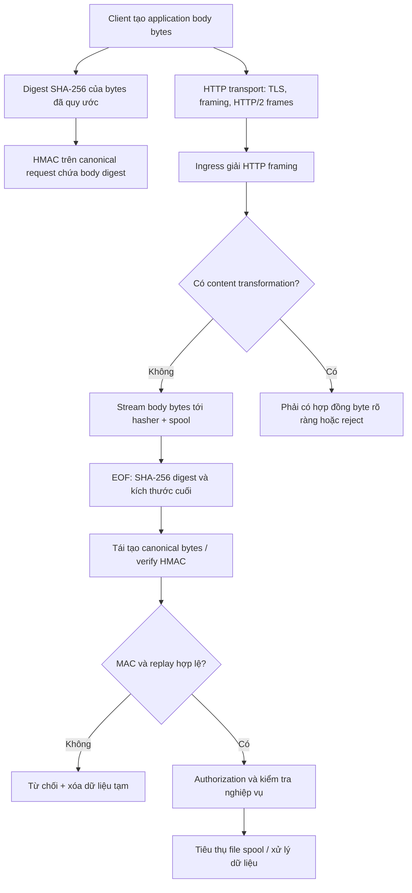
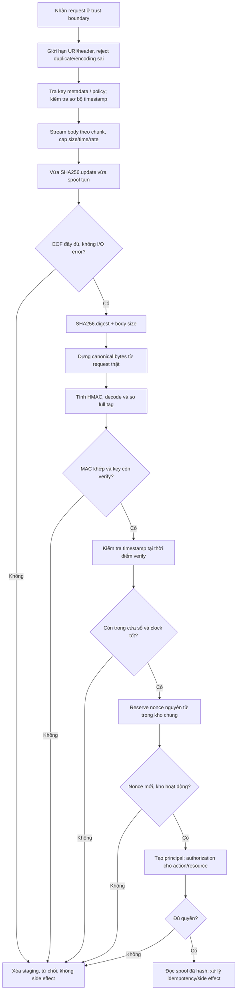

# Body streaming trong HMAC request authentication

## 1. Bài toán: ký một HTTP body không thể giữ toàn bộ trong RAM

Trong module `SECURITY_AUTHENTICATION_HMAC_REQUEST_AUTHENTICATION`, client và server dùng **shared secret** để tính HMAC trên **canonical request**. Canonical request có thể gồm HTTP method, raw URI/query, các signed headers, timestamp, nonce và **digest của HTTP body**. Sau khi xác minh chữ ký và chống replay, server mới tạo principal để kiểm tra **authorization** trên hành động, tenant và tài nguyên thực tế.

Với request JSON vài kilobyte, lập trình viên thường đọc toàn bộ body vào `byte[]` rồi gọi `MessageDigest.digest(body)`. Nhưng upload tài liệu, webhook đính kèm hoặc batch ingest có thể lớn hàng chục hay hàng trăm megabyte. Đọc toàn bộ vào RAM tạo áp lực heap/GC, tăng khả năng quá tải và dễ mở đường tấn công cạn kiệt tài nguyên. **Body streaming** giải quyết phần **xử lý byte body theo từng chunk** để tính digest với bộ nhớ có giới hạn.

Ví dụ một client gửi:

```http
POST /v1/uploads?kind=invoice HTTP/1.1
Host: api.example.test
Content-Type: application/octet-stream
X-HMAC-Key-Id: partner-17:v5
X-HMAC-Timestamp: 1795838400
X-HMAC-Nonce: 9fc41749ac56ccfd4589b032779f6aee
X-HMAC-Signature: <base64-full-hmac-tag>

<binary-body>
```

Chữ ký ở header được tính từ canonical request đã chứa hash của **toàn bộ body**. Server phải đọc cho tới khi kết thúc body, tự tính digest rồi mới có đủ dữ liệu để kiểm tra HMAC. Khi dữ liệu đang chảy đến, **những chunk đã nhận chưa được xác thực cuối cùng**.

> **Điểm cốt lõi:** Streaming cho phép **tính hash dần dần**, nhưng **không có nghĩa mỗi chunk tự trở nên đáng tin cậy trước khi full-request signature khớp**. Với HMAC trên digest toàn body, không được thực thi side effect, phân quyền theo dữ liệu chưa kiểm chứng hoặc chuyển dữ liệu chưa xác thực sang hệ thống có tác động không thể thu hồi.

Bài **“Body streaming”**, thuộc chương **“Body canonicalization”**, tập trung vào ranh giới byte được ký, cách tính digest tăng dần, xử lý body một lần, giới hạn tài nguyên, xác minh trước khi cho nghiệp vụ sử dụng, và các lỗi khi proxy/gateway chuyển đổi nội dung. Bài dùng Java 17+ để minh họa hai lớp: **capture/hash theo dòng dữ liệu** và **tạo/xác minh HMAC từ metadata của body**.

### Mục tiêu học tập

Sau bài này, bạn có thể:

1. Phân biệt **HTTP framing**, **Content-Encoding**, **raw body bytes tại điểm ký**, **body digest** và **HMAC request signature**.
2. Tính SHA-256 của body theo nhiều chunk mà vẫn ra digest như băm một `byte[]` liên tục.
3. Thiết kế **spool an toàn** vào vùng lưu trữ tạm được kiểm soát để downstream đọc lại **chính những byte đã hash**.
4. Giới hạn kích thước, thời gian, tốc độ, số request đồng thời, dung lượng đĩa và xử lý disconnect/cancellation.
5. Giải thích vì sao timestamp/nonce phải được bảo vệ bằng HMAC và vì sao kiểm tra replay chỉ hoàn tất sau khi MAC hợp lệ.
6. Kiểm thử chuyển đổi HTTP/1.1 chunked, HTTP/2, gzip, multipart, JSON UTF-8 và lỗi proxy.
7. Phân biệt authentication bằng HMAC với authorization và idempotency nghiệp vụ.

## 2. Những lớp byte nào là “body” được ký?

Câu hỏi “ký body” chưa đủ cụ thể. Cần nói rõ **chuỗi byte nào** tạo digest. Trên đường truyền, request có thể trải qua TLS, HTTP framing, content coding, gateway rewrite, bộ lọc middleware và parser nghiệp vụ.



### 2.1 Framing của HTTP khác content bytes

- **HTTP/1.1 `Transfer-Encoding: chunked`** mô tả cách đóng khung body trên kết nối. Dòng kích thước chunk, `CRLF` và dấu kết thúc chunk **không thuộc dữ liệu application body** mà HTTP adapter thông thường trả về sau khi parse framing.
- **HTTP/2** dùng các DATA frames và luồng (stream) của protocol. Ranh giới DATA frame **không nên ảnh hưởng digest body** khi bộ xử lý đã lấy cùng dãy application bytes.
- **`Content-Length`** là metadata framing (khi có); không phải nguồn tin duy nhất về số byte sẽ nhận. Với chunked hoặc HTTP/2 có thể không có Content-Length giống HTTP/1.1. Phải đếm **byte thực đọc**.
- **`Content-Encoding: gzip`** biến đổi **representation bytes**, không phải HTTP transfer framing. Tùy framework, stream có thể là dữ liệu gzip ban đầu hoặc dữ liệu đã giải nén. Nếu hai phía hash khác representation, MAC sẽ không khớp.

**Contract minh họa trong bài:** ký **application body bytes sau khi HTTP framing được bóc ra**, nhưng **trước mọi Content-Encoding decoding**. Để tránh nhập nhằng, phiên bản mẫu yêu cầu **vắng mặt hoàn toàn header `Content-Encoding`**, kể cả `Content-Encoding: identity`; đương nhiên từ chối `gzip`, `br` hoặc encoding khác. Nếu hỗ trợ compression, phải mở rộng hợp đồng một cách tường minh: hash trước hay sau giải nén, thứ tự xử lý, giới hạn dung lượng nén/giải nén, và signed headers liên quan.

### 2.2 “Raw body bytes” không có nghĩa serialized JSON

Với các body sau:

```json
{"amount":100,"currency":"VND"}
```

và:

```json
{ "currency": "VND", "amount": 100 }
```

Hai tài liệu có thể biểu diễn cùng các trường JSON, nhưng **byte UTF-8 khác nhau** (khoảng trắng, thứ tự key), nên `SHA256(rawBodyBytes)` khác. Tương tự:

- `\n` và `\r\n` có byte khác nhau.
- Chuỗi tiếng Việt UTF-8 khác với JSON escape `\u....` dù parser có thể cho cùng giá trị.
- JSON có Unicode NFC/NFD có thể khác byte dù hiển thị gần giống.
- Body được serializer tạo lại sau khi parse thường **không bảo toàn byte** client đã ký.

Với **raw-byte signing**, lấy byte trước khi parse và **không format lại body để tính hash**. Nếu thực sự muốn ký semantic JSON thay cho byte gốc, phải áp dụng **JSON canonicalization scheme** có phiên bản và test vector riêng, không tự gọi `ObjectMapper.writeValueAsBytes` ở cả hai phía rồi coi đó là chuẩn mật mã.

### 2.3 Băm toàn body khác băm từng chunk rồi ghép hash

Cho body gồm ba byte ASCII `abc`, được nhận thành hai chunk `a` và `bc`:

```text
Cách đúng:
  digest.update("a")
  digest.update("bc")
  final = digest.digest()
  => SHA256("abc")

Cách sai nếu protocol yêu cầu SHA256(rawBodyBytes):
  SHA256("a") || SHA256("bc")
  SHA256(SHA256("a") || SHA256("bc"))
  SHA256("a") || SHA256("b") || SHA256("c")
```

`MessageDigest.update(...)` tiêu thụ các chunk **theo đúng thứ tự byte** và duy trì trạng thái hash. Ranh giới chunk là chi tiết của quá trình nhận, **không được ảnh hưởng kết quả**. Chỉ gọi `digest()` **một lần khi EOF đã xác nhận**. Nếu muốn một giao thức **chunk-level signing**, đó là thiết kế khác, cần thứ tự chunk, index, chaining, total length và quy tắc commit riêng.

## 3. Hai bài toán khác nhau: tính hash khi stream và giữ body cho nghiệp vụ

### 3.1 Có thể tính digest mà không buffer cả body

Với hash như SHA-256, không cần giữ toàn bộ bytes trong RAM. Ở mỗi lần đọc:

```text
while chunk = input.read():
    enforce_byte_limit(chunk.length)
    sha256.update(chunk)
digest = sha256.digest()    // chỉ tại EOF
```

Bộ nhớ cho `MessageDigest` và buffer có thể ở mức vài kilobyte, độc lập với tổng kích thước upload. Nhưng request chưa thể được xem là xác thực cho đến khi **chữ ký trên canonical chứa digest khớp**.

### 3.2 Vì sao thường cần spool dữ liệu tạm?

Nếu filter hoặc middleware đã đọc input stream để tính digest, controller **không thể mặc định đọc lại từ HTTP input stream**. Body có thể chỉ được truyền một lần. Có ba hướng thiết kế:

| Chiến lược | Khi phù hợp | Rủi ro cần xử lý |
| --- | --- | --- |
| **Memory buffer** có giới hạn nhỏ | JSON/body nhỏ với giới hạn chắc chắn | Heap/GC, nhân bộ nhớ khi nhiều request đồng thời, không phù hợp upload lớn. |
| **Spool vào file/vùng lưu trữ tạm** khi streaming | Upload lớn nhưng cần xác minh HMAC **trước** nghiệp vụ | Disk quota, quyền truy cập file, cleanup, encryption, backpressure, lỗi I/O. |
| **Staging storage cách ly** | Object upload lớn, cần lưu tạm vào hệ thống có trạng thái `UNVERIFIED` | Phải ngăn đọc/public/trigger job trước verify; xóa staging khi fail và bảo đảm tính bất biến của object. |

Cách thông dụng và dễ lý giải trong bài là **vừa hash vừa ghi spool** rồi **chỉ mở spool cho nghiệp vụ sau khi HMAC, timestamp và nonce đã hợp lệ**. Downstream phải dùng chính spool đã hash, không đọc lại một body khác rồi cho rằng nó tương đương.

### 3.3 Không được “stream thẳng vào DB” trước khi verify

Một thiết kế sai:

```text
Client -> request stream -> parse -> ghi DB/tạo chuyển tiền
                             |
                             +-> SHA256(body) -> verify HMAC tại EOF
```

Nếu HMAC sai, hệ thống đã có side effect. Rollback chỉ có thể giúp trong các transaction hoàn toàn nằm trong phạm vi có thể rollback; không thể giả định email, queue, external HTTP call, object public, thanh toán hay CDC đều được hoàn tác.

Thiết kế an toàn cho **full-body HMAC**:

```text
Client -> stream -> giới hạn + SHA256 + spool cách ly
                              |
                              +-> EOF + verify HMAC + nonce reserve
                                                  |
                                                  +-> principal/authorization
                                                                  |
                                                                  +-> dùng spool để xử lý
```

Không đẩy body trước vào dịch vụ phụ trợ có side effect dù dịch vụ đó “chỉ tạm xử lý” trừ khi có cơ chế staging **không thể quan sát/commit** trước xác minh, được chứng minh bằng thiết kế và test. Nếu yêu cầu xử lý từng chunk **trong lúc upload**, cần cân nhắc signed streaming/chunked protocol khác thay vì giả định HMAC cuối request bảo vệ từng chunk ngay lập tức.

## 4. Hợp đồng BODY-STREAM-V1: cách bind digest vào HMAC

Ta định nghĩa một giao thức mẫu tên `HMAC-REQUEST/BODY-STREAM-V1`. Đây là **hợp đồng giảng dạy** để minh họa streaming, không phải một chuẩn HMAC chung mặc định.

### 4.1 HTTP request minh họa

```http
POST /v1/uploads?kind=invoice HTTP/1.1
Host: api.example.test
Content-Type: application/octet-stream
X-HMAC-Key-Id: partner-17:v5
X-HMAC-Timestamp: 1795838400
X-HMAC-Nonce: 9fc41749ac56ccfd4589b032779f6aee
X-HMAC-Signature: <base64-hmac-sha256-full-tag>

abc
```

Trong ví dụ để dễ tự kiểm tra, **body thật là chính xác ba byte ASCII `61 62 63`** (`abc`), **không bao gồm newline** sau `c`. Dấu xuống dòng trong code block chỉ để trình bày; nếu request thật có `\n` ở cuối body, digest sẽ khác. Timestamp là dữ liệu minh họa, phải thay bằng thời điểm hiện hành khi chạy.

### 4.2 Những thành phần được ký

| Thành phần | Quy tắc BODY-STREAM-V1 |
| --- | --- |
| Method | `POST`, lấy ở HTTP ingress. |
| Request target | Raw origin-form path + raw query: `/v1/uploads?kind=invoice`; không parse rồi serialize lại. |
| Audience | Chuỗi cố định `ingest-api/prod`, đến từ metadata key/service. |
| Content-Type | Đúng một header `Content-Type`, canonical value chính xác `application/octet-stream`. |
| Content-Encoding | Header `Content-Encoding` phải **vắng mặt** trong phiên bản mẫu, kể cả khi khai `identity`, để tránh hai cách biểu diễn request. |
| Key ID | Header duy nhất `X-HMAC-Key-Id`, được đưa vào canonical; metadata server quyết định secret/algorithm/version. |
| Timestamp | `X-HMAC-Timestamp`, Unix epoch **seconds** dạng thập phân chuẩn, nằm trong HMAC. |
| Nonce | `X-HMAC-Nonce`, 16 byte ngẫu nhiên biểu diễn thành 32 hex lowercase, nằm trong HMAC. |
| Body bytes | Bytes được ứng dụng nhận **sau HTTP transfer framing**, chưa qua Content-Encoding/JSON transform. |
| Body size | Tổng số byte **thực đọc** đến EOF, biểu diễn số thập phân trong canonical, không tin Content-Length làm nguồn duy nhất. |
| Body digest | **SHA-256(rawBodyBytes)**, hex lowercase 64 ký tự, tính incremental. |
| HMAC | HMAC-SHA256 trên toàn canonical UTF-8, full tag 32 byte. |
| Chữ ký HTTP | Base64 chuẩn có padding, 44 ký tự; không newline và không rút ngắn tag. |
| Phân cách canonical | Mỗi dòng bằng `LF`, **không có LF cuối**. |

**Không ký trực tiếp Content-Length hoặc từng HTTP chunk size** trong hợp đồng mẫu, vì các đặc tính framing có thể thay đổi khi đi qua proxy mà application body bytes giữ nguyên. Thay vào đó **`body-size` được server đếm** và nằm trong HMAC. Cần kiểm tra framing theo HTTP parser để chống Content-Length/Transfer-Encoding ambiguity hoặc request smuggling; việc không ký framing không có nghĩa framing không quan trọng.

### 4.3 Canonical request chính xác 11 dòng

```text
HMAC-REQUEST/BODY-STREAM-V1
HMAC-SHA256
POST
/v1/uploads?kind=invoice
audience:ingest-api/prod
content-type:application/octet-stream
x-hmac-key-id:partner-17:v5
x-hmac-timestamp:1795838400
x-hmac-nonce:9fc41749ac56ccfd4589b032779f6aee
body-size:3
body-sha256:ba7816bf8f01cfea414140de5dae2223b00361a396177a9cb410ff61f20015ad
```

`ba7816bf...15ad` là **SHA-256 của đúng ba byte `abc`**. Nó **không phải MAC**; HMAC còn cần shared secret và tất cả dòng khác. Trong hợp đồng này, body size được lấy từ **counter của reader** và body hash được tính từ **cùng bytes**. Nếu client nói size bằng 3 trong header nhưng gửi thật 4 byte, server không dùng giá trị khai báo thay vì counter; MAC sẽ không khớp khi canonical khác.

Các bước:

```text
rawBodyBytes       = bytes sau HTTP framing
bodySize           = count(rawBodyBytes)
bodyHash           = lowercaseHex(SHA256(rawBodyBytes))
canonicalRequest   = joinWithLF(11_lines, noTrailingLF)
canonicalBytes     = UTF8(canonicalRequest)
macBytes           = HMAC_SHA256(secretBytes, canonicalBytes)
signatureHeader    = Base64StandardWithPadding(macBytes)
```

Bên server phải **tự dựng canonical bytes**, không nhận một chuỗi canonical do client gửi rồi tin ngay. Nếu body rỗng, size là `0`, SHA-256 digest chuẩn là:

```text
e3b0c44298fc1c149afbf4c8996fb92427ae41e4649b934ca495991b7852b855
```

Dù body rỗng, cần kiểm tra endpoint có cho phép body rỗng không. Có digest rỗng hợp lệ **không tự cho phép** gửi thiếu dữ liệu nghiệp vụ.

## 5. Luồng xác minh an toàn khi body đang streaming

Quá trình xác minh nên được chia thành **preflight có thể thực hiện sớm**, **capture đến EOF**, **kiểm tra HMAC**, **chống replay** và **quyết định nghiệp vụ**.



### 5.1 Điều gì có thể kiểm tra trước khi body kết thúc?

Có thể **từ chối sớm**:

- Method/route không được hỗ trợ, thiếu header bắt buộc, duplicate signed headers, định dạng signature sai.
- Key ID không tồn tại hoặc key không được phép verify theo chính sách server (trả lỗi bên ngoài không tiết lộ sự tồn tại của key).
- `Content-Encoding` bị cấm, Content-Type không đúng hợp đồng, `Content-Length` khai báo vượt quota.
- Timestamp **rõ ràng nằm ngoài cửa sổ** theo đồng hồ server đang đáng tin cậy.

Nhưng giá trị trong header do client gửi **chưa được HMAC xác minh**; **không được tạo principal hay thực hiện side effect** chỉ vì đã qua những kiểm tra sớm này.

### 5.2 Khi nào kiểm tra timestamp với upload dài?

Với request streaming, phải xác định **mốc kiểm tra thời gian**:

- **Kiểm tra sơ bộ lúc nhận headers** có thể tiết kiệm tài nguyên trước upload.
- **Kiểm tra lại tại thời điểm đã nhận đủ body và tính HMAC** giúp đảm bảo timestamp vẫn nằm trong cửa sổ chấp nhận trước khi commit.

Nếu upload mất 15 phút nhưng policy chỉ cho request cũ 5 phút, request có thể bị từ chối ở cuối dù timestamp hợp lệ lúc bắt đầu. Không nên nới cửa sổ tùy ý cho một client; hãy **giới hạn tổng upload duration**, phân nhóm endpoint có policy phù hợp được đánh giá, hoặc thiết kế resumable/chunk-signing protocol có định nghĩa replay riêng.

Không đơn giản thay header timestamp bằng giờ server ở EOF vì đó là **giá trị đã được client ký**. Server dùng thời gian hiện hành cho việc xác minh và vận hành, không được sửa nội dung client ký.

### 5.3 Nonce đặt sau verify, không đặt trước upload tùy tiện

Nếu cấp “quyền sử dụng nonce” từ lúc chỉ nhận headers, attacker có thể gửi hàng loạt request với signature giả, làm đầy kho nonce. Mẫu phổ biến là **verify MAC trước, reserve nonce sau**. Điều này đặt ra yêu cầu lưu spool an toàn trong thời gian chưa biết signature đúng; vì thế phải có quota và admission control để ngăn upload giả gây đầy đĩa.

Nếu muốn reserve một nonce trước upload để chặn request cùng lúc, phải thiết kế một cơ chế **reservation/pending** riêng, gắn với key/challenge và làm rõ hành vi khi abort, retry, hết hạn; không được bỏ qua kiểm tra HMAC cuối.

## 6. Java 17+: tính body digest tăng dần và spool một lần

Ví dụ sau dùng **JDK 17**, `InputStream` dạng blocking và một thư mục staging **do server cấu hình và kiểm soát**. Trong hệ thống production, quota tổng, directory permissions, encryption-at-rest, process isolation, deadline và cleanup khi crash cần triển khai ở hạ tầng hoặc wrapper thích hợp.

### 6.1 Capture body với bounded buffer

```java
import java.io.IOException;
import java.io.InputStream;
import java.io.OutputStream;
import java.nio.file.Files;
import java.nio.file.Path;
import java.nio.file.StandardOpenOption;
import java.security.MessageDigest;
import java.security.NoSuchAlgorithmException;
import java.util.HexFormat;
import java.util.Objects;

public final class BodyStreamCapture {
    private static final int BUFFER_BYTES = 8192;

    private BodyStreamCapture() {}

    public record CapturedBody(
            Path file,
            long size,
            String sha256Hex) implements AutoCloseable {

        @Override
        public void close() throws IOException {
            // Caller phải đóng khi reject, complete hoặc hủy request.
            Files.deleteIfExists(file);
        }
    }

    /**
     * source: HTTP application body bytes sau khi tầng HTTP bóc framing.
     * source không bị đóng ở đây: HTTP adapter quản lý vòng đời stream.
     * spoolDir: private directory, không nằm trong public document root.
     */
    public static CapturedBody capture(
            InputStream source,
            Path spoolDir,
            long maxBodyBytes) throws IOException {

        Objects.requireNonNull(source, "source");
        Objects.requireNonNull(spoolDir, "spoolDir");
        if (maxBodyBytes < 0) {
            throw new IllegalArgumentException("Invalid maxBodyBytes");
        }

        final MessageDigest sha256;
        try {
            sha256 = MessageDigest.getInstance("SHA-256");
        } catch (NoSuchAlgorithmException ex) {
            throw new IllegalStateException("SHA-256 unavailable", ex);
        }

        // createTempFile tạo file tên khó đoán mới; thư mục phải private.
        Path spoolFile =
                Files.createTempFile(spoolDir, "hmac-body-", ".tmp");
        boolean completed = false;
        long total = 0L;

        try {
            try (OutputStream out = Files.newOutputStream(
                    spoolFile, StandardOpenOption.WRITE)) {
                byte[] buffer = new byte[BUFFER_BYTES];
                while (true) {
                    int n = source.read(buffer);
                    if (n == -1) break; // EOF thật từ HTTP adapter
                    if (n == 0) {
                        // Chặn spin nếu một InputStream bất thường trả 0.
                        throw new IOException("Unexpected zero-length read");
                    }

                    // Tránh overflow: total luôn <= maxBodyBytes.
                    if (n > maxBodyBytes - total) {
                        throw new IOException("Body exceeds configured limit");
                    }

                    out.write(buffer, 0, n);
                    sha256.update(buffer, 0, n);
                    total += n;
                }
            } // Phải close/flush spool thành công mới trả kết quả.

            String digestHex =
                    HexFormat.of().formatHex(sha256.digest());
            completed = true;
            return new CapturedBody(spoolFile, total, digestHex);
        } finally {
            if (!completed) {
                // Request sai size, disconnect, lỗi disk hoặc close:
                // tuyệt đối không để bản staging không được xác thực tồn tại.
                Files.deleteIfExists(spoolFile);
            }
        }
    }
}
```

**Giải thích kỹ thuật:**

1. `MessageDigest.update(buffer, 0, n)` nhận đúng **`n` byte đã được ghi spool**, theo đúng thứ tự xuất hiện; digest cuối không phụ thuộc cách network chia chunk.
2. `total` được tăng sau khi qua kiểm tra `maxBodyBytes`; cách tính `n > maxBodyBytes - total` tránh tràn số khi cộng tổng quá lớn.
3. `Files.createTempFile` tạo tên file mới, hạn chế nguy cơ đè file cũ. **Chưa đủ để bảo mật** nếu `spoolDir` public, world-writable hoặc file quyền đọc quá rộng; phải cấu hình private directory, quota và permissions thích hợp.
4. `captured.close()` là bước dọn staging; caller nên dùng `try-with-resources` để xóa file khi signature/replay/authorization sai hay khi nghiệp vụ hoàn tất.
5. Khi crash/power loss, `finally` không chạy. Cần cơ chế quét file stale theo thời gian tuổi và trạng thái request, không xóa file đang được một request hợp lệ xử lý.
6. Khi body vượt quota, HTTP adapter/gateway cần **abort/close hoặc xử lý an toàn phần còn lại** theo HTTP server implementation; không cố đọc vô hạn để “drain” attacker. Mã ví dụ ném `IOException`; API production cần ánh xạ riêng thành `413 Payload Too Large` và cleanup/connection policy đúng.
7. `InputStream` là **blocking**: ví dụ này không nên chạy trực tiếp trên event-loop của Netty/WebFlux. Với reactive pipeline, cần cập nhật digest từng `DataBuffer`, spool theo cơ chế backpressure và giải phóng buffer đúng lifecycle, không `collectList()` toàn bộ upload.

### 6.2 Một body có thể chia thành bao nhiêu chunk cũng cho cùng digest

```java
import java.nio.charset.StandardCharsets;
import java.security.MessageDigest;
import java.util.HexFormat;

MessageDigest first = MessageDigest.getInstance("SHA-256");
first.update("abc".getBytes(StandardCharsets.US_ASCII));

MessageDigest second = MessageDigest.getInstance("SHA-256");
second.update("a".getBytes(StandardCharsets.US_ASCII));
second.update("b".getBytes(StandardCharsets.US_ASCII));
second.update("c".getBytes(StandardCharsets.US_ASCII));

String whole = HexFormat.of().formatHex(first.digest());
String split = HexFormat.of().formatHex(second.digest());

String expected =
        "ba7816bf8f01cfea414140de5dae2223"
      + "b00361a396177a9cb410ff61f20015ad";
if (!expected.equals(whole) || !whole.equals(split)) {
    throw new AssertionError("SHA-256 stream split mismatch");
}
```

Đây là **known vector SHA-256 của `abc`**. Test này chỉ xác minh tính bất biến theo ranh giới chunk của **body digest**, chưa kiểm tra HMAC hay canonical URI/headers.

### 6.3 Body rỗng vẫn cần được hash

```java
byte[] noBody = new byte[0];
String emptyDigest = java.util.HexFormat.of().formatHex(
        java.security.MessageDigest.getInstance("SHA-256")
                .digest(noBody));

if (!emptyDigest.equals(
        "e3b0c44298fc1c149afbf4c8996fb92427ae41e4649b934ca495991b7852b855")) {
    throw new AssertionError("Unexpected empty-body digest");
}
```

Một số request không có body và một số request có body rỗng có thể cùng 0 byte, cho digest giống nhau. Nếu endpoint cần phân biệt “body không hiện diện” với “zero-length body”, phải định nghĩa rõ chính sách ở tầng HTTP/route, thay vì coi SHA-256 của mảng rỗng là bằng chứng request có payload hợp lệ.

## 7. Java 17+: đưa body digest + size vào canonical request và xác minh HMAC

Phần này xử lý **metadata đã được capture** thay vì đọc lại body để tính hash. Hợp đồng `BODY-STREAM-V1` tạo đúng **11 dòng**, trong đó `body-size` và `body-sha256` đến từ `CapturedBody` do server tự tính.

### 7.1 Canonical builder và HMAC verifier

```java
import java.nio.charset.StandardCharsets;
import java.security.GeneralSecurityException;
import java.security.MessageDigest;
import java.util.Base64;
import java.util.Objects;
import javax.crypto.Mac;
import javax.crypto.SecretKey;

public final class BodyStreamHmacV1 {
    private BodyStreamHmacV1() {}

    public static byte[] canonicalBytes(
            String method,
            String rawTarget,
            String audience,
            String contentType,
            String keyId,
            String timestamp,
            String nonce,
            BodyStreamCapture.CapturedBody body) {

        Objects.requireNonNull(body, "body");
        if (!"POST".equals(method)
                || rawTarget == null || !rawTarget.startsWith("/")
                || rawTarget.length() > 4096
                || rawTarget.chars().anyMatch(
                        c -> c < 0x21 || c > 0x7e
                             || c == '#' || c == '\\')
                || !"ingest-api/prod".equals(audience)
                || !"application/octet-stream".equals(contentType)
                || keyId == null
                || !keyId.matches("[A-Za-z0-9._:-]{1,100}")
                || timestamp == null
                || !timestamp.matches("(0|[1-9][0-9]{0,11})")
                || nonce == null || !nonce.matches("[0-9a-f]{32}")
                || body.size() < 0
                || body.sha256Hex() == null
                || !body.sha256Hex().matches("[0-9a-f]{64}")) {
            throw new IllegalArgumentException("Invalid signed fields");
        }

        String canonical = String.join("\n",
                "HMAC-REQUEST/BODY-STREAM-V1",
                "HMAC-SHA256",
                method,
                rawTarget,
                "audience:" + audience,
                "content-type:" + contentType,
                "x-hmac-key-id:" + keyId,
                "x-hmac-timestamp:" + timestamp,
                "x-hmac-nonce:" + nonce,
                "body-size:" + body.size(),
                "body-sha256:" + body.sha256Hex());
        return canonical.getBytes(StandardCharsets.UTF_8);
    }

    public static boolean verifyFullBase64(
            SecretKey key, byte[] canonicalBytes, String signatureText) {

        Objects.requireNonNull(key, "key");
        Objects.requireNonNull(canonicalBytes, "canonicalBytes");
        if (signatureText == null || signatureText.length() != 44) {
            return false;
        }

        final byte[] received;
        try {
            received = Base64.getDecoder().decode(signatureText);
        } catch (IllegalArgumentException ex) {
            return false;
        }
        if (received.length != 32
                || !Base64.getEncoder().encodeToString(received)
                    .equals(signatureText)) {
            // Full HMAC-SHA256: đúng 32 bytes, Base64 chuẩn có padding.
            return false;
        }

        final byte[] expected;
        try {
            Mac mac = Mac.getInstance("HmacSHA256");
            mac.init(key);
            expected = mac.doFinal(canonicalBytes);
        } catch (GeneralSecurityException ex) {
            throw new IllegalStateException("HMAC provider/key error", ex);
        }
        return MessageDigest.isEqual(expected, received);
    }
}
```

**Quan trọng:**

- `SecretKey` phải được tìm từ **server-side key metadata** (secret manager/HSM hoặc provider phù hợp), không từ client. Metadata còn ràng buộc `keyId → algorithm HmacSHA256, canonicalVersion BODY-STREAM-V1, audience ingest-api/prod, trạng thái verify, principal`.
- `canonicalBytes` chỉ kiểm tra **một số cấu trúc chuỗi**. HTTP adapter phải kiểm tra header trùng, raw URI đúng origin-form, percent-encoding và query semantics, body encoding và limits. Nếu key/version sai, phải từ chối theo policy; **không thử nhiều canonical format/algorithm**.
- `verifyFullBase64` so HMAC **sau khi strict decode** Base64 chuẩn. `MessageDigest.isEqual` phù hợp hơn vòng lặp thoát ngay khi gặp byte khác nhau. Không cần và không được gửi secret cho server trong request.
- `Content-Type` được đưa vào canonical vì nó ảnh hưởng cách downstream hiểu bytes. Nếu endpoint có signed `Content-Disposition`, `Content-Encoding` hoặc `Idempotency-Key`, chúng phải được định nghĩa trong **phiên bản hợp đồng tương ứng**, không tự bỏ qua khi có ý nghĩa bảo mật.

### 7.2 HTTP authentication pipeline với spool

```java
// Pseudocode: RawRequest, KeyMetadata, services là abstraction
// của hệ thống, không phải API có sẵn của JDK.
RawRequest request = adapter.readValidatedHeadersAndTarget(httpRequest);

if (request.hasDuplicateSecurityHeaders()
        || request.hasContentEncoding()
        || !request.contentType().equals("application/octet-stream")) {
    rejectMalformed();
    return;
}

Instant preflightNow = clock.instant();
KeyMetadata key = keyStore.lookupForVerification(
        request.keyId(), "BODY-STREAM-V1", preflightNow);
if (key == null || !key.canVerify(preflightNow)) {
    rejectUnauthenticated();
    return;
}

// Preflight timestamp chỉ dùng từ chối sớm, KHÔNG tạo principal.
if (!timestampPolicy.passesPreflight(
        request.timestamp(), preflightNow)) {
    rejectUnauthenticated();
    return;
}

// spoolDirectory thuộc vùng an toàn, không public.
// maxBytes + upload deadline + quota đồng thời do hạ tầng kiểm soát.
try (BodyStreamCapture.CapturedBody body =
        BodyStreamCapture.capture(
                request.bodyStream(), spoolDirectory, maxBytes)) {

    byte[] canonical = BodyStreamHmacV1.canonicalBytes(
            request.method(), request.rawTarget(),
            "ingest-api/prod", request.contentType(),
            request.keyId(), request.timestamp(), request.nonce(), body);

    if (!BodyStreamHmacV1.verifyFullBase64(
            key.secret(), canonical, request.signatureBase64())) {
        rejectUnauthenticated();
        return;
    }

    // EOF đã xảy ra; đánh giá lại timestamp/key validity ở thời điểm verify.
    Instant verifiedAt = clock.instant();
    if (!clockHealth.isHealthy()
            || !keyStore.stillAllowed(key.id(), verifiedAt)
            || !timestampPolicy.accepts(request.timestamp(), verifiedAt)) {
        rejectUnauthenticated();
        return;
    }

    // Atomic nonce reserve, kho dùng chung mọi replica; lỗi => fail-closed.
    if (!nonceStore.reserve(key.id(), request.nonce(), nonceTtlSeconds)) {
        rejectReplay();
        return;
    }

    AuthenticatedPrincipal principal = identity.fromVerifiedKey(key);
    if (!authorization.canUpload(
            principal, request.tenantId(), request.targetResource())) {
        rejectForbidden();
        return;
    }

    // Đọc đúng file đã hash; chưa dùng body ở trước bước này.
    try (InputStream verifiedBody = Files.newInputStream(body.file())) {
        ingestService.ingestVerified(
                principal, verifiedBody, body.size());
    }
}  // Tự xóa file staging kể cả khi reject/exception.
```

Các thành phần ngoài JDK trong đoạn pseudocode chỉ minh họa cách phối hợp. Trong production, cần phân biệt **nonce trùng** với **lỗi kết nối kho nonce** (fail-closed, ví dụ 503), ánh xạ **body vượt quota** thành 413, kiểm tra **upload timeout/đứt mạng**, và quản lý transaction/idempotency phù hợp. Phương thức `ingestVerified` ở đây **không nhận Idempotency-Key từ client** vì BODY-STREAM-V1 chưa ký header này. Nếu `Idempotency-Key` ảnh hưởng hành vi, đưa nó vào **hợp đồng ký phiên bản mới** hoặc không cho header đó ở BODY-STREAM-V1 mẫu; không đọc một header chưa ký để quyết định hiệu ứng bảo mật.

### 7.3 Bất biến byte giữa hash và xử lý là yêu cầu bảo mật

Spool file là vật lưu byte tạm **chưa xác thực**. Dù digest và HMAC đã khớp, nếu một actor khác có thể sửa file sau xác minh rồi trước khi downstream đọc, đó là lỗi **TOCTOU** (time-of-check to time-of-use). Do đó:

- File staging phải nằm trong thư mục riêng không cho client/process khác ghi; không expose URL/path file cho người ngoài.
- Chỉ cung cấp handle đã kiểm soát hoặc snapshot bất biến cho downstream; hạn chế quyền sửa sau capture.
- Nếu chuyển thành object storage, gắn object/version/ETag bất biến và bảo đảm backend đọc **đúng object version đã xác minh**; không chỉ đọc lại object key có thể bị overwrite.
- Nếu phải copy hoặc move file sang hệ thống khác, bảo đảm quá trình chuyển không bị thay byte hoặc xác minh lại digest tại điểm commit theo chính sách.
- Xóa tệp tạm sau khi hoàn tất, thất bại hoặc hết hạn; không dùng spool làm nguồn lưu vĩnh viễn cho dữ liệu chưa xác thực.

## 8. Tài nguyên và khả năng chống DoS khi streaming

Streaming giảm **peak memory**, nhưng có thể làm tăng áp lực **disk/network/socket/concurrency**. Kẻ không biết secret vẫn có thể mở nhiều kết nối, gửi body lớn chậm, buộc server hash và spool trước khi cuối cùng bị từ chối do MAC sai.

### 8.1 Những giới hạn phải được kiểm soát

| Kiểm soát | Mục đích | Ghi chú |
| --- | --- | --- |
| **Max body bytes** | Chặn upload quá lớn | Đếm byte thực đọc; Content-Length chỉ hỗ trợ reject sớm, không thay stream counter. |
| **Max concurrent uploads** | Chặn quá nhiều spool cùng lúc | Semaphore/admission control theo instance, tenant/key và giới hạn hạ tầng. |
| **Total spool quota** | Ngăn đầy disk hoặc chiếm hết vùng tạm | Quota theo request/client và toàn service; dự phòng cleanup khi crash. |
| **Upload deadline** | Chặn body chảy quá lâu | Deadline tổng, read idle timeout và chính sách terminate connection. |
| **Minimum useful transfer rate** | Giảm tác động slowloris | Cân nhắc mạng yếu hợp lệ, không nhất thiết áp một ngưỡng cứng cho mọi client. |
| **Buffer size** | Giới hạn bộ nhớ khi hash/read | 8–64 KiB thường là điểm khởi đầu để benchmark; không cần buffer bằng body size. |
| **Backpressure** | Tránh producer nhanh hơn disk/consumer | Với reactive stream, chỉ request thêm chunk khi downstream đủ khả năng lưu. |
| **CPU/hash quota** | Giảm chi phí tính hash vô ích | Rate limit, admission theo authenticated key khi có thể; không coi keyId chưa verify là danh tính đáng tin. |
| **Staging cleanup** | Tránh file treo sau abort/crash | Dọn theo tuổi + trạng thái an toàn, không xóa upload còn hoạt động. |
| **Disk error handling** | Tránh partial body bị coi là hoàn chỉnh | Fail-closed, xóa staging, metric; không tự dùng digest tính dở. |

Giới hạn memory của hashing không đồng nghĩa **constant overall resource**: nếu nhiều request đồng thời mỗi request spool 100 MiB, đĩa vẫn có thể bị tiêu thụ nhanh. Thiết kế cân bằng mạng, CPU, đĩa và số kết nối; theo dõi số byte đang staging, tốc độ flush, lỗi I/O và queue depth.

### 8.2 EOF, Content-Length và incomplete body

Một body được coi là hoàn chỉnh khi HTTP adapter xác nhận **kết thúc stream hợp lệ theo framing**. Nếu kết nối bị reset giữa chừng hoặc có `Content-Length` không đủ byte, không được lấy `-1` giả và xem phần đã nhận là body hoàn chỉnh. Hợp đồng framing không khớp phải được HTTP server phát hiện; bộ capture chỉ dùng kết quả **đã xác nhận hợp lệ** từ adapter.

Nếu HTTP server có thể trả `EOF` cho một request bị cắt mà không báo framing error, việc tính digest trên phần bị cắt có thể tạo tình huống ngữ nghĩa khác với request client dự định. Vì vậy nên đảm bảo **HTTP parser/frame validation trước và trong streaming**, không chỉ dựa vào `InputStream` ở mức ứng dụng.

### 8.3 Reactive streaming / WebFlux / Netty

Với reactive API:

```text
publisher<DataBuffer>
  -> giới hạn byte + deadline + backpressure
  -> cập nhật MessageDigest (đúng thứ tự)
  -> spool/capture durable
  -> onComplete: finalize digest -> verify HMAC -> authorization
  -> replay verified data cho nghiệp vụ
  -> onError/onCancel: cleanup, fail-closed
```

Không viết `collectList()` mọi `DataBuffer` rồi ghép thành một `byte[]` nếu mục tiêu là streaming bộ nhớ giới hạn. Một `DataBuffer` có thể được pooling; không giữ reference qua xử lý bất đồng bộ mà không tuân thủ retain/release. Khi nguồn và spool dùng thread khác nhau, phải bảo đảm **thứ tự byte** và **không gọi `MessageDigest.update` đồng thời từ nhiều thread**. Nếu fan-out chunk để xử lý song song, cần serialize pipeline hash hoặc dùng thuật toán/chunk-signing protocol được thiết kế riêng.

## 9. Proxy/gateway, compression và các kiểu body đặc biệt

### 9.1 HTTP/1.1 chunked và HTTP/2 DATA frames

Client có thể gửi cùng bytes `abc` theo nhiều cách:

```text
HTTP/1.1 Content-Length: 3       -> application bytes: 61 62 63
HTTP/1.1 Transfer-Encoding: chunked
    chunks "a" + "bc"            -> application bytes: 61 62 63
HTTP/2 DATA frames "a" + "bc"     -> application bytes: 61 62 63
```

Nếu hợp đồng ký **application body bytes sau framing**, cả ba cho **SHA256("abc") giống nhau**. Server không được hash cả dòng chunk-size hay header framing nếu hợp đồng không ký chúng. Tuy nhiên proxy HTTP phải chống framing ambiguity, nhất là khi `Content-Length` và `Transfer-Encoding` mâu thuẫn; không bỏ qua HTTP request smuggling chỉ vì HMAC đã được triển khai.

### 9.2 Content-Encoding gzip và decompression bomb

Với gzip, người gửi có thể tạo **nhiều gzip byte streams khác nhau** cùng giải nén thành một JSON. Nếu client hash gzip bytes nhưng gateway giải nén trước khi verifier, HMAC sai. Nếu client hash uncompressed JSON mà backend hash gzip bytes, HMAC cũng sai.

Một hệ thống hỗ trợ gzip phải định nghĩa:

- Giá trị `Content-Encoding` được ký hoặc ràng buộc ra sao.
- Digest áp dụng lên **compressed representation** hay **uncompressed representation**.
- Ai giải nén, tại điểm nào, có kiểm tra checksum/stream corruption không.
- Giới hạn cho **compressed bytes, decompressed bytes và tỷ lệ nén** để tránh decompression bomb.
- Downstream sẽ dùng đúng dữ liệu đã được xác minh theo hợp đồng hay có bước biến đổi được kiểm soát.

**BODY-STREAM-V1 cấm Content-Encoding** để tránh thêm ngữ nghĩa này. Đừng âm thầm bật gzip trong gateway rồi nghĩ SHA-256 tự hiểu body sau biến đổi.

### 9.3 Multipart/form-data

Multipart body chứa **boundary, per-part headers và nội dung từng part**. Nếu ký raw body, boundary ngẫu nhiên và `CRLF` trong multipart đều góp phần vào digest. Cùng file upload nhưng boundary khác sẽ có SHA-256 raw body khác; đó là điều bình thường.

Nếu muốn ký từng part theo semantic (ví dụ file SHA-256 + metadata fields), phải tạo protocol mới quy định thứ tự part, duplicate fields, filename encoding, header normalization, multipart boundaries và data integrity. Không parse multipart rồi tự serialize lại mà mong HMAC raw-body vẫn khớp.

### 9.4 JSON, XML, newline và charset

- **JSON:** thay whitespace/thứ tự field/escaping làm đổi raw body bytes. Hãy hash trước parse.
- **XML:** namespace, encoding, canonical XML cần protocol riêng nếu ký semantic.
- **Text:** newline `LF`/`CRLF` và BOM UTF-8 là bytes thật; không tự normalize.
- **Charset:** `Content-Type` ảnh hưởng cách diễn giải data; ký header hoặc ràng buộc parser theo policy.
- **Payload rỗng:** SHA-256 của zero bytes là digest cố định; phải áp dụng rule endpoint về việc cho body rỗng.

### 9.5 Gateway verify rồi forward body

Nếu gateway là nơi xác minh HMAC và có nhiệm vụ stream vào backend:

- Gateway phải **capture đủ body và verify trước khi cho backend tiêu thụ như dữ liệu tin cậy**, hoặc dùng staging không thể commit/public trước verify.
- Gateway xóa header identity do Internet tự gửi, tạo authenticated principal context và bảo vệ kết nối nội bộ (ví dụ mTLS).
- Backend vẫn **authorization** theo action/tenant/resource thực tế, không chỉ tin `X-Verified-Client` bất kỳ.
- Nếu gateway đã xác minh body bytes A nhưng backend lại nhận body bytes B sau transform, phải có quy tắc rõ ràng chứng minh nội dung mà backend thực thi tương đương hoặc được xác thực lại. Không dùng lời khẳng định “gateway verified” để bỏ qua bất nhất dữ liệu.

## 10. Timestamp, nonce, key rotation và authorization trong luồng streaming

### 10.1 Streaming không tự chống replay

Một upload `abc` với digest đúng và HMAC hợp lệ vẫn có thể được gửi lại nguyên vẹn. Client cần ký timestamp và nonce; server cần kiểm tra thời gian bằng clock đáng tin và **reserve nonce nguyên tử sau MAC**:

```redis
SET hmac:nonce:partner-17:v5:9fc41749ac56ccfd4589b032779f6aee 1 NX EX 630
```

`NX` bảo đảm nonce mới trong kho dùng chung, `EX` gắn TTL cùng thao tác. Nếu policy timestamp đối xứng ±300 giây, lifetime timestamp tối đa từ lần chấp nhận sớm nhất đến hết hiệu lực có thể đến **600 giây**; `630` chỉ là ví dụ có dự phòng, phải tính thêm clock skew/độ trễ thực tế. Nếu nonce store lỗi, **fail-closed**; không cho qua upload HMAC đúng chỉ vì “đang không kết nối Redis”.

Với upload dài, kiểm tra lại timestamp ở **thời điểm hoàn tất body/verify** như policy đã công bố. Nonce TTL được chọn dựa trên cửa sổ chấp nhận và giả định đồng hồ, không dựa vào `Content-Length` hay thời gian stream vừa trôi qua một cách tùy tiện.

### 10.2 Key rotation giữa lúc upload

Nếu key bị **revoke trong lúc body đang upload**, server không được giữ quyền verify chỉ vì key hợp lệ khi headers mới đến. Sau EOF, phải kiểm tra lại trạng thái key tại thời điểm xác minh trước khi accept. Khi xoay từ `partner-17:v5` sang `v6`, metadata mỗi key cần ràng buộc **secret, HMAC algorithm, canonical version, audience, principal và trạng thái verify**.

Không thử một loạt key cũ/algorithm/canonical format khi HMAC thất bại. `keyId` chỉ dùng tra **record được phép**, không phải thông tin client được tự quyết định thuật toán. Secret production nên được sinh ngẫu nhiên đủ entropy, bảo vệ bằng secret manager/KMS/HSM; không đọc từ body hoặc URL.

### 10.3 Authentication không đồng nghĩa authorization

Client `partner-17` biết secret của chính mình có thể tạo **HMAC hợp lệ** cho một upload mới tới tenant khác. Hệ thống phải phân biệt:

- **Authentication:** HMAC đúng, key active, canonical method/URI/header/body đúng, timestamp trong cửa sổ, nonce mới.
- **Authorization:** principal `partner-17` có quyền upload loại tài liệu này vào **tenant và resource cụ thể** không? Có vượt quota, trạng thái tài khoản, policy dữ liệu không?
- **Business idempotency:** nếu client retry một ý định upload với nonce mới, có thể tạo hai object; cần idempotency key theo principal/operation/payload và quy tắc commit phù hợp.

Trong BODY-STREAM-V1 mẫu, nếu muốn dùng `Idempotency-Key` để thay đổi kết quả nghiệp vụ, phải đưa header đó vào **hợp đồng ký hoặc ràng buộc server-side một cách tương đương**, không lấy giá trị header chưa được ký để cho phép bỏ qua kiểm tra hay trả về dữ liệu của request khác.

## 11. Ma trận kiểm thử body streaming

Kiểm thử ba lớp: **hash theo chunk**, **canonical/HMAC bytes**, và **integration qua proxy/gateway → verifier → spool → authorization → downstream**. Dùng test secret không nhạy cảm, clock cố định, giả lập I/O errors và một kho nonce có hành vi nguyên tử.

| Case | Tình huống | Kỳ vọng |
| --- | --- | --- |
| B01 | Body chính xác `abc` với một lần `update`. | SHA-256 là `ba7816bf...15ad`. |
| B02 | Cùng body `abc` chia `a` + `bc`. | Digest giống B01, không phụ thuộc chunk boundaries. |
| B03 | Cùng body chia từng byte `a`, `b`, `c`. | Digest giống B01. |
| B04 | Body rỗng 0 byte. | Digest `e3b0c442...b855`, `body-size:0`; endpoint policy quyết định có cho phép hay không. |
| B05 | Body `abc\n` thay vì `abc`. | Digest khác; không trim newline. |
| B06 | JSON giống nghĩa nhưng đổi whitespace/thứ tự field. | Raw digest khác và HMAC khác nếu body được ký. |
| B07 | Body có UTF-8 tiếng Việt và/hoặc byte `0x00`. | Hash nguyên byte; không tự String conversion. |
| B08 | Body vượt giới hạn sau nhiều chunk. | Reject/413, xóa spool, không chạy nghiệp vụ. |
| B09 | `Content-Length` khai nhỏ nhưng byte thực đọc vượt limit. | Counter stream vẫn chặn; framing adapter từ chối mâu thuẫn. |
| B10 | HTTP/1.1 chunked với application bytes `abc`. | Chỉ hash decoded application bytes; digest giống B01. |
| B11 | HTTP/2 DATA frames có phân mảnh khác. | Digest giống B01 nếu application bytes giống nhau. |
| B12 | Gateway tự giải nén gzip nhưng client ký compressed bytes. | Reject/mismatch; BODY-STREAM-V1 cấm Content-Encoding. |
| B13 | Client gửi `Content-Encoding: gzip` dù cùng raw body. | Reject trước nghiệp vụ theo contract. |
| B14 | Multipart body cùng file nhưng boundary khác. | Digest raw body khác; không serialize lại trước hash. |
| B15 | Body stream bị ngắt trước khi framing hoàn chỉnh. | Incomplete request; không gọi final verification như body hợp lệ; cleanup. |
| B16 | Disk spool hết dung lượng hoặc `OutputStream.close` lỗi. | Fail-closed, xóa staging trong khả năng, không dùng partial digest. |
| B17 | Client giữ kết nối nhưng gửi cực chậm. | Read timeout/deadline, quota và cleanup hoạt động. |
| B18 | 100 request upload đồng thời vượt quota staging. | Admission/backpressure giới hạn tài nguyên; không OOM/đầy disk. |
| B19 | Chữ ký Base64 decode được nhưng tag chỉ 16 byte. | Reject vì full HMAC-SHA256 phải 32 byte. |
| B20 | Body digest đúng nhưng HMAC dùng secret sai. | Signature fail, không publish/DB write. |
| B21 | Thay 1 byte spool trước khi nghiệp vụ đọc, sau HMAC pass. | Test phát hiện TOCTOU; thiết kế bảo vệ bất biến byte. |
| B22 | Key revoke giữa lúc stream đang chảy. | Recheck tại EOF; authentication fail. |
| B23 | Timestamp valid lúc bắt đầu, hết hạn lúc EOF. | Xử lý theo policy: demo recheck → reject trước side effect. |
| B24 | Nonce đã dùng, MAC và body đều đúng. | Replay bị từ chối sau HMAC, không vào nghiệp vụ. |
| B25 | Hai replica đồng thời reserve một nonce. | Chỉ một atomic reserve thành công. |
| B26 | Nonce store lỗi hoặc clock verifier mất đồng bộ. | Fail-closed, có metric/alert. |
| B27 | Raw URI/query hoặc signed header bị proxy rewrite. | HMAC mismatch hoặc ingress reject; không fallback canonicalization. |
| B28 | Client ký body `abc` nhưng gửi body `abcd`. | `body-size`/digest khác, MAC fail. |
| B29 | Gateway verify body A nhưng backend xử lý bytes B. | Không chấp nhận bất nhất; kiểm soát staging/verified version. |
| B30 | HMAC/nonce đúng nhưng principal upload vào tenant không có quyền. | Authentication pass, authorization từ chối. |
| B31 | Hai request mới cùng intent, nonce khác nhau. | Idempotency nghiệp vụ ngăn tạo object/side effect trùng. |
| B32 | Java client và Go/Node server cùng body vector. | Body length, digest, canonical bytes, HMAC raw tag và Base64 khớp. |
| B33 | Source đọc trả lỗi I/O hoặc cancellation ở giữa body. | Không coi partial body là EOF hợp lệ, cleanup và reject. |
| B34 | Spool file còn sót khi process crash. | Cleanup stale artifact được kiểm soát, không xóa file active. |
| B35 | Byte thứ tự khác nhau do xử lý hash song song không đồng bộ. | Test phát hiện khác digest; pipeline serialize update theo đúng thứ tự. |
| B36 | HTTP request smuggling do framing mâu thuẫn. | Ingress reject trước khi ứng dụng hash; không có route/resource ambiguity. |

### 11.1 Golden vector tối thiểu

Một bộ golden vector nên chứa **đúng bytes** chứ không chỉ JSON mô tả:

- HTTP method và **raw origin-form request target** tại điểm ký.
- Signed headers/giá trị canonical, key ID, timestamp, nonce, audience và canonical version.
- **Raw body bytes** (`abc` không newline), số byte thực tế và SHA-256 digest đầy đủ.
- **Canonical request text với 11 dòng**, byte UTF-8 và phân cách LF, không có newline cuối.
- Shared secret **test-only**, HMAC algorithm, expected **32 raw MAC bytes** và Base64 chuẩn 44 ký tự.
- Các kịch bản khác chunk boundaries, Content-Length/chunked, HTTP/2, gateway transformations, incomplete body và failure cleanup.

Đừng chỉ kiểm tra “client ký rồi server tự verify” bằng cùng một hàm. Hai implementation độc lập có thể cùng mắc một lỗi (ví dụ normalize newline) và vẫn round-trip pass. Golden vector nên được đối chiếu với ít nhất hai implementation độc lập.

## 12. Monitoring, incident response và lựa chọn vận hành

Một HMAC verifier streaming cần metric ở cả **an ninh** và **tài nguyên**.

| Metric / tín hiệu | Giải thích |
| --- | --- |
| `body_bytes_read_total`, `body_size_rejected` | Khối lượng và số lần từ chối vượt quota. |
| `body_stream_duration`, `body_read_timeout` | Thời gian upload và dấu hiệu slowloris. |
| `staging_bytes_in_use`, `staging_files_active` | Mức tiêu thụ disk, dự đoán cạn quota. |
| `staging_io_error`, `staging_cleanup_error` | Lỗi ghi/đóng/xóa spool; cần cảnh báo. |
| `body_digest_mismatch` hoặc `hmac_invalid_signature` | Lỗi canonical body/header/key; phân loại nội bộ chính xác. |
| `body_content_encoding_rejected` | Client/gateway đã dùng compression ngoài hợp đồng. |
| `timestamp_out_of_window`, `nonce_replay` | Trạng thái chống replay; có thể tăng khi upload quá dài. |
| `clock_health_error`, `nonce_store_error` | Hạ tầng chống replay không đáng tin; fail-closed. |
| `upload_authorization_denied` | Principal hợp lệ nhưng không có quyền resource/action. |

**Không log** shared secret, full signature, raw body nhạy cảm hoặc toàn bộ URL/query chứa token. Có thể ghi correlation ID, key ID/version đã kiểm soát, số byte nhận, thời gian capture, loại content encoding, điểm verify và mã lỗi nội bộ. Digest body cũng có thể là fingerprint dữ liệu nhạy cảm; log digest chỉ khi chính sách dữ liệu cho phép.

### Khi có nhiều upload bị “signature mismatch”

1. Xác định **điểm đang hash bytes** ở client/gateway/backend; so sánh cùng byte fixture, không so JSON được parse lại.
2. Kiểm tra `Content-Encoding`, request body transformation, multipart boundaries và newline/charset.
3. Kiểm tra digest `SHA256(body)`, `body-size` và canonical text **trước** khi nghi ngờ HMAC algorithm/secret.
4. Kiểm tra proxy HTTP/1.1 chunked/HTTP/2 chuyển framing, Content-Length mismatch và timeouts.
5. Kiểm tra clock, key status/rotation, nonce TTL và expected canonical version.
6. Không hạ cấp thuật toán hay thử “body normalized variant” để làm request pass; giải quyết khác biệt tại contract/điểm verify.

## 13. Bài tập tình huống: upload lớn và chữ ký chỉ được kiểm tra ở cuối

**Đề bài:** Một đối tác gửi file PDF 120 MiB tới `POST /v1/uploads`. Server dùng HMAC-SHA256 trên canonical chứa SHA-256 của body. Để tiết kiệm thời gian, team cho body đi trực tiếp qua parser tài liệu, đăng ký object public và gửi message queue **khi stream vẫn đang chảy**. Đến EOF, HMAC không khớp vì gateway đã giải nén `Content-Encoding: gzip` trong khi client ký gzip bytes. Server trả `401`, nhưng object public và queue message đã được tạo. Thỉnh thoảng một request hợp lệ cũng bị từ chối do timestamp hết hạn trong lúc upload.

**Yêu cầu:** Xác định lỗi thiết kế và kiến trúc phù hợp.

**Phân tích:**

1. **Lỗi chính không nằm ở HMAC-SHA256** mà ở việc **thực thi side effect trước khi xác minh toàn body**. Full-body signature không xác thực các chunk riêng lẻ trong lúc chúng đang tới.
2. **Lỗi thứ hai:** client và server băm **hai representation khác nhau** (gzip bytes và bytes đã giải nén). BODY-STREAM-V1 phải reject Content-Encoding hoặc thiết kế phiên bản có compression semantics cố định và giới hạn decompression.
3. **Thiết kế lại:** ingress kiểm tra HTTP framing/header/quota; server **stream hash + spool cách ly**, xác nhận EOF, tính digest/size, dựng canonical request và xác minh HMAC. Kiểm tra timestamp/key validity, reserve nonce nguyên tử, tạo principal, authorization rồi mới commit object và queue/outbox.
4. **Upload dài:** đặt deadline rõ ràng; đánh giá lại timestamp policy tại EOF. Nếu file lớn thường vượt thời gian chấp nhận, cần policy endpoint dài hơn được đánh giá rủi ro hoặc **resumable/chunk-signing protocol** có state machine và anti-replay riêng, chứ không chỉnh timestamp client trong lúc server hash.
5. **Bảo vệ spool:** private storage, quota, cleanup kể cả abort/crash, không expose object trước verify, không cho process khác sửa file sau hash.
6. **Kiểm thử:** thay chunk boundaries; gzip transform; kill connection ở 50%; hết disk; nonce trùng trên hai replica; key revoke giữa upload; timestamp hết hạn; principal upload tenant khác; hai retry cùng idempotency key. Test **không có public object/queue effect** khi bất cứ bước xác thực/quyền nào thất bại.

### Câu hỏi tự kiểm tra

1. Vì sao `MessageDigest.update` cho từng chunk vẫn tạo SHA-256 của **toàn body**?
2. Vì sao `SHA256(chunk1)||SHA256(chunk2)` khác SHA-256 của body nối liền?
3. HTTP chunked framing và HTTP Content-Encoding khác nhau thế nào?
4. Client ký body gzip, server hash body sau giải nén thì điều gì xảy ra?
5. Tại sao không thể cho request chạy nghiệp vụ trước khi EOF và full HMAC verification?
6. Nếu filter đã consume body InputStream, controller có thể đọc lại mà không buffer/spool không?
7. Vì sao phải giới hạn byte thực đọc thay vì tin `Content-Length`?
8. Với upload 10 phút và policy timestamp ±5 phút, cần quy định mốc kiểm tra timestamp ra sao?
9. Khi request bị disconnect, staging file và digest tính dở phải được xử lý như thế nào?
10. Vì sao spool file cần tính bất biến sau verify để tránh TOCTOU?
11. Header `Idempotency-Key` có thể lấy từ client mà không ký, rồi cho bỏ qua nonce không?
12. HMAC hợp lệ chứng minh điều gì? Tại sao vẫn cần authorization theo tenant/resource?
13. Gateway verify HMAC trước backend thì cần bảo vệ dữ liệu và principal qua kênh nào?
14. Những dữ liệu nào cần có trong golden vector để Java và Node xác minh body streaming cùng kết quả?

**Ghi nhớ:** **Body streaming** giúp tính **SHA-256(raw body bytes)** theo từng chunk mà không giữ toàn bộ request trong RAM. Nhưng với **HMAC trên digest của toàn body**, chỉ khi **EOF hợp lệ + digest/size hoàn chỉnh + HMAC đúng + timestamp/nonce còn hợp lệ** mới có thể xem request đã xác thực. Hãy spool ở vùng cách ly, giới hạn tài nguyên, bảo vệ byte đã hash khỏi TOCTOU, kiểm thử proxy/gateway và compression, quản lý key rotation, rồi **authorization và idempotency** trước khi thực thi side effect.

