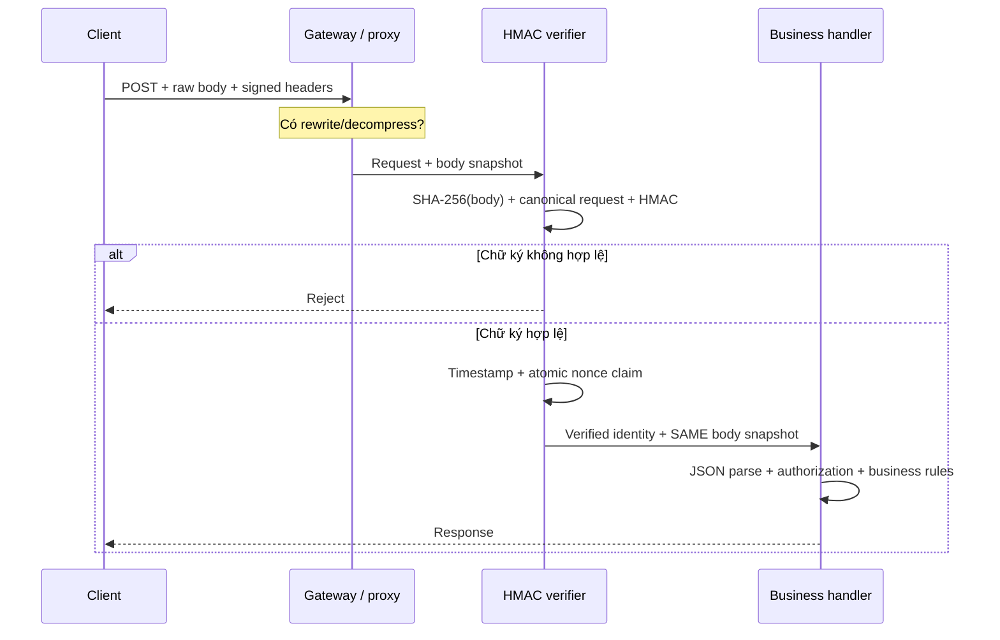

# Body bị thay đổi: tính toàn vẹn payload trong xác thực HTTP bằng HMAC

## 1. Body thay đổi có ý nghĩa gì?

**Body bị thay đổi** là tình huống các byte payload mà client dùng để **tính chữ ký** khác với các byte server **xác minh hoặc xử lý**. Với hợp đồng ký có bảo vệ body, chỉ một byte khác cũng làm thay đổi body digest và thường làm chữ ký HMAC cũ không còn hợp lệ.

Bài thuộc chương **Body canonicalization**, module `SECURITY_AUTHENTICATION_HMAC_REQUEST_AUTHENTICATION`. Module hướng dẫn xác thực HTTP request bằng **HMAC với shared secret** và **canonical request** gồm method, URI, header hoặc body theo hợp đồng; thực hành xác minh signature, chống replay bằng timestamp/nonce, key rotation, kiểm thử proxy/gateway và phân biệt **authentication** với **authorization**.

Ví dụ một request thanh toán:

```http
POST /v1/payments HTTP/1.1
Host: api.example.test
Content-Type: application/json
X-Key-Id: merchant-2026-11
X-Signature-Version: hmac-body-v1
X-Timestamp: 2026-11-28T02:05:00Z
X-Nonce: LV8sJq0U5E9ymx3VrdtKfA
X-Signature: <64 ký tự hex thường>

{"account":"A123","amount":100000}
```

Client ký request có `amount=100000`. Nếu body bị đổi thành `amount=900000`, có thêm newline, hoặc middleware serialize lại JSON, **byte payload** server nhìn thấy có thể khác. Nếu hợp đồng đưa body vào phần được ký, server phải **từ chối chữ ký cũ**. Ngược lại, nếu hợp đồng chỉ ký method và path **mà bỏ body**, HMAC không thể phát hiện body đã bị sửa.

HMAC chỉ xác thực **những byte đã thực sự đưa vào phép tính MAC**, không tự xác thực toàn bộ HTTP request. Bài này tập trung trả lời: *body bytes nào được ký*, *biến đổi nào được phép*, và *làm sao handler xử lý chính body đã xác minh*.

## 2. Hash body, canonical request và MAC

Một hợp đồng phổ biến hash body trước rồi đưa digest vào canonical message:

```text
bodyBytes      = bytes của payload theo hợp đồng
bodyDigest     = SHA-256(bodyBytes)
bodyDigestHex  = lowercaseHex(bodyDigest)
canonicalBytes = UTF8(method + LF + target + LF + signedHeaders
                      + LF + bodyDigestHex + ...)
macBytes       = HMAC-SHA256(sharedSecret, canonicalBytes)
signatureHex   = lowercaseHex(macBytes)
```

**SHA-256(bodyBytes) là hash không khóa**, không phải HMAC. Ai cũng có thể tính lại SHA-256 khi body đổi. Digest chỉ được bảo vệ khi nó là một phần của **canonicalBytes được ký bởi HMAC**. Nếu client gửi một header `X-Body-Digest`, server vẫn phải tự hash **body thực nhận**; không thể tin hoàn toàn digest do client khai báo.

Hai JSON sau có thể cùng ý nghĩa nghiệp vụ nhưng **khác bytes UTF-8**:

```json
{"account":"A123","amount":100000}
```

```json
{ "amount": 100000, "account": "A123" }
```

Với **raw-body signing**, khoảng trắng và thứ tự thuộc tính khác khiến digest thay đổi. Khi dùng lại chữ ký cũ, signature mismatch là **kết quả đúng theo hợp đồng**, không phải lỗi mật mã.

| Thành phần | Vai trò | Không tự bảo đảm |
| --- | --- | --- |
| `SHA-256(bodyBytes)` | Gom bytes payload thành digest 32 byte. | Không xác thực caller vì không có secret. |
| `HMAC-SHA256(secret, canonicalBytes)` | Ràng buộc body digest và các field đã ký với shared secret. | Không bảo vệ field bị bỏ khỏi canonical; không tự chống replay. |
| `X-Signature` | Truyền kết quả MAC để server so sánh. | Không phải trường được đưa chính nó vào canonical. |
| Authorization | Kiểm tra caller có quyền thao tác tài nguyên. | Không suy ra chỉ từ việc chữ ký hợp lệ. |

Vector SHA-256 giúp kiểm tra độc lập:

```text
SHA-256(empty byte array):
e3b0c44298fc1c149afbf4c8996fb92427ae41e4649b934ca495991b7852b855

SHA-256(UTF-8 bytes of "abc"):
ba7816bf8f01cfea414140de5dae2223b00361a396177a9cb410ff61f20015ad
```

## 3. Ký byte ở đúng ranh giới HTTP

HTTP có nhiều lớp đóng gói và biến đổi:

```text
Client serialize payload
       |
       v
HTTP transport (chunked / HTTP/2 DATA frames)
       |
       v
Ingress / gateway (có thể rewrite hoặc decompress)
       |
       v
HTTP adapter -> body snapshot -> HMAC verifier
                     +-------> business handler
```

Bài chọn một **hợp đồng minh họa cụ thể**:

> **bodyBytes là payload bytes sau khi gỡ HTTP transfer framing nhưng trước JSON parsing, charset conversion hoặc content transformation; profile từ chối `Content-Encoding`.**

**Transfer framing** (chẳng hạn cách chia chunk khác nhau ở HTTP/1.1) có thể đổi mà **payload bytes sau gỡ framing vẫn giống nhau**: digest khi ấy phải như nhau. Ngược lại, `Content-Encoding: gzip` biến content thành **bytes nén**; bytes sau giải nén thường khác bytes đã nén. Một phía ký trước decompress còn phía kia hash sau decompress sẽ tạo MAC khác.

| Lớp | Ví dụ | Quy tắc của hợp đồng |
| --- | --- | --- |
| Transfer framing | Chunked hoặc HTTP/2 DATA frames. | Gỡ framing trước hash; không ký chunk boundaries. |
| Content-Encoding | gzip/br. | Không hỗ trợ trong profile này, từ chối thay vì ngầm giải nén. |
| Content-Type | application/json. | Kiểm tra một giá trị đã ký và parser nhất quán. |
| Charset | UTF-8/UTF-16 hoặc BOM. | Ký raw bytes trước decode; chỉ chấp nhận encoding đã công bố. |
| JSON serializer | Đổi thứ tự key, dấu cách hoặc escape. | Không parse-serialize lại trước hash. |
| Handler | Đọc payload của HTTP request. | Sử dụng **chính snapshot đã xác minh**, không nguồn body thứ hai. |

Nếu API cần nhận body nén, phải công bố **signature profile có version**: rõ ràng ký bytes nén hay giải nén, ký Content-Encoding, giới hạn dữ liệu nén/giải nén và bảo đảm handler không nhận dạng khác. Không xử lý mismatch bằng cách **bỏ body digest**.

## 4. Những tình huống làm thay đổi body

| Tình huống | Byte hoặc ngữ nghĩa thay đổi? | Cách xác minh đúng |
| --- | --- | --- |
| Đổi `amount` từ `100000` thành `900000`. | Đổi bytes và tác động nghiệp vụ. | Digest khác; HMAC cũ phải thất bại. |
| Thêm whitespace, newline `LF`/`CRLF` hoặc UTF-8 BOM. | Đổi raw bytes, dù một parser có thể bỏ qua. | Golden fixture phải lưu **bytes/hex**, không chỉ JSON parsed. |
| JSON sắp xếp lại key hoặc pretty-print. | Có thể cùng object logic nhưng bytes khác. | Client ký **bytes cuối cùng sẽ gửi**; server không tự sửa. |
| Charset bị chuyển UTF-8 → UTF-16. | Bytes khác, có thể parser diễn giải khác. | Verify trước charset conversion; enforce encoding policy. |
| Gateway giải nén gzip. | Bytes nén và giải nén khác nhau. | Chặn Content-Encoding ở profile này hoặc tạo profile mới có quy tắc riêng. |
| Middleware đọc hết request stream trước verifier. | Verifier có thể thấy byte rỗng hoặc thiếu dữ liệu. | Capture body một lần, cung cấp cùng snapshot cho verifier/handler. |
| Form-urlencoded đổi `%20` thành `+`. | Có thể cùng value logic nhưng khác raw bytes. | Ký raw form bytes hoặc dùng canonical form được version hóa. |
| Multipart được tạo lại với boundary khác. | Boundary, CRLF và part ordering đổi bytes. | Ký raw multipart bytes và giữ nguyên snapshot hoặc công bố canonical multipart profile. |
| Request body bị cắt hoặc thêm bytes do framing lỗi. | Payload được nhận không giống dữ liệu được ký. | HTTP parser reject framing không rõ trước HMAC. |
| Middleware sửa giá trị **sau khi HMAC verify**. | Handler dùng body khác bytes đã ký. | Bảo đảm TOCTOU-safe snapshot và không có transformation ngoài policy. |

### JSON cùng nghĩa chưa chắc cùng cách xử lý

Hai chuỗi:

```json
{"value":1}
```

```json
{"value":1.0}
```

có thể được ứng dụng coi là gần tương đương, nhưng khác bytes và có thể khác kiểu số hoặc precision sau parse. Một trường hợp nhập nhằng hơn:

```json
{"role":"user","role":"admin"}
```

Những JSON parser khác nhau có thể lấy thuộc tính đầu, lấy thuộc tính cuối hoặc từ chối duplicate. **HMAC trên raw bytes vẫn có thể hoàn toàn hợp lệ** đối với một body mơ hồ về ngữ nghĩa. Vì vậy validation nghiệp vụ phải dùng **một parser có chính sách rõ ràng**, từ chối duplicate keys và dữ liệu không hợp lệ ở nơi cần, thay vì giả định “MAC đúng = JSON an toàn”.

Nếu yêu cầu hai biểu diễn JSON tương đương có chữ ký giống nhau, hãy lựa chọn và công bố **JSON canonicalization scheme riêng** (ví dụ đánh giá JCS, RFC 8785 khi phù hợp), gồm quy tắc cho Unicode, numbers, duplicate keys và encoding. Không thể gọi `Map.toString()` hoặc serialize bằng thư viện tùy chọn rồi mặc định đó là canonical JSON chung cho các ngôn ngữ.

## 5. Hợp đồng ký minh họa HMAC-BODY-V1

Giả sử endpoint chỉ nhận `POST /v1/payments`, body JSON và không dùng content compression:

```http
POST /v1/payments HTTP/1.1
Host: api.example.test
Content-Type: application/json
X-Key-Id: merchant-2026-11
X-Signature-Version: hmac-body-v1
X-Timestamp: 2026-11-28T02:05:00Z
X-Nonce: LV8sJq0U5E9ymx3VrdtKfA
X-Signature: <64 lowercase hex characters>

{"account":"A123","amount":100000}
```

**`hmac-body-v1` là hợp đồng do hai phía tự định nghĩa cho bài học**, không phải một tiêu chuẩn HTTP mặc định. Các quy tắc cố định:

1. **Method/target:** `POST`, raw target `/v1/payments`. Client ký request target nó thật sự gửi; server tái tạo từ request đã nhận tại ranh giới xác minh.
2. **Trusted audience:** `https://api.example.test` đến từ cấu hình routing/ingress, được đối chiếu với credential. Không tin mù quáng `Host` hoặc `X-Forwarded-Host` do client đưa vào.
3. **Signed Content-Type:** chính xác một `Content-Type: application/json`, có format đã công bố. `Content-Encoding` không được hỗ trợ. Adapter phải từ chối duplicate signed headers, CR/LF và HTTP framing mơ hồ.
4. **Body:** payload UTF-8 JSON có từ 1 byte đến 1 MiB trong ví dụ; SHA-256 tính trên body bytes **sau gỡ transfer framing, trước parser**. Handler dùng **chính snapshot đó**.
5. **Body digest:** `lowercaseHex(SHA-256(bodyBytes))` là chuỗi 64 ký tự trong canonical; không dùng hash do client khai báo thay cho tính lại body thực tế.
6. **Key/version:** `X-Key-Id` và `X-Signature-Version` đều nằm trong canonical; server chỉ chọn một secret/algorithm `HmacSHA256` đã cho phép đối với route/tenant. Không fallback khi MAC sai.
7. **Timestamp/nonce:** ký cả hai; timestamp UTC đến giây và nonce ngẫu nhiên base64url không padding. Server **phải** kiểm tra thời gian và uniqueness sau khi xác minh HMAC.
8. **Signature carrier:** `X-Signature` chứa HMAC-SHA256 đủ **32 byte**, encode **64 lowercase hex**, không đưa chính chữ ký vào canonical.
9. **Byte encoding:** các dòng canonical nối bằng **LF (`0A`)**, mã hóa UTF-8, **không thêm LF cuối**. Header name trong canonical dùng chữ thường.

Canonical message của request:

```text
HMAC-BODY-V1
POST
https://api.example.test
/v1/payments
content-type:application/json
x-key-id:merchant-2026-11
x-signature-version:hmac-body-v1
x-timestamp:2026-11-28T02:05:00Z
x-nonce:LV8sJq0U5E9ymx3VrdtKfA
<64 lowercase hex characters of SHA-256(bodyBytes)>
```

Dòng cuối là **placeholder**, cần thay bằng digest thực (không ký dấu `<`/`>`). Chữ ký:

```text
canonicalBytes = UTF8(canonicalRequest)
macBytes       = HMAC-SHA256(sharedSecret, canonicalBytes)
signatureHex   = lowercaseHex(macBytes)
```

Đổi dù một byte body sẽ làm **dòng digest cuối thay đổi** và kết quả MAC cũ không khớp. Method/target và những signed headers khác cũng được ràng buộc, nên không thể dùng chữ ký của POST thanh toán cho một request khác chỉ bằng cách sửa URL.

## 6. Đừng ký một body rồi gửi body khác

**Thứ tự đúng** trên client:

1. Tạo dữ liệu nghiệp vụ và serialize **một lần** thành bytes cuối cùng sẽ gửi.
2. Xác định method, raw URI/target, signed header values, timestamp và nonce.
3. Tính SHA-256 trên **chính body bytes đó**, tạo canonical message và HMAC.
4. Gửi **cùng body byte array** và header đã dùng khi ký, không sửa payload sau `Mac.doFinal`.

Đoạn code dễ mắc lỗi:

```java
// Không an toàn về tính tương thích:
byte[] bytesToSign = jsonLibraryA.serialize(payload);
String signature = sign(bytesToSign);
httpClient.sendJson(payload); // Có thể tự serialize khác bytes đã ký.
```

Cách đúng về nguyên tắc:

```java
byte[] bodyBytes = serializeOnce(payload);
String signature = sign(bodyBytes);
httpClient.sendBytes(bodyBytes); // Snapshot đã được ký.
```

Nếu cần thêm một field, thay số tiền, đổi charset, format lại JSON hoặc gzip sau khi ký, phải **tính lại digest và chữ ký** theo profile tương ứng. Điều tương tự áp dụng phía server: không xác minh trên bytes A nhưng lại cho business handler xử lý bytes B.

## 7. Java 17+: minh họa phát hiện body tampering

Đoạn code sau là một chương trình Java 17 **độc lập** để so sánh ba trường hợp: body gốc, body đổi giá trị nghiệp vụ và body JSON đổi formatting. Nó dùng `MessageDigest.getInstance("SHA-256")` cho body và JCA `Mac.getInstance("HmacSHA256")` cho canonical request, so sánh MAC bằng `MessageDigest.isEqual`.

**Phạm vi có chủ ý:** lớp demo tập trung vào **body integrity**; nó kiểm tra phiên bản/key scope và chữ ký nhưng **không triển khai timestamp freshness, nonce store, HTTP header parser hoặc authorization**. Phần sau của bài giải thích những kiểm soát đó. Dữ liệu timestamp và khóa trong `main` chỉ dùng để thử nghiệm lặp lại được, **không phải cách tạo khóa/timestamp production**.

```java
import java.nio.charset.StandardCharsets;
import java.security.GeneralSecurityException;
import java.security.MessageDigest;
import java.time.Instant;
import java.time.format.DateTimeParseException;
import java.util.HexFormat;
import java.util.Set;
import javax.crypto.Mac;
import javax.crypto.spec.SecretKeySpec;

public final class BodyMutationDemo {
    private static final HexFormat HEX = HexFormat.of();
    private static final String VERSION = "hmac-body-v1";
    private static final String ORIGIN = "https://api.example.test";
    private static final String TARGET = "/v1/payments";

    // Byte array được copy khi tạo request và khi truy xuất:
    // không cho caller sửa trực tiếp snapshot sau khi đã ký.
    public record Request(
            String method, String rawTarget, String trustedOrigin,
            String contentType, String keyId, String version,
            String timestamp, String nonce, byte[] body,
            String signatureHex) {
        public Request {
            body = body == null ? null : body.clone();
        }
        @Override
        public byte[] body() {
            return body == null ? null : body.clone();
        }
    }

    public record Credential(
            String keyId, byte[] secret, boolean active,
            String audience, Set<String> allowedVersions) {
        public Credential {
            secret = secret == null ? null : secret.clone();
        }
        @Override
        public byte[] secret() {
            return secret == null ? null : secret.clone();
        }
    }

    public static String sha256Hex(byte[] body)
            throws GeneralSecurityException {
        return HEX.formatHex(
                MessageDigest.getInstance("SHA-256").digest(body));
    }

    public static byte[] canonicalBytes(Request r)
            throws GeneralSecurityException {
        String message = String.join("\n",
                "HMAC-BODY-V1",
                r.method(),
                ORIGIN,
                r.rawTarget(),
                "content-type:" + r.contentType(),
                "x-key-id:" + r.keyId(),
                "x-signature-version:" + r.version(),
                "x-timestamp:" + r.timestamp(),
                "x-nonce:" + r.nonce(),
                sha256Hex(r.body()));
        return message.getBytes(StandardCharsets.UTF_8);
    }

    private static byte[] computeMac(byte[] secret, Request r)
            throws GeneralSecurityException {
        // Thuật toán chỉ do profile trên server quyết định.
        Mac mac = Mac.getInstance("HmacSHA256");
        mac.init(new SecretKeySpec(secret, "HmacSHA256"));
        return mac.doFinal(canonicalBytes(r));
    }

    public static Request signForDemo(Request r, byte[] secret)
            throws GeneralSecurityException {
        String signature = HEX.formatHex(computeMac(secret, r));
        return new Request(r.method(), r.rawTarget(), r.trustedOrigin(),
                r.contentType(), r.keyId(), r.version(),
                r.timestamp(), r.nonce(), r.body(), signature);
    }

    public static boolean verifyMacOnly(Request r, Credential key)
            throws GeneralSecurityException {
        if (r == null || key == null || r.method() == null
                || r.rawTarget() == null || r.trustedOrigin() == null
                || r.contentType() == null || r.keyId() == null
                || r.version() == null || r.timestamp() == null
                || r.nonce() == null || r.body() == null
                || r.signatureHex() == null) return false;

        // Các điều kiện hợp đồng ngoài HMAC:
        if (!"POST".equals(r.method())
                || !TARGET.equals(r.rawTarget())
                || !ORIGIN.equals(r.trustedOrigin())
                || !"application/json".equals(r.contentType())
                || !VERSION.equals(r.version())
                || !r.keyId().equals(key.keyId())
                || !key.active()
                || !ORIGIN.equals(key.audience())
                || key.allowedVersions() == null
                || !key.allowedVersions().contains(VERSION)
                || key.secret() == null || key.secret().length < 32
                || r.body().length == 0 || r.body().length > 1_048_576
                || !r.nonce().matches("[A-Za-z0-9_-]{22,128}")
                || !r.signatureHex().matches("[0-9a-f]{64}")) {
            return false;
        }
        try {
            Instant.parse(r.timestamp()); // Demo chỉ kiểm tra parse.
        } catch (DateTimeParseException invalid) {
            return false;
        }

        byte[] supplied = HEX.parseHex(r.signatureHex());
        byte[] expected = computeMac(key.secret(), r);
        return MessageDigest.isEqual(expected, supplied);
    }

    public static Request replaceBody(Request original, byte[] changed) {
        return new Request(original.method(), original.rawTarget(),
                original.trustedOrigin(), original.contentType(),
                original.keyId(), original.version(), original.timestamp(),
                original.nonce(), changed, original.signatureHex());
    }

    public static void main(String[] args) throws Exception {
        // KHÓA TEST CỐ ĐỊNH: không dùng trong môi trường thật.
        byte[] testSecret = new byte[32];
        for (int i = 0; i < testSecret.length; i++) {
            testSecret[i] = (byte) (i + 1);
        }
        Credential key = new Credential("merchant-2026-11",
                testSecret, true, ORIGIN, Set.of(VERSION));

        byte[] original = (
                "{\"account\":\"A123\",\"amount\":100000}")
                .getBytes(StandardCharsets.UTF_8);
        Request unsigned = new Request("POST", TARGET, ORIGIN,
                "application/json", key.keyId(), VERSION,
                "2026-11-28T02:05:00Z", "LV8sJq0U5E9ymx3VrdtKfA",
                original, "");
        Request signed = signForDemo(unsigned, testSecret);

        byte[] changedAmount = (
                "{\"account\":\"A123\",\"amount\":900000}")
                .getBytes(StandardCharsets.UTF_8);
        byte[] sameMeaningDifferentBytes = (
                "{ \"amount\": 100000, \"account\": \"A123\" }")
                .getBytes(StandardCharsets.UTF_8);

        Request changed = replaceBody(signed, changedAmount);
        Request formatted = replaceBody(signed, sameMeaningDifferentBytes);

        System.out.println("Original MAC valid: "
                + verifyMacOnly(signed, key));        // true
        System.out.println("Modified amount valid: "
                + verifyMacOnly(changed, key));       // false
        System.out.println("Reformatted JSON valid: "
                + verifyMacOnly(formatted, key));     // false
        System.out.println("Original body digest: "
                + sha256Hex(original));
        System.out.println("Modified body digest: "
                + sha256Hex(changedAmount));
    }
}
```

Trong demo, một `Request` mới được tạo bằng `replaceBody` giữ nguyên **signature của body cũ**. Đây chính là điều kiện kiểm thử body đã bị sửa trên đường đi; verifier tính digest mới, dựng canonical bytes mới và trả `false`.

**Không dùng `verifyMacOnly` làm middleware production:** hàm này không kiểm tra cửa sổ timestamp, không claim nonce, và không xử lý parser/duplicate headers, key management, authorization hoặc body size ở ingress. Production phải dùng các kiểm soát được nêu ở những mục sau. `MessageDigest.isEqual` giúp tránh so sánh MAC bằng `String.equals`, nhưng toàn bộ xử lý HTTP, credential lookup và rate limiting cũng phải được thiết kế bảo mật.

### Nếu body đổi rồi được ký lại bằng secret hợp lệ thì sao?

Nếu caller **có shared secret hợp lệ** và chủ động đổi `amount` từ 100000 sang 900000 **trước khi ký**, MAC mới vẫn có thể đúng. Điều đó không phải lỗi HMAC: HMAC xác thực **request thực sự được người nắm secret tạo ra**, không kiểm tra số tiền có hợp lệ hoặc caller có đủ quyền. Server còn cần **authorization, hạn mức thanh toán, business validation và audit**.

## 8. Request body dạng stream: hash và giữ snapshot đúng một lần

Trong web server, request body thường có dạng `InputStream` chỉ đọc một chiều. Một lỗi dễ gặp:

```java
// Sai ý tưởng nếu stream không hỗ trợ reset:
byte[] digest = sha256(requestInputStream);
byte[] handlerBytes = requestInputStream.readAllBytes(); // Có thể rỗng!
```

Ở đây verifier và handler không còn quan sát cùng body. Với payload nhỏ và có giới hạn, có thể **capture một lần, hash cùng lúc, rồi chuyển chính snapshot tới handler**:

```java
import java.io.ByteArrayOutputStream;
import java.io.IOException;
import java.io.InputStream;
import java.security.GeneralSecurityException;
import java.security.MessageDigest;

public final class BodyCapture {
    public record BodySnapshot(byte[] bytes, byte[] sha256) {
        public BodySnapshot {
            bytes = bytes.clone();
            sha256 = sha256.clone();
        }
        @Override public byte[] bytes() { return bytes.clone(); }
        @Override public byte[] sha256() { return sha256.clone(); }
    }

    public static BodySnapshot readBodyOnce(InputStream input, int maxBytes)
            throws IOException, GeneralSecurityException {
        if (maxBytes < 0) throw new IllegalArgumentException("maxBytes");
        MessageDigest sha256 = MessageDigest.getInstance("SHA-256");
        ByteArrayOutputStream saved = new ByteArrayOutputStream();
        byte[] chunk = new byte[8192];
        int count;
        while ((count = input.read(chunk)) != -1) {
            if (count > maxBytes - saved.size()) {
                throw new IOException("Body exceeds limit");
            }
            saved.write(chunk, 0, count);
            sha256.update(chunk, 0, count);
        }
        return new BodySnapshot(saved.toByteArray(), sha256.digest());
    }
}
```

`sha256.update` và `saved.write` nhận **cùng từng đoạn byte**, không phải dữ liệu bị decode/reformat. Sau khi HMAC và replay check thành công, handler parse **`BodySnapshot.bytes()`** theo cùng policy. Đối với body lớn, không giữ vô hạn trong RAM: dùng temp storage được bảo vệ hoặc cơ chế streaming-to-durable-buffer có giới hạn, xác minh toàn bộ trước khi có side effect, rồi replay **cùng bytes đã đóng băng** cho handler.

**Không xử lý nghiệp vụ một phần trước khi đọc và xác minh hết stream.** Ví dụ, không ghi từng dòng CSV vào database rồi mới tính xong HMAC ở cuối: nếu signature thất bại, tác động nghiệp vụ đã xảy ra. Nên giới hạn số byte, timeout, áp dụng backpressure và tránh decompression bomb hoặc việc đọc stream không kết thúc.

## 9. Proxy/gateway và lỗi TOCTOU: body đã verify không phải body được xử lý

**TOCTOU (Time-of-check to time-of-use)** trong bối cảnh này là khoảng cách giữa thời điểm **kiểm tra HMAC trên body A** và thời điểm **ứng dụng sử dụng body B**. Nếu có một phép biến đổi ở giữa, việc chữ ký của A hợp lệ **không chứng minh** B là nội dung đã được xác thực.



Các nguyên tắc cần có:

- Nếu **gateway xác minh HMAC trước khi sửa body**, gateway phải xác định rõ nội dung nào được coi là đã xác minh và chỉ chuyển identity/context đáng tin cậy cho backend. Backend phải chặn truy cập trực tiếp hoặc header tự khai `X-Authenticated-Client`.
- Nếu **backend xác minh HMAC**, gateway không được âm thầm biến đổi raw body theo một cách nằm ngoài contract; hoặc hệ thống cần phiên bản ký cho **logical representation** được cả hai phía canonicalize giống nhau.
- Request parser phải xử lý **framing, Content-Length/Transfer-Encoding, header duplicate, Content-Encoding và kích thước** trước khi verifier tin body snapshot. HMAC không thay thế kiểm tra HTTP request smuggling/desync.
- **Verified snapshot** phải là dữ liệu bất biến hoặc được bảo vệ khỏi thay đổi. Trong Java, mảng `byte[]` có thể bị sửa; khi qua nhiều tầng hoặc thread, hãy dùng copy/immutable wrapper hoặc cơ chế bảo vệ tương đương, tránh đưa ra tham chiếu mutable.
- Handler không đọc lại `InputStream` đã cạn hoặc một body đã được framework parse/serialize thành bytes mới; nếu cần JSON object, parse từ **chính verified snapshot** và áp dụng schema validation.
- Không dùng một header `X-Original-Body-Hash` do caller Internet gửi làm “bằng chứng” body gốc nếu gateway không ràng buộc nó bằng kênh tin cậy và dữ liệu đã ký.

### Ví dụ cụ thể: gateway giải nén trước khi verifier chạy

```text
Client:
  Content-Encoding: gzip
  body bytes = gzip(JSON)
  ký SHA-256(gzip(JSON))

Gateway:
  giải nén -> JSON bytes

Backend:
  tính SHA-256(JSON) -> khác digest client đã ký
```

Đây là **lỗi tương thích hợp đồng/ràng giới ký**, không nên khắc phục bằng cách bỏ qua digest hoặc xác minh trên hash tự khai báo. Với `hmac-body-v1` của bài, request mang `Content-Encoding` phải bị từ chối ngay. Nếu cần hỗ trợ gzip, hãy phát hành profile mới và kiểm tra end-to-end ở đúng vị trí nén/giải nén.

### Theo dõi lỗi mà không làm lộ dữ liệu

Các số liệu hữu ích gồm signature version, route, content-encoding đã được phép hay không, kích thước body, loại mismatch (canonical, MAC, timestamp, nonce), gateway hop và SDK version. **Không log shared secret, raw chữ ký đầy đủ hoặc body nhạy cảm**. Nếu cần so sánh bytes giữa client và gateway, dùng **test fixture không chứa dữ liệu thật** với digest/hex byte và công cụ chẩn đoán trong môi trường kiểm thử có kiểm soát.

## 10. HMAC body integrity không thay thế replay, key policy hoặc authorization

Giả sử body và mọi signed headers đều **không đổi** khi gửi lại:

```text
same bodyBytes -> same bodyDigest
same canonical fields -> same canonicalBytes
same secret -> same valid HMAC
```

HMAC tự nó **không phát hiện một request hợp lệ đã được phát lại**. Vì vậy, `X-Timestamp` và `X-Nonce` phải **được ký** và phải được server **kiểm tra độc lập**:

1. **Timestamp freshness:** parse UTC/format chính xác, kiểm tra cửa sổ thời gian, ví dụ ±5 phút và đồng bộ đồng hồ các node.
2. **Nonce uniqueness:** tạo nonce ngẫu nhiên đủ mạnh ở client, server dùng **atomic insert-if-absent** cho `(keyId, nonce)` trên kho dùng chung. Nếu đã có nonce thì từ chối ngay cả khi HMAC đúng.
3. **TTL:** với cửa sổ ±5 phút, một nonce được chấp nhận khi timestamp ở tương lai 5 phút có thể còn hợp lệ gần 10 phút kể từ thời điểm đầu tiên; chọn TTL hơn 10 phút (ví dụ 11 phút) có biên an toàn và chính sách clock skew nhất quán.
4. **Thứ tự:** chỉ claim nonce sau khi HMAC đúng để request MAC sai khó chiếm chỗ trong nonce store. Nếu nonce store hoặc secret store lỗi, **fail closed**, không mặc nhiên chấp nhận.

Chống replay cũng không chứng minh request có quyền thực thi. Một client nắm secret hợp lệ có thể **tự ký lại body mới**; HMAC lúc ấy xác nhận request do client đó tạo, nhưng việc chuyển `amount=900000` có được phép hay không là **business validation và authorization**.

**Key rotation và signature version:**

- `X-Key-Id` chọn credential từ store tin cậy; kiểm tra active/revoked, tenant, audience, service/route scope và tập phiên bản ký được phép.
- Key cũ và mới có thể đồng thời được phép trong khoảng chuyển tiếp, nhưng **mỗi request chỉ dùng một key ID**. Không tự thử mọi secret hoặc HMAC algorithm cho tới khi một chữ ký khớp.
- Nếu thay từ raw-body signing sang canonical JSON signing hoặc thêm hỗ trợ gzip, **đó là thay đổi hợp đồng ký**: phải có signature version mới và golden fixtures tương ứng; chỉ xoay secret không giải quyết mismatch canonicalization.
- Nếu secret đã bị lộ, thu hồi/rotate key ngay, không coi thay đổi body digest algorithm là biện pháp xử lý thay thế.
- HTTPS/TLS tiếp tục cần thiết cho tính bí mật đường truyền và xác minh danh tính server; HMAC **không mã hóa payload**.

## 11. Ma trận kiểm thử body bị thay đổi

Một bộ **golden fixtures** nên lưu secret thử nghiệm, method, raw target, các signed headers, **body bytes dạng hex hoặc file kiểm thử**, body SHA-256, canonical UTF-8 bytes, HMAC dự kiến và kết quả xác minh. Tránh chỉ lưu JSON object đã parse vì làm mất bằng chứng về whitespace, BOM hoặc encoding.

| Test case | Kết quả kỳ vọng |
| --- | --- |
| Request gốc, key active, đủ headers, body chính xác, nonce mới. | MAC đúng, freshness/replay đúng; chuyển sang authorization. |
| Thay `amount=100000` thành `900000`, giữ MAC. | **Từ chối** do body digest và canonical bytes thay đổi. |
| Thêm một dấu space, newline hoặc CRLF sau JSON, giữ MAC. | **Từ chối** theo raw-body contract, dù JSON có thể parse giống nhau. |
| Đổi thứ tự keys hoặc pretty-print JSON, giữ MAC. | **Từ chối** do body bytes khác. |
| Tính hash từ JSON parse-serialize thay vì body thực gửi. | Signature mismatch; sửa client/verifier dùng snapshot bytes. |
| Client ký UTF-8 nhưng HTTP library gửi UTF-16 hoặc thêm BOM. | Signature mismatch hoặc bị charset policy từ chối. |
| Request không có body tại endpoint yêu cầu non-empty JSON. | Từ chối bởi profile/body size validation. |
| Body dài trên 1 MiB theo giới hạn demo. | Từ chối trước khi tốn tài nguyên hoặc có side effect. |
| HTTP/1.1 chunked khác kích thước chunk, payload bytes vẫn giống. | **Cùng body digest** sau dechunking; HMAC có thể hợp lệ. |
| Gzip body gửi tới profile không cho Content-Encoding. | Từ chối theo hợp đồng, không tự decompress để cứu signature. |
| Gateway decompress hoặc rewrite JSON trước backend verifier. | Test phát hiện mismatch; xác định lại ranh giới ký/verify. |
| Multipart có boundary mới nhưng nội dung part logic tương đương. | Raw bytes khác; HMAC cũ không khớp. |
| Body stream đã bị middleware đọc hết, handler thấy rỗng. | Test phát hiện sai snapshot; phải capture/verify/replay đúng bytes. |
| Xác minh HMAC trên bytes A nhưng handler xử lý bytes B. | **Không được phép**; integration test ngăn TOCTOU. |
| JSON có duplicate keys, parser A lấy first và parser B lấy last. | Từ chối schema mơ hồ hoặc bắt buộc cùng parser semantics đã được kiểm tra. |
| Header `Content-Type` đổi, hoặc một header ký xuất hiện hai lần. | Chữ ký không khớp hoặc parser từ chối header mơ hồ. |
| Đổi method, URI, key ID hoặc signature version mà giữ body/MAC. | Từ chối bởi canonical MAC hoặc key/profile/route policy. |
| MAC đúng nhưng timestamp quá hạn hoặc nonce đã dùng. | Replay protection từ chối. |
| MAC đúng nhưng key bị revoke/không thuộc service hoặc tenant. | Credential policy từ chối. |
| MAC đúng, nonce mới, nhưng caller không có quyền tạo giao dịch. | **Authorization từ chối**. |

### Bài tập thực hành

1. Chạy `BodyMutationDemo`: ghi nhận digest của body gốc và body có số tiền đã sửa, kết quả `verifyMacOnly` cho cả ba trường hợp.
2. Thử thêm đúng **một byte `0A`** vào cuối body JSON và giải thích tại sao JSON parser có thể vẫn chấp nhận trong khi MAC cũ không hợp lệ.
3. Thực hiện JSON pretty-print **sau khi ký**; sửa client để serialize một lần và dùng đúng byte array đã ký khi gửi.
4. Dùng cùng payload bytes qua HTTP/1.1 chunked với hai cách chia chunk; so sánh SHA-256 ở ranh giới sau khi bỏ transfer framing.
5. Mô phỏng gateway giải nén gzip trước khi backend hash; xác định tại sao `SHA-256(gzip(JSON))` và `SHA-256(JSON)` không khớp, đề xuất contract có version nếu cần gzip.
6. Cho handler đọc lại `InputStream` sau verifier; quan sát body rỗng. Thay bằng cách capture một snapshot và chuyển snapshot đó cho handler.
7. Gửi lại một request MAC đúng với cùng nonce. Giải thích vì sao kết quả kiểm tra **integrity** có thể đúng nhưng **replay check** phải sai.
8. Ký lại một body có `amount` cao bằng key hợp lệ của client, sau đó áp dụng chính sách quyền và hạn mức; phân biệt **chữ ký hợp lệ** với **giao dịch được phép**.

## 12. Checklist triển khai an toàn

- [ ] Hợp đồng ký có **signature version** rõ ràng, cho biết body bytes lấy tại ranh giới nào, hash algorithm, encoding digest, canonical schema và MAC algorithm.
- [ ] Bảo vệ method, raw target/URI, trusted audience, signed headers và **body digest**, không chỉ ký hash mà bỏ ngữ cảnh request.
- [ ] Server tự hash đúng **body bytes thực nhận**, không tin digest do caller tự khai báo, không parse/serialize lại trước hash theo raw-body contract.
- [ ] Phân biệt HTTP transfer framing với content compression; quy định Content-Encoding, Content-Type, charset, BOM, JSON schema và body rỗng.
- [ ] Client **serialize một lần và gửi đúng bytes đã ký**; không tự thay body trong HTTP middleware sau bước ký.
- [ ] Server capture **một snapshot có giới hạn**, xác minh toàn bộ trước khi xử lý nghiệp vụ; handler dùng đúng snapshot và không giải mã/biến đổi ngoài contract.
- [ ] Bảo vệ chống TOCTOU với immutable snapshots/copies hoặc storage an toàn; không dùng lại stream đã cạn.
- [ ] HTTP ingress xử lý size limits, timeout, ambiguous framing, duplicate signed headers và proxy rewrites nhất quán.
- [ ] Với gzip, multipart, canonical JSON hoặc streaming đặc biệt, định nghĩa **profile riêng** và kiểm thử client, gateway, verifier, handler bằng golden byte fixtures.
- [ ] HMAC được so sánh dạng byte bằng hàm phù hợp; key ID/version nằm trong allowlist, key rotation/revocation và scope được kiểm soát.
- [ ] Timestamp/nonce đều được ký, kiểm tra freshness và claim nguyên tử trên kho dùng chung, fail closed khi phụ thuộc bảo mật lỗi.
- [ ] Sau xác thực HMAC vẫn có authorization, business validation, idempotency phù hợp và HTTPS/TLS xác minh server.

**Điểm cần nhớ:** Khi **body bị thay đổi**, HMAC chỉ phát hiện được sự khác biệt nếu **chính body bytes hoặc digest của chúng nằm trong canonical request được ký**, và server tính lại digest từ **cùng byte snapshot mà handler sẽ sử dụng**. JSON whitespace, charset, compression, stream consumption hoặc gateway rewrite đều có thể làm lệch byte dù nghiệp vụ trông không đổi. Một hợp đồng ký có version, ranh giới body rõ ràng, kiểm soát TOCTOU và kiểm thử end-to-end là nền tảng bảo vệ tính toàn vẹn; replay, key policy và authorization vẫn phải được xác minh độc lập.
