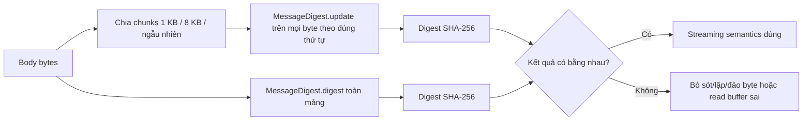

# Kiểm thử canonical body: đảm bảo client và server ký đúng cùng byte trong HMAC request authentication

> **Chương:** Body canonicalization  
> **Bài học:** Kiểm thử canonical body  
> **Ngữ cảnh:** Xác thực HTTP request bằng HMAC và shared secret. Client cùng server dựng canonical request từ method, URI, signed headers và/hoặc body theo hợp đồng ký. Bài này tập trung vào **thiết kế fixture, test vector, test biến đổi và kiểm thử tích hợp** để chắc chắn body mà verifier xác thực chính là body được backend xử lý.

## 1. Vì sao phải kiểm thử canonical body?

Trong xác thực request bằng HMAC, phép tính mật mã thường chỉ là bước cuối:

```text
bodyDigest = SHA-256(bytesOfBodyDefinedByContract)
canonicalRequest = canonical(method, URI, signedHeaders, bodyDigest)
signature = HMAC-SHA256(sharedSecret, bytesToSign(canonicalRequest))
```

Vấn đề khó nhất không phải gọi `MessageDigest.getInstance("SHA-256")` hay `Mac.getInstance("HmacSHA256")`. Nó là bảo đảm **client và verifier đưa vào cùng một dãy byte body**, đồng thời **business handler sử dụng đúng nội dung đã được xác thực**.

Ví dụ hai body JSON:

```json
{"amount":100000,"currency":"VND"}
```

và:

```json
{"currency":"VND","amount":100000}
```

Có thể biểu diễn dữ liệu nghiệp vụ tương đương, nhưng **byte khác nhau**. Nếu hợp đồng dùng SHA-256 trên raw body bytes, chúng có **digest khác nhau** và chữ ký HMAC khác nhau. Điều đó **đúng theo hợp đồng**, không phải một lỗi của SHA-256.

Ngược lại, nếu client ký một byte stream, gateway tự parse/serialize lại JSON, verifier hash một byte stream khác, chúng sẽ không xác minh được mặc dù nội dung trông giống nhau. Nguy hiểm hơn: nếu verifier hash một biểu diễn đã lược bỏ/chuẩn hóa sai thông tin, còn backend dùng thông tin bị lược bỏ, HMAC có thể **khớp trên dữ liệu khác với tác động nghiệp vụ thực tế**.

### Mục tiêu sau bài học

Người học có thể:

1. Viết rõ **body nào được ký** và chốt ranh giới quan sát byte.
2. Tạo fixture golden có byte body, body digest, canonical request và HMAC tag.
3. Phân biệt trường hợp **phải cho cùng digest**, **phải cho digest khác** và **phải từ chối**.
4. Kiểm thử raw JSON, text, form, multipart, binary, body rỗng, streaming, Content-Encoding và proxy/gateway.
5. Tách vấn đề body canonicalization khỏi replay, idempotency, key rotation và authorization.

## 2. “Canonical body” có hai nghĩa khác nhau

Không có **một** cách canonicalize body phù hợp với mọi giao thức. Trước khi viết test, phải chọn rõ mô hình của hệ thống.

| Mô hình | Dữ liệu đem băm/ký | Hệ quả đối với kiểm thử |
| --- | --- | --- |
| **Raw-body binding** | Chính xác **byte content** đã được hợp đồng xác định tại điểm ký/kiểm, ví dụ `SHA256(rawBodyBytes)`. | Khác một byte thường cho digest khác; không được tự parse rồi serialize lại. |
| **Semantic canonicalization** | Parse một định dạng được hỗ trợ, chuyển sang dạng chuẩn theo **thuật toán được đặc tả đầy đủ**, rồi băm/ký dãy byte chuẩn. | Nhiều biểu diễn khác byte có thể có cùng digest **nếu và chỉ nếu** thuật toán chuẩn xem chúng tương đương. |
| **Selected-field signing** | Chỉ ký các trường được chọn từ object/format. | Phải chứng minh mọi trường có tác động nghiệp vụ đã được ràng buộc; bỏ sót trường tạo rủi ro lớn. |

**Mặc định an toàn và dễ kiểm toán cho HMAC HTTP APIs:** băm **raw body bytes theo một ranh giới được xác định cụ thể** rồi đưa digest vào canonical request. Không dùng một phương thức như `object.toString()` hay serializer mặc định làm “canonical body” khi chưa có hợp đồng.

Nếu cần cho phép JSON khác whitespace/key order nhưng vẫn cùng chữ ký, hãy xem xét **JSON Canonicalization Scheme (JCS, RFC 8785)** và các điều kiện của nó, thay vì tự viết `sortKeys()` rồi cho là tương thích. JCS có những quy tắc về dữ liệu đầu vào, serializing numbers, Unicode, duplicate property names và kiểu số không đơn giản. Cần kiểm tra **trọn bộ** quy tắc và dùng chung implementation/fixtures.

**Không trộn hai mô hình trong cùng phiên bản giao thức**. Client ký raw bytes mà server ký “JSON được chuẩn hóa” sẽ cho những trường hợp chấp nhận/từ chối khác nhau.

## 3. Hợp đồng thử nghiệm `BODY-RAW-V1`

Để kiểm thử có kết quả tái lập, bài này sử dụng **giao thức tùy biến để học**, đặt tên `BODY-RAW-V1`. Nó **không phải một đặc tả HMAC áp dụng cho mọi HTTP service**.

### 3.1. Body nào được băm?

Giả định của `BODY-RAW-V1`:

1. `bodyBytes` là **HTTP message content bytes sau khi HTTP transfer framing đã được tháo**, nhưng **trước khi decode Content-Encoding**. Với HTTP/1.1 chunked, delimiter chunk **không** thuộc body bytes được băm. Với gzip content coding, các byte **gzip-encoded** là body bytes được băm.
2. Client phải băm **đúng các byte cuối cùng mà nó gửi**. Chữ ký được tạo **sau khi** serializer, multipart builder và các middleware sửa nội dung hoàn thành.
3. Verifier phải có quyền đọc **cùng byte representation**. Nếu gateway giải nén, chuyển đổi charset hoặc serialize lại body trước verifier, hợp đồng phải thay đổi điểm kiểm hoặc chuyển dữ liệu gốc qua kênh đáng tin; không âm thầm băm body đã biến đổi.
4. Body `0 byte` được biểu diễn bằng **SHA-256 của mảng byte rỗng**. Không thay bằng chuỗi `""` ở dòng digest.
5. Không thêm/kéo bỏ newline, BOM, whitespace; không chuẩn hóa JSON trước SHA-256.
6. Body bị giới hạn kích thước và thời gian đọc. Không cho phép stream vô hạn; mọi byte phải được kiểm soát trước nghiệp vụ.
7. `Content-Type` được ký nếu có tác động tới parser. `Content-Encoding` cũng được ràng buộc để ngăn thay đổi cách giải mã cùng body bytes.
8. Với triển khai mẫu, HTTP adapter phải phân biệt rõ **body content bytes** với metadata/framing, và từ chối biến thể không hỗ trợ.

### 3.2. Cách tạo canonical request

Để bao quát body nhưng vẫn giữ bảo vệ request tổng thể, ví dụ dùng:

```text
bodySha256Hex = lowercaseHex(SHA256(bodyBytes))

canonicalRequest =
    METHOD + "\n"
    + CANONICAL_PATH + "\n"
    + CANONICAL_QUERY + "\n"
    + "content-type:" + canonicalContentType + "\n"
    + "content-encoding:" + canonicalContentEncoding + "\n"
    + "x-key-id:" + keyId + "\n"
    + "x-nonce:" + nonce + "\n"
    + "x-timestamp:" + timestamp + "\n"
    + bodySha256Hex

bytesToSign = UTF8("HMAC-SHA256/BODY-RAW-V1\n" + canonicalRequest)
tagBytes = HMAC-SHA256(secretBytes, bytesToSign)
```

Các trường method, path, query, Content-Type, Content-Encoding, key ID, nonce, timestamp đều phải có **quy tắc parse/validate và canonical riêng**. Chuỗi trên là **format ví dụ**, không phải một canonicalizer URL/header hoàn chỉnh. Trong service phân biệt tenant bằng authority, phải **ký/cố định authority**; ví dụ đơn giản hóa bằng một API host cố định và ranh giới routing được kiểm soát.

`X-Signature` chỉ chở tag (ví dụ Base64URL không padding), **không** được đưa vào chính signing input trong hợp đồng này.

Định nghĩa chi tiết Content-Encoding:

- Trong fixture, sử dụng giá trị canonical `identity` khi **không có Content-Encoding**. Đây là **marker nội bộ của hợp đồng**, không phải giả định HTTP gửi header `Content-Encoding: identity`.
- Nếu hỗ trợ `gzip`, body hash tính trên **byte gzip-compressed** tại điểm đã định nghĩa, và dòng `content-encoding:gzip` phải được HMAC bảo vệ.
- Request có nhiều content-coding hoặc coding khác chưa hỗ trợ **phải bị từ chối** trong phiên bản hợp đồng ví dụ này.

**Không gửi hoặc tin trường `x-body-sha256` do client khai mà bỏ qua việc tự tính từ body nhận được.** Nếu wire protocol có body digest do client gửi, verifier cần kiểm digest đó **khớp body thật** và được signature bao phủ theo contract.

## 4. Bộ bất biến làm “oracle” cho test

Test không thể chỉ so “hai bên có cùng kết quả” nếu client và server **cùng triển khai sai** một hàm. Cần cả **known-answer vectors** và những bất biến về byte.

| Bất biến | Cách kiểm | Kết quả đúng |
| --- | --- | --- |
| Cùng body bytes, cùng thuật toán | So sánh digest của mảng byte và digest qua streaming. | **Bằng nhau**, không phụ thuộc chia chunk khi đọc. |
| Body thay đổi một byte | Giữ nguyên field khác, đổi một byte body. | SHA-256 gần như chắc chắn khác; test fixture cụ thể phải khác. |
| Body khác chỉ whitespace/newline | `{"a":1}` so với `{"a": 1}` hoặc LF/CRLF. | **Khác** theo raw-body contract. |
| JSON cùng dữ liệu logic, đổi key order | `{"a":1,"b":2}` so với `{"b":2,"a":1}`. | **Khác** theo raw-body contract. |
| Body rỗng | Hash byte[0]. | Bằng SHA-256(empty) chuẩn, không phải digest của `"null"` hoặc `"\n"`. |
| Cùng body, đổi Content-Type | Body digest có thể bằng nhau, HMAC tag phải đổi vì header được ký. | Tag **khác**. |
| Cùng body, đổi Content-Encoding | Body digest có thể bằng nhau, HMAC tag phải đổi vì metadata được ký. | Tag **khác**. |
| Đổi method/path/query | Body digest có thể giống nhau, tag HMAC phải đổi. | Tag **khác**. |
| Đổi key ID, timestamp hoặc nonce | Body digest giữ nguyên, tag HMAC phải đổi. | Tag **khác**. |
| Đổi shared secret | Cùng canonical request nhưng dùng secret khác. | Tag khác; verifier phải chọn đúng key theo registry. |
| Phát lại nguyên request | Body digest và HMAC tag vẫn khớp. | **Bị từ chối bởi replay store**, không phải bởi SHA-256. |
| Signature khớp nhưng thiếu quyền | Authn có thể thành công. | **Bị authorization từ chối**. |

**Chú ý:** SHA-256 được thiết kế chống va chạm, nhưng nói “khác byte thì **chắc chắn** khác hash” là không chính xác về mặt toán học vì đầu ra hữu hạn. Trong test với fixture cụ thể, bạn có thể và nên xác nhận **kết quả thực tế khác nhau**.

## 5. Golden fixtures: kiểm bằng byte trước, không kiểm bằng object

Một fixture tốt chứa ít nhất:

```yaml
fixtureId: post-json-lf-v1
method: POST
canonicalPath: /v1/payments
canonicalQuery: orderId=42
contentType: application/json
contentEncodingMarker: identity
keyId: merchant-test-k1
timestamp: "1795800000"
nonce: 8e04673624234fe3935f0f9e65d38f6a
bodyEncoding: UTF-8
bodyText: '{"amount":100000}'
bodyBytesHex: <tính từ đúng bodyText, KHÔNG tự thêm newline>
bodySha256Hex: <được tính bằng chương trình/fixture chuẩn>
canonicalRequestUtf8Hex: <nếu cần đối chiếu cross-language>
expectedSignatureBase64url: <tính bằng test secret đã cố định>
```

Đây là **schema minh họa**, các giá trị trong dấu `<...>` là placeholder không được mang vào fixture chạy thật. Với body nhị phân, **không** có `bodyText` mà dùng hex/Base64 của **byte gốc**.

Nên lưu **byte fixture**, không chỉ biểu diễn text, vì các cách lưu file/IDE có thể thay đổi BOM hoặc line endings. Test cần kiểm tra **độ dài byte** và **digest dự kiến** của fixture để biết test data có bị biến đổi vô ý.

### Known-answer test (KAT) cơ bản

Hai giá trị SHA-256 công khai có thể kiểm bằng JCA hoặc bất kỳ implementation tương thích:

```text
SHA-256(UTF8("abc")) =
ba7816bf8f01cfea414140de5dae2223b00361a396177a9cb410ff61f20015ad

SHA-256(empty bytes) =
e3b0c44298fc1c149afbf4c8996fb92427ae41e4649b934ca495991b7852b855
```

HMAC-SHA256 cũng cần test vector độc lập. **RFC 4231, test case 1**:

```text
key:     20 bytes of 0x0b
message: ASCII "Hi There"
tag:     b0344c61d8db38535ca8afceaf0bf12b
         881dc200c9833da726e9376c2e32cff7
```

Nối hai dòng tag thành **một chuỗi hex** 64 ký tự. Test vectors là công khai và **không phải secret production**.

**Lý do cần KAT:** nếu client và server cùng dùng nhầm encoding hay cùng ký một string khác với hợp đồng, việc “hai phía giống nhau” không đủ để bắt lỗi. KAT chứng minh toán tử hash/HMAC triển khai đúng với dữ liệu đã biết, còn fixture canonical request chứng minh các **byte của protocol** đúng với hợp đồng.

## 6. Java 17+: test harness tự chứa cho BODY-RAW-V1

Ví dụ Java 17+ sau là một chương trình độc lập dùng JDK chuẩn. Nó không thử kết nối HTTP; mục tiêu là **kiểm semantics tại ranh giới bytes → SHA-256 → canonical request → HMAC**.

Chương trình:

- Kiểm KAT SHA-256 và HMAC-SHA256.
- Kiểm streaming `MessageDigest.update(...)` bất biến với ranh giới chunk.
- Kiểm tag ổn định cho cùng fixture.
- Kiểm khác biệt giữa các kiểu body JSON, newline, UTF-8 và BOM.
- Kiểm Content-Type/Content-Encoding, URI, key ID, timestamp và nonce được ràng buộc.
- Kiểm body gzip khác body chưa nén.
- Phân biệt body rỗng với `null` và ký tự LF.

```java
import java.io.ByteArrayOutputStream;
import java.nio.charset.StandardCharsets;
import java.security.GeneralSecurityException;
import java.security.MessageDigest;
import java.util.Arrays;
import java.util.HexFormat;
import java.util.zip.GZIPOutputStream;
import javax.crypto.Mac;
import javax.crypto.spec.SecretKeySpec;

public final class CanonicalBodyTest {
    private static final HexFormat HEX = HexFormat.of();
    private static int assertions = 0;

    // Test key CỐ ĐỊNH để kết quả fixture có thể tái lập.
    // Không sử dụng key này cho bất kỳ credential production nào.
    private static final byte[] TEST_SECRET = HEX.parseHex(
            "000102030405060708090a0b0c0d0e0f"
          + "101112131415161718191a1b1c1d1e1f");

    private CanonicalBodyTest() {}

    record Request(
            String method,
            String path,
            String query,
            String contentType,
            String contentEncoding,
            String keyId,
            String timestamp,
            String nonce,
            byte[] body) {}

    private static byte[] utf8(String s) {
        return s.getBytes(StandardCharsets.UTF_8);
    }

    private static String sha256Hex(byte[] body)
            throws GeneralSecurityException {
        return HEX.formatHex(MessageDigest
                .getInstance("SHA-256")
                .digest(body));
    }

    // Chia byte thành các chunk để mô phỏng streaming.
    // Digest PHẢI không phụ thuộc cách chia chunk.
    private static String sha256HexChunks(byte[] body, int chunkSize)
            throws GeneralSecurityException {
        if (chunkSize <= 0) {
            throw new IllegalArgumentException("chunkSize must be positive");
        }
        MessageDigest sha = MessageDigest.getInstance("SHA-256");
        for (int pos = 0; pos < body.length; pos += chunkSize) {
            int len = Math.min(chunkSize, body.length - pos);
            sha.update(body, pos, len);
        }
        return HEX.formatHex(sha.digest());
    }

    // Demo: các field đã được parse, validate và canonicalize
    // BỞI LỚP HTTP/TIN CẬY theo hợp đồng. Không truyền chuỗi từ
    // header/query chưa kiểm tra trực tiếp vào code production này.
    private static String canonical(Request r)
            throws GeneralSecurityException {
        return String.join("\n",
                r.method(), r.path(), r.query(),
                "content-type:" + r.contentType(),
                "content-encoding:" + r.contentEncoding(),
                "x-key-id:" + r.keyId(),
                "x-nonce:" + r.nonce(),
                "x-timestamp:" + r.timestamp(),
                sha256Hex(r.body()));
    }

    private static byte[] hmac(byte[] secret, byte[] input)
            throws GeneralSecurityException {
        Mac mac = Mac.getInstance("HmacSHA256");
        mac.init(new SecretKeySpec(secret, "HmacSHA256"));
        return mac.doFinal(input);
    }

    private static byte[] signature(byte[] secret, Request r)
            throws GeneralSecurityException {
        String toSign = "HMAC-SHA256/BODY-RAW-V1\n" + canonical(r);
        return hmac(secret, utf8(toSign));
    }

    private static Request withBody(Request r, byte[] body) {
        return new Request(r.method(), r.path(), r.query(),
                r.contentType(), r.contentEncoding(), r.keyId(),
                r.timestamp(), r.nonce(), body);
    }

    private static Request withContentType(Request r, String ct) {
        return new Request(r.method(), r.path(), r.query(),
                ct, r.contentEncoding(), r.keyId(),
                r.timestamp(), r.nonce(), r.body());
    }

    private static Request withContentEncoding(Request r, String ce) {
        return new Request(r.method(), r.path(), r.query(),
                r.contentType(), ce, r.keyId(),
                r.timestamp(), r.nonce(), r.body());
    }

    private static Request withMethod(Request r, String method) {
        return new Request(method, r.path(), r.query(),
                r.contentType(), r.contentEncoding(), r.keyId(),
                r.timestamp(), r.nonce(), r.body());
    }

    private static Request withPath(Request r, String path) {
        return new Request(r.method(), path, r.query(),
                r.contentType(), r.contentEncoding(), r.keyId(),
                r.timestamp(), r.nonce(), r.body());
    }

    private static Request withQuery(Request r, String query) {
        return new Request(r.method(), r.path(), query,
                r.contentType(), r.contentEncoding(), r.keyId(),
                r.timestamp(), r.nonce(), r.body());
    }

    private static Request withMetadata(
            Request r, String keyId, String timestamp, String nonce) {
        return new Request(r.method(), r.path(), r.query(),
                r.contentType(), r.contentEncoding(), keyId,
                timestamp, nonce, r.body());
    }

    private static void require(boolean value, String message) {
        assertions++;
        if (!value) throw new AssertionError(message);
    }

    private static void signatureMustDiffer(Request original, Request changed)
            throws GeneralSecurityException {
        byte[] before = signature(TEST_SECRET, original);
        byte[] after = signature(TEST_SECRET, changed);
        require(!MessageDigest.isEqual(before, after),
                "Signature should differ after a signed field changes");
    }

    private static byte[] gzip(byte[] source) throws Exception {
        ByteArrayOutputStream output = new ByteArrayOutputStream();
        try (GZIPOutputStream stream = new GZIPOutputStream(output)) {
            stream.write(source);
        }
        return output.toByteArray();
    }

    public static void main(String[] args) throws Exception {
        // Độc lập với canonical request: kiểm JCA đúng thuật toán.
        require(sha256Hex(utf8("abc")).equals(
                "ba7816bf8f01cfea414140de5dae2223"
              + "b00361a396177a9cb410ff61f20015ad"),
                "SHA-256 abc KAT");
        require(sha256Hex(new byte[0]).equals(
                "e3b0c44298fc1c149afbf4c8996fb924"
              + "27ae41e4649b934ca495991b7852b855"),
                "SHA-256 empty KAT");

        byte[] rfcKey = new byte[20];
        Arrays.fill(rfcKey, (byte) 0x0b);
        require(HEX.formatHex(hmac(rfcKey, utf8("Hi There"))).equals(
                "b0344c61d8db38535ca8afceaf0bf12b"
              + "881dc200c9833da726e9376c2e32cff7"),
                "RFC 4231 HMAC-SHA256 case 1 KAT");

        byte[] json = utf8("{\"amount\":100000,\"currency\":\"VND\"}");
        Request request = new Request(
                "POST", "/v1/payments", "orderId=42",
                "application/json", "identity",
                "merchant-test-k1", "1795800000",
                "8e04673624234fe3935f0f9e65d38f6a", json);

        // Cùng bytes: hash và signature phải xác định.
        require(sha256Hex(json).equals(sha256Hex(json.clone())),
                "Same bytes should have same digest");
        require(MessageDigest.isEqual(
                signature(TEST_SECRET, request),
                signature(TEST_SECRET, withBody(request, json.clone()))),
                "Same canonical body should have same HMAC");

        for (int size : new int[] {1, 2, 3, 7, 8192}) {
            require(sha256Hex(json).equals(sha256HexChunks(json, size)),
                    "Digest must ignore chunk boundaries: " + size);
        }

        // RAW-BODY-V1: giống ngữ nghĩa JSON không nghĩa là giống bytes.
        signatureMustDiffer(request, withBody(request,
                utf8("{\"amount\":100000, \"currency\":\"VND\"}")));
        signatureMustDiffer(request, withBody(request,
                utf8("{\"currency\":\"VND\",\"amount\":100000}")));
        signatureMustDiffer(request, withBody(request,
                utf8("{\"amount\":100000,\"currency\":\"VND\"}\n")));
        signatureMustDiffer(request, withBody(request,
                utf8("{\"amount\":100000,\"currency\":\"VND\"}\r\n")));
        signatureMustDiffer(request, withBody(request,
                utf8("{\"amount\":900000,\"currency\":\"VND\"}")));

        byte[] bomAndJson = new byte[3 + json.length];
        bomAndJson[0] = (byte) 0xEF;
        bomAndJson[1] = (byte) 0xBB;
        bomAndJson[2] = (byte) 0xBF;
        System.arraycopy(json, 0, bomAndJson, 3, json.length);
        signatureMustDiffer(request, withBody(request, bomAndJson));

        // Header và các phần request khác cũng phải ràng buộc chữ ký.
        signatureMustDiffer(request,
                withContentType(request, "text/plain"));
        signatureMustDiffer(request,
                withContentEncoding(request, "gzip"));
        signatureMustDiffer(request, withMethod(request, "GET"));
        signatureMustDiffer(request, withPath(request, "/v1/refunds"));
        signatureMustDiffer(request, withQuery(request, "orderId=99"));
        signatureMustDiffer(request, withMetadata(request,
                "merchant-test-k2", request.timestamp(), request.nonce()));
        signatureMustDiffer(request, withMetadata(request,
                request.keyId(), "1795800001", request.nonce()));
        signatureMustDiffer(request, withMetadata(request,
                request.keyId(), request.timestamp(),
                "ea26e9493fbc46a48a2df55c3add968d"));

        // GZIP content được ký trên COMPRESSED bytes trong BODY-RAW-V1.
        byte[] compressed = gzip(json);
        require(!sha256Hex(compressed).equals(sha256Hex(json)),
                "Gzip bytes and raw JSON bytes must not hash equally here");
        Request gzippedRequest = withContentEncoding(
                withBody(request, compressed), "gzip");
        require(MessageDigest.isEqual(
                signature(TEST_SECRET, gzippedRequest),
                signature(TEST_SECRET, gzippedRequest)),
                "Same compressed bytes must verify with same fields");
        signatureMustDiffer(request, gzippedRequest);

        // Empty body khác chuỗi text "null" và khác một byte LF.
        Request empty = withBody(request, new byte[0]);
        signatureMustDiffer(empty, withBody(empty, utf8("null")));
        signatureMustDiffer(empty, withBody(empty, utf8("\n")));

        // Đổi secret làm đổi tag; verifier phải lấy đúng secret theo keyId.
        byte[] anotherSecret = TEST_SECRET.clone();
        anotherSecret[0] ^= (byte) 0x01;
        require(!MessageDigest.isEqual(
                signature(TEST_SECRET, request),
                signature(anotherSecret, request)),
                "Different credential key must not match test fixture");

        System.out.println("PASS: " + assertions + " assertions");
        System.out.println("Body bytes length: " + json.length);
        System.out.println("Body SHA-256: " + sha256Hex(json));
        // Không in shared secret hoặc signature production.
    }
}
```

Chạy chương trình khi Java 17+ đã sẵn sàng:

```bash
javac CanonicalBodyTest.java
java CanonicalBodyTest
```

**Phân biệt việc viết test và xác minh đã chạy:** đoạn trên là ví dụ có thể biên dịch với Java 17+. Một pipeline production còn cần chạy unit/integration tests thực tế, trong đó có gateway và framework; **chỉ việc có code test trong tài liệu không chứng minh bản triển khai đã vượt qua kiểm thử**.

### Những gì chương trình chứng minh và không chứng minh

Chương trình kiểm tra **thuộc tính của pure signing pipeline**: dữ liệu byte được đưa vào SHA-256, canonical request và HMAC được ràng buộc ổn định. Nó **không triển khai**:

- Parser HTTP, xác minh trùng/thiếu `Content-Type` hay `Content-Encoding`.
- URI/query canonicalization đầy đủ.
- Kiểm danh tính, key status, thời hạn timestamp hay nonce store.
- Giải nén an toàn với giới hạn tài nguyên hoặc parse JSON.
- Routing, authorization và idempotency của nghiệp vụ.
- Bảo đảm gateway giữ nguyên representation bytes đã ký.

Trong code mẫu `Request` mang `byte[]` có thể thay đổi được. Trong production, nên dùng **snapshot immutable hoặc defensive copy** để tránh body bị thay giữa lúc ký, gửi và xử lý. Nếu framework dùng streaming, cần đảm bảo bytes được hash cũng chính là bytes được parser nhận, hoặc spool có kiểm soát để tái đọc một bản duy nhất.

## 7. Test body rỗng, body vắng mặt và ký tự vô hình

Đây là nhóm lỗi phổ biến vì log hiển thị giống nhau, trong khi byte không giống nhau.

| Body thực | Byte (hex) | SHA-256 theo BODY-RAW-V1 |
| --- | --- | --- |
| Không có body, được chuẩn hóa thành zero content bytes | *(0 byte)* | SHA-256(empty). |
| Body rỗng do `Content-Length: 0` | *(0 byte)* | Cùng SHA-256(empty) **nếu hợp đồng coi hai trạng thái tương đương**. |
| JSON `null` | `6E 75 6C 6C` | Digest khác empty. |
| JSON object rỗng `{}` | `7B 7D` | Digest khác empty. |
| Chuỗi JSON rỗng `""` | `22 22` | Digest khác empty. |
| Một dấu cách | `20` | Digest khác empty. |
| Một LF | `0A` | Digest khác empty. |
| Một CRLF | `0D 0A` | Digest khác LF. |
| UTF-8 BOM trước nội dung | `EF BB BF ...` | Digest khác cùng nội dung không có BOM. |

**Không dùng `String.isBlank()`, `trim()` hoặc so object JSON để quyết định body “rỗng” trước khi hash.** Các phép đó làm mất byte đã gửi.

Nếu giao thức cần phân biệt **không có body** với **có zero-length body**, phải có thêm marker được ký và được framework/nghiệp vụ bảo toàn. Hợp đồng `BODY-RAW-V1` minh họa chọn cùng zero bytes khi không có content.

Lưu ý `Content-Length` và transfer framing thường thay đổi qua proxy: **không tự suy body hash từ Content-Length**. Phải hash dữ liệu content thực sự đã đọc.

## 8. JSON: thử cả byte-level và semantic edge cases

Đối với `application/json` và mô hình raw-body, những biến thể sau **không** được âm thầm canonicalize lại:

| Biến thể test | Ví dụ | Kỳ vọng |
| --- | --- | --- |
| Khoảng trắng | `{"a":1}` vs `{"a": 1}` | Digest khác. |
| Thứ tự object keys | `{"a":1,"b":2}` vs `{"b":2,"a":1}` | Digest khác. |
| Thứ tự array | `[1,2]` vs `[2,1]` | Digest khác; array order thường có ý nghĩa. |
| Giá trị số | `1` vs `1.0` vs `1e0` | Digest khác; semantic equivalence không tự suy từ text. |
| JSON string escape | Nội dung Unicode trực tiếp vs escape JSON hợp lệ | Digest khác khi byte khác. |
| Newline cuối | `{}` vs `{}\n` | Digest khác. |
| BOM | Body UTF-8 có/không BOM | Digest khác; API có thể reject BOM theo quy tắc parser. |
| Duplicate object keys | `{"role":"user","role":"admin"}` | **Test parser policy**: nên reject nếu duplicate key có nguy cơ làm các tầng hiểu khác nhau. |
| Invalid UTF-8 | Byte không tạo chuỗi UTF-8 hợp lệ | Digest vẫn xác định trên bytes, nhưng API JSON phải reject body không hợp lệ thay vì thay byte im lặng. |
| Unicode composed/decomposed | Ký tự `é` so với `e` + combining accent | Digest khác trừ khi hợp đồng semantic canonicalization định nghĩa khác. |
| Raw vs post-parsing | Byte trước và sau formatter/serializer | Verifier phải hash đúng byte đã ký; formatter không được chạy giữa hai bước. |

**Ranh giới quan trọng:** HMAC đúng **không biến JSON không hợp lệ thành hợp lệ**. Việc kiểm JSON grammar/schema/duplicate property/giới hạn số và authorization vẫn phải diễn ra ở tầng nội dung. Ngược lại, parser không được tự sửa content rồi khiến backend thực thi một body khác với body đã được verifier bảo vệ.

### Khi thật sự chọn canonical JSON (không phải BODY-RAW-V1)

Nếu thiết kế chuyển sang một `BODY-JCS-V2` sử dụng RFC 8785, bộ test **phải khác**:

- Một số khác biệt whitespace và object-key order có thể cho **cùng canonical bytes**.
- Thứ tự phần tử array vẫn phải được bảo toàn.
- Đầu vào phải tuân thủ các ràng buộc dữ liệu I-JSON phù hợp, không nhận duplicate property names tùy tiện.
- Unicode, số và serializer phải tuân thủ đầy đủ JCS; không tùy ý chuyển BigDecimal/double và tuyên bố mọi hệ thống sẽ in số giống nhau.
- Golden fixtures phải bao gồm Unicode khó, number edge cases, escape sequences và parser rejection.
- **Version string-to-sign phải khác rõ** để tránh nhầm hợp đồng raw bytes và canonical JSON.

Không “thử sửa cho pass” test raw-body bằng cách thêm `ObjectMapper.readTree(...).toString()` trước khi hash. Đó là thay đổi ngữ nghĩa giao thức.

## 9. Form, multipart, binary và streaming

### 9.1. Form-urlencoded

Ví dụ body:

```text
amount=100&note=hello+world
```

so với:

```text
note=hello%20world&amount=100
```

Một form parser có thể coi một số trường là tương đương, nhưng raw bytes khác. Nếu BODY-RAW-V1 ký raw bytes, test phải cho **digest khác nhau**. Đồng thời cần kiểm:

- `+` với `%20`.
- Param trùng tên: `role=user&role=admin`, một số framework lấy đầu, cuối hoặc danh sách.
- Charset và percent-encoding.
- Thứ tự cặp và `name=` vs `name`.
- Form values chứa `%26`, `%3D` và double decode.

**Đừng hash một `Map<String,String>` đã mất duplicate** rồi bảo rằng đã ký body form gốc. Chính sách duplicate phải được thống nhất giữa xác minh và xử lý nghiệp vụ.

### 9.2. Multipart/form-data

Multipart body có **boundary và CRLF**, cùng headers từng part và nội dung file:

```text
Content-Type: multipart/form-data; boundary=BOUNDARY-A

--BOUNDARY-A\r\n
Content-Disposition: form-data; name="file"; filename="a.txt"\r\n
Content-Type: text/plain\r\n
\r\n
hello\r\n
--BOUNDARY-A--\r\n
```

Khối trên biểu diễn các sequence `\r\n` dưới dạng **ký hiệu để đọc**, không phải một bản raw multipart body tự xác nhận hợp lệ. Trong fixture thực tế cần lưu và kiểm đúng byte CRLF.

Các test cần có:

- Cùng file và field nhưng multipart builder chọn **boundary khác** → body bytes và Content-Type có thể đổi → HMAC khác.
- Thay một byte file content → digest khác.
- Đổi order của part → digest khác; nếu backend xem thứ tự có ý nghĩa thì càng cần kiểm parser.
- Thay `Content-Disposition`, `filename` hoặc header của part → raw body đổi; parser nghiệp vụ vẫn phải validate dữ liệu.
- Multipart có duplicate field names hoặc thiếu closing delimiter → áp chính sách reject/validate thích hợp.
- Size limit và nested multipart → không đọc vô hạn hoặc vượt bộ nhớ.

**Phải tạo xong multipart body và Content-Type chứa boundary trước khi ký.** Nếu client library tự sinh boundary sau lúc signer chạy, signature thường sai.

### 9.3. Binary body

Với file hoặc blob nhị phân:

```text
00 01 7F 80 FF
```

đó là **5 byte**, không phải chuỗi UTF-8 cần parse. Kiểm thử:

- Byte `0x00` không được cắt nội dung.
- Byte `0x80` và `0xFF` không bị thay thành UTF-8 replacement character.
- Không dùng `new String(body)` rồi `getBytes()` để “chuẩn hóa”.
- Một byte file bị đổi khiến SHA-256 khác trong fixture.
- Body lớn được hash theo streaming và có giới hạn dung lượng.

### 9.4. Streaming và chunk boundaries

`MessageDigest.update(byte[], offset, len)` cho phép tính SHA-256 dần. Nếu các chunk được ghép lại thành **chính xác cùng byte sequence**, digest phải không phụ thuộc vào cách chia chunk.



Cần phân biệt **streaming chunk do code đọc** với **HTTP/1.1 Transfer-Encoding chunked**. Transfer framing không phải nội dung ứng dụng; code hash phải hoạt động trên body bytes được HTTP stack trao cho ứng dụng ở điểm đã định nghĩa.

Ví dụ Java (mảnh code, có import phù hợp):

```java
// Ví dụ minh họa: áp dụng cho InputStream chứa đúng byte content
// đã được hợp đồng ký quy định (không phải raw TCP chunks).
static String sha256HexOfLimitedStream(
        java.io.InputStream in, long maxBytes)
        throws java.io.IOException, java.security.GeneralSecurityException {
    if (maxBytes < 0) throw new IllegalArgumentException("maxBytes");
    java.security.MessageDigest digest =
            java.security.MessageDigest.getInstance("SHA-256");
    byte[] buffer = new byte[8192];
    long count = 0;
    int n;
    while ((n = in.read(buffer)) != -1) {
        if (n == 0) continue;
        if (n > maxBytes - count) {
            throw new java.io.IOException("Body too large");
        }
        count += n;
        digest.update(buffer, 0, n);
    }
    return java.util.HexFormat.of().formatHex(digest.digest());
}
```

**Mục tiêu test:** so `sha256HexOfLimitedStream` với digest một lần trên cùng fixture, thử chunk sizes khác nhau, stream rỗng, stream dừng giữa chừng, stream ném IOException, byte vượt quota và stream cắt thiếu dữ liệu. Nếu body bị truncation, không được trả kết quả HMAC như request hợp lệ và không được chuyển body thiếu cho nghiệp vụ.

**Không mặc định đóng stream bên trong helper** nếu ownership thuộc HTTP framework; caller phải đảm bảo lifecycle, timeouts, hủy request và xử lý resource đúng. Một `InputStream.read` trả 0 lặp vô hạn là tình huống bất thường cần tầng HTTP enforce timeout; đoạn minh họa chỉ cho thấy cách hash byte.

## 10. Content-Encoding, Content-Length và proxy transformations

HTTP có nhiều lớp biến đổi. Bộ test cần mô phỏng **đúng thứ tự**:

```text
Client representation bytes (có thể gzip-encoded)
    |
    v
HTTP transfer framing (HTTP/1.1 chunked, HTTP/2 frames...)
    |
    v
Gateway / reverse proxy
    |  [có thể đổi transfer framing]
    |  [có thể decompress / re-compress / rewrite body]
    v
Verifier nhận body bytes tại điểm đã chốt
    |
    v
SHA-256 + HMAC verification
    |
    v
Content decoding / parser / business execution
```

### 10.1. Transfer-Encoding không phải Content-Encoding

| Khái niệm | Ví dụ | Ý nghĩa với body hash |
| --- | --- | --- |
| **Transfer framing** | HTTP/1.1 chunked; HTTP/2 DATA frames | Cách dữ liệu truyền theo hop. BODY-RAW-V1 băm **content bytes**, không băm delimiter chunk/TCP framing. |
| **Content-Encoding** | `gzip`, `br` | Content coding làm thay đổi representation bytes. Contract phải chốt băm **trước hay sau decode** và ký metadata tương ứng. |
| **Content-Type** | `application/json` | Quyết định parser/representation semantics; phải đồng nhất với nội dung được backend thực thi. |
| **Content-Length** | `123` | Metadata độ dài ở tầng HTTP; không thay thế việc thực sự hash đúng từng byte. |
| **Raw body digest** | SHA-256 trên body bytes đã định nghĩa | Đưa vào signing input để bảo vệ payload. |

**Hai request có cùng decoded JSON nhưng gzip stream khác byte** vẫn có thể cho **body hash khác nhau** theo hợp đồng băm gzip-encoded bytes. Điều này đúng theo `BODY-RAW-V1`.

### 10.2. Bộ test gateway tối thiểu

1. Gửi trực tiếp một request HMAC hợp lệ vào verifier: phải pass.
2. Gửi **cùng fixture** qua gateway với body bytes nguyên vẹn: phải pass.
3. Thay HTTP/1.1 chunk size hoặc chuyển HTTP/2, nhưng giữ content bytes: body digest phải không đổi.
4. Cho gateway giải nén gzip trước verifier trong contract băm encoded bytes: phải **fail closed** hoặc chuyển điểm xác minh đến trước khi giải nén; không được cho tag cũ pass trên body khác.
5. Cho gateway reserialize JSON/normalize newline: phải mismatch theo raw-body contract.
6. Cho gateway thêm/sửa Content-Type hoặc Content-Encoding đã ký: HMAC phải mismatch hoặc reject.
7. Thử request vượt body size limit, timeouts, chunked upload bị cắt ngắn và client disconnect: không trả authenticated result cho request chưa hoàn tất.
8. Thử duplicate/malformed Content-Type hoặc body parser không thống nhất: verifier và backend phải dùng cùng representation, hoặc reject.

**Đừng “chữa” mismatch bằng cách bỏ body digest khỏi signature.** Nếu số tiền, người nhận hoặc payload có thể thay đổi mà tag vẫn hợp lệ, một lớp bảo vệ quan trọng đã biến mất.

## 11. Test độc lập với implementation: golden, mutation, property và differential

Một chương trình unit test kiểm tra nhiều điều, nhưng chưa đủ để bảo đảm một hệ thống đa ngôn ngữ và nhiều proxy hoạt động đúng.

### 11.1. Golden vector tests

Tạo fixtures cố định chứa:

- Test key cố định (chỉ dùng trong test), key ID và signing contract version.
- Method, path, query, danh sách signed headers cùng giá trị canonical.
- **Body byte length**, hex hoặc Base64 của raw bytes, Content-Type/Content-Encoding.
- SHA-256 digest chuẩn.
- Bytes của canonical request/string-to-sign (hex là biểu diễn rõ ràng).
- HMAC tag chuẩn ở dạng hex và Base64URL.

Golden values cần được xác minh bởi **implementation độc lập** hoặc test vector đáng tin, không chỉ copy output của code dưới test thành expected. Version hóa fixture cùng signing contract để tránh update kỳ vọng lén lút che bug.

### 11.2. Mutation tests

Bắt đầu bằng một request HMAC hợp lệ và thay **một yếu tố đã ký** mỗi lần:

```text
method: POST -> PUT
path: /v1/payments -> /v1/refunds
query: orderId=42 -> orderId=99
content-type: application/json -> text/plain
content-encoding: identity -> gzip
body: amount 100000 -> 900000
body: LF -> CRLF
timestamp: t -> t+1
nonce: nonce-A -> nonce-B
keyId: k1 -> k2
```

Nếu tag không được tính lại, verifier phải **từ chối** từng biến đổi. Test cần phân biệt:

- **Digest mismatch:** body bytes khác.
- **Signature mismatch:** canonical request hoặc key khác.
- **Policy rejection:** body/Content-Type/encoding không được hỗ trợ dù chữ ký có thể đúng.
- **Replay rejection:** request cũ có HMAC đúng nhưng nonce đã dùng.
- **Authorization rejection:** request có chữ ký đúng nhưng principal không có quyền.

### 11.3. Property-based tests

Với input được sinh có kiểm soát:

- Mọi cách chia body bytes thành chunk liên tiếp phải cho **cùng digest**.
- Hai bản sao byte buffer giống hệt phải cho **cùng digest/tag** khi metadata giống nhau.
- Bất kỳ khác biệt byte nào trong fixture mutation cụ thể phải khiến **digest hoặc full signing input thay đổi**, với điều kiện không có chuẩn hóa semantic.
- Encode/decode signature trên wire phải roundtrip đúng bytes; reject malformed/overlong encoding.
- Khi model là `BODY-JCS-V2`, mỗi cặp JSON được JCS xem là tương đương phải cho cùng canonical bytes; các dữ liệu bị cấm theo JCS phải bị reject.

**Cẩn thận với test ngẫu nhiên:** khác byte không có nghĩa toán học tuyệt đối khác hash. Property “mọi byte khác luôn cho digest khác” không phải định lý; thay vì khẳng định không thể có collision, dùng các mutation fixtures đã biết và kiểm đúng kết quả.

### 11.4. Differential tests

Khi có client Java, JavaScript, Go hoặc mobile:

1. Cho mọi client cùng bộ fixture **raw body bytes**; kiểm độ dài và hex.
2. Mỗi implementation tính SHA-256 độc lập; so với golden.
3. So canonical request UTF-8 bytes theo hex; không chỉ so chuỗi hiển thị.
4. So HMAC tag trước khi encode.
5. Thử JSON body UTF-8, BOM, CRLF, binary 0x00/0xFF, multipart và gzip.
6. Gửi qua gateway thật để phát hiện body rewrite hoặc metadata drift.
7. Kiểm endpoint sử dụng **body đã được HMAC bảo vệ**, không dùng một bản copy đã biến đổi.

Đây thường là cách phát hiện lỗi do platform defaults, charset mặc định, serializer hoặc middleware gây ra.

## 12. Test matrix tham khảo: ưu tiên ca nào?

Bảng này tách kỳ vọng **same/different/reject**. “Different” là kỳ vọng kiểm tra trên những fixture cụ thể, không phải cam kết hash không thể có va chạm.

| # | Tình huống | Body bytes | Kỳ vọng chính |
| --- | --- | --- | --- |
| 1 | SHA-256 của `abc` | `61 62 63` | Khớp KAT chuẩn. |
| 2 | SHA-256 body rỗng | 0 byte | Khớp KAT empty. |
| 3 | RFC 4231 HMAC case 1 | Byte test vector | Khớp tag chuẩn. |
| 4 | Body cùng byte, hai bản sao mảng | Bằng nhau | Digest/HMAC bằng nhau. |
| 5 | Đọc body toàn bộ vs stream chunk 1 byte | Bằng nhau | Digest bằng nhau. |
| 6 | Streaming với chunk 7 byte vs 8 KB | Bằng nhau | Digest bằng nhau. |
| 7 | Stream bị cắt bớt trước EOF đúng | Thiếu byte | Không xác thực request như hoàn chỉnh. |
| 8 | Stream lỗi `IOException` giữa chừng | Thiếu byte | Fail closed, không xử lý body thiếu. |
| 9 | Body vượt quota | Quá lớn | Reject trước khi dùng tài nguyên không giới hạn. |
| 10 | JSON thêm khoảng trắng | Khác byte | Digest khác (raw-body). |
| 11 | JSON đổi thứ tự key | Khác byte | Digest khác (raw-body). |
| 12 | JSON số `1` so với `1.0` | Khác byte | Digest khác (raw-body). |
| 13 | JSON array reorder | Khác byte | Digest khác. |
| 14 | JSON thêm LF cuối | Khác byte | Digest khác. |
| 15 | Body LF so với CRLF | Khác byte | Digest khác. |
| 16 | Body có/không UTF-8 BOM | Khác byte | Digest khác; parser policy riêng. |
| 17 | Unicode composed vs decomposed | Khác UTF-8 byte | Digest khác nếu không có semantic normalization. |
| 18 | JSON duplicate object keys | Có thể cùng/mismatch tùy cách parse | Reject nếu backend/verifier có parser differential, không âm thầm bỏ field. |
| 19 | Invalid JSON/UTF-8 | Byte vẫn có digest | Parser/validation phải reject. |
| 20 | Empty vs `null` vs `{}` | Khác byte | Digest khác. |
| 21 | Form-urlencoded: `+` vs `%20` | Khác byte | Digest khác; parser semantics phải nhất quán. |
| 22 | Form duplicated names | Có thể ambiguous | Reject hoặc dùng đúng multimap đã được ký. |
| 23 | Multipart boundary đổi | Khác body+header | Digest/signature khác. |
| 24 | Multipart thay một byte file | Khác byte | Digest khác. |
| 25 | Binary chứa 0x00 và 0xFF | Byte chính xác | Hash/verify không qua String conversion. |
| 26 | Gzip bytes vs JSON uncompressed | Khác byte | Digest khác theo BODY-RAW-V1. |
| 27 | Hai gzip streams khác byte, cùng decoded text | Khác byte | Digest khác theo BODY-RAW-V1. |
| 28 | Gateway đổi transfer chunk framing | Content bytes giữ nguyên | Digest phải không đổi. |
| 29 | Gateway reserialize JSON | Content bytes khác | Signature mismatch/fail closed. |
| 30 | Gateway giải nén trước verifier | Content bytes khác | Mismatch/fail closed hoặc verify trước transform. |
| 31 | Đổi Content-Type nhưng giữ body | Body digest giống | Signature mismatch do header đã ký. |
| 32 | Đổi Content-Encoding nhưng giữ body | Body digest giống | Signature mismatch do header đã ký. |
| 33 | Đổi method/path/query đã ký | Body digest giống | Signature mismatch. |
| 34 | Đổi key ID nhưng không ký lại | Body digest giống | Signature mismatch/policy reject. |
| 35 | Đổi timestamp/nonce nhưng giữ tag | Body digest giống | Signature mismatch. |
| 36 | Tag của secret B gửi với key ID A | Body digest giống | Authentication thất bại. |
| 37 | Dùng key cũ đã revoked | Tag có thể khớp bằng key cũ | Credential policy từ chối. |
| 38 | Gửi lại nguyên request cùng nonce | Digest + HMAC vẫn đúng | Replay store từ chối. |
| 39 | Retry POST với nonce mới, cùng idempotency key | Body có thể giống | Business không tạo tác động trùng. |
| 40 | Principal A ký hợp lệ body nhằm resource B | Authn có thể đúng | Authorization từ chối nếu không được phép. |

## 13. Quy trình test qua HTTP thật

Các bước này cần thực thi trên môi trường thử nghiệm **được phép**, với test credential và một endpoint có trạng thái nghiệp vụ có thể quan sát.

### Bước 1: Cố định điểm byte và hợp đồng

Phải biết signer chạy **trước hay sau** JSON serializer, gzip compressor và multipart writer. Đồng thời biết verifier đọc body từ **đâu** và khi nào HTTP framework xử lý `Content-Encoding`.

Viết rõ contract như:

```text
Signing contract: BODY-RAW-V1
Body hash stage: after transfer framing removal, before content decoding
Body digest encoding: lowercase hex SHA-256 (64 chars)
Body empty: zero bytes -> SHA-256(empty)
Signed metadata: method, URI, content-type, content-encoding,
                 keyId, nonce, timestamp
String-to-sign charset: UTF-8
Line separator: LF (0x0A)
```

Nếu hai team không trả lời được câu hỏi **“hash chính xác bytes nào?”**, chưa đủ điều kiện kết luận API HMAC có thể tương tác.

### Bước 2: Lập fixture và tính kết quả từ hai implementation

Tạo fixture byte gốc (hex/Base64), expected SHA-256 và expected HMAC. Kiểm chiều dài body trước khi so digest. Dùng test key có thể công bố nội bộ; không dùng secret thật. Nếu có nhiều ngôn ngữ, mỗi client phải chạy cùng fixture.

### Bước 3: Test trực tiếp tới verifier

- Request hợp lệ phải qua authentication.
- Mutation từng byte/signed field phải fail.
- Body sai media type, malformed, oversized, truncated phải được reject theo chính sách.
- Nội dung nghiệp vụ thực thi phải tương ứng **đúng body đã được xác minh**.

### Bước 4: Test qua gateway/proxy thật

Cùng fixture đi qua gateway, load balancer và service mesh với HTTP/1.1 hoặc HTTP/2 được hỗ trợ. Kiểm header/content encoding/body rewrite, chunking, upload lớn, stream abort và request timeout.

Nếu gateway giải nén hoặc rewrite body, **chọn lại điểm verify** hoặc cập nhật signing contract trên một trust boundary có đủ dữ liệu. Không bỏ digest khi mismatch.

### Bước 5: Kiểm concurrency, replay và retry

Gửi cùng nonce trên hai instance đồng thời: **chỉ một request được claim**. Retry POST hợp lệ với **nonce khác** nhưng idempotency key đã ký giữ nguyên: không tạo tác động nghiệp vụ trùng. Nếu store lỗi ở endpoint nhạy cảm, fail closed theo chính sách.

### Bước 6: Kiểm credential và authorization

Dùng key A để ký, gửi key ID B → bị từ chối. Revoke key cũ rồi xác minh lại → bị từ chối dù HMAC tính bằng secret cũ vẫn đúng. Dùng principal A ký request tới tenant/resource B → authorization phải từ chối nếu A không có quyền.

## 14. Anti-replay, idempotency và key rotation không nằm trong body hash

Điều quan trọng là **đừng để các bài test mật mã che mất bài test hệ thống**.

### Replay protection

Một request HMAC hợp lệ có thể được phát lại nguyên vẹn:

```text
POST /v1/payments
signed timestamp = t
signed nonce     = N
body              = {"amount":100000}
signature         = HMAC(K, bytesToSign)
```

Cùng byte body và metadata sẽ tạo cùng HMAC. Chống replay cần:

1. Timestamp và nonce **được ràng buộc trong signing input**.
2. Server kiểm freshness window (ví dụ `abs(now - timestamp) <= 300` giây).
3. **Chỉ sau khi HMAC hợp lệ** mới claim `(keyId, nonce)` qua thao tác atomic trên kho chung.
4. TTL đủ dài để bao phủ toàn bộ khoảng timestamp còn được chấp nhận; với cửa sổ đối xứng ±300 giây, TTL 300 giây từ lần nhận sớm nhất có thể không đủ.
5. Nonce đã tồn tại hoặc store lỗi theo chính sách nhạy cảm → fail closed.

### Idempotency đối với POST

Nếu timeout sau khi server đã ghi giao dịch, client có thể gửi **request mới** cùng body nghiệp vụ và `Idempotency-Key` đã ký nhưng với **nonce/timestamp/signature mới**. Idempotency store phải kiểm một cách nguyên tử theo principal và operation, đối chiếu fingerprint nghiệp vụ và trả lại trạng thái/kết quả phù hợp, không tạo thanh toán lần hai.

**Nonce store và idempotency store giải quyết hai vấn đề khác nhau**: chặn **phát lại nguyên request cũ** và chặn **thực hiện lại cùng một thao tác hợp lệ**.

### Credential rotation

Server lấy secret theo **key ID từ credential registry đáng tin**, không nhận secret do request tự gửi. Khi đổi từ k1 sang k2, phải dùng `Mac.init(key2)` hoặc đối tượng `Mac` mới; `Mac.reset()` không thay key. Key đã `REVOKED`/`EXPIRED` bị từ chối ngay cả khi tag theo secret cũ đúng về mặt toán học.

Body canonicalization version có thể giữ nguyên khi chỉ đổi secret, nhưng thay từ raw-body sang canonical JSON là **thay đổi signing contract**, cần version riêng và rollout có kiểm soát.

### Authentication khác authorization

HMAC tag đúng chỉ chứng minh khả năng sử dụng credential đối với **các byte đã ký**. Nó không tự cấp quyền:

```text
Signed body: {"tenantId":"B","amount":100000}
Authenticated principal: tenant-A
```

Nếu tenant A không có quyền với B, ứng dụng phải từ chối, dù body hash và HMAC đều chính xác.

## 15. Lỗi test thường gặp và cách sửa

| Anti-pattern | Vì sao nguy hiểm | Cách sửa |
| --- | --- | --- |
| Chỉ assert “HMAC không ném exception” | Không kiểm ký đúng bytes hay đúng contract. | KAT, golden body digest, canonical request bytes và negative cases. |
| Dùng `Map`/JSON object làm fixture thay cho bytes | Serializer có thể đổi order/whitespace/encoding. | Lưu raw bytes hex/Base64 và expected length/digest. |
| Dùng Java `String` cho binary upload | Byte 0xFF/NUL có thể bị thay hoặc mất. | Hash `byte[]`/`InputStream` chính xác. |
| Test body trống bằng `new String("")` rồi mặc định giống `null` | “Không có body” và text `"null"` không cùng byte. | Test zero bytes, `null`, LF, BOM riêng. |
| Chỉ test JSON một dòng không Unicode | Không phát hiện CRLF, BOM, UTF-8/Unicode edge cases. | Mutation matrix đa dạng và cross-language fixtures. |
| Hash JSON sau khi parse thành object | Là thay đổi contract raw-body và có thể mất duplicate fields. | Hash trước parser tại điểm ký/kiểm, reject ambiguous JSON. |
| Bỏ qua Content-Encoding | Client ký gzip bytes, server hash decoded bytes. | Ký metadata và chốt ranh giới byte; test gzip qua gateway. |
| Hash HTTP chunk delimiters | Digest phụ thuộc framing từng hop. | Hash message content bytes sau loại transfer framing. |
| Test streaming bằng buffer nhưng dùng `update(buffer)` mọi lần | Có thể hash cả byte cũ ở phần buffer chưa sử dụng. | Dùng `update(buffer, 0, actualBytesRead)`. |
| Không giới hạn body size/time | Attacker làm cạn bộ nhớ/CPU/disk. | Giới hạn và timeout trước/đang đọc, xử lý stream lỗi fail closed. |
| Test gateway chỉ qua mock/stub | Không thấy body rewrite, chunking hoặc content decoding thật. | Chạy fixture qua ingress thực tế. |
| Cho HMAC pass là cho thực hiện POST | Bỏ replay/idempotency/authz. | Test từng quyết định bảo mật riêng. |
| Test key rotation chỉ bằng `Mac.reset()` | `reset()` không thay credential. | Init key mới, kiểm revoked/expired theo registry. |
| Tắt body digest khi signature mismatch | Bỏ bảo vệ payload nghiệp vụ. | Sửa source bytes/điểm verify/contract, không giảm dữ liệu ký. |

### Troubleshooting checklist

Khi signature của một body không khớp, so sánh trên **fixture không nhạy cảm** theo thứ tự:

```text
01. Contract version và keyId -> secretRef
02. Method, authority, path, query
03. Tên/giá trị signed headers, Content-Type, Content-Encoding
04. Body byte length ở client sau finalize
05. Body byte length tại verifier trước parse
06. Hex/sha256 của raw content bytes ở mỗi phía
07. Có BOM, whitespace, CRLF, Unicode encoding khác không?
08. Có gzip decompression, reserialization hoặc multipart rebuild không?
09. Có duplicate JSON/form fields bị parser làm mất không?
10. Canonical request bytes: thứ tự dòng, LF, trailing separator
11. String-to-sign bytes và HMAC SHA-256 tag bytes
12. Base64URL/hex transport decoding và signature version
13. Timestamp/nonce freshness, replay store, credential status
14. Principal và authorization tới resource thực tế
```

**Không log secret, HMAC tag đầy đủ, raw body chứa thông tin nhạy cảm hoặc canonical request lộ dữ liệu production.** Nên log correlation ID, loại lỗi, dữ liệu độ dài/metadata phù hợp chính sách và kiểm thử bằng fixture được phép chia sẻ.

## 16. Câu hỏi tự kiểm tra

**Câu 1.** Vì sao hai JSON cùng dữ liệu nghiệp vụ nhưng khác thứ tự key có thể bị HMAC từ chối?

*Đáp án:* Nếu hợp đồng ký **raw body bytes**, thứ tự key thay đổi byte JSON. SHA-256 digest và canonical signing input khác, nên tag HMAC cũ không khớp. Đây là hành vi đúng theo contract.

**Câu 2.** SHA-256 body có tự xác thực client không?

*Đáp án:* Không. Ai có body cũng tính lại SHA-256. Digest chỉ ràng buộc payload khi **nằm trong dữ liệu được HMAC ký** cùng shared secret.

**Câu 3.** Vì sao phải test body rỗng với `null` và `\n` riêng?

*Đáp án:* Zero bytes, chuỗi ASCII `null` và một byte LF là ba dãy byte khác nhau, phải cho digest khác trong các fixture raw-body.

**Câu 4.** Nếu cùng content bytes nhưng HTTP/1.1 chunk size thay đổi thì body hash có thay đổi không?

*Đáp án:* Không theo `BODY-RAW-V1`. Transfer framing không thuộc message content bytes được băm. Nếu hash thay đổi, có thể đang hash sai lớp bytes.

**Câu 5.** Vì sao cần test cả `Content-Type` và `Content-Encoding` dù body digest đã được ký?

*Đáp án:* Hai header này có thể thay đổi cách backend diễn giải cùng body bytes. Nếu không được ràng buộc, attacker có thể sửa metadata mà HMAC không đổi.

**Câu 6.** Nếu gateway giải nén gzip trước verifier, nên làm gì?

*Đáp án:* Với contract băm compressed bytes, verifier phải nhận đúng các byte trước giải nén hoặc giao thức phải có một điểm/cách ký được thiết kế riêng; không tự hash decoded bytes rồi bỏ qua mismatch.

**Câu 7.** Test JSON canonicalization bằng `sortKeys()` có đủ không?

*Đáp án:* Không. Một giải pháp như RFC 8785 cần quy tắc chính xác về số, Unicode, escaping, duplicate object names và nhiều trường hợp khác. Phải dùng đúng đặc tả và golden fixtures độc lập.

**Câu 8.** Vì sao HMAC hợp lệ vẫn có thể gây thanh toán trùng?

*Đáp án:* HMAC không phát hiện request đã dùng. Cần signed timestamp/nonce và replay store; retry hợp lệ bằng nonce mới còn cần idempotency key/transaction policy.

**Câu 9.** Khi key rotation, test body digest có cần đổi không?

*Đáp án:* Với body bytes và thuật toán SHA-256 giống nhau, digest không đổi. **HMAC tag** đổi nếu secret đổi; server chọn secret theo key ID, kiểm trạng thái credential.

**Câu 10.** Request HMAC đúng với body có `tenantId=B` có tự cho client A quyền truy cập B không?

*Đáp án:* Không. Body được ký không thay thế **authorization**. Principal phải đến từ credential đã xác thực, và business kiểm quyền trên tenant/resource thực tế.

---

## Tài liệu tham khảo

- [RFC 9110 – HTTP Semantics](https://www.rfc-editor.org/rfc/rfc9110): HTTP content, Content-Type, Content-Encoding và ngữ nghĩa representation.
- [RFC 9112 – HTTP/1.1](https://www.rfc-editor.org/rfc/rfc9112): framing, Transfer-Encoding và HTTP/1.1 messages.
- [RFC 9530 – Digest Fields](https://www.rfc-editor.org/rfc/rfc9530): các trường content digest và representation digest.
- [RFC 8259 – JSON](https://www.rfc-editor.org/rfc/rfc8259): JSON syntax, encoding và lưu ý về tên thành phần đối tượng.
- [RFC 8785 – JSON Canonicalization Scheme (JCS)](https://www.rfc-editor.org/rfc/rfc8785): chuẩn JSON canonicalization khi cần signing semantic JSON thay vì raw bytes.
- [RFC 9421 – HTTP Message Signatures](https://www.rfc-editor.org/rfc/rfc9421): signature base và covered components cho HTTP Message Signatures, khác hợp đồng tùy biến `BODY-RAW-V1`.
- [Oracle Java SE 17 – `MessageDigest`](https://docs.oracle.com/en/java/javase/17/docs/api/java.base/java/security/MessageDigest.html): hash byte, `update` và `digest`.
- [Oracle Java SE 17 – `javax.crypto.Mac`](https://docs.oracle.com/en/java/javase/17/docs/api/java.base/javax/crypto/Mac.html): HMAC với JCA/JCE.

**Ghi nhớ:** Kiểm thử canonical body không chỉ là “SHA-256 chạy đúng”. Cần **đóng băng chính xác byte body cần bảo vệ**, kiểm KAT và golden vectors, thử các biến thể JSON/text/form/multipart/binary/streaming, xác nhận `Content-Type` và `Content-Encoding` được ký nhất quán, đồng thời kiểm thực tế những biến đổi qua gateway/proxy. HMAC hợp lệ vẫn phải qua kiểm **timestamp/nonce, credential/key rotation, idempotency và authorization**; điều quan trọng nhất là **body được xác thực phải chính là body mà nghiệp vụ sử dụng**.
