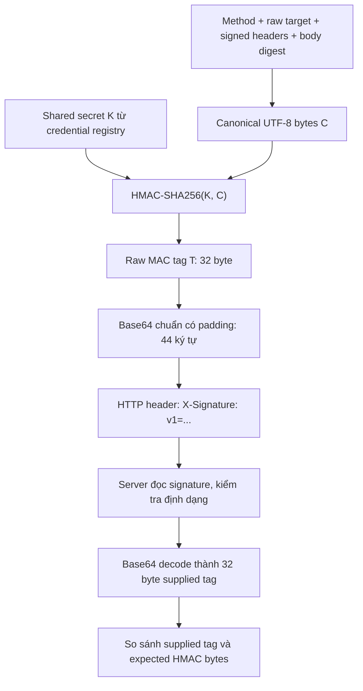

# Base64 signature: Mã hóa chữ ký HMAC để truyền an toàn qua HTTP

Trong một giao thức xác thực HTTP bằng HMAC, phép tính mật mã tạo ra **MAC output dạng byte thô** (*raw bytes*), không phải chuỗi ký tự. Nếu API cần đặt kết quả này vào header HTTP như `X-Signature`, ta phải **mã hóa byte thành một biểu diễn văn bản được cả client và server thống nhất**. Một lựa chọn phổ biến là **Base64**.

Bài **Base64 signature** thuộc chương **Encoding chữ ký** của module `SECURITY_AUTHENTICATION_HMAC_REQUEST_AUTHENTICATION`. Module hướng đến việc xác thực HTTP request bằng **shared secret**, chuỗi **canonical request** chứa method, URI, header hoặc body theo hợp đồng ký, đồng thời kiểm tra timestamp/nonce chống replay, quản lý key rotation, thử nghiệm qua proxy/gateway và phân biệt xác thực với phân quyền.

Trọng tâm bài này là sự khác biệt giữa **chữ ký HMAC thực sự (mảng byte)** và **giá trị Base64 dùng để truyền**, cách chọn một dạng encoding có phiên bản, giải mã/kiểm tra định dạng nghiêm ngặt trong Java 17, rồi so sánh MAC output an toàn. Base64 không phải một thuật toán xác thực hay mã hóa bí mật; nó chỉ là **lớp biểu diễn**.

## 1. Mục tiêu học tập

Sau bài học, bạn có thể:

1. Giải thích chuỗi xử lý **canonical bytes → HMAC raw bytes → Base64 signature → header HTTP** và chiều xác minh ngược lại.
2. Phân biệt **Base64 chuẩn**, **Base64URL**, hex, có/không padding; tính đúng độ dài tag và số ký tự biểu diễn cho HMAC-SHA256.
3. Định nghĩa một *wire contract* không nhập nhằng: version, thuật toán, đầy đủ tag hay truncation, Base64 alphabet, padding, vị trí header và giới hạn kích thước.
4. Viết Java 17 với `Mac`, `Base64.getEncoder()`, `Base64.getDecoder()`, kiểm tra **decode–reencode canonical** và so sánh raw MAC bytes bằng `MessageDigest.isEqual`.
5. Phân loại lỗi signature malformed, MAC mismatch, key/provider lỗi, replay và thiếu quyền; không biến chúng thành cùng một ngoại lệ.
6. Kiểm thử encoding, key rotation, proxy/gateway và khả năng tương thích giữa các client SDK.

## 2. Base64 signature là gì?

Giả sử client tính:

\[
T=\operatorname{HMAC\mbox{-}SHA256}(K,C)
\]

Trong đó:

- `K`: **shared secret** riêng cho một credential, được cấp phát và lưu an toàn; không gửi trong HTTP request.
- `C`: **canonical request bytes** được client tạo từ phương thức HTTP, raw URI, một số header, digest body, timestamp, nonce và audience theo hợp đồng ký.
- `T`: **MAC output 32 byte** (256 bit) khi dùng HMAC-SHA256 với **full tag**.

`T` có thể chứa các byte bằng `0x00`, `0xff` hoặc ký tự không in được. Vì thế không thể an toàn lấy `new String(T, UTF_8)` và coi kết quả là một chuỗi header HTTP. Thay vào đó:

\[
S=\operatorname{Base64}_{\mathrm{standard}}(T)
\]

Chuỗi `S` dùng ký tự ASCII có thể truyền qua header. Ví dụ hợp đồng trong bài định nghĩa:

```http
X-Signature: v1=<BASE64_CUA_32_BYTE_HMAC>
```

`v1=` là **prefix phiên bản do ứng dụng quy định**, không phải thành phần của Base64. Dấu `=` cuối chuỗi Base64 (nếu có) là **padding** theo Base64; hai dấu bằng này có vai trò khác nhau dù đều xuất hiện trong cùng giá trị header.

### Sơ đồ từ request đến signature



**Không được nhầm hai phép chuyển đổi:** chuẩn hóa **canonical request** biến dữ liệu HTTP thành bytes `C` để ký; còn **Base64 signature encoding** biến `T` thành văn bản `S` để vận chuyển. Đổi cách viết URI, header hoặc body trước HMAC làm thay đổi **dữ liệu ký**; đổi Base64 chuẩn thành Base64URL làm thay đổi **cách biểu diễn MAC** và có thể khiến parser từ chối, ngay cả khi giải mã về cùng bytes.

## 3. Độ dài chữ ký HMAC-SHA256 sau Base64

HMAC-SHA256 với full tag cho **32 byte**. Base64 mã hóa ba byte thành bốn ký tự; độ dài dạng có padding là:

\[
L_{\mathrm{Base64}}=4\left\lceil\frac{n}{3}\right\rceil
\]

Với `n = 32`, ta có `4 × ceil(32/3) = 44` ký tự. Vì `32 mod 3 = 2`, Base64 có **một dấu `=` padding ở cuối**.

| Dữ liệu / cách biểu diễn | Độ dài | Ví dụ ý nghĩa |
| --- | ---: | --- |
| Full HMAC-SHA256 raw tag | **32 byte** | Dữ liệu đưa vào phép so sánh MAC. |
| Full HMAC-SHA256 dạng hex | **64 ký tự ASCII** | Mỗi byte thành 2 chữ số hex. |
| Full HMAC-SHA256 dạng Base64 chuẩn có padding | **44 ký tự ASCII**, kết thúc bằng một `=` | Dùng làm phần signature sau `v1=` ở hợp đồng V1. |
| Full HMAC-SHA256 dạng Base64URL không padding | **43 ký tự ASCII** | Một hợp đồng khác, thích hợp hơn cho URL. |
| Header value `v1=` + Base64 chuẩn | **47 ký tự ASCII** | Bao gồm prefix phiên bản dài 3 ký tự. |
| Full HMAC-SHA512 raw tag | **64 byte** | Thuật toán khác; không suy ra độ dài 32 byte. |
| Full HMAC-SHA512 Base64 có padding | **88 ký tự ASCII** | Định dạng khác phải có policy tương ứng. |

Những con số trên giả định **không cắt ngắn tag**. Nếu sản phẩm chủ động dùng truncated HMAC, phải định nghĩa đầy đủ thuật toán, số byte tag, điều kiện chấp nhận và phân tích an toàn trong **phiên bản giao thức riêng**. Không cho client tự gửi 16 byte rồi server chỉ so 16 byte đầu của MAC 32 byte vì “cũng decode được”.

**Giới hạn quan trọng:** Base64 làm dài hơn dữ liệu thô khoảng một phần ba. Nó **không tăng entropy, không mã hóa bí mật, không tăng sức mạnh HMAC**. Tag 32 byte biểu diễn bằng Base64 vẫn chỉ là cùng 32 byte đó.

### Khi đọc signature qua HTTP

Ví dụ một header có dạng:

```http
X-Signature: v1=AAAAAAAAAAAAAAAAAAAAAAAAAAAAAAAAAAAAAAAAAAA=
```

Phần Base64 sau `v1=` có đúng 44 ký tự và decode ra 32 byte bằng `0x00`. **Đây chỉ là ví dụ encoding**, không phải chữ ký HMAC hợp lệ của request thực tế. Kiểm tra độ dài đúng **không có nghĩa** chữ ký đúng: server vẫn phải tính HMAC từ secret và canonical request rồi so sánh tag.

## 4. Base64 chuẩn, Base64URL và MIME Base64

Để hai SDK cùng tính đúng signature, phải chọn **một** biến thể Base64 trên wire.

| Biến thể | Alphabet chính | Padding | API Java 17 | Dùng ở đâu? |
| --- | --- | --- | --- | --- |
| **Base64 chuẩn (RFC 4648)** | `A–Z a–z 0–9 + /` | Thường dùng `=` theo hợp đồng. | `Base64.getEncoder()` / `Base64.getDecoder()` | Header HTTP `X-Signature` trong V1. |
| **Base64URL (RFC 4648)** | `A–Z a–z 0–9 - _` | Có thể có/không tùy hợp đồng; Java có `withoutPadding()`. | `Base64.getUrlEncoder()` / `Base64.getUrlDecoder()` | Query parameter, URL, token URL-safe theo hợp đồng khác. |
| **MIME Base64** | Alphabet chuẩn, có thể xuống dòng và bỏ qua một số ký tự ngoài alphabet khi giải mã. | Theo định dạng MIME. | `Base64.getMimeEncoder()` / `Base64.getMimeDecoder()` | Nội dung MIME; **không phù hợp parser signature strict**. |
| **Hex** | `0–9 a–f` hoặc có quy tắc chữ hoa riêng. | Không có. | `HexFormat` | Test vector, log kiểm thử an toàn, protocol chọn hex. |

Khác biệt dễ thấy: Base64URL thay ký tự `+` thành `-` và `/` thành `_`. Nhưng với những MAC tình cờ không sinh ra `+` hay `/`, hai chuỗi **có thể trùng nhau về ký tự**; đừng dựa vào “nhìn chuỗi” để đoán Base64 variant. Server phải chọn decoder **dựa vào version/protocol**.

**Hợp đồng V1 của bài:** dùng **Base64 chuẩn có padding bắt buộc**. Không tự chuyển sang Base64URL khi gặp lỗi, không thử cả hai decoder rồi nhận cái nào thành công. Nếu cần signature trong URL, hãy tạo **phiên bản có Base64URL** và quy tắc URL encoding tương ứng.

### Tại sao đưa Base64 chuẩn vào query dễ gặp lỗi?

Ký tự `+` trong giá trị query thường được framework xử lý theo quy tắc `application/x-www-form-urlencoded` như khoảng trắng; `/` hoặc `=` cũng có thể bị biến đổi khi qua parser hoặc encode URL. Nếu muốn truyền signature bằng query (trường hợp có yêu cầu cụ thể), thường nên thiết kế phiên bản dùng **Base64URL** và ký/kiểm tra chính xác raw target. Tuy nhiên, **signature trong URL** có nguy cơ bị ghi vào access log, browser history, proxy cache hoặc referrer. Với API machine-to-machine, đặt signature trong header HTTPS thường dễ quản trị hơn.

### Không dùng MIME decoder để “chữa” signature

`Base64.getMimeDecoder()` có thể bỏ qua whitespace hay ký tự ngoài alphabet trong những trường hợp mà `getDecoder()` từ chối. Đối với chữ ký bảo mật, tự làm sạch `\r`, `\n`, khoảng trắng, tab hoặc ký tự lạ có thể che khuất lỗi parser/header injection. Hãy **từ chối chuỗi không đúng định dạng**, không cố sửa nó.

## 5. Canonical Base64: cùng tag phải có một biểu diễn được phép

Base64 là cách ánh xạ các nhóm 6 bit thành ký tự. Với những byte không đủ ba phần tử ở nhóm cuối, Base64 có **padding bits** và các dấu `=`. Nếu decoder nới lỏng chấp nhận dữ liệu có padding bits sai hoặc chuỗi thiếu padding, nhiều chuỗi văn bản khác nhau có thể giải mã về cùng byte.

Để tránh nhập nhằng, V1 quy định:

1. Giá trị header **bắt đầu chính xác** bằng `v1=`.
2. Sau prefix có **đúng 44 ký tự Base64 chuẩn**, ký tự cuối là `=`, không thêm khoảng trắng hoặc newline.
3. Decoder phải tạo **đúng 32 byte** full HMAC-SHA256 tag.
4. **Encode lại** 32 byte bằng `Base64.getEncoder().encodeToString(bytes)` và so sánh chuỗi kết quả với đoạn header đã nhận; nếu khác, **từ chối**.
5. MAC được so sánh trên **byte arrays**, không so các chuỗi được người gửi tự format.

Điều kiện decode–reencode giúp ép biểu diễn về một dạng duy nhất, kể cả khi decoder có hành vi cho phép dạng không canonical. Nó cũng giảm phụ thuộc vào việc decoder bên này và bên kia có cùng chính sách padding hay không.

### Ví dụ parser chấp nhận và từ chối

| Header value | Xử lý V1 | Vì sao |
| --- | --- | --- |
| `v1=<44 ký tự Base64 chuẩn với padding đúng>` | Tiếp tục decode và kiểm tra MAC. | Đúng wire format, **chưa chắc HMAC đúng**. |
| `v1=<43 ký tự Base64 không padding>` | Từ chối. | Thiếu padding và sai độ dài V1. |
| `v1=<Base64URL với - hoặc _>` | Từ chối. | Sai alphabet V1. |
| `V1=<Base64>` | Từ chối. | Version prefix phân biệt chữ hoa/thường. |
| `v2=<Base64>` | Từ chối nếu credential/endpoint chỉ hỗ trợ V1. | Không tự fallback sang version khác. |
| `v1= <Base64>` | Từ chối. | Khoảng trắng thừa trong signature value. |
| `v1=<Base64>\n` | Từ chối. | Không chấp nhận newline/MIME wrapping. |
| `v1=<Base64><ký tự lạ>` | Từ chối. | Không tự strip ký tự ngoài alphabet. |
| Hai header `X-Signature` khác case | Từ chối. | Duplicate security header có thể bị parser chọn first/last. |
| Header có đúng kích thước nhưng MAC sai | Từ chối xác thực. | Đúng encoding **không đồng nghĩa** đúng chữ ký. |

**Lưu ý HTTP parser:** Một số framework có thể loại *optional whitespace* (OWS) quanh field value theo cú pháp HTTP trước khi ứng dụng đọc được nó. Code verifier ở tầng Java chỉ kiểm tra **giá trị mà adapter cung cấp**, không tự chứng minh được client đã gửi raw header như thế nào. Với các quy tắc đòi hỏi từ chối biểu diễn trên wire không phù hợp, phải thực thi ở **HTTP ingress/gateway có khả năng quan sát và chặn**; không giả định parser giữ nguyên bằng chứng.

## 6. Hợp đồng ký HMAC request và Base64 signature

Tạo chữ ký không bắt đầu từ chuỗi Base64; nó bắt đầu từ **canonical request**. Ví dụ giao thức `HMAC-SHA256-V1` cho API `orders-api-prod`:

| Thành phần | Quy tắc V1 minh họa |
| --- | --- |
| Thuật toán JCA | `HmacSHA256`, chỉ do server policy định nghĩa. |
| Shared secret | Cấp riêng cho mỗi `keyId` bằng nguồn ngẫu nhiên mật mã; secret production mới tối thiểu 32 byte. |
| Method | Chính xác `POST`. |
| Request target | Raw origin-form `/v1/orders` (endpoint ví dụ), không tự chuẩn hóa ngoài contract. |
| Header được ký | `Content-Type`, `X-Key-Id`, `X-Timestamp`, `X-Nonce`; field name lowercase và thứ tự cố định. |
| Body digest | SHA-256 của **raw HTTP content bytes** (ở V1 không cho phép `Content-Encoding`), viết hex chữ thường. |
| Audience | `orders-api-prod` được ký. |
| Canonical encoding | UTF-8, LF giữa các dòng, không LF cuối. |
| Signature header | `X-Signature: v1=<Base64 chuẩn có padding từ full 32-byte HMAC>`. |
| Freshness | Timestamp UTC trong cửa sổ, nonce một lần cho `keyId`. |

Request ví dụ:

```http
POST /v1/orders HTTP/1.1
Host: api.example.test
Content-Type: application/json
X-Key-Id: partner-a-202611
X-Timestamp: 2026-11-28T02:00:00Z
X-Nonce: Zq8DxKtUokcwPGNj3d_yvQ
X-Signature: v1=<BASE64_HMAC_SHA256>

{"sku":"BK-42","quantity":2}
```

Canonical request mà client và server **tự dựng bằng cùng hợp đồng**:

```text
HMAC-SHA256-V1
orders-api-prod
POST
/v1/orders
content-type:application/json
x-key-id:partner-a-202611
x-timestamp:2026-11-28T02:00:00Z
x-nonce:Zq8DxKtUokcwPGNj3d_yvQ
sha256:<LOWERCASE_HEX_SHA256_OF_RAW_BODY_BYTES>
```

`<...>` ở hai ví dụ là placeholder. Phía gửi **không** tự tính HMAC trên chuỗi Base64 của body hay trên chữ ký đã encode. Đúng trình tự:

\[
\begin{aligned}
D &= \operatorname{SHA256}(\mathrm{rawBodyBytes}),\\
C &= \operatorname{UTF8}(\mathrm{canonicalRequest\ containing\ hex}(D)),\\
T &= \operatorname{HMAC\mbox{-}SHA256}(\mathrm{sharedSecret},C),\\
S &= \operatorname{Base64}_{\mathrm{standard,padded}}(T).
\end{aligned}
\]

Wire header là `v1=` nối với `S`.

### Không nhầm body digest với signature

| Chuỗi | Có khóa? | Kích thước raw | Chức năng |
| --- | --- | --- | --- |
| `SHA-256(rawBody)` | Không | 32 byte | Đại diện cho body bytes trong canonical request. |
| `HMAC-SHA256(secret, canonicalRequest)` | **Có** | 32 byte | Xác thực request có đúng credential và các trường được ký không. |
| `Base64(HMAC output)` | Không thêm khóa | 44 ký tự | Vận chuyển cùng tag qua header HTTP. |

Hai output có thể cùng **độ dài 32 byte** nhưng **không được dùng thay cho nhau**. Header signature phải là Base64 của **HMAC có khóa**, không phải Base64 của SHA-256(body). Nếu chỉ hash body mà bỏ method/URI/header, người nhận không có bảo đảm từ HMAC về những trường bị bỏ khỏi hợp đồng.

## 7. Java 17: ký Base64 signature và xác minh an toàn

Ví dụ sau chạy trên Java 17 và sử dụng JCA (`Mac`) cùng `Base64`. Nó thực hiện bốn việc:

1. Tính raw HMAC-SHA256 từ secret và canonical request bytes.
2. Encode raw tag theo Base64 chuẩn, có padding, gắn prefix `v1=`.
3. Validate header **đúng 47 ký tự**, decode, kiểm tra đúng **32 byte** và re-encode để xác minh canonical representation.
4. Tính expected HMAC trên request server nhận, rồi so sánh **raw bytes** bằng `MessageDigest.isEqual`.

Để ví dụ tự chạy và tập trung vào encoding, ký trên một hợp đồng endpoint minh họa `POST /v1/orders`. Credential registry, đồng hồ, nonce store, HTTP parser và authorization phải được tích hợp riêng sau đó.

```java
import java.nio.charset.StandardCharsets;
import java.security.GeneralSecurityException;
import java.security.MessageDigest;
import java.time.Instant;
import java.time.format.DateTimeParseException;
import java.util.Arrays;
import java.util.Base64;
import java.util.HexFormat;
import javax.crypto.Mac;
import javax.crypto.spec.SecretKeySpec;

public final class Base64SignatureHmacV1 {
    private static final String ALGORITHM = "HmacSHA256";
    private static final String PREFIX = "v1=";
    private static final int TAG_BYTES = 32;
    private static final int BASE64_CHARS = 44;
    private static final int MAX_BODY = 64 * 1024;

    private Base64SignatureHmacV1() {}

    public record RequestData(
            String method,
            String rawTarget,
            String contentType,
            String keyId,
            String timestamp,
            String nonce,
            byte[] bodyBytes) {

        public RequestData {
            if (bodyBytes != null) {
                bodyBytes = bodyBytes.clone();
            }
        }

        @Override
        public byte[] bodyBytes() {
            return bodyBytes == null ? null : bodyBytes.clone();
        }
    }

    private static void validate(RequestData r) {
        if (r == null
                || !"POST".equals(r.method())
                || !"/v1/orders".equals(r.rawTarget())
                || !"application/json".equals(r.contentType())
                || r.keyId() == null
                || !r.keyId().matches("[A-Za-z0-9_-]{1,80}")
                || r.timestamp() == null
                || !r.timestamp().matches(
                      "[0-9]{4}-[0-9]{2}-[0-9]{2}T"
                      + "[0-9]{2}:[0-9]{2}:[0-9]{2}Z")
                || r.nonce() == null
                || r.bodyBytes() == null
                || r.bodyBytes().length > MAX_BODY) {
            throw new IllegalArgumentException("Invalid signed request data");
        }

        try {
            Instant.parse(r.timestamp()); // Chưa kiểm tra lệch giờ.
        } catch (DateTimeParseException ex) {
            throw new IllegalArgumentException("Invalid timestamp", ex);
        }

        // V1 yêu cầu nonce đúng 16 byte, Base64URL không padding.
        try {
            byte[] nonceBytes = Base64.getUrlDecoder().decode(r.nonce());
            if (nonceBytes.length != 16
                    || !Base64.getUrlEncoder().withoutPadding()
                            .encodeToString(nonceBytes).equals(r.nonce())) {
                throw new IllegalArgumentException("Invalid nonce format");
            }
        } catch (IllegalArgumentException ex) {
            throw new IllegalArgumentException("Invalid nonce format", ex);
        }
    }

    private static byte[] canonicalBytes(RequestData r)
            throws GeneralSecurityException {
        validate(r);
        byte[] digest = MessageDigest.getInstance("SHA-256")
                .digest(r.bodyBytes());
        String canonical = String.join("\n",
                "HMAC-SHA256-V1",
                "orders-api-prod",
                r.method(),
                r.rawTarget(),
                "content-type:" + r.contentType(),
                "x-key-id:" + r.keyId(),
                "x-timestamp:" + r.timestamp(),
                "x-nonce:" + r.nonce(),
                "sha256:" + HexFormat.of().formatHex(digest));
        return canonical.getBytes(StandardCharsets.UTF_8);
    }

    private static byte[] fullMac(byte[] secret, byte[] canonical)
            throws GeneralSecurityException {
        // Chính sách credential mới của hệ thống ví dụ: >= 32 byte random.
        if (secret == null || secret.length < 32) {
            throw new IllegalStateException("HMAC credential violates key policy");
        }
        Mac mac = Mac.getInstance(ALGORITHM);
        mac.init(new SecretKeySpec(secret, ALGORITHM));
        byte[] tag = mac.doFinal(canonical);
        if (tag.length != TAG_BYTES) {
            throw new IllegalStateException("Unexpected HMAC tag length");
        }
        return tag;
    }

    /** Base64 chuẩn, full HMAC-SHA256, padding bắt buộc. */
    public static String encodeSignature(byte[] tag) {
        if (tag == null || tag.length != TAG_BYTES) {
            throw new IllegalArgumentException("Expected full 32-byte MAC");
        }
        return PREFIX + Base64.getEncoder().encodeToString(tag);
    }

    /**
     * Không bỏ padding, không trim, không tự nhận Base64URL/MIME.
     * Sai phiên bản/encoding trả null; caller không dùng kết quả làm principal.
     */
    public static byte[] decodeSignature(String headerValue) {
        if (headerValue == null
                || headerValue.length() != PREFIX.length() + BASE64_CHARS
                || !headerValue.startsWith(PREFIX)) {
            return null;
        }
        String encoded = headerValue.substring(PREFIX.length());
        byte[] supplied;
        try {
            supplied = Base64.getDecoder().decode(encoded);
        } catch (IllegalArgumentException malformed) {
            return null;
        }
        if (supplied.length != TAG_BYTES) {
            return null;
        }
        // Chặn thiếu padding, noncanonical pad bits hoặc biểu diễn dư thừa.
        String canonical = Base64.getEncoder().encodeToString(supplied);
        return canonical.equals(encoded) ? supplied : null;
    }

    /** Chỉ quyết định tính đúng của MAC; freshness/authorization làm riêng. */
    public static boolean verify(
            byte[] activeSecret, RequestData received, String headerValue)
            throws GeneralSecurityException {
        byte[] supplied = decodeSignature(headerValue);
        if (supplied == null) {
            return false;
        }
        byte[] expected = fullMac(activeSecret, canonicalBytes(received));
        return MessageDigest.isEqual(expected, supplied);
    }

    public static String sign(byte[] secret, RequestData request)
            throws GeneralSecurityException {
        return encodeSignature(fullMac(secret, canonicalBytes(request)));
    }

    public static void main(String[] args) throws Exception {
        // Public RFC 4231 test case 1, key ngắn hơn policy production ví dụ.
        // Dùng JCA trực tiếp chỉ để kiểm tra bản thân phép HMAC.
        byte[] vectorKey = new byte[20];
        Arrays.fill(vectorKey, (byte) 0x0b);
        Mac vector = Mac.getInstance(ALGORITHM);
        vector.init(new SecretKeySpec(vectorKey, ALGORITHM));
        byte[] rawVector = vector.doFinal(
                "Hi There".getBytes(StandardCharsets.US_ASCII));
        String expectedHex =
                "b0344c61d8db38535ca8afceaf0bf12b"
              + "881dc200c9833da726e9376c2e32cff7";
        if (!expectedHex.equals(HexFormat.of().formatHex(rawVector))) {
            throw new AssertionError("RFC 4231 HMAC-SHA256 vector mismatch");
        }

        String encodedVector = encodeSignature(rawVector);
        if (encodedVector.length() != 47
                || !encodedVector.endsWith("=")
                || !Arrays.equals(rawVector, decodeSignature(encodedVector))) {
            throw new AssertionError("Base64 signature roundtrip mismatch");
        }

        byte[] secret = new byte[32]; // Test only, không phải secret thật.
        Arrays.fill(secret, (byte) 0x5a);
        byte[] body = "{\"sku\":\"BK-42\",\"quantity\":2}"
                .getBytes(StandardCharsets.UTF_8);
        RequestData request = new RequestData(
                "POST", "/v1/orders", "application/json",
                "partner-a-202611", "2026-11-28T02:00:00Z",
                "Zq8DxKtUokcwPGNj3d_yvQ", body);
        String signature = sign(secret, request);
        if (!verify(secret, request, signature)) {
            throw new AssertionError("Valid HMAC signature rejected");
        }

        // Bỏ padding không được chấp nhận dù decoder khác có thể decode.
        if (decodeSignature(signature.substring(0, signature.length() - 1))
                != null) {
            throw new AssertionError("Unpadded Base64 was accepted");
        }
        // Chuỗi signature không được tùy ý thêm whitespace.
        if (decodeSignature(signature + " ") != null) {
            throw new AssertionError("Whitespace in signature was accepted");
        }

        // Sửa một byte body: encoding hợp lệ nhưng MAC không còn đúng.
        byte[] changedBody = "{\"sku\":\"BK-42\",\"quantity\":3}"
                .getBytes(StandardCharsets.UTF_8);
        RequestData changedRequest = new RequestData(
                request.method(), request.rawTarget(), request.contentType(),
                request.keyId(), request.timestamp(), request.nonce(),
                changedBody);
        if (verify(secret, changedRequest, signature)) {
            throw new AssertionError("Modified request was accepted");
        }
        System.out.println("RFC 4231 and Base64 HMAC checks passed.");
    }
}
```

### Vì sao code không so sánh chuỗi Base64?

Hai chuỗi Base64 có thể khác nhau về padding hoặc bị một decoder nới lỏng chấp nhận cùng dữ liệu. Với **giao thức V1**, ta **từ chối** tất cả biểu diễn không canonical trước, sau đó so sánh **tag bytes**. Cách so sánh như `receivedBase64.equals(expectedBase64)` không nên là cơ chế xác minh MAC chính: nó buộc tính đúng đắn vào encoding và có thể dùng phép so sánh chuỗi không được thiết kế cho mục tiêu giảm rò rỉ thời gian.

`MessageDigest.isEqual(expected, supplied)` là API phù hợp hơn để so sánh digest/MAC byte arrays, giảm nguy cơ kiểm tra từng byte rồi return sớm theo nội dung. Dẫu vậy, không có một phép gọi Java nào tự chứng minh toàn bộ hệ thống end-to-end là **constant-time tuyệt đối** trên mọi JVM/hardware; hãy giới hạn các nhánh dựa trên dữ liệu bí mật và thực hiện kiểm tra độ dài/format **công khai, cố định** trước khi so MAC.

### Giới hạn và vị trí bổ sung policy

Code trên **chưa phải middleware HTTP production**. Lớp adapter phải lấy giá trị header đúng từ HTTP parser, phát hiện `X-Signature` trùng với bất kỳ cách viết hoa nào, kiểm tra signed header khác không nhập nhằng, giữ method/raw target/raw body và từ chối content coding không thuộc V1. Credential registry tra `keyId` và kiểm tra trạng thái ACTIVE, audience, version và thời hạn **trước** khi gọi `verify`. Timestamp chỉ được **parse cú pháp** trong class; kiểm tra tuổi request và nonce store phải được triển khai ở lớp xác thực đầy đủ.

`RequestData` clone mảng byte để tránh code khác sửa body sau khi ký; ứng dụng thực tế còn cần giới hạn request body **khi đọc stream**, quản lý bộ nhớ, và không gây side effect trước khi hoàn tất xác minh.

## 8. HMAC signature trong HTTP header: parser, duplicate và proxy

Một signature value có thể được gửi với tên header `X-Signature`, `x-signature` hoặc `X-SIGNATURE`. **Tên header HTTP là case-insensitive**, nhưng **giá trị** `v1=<Base64>` là case-sensitive.

| Hiện tượng | Cách xử lý |
| --- | --- |
| `X-Signature` ↔ `x-signature`, một occurrence. | Coi là cùng field name; đọc một value rồi kiểm tra format. |
| Hai header `X-Signature` và `x-signature`. | **Từ chối duplicate**, không chọn first/last và không join bằng dấu phẩy. |
| Client thay một ký tự chữ hoa thành chữ thường trong Base64 value. | Giá trị raw tag có thể khác; parser không lowercase value. |
| Proxy thêm OWS quanh field value. | Hợp đồng/ingress phải thống nhất việc parse; không tùy ý `trim()` trong verifier để sửa malformed input. |
| Proxy gộp duplicate thành chuỗi phân tách dấu phẩy. | Có thể mất bằng chứng trùng header; cần chặn ở ingress trước khi merge. |
| HTTP/2/HTTP/3 gửi tên field lowercase. | Hợp lệ ở tầng giao thức; signature value vẫn giữ nguyên Base64 chuẩn. |
| Reverse proxy chuyển HTTP/1.1 sang HTTP/2 nhưng giữ header value. | Base64 signature không đổi; vẫn phải kiểm tra canonical method/target/body. |
| Gateway rewrite URI, đổi method, header được ký hoặc body. | MAC mismatch dù Base64 hoàn toàn hợp lệ. |
| Client tự đặt `X-Authenticated-Client`. | Gateway phải bỏ header giả; backend chỉ tin principal đã xác thực qua kênh nội bộ bảo vệ. |

Các ký tự `+`, `/` và `=` thuộc Base64 chuẩn và có thể xuất hiện hợp lệ trong **HTTP header value**; không cần “URL-encode” chúng khi gửi header. Nhưng nếu một proxy áp dụng form decoding cho header value, đó là hành vi biến đổi **sai tầng** và sẽ gây hỏng signature. Kiểm thử trên giao thức và proxy thật, không chỉ kiểm thử `Base64.getDecoder()` trong unit test.

### Đừng dùng getter một giá trị khi chưa kiểm tra duplicate

Trong các môi trường Servlet, `request.getHeader("X-Signature")` có thể trả một value mà không chứng minh rằng client chỉ gửi đúng một occurrence. Kiểm tra hành vi `getHeaders(name)`, parser và proxy; nếu raw duplicate đã được merge hoặc bỏ ở gateway, đặt bước phát hiện **sớm hơn**. Không thể khôi phục một occurrence đã bị parser loại bỏ bằng code phía sau.

Không đưa signature production hoặc shared secret vào URL/access log, error response hoặc tracing. Khi chẩn đoán, hãy lưu request ID, mã lỗi đã làm sạch, key ID phù hợp, thuật toán/policy version và thông tin kích thước, không ghi đầy đủ giá trị signature.

## 9. Phân biệt ba kiểu lỗi khi xác minh

Một hệ thống trưởng thành không nên trả cùng một nguyên nhân nội bộ cho tất cả lỗi. Cần tách:

| Tình huống | Bước phát hiện | Ý nghĩa |
| --- | --- | --- |
| Thiếu `X-Signature` hoặc prefix sai | HTTP adapter/decoder | Request không tuân theo giao thức V1. |
| Base64 sai alphabet/padding/độ dài | `decodeSignature` | Encoding không hợp lệ; chưa cần tính HMAC. |
| Base64 đúng, tag 32 byte nhưng không bằng expected MAC | `MessageDigest.isEqual` | **MAC mismatch**; có thể sai secret hoặc canonical bytes. |
| `keyId` không tồn tại / đã revoke / sai audience | Credential registry | Từ chối xác thực trước khi chọn secret. |
| `Mac.getInstance` hoặc `Mac.init` lỗi với credential ACTIVE | JCA/provider/secret manager | Lỗi cấu hình/credential **phía server**, cần fail closed và cảnh báo. |
| Chữ ký hợp lệ nhưng timestamp quá hạn hoặc nonce đã dùng | Replay/freshness policy | Request không được chấp nhận, dù HMAC đúng. |
| Chữ ký, timestamp/nonce đều hợp lệ nhưng client không có quyền | Authorization | Từ chối theo phạm vi tài nguyên/scope; thường `403`. |

Một malformed signature có thể dẫn đến HTTP `401` hoặc lỗi request phù hợp hợp đồng; thất bại xác thực nói chung thường trả phản hồi **chung**, tránh lộ sự tồn tại của key ID hoặc thông tin về secret. **Lỗi provider/secret manager** không nên mặc định bị mô tả là “client ký sai”; cần cảnh báo nội bộ, fail closed và trả lỗi dịch vụ chung (thường `5xx` khi thích hợp).

Với các lỗi signature malformed, không tự bỏ dấu `=`, chuyển thành Base64URL hoặc thử HmacSHA1 để “cứu” request. Những cách fallback khiến việc chấp nhận chữ ký phụ thuộc input do bên ngoài kiểm soát, không còn tuân thủ một contract bất biến.

## 10. Key rotation và algorithm version: không dùng encoding để đoán khóa

Một client có thể có hai credential cùng tồn tại trong khoảng chuyển đổi:

| Key ID | Secret | Trạng thái | Encoding |
| --- | --- | --- | --- |
| `partner-a-202611` | Secret A | ACTIVE trong overlap | `v1=Base64(HmacSHA256(...))`. |
| `partner-a-202702` | Secret B | ACTIVE mới | Vẫn dùng đúng hợp đồng `v1`. |
| `partner-a-202608` | Secret cũ | REVOKED | Không được phép xác minh request mới. |

**Key rotation thay secret, không tự thay cách Base64 encode.** Client gửi `X-Key-Id` nào thì server tra **đúng secret** của key ID đó; không thử hàng loạt secret đến khi tag khớp. `X-Key-Id` là định danh công khai, phải được ràng buộc vào dữ liệu ký và chỉ được dùng để nhận diện principal **sau** khi HMAC, timestamp/nonce và policy hợp lệ.

Nếu hệ thống chuyển từ HMAC-SHA256 sang HMAC-SHA512, tag đổi từ 32 sang 64 byte. **Đó là thay đổi protocol/thuật toán**, cần version mới với quy tắc encoding và độ dài tag riêng, không đơn giản nhìn signature dài bao nhiêu rồi tự chọn thuật toán. Nếu muốn dùng Base64URL thay Base64 chuẩn, cũng phải có version hoặc một hợp đồng được phân biệt và kiểm soát rõ, tránh fallback dựa trên chuỗi do client gửi.

Khi nghi secret bị lộ, thu hồi credential và cấp secret mới. Chỉ thay key ID nhưng dùng lại secret đã lộ **không giải quyết nguy cơ giả mạo**.

## 11. Base64 signature không thay thế timestamp/nonce và authorization

Bất kể giá trị signature có được mã hóa Base64 hay không, **HMAC là phép tính xác định**: cùng key và cùng canonical request bytes sẽ cho cùng MAC. Một request có chữ ký đúng có thể được ghi lại rồi phát lại.

Vì vậy V1 ký cả:

- **Timestamp** `X-Timestamp` dưới dạng UTC có quy tắc parse/format; kiểm tra cửa sổ (ví dụ ±300 giây).
- **Nonce** `X-Nonce`, ví dụ 128 bit ngẫu nhiên biểu diễn Base64URL không padding; **chú ý** nonce và signature có thể dùng **hai biến thể Base64 khác nhau** vì thuộc hai field được quy định riêng.
- **Key ID** để chống tráo credential; audience để chống dùng signature đúng secret ở service/môi trường khác.

Sau khi HMAC hợp lệ và timestamp ở trong cửa sổ, server claim `(keyId, nonce)` bằng thao tác **nguyên tử** trong kho dùng chung. Với cửa sổ ±5 phút, timestamp nhanh 5 phút có thể còn hợp lệ đến khoảng 10 phút từ lần nhận sớm nhất; TTL nonce cần kéo dài tới khi timestamp không còn hợp lệ, cộng biên an toàn. Nếu nonce store không sẵn sàng, API bắt buộc chống replay phải **fail closed**.

Retry một request có side effect cần timestamp/nonce mới và **tính lại HMAC/Base64 signature**. Với nghiệp vụ tạo đơn, có thể cần thêm idempotency key để tránh tạo đơn trùng; nếu header đó ảnh hưởng xử lý thì nên nằm trong dữ liệu ký theo phiên bản phù hợp.

### Authentication và authorization khác nhau

`X-Signature` hợp lệ chứng minh request đã được ký bằng secret tương ứng credential và các bytes được ký không bị sửa trái phép. Nó **không** chứng minh client có quyền với mọi tài nguyên hoặc field.

Ví dụ client `partner-a` ký hợp lệ `PATCH /v1/orders/42` nhưng chỉ có quyền xem đơn hàng: backend vẫn phải từ chối sửa. Một tag được mã hóa đúng Base64 cũng không nói lên danh tính; chỉ sau khi **tra key ID, xác minh MAC và kiểm tra policy**, principal `clientId` mới được tin. Sau đó cần kiểm tra **method + URI + tenant + resource + scope** và các điều kiện nghiệp vụ.

## 12. Ma trận kiểm thử Base64 signature

| Test case | Kết quả mong đợi |
| --- | --- |
| HMAC-SHA256 theo RFC 4231 test case 1. | Raw MAC hex đúng `b0344c61d8db38535ca8afceaf0bf12b881dc200c9833da726e9376c2e32cff7`. |
| Raw tag 32 byte encode Base64 chuẩn. | Đúng 44 ký tự Base64, một dấu `=` cuối; `v1=` + phần tag dài 47 ký tự. |
| Decode rồi encode lại một signature V1 hợp lệ. | Chuỗi mới **đúng bằng** chuỗi gốc, raw tag 32 byte. |
| Thiếu padding `=` cuối. | V1 từ chối, dù một decoder nới lỏng có thể giải mã. |
| Base64URL không padding. | V1 từ chối nếu sai độ dài/alphabet; không fallback decoder. |
| Base64 chứa CR, LF, tab, khoảng trắng hoặc ký tự không thuộc alphabet. | V1 từ chối; không dùng MIME decoder để bỏ ký tự. |
| Prefix `V1=`, `v2=` hoặc bỏ prefix. | V1 từ chối nếu không được policy cho phép. |
| Raw supplied tag chỉ 16 byte. | V1 từ chối, không tự truncation expected MAC. |
| Tag đủ 32 byte và Base64 hợp lệ nhưng sai HMAC. | Authentication bị từ chối; encoding đúng không đủ. |
| Đổi một byte body, method, raw target, signed header, timestamp hoặc nonce. | MAC cũ không khớp nếu trường đó được ký. |
| Chỉ thay kiểu viết hoa của **tên** `X-Signature`. | Đọc được cùng field; giá trị và MAC không đổi. |
| Thay chữ hoa/thường trong **giá trị Base64**. | Chuỗi khác, MAC có thể khác; không lowercase value. |
| Gửi hai field `X-Signature` và `x-signature`. | Từ chối duplicate ở ingress/adapter. |
| Client HTTP/1.1 qua HTTP/2 proxy, giữ signature value. | Decode giống nhau; HMAC còn phụ thuộc method/URI/header/body được bảo toàn. |
| Key đã REVOKED hoặc phiên bản credential sai audience. | Từ chối dù signature đúng trên dữ liệu cũ. |
| Gửi lại cùng nonce đến hai instance đồng thời. | Kho nonce dùng chung chỉ chấp nhận tối đa một claim. |
| Signature đúng nhưng thiếu quyền `orders:cancel`. | Authentication có thể đúng, authorization từ chối. |

Nên có **test vector liên ngôn ngữ** ghi dữ liệu thử nghiệm không nhạy cảm: bytes secret, HTTP method, raw target, signed headers, raw body bytes, SHA-256(body), canonical UTF-8 bytes, HMAC raw tag dạng hex, Base64 chuẩn có padding và header `v1=...`. So sánh đủ **cả raw MAC và wire string** giúp phân biệt lỗi mã hóa với lỗi canonicalization.

## 13. Bài tập thực hành

### Bài 1 — Tại sao không `new String(rawMac, UTF_8)`?

Một developer muốn đặt kết quả `Mac.doFinal()` trực tiếp vào header HTTP bằng cách tạo Java `String` từ mảng 32 byte. Điều gì có thể sai?

**Gợi ý:** Raw MAC là dữ liệu nhị phân tùy ý, có thể chứa byte không đại diện ký tự UTF-8 hợp lệ hoặc ký tự điều khiển. Chuyển String có thể làm thay dữ liệu hoặc tạo header không hợp lệ. Phải Base64-encode raw bytes theo contract rồi gửi.

### Bài 2 — 32 byte HMAC-SHA256 thành bao nhiêu ký tự?

Hãy tính độ dài Base64 chuẩn có padding của tag 32 byte và toàn bộ `X-Signature` value khi prefix là `v1=`.

**Gợi ý:** `4 × ceil(32/3) = 44` ký tự Base64, trong đó có **một dấu = ở cuối**. Prefix `v1=` dài ba ký tự, nên value tổng dài **47**.

### Bài 3 — Có thể bỏ padding vì Java vẫn decode được?

Client gửi Base64 chuẩn không padding với full HMAC-SHA256. Decoder của một SDK có thể đọc ra đúng 32 byte. V1 bắt buộc có padding. Server nên nhận không?

**Gợi ý:** Không. Giao thức đã quy định **một biểu diễn canonical**; chấp nhận padding tùy ý làm phát sinh nhiều wire value tương đương và khác hành vi giữa SDK. Nếu muốn thay đổi, tạo contract/version rõ.

### Bài 4 — Base64URL dùng được trong header không?

Một client gửi Base64URL không padding trong header `X-Signature`. Đây có phải chuỗi không thể dùng trong HTTP header?

**Gợi ý:** Base64URL là cách biểu diễn hợp lệ về mặt ký tự và **có thể** dùng làm giá trị header nếu protocol chọn nó. Nhưng **V1 của bài chọn Base64 chuẩn có padding**, nên server V1 phải từ chối chứ không tự đoán encoding.

### Bài 5 — Encoding đúng, chữ ký vẫn sai

Client encode tag đúng Base64, server decode ra đúng 32 byte, nhưng `MessageDigest.isEqual` trả false. Hãy nêu ít nhất bốn nguyên nhân không thuộc Base64.

**Gợi ý:** Client/server khác secret; khác key ID/rotation; raw URI bị rewrite; signed header khác; JSON body bị serialize lại; timestamp/nonce khác; canonical newline/UTF-8 khác; audience không giống nhau. Debug bằng test vector **không nhạy cảm**, không log secret production.

### Bài 6 — Signature đúng có đủ chống replay?

Một request HMAC hợp lệ bị bắt lại, gửi lần nữa với **cùng nonce và signature**. Base64 signature hoàn toàn đúng. Server có nên chạy nghiệp vụ lần thứ hai?

**Gợi ý:** Không. HMAC và Base64 không tạo freshness. Kho nonce dùng chung phải phát hiện `(keyId, nonce)` đã claim; chỉ có thể retry hợp lệ bằng timestamp/nonce mới và signature mới, kết hợp idempotency nếu nghiệp vụ cần.

## 14. Checklist triển khai và kết luận

Trước khi đưa Base64 signature vào production:

- [ ] Giao thức quy định rõ **thuật toán, raw tag length, encoding variant, padding và signature version**.
- [ ] Chỉ dùng **Base64 chuẩn có padding** cho signature V1; không tự fallback Base64URL/hex/MIME khi nhận dữ liệu khác contract.
- [ ] Client **tính raw HMAC trên canonical request bytes**, sau đó mới Base64-encode tag; không HMAC chuỗi Base64 thay vì canonical bytes.
- [ ] Server decode Base64 thành **đúng 32 byte**, re-encode để bảo đảm canonical representation, so với expected HMAC bằng `MessageDigest.isEqual`.
- [ ] Header value `v1=...` có giới hạn kích thước và không bị trim/lowercase/ghép nhiều lần tùy ý; chặn duplicate `X-Signature` ở HTTP adapter/ingress.
- [ ] Chữ hoa/thường của **header name** được xử lý theo HTTP; **signature value** giữ nguyên từng ký tự.
- [ ] Có test vector cho raw MAC, Base64 string, prefix, padding, malformed input và sửa byte dữ liệu ký.
- [ ] HTTP method, raw URI, signed header, body digest và audience được dựng thống nhất qua client–proxy–gateway–backend.
- [ ] `keyId` ánh xạ tới đúng credential ACTIVE, có key rotation/revoke; không thử nhiều secret khi signature sai.
- [ ] Timestamp/nonce nằm trong canonical request và được xác minh bằng clock window + nonce store claim nguyên tử, **fail closed** khi hạ tầng chống replay lỗi.
- [ ] Danh tính chỉ được tin sau khi HMAC và freshness hợp lệ; backend vẫn kiểm tra **authorization** cho hành động/tài nguyên.
- [ ] Không đưa secret, raw signature production hoặc canonical request có dữ liệu nhạy cảm vào URL, error response hoặc log.

**Kết luận:** **Base64 signature là cách vận chuyển kết quả HMAC, không phải bản thân cơ chế xác thực.** Với HMAC-SHA256 full tag, kết quả là **32 byte raw MAC**, được biểu diễn thành **44 ký tự Base64 chuẩn có padding** (hay **47 ký tự** khi kèm `v1=`). Client và server phải thống nhất định dạng wire, từ chối dạng nhập nhằng và so sánh **bytes đã decode** với HMAC kỳ vọng. Để thực sự xác thực HTTP request, chữ ký đó còn phải gắn với một **canonical request chính xác**, secret còn hiệu lực, chống replay, key rotation và phân quyền độc lập.
