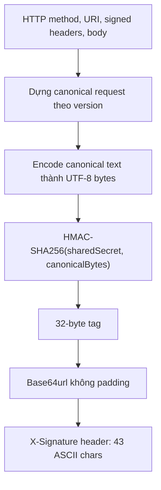
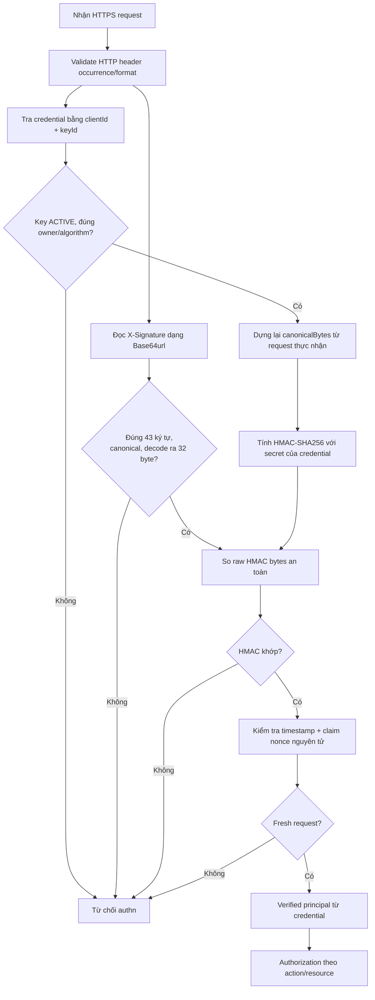
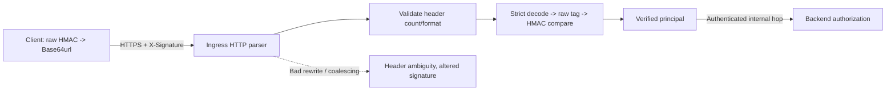

# Base64url

## 1. Base64url giải quyết vấn đề nào trong HMAC request authentication?

Trong module **SECURITY_AUTHENTICATION_HMAC_REQUEST_AUTHENTICATION**, client và server dùng chung **shared secret** để xác thực một HTTP request. Hai phía thống nhất hợp đồng ký (*canonical request*) bao gồm HTTP method, URI, các header đã chọn và body/hash body. Client tính HMAC trên đúng chuỗi byte đó; server tái tạo cùng chuỗi byte và tính HMAC để kiểm tra.

Một HMAC-SHA256 trả về **32 byte dữ liệu nhị phân**. Những byte này không thể tùy tiện chèn vào một HTTP header hoặc URL như văn bản UTF-8: chúng có thể chứa byte NUL, control characters hoặc những byte không biểu diễn được thành chuỗi hợp lệ. **Base64url** chuyển mảng byte nhị phân thành **chuỗi ASCII an toàn cho ngữ cảnh URL**, đồng thời sử dụng thuận tiện trong header HTTP.

```text
canonical HTTP request --UTF-8--> canonicalBytes
                                  |
                            HMAC-SHA256(secret, canonicalBytes)
                                  |
                            32-byte raw MAC tag
                                  |
                      Base64url encode, no padding
                                  |
                   X-Signature: <43 ASCII characters>
```

**Điểm cốt lõi:** Base64url chỉ là **biểu diễn của chữ ký**, không phải thuật toán ký, không phải một lớp mã hóa giữ bí mật và không tự xác thực client. Giá trị Base64url có thể đọc/giải mã bởi bất kỳ ai. Tính xác thực đến từ việc **HMAC tag khớp** với tag server tự tính bằng shared secret tin cậy.

Bài học *Base64url* thuộc chương **Encoding chữ ký**. Sau bài, người học có thể:

- Phân biệt Base64 chuẩn với Base64url theo RFC 4648, bao gồm alphabet, dấu `=` và no-padding.
- Giải thích vì sao HMAC-SHA256 có output 32 byte được biểu diễn bằng **43 ký tự Base64url không padding**.
- Thiết kế hợp đồng `X-Signature` nghiêm ngặt, chỉ chấp nhận **một biểu diễn chuẩn duy nhất** của tag.
- Viết Java 17 để encode/decode, validate format, so sánh raw HMAC bytes và xử lý lỗi mà không bypass authentication.
- Kiểm thử header, query, proxy/gateway, timestamp/nonce, key rotation và ranh giới **authentication/authorization**.
- Dùng **golden test vector độc lập** để phát hiện các lỗi mà test `sign() -> verify()` trong cùng class có thể bỏ sót.

## 2. Base64url khác Base64 chuẩn ở những ký tự nào?

Base64 (RFC 4648) chuyển **3 byte** thành **4 ký tự** bằng cách chia dữ liệu thành các nhóm 6 bit. Bộ ký tự thông dụng của Base64 có 64 ký tự; Base64url dùng phần lớn cùng alphabet nhưng thay hai ký tự có thể gây vấn đề trong URL.

| Chỉ số trong alphabet | Base64 chuẩn | Base64url |
| --- | --- | --- |
| 0–25 | `A–Z` | `A–Z` |
| 26–51 | `a–z` | `a–z` |
| 52–61 | `0–9` | `0–9` |
| 62 | `+` | **`-`** |
| 63 | `/` | **`_`** |
| Padding khi byte không chia hết cho 3 | Thường dùng `=` | Có thể dùng `=` theo protocol; **bài này cấm padding** |

Ví dụ với ba byte:

```text
Raw bytes (hex): fb ff ff
Base64:          +///
Base64url:       -___
```

Hai chuỗi trên giải mã về **cùng ba byte**, nhưng sử dụng alphabet khác nhau. Chúng **không được** sử dụng thay thế một cách tùy ý trong giao thức ký đã chọn Base64url.

Một số ví dụ dễ kiểm tra:

| Byte input | Base64 chuẩn | Base64url có padding | Base64url không padding |
| --- | --- | --- | --- |
| UTF-8 `foo` | `Zm9v` | `Zm9v` | `Zm9v` |
| UTF-8 `fo` | `Zm8=` | `Zm8=` | `Zm8` |
| UTF-8 `f` | `Zg==` | `Zg==` | `Zg` |
| Byte `FF` (hex) | `/w==` | `_w==` | `_w` |
| Byte `FB FF FF` (hex) | `+///` | `-___` | `-___` |

**Vì sao cần URL-safe alphabet?** Ký tự `+` có thể bị trình xử lý query kiểu `application/x-www-form-urlencoded` hiểu thành dấu cách; `/` là ký tự có vai trò phân tách path trong URL. Dấu `=` có thể cần escape hoặc gây mơ hồ trong một số giao diện truyền dữ liệu. Base64url sử dụng `-` và `_` giúp giảm những va chạm này.

Tuy nhiên, dùng Base64url **không có nghĩa được đưa secret hoặc token vào URL tùy ý**. URL/query có thể bị ghi vào access log, history, analytics và referrer. Với xác thực request HMAC, nên truyền tag qua **header chuyên dụng**, sử dụng TLS và giới hạn log.

### 2.1. Base64url không phải URL encoding

Ba thao tác khác nhau cần tránh nhầm lẫn:

- **Base64url encoding:** mảng byte `FB FF FF` → `-___`.
- **Percent encoding của URL:** biến một byte/ký tự cần escape thành dạng `%HH`, chẳng hạn `+` → `%2B`.
- **Form decoding:** một số parser query hiểu dấu `+` thô là dấu cách.

Không tạo chữ ký bằng cách “Base64 chuẩn trước, rồi URL-encode chuỗi” nếu hợp đồng yêu cầu **Base64url không padding**. Hai chuỗi có thể được decode về cùng tag nhưng **khác biểu diễn**, gây khó liên thông, cache/key comparison không nhất quán hoặc nhiều alias cho cùng bằng chứng mật mã.

## 3. Vì sao 32-byte HMAC-SHA256 thành 43 ký tự?

HMAC-SHA256 có đầu ra **256 bit = 32 byte**.

Base64 biểu diễn mỗi ký tự bằng 6 bit, nên độ dài dạng có padding là:

```text
encodedPaddedLength = 4 * ceil(byteCount / 3)

HMAC-SHA256: 4 * ceil(32 / 3)
           = 4 * 11
           = 44 characters
```

Vì `32 = 10*3 + 2`, nhóm cuối chỉ có 2 byte nên Base64 chuẩn có **một dấu `=`** ở cuối. Nếu hợp đồng chọn Base64url **không padding**, bỏ `=` cuối, còn **43 ký tự**.

```text
HMAC-SHA256:            32 raw bytes
Base64url có padding:   44 ký tự, ký tự cuối là "="
Base64url no-padding:   43 ký tự, không có "="
```

Đây là **độ dài tag của HMAC-SHA256 nguyên vẹn**, không phải độ dài chung cho mọi thuật toán. Ví dụ:

| Primitive/output | Byte output | Base64url không padding |
| --- | ---: | ---: |
| HMAC-SHA256, tag đầy đủ | 32 | 43 ký tự |
| HMAC-SHA512, tag đầy đủ | 64 | 86 ký tự |
| HMAC-SHA256 cắt xuống 16 byte theo giao thức riêng | 16 | 22 ký tự |

**Trong hợp đồng của bài này, không cắt tag.** Việc chấp nhận tag ngắn hơn, tự bỏ vài byte, hoặc “so prefix” là thay đổi mức bảo mật và phải được thiết kế/đánh giá riêng.

### 3.1. Padding bits và tính canonical

Base64 dùng nhóm 6 bit. Với input 32 byte, ký tự Base64url thứ 43 chỉ chứa 4 bit có dữ liệu thực; **hai bit thấp còn lại là padding bits và phải bằng 0** trong biểu diễn canonical.

Một số decoder chỉ quan tâm các bit dữ liệu và có thể giải mã nhiều chuỗi khác nhau về **cùng một mảng 32 byte** nếu bits không sử dụng không được kiểm soát. Do đó, một decoder trả 32 byte **chưa chắc** chứng minh chuỗi ban đầu có **cách viết duy nhất**.

Giao thức nên kiểm tra:

1. Alphabet chỉ gồm `A–Z`, `a–z`, `0–9`, `-`, `_`.
2. Độ dài **chính xác 43 ký tự**, không có `=`, SP, TAB hay xuống dòng.
3. Decode Base64url thành **đúng 32 byte**.
4. **Encode ngược** byte vừa decode bằng Base64url no-padding và yêu cầu chuỗi nhận được **trùng chính xác** chuỗi đầu vào.

Bước 4 kiểm tra representation canonical (bao gồm bits dư ở nhóm cuối). Không nên giả định mọi thư viện decoder luôn kiểm tra các bit này theo cùng một cách.

**Lưu ý:** So sánh văn bản `encoded.equals(input)` ở bước 4 chỉ dùng để **kiểm tra cách viết canonical**; bước chứng minh xác thực vẫn phải so sánh **raw HMAC bytes** với kết quả tính lại một cách an toàn về thời gian.

## 4. Chuỗi thao tác đúng: ký byte, rồi mới encode

### 4.1. Luồng ở client



Thứ tự này quan trọng: **HMAC nhận byte canonical request**, không nhận chuỗi `Base64url(canonical request)` trừ khi hợp đồng giao thức **quy định rõ** điều đó. Base64url ở đây **chỉ dùng để vận chuyển output tag**.

### 4.2. Luồng ở server



Không có bước nào cho phép client đưa **canonical request do họ tự khai** rồi yêu cầu server tin luôn. Server phải dựng input từ request thực nhận ở điểm xác minh đã thống nhất. Nếu proxy rewrite path/query/header trước bước này mà không có hợp đồng đáng tin, HMAC có thể thất bại hoặc bảo vệ sai ngữ nghĩa.

### 4.3. Những lỗi thường gặp

```java
// SAI: dùng byte tag HMAC trực tiếp làm UTF-8 string.
String signature = new String(rawMacBytes, StandardCharsets.UTF_8);

// SAI: dùng Base64 chuẩn thay cho Base64url theo hợp đồng.
String signature = Base64.getEncoder()
        .encodeToString(rawMacBytes);

// SAI: HMAC trên chuỗi hex/tag đã encode thay vì canonical request.
// Mac mac = ...;
// byte[] tag = mac.doFinal(base64Text.getBytes(UTF_8));

// ĐÚNG: chỉ encode SAU khi đã tính HMAC trên canonicalBytes.
String signature = Base64.getUrlEncoder().withoutPadding()
        .encodeToString(rawMacBytes);
```

Ví dụ thứ hai **không làm thay đổi byte HMAC**, nhưng làm thay đổi **cách vận chuyển**: output có thể chứa `+`, `/` và `=`, vi phạm Base64url no-padding contract.

## 5. Hợp đồng ký mẫu: HTTP-HMAC-B64URL-V1

Để việc kiểm thử không phụ thuộc suy đoán, bài này định nghĩa **một hợp đồng minh họa riêng**, không phải chuẩn bắt buộc của JCA hay mọi API. Hợp đồng có hai phần:

- **Canonical request input:** chỉ rõ những byte đi vào HMAC.
- **Signature encoding:** chỉ rõ cách biến 32-byte HMAC tag thành giá trị header `X-Signature`.

### 5.1. Request được ký

```http
POST /v1/payments?currency=VND HTTP/1.1
Host: api.example.test
Content-Type: application/json
X-Client-Id: merchant-42
X-Key-Id: key-2026-11
X-Timestamp: 1790000000
X-Nonce: A1b2C3d4E5f6G7h8
X-Signature: <43-character-base64url-no-padding>

{"paymentId":"p-101","amount":250000}
```

Hợp đồng quy định:

1. Method đúng case `POST`, raw path `/v1/payments` và raw query `currency=VND` được lấy tại điểm xác minh trước rewrite.
2. Authority `api.example.test` được ingress kiểm tra theo host/tenant policy; không tin `X-Forwarded-Host` tự khai.
3. Signed headers bắt buộc: `content-type`, `x-client-id`, `x-key-id`, `x-timestamp`, `x-nonce`. Tên lowercase và thứ tự cố định; từ chối duplicate/missing và CR/LF trong header value.
4. Content-Type ở ví dụ chính xác `application/json`. Mọi field có ý nghĩa khác đối với nghiệp vụ phải được ký hoặc bảo vệ bởi trust boundary tương đương.
5. Body hash là SHA-256 hex chữ thường của **đúng body bytes UTF-8 như client gửi**, sau khi loại transfer framing, trước khi JSON parser reserialize.
6. Kết hợp các dòng bằng LF (`\n`), **không thêm LF cuối**, mã hóa toàn bộ bằng UTF-8.
7. Secret HMAC-SHA256 được tra từ credential store theo `clientId + keyId`, không do client gửi. Algorithm gắn với credential/policy server; không cho header từ client tự chọn crypto primitive.
8. Signature header **không nằm trong canonical request** vì nó là kết quả HMAC; giá trị của header bắt buộc là Base64url **no-padding**, đúng 43 ký tự, tương ứng toàn bộ 32 byte.

### 5.2. Canonical request 11 dòng

```text
HTTP-HMAC-B64URL-V1
POST
/v1/payments
currency=VND
authority:api.example.test
content-type:application/json
x-client-id:merchant-42
x-key-id:key-2026-11
x-timestamp:1790000000
x-nonce:A1b2C3d4E5f6G7h8
a52d7498729a2c266afcb91b926ed2188e2c646b66613d69d7c87b9677ad34e8
```

Dòng cuối là SHA-256 **đã tính** cho body byte sequence:

```json
{"paymentId":"p-101","amount":250000}
```

Không có xuống dòng trong JSON body fixture. Canonical input trên có **11 dòng**, **265 byte UTF-8** và không có dấu LF ở cuối.

Đây là hợp đồng test có method/path cố định để dễ minh họa, không phải một giao thức mọi endpoint phải dùng. Với API thật cần quy định chi tiết percent encoding, query trùng, authority/Host, signed headers và body content coding để client–gateway–server hiểu cùng các byte.

## 6. Golden test vector: biết chính xác output đúng

**Test key cố định và công khai**, chỉ dùng trong bài thực hành:

```text
Key hex (32 bytes):
000102030405060708090a0b0c0d0e0f101112131415161718191a1b1c1d1e1f

Canonical input:
11 dòng UTF-8 ở mục 5.2; LF, không LF cuối, 265 bytes

SHA-256(body) hex:
a52d7498729a2c266afcb91b926ed2188e2c646b66613d69d7c87b9677ad34e8

HMAC-SHA256 raw tag hex (32 bytes):
63aa6a1d9b21d14a0e322849f1cc32f83006949cc5bf6354f0ad0091c0e4ba98

Base64 chuẩn có padding:
Y6pqHZsh0UoOMihJ8cwy+DAGlJzFv2NU8K0AkcDkupg=

Base64url KHÔNG padding (43 ký tự):
Y6pqHZsh0UoOMihJ8cwy-DAGlJzFv2NU8K0AkcDkupg
```

Golden vector này được tính độc lập bằng HMAC-SHA256 trên byte input kể trên. Dấu `+` trong Base64 chuẩn được thay bằng `-` trong Base64url, và dấu `=` cuối bị bỏ. Hai chuỗi decode về **cùng tag bytes**, nhưng hợp đồng chỉ chấp nhận **chuỗi Base64url không padding**.

Đừng nhầm golden test với end-to-end authentication: timestamp `1790000000` là giá trị fixture cố định, không bảo đảm còn trong cửa sổ cho phép khi chạy. Golden vector kiểm tra **canonicalization, HMAC và encoding**; integration test xác thực cần sinh timestamp/nonce mới, dựng lại canonical request rồi ký lại.

### 6.1. Tại sao cần expected tag độc lập?

Nếu một nhóm cùng viết `encode()` và `decode()` bị nhầm thành Base64 chuẩn, phép test `decode(encode(raw))` vẫn thành công. Tương tự, `sign()` và `verify()` có thể cùng bỏ mất một header quan trọng mà round-trip test vẫn xanh.

Một vector chất lượng cần lưu **secret test**, exact canonical bytes, raw tag bytes và expected Base64url. Sau đó:

- Assert HMAC trên canonical bytes bằng expected raw tag.
- Assert encode của expected raw tag bằng expected Base64url.
- Assert decode strict của expected Base64url bằng expected raw tag.
- Assert bản padded/base64-standard và alias không canonical **bị từ chối bởi protocol**.
- Assert sửa một byte trong dữ liệu đã ký không thể dùng lại tag cũ.

## 7. Java 17: encode/decode Base64url nghiêm ngặt

JDK hỗ trợ trực tiếp thông qua:

- `Base64.getUrlEncoder().withoutPadding()`: tạo chuỗi Base64url không padding.
- `Base64.getUrlDecoder()`: giải mã alphabet URL-safe. Decoder **không thay thế toàn bộ protocol validation**.
- `Mac.getInstance("HmacSHA256")`: tính tag raw bytes.
- `MessageDigest.isEqual(expected, supplied)`: so tag bytes phù hợp cho kiểm tra MAC.

Ví dụ dưới đây là một helper độc lập, có thể chạy với Java 17, dùng chính test vector ở mục 6.

```java
import java.nio.charset.StandardCharsets;
import java.security.GeneralSecurityException;
import java.security.MessageDigest;
import java.util.Arrays;
import java.util.Base64;
import java.util.HexFormat;
import java.util.regex.Pattern;
import javax.crypto.Mac;
import javax.crypto.spec.SecretKeySpec;

public final class HmacBase64UrlV1 {
    private static final String HMAC = "HmacSHA256";
    private static final int TAG_BYTES = 32;
    private static final Pattern ENCODED_TAG =
        Pattern.compile("[A-Za-z0-9_-]{43}");

    private HmacBase64UrlV1() {}

    public static String encodeTag(byte[] rawTag) {
        if (rawTag == null || rawTag.length != TAG_BYTES) {
            throw new IllegalArgumentException("Expected 32-byte HMAC tag");
        }
        return Base64.getUrlEncoder().withoutPadding()
            .encodeToString(rawTag);
    }

    // Ném IllegalArgumentException cho chữ ký không đúng wire format.
    public static byte[] decodeCanonicalTag(String encoded) {
        if (encoded == null
                || !ENCODED_TAG.matcher(encoded).matches()) {
            throw new IllegalArgumentException(
                "Signature must be 43 Base64url characters");
        }

        final byte[] tag;
        try {
            tag = Base64.getUrlDecoder().decode(encoded);
        } catch (IllegalArgumentException malformed) {
            throw new IllegalArgumentException(
                "Malformed Base64url signature", malformed);
        }
        if (tag.length != TAG_BYTES) {
            throw new IllegalArgumentException("HMAC tag length mismatch");
        }

        // Chặn alias không canonical, kể cả bits dư ở nhóm cuối.
        if (!encodeTag(tag).equals(encoded)) {
            throw new IllegalArgumentException(
                "Noncanonical Base64url signature");
        }
        return tag;
    }

    public static byte[] hmacSha256(byte[] sharedSecret,
                                    byte[] canonicalBytes)
            throws GeneralSecurityException {
        if (sharedSecret == null || sharedSecret.length < 32
                || canonicalBytes == null) {
            throw new IllegalArgumentException(
                "Invalid configured secret/canonical bytes");
        }
        Mac mac = Mac.getInstance(HMAC);
        mac.init(new SecretKeySpec(sharedSecret, HMAC));
        return mac.doFinal(canonicalBytes);
    }

    public static String sign(byte[] sharedSecret,
                              byte[] canonicalBytes)
            throws GeneralSecurityException {
        return encodeTag(hmacSha256(sharedSecret, canonicalBytes));
    }

    public static boolean verify(byte[] sharedSecret,
                                 byte[] canonicalBytes,
                                 String suppliedSignature)
            throws GeneralSecurityException {
        final byte[] received;
        try {
            received = decodeCanonicalTag(suppliedSignature);
        } catch (IllegalArgumentException invalidSignatureFormat) {
            return false;
        }

        // So MAC BYTES, không so text được encode.
        byte[] expected = hmacSha256(sharedSecret, canonicalBytes);
        return MessageDigest.isEqual(expected, received);
    }

    // Fixture có body JSON và 11 dòng canonical request.
    private static byte[] canonicalFixture()
            throws GeneralSecurityException {
        byte[] body = (
            "{\"paymentId\":\"p-101\",\"amount\":250000}"
        ).getBytes(StandardCharsets.UTF_8);
        String digest = HexFormat.of().formatHex(
            MessageDigest.getInstance("SHA-256").digest(body)
        );

        String canonical = String.join("\n",
            "HTTP-HMAC-B64URL-V1",
            "POST",
            "/v1/payments",
            "currency=VND",
            "authority:api.example.test",
            "content-type:application/json",
            "x-client-id:merchant-42",
            "x-key-id:key-2026-11",
            "x-timestamp:1790000000",
            "x-nonce:A1b2C3d4E5f6G7h8",
            digest
        );
        return canonical.getBytes(StandardCharsets.UTF_8);
    }

    private static void mustReject(String input) {
        try {
            decodeCanonicalTag(input);
            throw new AssertionError("Expected rejected signature");
        } catch (IllegalArgumentException expected) {
            // Đúng: input không thuộc giao thức wire của V1.
        }
    }

    public static void main(String[] args)
            throws GeneralSecurityException {
        byte[] key = new byte[32];
        for (int i = 0; i < key.length; i++) {
            key[i] = (byte) i; // 00..1f; TEST KEY, không dùng production.
        }

        byte[] canonical = canonicalFixture();
        if (canonical.length != 265) {
            throw new AssertionError("Canonical input bytes changed");
        }

        String expectedHex =
            "63aa6a1d9b21d14a0e322849f1cc32f8"
          + "3006949cc5bf6354f0ad0091c0e4ba98";
        byte[] raw = hmacSha256(key, canonical);
        if (!Arrays.equals(raw, HexFormat.of().parseHex(expectedHex))) {
            throw new AssertionError("Raw HMAC mismatch");
        }

        String expectedUrl =
            "Y6pqHZsh0UoOMihJ8cwy-DAGlJzFv2NU8K0AkcDkupg";
        if (!encodeTag(raw).equals(expectedUrl)) {
            throw new AssertionError("Base64url mismatch");
        }
        if (!verify(key, canonical, expectedUrl)) {
            throw new AssertionError("Golden signature must verify");
        }

        // Không nhận padding hoặc alphabet Base64 chuẩn.
        mustReject(expectedUrl + "=");
        mustReject(
            "Y6pqHZsh0UoOMihJ8cwy+DAGlJzFv2NU8K0AkcDkupg");
        mustReject(" " + expectedUrl);
        mustReject(expectedUrl + "\n");

        // Tag kết thúc bằng 'g'. Thay bằng 'h' tạo alias có
        // low-order pad bits khác, nhưng không phải canonical.
        mustReject(expectedUrl.substring(0, 42) + "h");

        // Đổi dữ liệu đã ký, giữ tag cũ => HMAC không khớp.
        byte[] tampered = Arrays.copyOf(canonical, canonical.length);
        tampered[0] ^= 1;
        if (verify(key, tampered, expectedUrl)) {
            throw new AssertionError("Tampered request must fail");
        }

        System.out.println("HMAC/Base64url test vectors OK");
    }
}
```

### 7.1. Vì sao validator có nhiều lớp?

1. **Regex/alphabet và độ dài:** từ chối sớm signature có dấu `=`, `+`, `/`, SP/HTAB, newline và Unicode. Chỉ chấp nhận **43 ký tự ASCII** đúng contract.
2. **Decode:** biến chuỗi thành bytes bằng `getUrlDecoder()`; bắt `IllegalArgumentException` cho input sai cú pháp.
3. **Raw length:** yêu cầu tag **32 byte**, không tùy ý nhận 16 byte, 64 byte hoặc tag bị cắt.
4. **Re-encode canonical:** bảo đảm chỉ một cách viết Base64url được chấp nhận cho cùng raw tag, kể cả bits dư ở nhóm cuối.
5. **HMAC và comparison:** tính tag độc lập từ canonical request và shared secret tin cậy; `MessageDigest.isEqual` so **32 raw bytes**. Không dùng `String.equals` trên chuỗi chữ ký để thay thế bước xác minh mật mã.

`MessageDigest.isEqual` được dùng nhằm hạn chế rò thông tin so sánh tag, nhưng **nó không tự làm toàn bộ API constant-time**. Kiểm tra độ dài/định dạng, credential lookup và lỗi API vẫn có thể khác thời gian. Ứng dụng cần giới hạn tốc độ, phân loại lỗi nội bộ hợp lý và tránh các phản hồi làm lộ thông tin khóa hoặc credential.

### 7.2. Giới hạn của ví dụ Java

- `canonicalFixture()` dùng **request test cố định** để xác nhận HMAC và Base64url; production phải dựng canonical bytes từ HTTP request thực nhận, kiểm tra method, raw URI/query, signed headers, duplicate, body representation, authority và protocol version.
- `hmacSha256()` từ chối secret ngắn hơn 32 byte **theo chính sách ví dụ**. Secret thực cần sinh bằng CSPRNG, cấp riêng theo client/môi trường và lưu an toàn. **Không** nhận secret từ header signature.
- `verify()` chỉ xác minh HMAC. Nó chưa kiểm tra credential state, timestamp, nonce, key rotation hay quyền nghiệp vụ; các bước đó phải được thêm vào authentication pipeline.
- Nếu `Mac.getInstance` không có provider hoặc `mac.init` không nhận key, exception là **lỗi hệ thống/credential**. Không catch rồi cho request qua, cũng không fallback sang thuật toán yếu hơn.
- Header `X-Signature` ở HTTP adapter phải có **một occurrence duy nhất**. Hàm nhận `String` ở đây không thể tự phát hiện hai header đã bị proxy/framework gộp từ trước.
- Đừng nhầm `HexFormat` trong fixture (để biểu diễn body digest) với Base64url của **raw HMAC tag**. Hai định dạng dùng cho hai mục đích khác nhau.

## 8. Hợp đồng wire: header, Authorization và query

### 8.1. Ví dụ dùng X-Signature

```http
POST /v1/payments?currency=VND HTTP/1.1
Host: api.example.test
X-Client-Id: merchant-42
X-Key-Id: key-2026-11
X-Timestamp: 1790000000
X-Nonce: A1b2C3d4E5f6G7h8
Content-Type: application/json
X-Signature: Y6pqHZsh0UoOMihJ8cwy-DAGlJzFv2NU8K0AkcDkupg

{"paymentId":"p-101","amount":250000}
```

Đây là **request fixture** phù hợp với dữ liệu ký và key test ở mục 6. Trong hệ thống thật, timestamp cố định sẽ hết hạn, nên không coi đây là request production có thể gọi thành công bất kỳ lúc nào.

**Điều cần kiểm thử ở ingress:**

- Chỉ có một header `X-Signature`; từ chối duplicate cùng tên, kể cả khác case.
- Header không chứa newline, CR, dấu cách dư, dấu `=` hoặc ký tự không nằm trong Base64url no-padding alphabet theo contract.
- Không tự động `trim()` các ký tự ngoài quy tắc protocol để “cứu” input không hợp lệ. Nếu HTTP parser đã xử lý OWS framing ở rìa, verifier kiểm tra chính xác **header value mà hợp đồng định nghĩa**; tránh hai bộ xử lý khác nhau.
- Không lấy chữ ký từ `X-Original-Signature` hay `X-Forwarded-*` do bên gọi tự đặt.
- Không thêm `X-Signature` vào danh sách trường canonical signed headers: ký trên chữ ký sẽ tạo vòng phụ thuộc.

### 8.2. Nếu đặt Base64url trong query parameter

Một số dịch vụ sử dụng signed URL trong đó signature nằm trong query. Base64url giảm nhu cầu percent-encoding cho `+`, `/` và `=`, nhưng phải quy định rõ:

1. Signature parameter **bị loại khỏi phần dữ liệu được ký** theo quy tắc xác định, tương tự loại header `X-Signature`.
2. Phải từ chối **duplicate signature parameter** (`sig=a&sig=b`) trước khi parser chọn giá trị đầu/cuối.
3. Dựng canonical query theo hợp đồng, không parse `+` thành space trong một phía nhưng giữ nguyên ở phía khác.
4. Không thay đổi chữ ký bằng cách URL-decode **thêm một lần**; chữ ký phải được kiểm tra đúng Base64url representation đã công bố.
5. Hạn chế TTL, nonce/idempotency và rủi ro URL xuất hiện trong browser history, logs, proxies, referrer; không đưa shared secret vào URL.

Bài học này ưu tiên **header transport**; nếu xây signed URL, cần một version hợp đồng riêng mô tả cách tách signature field khỏi query đã ký.

### 8.3. Không nhầm với JWT/JWS

JWT/JWS cũng sử dụng Base64url trong một số thành phần, nhưng **không có nghĩa** một chuỗi 43 ký tự Base64url ở `X-Signature` là JWT. JWT compact representation thường có các phần ngăn bằng dấu `.` và có quy tắc ký khác.

Không tự lấy chữ ký JWT, token OAuth hay giá trị `Authorization: Bearer ...` rồi cho qua verifier HMAC request chỉ vì chúng đều có thể chứa ký tự Base64url. **Format giống nhau không đồng nghĩa cơ chế xác thực giống nhau.**

## 9. Gateway/proxy và những lỗi encoding thường gặp



| Biến đổi | Rủi ro | Cách kiểm thử hoặc phòng ngừa |
| --- | --- | --- |
| Gateway đổi case tên `X-Signature` | Tên field HTTP case-insensitive | Tìm đúng field dù tên lowercase; giá trị signature **case-sensitive** |
| Gateway thêm SP ở đầu/cuối giá trị | Có thể khác contract, parser xử lý OWS | Định nghĩa ranh giới parse; không tự trim tùy tiện ở verifier |
| Gateway gộp hai `X-Signature` | Mất thông tin duplicate hoặc tạo chuỗi có dấu phẩy | Reject duplicate trước khi coalesce |
| Chuyển Base64url thành Base64 chuẩn | `-` thành `+`, `_` thành `/`, có thể thêm `=` | Không đổi encoding sau khi ký; strict contract reject |
| Header bị split/wrapped thành nhiều dòng | CR/LF/obs-fold, parser disagreement | Reject hoặc chặn tại HTTP stack |
| API client gửi `+` trong query thay vì `-` | Form decoder có thể biến dấu cộng thành SP | Dùng Base64url và kiểm thử qua query parser |
| Proxy percent-encode dấu `-` hoặc `_` | Signature text có thể bị thay đổi representation | Chốt cách đọc raw/decoded query; không decode tùy tiện |
| Middleware tự `URLDecoder.decode` signature header | Biến dữ liệu header theo cú pháp query không phù hợp | Header value phải được xử lý theo wire contract, không form-decode |
| HTTP/1.1 → HTTP/2/3 | Header names lowercase, framing khác | Ký semantic components; kiểm thử header value không đổi và không duplicate |
| Gateway rewrite URI/body sau xác minh | Business có thể xử lý request khác input đã ký | Verify trước transform hoặc chuyển trusted representation |
| Backend được gọi không qua gateway | Có thể bỏ bước HMAC | Kiểm soát network/mTLS hoặc thêm verifier tương đương |
| Signature nằm trong access log | Có thể bị sao chép để replay khi nonce layer sai | Redact signature, bảo vệ log và kiểm tra nonce |

**Quan sát:** Chữ ký Base64url trong header không thay đổi chỉ vì HTTP/2 yêu cầu tên field lowercase. Tên header và **giá trị signature** là hai phần khác nhau; giá trị Base64url **phân biệt chữ hoa/thường** và không được lowercase.

Nếu verifier ở gateway rồi truyền principal xuống backend, gateway phải xóa các header `X-Verified-Client` do bên ngoài tự gửi trước khi đặt metadata đã xác thực. Backend chỉ tin principal khi kết nối/nguồn được xác thực (ví dụ mTLS hoặc internal assertion đã kiểm tra), không chỉ vì header trông hợp lệ.

## 10. Định tuyến lỗi: format, HMAC, freshness và quyền

Không nên gom mọi lỗi vào một “Base64 decode failed”, vì điều đó che nguyên nhân và làm việc vận hành sai hướng.

| Nhóm lỗi | Ví dụ | Bản chất | Hành vi an toàn |
| --- | --- | --- | --- |
| **Malformed signature** | `X-Signature` thiếu, duplicate, dài 42/44, có `+`, `/`, `=`, whitespace | Input không tuân thủ giao thức encoding | Từ chối authentication; không gọi nghiệp vụ |
| **Noncanonical Base64url** | Ký tự cuối thay bits đệm nhưng decode ra cùng bytes | Nhiều cách viết cho cùng raw tag | Từ chối trước HMAC comparison |
| **Invalid HMAC** | Chuỗi encoding chuẩn nhưng tag không khớp | Dữ liệu, secret hoặc chữ ký không đúng | Từ chối authentication |
| **Credential revoked** | Key ID bị thu hồi dù raw HMAC khớp | Credential không được phép | Từ chối authentication ở mọi verifier |
| **Replay/stale request** | Tag đúng nhưng timestamp cũ/nonce đã dùng | Không chứng minh độ mới | Từ chối authentication |
| **Authorization denied** | Authn thành công nhưng principal thiếu scope | Không đủ quyền trên action/resource | Thường `403 Forbidden` |
| **Cryptographic backend unavailable** | `NoSuchAlgorithmException` hoặc key store lỗi | Hạ tầng không thể xác minh an toàn | **Fail-closed**; trả lỗi dịch vụ phù hợp, không cho qua |

Về HTTP, credential thiếu/sai hoặc không xác thực thường được xử lý thành **401 Unauthorized** theo API contract; một hệ thống cũng có thể dùng **400** cho thông điệp sai cú pháp rất sớm. Quan trọng hơn mã số cụ thể là **không có đường xử lý nghiệp vụ vượt qua bước xác minh**. Lỗi hạ tầng như provider thiếu thuật toán hoặc nonce store hỏng nên được báo nội bộ rõ ràng; không giả vờ đó là chữ ký client sai hàng loạt.

**Không log** raw shared secret, full request body nhạy cảm hoặc toàn bộ chữ ký production để “debug”. Có thể log mã lỗi, request ID, key ID đã được kiểm tra theo chính sách, độ dài signature, hash/fingerprint hạn chế và thời điểm phát sinh; giới hạn quyền truy cập log.

## 11. Timestamp, nonce và key rotation không nằm trong Base64url

Một tag Base64url hợp lệ về mặt định dạng vẫn có thể là bản sao của một request cũ. Đây là rủi ro **replay**, không phải lỗi encoding.

Quy trình an toàn:

1. Dùng `(clientId, keyId)` để tra đúng credential, kiểm tra algorithm `HmacSHA256`, môi trường, chủ sở hữu và trạng thái `ACTIVE`.
2. Dựng canonical request từ method, raw URI/query, signed headers và body hash tại authentication boundary.
3. Strict decode `X-Signature` thành 32-byte tag, tính lại HMAC rồi so raw bytes.
4. Kiểm tra timestamp đã ký nằm trong cửa sổ, ví dụ ±300 giây theo clock server đáng tin.
5. Claim **nonce đã ký** bằng thao tác nguyên tử trong kho chia sẻ theo client, TTL đủ bao phủ cửa sổ hiệu lực; từ chối mọi lần claim sau.
6. Tạo verified principal từ credential đã xác minh rồi mới chạy authorization theo scope, action và resource; áp dụng idempotency nghiệp vụ với các thao tác nhạy cảm.

**Không claim nonce trước HMAC**: attacker không có secret có thể gửi request giả để chiếm nonce của client hợp lệ. Nếu nonce store không khả dụng, endpoint nhạy cảm phải fail-closed.

**Key rotation:** `X-Key-Id` được đưa vào dữ liệu ký để lựa chọn secret theo bản ghi phía server. Rotation định kỳ có thể có giai đoạn chuyển đổi được phê duyệt; key nghi bị lộ phải `REVOKED` ngay ở mọi verifier. Việc đổi key **không làm thay đổi Base64url format** nếu vẫn dùng HMAC-SHA256 nguyên vẹn: raw tag vẫn 32 byte và text vẫn 43 ký tự.

**Secret bị lộ:** kẻ có secret có thể tạo **tag mới, timestamp mới và nonce mới**, encode Base64url hoàn toàn hợp lệ. Base64url, timestamp và nonce không thể khắc phục compromise của shared secret; cần thu hồi key và điều tra phạm vi ảnh hưởng.

**Phân quyền:** client có secret hợp lệ có thể ký request tạo thanh toán cho một tài khoản không thuộc quyền của mình. HMAC authentication có thể thành công; service vẫn phải trả **403** (hoặc phản hồi che giấu tài nguyên theo policy) nếu quyền không đủ. Một chuỗi chữ ký đẹp không đồng nghĩa người gọi có quyền nghiệp vụ.

## 12. Ma trận kiểm thử Base64url và xác thực request

Để học hiệu quả, tách test **encoding thuần**, **sign/verify**, **HTTP integration** và **security/replay**. Sử dụng key test cố định cho golden vectors; tuyệt đối không sao chép secret production vào test.

### 12.1. Encoding và canonical representation

| Test | Input / thao tác | Expected |
| --- | --- | --- |
| E01 | Encode UTF-8 `foo` | `Zm9v` |
| E02 | Encode UTF-8 `fo` no-padding | `Zm8` |
| E03 | Encode UTF-8 `f` no-padding | `Zg` |
| E04 | Encode `FB FF FF` | `-___`; không phải `+///` |
| E05 | Encode byte `FF` | `_w`; không phải `/w==` |
| E06 | Encode 32-byte raw tag | **43 ký tự**, regex Base64url no-padding |
| E07 | Input có `+` | Reject, alphabet Base64 chuẩn |
| E08 | Input có `/` | Reject, alphabet Base64 chuẩn |
| E09 | Input kết thúc bằng `=` | Reject, padding không thuộc V1 |
| E10 | Input có SP/HTAB | Reject, không tự trim để cho qua |
| E11 | Input có CR/LF | Reject, không coi MIME line wrap là hợp lệ |
| E12 | Input có Unicode homoglyph hoặc ký tự ngoài ASCII | Reject |
| E13 | Input 42 hoặc 44 ký tự | Reject trước decode |
| E14 | Input 43 ký tự nhưng decode không ra 32 byte | Reject |
| E15 | Ký tự cuối thay đổi nonzero pad bits, vẫn decode cùng raw bytes ở decoder lỏng | **Reject** vì re-encode không trùng |
| E16 | Gọi encode cho byte array 16 hoặc 64 byte | Reject theo tag-size policy của V1 |

### 12.2. Golden vectors, tamper và JCA

| Test | Input / thao tác | Expected |
| --- | --- | --- |
| C01 | Exact canonical bytes ở mục 5.2 | **265 UTF-8 bytes** |
| C02 | Body fixture `{"paymentId":"p-101","amount":250000}` | SHA-256 đúng `a52d7498...7ad34e8` |
| C03 | HMAC key bytes `00..1f` và input fixture | Raw tag hex đúng `63aa6a1d...c0e4ba98` |
| C04 | Base64url của golden raw tag | `Y6pqHZsh0UoOMihJ8cwy-DAGlJzFv2NU8K0AkcDkupg` |
| C05 | Giải mã golden tag | Raw bytes khớp 32-byte expected |
| C06 | Đổi một byte method/path/query đã ký, giữ chữ ký | Verify fail |
| C07 | Đổi signed `Content-Type`, `X-Client-Id` hay `X-Key-Id` | Reject policy/credential hoặc HMAC fail |
| C08 | Đổi một byte body, giữ chữ ký | Body digest/HMAC khác |
| C09 | Secret khác nhưng cùng canonical bytes | Verify fail |
| C10 | Invalid Base64url nhưng HMAC implementation hoạt động | Fail authentication, không cấp principal |
| C11 | Provider không hỗ trợ `HmacSHA256` | Fail-closed, không fallback |
| C12 | HMAC đúng nhưng thiếu key ID hoặc key ID không thuộc client | Reject authn |
| C13 | Header signature trùng hai lần | Reject trước khi chọn một value |

### 12.3. Gateway/proxy, replay và authorization

| Test | Tình huống | Expected |
| --- | --- | --- |
| I01 | HTTP/1.1 tên `X-Signature` đổi case | Vẫn tìm đúng field; **không đổi case value** |
| I02 | HTTP/2 gửi tên header lowercase | Signature value được giữ nguyên |
| I03 | Gateway chèn `+`, `/` hoặc `=` theo kiểu Base64 thường | Strict validator từ chối |
| I04 | Proxy gộp hai `X-Signature` | Reject duplicate tại ingress |
| I05 | Query parser đổi `+` thành space nếu dùng Base64 thường | Test chứng minh Base64url tránh lỗi này |
| I06 | Proxy tự percent-encode/decode signature | Phải tương thích contract hoặc reject, không đoán nhiều dạng |
| I07 | Gateway rewrite path/query/body sau verify | Chặn biến đổi có ý nghĩa hoặc truyền trusted representation |
| I08 | Caller tự đặt `X-Verified-Client: admin` | Không cấp principal admin |
| I09 | Timestamp đã ký quá hạn dù tag đúng | Reject freshness |
| I10 | Replay nguyên request trong cửa sổ | HMAC đúng nhưng nonce bị từ chối |
| I11 | Hai replica cùng claim nonce | Tối đa một claim thành công |
| I12 | Nonce store mất kết nối | Endpoint nhạy cảm fail-closed |
| I13 | Key đã `REVOKED` dù tag đúng theo secret cũ | Reject trên mọi verifier |
| I14 | Key rotation tạo key ID mới với cùng HmacSHA256 | Tag format **vẫn 43 ký tự**, key-state được kiểm tra |
| I15 | HMAC hợp lệ nhưng principal thiếu quyền thanh toán | Authentication pass, authorization reject `403` |
| I16 | Backend có đường truy cập bỏ qua gateway | Test phát hiện/bịt bypass authentication boundary |
| I17 | Access log chứa đầy đủ secret hay signature | Test/redaction policy phát hiện rò rỉ |
| I18 | Quá nhiều signature sai từ một client/IP | Rate limit và metrics hoạt động; không lộ key |

### 12.4. Property-based tests đáng bổ sung

- Với mọi mảng **32 byte**, `decodeCanonicalTag(encodeTag(bytes))` phải trả lại đúng bytes.
- Với mọi input được `decodeCanonicalTag` chấp nhận, `encodeTag(decoded)` phải **trùng chính xác input**.
- Với mọi input có độ dài khác 43 hoặc có ký tự ngoài alphabet, validator phải từ chối mà không thực thi nghiệp vụ.
- Với mọi canonical request khác fixture ở một byte đã ký, golden signature cũ phải thất bại **trừ xác suất va chạm mật mã cực kỳ nhỏ**. Không viết assertion yêu cầu thay mọi byte của input luôn tạo raw tag khác trong mọi trường hợp về mặt toán học.
- Với mọi thứ tự header được hợp đồng coi tương đương, canonical bytes và signature phải giống nhau; với một thay đổi đã được ký, signature cũ không được chấp nhận.
- Với mọi timestamp/nonce đã ký bị sửa mà không ký lại, HMAC cũ phải không xác minh được; với tag đúng nhưng nonce lặp, tầng replay phải từ chối.

## 13. Tình huống thực tế và hướng giải

### Tình huống A — Client Java dùng nhầm Base64 chuẩn

Client ký HMAC-SHA256 đúng nhưng dùng `Base64.getEncoder()`; header có chữ `+` và dấu `=`. Server dùng `Base64.getUrlDecoder()` và báo chữ ký sai.

**Phân tích:** Chữ ký raw bytes có thể hoàn toàn đúng; **encoding không đúng hợp đồng**. Sửa client thành `Base64.getUrlEncoder().withoutPadding()`, giữ nguyên HMAC secret và canonical bytes. Không nên nới server để “thử cả hai encoding” cho đến khi một kiểu khớp.

### Tình huống B — Decode thành công, nhưng representation không canonical

Một signature dài 43 ký tự, dùng alphabet Base64url, decoder trả đúng 32 byte. Tuy nhiên ký tự cuối bị đổi ở những bits không mang dữ liệu, nên encode lại không ra chuỗi ban đầu.

**Phân tích:** **Reject.** Decoder lỏng có thể cho nhiều chuỗi ký tự tương ứng cùng tag; strict wire contract của V1 yêu cầu **re-encode equality**. Trong golden vector, có thể thay ký tự cuối `g` thành `h` để kiểm tra rejection; nếu decoder từ chối ngay ở bước parse cũng là kết quả an toàn.

### Tình huống C — Chữ ký đẹp nhưng verify HMAC sai qua gateway

Client gửi đúng Base64url 43 ký tự; backend decode ra 32 byte nhưng tag khác giá trị tự tính. Gateway đã thay `/public/v1/payments` thành `/v1/payments` trước khi backend dựng canonical request.

**Phân tích:** Đây là **canonicalization boundary mismatch**, không phải lỗi Base64url. Cần xác minh trên cùng method/path/query/header/body đã thỏa thuận, thường tại ingress trước rewrite, hoặc truyền representation đáng tin. Không sửa bằng cách decode/encode lại signature.

### Tình huống D — HMAC đúng và Base64url đúng, vẫn bị từ chối

Client lấy đúng secret, ký request có timestamp cũ và nonce đã được dùng. Server xác minh tag chính xác nhưng trả 401.

**Phân tích:** Đúng chính sách. Base64url là format, HMAC là authentication of bytes, còn **timestamp và nonce** bảo đảm độ mới. Cần tạo timestamp/nonce mới rồi **ký lại toàn bộ canonical request**, không tái sử dụng tag cũ.

### Tình huống E — Key rotation làm thay đổi số ký tự signature?

Team đổi secret HMAC-SHA256 và key ID; một người đề xuất chuyển từ 43 sang 64 ký tự vì key dài hơn.

**Phân tích:** Sai. Độ dài Base64url phụ thuộc **số byte output tag**, không phụ thuộc chiều dài key. HMAC-SHA256 full tag vẫn 32 byte → 43 ký tự no-padding. Nếu đổi primitive hoặc dùng truncated tag theo phiên bản giao thức khác mới cần điều chỉnh format và policy.

### Tình huống F — Verifier tin chữ ký đã decode là đủ xác thực

Server nhận `X-Signature` đúng 43 ký tự và decode ra 32 byte, sau đó gắn `VerifiedPrincipal(merchant-42)` mà không tính lại HMAC.

**Phân tích:** Đây là **authentication bypass**. Bất cứ ai cũng có thể tạo 32 byte ngẫu nhiên rồi Base64url-encode. Server chỉ được cấp principal sau khi **tra credential đáng tin, tính lại HMAC trên canonical request và so raw bytes**, kiểm tra freshness và key state.

### Tình huống G — HMAC đúng nhưng vượt quyền

Client `merchant-42` có secret hợp lệ ký thao tác thanh toán cho account `merchant-73`. Base64url/HMAC và timestamp/nonce đều đúng.

**Phân tích:** Xác thực thành công nhưng **authorization vẫn phải kiểm tra quyền đối với tài khoản và giao dịch**. Không chấp nhận chỉ vì client tự ký account ID, và không dùng ký tự Base64url hay header client ID làm bằng chứng đủ quyền.

## 14. Checklist triển khai Base64url production

- [ ] Hợp đồng quy định rõ **RFC 4648 Base64url alphabet**, padding policy và số byte raw tag; không trộn Base64 chuẩn với Base64url.
- [ ] Với HMAC-SHA256 full tag: yêu cầu **32 byte raw**, **43 ký tự Base64url không padding**.
- [ ] Kiểm tra alphabet, length, decode, raw tag length và **canonical re-encoding**; từ chối alias/malformed input.
- [ ] Tạo HMAC **trên canonical request bytes**, chỉ Base64url-encode **output tag**.
- [ ] So raw HMAC bytes bằng phương pháp so sánh phù hợp, không thay thế xác minh bằng `encodedString.equals`.
- [ ] Chỉ một header signature được phép; phát hiện duplicate trước khi proxy/framework gộp, không chấp nhận CR/LF, SP/HTAB dư hoặc MIME line wrapping ngoài contract.
- [ ] Có **golden test vector độc lập** cho exact canonical bytes, tag raw hex và Base64url, không chỉ sign/verify round-trip trong một implementation.
- [ ] Chuẩn hóa method, URI/query, selected headers và body digest theo **một phiên bản hợp đồng** nhất quán qua client/gateway/backend.
- [ ] Không đưa `X-Signature` vào dữ liệu được ký; nếu dùng signed URL phải có quy tắc loại signature parameter khỏi canonical query rõ ràng.
- [ ] Tra shared secret theo client ID + key ID trong credential store tin cậy, kiểm tra algorithm, môi trường, rotation và revocation; không log secret.
- [ ] Ký timestamp/nonce; sau HMAC hợp lệ mới claim nonce nguyên tử với TTL phù hợp; fail-closed khi không thể xác minh an toàn.
- [ ] Truyền verified principal qua boundary nội bộ có xác thực nguồn, không tin header danh tính do client tự đặt.
- [ ] Authorization riêng theo principal, action và resource; idempotency nghiệp vụ không bị thay thế bởi encoding hoặc HMAC.
- [ ] Kiểm thử HTTP/1.1–HTTP/2/3, proxy/gateway, duplicate signature, strict format, key rotation, replay race và lỗi hạ tầng.
- [ ] Không coi Base64url là mã hóa bí mật, không đưa signature/secret vào URL hoặc log tràn lan; dùng TLS và chính sách bảo vệ telemetry.

**Kết luận:** Trong HMAC request authentication, **Base64url là bước vận chuyển raw MAC tag thành văn bản ASCII**, không phải primitive mật mã. Một hệ thống đúng phải **ký chính xác canonical request bytes, tính HMAC-SHA256 ra 32 byte, encode thành 43 ký tự Base64url không padding**, rồi phía nhận kiểm tra **đúng representation và so raw tag bytes** với kết quả tự tính. Chỉ khi kết hợp với timestamp/nonce, key rotation, trust boundary ở gateway và authorization độc lập, chữ ký mới góp phần bảo vệ đúng HTTP request thực thi.

