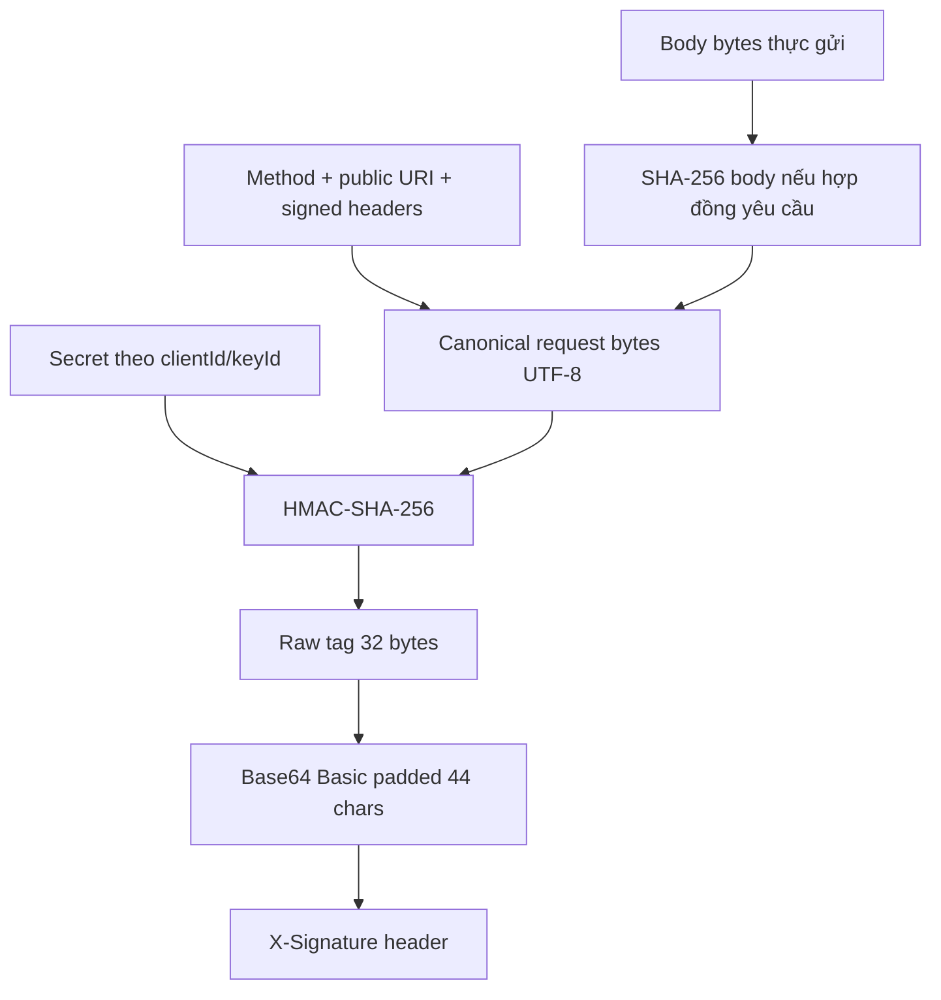
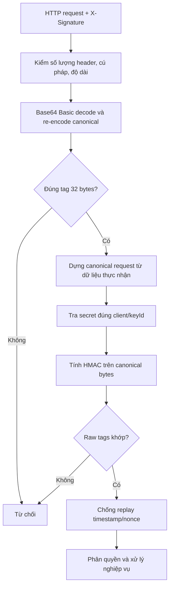

# Padding Base64

## 1. Vì sao padding Base64 quan trọng khi truyền chữ ký HMAC?

Trong xác thực HTTP request bằng **HMAC và shared secret**, bên gửi dựng một **canonical request** từ phương thức HTTP, URI, các header và/hoặc body theo hợp đồng ký. Sau đó bên gửi tính HMAC trên **byte** canonical request. Java `javax.crypto.Mac.doFinal(...)` trả về một `byte[]` chứa **MAC tag thô**. Những byte này không phải lúc nào cũng in được thành ký tự văn bản, vì vậy giao thức thường **mã hóa tag bằng Base64** trước khi gửi trong HTTP header.

Ví dụ:

```http
POST /v1/payments?merchantId=m-42 HTTP/1.1
Host: api.example.test
Content-Type: application/json
X-Client-Id: client-42
X-Key-Id: key-2026-11
X-Timestamp: 1795856400
X-Nonce: B4WleKXhN9rPAB9I6mNJKw
X-Signature: <base64-hmac-sha256>

{"orderId":"O-42","amount":250000,"currency":"VND"}
```

Giá trị `<base64-hmac-sha256>` chỉ là **placeholder**. Ở một request thật, nó phải được thay bằng Base64 của kết quả HMAC tính từ secret và **đúng canonical request**. Timestamp và nonce trong ví dụ cũng phải được tạo mới cho từng lần ký theo hợp đồng.

Vấn đề thường gặp là **dấu `=` ở cuối Base64**. Client có thể bỏ dấu này, gateway có thể chuyển dữ liệu qua một lớp form decoder, hoặc verifier có thể chấp nhận cả hai cách viết dù hợp đồng chỉ quy định một. Chữ ký có thể thất bại do **không thống nhất encoding** ngay cả khi thuật toán HMAC, secret và canonical request hoàn toàn đúng.

Bài học **Padding Base64** thuộc chương **Encoding chữ ký**, mô-đun **`SECURITY_AUTHENTICATION_HMAC_REQUEST_AUTHENTICATION`**. Mô-đun tập trung thiết kế xác thực HTTP request bằng HMAC với shared secret và canonical request chứa method, URI, header hoặc body; thực hành xác minh chữ ký, timestamp/nonce chống replay, quản lý key rotation, kiểm thử proxy/gateway và phân biệt xác thực với phân quyền.

**Kết quả học tập:** người học xác định chính xác số dấu padding, phân biệt Base64 với Base64URL, viết sender/verifier Java 17 kiểm tra chuỗi chữ ký đúng hợp đồng, thiết kế test vector và xử lý các trường hợp gateway hoặc client làm thay đổi encoding mà không giảm an toàn xác minh.

## 2. Base64 là encoding, không phải một thuật toán mã hóa bí mật

**Base64** biểu diễn dãy byte thành chuỗi ký tự từ một **alphabet 64 ký tự**. Theo kiểu Base64 chuẩn trong RFC 4648 (*base64 alphabet*):

```text
A-Z  a-z  0-9  +  /
```

Mỗi ký tự Base64 biểu diễn **6 bit**. Thuật toán lấy từng nhóm **3 byte = 24 bit** rồi tạo **4 ký tự Base64**:

```text
Byte 1       Byte 2       Byte 3
xxxxxxxx     yyyyyyyy     zzzzzzzz
         24 bit
            |
      chia thành 4 cụm 6 bit
            |
      aaaaaa bbbbbb cccccc dddddd
            |
         4 ký tự Base64
```

Base64 chỉ thay đổi **cách biểu diễn**:

- **Không thêm tính bí mật:** bất kỳ ai cũng có thể decode Base64.
- **Không tạo chữ ký mới:** cùng dãy byte MAC thì Base64 của nó luôn xác định theo bảng ký tự và chính sách padding đã chọn.
- **Không cải thiện bảo mật HMAC:** tính xác thực đến từ secret dùng trong HMAC; độ dài tag, thuật toán và canonical request.
- **Không thay đổi byte MAC gốc:** decode một chuỗi hợp lệ cho lại chính `byte[]` đã được encode.

Ví dụ các chuỗi đã biết:

| Byte văn bản ASCII | Base64 chuẩn có padding | Số byte nguồn |
| --- | --- | ---: |
| `f` | `Zg==` | 1 |
| `fo` | `Zm8=` | 2 |
| `foo` | `Zm9v` | 3 |
| `foob` | `Zm9vYg==` | 4 |
| `fooba` | `Zm9vYmE=` | 5 |
| `foobar` | `Zm9vYmFy` | 6 |

Hãy chú ý sự lặp lại chu kỳ **3 byte ↔ 4 ký tự**. Số dấu `=` ở cuối được xác định bởi **độ dài dãy byte đầu vào**, không phụ thuộc vào secret hoặc dữ liệu ngẫu nhiên cụ thể trong MAC.

## 3. Padding `=` có ý nghĩa gì?

Nếu input không đủ 3 byte để tạo một nhóm 24 bit trọn vẹn, Base64 vẫn phát ra một nhóm **4 ký tự** bằng cách dùng dấu **`=`** ở cuối. Dấu `=` là **ký hiệu padding**, **không** phải một byte của MAC và cũng **không** biểu diễn thêm dữ liệu mật mã.

Có ba trường hợp:

| Số byte còn lại trong nhóm cuối | Số ký tự mang dữ liệu | Padding | Ví dụ |
| --- | ---: | --- | --- |
| **0 byte dư** (độ dài chia hết cho 3) | 4 | Không có `=` | `foo → Zm9v` |
| **1 byte dư** | 2 | `==` | `f → Zg==` |
| **2 byte dư** | 3 | `=` | `fo → Zm8=` |

Công thức với **n byte đầu vào**:

\[
\text{base64PaddedLength}(n) = 4\left\lceil \frac{n}{3}\right\rceil
\]

Số dấu padding:

\[
\text{paddingCount}(n) = (3 - (n \bmod 3)) \bmod 3
\]

Ví dụ:

```text
n = 1   -> 4 ký tự, 2 dấu '='
n = 2   -> 4 ký tự, 1 dấu '='
n = 3   -> 4 ký tự, 0 dấu '='
n = 16  -> 24 ký tự, 2 dấu '='
n = 20  -> 28 ký tự, 1 dấu '='
n = 24  -> 32 ký tự, 0 dấu '='
n = 32  -> 44 ký tự, 1 dấu '='
```

**Phân biệt:** `Base64.getEncoder()` của Java theo bảng Basic tạo biểu diễn có padding. `withoutPadding()` cố ý bỏ dấu `=`. Hai chuỗi có thể decode thành **cùng byte nguồn**, nhưng chúng **không phải cùng chuỗi ký tự** và không tự động đều hợp lệ theo **hợp đồng giao thức**.

### 3.1. Dấu `=` có chứa dữ liệu chữ ký không?

Không. Trong Base64 padded, `=` biểu thị nhóm cuối chỉ có 1 hoặc 2 byte dữ liệu. Việc xóa đúng padding không làm mất byte MAC trong một kiểu **Base64 no-padding được quy định rõ**, nhưng nếu hai phía đã thống nhất **Base64 chuẩn có padding**, xóa padding là **sai định dạng**.

Server nên quyết định **encoding và độ dài chấp nhận** từ cấu hình đáng tin cậy hoặc **phiên bản hợp đồng ký**, thay vì sửa header đầu vào tùy ý cho tới khi decode được.

### 3.2. Các bit thừa ở nhóm cuối phải được xử lý thế nào?

Khi chỉ còn 1 byte, Base64 dùng hai ký tự dữ liệu: ký tự thứ hai chứa **2 bit dữ liệu thật** và có **4 pad bits bằng 0**. Khi còn 2 byte, ký tự thứ ba chứa **4 bit dữ liệu thật** và có **2 pad bits bằng 0**.

Nếu một decoder quá dễ dãi không kiểm tra pad bits, có thể xuất hiện **nhiều chuỗi Base64 khác nhau decode thành cùng byte**. Vì vậy, với một giao thức yêu cầu **canonical Base64**, verifier nên:

1. Kiểm tra **độ dài chuỗi** và **số byte tag** đúng hợp đồng.
2. Decode bằng đúng bảng ký tự được quy định.
3. **Encode lại** byte vừa decode theo encoding chính tắc của hợp đồng.
4. So sánh chuỗi mới với chuỗi nhận vào; nếu khác, từ chối.
5. Sau đó mới tính HMAC kỳ vọng và so sánh **byte tag**.

Việc encode lại giúp bác bỏ chuỗi thiếu padding, biến thể pad bits hoặc cách viết không chính tắc **ngay cả khi một decoder có thể giải mã chúng**.

## 4. Base64 padding của HMAC-SHA-256: tính chính xác từng trường hợp

**HMAC-SHA-256 đầy đủ** có output dài **256 bit = 32 byte**, do đó:

```text
32 bytes = 10 nhóm đủ 3 byte + 2 byte dư
         = 10 * 4 + 4 ký tự Base64
         = 44 ký tự
         = 43 ký tự mang dữ liệu + đúng 1 dấu '='
```

Một header chữ ký theo hợp đồng dùng Base64 chuẩn **có padding**:

```http
X-Signature: sDRMYdjbOFNcqK/OrwvxK4gdwgDJgz2nJuk3bC4yz/c=
```

Chuỗi trên là một test vector HMAC-SHA-256 hợp lệ ở dạng **44 ký tự**; cách sinh được trình bày ở mục 7. Nó có **đúng một dấu `=` ở cuối**.

Trong một giao thức khác dùng **tag HMAC-SHA-256 rút gọn còn 16 byte** (128 bit), kết quả là:

```text
16 bytes = 5 nhóm đủ 3 byte + 1 byte dư
         = 24 ký tự Base64 padded
         = 22 ký tự mang dữ liệu + đúng 2 dấu '=='
```

Ví dụ:

```http
X-Signature: sDRMYdjbOFNcqK/OrwvxKw==
```

Tag 16 byte này là **16 byte đầu của raw 32-byte HMAC test**, không phải chuỗi Base64 đầy đủ bị `substring` cắt bớt. Khi một giao thức quy định tag đầy đủ **32 byte**, verifier phải **từ chối** dạng 16 byte dù nó có cú pháp Base64 hợp lệ.

### 4.1. Bảng kích thước thường gặp

| Loại raw output | Số byte | Base64 padded | Dấu padding | Base64 không padding |
| --- | ---: | ---: | --- | ---: |
| HMAC-SHA-256 đầy đủ | 32 | 44 ký tự | Một `=` | 43 ký tự |
| HMAC-SHA-256 truncate 128 bit | 16 | 24 ký tự | Hai `==` | 22 ký tự |
| Tag 20 byte trong một hợp đồng khác | 20 | 28 ký tự | Một `=` | 27 ký tự |
| Tag 24 byte trong một hợp đồng khác | 24 | 32 ký tự | Không có | 32 ký tự |
| HMAC-SHA-384 đầy đủ | 48 | 64 ký tự | Không có | 64 ký tự |
| HMAC-SHA-512 đầy đủ | 64 | 88 ký tự | Hai `==` | 86 ký tự |

Các thuật toán/tag length trong bảng **không được phép hoán đổi tự do**. Server phải chọn đúng thuật toán và tag length từ **hợp đồng ký tin cậy**; không chấp nhận một tag ngắn chỉ vì khi decode nó có độ dài bất kỳ.

### 4.2. Độ dài của key và độ dài signature khác nhau

HMAC sử dụng shared secret, nhưng **độ dài key không tự quyết định số dấu Base64 padding của tag**. Ví dụ key có 16, 32 hoặc 64 byte, nếu cùng dùng HMAC-SHA-256 **đầy đủ**, output vẫn là **32 byte**, do đó Base64 padded vẫn **44 ký tự với một `=`**.

Trong quy trình key rotation, chuyển secret cũ sang secret mới **không làm đổi số dấu `=`** nếu thuật toán/tag length/encoding giữ nguyên; nó chỉ làm **giá trị chữ ký** thay đổi.

## 5. Base64 Basic, Base64URL và MIME Base64 khác nhau thế nào?

RFC 4648 mô tả các bảng ký tự khác nhau cho những mục đích truyền tải khác nhau. Trong Java, các API tương ứng không được trộn lẫn:

| Loại | Alphabet đặc biệt | Padding mặc định với `Base64` Java | Công dụng thường gặp |
| --- | --- | --- | --- |
| **Base64 Basic** | `+`, `/` | Có `=` nếu cần | HTTP header text, JSON field hoặc các giao thức tự định nghĩa |
| **Base64URL** | `-`, `_` | Có `=` nếu dùng `getUrlEncoder()` mặc định; có thể bỏ bằng `withoutPadding()` | URL-safe token, format quy định URL alphabet |
| **MIME Base64** | Cùng alphabet cơ bản, cho phép ngắt dòng theo MIME | Có padding; encoder MIME có thể chèn CRLF | MIME/email, **không phù hợp** để tùy ý parse header chữ ký HTTP |

Ví dụ cùng **32 byte** HMAC test:

```text
Base64 Basic, padded:
sDRMYdjbOFNcqK/OrwvxK4gdwgDJgz2nJuk3bC4yz/c=

Base64URL, no padding:
sDRMYdjbOFNcqK_OrwvxK4gdwgDJgz2nJuk3bC4yz_c
```

Ký tự `/` trong Base64 Basic chuyển thành `_` theo Base64URL; dấu `=` được bỏ khi dùng **no-padding**. Đây là **cùng dãy byte MAC** khi decode đúng phiên bản, nhưng **khác chuỗi text**. Nếu server đã công bố **Base64 Basic padded**, không nên tự thử Base64URL khi xác minh thất bại.

### 5.1. Base64URL không đồng nghĩa với "Base64 Basic bỏ dấu bằng"

Base64URL khác **cả bảng ký tự** lẫn tùy chọn padding. Với data không chứa sextet rơi vào `+` hoặc `/`, hai output **có thể trông giống nhau**, nhưng không được dựa vào hiện tượng ngẫu nhiên đó. Test vector phải chọn dữ liệu có `+`, `/` để chứng minh phân biệt hai alphabet.

```java
import java.util.Base64;

// Dùng raw tag của test vector công khai (mục 7).
byte[] rawTag = Base64.getDecoder().decode(
        "sDRMYdjbOFNcqK/OrwvxK4gdwgDJgz2nJuk3bC4yz/c=");

String basicPadded = Base64.getEncoder().encodeToString(rawTag);
String urlUnpadded = Base64.getUrlEncoder()
        .withoutPadding().encodeToString(rawTag);
```

Đoạn trên dùng dữ liệu test đã biết để minh họa hai alphabet và padding. Trong ứng dụng thật, `rawTag` phải đến từ kết quả `Mac.doFinal()` trên canonical request đã thống nhất.

### 5.2. Chữ ký đặt trong HTTP header hay URL query?

Một Base64 Basic string có thể chứa `+`, `/` và `=`. Trong **HTTP header value**, những ký tự này thường là ký tự văn bản hợp lệ; **không cần percent-encode** như khi xây dựng URL. Ngược lại, nếu đặt chữ ký trong query string, `+` có thể bị form decoder diễn giải là dấu cách, còn `&`, `=` và các quy tắc encoding query cần xử lý riêng.

**Khuyến nghị kiến trúc:** với HMAC HTTP request authentication, thường đặt signature trong một **HTTP header** như `X-Signature`, không trong query string. URL dễ xuất hiện trong access log, trace, lịch sử duyệt web hoặc cache; chữ ký hợp lệ lọt ra ngoài có thể bị **replay** trong cửa sổ timestamp nếu thiếu nonce protection.

## 6. Hợp đồng encoding chữ ký phải được định nghĩa chính xác

Không viết tài liệu chỉ ghi `signature = base64(hmac)` rồi để hai SDK tự quyết định chi tiết. Một hợp đồng ký nên nêu:

1. **Algorithm:** `HmacSHA256`.
2. **Raw tag length:** đủ **32 byte**, không tự truncate.
3. **Signature encoding:** RFC 4648 Base64 Basic **có padding**.
4. **Header:** `X-Signature`, **đúng một giá trị**; không gộp nhiều header trùng tên.
5. **Độ dài chuỗi:** **44 ký tự ASCII**; ký tự cuối là **`=`**; không có khoảng trắng hay line break bên trong.
6. **Decoding:** dùng Basic decoder, không tự fallback sang MIME/Base64URL; kiểm tra canonical re-encoding.
7. **Comparison:** so sánh **byte tag** với raw HMAC expected, không so String theo vòng lặp tự viết.
8. **Signed input:** canonical request có version, method, URI, headers đã chọn, timestamp, nonce, body hoặc body hash theo hợp đồng.
9. **Key selection:** client ID và key ID ràng buộc với secret còn hiệu lực và nằm trong dữ liệu ký theo chính sách.
10. **Replay/authorization:** HMAC thành công chưa đủ; cần timestamp, nonce store, và phân quyền độc lập.

Ví dụ một cấu trúc HTTP:

```http
POST /v1/payments?merchantId=m-42 HTTP/1.1
Content-Type: application/json
X-Client-Id: client-42
X-Key-Id: key-2026-11
X-Timestamp: 1795856400
X-Nonce: B4WleKXhN9rPAB9I6mNJKw
X-Signature: <44-character-basic-base64-with-one-equals>
```

Giá trị trong dấu `<...>` là placeholder, không phải chữ ký thật. Server phải kiểm tra header **có mặt đúng một lần** và **cú pháp hợp lệ** trước khi tính MAC; một HTTP framework có thể gộp duplicate header nên gateway/server nên bác bỏ cách biểu diễn mơ hồ ngay khi còn đủ thông tin.

**Không tin giá trị "alg", "tagLength", "encoding" tự khai báo** từ một request chưa xác thực để chọn verifier yếu hơn. Những thuộc tính đó phải đến từ phiên bản hợp đồng ký và allowlist đáng tin cậy.

## 7. Test vector HMAC-SHA-256 để kiểm tra padding Base64

Dùng một vector chuẩn phổ biến của HMAC-SHA-256, chỉ dành cho kiểm thử:

```text
Key:
20 bytes, mỗi byte bằng 0x0b

Message (ASCII/UTF-8):
Hi There

Full HMAC-SHA-256 tag (32 bytes, hex):
b0344c61d8db38535ca8afceaf0bf12b881dc200c9833da726e9376c2e32cff7

Base64 Basic padded (44 chars):
sDRMYdjbOFNcqK/OrwvxK4gdwgDJgz2nJuk3bC4yz/c=

Base64URL unpadded (43 chars):
sDRMYdjbOFNcqK_OrwvxK4gdwgDJgz2nJuk3bC4yz_c
```

Nếu hợp đồng riêng chọn truncate thành **16 byte đầu**, test vector tương ứng:

```text
First 16 bytes of HMAC (hex):
b0344c61d8db38535ca8afceaf0bf12b

Base64 Basic padded (24 chars):
sDRMYdjbOFNcqK/OrwvxKw==
```

Các giá trị này giúp phát hiện ba lỗi phổ biến:

- **Sai thuật toán/key/message:** raw HMAC không khớp hex.
- **Sai encoding hoặc alphabet:** raw HMAC đúng, nhưng Base64 Basic khác Base64URL.
- **Sai padding/độ dài:** giá trị Base64 thiếu `=` hoặc bị cắt ký tự không theo hợp đồng.

Không đưa key test (0x0b lặp) vào production; dùng shared secret có entropy cao, lưu trữ và xoay khóa đúng chính sách.

### 7.1. Java kiểm chứng vector độc lập

```java
import java.nio.charset.StandardCharsets;
import java.util.Arrays;
import java.util.Base64;
import java.util.HexFormat;
import javax.crypto.Mac;
import javax.crypto.spec.SecretKeySpec;

byte[] key = new byte[20];
Arrays.fill(key, (byte) 0x0b);

Mac mac = Mac.getInstance("HmacSHA256");
mac.init(new SecretKeySpec(key, "HmacSHA256"));
byte[] rawTag = mac.doFinal("Hi There".getBytes(StandardCharsets.US_ASCII));

String hex = HexFormat.of().formatHex(rawTag);
String b64 = Base64.getEncoder().encodeToString(rawTag);
String b64url = Base64.getUrlEncoder().withoutPadding()
        .encodeToString(rawTag);

// Đối chiếu với những giá trị cố định ở test vector phía trên.
```

Mã trên yêu cầu Java 17+ (vì `HexFormat`), đồng thời có thể dùng `Mac`/`Base64` trên những JDK thấp hơn khi bỏ phần `HexFormat`. **HMAC được tính trên byte message**, không trên chuỗi Base64 hay chuỗi hex của message trừ khi một giao thức khác quy định rõ như vậy.

## 8. Java 17: ký và xác minh Base64 padded theo hợp đồng cố định

Hàm ký trả về **Base64 Basic padded của 32-byte HMAC-SHA-256**. Hàm xác minh kiểm tra strict format rồi so sánh **byte tag**. Trong HTTP thực tế, caller phải dựng **canonical request từ dữ liệu thực nhận**, tra đúng secret đang có hiệu lực và chặn replay.

```java
import java.security.GeneralSecurityException;
import java.security.MessageDigest;
import java.util.Base64;
import java.util.Objects;
import javax.crypto.Mac;
import javax.crypto.spec.SecretKeySpec;

public final class HmacSha256Base64V1 {
    private static final String ALGORITHM = "HmacSHA256";
    private static final int TAG_BYTES = 32;
    private static final int BASE64_CHARS = 44;

    private HmacSha256Base64V1() {}

    public static byte[] rawHmac(byte[] secret, byte[] canonicalBytes)
            throws GeneralSecurityException {
        Objects.requireNonNull(secret, "secret");
        Objects.requireNonNull(canonicalBytes, "canonicalBytes");
        if (secret.length == 0) {
            throw new IllegalArgumentException("Empty shared secret");
        }

        // Instance local: tránh chia sẻ Mac mutable giữa các request.
        Mac mac = Mac.getInstance(ALGORITHM);
        mac.init(new SecretKeySpec(secret, ALGORITHM));
        return mac.doFinal(canonicalBytes);
    }

    public static String sign(byte[] secret, byte[] canonicalBytes)
            throws GeneralSecurityException {
        byte[] rawTag = rawHmac(secret, canonicalBytes);
        if (rawTag.length != TAG_BYTES) {
            throw new GeneralSecurityException(
                    "Unexpected HMAC-SHA-256 tag length");
        }
        return Base64.getEncoder().encodeToString(rawTag);
    }

    public static boolean verify(byte[] secret,
                                 byte[] canonicalBytes,
                                 String suppliedBase64)
            throws GeneralSecurityException {
        // Độ dài Base64 padded của 32 bytes là 44 ký tự.
        if (suppliedBase64 == null
                || suppliedBase64.length() != BASE64_CHARS) {
            return false;
        }

        // Với Basic Base64 từ 32 bytes, phải có đúng 1 dấu '='
        // ở cuối; việc re-encode phía dưới cũng kiểm tra quy tắc.
        if (suppliedBase64.charAt(BASE64_CHARS - 1) != '=') {
            return false;
        }

        final byte[] suppliedTag;
        try {
            suppliedTag = Base64.getDecoder().decode(suppliedBase64);
        } catch (IllegalArgumentException invalidBase64) {
            return false;
        }

        if (suppliedTag.length != TAG_BYTES) {
            return false;
        }

        // Java decoder có thể chấp nhận một số biểu diễn không padded;
        // không dựa vào decoder để cưỡng chế format canonical.
        String canonicalBase64 =
                Base64.getEncoder().encodeToString(suppliedTag);
        if (!canonicalBase64.equals(suppliedBase64)) {
            return false;
        }

        byte[] expectedTag = rawHmac(secret, canonicalBytes);
        return MessageDigest.isEqual(expectedTag, suppliedTag);
    }
}
```

**Điểm kiểm soát trong thiết kế:**

- `Mac` có **trạng thái**, nên mỗi lần ký/xác minh tạo instance local; không giữ một `Mac` dùng chung làm field của Spring singleton.
- Server chọn **tag length 32 byte** và **Base64 Basic padded** từ cấu hình V1, không cho client gửi số byte tự chọn.
- `Base64.getDecoder()` chỉ có nhiệm vụ biến **text thành byte**, **không** chứng minh chữ ký hợp lệ.
- So sánh `canonicalBase64.equals(suppliedBase64)` là kiểm tra **tính chính tắc của encoding công khai**, không phải so sánh hai giá trị MAC bí mật.
- `MessageDigest.isEqual` là phương án thích hợp hơn tự dùng `String.equals` trên MAC hoặc vòng lặp thoát sớm, nhưng vẫn cần giới hạn input, rate limiting và tránh rò rỉ secret.
- Hàm `verify` trả `false` với chữ ký sai format hoặc MAC sai. Nếu thuật toán/key không khả dụng, nó ném exception; tầng xác thực phải **fail closed**, không bỏ qua HMAC.
- Các bước timestamp, nonce, key rotation, canonicalization và authorization **nằm ngoài** utility này.

### 8.1. Vì sao không chỉ kiểm tra `Base64.getDecoder().decode(...)`?

Một decoder có thể chấp nhận input thiếu padding ở cuối hoặc các biến thể biểu diễn vẫn cho ra byte MAC. Nếu hợp đồng yêu cầu **44 ký tự với `=` cuối**, chỉ decode thành công là chưa đủ. Ta phải kiểm tra **độ dài input**, **32 byte output** và **encode lại chính xác**.

Ví dụ:

```text
Full valid Base64:
sDRMYdjbOFNcqK/OrwvxK4gdwgDJgz2nJuk3bC4yz/c=

Same Base64 without '=':
sDRMYdjbOFNcqK/OrwvxK4gdwgDJgz2nJuk3bC4yz/c
```

Cả hai có thể tương ứng **cùng 32 byte**, nhưng **chỉ chuỗi đầu** hợp lệ trong V1 có padding. Nếu sản phẩm muốn hỗ trợ no-padding, hãy quy định encoding đó thành **một hợp đồng rõ** thay vì dùng các heuristic chấp nhận tự do.

## 9. Những lỗi thường gặp khi xử lý padding trong Java

### 9.1. Bỏ padding ở client nhưng server đòi padded

```java
String invalidForV1 = Base64.getEncoder()
        .withoutPadding().encodeToString(rawTag);
```

Chuỗi này dài **43 ký tự** với raw tag 32 byte. Nó có thể decode thành cùng byte, nhưng **không hợp lệ** khi V1 yêu cầu 44 ký tự và một `=`. Cách sửa: dùng `Base64.getEncoder()` không gọi `withoutPadding()`.

### 9.2. Dùng `Base64.getUrlEncoder()` thay vì `getEncoder()`

```java
String wrongAlphabetForV1 = Base64.getUrlEncoder()
        .encodeToString(rawTag);
```

Khi raw tag sinh ký tự `+` hoặc `/` theo Basic alphabet, URL encoder tạo `-` hoặc `_`. Điều này **không khớp Basic Base64**. Dùng đúng encoder được hợp đồng quy định, kể cả khi một số test vector ngẫu nhiên không chứa những ký tự đặc biệt này.

### 9.3. Dùng `getMimeDecoder()` cho header chữ ký

`Base64.getMimeDecoder()` được thiết kế để xử lý dữ liệu kiểu MIME, chấp nhận một số ký tự ngoài bảng chữ cái như line breaks theo quy tắc của nó. Với HTTP signature header strict, **không nên dùng MIME decoder** vì cách xử lý có thể quá dễ dãi so với hợp đồng.

### 9.4. Thêm, cắt hoặc “sửa” `=` theo cảm tính

Những ví dụ sai:

```java
// SAI: có thể làm biến dạng hoặc che lỗi giao thức.
signature = signature.replace("=", "");
signature = signature + "=";
signature = signature.substring(0, 32);
```

Không nên dùng `replace`, `trim` hoặc `substring` để “khắc phục” chữ ký trước khi xác minh. Nếu header không tuân theo hợp đồng, **từ chối và sửa lỗi ở phía sender/proxy**. Một trường hợp khác là HTTP header có dấu cách bao quanh do cách serialize OWS; cần định nghĩa rõ việc framework loại bỏ OWS ở ranh giới HTTP và không tự xóa ký tự nội bộ trái hợp đồng.

### 9.5. Cắt Base64 string để tạo tag HMAC ngắn

```java
// SAI: cắt ký tự Base64 không phải truncate raw HMAC bytes.
String shortSignature = Base64.getEncoder()
        .encodeToString(fullHmac)
        .substring(0, 24);
```

Dù tình cờ có trường hợp phần đầu tương ứng một số byte, đây **không phải cách định nghĩa truncation đáng tin cậy**. Với tag 16 byte, phải lấy **16 byte đầu của raw HMAC** rồi **encode lại từ byte tag đã cắt**. Ví dụ:

```java
import java.util.Arrays;
import java.util.Base64;

// Dùng raw HMAC-SHA-256 của test vector công khai.
byte[] fullHmac = Base64.getDecoder().decode(
        "sDRMYdjbOFNcqK/OrwvxK4gdwgDJgz2nJuk3bC4yz/c=");

byte[] truncated = Arrays.copyOf(fullHmac, 16);
String base64Tag128 =
        Base64.getEncoder().encodeToString(truncated);
```

Đoạn trên lấy tag từ test vector đã biết để minh họa việc **cắt byte rồi encode**. Trong ứng dụng thật, sử dụng raw tag từ HMAC của request hiện tại như phần triển khai ở mục 10.

## 10. Tag rút gọn: truncate byte trước, encode sau

Nếu giao thức ký cố ý sử dụng **HMAC-SHA-256 truncated 128-bit tag**, phải định nghĩa:

```text
fullTag = HMAC-SHA-256(secret, canonicalBytes)    // 32 bytes
tag128  = first 16 bytes of fullTag               // 16 bytes
header  = Base64.Basic.Padded(tag128)             // 24 chars, "==" cuối
```

Java:

```java
import java.util.Arrays;
import java.util.Base64;

byte[] fullTag =
        HmacSha256Base64V1.rawHmac(secret, canonicalBytes);

byte[] tag128 = Arrays.copyOf(fullTag, 16);
String signature128 =
        Base64.getEncoder().encodeToString(tag128);
```

**Vì sao cần ràng buộc theo phiên bản?** Nếu verifier tự chọn số byte so sánh theo độ dài `suppliedTag` từ attacker, nó có thể chấp nhận tag 1 byte hoặc thậm chí 0 byte tùy cách code viết. Điều đó có thể dẫn đến giả mạo chữ ký. Server phải có **tag length cố định**, ví dụ 32 byte cho V1 hoặc 16 byte cho một phiên bản khác được phê duyệt.

Ví dụ **cách xác minh sai nghiêm trọng**:

```java
// KHÔNG SỬ DỤNG. Có thể chấp nhận prefix cực ngắn.
byte[] received = Base64.getDecoder().decode(header);
byte[] expected = HmacSha256Base64V1.rawHmac(secret, canonicalBytes);
return MessageDigest.isEqual(
        Arrays.copyOf(expected, received.length), received);
```

Nếu `received.length` bằng 0, biểu thức có thể so sánh hai mảng rỗng và cho kết quả `true`. Với 1 byte, attacker có xác suất đoán trúng khoảng **1/256 cho mỗi thử độc lập** trong mô hình kiểm tra prefix. Dù có dùng phương pháp so sánh chống timing leak, **không kiểm tra độ dài tag vẫn là lỗi an ninh**.

## 11. Ví dụ đầy đủ: padding chỉ là lớp biểu diễn sau khi ký request

Trong HTTP request authentication, chuỗi chữ ký chỉ là **đầu ra cuối cùng** của một pipeline. Để hiểu lỗi padding nằm ở đâu, hãy tách rõ các bước:



Ở phía server:



**Tình huống chẩn đoán:** nếu client cung cấp đúng 44 ký tự Base64 và server decode được 32 byte nhưng HMAC vẫn không khớp, **không nên sửa padding**. Hãy kiểm tra canonical method, raw path/query, signed headers, body hash, timestamp/nonce, secret và key ID. Ngược lại, nếu raw HMAC hai bên được test chứng minh giống nhau nhưng chuỗi header khác, hãy tập trung vào **Base64 alphabet, padding, whitespace và middleware**.

### 11.1. Biểu diễn Base64 không phải một phần của HMAC input

Hợp đồng bình thường ký **canonical bytes**, rồi Base64 **raw tag output**:

```text
correctSignature =
    Base64(HMAC(secret, canonicalBytes))
```

Không nhầm với:

```text
wrongSignature =
    HMAC(secret, UTF8(Base64(canonicalBytes)))
```

Công thức thứ hai là một thuật toán ký **khác** và chỉ có ý nghĩa nếu giao thức được định nghĩa đặc biệt như vậy. Base64 encoding ở **output stage** không tự động có vai trò trong canonical request bytes.

## 12. Khi signature đi qua proxy/gateway

HTTP/1.1, HTTP/2, reverse proxy và API gateway có thể định tuyến hoặc chuyển đổi headers. Các nguy cơ liên quan đến chữ ký:

| Hiện tượng | Nguyên nhân thường gặp | Hậu quả và cách xử lý |
| --- | --- | --- |
| Dấu `=` cuối bị bỏ | SDK hoặc middleware dùng no-padding | **Sai format V1**; sửa encoder hoặc định nghĩa version khác |
| Ký tự `+` thành dấu cách | Đưa Base64 Basic qua form/query decoding | Truyền chữ ký trong header hoặc encode URI component đúng cách |
| `/` thành `_` | Sender dùng Base64URL thay Basic | Cố định alphabet; từ chối không tương thích |
| Signature có newline | MIME Base64 hoặc proxy folding sai | Từ chối vì header signature không được chứa line break |
| Header bị thêm OWS | Middleware serialize/parse header value khác nhau | Quy định boundary normalization; test end-to-end |
| Hai `X-Signature` được gộp | HTTP stack xử lý duplicate khác backend | Từ chối duplicate ở lớp còn thấy thông tin gốc |
| Chữ ký bị cắt vì giới hạn header | Header size limit quá nhỏ hoặc bug | Bảo đảm giới hạn cấu hình phù hợp; không tự cắt tag |
| Path/query bị rewrite | Canonical request trước/sau gateway khác | Xác minh tại gateway trước rewrite hoặc bảo toàn public target |
| Body bị thay hoặc nén/giải nén | Hash body đã ký thay đổi | Thống nhất ranh giới body bytes và content coding |
| Client/Key ID đổi trên đường truyền | Proxy sửa signed metadata | HMAC phải không khớp; kiểm tra ranh giới tin cậy |

Một header chứa `=` ở cuối là hợp lệ theo cú pháp giá trị HTTP thông thường; gateway **không cần** và **không nên** xóa nó. Nếu signature được vận chuyển qua một hệ thống có giao thức riêng, hãy kiểm thử đường đi đó thay vì suy luận rằng mọi parser bảo toàn dữ liệu.

**Điểm quan trọng:** đúng Base64 padding **không** sửa được lỗi canonicalization. Nếu gateway thay path hoặc body, HMAC sai dù signature header là Base64 chính tắc.

## 13. Timestamp, nonce, key rotation và authorization

### 13.1. Padding Base64 không chống replay

Một request bị sao chép nguyên vẹn có **cùng raw HMAC** và đương nhiên có **cùng Base64 signature**, kể cả dấu `=`. Kẻ tấn công không cần đổi padding để phát lại.

Phải có cơ chế riêng:

1. Timestamp được đưa vào canonical request và ký cùng các trường quan trọng.
2. Server kiểm timestamp trong một **cửa sổ ngắn** theo chính sách, kiểm kiểu dữ liệu và đơn vị.
3. Nonce mới được sinh bằng nguồn ngẫu nhiên đủ mạnh phía gửi và được ký.
4. **Sau khi HMAC hợp lệ**, server ghi nonce theo principal bằng thao tác **atomic insert-if-absent** vào kho replay dùng chung; nonce đã dùng bị từ chối.
5. Retry hợp lệ có thể tạo timestamp/nonce/chữ ký mới. Với thanh toán, cần một **idempotency key** nghiệp vụ ổn định cho cùng ý định để tránh thực hiện lại giao dịch.

Nonce cũng có thể được mã hóa Base64URL không padding để đưa vào header, nhưng **đó là hợp đồng encoding riêng của nonce**. Không vì nonce dùng no-padding mà tự cho phép signature dùng no-padding.

### 13.2. Key rotation và Base64 padding

Khi chuyển từ `key-old` sang `key-new`:

- HMAC raw bytes thay đổi do secret/key ID thay đổi.
- Nếu vẫn dùng HMAC-SHA-256 **32 byte đầy đủ**, Base64 Basic padded vẫn **44 ký tự với đúng một `=`**.
- Server phải ràng buộc `clientId` và `keyId` với secret còn hiệu lực; không chỉ nhìn header key ID là coi client đã được xác thực.
- Một secret bị thu hồi phải bị từ chối theo key policy, **dù signature đúng Base64 và HMAC khớp với secret đã thu hồi**.
- Không thử mọi secret hoặc fallback xuống thuật toán/tag length yếu hơn chỉ để tìm một chữ ký khớp mà không có chính sách rõ.

### 13.3. Xác thực khác phân quyền

Giả sử request có chữ ký Base64 chính tắc, raw HMAC đúng, timestamp còn hiệu lực và nonce mới. Điều đó xác nhận bên gửi **nắm secret phù hợp** và các thành phần **đã ký** không bị sửa. Nó **không** chứng minh client có quyền tạo thanh toán cho merchant khác hoặc truy cập mọi scope.

Hệ thống vẫn phải kiểm tra quyền từ principal đã xác thực, tài nguyên/tenant thực sự được route tới và chính sách nghiệp vụ. **Base64 padding không phải thông tin phân quyền**.

## 14. Kiểm thử encoding, padding và độ dài

Một bộ test cần phân biệt **encoding validation** khỏi **HMAC verification**. Nếu test chỉ gọi `sign` rồi gọi `verify` bằng cùng implementation, hai hàm có thể cùng sai về Base64 và vẫn “pass”.

| Ca kiểm thử | Đầu vào/hành động | Kết quả theo V1 |
| --- | --- | --- |
| Known full HMAC vector | Key 0x0b ×20, message `Hi There` | Base64 đúng `sDR.../c=` |
| Full tag 32 bytes | Raw HMAC-SHA-256 chuẩn | 44 ký tự, **một `=` cuối** |
| Truncated tag 16 bytes | Raw 16 bytes đầu | 24 ký tự, **hai `==`**; **V1 32-byte phải từ chối** |
| Body của Base64 không padding | Xóa `=` cuối | Từ chối V1 dù decode có thể ra 32 byte |
| Dấu `=` thừa | Thêm một dấu `=` | Từ chối |
| Padding đặt giữa chuỗi | Chèn `=` vào vị trí khác | Từ chối |
| Sai alphabet | Base64URL chứa `_` hoặc `-` | Từ chối Basic V1 |
| Sai byte tag | Decode đúng 31 hoặc 33 byte | Từ chối |
| Zero-length tag | Chuỗi Base64 rỗng | Từ chối |
| CR/LF trong header | MIME wrapping hoặc header folding | Từ chối |
| Khoảng trắng nội bộ | Chèn SP vào giữa signature | Từ chối |
| Chữ hoa/thường thay đổi | Đổi chữ cái trong Base64 | HMAC không khớp; Base64 là case-sensitive |
| Thay một bit raw tag | Flip bit rồi encode lại | HMAC không khớp |
| Nonzero pad bits | Biến thể text khác nhưng decode được cùng tag | Từ chối qua **re-encode equality** |
| Basic vs URL encoder | Đổi `/` ↔ `_` trong vector | Từ chối Basic V1 |
| Header trùng | Hai `X-Signature` hoặc value bị gộp | Từ chối trước so sánh |
| MAC đúng, method bị sửa | Giữ signature nhưng đổi `POST` thành `GET` | HMAC sai nếu method được ký |
| MAC đúng, body bị sửa | Thay JSON sau khi ký | Body hash/HMAC sai |
| Signature hợp lệ nhưng nonce cũ | Phát lại nguyên request | Replay store từ chối |
| Secret key bị thu hồi | Tag được tính bằng key cũ | Key resolver từ chối theo rotation policy |
| Thiếu quyền | HMAC hoàn toàn đúng | Authorization từ chối |
| Gateway bỏ padding | Route qua proxy/SDK có lỗi encoder | E2E phát hiện sai format V1 |

### 14.1. JUnit 5: test vector và các trường hợp thiếu padding

```java
import static org.junit.jupiter.api.Assertions.*;
import java.nio.charset.StandardCharsets;
import java.util.Arrays;
import java.util.Base64;
import org.junit.jupiter.api.Test;

class HmacSha256Base64V1Test {
    private static final byte[] VECTOR_KEY = new byte[20];
    private static final byte[] MESSAGE =
            "Hi There".getBytes(StandardCharsets.US_ASCII);
    private static final String EXPECTED =
            "sDRMYdjbOFNcqK/OrwvxK4gdwgDJgz2nJuk3bC4yz/c=";

    static {
        Arrays.fill(VECTOR_KEY, (byte) 0x0b);
    }

    @Test
    void fullTagUsesExactlyOnePaddingCharacter() throws Exception {
        String actual = HmacSha256Base64V1.sign(
                VECTOR_KEY, MESSAGE);

        assertEquals(EXPECTED, actual);
        assertEquals(44, actual.length());
        assertTrue(actual.endsWith("="));
        assertFalse(actual.endsWith("=="));
        assertEquals(32, Base64.getDecoder().decode(actual).length);
        assertTrue(HmacSha256Base64V1.verify(
                VECTOR_KEY, MESSAGE, actual));
    }

    @Test
    void truncatedTagHasTwoEqualsButIsNotValidV1()
            throws Exception {
        byte[] full = HmacSha256Base64V1.rawHmac(
                VECTOR_KEY, MESSAGE);
        byte[] shortTag = Arrays.copyOf(full, 16);
        String shortB64 =
                Base64.getEncoder().encodeToString(shortTag);

        assertEquals("sDRMYdjbOFNcqK/OrwvxKw==", shortB64);
        assertEquals(24, shortB64.length());
        assertFalse(HmacSha256Base64V1.verify(
                VECTOR_KEY, MESSAGE, shortB64));
    }

    @Test
    void rejectsUnpaddedAndUrlSafeVariants() throws Exception {
        String missingPadding = EXPECTED.substring(
                0, EXPECTED.length() - 1);
        assertFalse(HmacSha256Base64V1.verify(
                VECTOR_KEY, MESSAGE, missingPadding));

        byte[] tag = Base64.getDecoder().decode(EXPECTED);
        String urlNoPadding =
                Base64.getUrlEncoder().withoutPadding()
                        .encodeToString(tag);
        assertFalse(HmacSha256Base64V1.verify(
                VECTOR_KEY, MESSAGE, urlNoPadding));
    }

    @Test
    void rejectsMalformedOrTamperedSignatures() throws Exception {
        String[] bad = {
                "", "=", EXPECTED + "=",
                EXPECTED.replace("/", "_"),
                EXPECTED.substring(0, 10) + " " +
                        EXPECTED.substring(11),
                EXPECTED.substring(0, 10) + "\n" +
                        EXPECTED.substring(11)
        };
        for (String candidate : bad) {
            assertFalse(HmacSha256Base64V1.verify(
                    VECTOR_KEY, MESSAGE, candidate));
        }

        byte[] changed = Base64.getDecoder().decode(EXPECTED);
        changed[0] ^= (byte) 0x01;
        String changedB64 =
                Base64.getEncoder().encodeToString(changed);
        assertFalse(HmacSha256Base64V1.verify(
                VECTOR_KEY, MESSAGE, changedB64));
    }
}
```

Ví dụ dùng **JUnit 5**, cần khai báo dependency trong dự án để chạy. Đây là tài liệu STEP 4, chưa chạy build hoặc bộ QA chuyên môn. Trong production, không sử dụng test key, test nonce hay header signature vector như credential thật.

### 14.2. Test độc lập, không phụ thuộc signer và verifier cùng lỗi

Ngoài test Java, cần golden fixture riêng gồm:

```text
algorithm = HmacSHA256
secretHex = 0b repeated 20 times
messageUtf8 = "Hi There"
rawTagHex = b0344c61d8db38535ca8afceaf0bf12b881dc200c9833da726e9376c2e32cff7
base64BasicPadded = sDRMYdjbOFNcqK/OrwvxK4gdwgDJgz2nJuk3bC4yz/c=
base64UrlUnpadded = sDRMYdjbOFNcqK_OrwvxK4gdwgDJgz2nJuk3bC4yz_c
```

Client Java, Go, Python hoặc SDK khác phải tạo ra **đúng rawTagHex** trước khi so chuỗi Base64. Nếu hex đúng nhưng chữ ký sai, lỗi gần như chắc chắn nằm ở **encoding/format hoặc transport**. Nếu hex sai, cần quay về **secret, canonical bytes và thuật toán**.

## 15. Khi nào nên dùng Base64 không padding?

Có các giao thức **cố ý** dùng Base64URL **không padding**, ví dụ nhiều định dạng token URL-safe. Điều đó không có nghĩa Base64 không padding là sai về mặt mã hóa; nó chỉ **không phù hợp** với hợp đồng V1 padded của bài.

Nếu thiết kế một phiên bản mới dùng Base64URL no-padding, hãy ghi rõ:

| Thuộc tính | Base64 Basic padded V1 | Base64URL no-padding V2 (ví dụ) |
| --- | --- | --- |
| HMAC | HMAC-SHA-256 đầy đủ, 32 byte | HMAC-SHA-256 đầy đủ, 32 byte |
| Alphabet | `A-Z a-z 0-9 + /` | `A-Z a-z 0-9 - _` |
| Dấu `=` cuối | **Bắt buộc 1** | **Không có** |
| Số ký tự | **44** | **43** |
| Java encoder | `Base64.getEncoder()` | `Base64.getUrlEncoder().withoutPadding()` |
| Java decoder | `Base64.getDecoder()` + canonical check | `Base64.getUrlDecoder()` + canonical check |
| Chính sách lựa chọn | Theo **hợp đồng đáng tin cậy** | Chỉ endpoint/client/version được cấu hình V2 |

Verifier V2 cũng phải kiểm **đúng 43 ký tự**, decode thành **32 byte**, rồi **encode lại với URL encoder withoutPadding** và so chuỗi đầu vào. Không suy version chỉ từ độ dài signature và tự chuyển sang định dạng dễ dãi nhất.

Nếu cần chuyển đổi dần trong key rotation, hãy quản lý **hợp đồng ký và thời hạn hỗ trợ version** riêng với vòng đời secret. Xoay khóa và đổi encoding là **hai loại thay đổi khác nhau**; không nên vô tình trộn chúng trong cùng một fallback.

## 16. Bài tập thực hành

Một API Java nhận chữ ký HMAC-SHA-256 trong header `X-Signature`, hợp đồng quy định tag đầy đủ **32 byte**, Base64 Basic **có padding** và timestamp/nonce được ký. API chạy phía sau gateway và có đối tác dùng Java, Go, JavaScript.

Hãy trả lời:

1. Tag 32 byte tạo bao nhiêu ký tự Base64 padded? Có mấy dấu `=`?
2. Tag 16 byte tạo bao nhiêu ký tự Base64 padded? Dấu padding có nói lên sức mạnh bảo mật không?
3. Client gửi 43 ký tự Base64 không padding nhưng server yêu cầu V1. Có nên tự thêm một `=` rồi chấp nhận không?
4. Vì sao `Base64.getDecoder().decode(...)` thành công chưa đủ để kết luận signature đúng hợp đồng?
5. Java có những encoder/decoder nào cho Basic, URL và MIME? Vì sao MIME decoder không phù hợp để xác minh signature header strict?
6. Nếu client gửi Base64URL với `_` thay cho `/`, raw tag sau decode URL có thể giống tag Basic không? V1 có nên chấp nhận không?
7. Vì sao không được dùng `Base64(fullTag).substring(...)` để tạo truncated HMAC?
8. Nếu verifier cắt expected tag theo `suppliedTag.length`, attacker có thể khai thác trường hợp nào?
9. Khi key rotation diễn ra nhưng HMAC-SHA-256 full tag và Base64 Basic padded vẫn giữ nguyên, độ dài chữ ký và số dấu `=` có đổi không?
10. Gateway chuyển chữ ký từ header sang query string, ký tự `+` có thể gặp vấn đề gì?
11. Nếu signature header đúng padding nhưng HMAC không khớp, bạn sẽ kiểm tra lớp nào tiếp theo?
12. Nếu raw HMAC hợp lệ nhưng nonce đã được dùng trước, request có được chấp nhận không?
13. Nếu client có signature đúng nhưng thiếu quyền thao tác trên merchant được chỉ định, bước nào phải từ chối?
14. Khi phát hành V2 Base64URL no-padding, làm sao tránh server tự động fallback sang phiên bản cũ không còn được phép?
15. Hãy bổ sung test bảo đảm chuỗi Base64 với pad bits không chính tắc bị bác bỏ, dù decoder nào đó vẫn trả byte hợp lệ.

**Gợi ý trả lời:** (1) 44 ký tự, một `=`; (2) 24 ký tự, hai `==`, padding chỉ phản ánh độ dài byte nguồn; (3) không với V1 strict, sửa sender hoặc dùng version mới có hợp đồng; (4) decoder có thể chấp nhận biểu diễn không chính tắc, phải kiểm byte length và re-encoding; (5) `getEncoder/getDecoder`, `getUrlEncoder/getUrlDecoder`, `getMimeEncoder/getMimeDecoder`; (6) có thể cùng raw bytes, nhưng khác alphabet nên V1 từ chối; (7) truncate raw bytes trước khi encode; (8) tag 0 hoặc 1 byte; (9) không; (10) form decoder có thể đổi `+` thành space; (11) canonical request, secret/keyId, method/URI/header/body, proxy; (12) không, replay store chặn; (13) authorization; (14) allowlist theo phiên bản và thời hạn hiệu lực; (15) decode rồi re-encode và so text chính xác.

## 17. Tổng kết

**Dấu `=` của Base64 không phải một phần của chữ ký HMAC thô và không tăng hay giảm độ mạnh của thuật toán.** Nó chỉ thể hiện cách nhóm các byte để truyền dưới dạng Base64. Đối với **32 byte HMAC-SHA-256 đầy đủ**, Base64 Basic **có padding** luôn dài **44 ký tự, với đúng một `=` ở cuối**. Đối với **tag truncate 16 byte**, Base64 padded dài **24 ký tự, với đúng `==`**.

Trong HTTP request authentication, phải thống nhất **algorithm, raw tag length, alphabet, padding policy và canonical representation** theo phiên bản hợp đồng. Verifier nên giới hạn header, decode đúng alphabet, kiểm **fixed tag length**, **re-encode canonical** và so sánh **raw HMAC bytes**. Đúng padding không thay thế canonical request chính xác, timestamp/nonce chống replay, key rotation, proxy/gateway consistency và authorization. Khi kiểm thử từ **raw tag → Base64 → HTTP transport → verifier**, người học có thể phân biệt lỗi encoding với lỗi mật mã và xử lý chúng mà không hạ thấp độ an toàn của hệ thống.

