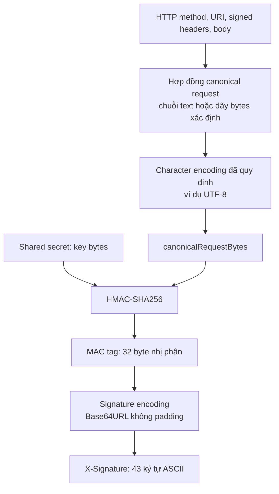

# Character encoding trong Encoding chữ ký HMAC cho HTTP request

## Mục tiêu học tập

Sau bài học, bạn có thể:

- Phân biệt **character encoding (mã hóa ký tự)** với **signature encoding (biểu diễn chữ ký nhị phân)**; biết chính xác bước nào tạo bytes và bước nào chỉ biến bytes thành văn bản để vận chuyển.
- Giải thích tại sao `HMAC-SHA256` nhận **chuỗi byte**, không nhận trực tiếp “nội dung chữ” hay đối tượng Java; hiểu ảnh hưởng của UTF-8, UTF-16, ASCII và charset mặc định.
- Nhận biết các tình huống Unicode nguy hiểm: ký tự tổ hợp, NFC/NFD, ký tự thay thế (replacement character), surrogate không hợp lệ, BOM và dấu xuống dòng LF/CRLF.
- Thiết kế hợp đồng ký có **UTF-8 được chốt rõ**, quy tắc raw body, HTTP header, request-target, percent-encoding và một format tag duy nhất (ví dụ Base64URL không padding).
- Viết Java/JCA mã hóa text sang UTF-8 **không âm thầm thay ký tự lỗi**, tính HMAC-SHA256, giải mã signature nghiêm ngặt và so tag bằng `MessageDigest.isEqual`.
- Kiểm thử tương thích giữa client Java, client ngôn ngữ khác, proxy/gateway và backend; phân biệt lỗi character encoding với lỗi key, canonicalization, replay và authorization.

**Bối cảnh:** Đây là bài thuộc chương **Encoding chữ ký** của module `SECURITY_AUTHENTICATION_HMAC_REQUEST_AUTHENTICATION`. Module xây dựng xác thực HTTP request bằng **shared secret** và **canonical request** chứa method, URI, header hoặc body theo hợp đồng ký; sau đó kiểm tra chữ ký, chống replay bằng timestamp/nonce, quản lý key rotation, kiểm thử proxy/gateway và phân biệt authentication với authorization. Chủ đề **Character encoding** tập trung vào ranh giới **ký tự → byte → HMAC → encoding tag**. Không có ghi chú bổ sung riêng cho bài học.

## 1. Hai loại “encoding” khác nhau trong một chữ ký

Từ *encoding* thường chỉ hai phép biến đổi khác nhau khi triển khai HMAC cho HTTP:

1. **Character encoding**: chuyển văn bản có ký tự Unicode thành **bytes** theo một charset xác định, thường là UTF-8.
2. **Signature encoding**: sau khi HMAC trả về **bytes của MAC**, chuyển những bytes này thành **chuỗi ASCII** theo một biểu diễn vận chuyển, chẳng hạn Base64URL hoặc hex.

Luồng khái niệm:



Ví dụ:

```text
M = canonical request text
M_bytes = UTF8(M)
tag_bytes = HMAC-SHA256(secret_key_bytes, M_bytes)
signature_text = Base64URL_NoPadding(tag_bytes)
```

Tại verifier, quy trình ngược theo **logic xác minh**:

```text
signature_text_from_header --Base64URL decode--> received_tag_bytes
HTTP request thực nhận --canonicalize + UTF-8--> expected_message_bytes
HMAC-SHA256(stored_key_bytes, expected_message_bytes) --> expected_tag_bytes
compare_constant_time(expected_tag_bytes, received_tag_bytes)
```

**Không “giải mã HMAC” để lấy thông điệp gốc.** HMAC là mã xác thực thông điệp (MAC), không phải mã hóa dữ liệu có thể giải mã. Base64URL chỉ là cách biểu diễn một dãy byte; giải mã Base64URL **không chứng minh** chữ ký hợp lệ.

| Khái niệm | Input | Output | Vai trò |
|---|---|---|---|
| `UTF8(text)` | Chuỗi ký tự | Bytes | Tạo bytes cho phần canonical được biểu diễn bằng text |
| `SHA256(rawBody)` | Bytes của body | Digest 32 byte | Tạo dấu vân tay body để đưa vào dữ liệu được ký |
| `HMAC-SHA256(K, M)` | Bytes khóa + bytes thông điệp | Tag 32 byte | Xác thực và bảo vệ tính toàn vẹn của dữ liệu đã ký |
| Base64URL | Bytes bất kỳ | ASCII text | Chuyên chở tag trong HTTP header |
| Hex | Bytes bất kỳ | ASCII `0-9a-f` | Trình bày tag trong test vector/debug |
| Percent-encoding URI | Bytes cần biểu diễn trong URI | Chuỗi `%HH`/ký tự cho phép | Biểu diễn path/query trên wire; **không phải** Base64URL |

## 2. Tại sao hai chuỗi trông giống nhau lại cho chữ ký khác nhau?

HMAC không biết “café” có ý nghĩa gì. Nó chỉ nhìn thấy **thứ tự bytes**. Nếu input bytes khác, kết quả HMAC thông thường khác, dù các ký tự hiển thị tương tự.

### 2.1. UTF-8 so với UTF-16

Ví dụ chữ `é` (U+00E9):

| Representation | Bytes (hex) |
|---|---|
| UTF-8 của U+00E9 | `C3 A9` |
| UTF-16BE của U+00E9 | `00 E9` |
| UTF-16LE của U+00E9 | `E9 00` |
| UTF-8 của chữ `e` + dấu sắc tổ hợp U+0301 | `65 CC 81` |

Nếu client Java dùng UTF-8 còn server sử dụng UTF-16LE cho canonical text, **hai bên không thể tính cùng tag**. Lỗi đó không được khắc phục bằng cách đổi thuật toán HMAC.

**Quy tắc:** hợp đồng ký phải ghi rõ charset của text được đưa vào HMAC. Với giao thức mới, **UTF-8 không BOM** là một lựa chọn thực tế, dễ tương thích giữa các ngôn ngữ.

### 2.2. Unicode NFC và NFD

Hai biểu diễn của `café` có thể **nhìn giống nhau**:

```text
Composed (NFC thường gặp):
  c a f é
  code points: U+0063 U+0061 U+0066 U+00E9
  UTF-8: 63 61 66 C3 A9

Decomposed (NFD thường gặp):
  c a f e ◌́
  code points: U+0063 U+0061 U+0066 U+0065 U+0301
  UTF-8: 63 61 66 65 CC 81
```

Các chuỗi có thể được xem là tương đương về mặt Unicode normalization nhưng **không giống bytes**.

Có hai chính sách khả dĩ:

- **Ký exact bytes:** không chuẩn hóa Unicode trước khi băm; client chốt body bytes một lần và gửi chính bytes ấy. Hai representation khác nhau được xem là hai thông điệp có chữ ký khác nhau.
- **Ký text sau chuẩn hóa đã đặc tả:** định nghĩa NFC/NFD, charset, thời điểm normalize và cách handler nhận dữ liệu; tất cả thành phần phải sử dụng cùng thuật toán. Không tự bật normalization ở riêng verifier.

**Trong bài này chọn ký exact raw body bytes**, còn canonical string được tạo từ một tập trường HTTP đã xác định rõ và encode UTF-8. Không tự normalize hay trim body/URI/metadata nếu hợp đồng không nói như vậy.

### 2.3. Một ký tự bị thay thế âm thầm

Một chuỗi Java `String` có thể chứa **unpaired surrogate**: một nửa của UTF-16 surrogate pair mà không có nửa còn lại. Một số phép mã hóa text mặc định có thể **thay ký tự lỗi** bằng dấu hỏi hoặc ký tự thay thế thay vì báo lỗi. Hậu quả:

- Client ký bytes sau khi bị thay bằng ký tự khác.
- HTTP client/server có thể xử lý hoặc thay thế theo chính sách khác.
- Hai chuỗi Unicode không hợp lệ có thể được thay thành cùng biểu diễn, hoặc tạo mismatch khó chẩn đoán.

Đối với phần text tự xây dựng thành canonical bytes, nên dùng **`CharsetEncoder` đặt `CodingErrorAction.REPORT`** để từ chối đầu vào không thể biểu diễn theo UTF-8 hợp lệ, thay vì âm thầm sửa.

### 2.4. Byte Order Mark (BOM)

UTF-8 có thể được ghi kèm **BOM** là ba byte `EF BB BF` ở đầu. UTF-8 **không yêu cầu BOM**. Nếu một bên thêm BOM trước canonical string còn bên kia không thêm, HMAC khác nhau.

```text
UTF-8("POST")              = 50 4F 53 54
UTF-8_BOM + UTF-8("POST")   = EF BB BF 50 4F 53 54
```

Đối với protocol ký, hãy **cấm BOM ở canonical string**. Với body, hoặc ký **exact bytes có BOM** nếu contract cho phép, hoặc từ chối body có BOM và yêu cầu client gửi UTF-8 không BOM. Đừng tự bỏ BOM trước khi ký rồi để backend xử lý dữ liệu gốc theo cách khác.

## 3. Dấu xuống dòng, khoảng trắng và khả năng tái tạo bytes

Giả sử canonical request gồm bốn dòng:

```text
POST
/v1/notes
host:api.example.test
x-client-id:writer-17
```

Nếu hợp đồng phân cách dòng bằng LF, byte phân cách là **`0A`**. Windows CRLF là **`0D 0A`**. Cùng text hiển thị trong editor nhưng hai chuỗi bytes khác nhau:

```text
LF:
"POST\n/v1/notes\nhost:api.example.test\nx-client-id:writer-17"

CRLF:
"POST\r\n/v1/notes\r\nhost:api.example.test\r\nx-client-id:writer-17"
```

Quy tắc phải được đặc tả:

1. **Thứ tự các dòng** trong canonical request phải cố định.
2. Dùng LF `\n` giữa các dòng, **không** thêm LF cuối, trừ khi hợp đồng cố ý yêu cầu.
3. Tên các header được ký có case và separator cố định, ví dụ `host:`, `x-client-id:`; không tự chèn dấu cách sau dấu hai chấm.
4. Không dùng `System.lineSeparator()`, vì phụ thuộc môi trường chạy.
5. Không tự dùng `String.trim()`, `strip()` hoặc `replaceAll("\\s+", " ")` trên trường đã ký nếu chưa có định nghĩa chính xác; thao tác đó có thể đổi dữ liệu.
6. Header rỗng, vắng mặt, trùng giá trị và thứ tự nhiều giá trị phải được xử lý theo **hợp đồng** thay vì theo lựa chọn tùy ý của parser.

**Ví dụ lỗi điển hình:** client dùng `String.join("\n", lines)`, server dùng `String.join("\r\n", lines)`. Cả hai đều “ký đúng HMAC-SHA256”, nhưng chữ ký **không bao giờ khớp**.

## 4. Mã hóa chữ ký khi gửi qua HTTP: Base64URL, Base64 và hex

Tag HMAC-SHA256 đầy đủ luôn có **32 byte** trước encoding. Không thể giả định những byte này là một chuỗi UTF-8 có thể đọc được; việc gọi `new String(tagBytes, UTF_8)` là **sai giao thức** vì tag tùy ý có thể chứa byte UTF-8 không hợp lệ.

Hãy dùng một phép biểu diễn **binary-to-text** đã định nghĩa.

| Định dạng | Với tag HMAC-SHA256 32 byte | Ký tự thường gặp | Nhận xét |
|---|---:|---|---|
| Raw binary | 32 byte | Có thể không in được | Dùng khi so bytes trong verifier |
| Hex chữ thường | 64 ký tự | `0-9a-f` | Dễ đọc test vector, dài gấp đôi raw |
| Base64 chuẩn có padding | 44 ký tự | `A-Z a-z 0-9 + / =` | Có `+` và `/` |
| **Base64URL không padding** | **43 ký tự** | `A-Z a-z 0-9 - _` | Thuận tiện cho giá trị HTTP header |
| Base64URL có padding | 44 ký tự | Như Base64URL, thêm `=` | Khác chuỗi của hợp đồng không padding |

### Vì sao 43 ký tự?

```text
32 byte = 10 nhóm 3 byte + 2 byte dư
10 nhóm đầy đủ -> 40 ký tự Base64
2 byte dư      -> 3 ký tự Base64 + 1 dấu "=" khi có padding

Base64URL không padding -> 40 + 3 = 43 ký tự ASCII
```

Không đưa `+`, `/` hoặc `=` vào một format signature quy định **Base64URL không padding**, và không tự thêm `=` để “sửa” chuỗi không hợp lệ. Hex cũng có thể dùng nếu giao thức quy định, nhưng **hai phía không được tự chọn format khác nhau**.

### Canonical Base64URL và pad bits

Chỉ regex 43 ký tự `[A-Za-z0-9_-]{43}` là **chưa đủ**. Với 32 byte MAC, hai bit thấp của ký tự Base64 cuối không mang dữ liệu và phải được encode đúng chuẩn. Một decoder dễ dãi có thể chấp nhận hai chuỗi text khác nhau nhưng decode ra **cùng bytes**.

Chính sách nghiêm ngặt:

```text
Nhận X-Signature
  -> kiểm tra đúng một header, length và alphabet
  -> Base64URL decode
  -> kiểm tra 32 byte
  -> Base64URL encode lại, không padding
  -> bắt buộc chuỗi encode lại == chuỗi nhận ban đầu
  -> so HMAC bytes
```

Ví dụ 32 byte toàn `0x00` có biểu diễn Base64URL không padding gồm **43 chữ `A`**. Thay ký tự cuối bằng `B` có thể vẫn decode ra cùng 32 byte trên một decoder dễ dãi. Quy trình **re-encode rồi so text** sẽ từ chối biến thể ấy. Test này **chỉ kiểm tra format**, không có nghĩa một tag bằng 32 byte số 0 là chữ ký HMAC hợp lệ.

## 5. Đường biên charset của HTTP header, URI và body

Một HTTP request có các thành phần với **quy tắc ký tự khác nhau**. Không nên áp dụng `String.getBytes(UTF_8)` rồi cho rằng mọi byte đã được canonical hóa đúng.

### 5.1. Header ký và chữ ký header

Tên header HTTP theo token syntax, không mang Unicode tự do. Giá trị header cũng chịu quy tắc giao thức/parser và có thể đi qua nhiều HTTP phiên bản. Vì vậy, một profile HMAC đơn giản nên:

- Giữ **signature text** hoàn toàn ASCII bằng Base64URL không padding.
- Dùng `clientId`, `keyId`, timestamp, nonce ở **ASCII grammar có giới hạn**.
- Không đặt Unicode tự do trong header authentication chưa có protocol encoding cụ thể.
- Chốt chính xác `Host`/`:authority` và `Content-Type`; không lấy giá trị từ `X-Forwarded-*` do client tự khai.
- Reject header trùng hoặc nhập nhằng trước khi xác minh, thay vì để ingress lấy first value còn backend lấy last.

Nếu ứng dụng cần bảo vệ một giá trị Unicode trong header nghiệp vụ, hãy **đặc tả biểu diễn ASCII của nó**, ví dụ một encoding hợp đồng xác định, rồi ký biểu diễn đó. Đừng tự gửi raw Unicode vào header rồi tin rằng mọi proxy/framework đều giữ nguyên byte.

### 5.2. URI và percent-encoding

Trong URI, một ký tự Unicode có thể được chuyển sang UTF-8 rồi biểu diễn bằng **`%HH`**.

Ví dụ:

```text
Ký tự "é" (U+00E9)
UTF-8 bytes: C3 A9
Percent-encoding: %C3%A9
```

Hai URI `/v1/notes/caf%C3%A9` và `/v1/notes/cafe%CC%81` có thể hiển thị gần giống nhau sau decode nhưng **khác chuỗi raw request-target**. Cũng không được tự coi `%2F` (encoded slash) là dấu `/` phân tách segment, hoặc tự decode hai lần. Các URL library có thể trả **raw path** và **decoded path** khác nhau.

Khi ký HMAC, hãy chọn một trong hai chính sách rõ ràng:

1. **Ký raw request-target** và reject những biểu diễn percent-encoding nhập nhằng hoặc không hỗ trợ.
2. **Canonicalize URI theo một thuật toán công bố**: quy tắc decode, UTF-8, normalization, percent hex case, query ordering, duplicate và re-encode; verifier/router/backend phải thống nhất ngữ nghĩa.

**Không trộn raw path bên client với decoded path phía server.** Điều đó vừa gây HMAC mismatch vừa có thể gây chênh lệch định tuyến nếu verifier và handler chọn tài nguyên khác nhau.

### 5.3. Raw body bytes và charset của payload

`Content-Type: application/json; charset=utf-8` là mô tả cách diễn giải dữ liệu, **không tự biến bytes đã nhận thành đúng UTF-8**. Cần kiểm tra encoding hợp lệ theo media type và chính sách API.

Nếu hợp đồng ký raw body:

```text
bodyDigest = SHA256(exactRawBodyBytes)
canonicalLine = "body-sha256:" + Base64URL_NoPadding(bodyDigest)
```

thì **không được**:

- Parse JSON rồi serialize lại với một thư viện khác trước khi tính hash.
- Đổi dấu cách, thứ tự field, Unicode escape, normalization hoặc newline rồi giả định bytes vẫn như cũ.
- Đọc body như một `String` bằng charset hệ điều hành rồi `getBytes()` trở lại.
- Bỏ BOM, trim body hay tự gzip/ungzip khi hợp đồng ký chưa quy định rõ transformation.

Ví dụ các body text sau có thể mang dữ liệu ý nghĩa gần giống nhau nhưng bytes khác:

```json
{"note":"café"}
```

```json
{"note":"caf\u00e9"}
```

Trong JSON thứ hai, sáu ký tự ASCII `\u00e9` nằm trong body text (nếu được gửi theo cú pháp JSON escape), chứ không phải hai byte UTF-8 `C3 A9`. Hash raw body khác; đây là kết quả đúng nếu API chọn exact bytes.

## 6. Một hợp đồng ký `hmac-utf8-v1` để thực hành

Ví dụ ứng dụng server-to-server có endpoint:

```http
POST /v1/notes HTTP/1.1
Host: api.example.test
Content-Type: application/json; charset=utf-8
X-Client-Id: writer-17
X-Key-Id: k2
X-Timestamp: <unix-seconds>
X-Nonce: <base64url-nonce-128-bit>
X-Signature: <base64url-hmac-tag>

{"note":"café"}
```

Những mục `<...>` chỉ là placeholder. Hợp đồng `hmac-utf8-v1` cố tình có **route và Host cố định** để người học quan sát riêng các lỗi encoding, không phải một protocol production bao phủ mọi URI.

### 6.1. Quy tắc phần request

| Thành phần | Quy tắc hợp đồng minh họa |
|---|---|
| Method | Chỉ `POST` |
| Request-target | Chính xác `/v1/notes`, không query |
| Public Host | Chính xác `api.example.test`, **đã được ingress kiểm tra** |
| Content-Type | Chính xác `application/json; charset=utf-8` |
| Client/Key ID | ASCII `[A-Za-z0-9][A-Za-z0-9._-]{0,63}` |
| Timestamp | Unix seconds biểu diễn thập phân chuẩn, không whitespace/leading zero tùy tiện |
| Nonce | 16 byte ngẫu nhiên mã hóa Base64URL không padding = 22 ký tự |
| Body | Raw UTF-8 bytes không BOM, UTF-8 strict; giới hạn size, không được proxy biến đổi |
| Body digest | `SHA-256` của **exact raw body bytes**; Base64URL không padding |
| Canonical text | Dòng có thứ tự cố định, ngăn bằng LF; không có LF cuối |
| Encoding canonical text | **UTF-8 không BOM**, từ chối chuỗi Java có unpaired surrogate |
| MAC | `HMAC-SHA256` với secret bytes theo `(environment, clientId, keyId)` |
| Signature header | Một `X-Signature`; Base64URL không padding, đúng 43 ký tự ASCII |
| Algorithm/version | Cố định theo endpoint và chính sách server; không hạ cấp theo lựa chọn tùy ý của client |

### 6.2. Canonical string

```text
POST
/v1/notes
host:api.example.test
content-type:application/json; charset=utf-8
x-client-id:writer-17
x-key-id:k2
x-timestamp:<unix-seconds>
x-nonce:<base64url-nonce-128-bit>
body-sha256:<base64url-sha256-of-exact-raw-body>
```

**Các bước chuyển byte:**

1. Chốt raw body UTF-8 một lần; ký **chính những bytes sẽ gửi**.
2. Tính SHA-256 raw body, encode digest bằng Base64URL không padding.
3. Ghép canonical text đúng thứ tự, sử dụng LF (`0A`) và **không thêm LF cuối**.
4. Encode canonical text bằng UTF-8 **không BOM**.
5. Tính `HMAC-SHA256(secretBytes, canonicalBytes)`.
6. Encode tag HMAC 32 byte thành signature ASCII Base64URL không padding; gắn vào header `X-Signature`.

Ví dụ body `{"note":"café"}` có raw UTF-8 bytes bao gồm `C3 A9`. Nếu client đổi representation thành body có JSON Unicode escape mà giữ signature cũ, body hash thay đổi và HMAC fail. Nếu backend cần so sánh text theo Unicode normalization, thực hiện logic đó **sau khi xác minh exact bytes**, hoặc thiết kế phiên bản protocol quy định rõ normalization cho tất cả phía.

## 7. Java 17+: strict UTF-8, body digest và signature Base64URL

Ví dụ Java dưới đây chỉ phụ thuộc JDK. Nó tập trung vào **quy tắc chuyển ký tự sang byte** và **biểu diễn tag**; các phần HTTP parser, key store và nonce store được nêu riêng sau mã.

```java
import java.nio.ByteBuffer;
import java.nio.CharBuffer;
import java.nio.charset.CharacterCodingException;
import java.nio.charset.CodingErrorAction;
import java.nio.charset.StandardCharsets;
import java.security.GeneralSecurityException;
import java.security.MessageDigest;
import java.security.SecureRandom;
import java.time.Instant;
import java.util.Arrays;
import java.util.Base64;
import java.util.regex.Pattern;
import javax.crypto.Mac;
import javax.crypto.spec.SecretKeySpec;

public final class StrictUtf8HmacV1 {
    private static final String HOST = "api.example.test";
    private static final String TARGET = "/v1/notes";
    private static final String CONTENT_TYPE =
            "application/json; charset=utf-8";
    private static final Pattern ID =
            Pattern.compile("[A-Za-z0-9][A-Za-z0-9._-]{0,63}");
    private static final Pattern TIMESTAMP =
            Pattern.compile("[1-9][0-9]{0,11}");
    private static final Pattern NONCE =
            Pattern.compile("[A-Za-z0-9_-]{22}");
    private static final Pattern SIGNATURE =
            Pattern.compile("[A-Za-z0-9_-]{43}");
    private static final Base64.Encoder B64URL =
            Base64.getUrlEncoder().withoutPadding();
    private static final int MAX_BODY_BYTES = 16 * 1024;

    private StrictUtf8HmacV1() {}

    public record RequestParts(
            String method, String rawTarget, String effectiveHost,
            String contentType, String clientId, String keyId,
            String timestamp, String nonce, byte[] rawBody) {}

    // Reject malformed Java UTF-16 (ví dụ unpaired surrogate), không
    // âm thầm đổi ký tự lỗi thành '?' hoặc replacement character.
    public static byte[] encodeUtf8Strict(String value) {
        if (value == null) {
            throw new IllegalArgumentException("Null canonical text");
        }
        try {
            ByteBuffer buffer = StandardCharsets.UTF_8.newEncoder()
                    .onMalformedInput(CodingErrorAction.REPORT)
                    .onUnmappableCharacter(CodingErrorAction.REPORT)
                    .encode(CharBuffer.wrap(value));
            byte[] result = new byte[buffer.remaining()];
            buffer.get(result);
            return result;
        } catch (CharacterCodingException invalidText) {
            throw new IllegalArgumentException(
                    "Canonical text contains invalid Unicode", invalidText);
        }
    }

    // Kiểm tra raw body UTF-8 strict; không decode rồi serialize lại.
    private static void validateBody(byte[] body) {
        if (body == null || body.length == 0 ||
                body.length > MAX_BODY_BYTES) {
            throw new IllegalArgumentException("Invalid body length");
        }
        if (body.length >= 3 &&
                (body[0] & 0xff) == 0xef &&
                (body[1] & 0xff) == 0xbb &&
                (body[2] & 0xff) == 0xbf) {
            throw new IllegalArgumentException("UTF-8 BOM is forbidden");
        }
        try {
            StandardCharsets.UTF_8.newDecoder()
                    .onMalformedInput(CodingErrorAction.REPORT)
                    .onUnmappableCharacter(CodingErrorAction.REPORT)
                    .decode(ByteBuffer.wrap(body));
        } catch (CharacterCodingException invalidBytes) {
            throw new IllegalArgumentException(
                    "Body is not strict UTF-8", invalidBytes);
        }
        // Đây chưa phải JSON schema validation: backend phải parse JSON
        // theo chính các body bytes đã được verifier xác thực.
    }

    private static boolean validNonce(String value) {
        if (value == null || !NONCE.matcher(value).matches()) {
            return false;
        }
        try {
            byte[] bytes = Base64.getUrlDecoder().decode(value);
            return bytes.length == 16 &&
                    B64URL.encodeToString(bytes).equals(value);
        } catch (IllegalArgumentException malformed) {
            return false;
        }
    }

    public static String canonical(RequestParts r)
            throws GeneralSecurityException {

        if (r == null ||
                !"POST".equals(r.method()) ||
                !TARGET.equals(r.rawTarget()) ||
                !HOST.equals(r.effectiveHost()) ||
                !CONTENT_TYPE.equals(r.contentType()) ||
                r.clientId() == null || !ID.matcher(r.clientId()).matches() ||
                r.keyId() == null || !ID.matcher(r.keyId()).matches() ||
                r.timestamp() == null ||
                !TIMESTAMP.matcher(r.timestamp()).matches() ||
                !validNonce(r.nonce())) {
            throw new IllegalArgumentException("Invalid signed fields");
        }

        validateBody(r.rawBody());
        String bodyDigest = B64URL.encodeToString(
                MessageDigest.getInstance("SHA-256").digest(r.rawBody()));

        return String.join("\n",
                "POST",
                TARGET,
                "host:" + HOST,
                "content-type:" + CONTENT_TYPE,
                "x-client-id:" + r.clientId(),
                "x-key-id:" + r.keyId(),
                "x-timestamp:" + r.timestamp(),
                "x-nonce:" + r.nonce(),
                "body-sha256:" + bodyDigest);
    }

    private static byte[] tag(byte[] secret, RequestParts r)
            throws GeneralSecurityException {
        Mac mac = Mac.getInstance("HmacSHA256");
        mac.init(new SecretKeySpec(secret, "HmacSHA256"));
        // KHÔNG sử dụng charset mặc định hoặc String.getBytes() rỗng args.
        return mac.doFinal(encodeUtf8Strict(canonical(r)));
    }

    public static String sign(byte[] secret, RequestParts r)
            throws GeneralSecurityException {
        return B64URL.encodeToString(tag(secret, r));
    }

    public static boolean verify(
            byte[] secret, RequestParts received, String encodedSignature)
            throws GeneralSecurityException {

        if (encodedSignature == null ||
                !SIGNATURE.matcher(encodedSignature).matches()) {
            return false;
        }
        final byte[] supplied;
        try {
            supplied = Base64.getUrlDecoder().decode(encodedSignature);
        } catch (IllegalArgumentException malformed) {
            return false;
        }
        if (supplied.length != 32 ||
                !B64URL.encodeToString(supplied).equals(encodedSignature)) {
            return false;
        }

        final byte[] expected;
        try {
            expected = tag(secret, received);
        } catch (IllegalArgumentException badRequest) {
            return false;
        }
        return MessageDigest.isEqual(expected, supplied);
    }

    public static void main(String[] args)
            throws GeneralSecurityException {

        // Mô phỏng việc cấp khóa, không sinh khóa mới ở verifier mỗi request.
        byte[] secret = new byte[32];
        new SecureRandom().nextBytes(secret);
        byte[] nonceBytes = new byte[16];
        new SecureRandom().nextBytes(nonceBytes);

        String composedJson = "{\"note\":\"café\"}";
        String decomposedJson = "{\"note\":\"cafe\u0301\"}";

        RequestParts signed = new RequestParts(
                "POST", TARGET, HOST, CONTENT_TYPE,
                "writer-17", "k2",
                Long.toString(Instant.now().getEpochSecond()),
                B64URL.encodeToString(nonceBytes),
                encodeUtf8Strict(composedJson));

        String signature = sign(secret, signed);
        if (!verify(secret, signed, signature)) {
            throw new AssertionError("Valid signature was rejected");
        }

        // Text có thể hiển thị giống nhau, nhưng raw UTF-8 bytes khác.
        RequestParts changedBody = new RequestParts(
                signed.method(), signed.rawTarget(), signed.effectiveHost(),
                signed.contentType(), signed.clientId(), signed.keyId(),
                signed.timestamp(), signed.nonce(),
                encodeUtf8Strict(decomposedJson));

        if (Arrays.equals(signed.rawBody(), changedBody.rawBody())) {
            throw new AssertionError("Unicode test data must differ");
        }
        if (verify(secret, changedBody, signature)) {
            throw new AssertionError("Changed Unicode bytes were accepted");
        }

        // UTF-8 không hợp lệ: C3 phải có continuation byte, 28 không hợp lệ.
        try {
            RequestParts broken = new RequestParts(
                    signed.method(), signed.rawTarget(),
                    signed.effectiveHost(), signed.contentType(),
                    signed.clientId(), signed.keyId(), signed.timestamp(),
                    signed.nonce(), new byte[] {(byte) 0xc3, 0x28});
            sign(secret, broken);
            throw new AssertionError("Invalid UTF-8 was accepted");
        } catch (IllegalArgumentException expected) {
            // PASS: không thay byte lỗi bằng ký tự khác.
        }

        // Unpaired surrogate trong Java String phải bị từ chối.
        try {
            encodeUtf8Strict("invalid:\uD800");
            throw new AssertionError("Invalid surrogate was accepted");
        } catch (IllegalArgumentException expected) {
            // PASS.
        }

        if (signature.length() != 43) {
            throw new AssertionError("Expected 43-char Base64URL MAC");
        }
        System.out.println("Character-encoding HMAC checks: PASS");
    }
}
```

### Mã minh họa điều gì?

- **Text → bytes:** `encodeUtf8Strict` dùng `CharsetEncoder` với `REPORT`, không âm thầm thay unpaired surrogate. Canonical string được biến thành UTF-8 bytes **không BOM**.
- **Body:** `validateBody` từ chối UTF-8 invalid/BOM theo profile, nhưng digest vẫn tính trên **rawBody**; không serialize body đã decode trước khi hash.
- **Tag:** `Mac.getInstance("HmacSHA256")` trả raw tag 32 byte, sau đó encode Base64URL không padding. Verifier kiểm tra alphabet/length và **decode → re-encode** để từ chối dạng noncanonical.
- **So sánh:** `MessageDigest.isEqual` so raw expected/received tag bytes. Dùng phép so sánh phù hợp **không làm toàn bộ HTTP pipeline tự động constant-time**; key lookup và lỗi hạ tầng vẫn có đặc điểm timing khác.
- **Unicode:** body chứa `é` dạng composed và body chứa `e + combining accent` có thể hiển thị tương tự nhưng có raw bytes khác, nên không dùng chung chữ ký.
- **Ranh giới:** `canonical` giới hạn method/path/host/content-type để tránh nhầm ngữ cảnh. Nó **không được tự điền Host hằng** ở một HTTP adapter mà bỏ qua kiểm tra authority client đã gửi.

### Phạm vi ngoài đoạn mã

`StrictUtf8HmacV1` là **ví dụ mật mã và mã hóa ký tự**, chưa phải production HTTP filter. Trong thực tế, cần:

- Parser HTTP phát hiện header thiếu/trùng, kiểm soát request-target, Host/`:authority`, Content-Type và giới hạn body.
- Chọn **effective host đáng tin** từ ingress đã route, không tin `X-Forwarded-Host` từ client.
- Key store tra đúng `(environment, clientId, keyId, service/audience)` và kiểm tra trạng thái key còn được phép verify.
- Đồng hồ server kiểm tra timestamp; shared nonce store ghi atomically theo chính sách replay.
- Backend parse JSON **trên đúng body đã được xác minh**, kiểm tra schema, tenant/resource/operation, và áp dụng authorization.
- Ghi log/metrics không chứa raw secret, dữ liệu nhạy cảm hoặc raw body tràn lan.

Ví dụ lưu trữ raw secret ở `byte[]` để minh họa; trong production cần secret manager/KMS, phân quyền truy cập và quy trình key rotation. Không tạo một khóa ngẫu nhiên mới khi verifier nhận từng request.

## 8. Java character encoding pitfalls cần tránh

| Cách viết hoặc tình huống | Vấn đề | Cách xử lý |
|---|---|---|
| `text.getBytes()` | Charset mặc định theo môi trường/JDK và cấu hình; thiếu hợp đồng rõ | `getBytes(StandardCharsets.UTF_8)` hoặc strict encoder khi cần reject dữ liệu lỗi |
| `new String(rawBytes)` | Dùng charset mặc định và có thể diễn giải sai | Chỉ decode bằng charset được hợp đồng chỉ định; dùng strict decoder nếu cần |
| `new String(hmacBytes, UTF_8)` | MAC binary tùy ý, không đảm bảo UTF-8 hợp lệ | Dùng Base64URL/hex |
| `String.trim()` trên canonical field | Thay đổi bytes và có thể loại dấu cách mang ý nghĩa | Không tự trim; định nghĩa canonical normalization trước |
| `System.lineSeparator()` | CRLF/LF khác nhau theo OS | Dùng ký tự LF cố định `\n` |
| Tự `Normalizer.normalize(text, NFC)` ở một bên | Unicode canonicalization khác giữa hai phía | Không normalize nếu giao thức ký exact bytes; nếu có thì version hóa |
| Thêm UTF-8 BOM ở client | Thêm `EF BB BF` ngoài hợp đồng | Từ chối hoặc định nghĩa rõ cách ký bytes có BOM |
| JSON decode rồi serialize lại trước hash | Khác whitespace, escaping, thứ tự field | Hash exact raw body bytes |
| Header signature dùng Base64 chuẩn khi server chờ Base64URL | `+`/`/`/`=` ngoài grammar | Đúng một signature encoding được chốt |
| Decoder chấp nhận nhiều dạng Base64 tương đương | Canonical string signature không duy nhất | Decode, kiểm tra length rồi re-encode so chuỗi |
| Ký Unicode trực tiếp trong raw HTTP header | HTTP parser/proxy có thể xử lý khác nhau | ASCII wire encoding cụ thể, contract chung |
| URI Unicode được client encode tự động | `%HH` raw target khác giữa các thư viện | Chốt percent-encoding và ký target nhất quán |
| Gateway tự gzip/ungzip hoặc sửa body | Bytes hash khác so với bên ký | Quy định điểm lấy body, chặn transform hoặc dùng contract mới |
| Đổi `Content-Type`/charset sau ký | Handler có thể hiểu bytes khác | Ký media type/charset và reject mismatch |

**Phân tích lỗi đúng thứ tự:** nếu HMAC mismatch, kiểm tra **key bytes**, **canonical request bytes**, **charset**, **body raw bytes**, **tag encoding**, **proxy transformations** trước khi suy rằng thuật toán HMAC sai. Khi debug, có thể so **SHA-256 của canonical bytes** ở môi trường kiểm thử an toàn để định vị khác biệt, nhưng không ghi plaintext secret hoặc thông tin cá nhân vào logs.

## 9. Tương tác với API gateway và hệ thống nhiều ngôn ngữ

Giả sử client dùng Java, gateway dùng một runtime khác, verifier dùng Java và backend dùng một framework JSON khác. Ranh giới có thể biến đổi dữ liệu:

```mermaid
sequenceDiagram
    autonumber
    participant C as Java Client
    participant G as API Gateway
    participant V as Java HMAC Verifier
    participant K as Key Store
    participant N as Shared Nonce Store
    participant B as Backend
    C->>C: Serialize JSON UTF-8 một lần
    C->>C: Hash raw body, canonicalize LF + UTF-8
    C->>C: HMAC-SHA256; Base64URL tag
    C->>G: HTTPS request + raw body + ASCII signature
    G->>G: Parse HTTP; chặn header/authority nhập nhằng
    G->>V: Request theo hợp đồng, không đổi signed bytes
    V->>V: Validate format, UTF-8 strict và signed fields
    V->>K: Tra key theo clientId/keyId/env/audience
    K-->>V: Key còn được phép verify
    V->>V: Rebuild canonical bytes, HMAC, so tag
    alt HMAC sai hoặc key không hợp lệ
        V-->>C: Từ chối xác thực
    else HMAC hợp lệ
        V->>N: Atomic insert-if-absent(clientId, nonce)
        alt Nonce đã dùng hoặc store lỗi
            V-->>C: Reject replay / fail closed
        else Nonce mới
            N-->>V: Inserted
            V->>B: Principal + body/context đã verify
            B->>B: Parse/validate/authz/idempotency
            B-->>C: Business response
        end
    end
```

### Vấn đề cụ thể qua proxy

1. **Host rewrite:** client ký `api.example.test`, upstream thấy `service.internal`. Verifier phải sử dụng public host **được ingress xác thực** hoặc verify trước rewrite; không tin `X-Forwarded-Host` do client tự gửi.
2. **Path/query normalization:** framework decode/encode URI khác, bao gồm Unicode percent-encoding. Chỉ ký target do contract cho phép và xử lý nhất quán ở router.
3. **Body transform:** gateway có thể decompress, chuyển đổi JSON hoặc thay đổi newline/body encoding; với hợp đồng ký raw body, mọi biến đổi đó có thể khiến chữ ký sai.
4. **Duplicate headers:** HTTP/1.1 và HTTP/2 có quy tắc header khác nhau; các tầng không được chọn các giá trị `Content-Type` hoặc `X-Signature` mâu thuẫn.
5. **HTTP framing:** chuyển từ chunked HTTP/1.1 sang HTTP/2 có thể khác framing nhưng **raw representation body bytes sau khi tách framing** phải đúng điểm hợp đồng ký. Không băm byte đánh dấu kích thước chunk nếu client/server đã thống nhất hash representation bytes.
6. **Backend diễn giải lại:** nếu verifier chỉ validate text UTF-8 rồi backend đọc bằng charset khác hoặc normalize một cách ảnh hưởng quyết định quyền, bảo vệ HMAC trở nên thiếu nhất quán về ngữ nghĩa.

Một tiêu chí test tốt: **cùng body và same canonical fields → cùng SHA-256 canonical bytes trên client/verifier**, bất kể client chạy Windows/Linux hay đi qua gateway. Nếu bytes thực sự khác, test phải phản ánh khác biệt ấy bằng mismatch hoặc reject, không tự sửa dữ liệu để “qua chữ ký”.

## 10. Timestamp, nonce và key rotation không phải bài toán encoding

Một chữ ký có format Base64URL đúng và canonical UTF-8 đúng vẫn có thể bị **replay**. Bên tấn công có thể phát lại nguyên HTTP request có cùng tag, timestamp và nonce.

Cần tách trách nhiệm:

- **Timestamp:** được ký trong canonical request, có format thập phân nhất quán; verifier kiểm tra cửa sổ thời gian (ví dụ ±300 giây, đồng hồ được đồng bộ).
- **Nonce:** được ký, đủ entropy và duy nhất theo chính sách, chẳng hạn 16 byte CSPRNG được mã hóa Base64URL 22 ký tự. Nonce cũng có quy tắc wire encoding rõ ràng.
- **Nonce store:** sau khi HMAC khớp, thực hiện **atomic insert-if-absent** cho `(clientId, nonce)` trong kho dùng chung mọi replica; TTL bao phủ toàn bộ thời gian request có thể còn được chấp nhận.
- **Key rotation:** `keyId` chỉ chọn phiên bản secret, không phải secret. Verifier tra đúng `(env, clientId, keyId, audience)`, kiểm tra ACTIVE/VERIFY_ONLY/REVOKED; trong giai đoạn chuyển tiếp có thể nhận phiên bản cũ/mới theo chính sách, sau thu hồi phải từ chối key cũ trên tất cả replica.
- **Secret compromise:** người biết secret có thể tạo **chữ ký mới** trên body UTF-8 mới, timestamp/nonce mới. Replay protection không chữa được việc secret bị lộ; phải thu hồi và rotation.
- **Authorization:** HMAC chỉ xác thực bên có khả năng sử dụng key và tính toàn vẹn của dữ liệu ký. Principal đã xác thực vẫn cần quyền đối với tenant, resource, method và operation của request. Encoding đúng không có nghĩa mọi nội dung JSON được phép thực thi.

Nếu API tạo note/thanh toán có thể thực thi lặp sau timeout, cân nhắc **idempotency key** và xử lý transaction riêng; nếu key này do client gửi, nó cần được ký hoặc ràng buộc bằng context đáng tin. Không dùng nonce như một bản thay thế tự động cho idempotency nghiệp vụ.

## 11. Ma trận kiểm thử character encoding và signature encoding

| Test | Thay đổi hoặc input | Kỳ vọng |
|---|---|---|
| Happy path | Body UTF-8 valid, Host/URI/header hợp đồng, key đúng | HMAC pass; chuyển tiếp replay/authz |
| UTF-8 vs UTF-16 | Một bên encode canonical string bằng UTF-16 | HMAC mismatch |
| NFC vs NFD | `café` composed so với `cafe + U+0301` trong body | Raw body digest khác, không dùng lại tag cũ |
| Invalid UTF-8 body | Byte sequence `C3 28` | Reject theo `hmac-utf8-v1` |
| UTF-8 BOM | Body mở đầu bằng `EF BB BF` | Reject trong profile hẹp |
| Unpaired surrogate | Java string chứa `\uD800` đơn độc | Strict UTF-8 encoder reject |
| LF vs CRLF canonical | Dấu phân cách chuyển `0A` thành `0D 0A` | HMAC mismatch |
| LF cuối | Một bên thêm newline ở dòng cuối | HMAC mismatch |
| Body whitespace | JSON có thêm dấu cách/newline | Raw body digest khác; tag cũ fail |
| JSON Unicode escape | Raw `é` đổi thành `\u00e9` text trong JSON | Raw body khác; signature cũ fail |
| Tag Base64URL không padding | 32-byte MAC → 43 ASCII chars | Accept nếu verify HMAC đúng |
| Base64 padded | 44 ký tự cuối `=` | Reject format `hmac-utf8-v1` |
| Hex tag | 64 ký tự hex | Reject format, dù có thể biểu diễn cùng bytes |
| Base64 chuẩn dùng `+`/`/` | Không thuộc alphabet Base64URL | Reject |
| Noncanonical pad bits | Chuỗi decode cùng bytes nhưng encode lại khác | Reject |
| Signature là Unicode text | Gửi ký tự ngoài ASCII trong `X-Signature` | Reject |
| Invalid signature length | Thiếu/thừa ký tự | Reject |
| Duplicate signature/header | Hai `X-Signature` hoặc `Content-Type` | Reject ở ingress/parser |
| Raw URI percent encoding | `%C3%A9` bị đổi thành một biểu diễn URI khác | Contract xử lý rõ hoặc reject; không ký target khác với handler |
| Host bị rewrite | Public Host khác internal Host | Dùng authority public đáng tin; không tin raw forwarding header |
| Gateway biến đổi body | Proxy đổi charset/compression/JSON | HMAC mismatch hoặc reject theo hợp đồng |
| Cross-language fixture | Java, Go, Node gửi cùng exact canonical bytes/secret | HMAC bytes và Base64URL tag phải trùng |
| Replay nhiều replica | Gửi lại nguyên signature + nonce | Tối đa một request vượt qua shared nonce gate |
| Key cũ đã revoke | Tag đúng với secret cũ | Reject theo key state |
| Sai tenant | HMAC đúng nhưng principal không có quyền | Authentication pass; authorization deny |

### Kiểm tra encoding ở mức byte, không phải bằng mắt

Khi hai implementation không tương thích, nên tạo **test fixture có canonical bytes và kết quả MAC đã biết**:

```text
fixture:
  secret_hex: <32-byte-secret-in-hex>
  method: POST
  raw_target: /v1/notes
  raw_body_hex: <exact-body-utf8-in-hex>
  canonical_hex: <exact-canonical-bytes-in-hex>
  mac_hex: <32-byte-HMAC-SHA256>
  mac_base64url: <43-char-tag>
```

Mỗi client/server phải so `canonical_hex` trước khi so HMAC. Các chuỗi `<...>` ở đây là **placeholder**, không phải secret/test vector production. Có thể bổ sung **RFC 4231 HMAC-SHA256 test vectors** để xác nhận lớp mật mã độc lập với canonicalization HTTP.

**Không log secret production**, không xuất raw body có dữ liệu nhạy cảm hoặc bản canonical chứa token/header riêng tư chỉ để debug. Với dữ liệu thật, dùng metrics, mã lỗi tổng quát, fingerprint phù hợp và môi trường kiểm thử được kiểm soát.

## 12. Những lỗi thiết kế thường gặp

1. **Nhầm UTF-8 với Base64:** UTF-8 giải quyết text → bytes, Base64 giải quyết bytes → ASCII. Không dùng Base64 thay cho character encoding của message.
2. **Biến HMAC tag thành `String` trực tiếp:** dãy byte ngẫu nhiên không phải UTF-8 text hợp lệ; phải encode bằng Base64URL/hex.
3. **Không chốt charset:** mặc định charset ở client/server khác nhau hoặc thay đổi khi nâng runtime.
4. **Dùng `String.getBytes()` hoặc `new String(bytes)` không truyền charset:** làm mất tính tái lập và có thể sửa dữ liệu.
5. **Ký canonical string có CRLF ở một phía, LF phía kia:** tag mismatch không liên quan chất lượng secret.
6. **Tự Unicode normalize/trim trước ký ở một phía:** dữ liệu được ký không trùng dữ liệu business xử lý.
7. **Giải mã UTF-8 lỗi bằng ký tự thay thế:** có thể che giấu input sai và thay đổi message.
8. **Tự thêm/bỏ BOM:** thay bytes đã ký; phải có policy rõ.
9. **Cho phép nhiều dạng signature text tương đương:** Base64 padded/unpadded, hex và noncanonical pad bits gây khác biệt log/cache/validator.
10. **Tự decode/encode URI hoặc JSON qua gateway:** canonical bytes sai, hoặc verifier và backend chọn resource/tenant khác.
11. **Chỉ xác minh chữ ký mà bỏ qua nonce/key state:** replay hay dùng secret bị revoke vẫn có thể đi tiếp.
12. **Coi signature đúng là authorization thành công:** client hợp lệ không tự có quyền với mọi tenant và resource.

## 13. Bài tập thực hành: đồng bộ encoding qua Java client và gateway

Hệ thống `notes-api` có `POST /v1/notes` và chạy sau reverse proxy. Client Java ký HMAC-SHA256 bằng shared secret; verifier có ba replica; backend parse JSON có trường `note` chứa tiếng Việt, dấu thanh và emoji.

Hãy thực hiện:

1. Viết hợp đồng `hmac-utf8-v1` xác định method, request-target, Host, Content-Type, client/key ID, timestamp, nonce, body digest và format chữ ký Base64URL không padding.
2. Cho các body `{"note":"café"}`, `{"note":"cafe\u0301"}`, `{"note":"xin chào 👋"}` và `{"note":"caf\u00e9"}`, ghi nhận **exact UTF-8 bytes** và SHA-256 digest từng body; giải thích trường hợp nào có thể hiển thị giống nhưng chữ ký khác.
3. Viết client serialize JSON một lần, encode UTF-8 không BOM, tạo nonce mới, dựng canonical string bằng LF, ký bằng `javax.crypto.Mac` và gửi đúng bytes đã ký.
4. Viết verifier dùng strict `CharsetEncoder`/`CharsetDecoder` ở những điểm cần chuyển text/bytes, từ chối unpaired surrogate, invalid UTF-8/BOM theo hợp đồng, decode Base64URL tag 32 byte và so bằng `MessageDigest.isEqual`.
5. Dùng cùng test fixture ở Java và ít nhất một ngôn ngữ khác; chứng minh `canonical bytes` trùng **trước khi** kiểm tra HMAC bytes/tag.
6. Chạy request qua gateway và thử đổi charset, Unicode normalization, Host, raw URI, newline body, JSON escape, duplicate header hoặc body compression; ghi nhận case reject/mismatch.
7. Thử replay cùng nonce qua ba replica, rotation `k1 → k2` và request có signature đúng nhưng không có quyền tạo note thuộc tenant khác.
8. Đưa ra cách khôi phục khi client timeout: nonce mới không tự giải quyết idempotency; mô tả chính sách retry nếu endpoint gây side effect.

**Tiêu chí đạt:** Có bằng chứng nhất quán **text → canonical UTF-8 bytes → HMAC raw bytes → Base64URL text** trên cả client và verifier. Không có bước Unicode normalization, body reserialization, BOM, newline hoặc proxy rewrite bất ngờ. Replay protection, key rotation và authorization được kiểm soát **ngoài phép encoding**.

---

## Ghi nhớ

Trong module `SECURITY_AUTHENTICATION_HMAC_REQUEST_AUTHENTICATION`, **character encoding** quyết định bytes mà HMAC thực sự ký, còn **signature encoding** quyết định cách trình bày tag nhị phân để gửi qua HTTP. Với hợp đồng ký UTF-8, phải chốt **đúng canonical bytes**, LF, BOM, Unicode normalization và raw body; HMAC-SHA256 tạo tag 32 byte, có thể biểu diễn bằng **Base64URL không padding 43 ký tự**. Không để HTTP client, proxy/gateway hoặc backend âm thầm đổi charset, URI hay body sau khi ký. Chữ ký đúng còn cần **timestamp/nonce chống replay**, **quản lý key rotation** và **phân quyền theo tài nguyên**.
