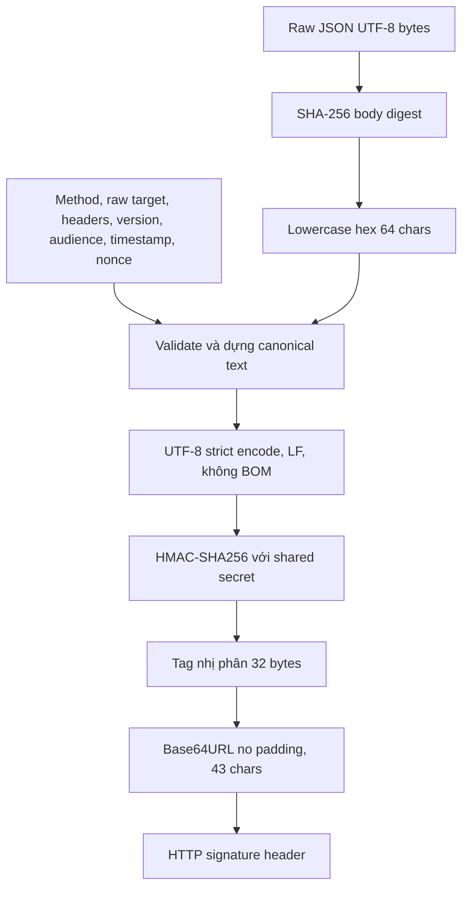
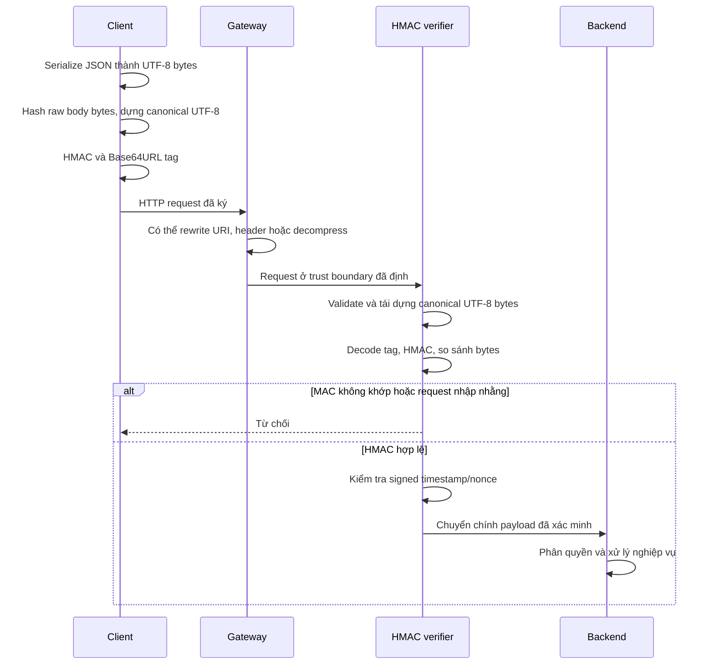

# UTF-8 trong Encoding chữ ký HMAC

> **Chương:** Encoding chữ ký  
> **Bài học:** UTF-8 — quy tắc chuyển văn bản thành bytes để ký và xác minh HTTP request bằng HMAC.  
> **Phạm vi:** Shared secret, canonical HTTP request gồm method, URI, signed headers và body theo hợp đồng; kiểm thử proxy/gateway, chống replay bằng timestamp/nonce, key rotation và phân biệt xác thực với phân quyền.

## 1. UTF-8 nằm ở đâu trong quy trình tạo signature?

Khi client gọi một API bằng HMAC, chữ ký không được tạo từ một “chuỗi ký tự trừu tượng”. HMAC nhận một **dãy bytes**. Với HTTP request, client phải xác định chính xác cách chuyển các thành phần văn bản như method, URI, timestamp và header đã canonicalize thành bytes.

Giả sử request:

```http
POST /v1/orders?mode=commit HTTP/1.1
Host: orders.example.test
Content-Type: application/json
X-Client-Id: partner-01
X-Key-Id: key-2026-11
X-Timestamp: 1795800000
X-Nonce: Bph1bgR7mMYnUnkY_UY6NA
X-Signature: <base64url-hmac-sha256>

{"orderId":"ORD-1024","description":"Cà phê","amount":100000}
```

Một signing profile minh họa quy định:

```text
bodyBytes       = UTF8(jsonTextActuallySent)
bodyHashHex     = lowercase_hex(SHA256(bodyBytes))
canonicalText   = joinContractFieldsWithLF(
                    version, audience, method, target,
                    contentType, clientId, keyId,
                    timestamp, nonce, bodyHashHex)
canonicalBytes  = UTF8(canonicalText)
tagBytes        = HMAC_SHA256(sharedSecret, canonicalBytes)
signatureHeader = BASE64URL_NO_PADDING(tagBytes)
```

Trong quy trình này, **UTF-8 xuất hiện trước khi hash và HMAC**:

- Chuyển văn bản JSON thành bytes để gửi và tính body hash.
- Chuyển chuỗi canonical request (nếu hợp đồng định nghĩa nó là văn bản) thành bytes để đưa vào HMAC.

**UTF-8 không phải thuật toán mã hóa tag HMAC nhị phân để đặt vào header.** Tag gồm các byte tùy ý; muốn gửi qua HTTP header dạng text thì dùng **hex hoặc Base64/Base64URL theo hợp đồng**. Việc làm `new String(tagBytes, UTF_8)` có thể tạo chuỗi lỗi và làm mất thông tin.

Sau bài này, người học phải phân biệt được **text → UTF-8 bytes → HMAC bytes → Base64URL text**, kiểm tra các biến thể Unicode và thiết kế Java/JCA không phụ thuộc default charset.

## 2. Ba lớp biểu diễn không được nhầm lẫn

| Lớp | Ví dụ | Đầu vào/đầu ra | Mục đích |
| --- | --- | --- | --- |
| Văn bản ứng dụng | `"Cà phê"` | Một chuỗi Unicode | Dữ liệu con người đọc |
| UTF-8 encoding | Bytes UTF-8 của `"Cà phê"` | Unicode text → bytes | Truyền và đưa vào thuật toán băm/MAC |
| Hàm băm body | `SHA-256(bodyBytes)` | Bytes → digest 32 bytes | Ràng buộc raw body vào canonical request |
| HMAC | `HMAC-SHA256(key, canonicalBytes)` | Key + bytes → tag 32 bytes | Xác thực toàn vẹn thông điệp |
| Base64URL | Ví dụ 43 ký tự ASCII | Tag bytes → chuỗi ASCII | Chuyển tag sang header an toàn theo giao thức |
| Hex | Ví dụ 64 ký tự `0-9a-f` | Tag bytes → chuỗi ASCII | Cách biểu diễn khác, không hoán đổi với Base64URL |

> **Ghi nhớ:** UTF-8 là cách biểu diễn **văn bản thành bytes**. Base64URL và hex là cách biểu diễn **bytes tùy ý thành text**. HMAC là phép tính mật mã có khóa, không phải một phương thức encoding.

### 2.1 UTF-8 là gì?

UTF-8 là một kiểu mã hóa Unicode theo độ dài biến đổi, dùng từ **1 đến 4 bytes cho mỗi Unicode scalar value hợp lệ**. Các ký tự ASCII trong khoảng U+0000 đến U+007F có cùng giá trị byte đơn trong UTF-8; các ký tự khác dùng nhiều byte.

| Ký tự | Code point | UTF-8 hex | Số bytes |
| --- | --- | --- | --- |
| `A` | U+0041 | `41` | 1 |
| Dấu cách | U+0020 | `20` | 1 |
| `é` | U+00E9 | `C3 A9` | 2 |
| `Đ` | U+0110 | `C4 90` | 2 |
| `中` | U+4E2D | `E4 B8 AD` | 3 |
| `😀` | U+1F600 | `F0 9F 98 80` | 4 |

Với chuỗi `café`, bytes UTF-8 dạng hex là:

```text
"café"
63 61 66 C3 A9

"cafe\u0301" (e + dấu sắc kết hợp U+0301)
63 61 66 65 CC 81
```

Hai chuỗi có thể **trông gần giống nhau** nhưng khác code point và khác bytes. HMAC của hai bytes khác nhau sẽ khác, trừ xác suất va chạm mật mã không đáng kể.

### 2.2 Java String không phải UTF-8 bytes

Trong Java, `String` biểu diễn một chuỗi các đơn vị mã UTF-16 ở cấp API; code point ngoài BMP thường dùng **surrogate pair**. UTF-8 lại là encoding bytes dùng cho các giá trị Unicode hợp lệ.

Không viết logic chữ ký bằng cách giả định:

```java
// SAI về mặt khái niệm: mỗi char Java không phải một byte UTF-8.
char[] chars = text.toCharArray();
```

Một `char` có thể là một nửa surrogate pair, và một code point có thể trở thành 1–4 bytes UTF-8. Cũng không dùng `String.length()` để suy ra byte length của canonical request.

### 2.3 UTF-8 không sửa được dữ liệu bị chuẩn hóa sai

UTF-8 chỉ chuyển chuỗi Unicode đã có thành bytes. Nó **không** tự sắp xếp URI query parameter, normalize JSON, lowercase header names, loại CRLF, normalize Unicode, bảo đảm UTC timestamp hoặc kiểm tra key ID. Các hành động đó thuộc về **hợp đồng canonicalization** và validation riêng.

## 3. Quy tắc UTF-8 của một hợp đồng ký an toàn

Để tránh việc Java client, Go service và reverse proxy tạo bytes khác nhau, signing profile cần ghi rõ:

1. **Charset:** mọi chuỗi canonical được ký dạng text phải encode bằng UTF-8, không dùng charset mặc định của máy.
2. **Định dạng canonical:** thứ tự field, dấu phân cách và escaping phải cố định; ví dụ một byte LF `0x0A` giữa các dòng, **không có LF cuối**.
3. **BOM:** không được thêm UTF-8 BOM `EF BB BF` vào đầu canonical bytes; với JSON body của bài cũng **từ chối BOM** theo profile ví dụ.
4. **Input Unicode:** chỉ chấp nhận Unicode hợp lệ; từ chối surrogate đơn lẻ trong Java và byte UTF-8 không hợp lệ khi decode.
5. **Normalization:** không tự NFC/NFD/uppercase/lowercase văn bản Unicode trước ký. Nếu ứng dụng cần normalization, quy tắc phải được ghi trong profile và áp dụng thống nhất cho cả xác minh lẫn nghiệp vụ.
6. **HTTP method/URI/headers:** phải canonicalize theo grammar HTTP/URI trước khi UTF-8 encode; không lấy một chuỗi URI đã decode không rõ nguồn rồi ký.
7. **Body:** xác định ký raw bytes hay canonical JSON bytes, không dùng hai cách lẫn nhau.
8. **Tag encoding:** quy định chính xác Base64URL không padding hoặc hex, alphabet, length, version; không nhận nhiều dạng dựa trên suy đoán.
9. **Giới hạn tài nguyên:** giới hạn byte length của body, target, header và canonical message trước khi tính MAC.
10. **Điểm tin cậy:** server phải dựng lại canonical bytes từ request thực nhận tại một trust boundary đã thống nhất, không tin một `X-Canonical-Bytes` do client tự khai.

Các quy tắc này chỉ là **hợp đồng minh họa**, không phải một format HTTP signature áp dụng phổ quát.

### 3.1 LF khác CRLF, ngay cả khi cùng hiển thị thành dòng mới

Ví dụ:

```text
"POST\n/v1/orders"    -> byte 50 4F 53 54 0A 2F ...
"POST\r\n/v1/orders"  -> byte 50 4F 53 54 0D 0A 2F ...
```

Dòng đầu dùng LF (một byte `0A`), dòng thứ hai dùng CRLF (hai byte `0D 0A`). Chúng tạo HMAC khác nhau. Không dùng `System.lineSeparator()` cho canonical request vì hệ điều hành có thể dùng newline khác nhau.

Trong Java:

```java
String canonical = String.join("\n", fields);
// Không thêm System.lineSeparator() ở cuối.
byte[] bytes = canonical.getBytes(StandardCharsets.UTF_8);
```

Nếu muốn ký bytes do các thành phần đã chuẩn hóa cung cấp, cũng có thể dựng trực tiếp buffer bytes với delimiter `0A`, miễn có specification chính xác tương ứng.

### 3.2 Tránh UTF-8 BOM

UTF-8 BOM gồm ba byte:

```text
EF BB BF
```

Nếu một bên ký chuỗi canonical có BOM và bên kia không, MAC chắc chắn sẽ lệch với dữ liệu thực tế. UTF-8 không yêu cầu BOM ở đầu canonical request. Hợp đồng `hmac-utf8-v1` của bài chọn **không có BOM**.

Với JSON, một số parser có thể chấp nhận hoặc bỏ BOM; nên chọn chính sách chặt. Nếu body raw bytes chứa BOM, dù parser bỏ nó trước nghiệp vụ thì digest raw body có thể khác. Đừng âm thầm bỏ BOM sau khi đã tính chữ ký hoặc trước khi hash mà không được định nghĩa.

## 4. Unicode normalization: NFC và NFD

Hai cách biểu diễn ký tự có dấu:

```text
NFC: "café"       -> "caf\u00E9"
NFD: "cafe\u0301"  -> "cafe" + COMBINING ACUTE ACCENT
```

Chúng có thể hiển thị giống nhau, nhưng dãy code point khác và UTF-8 bytes khác:

| Dạng | UTF-8 hex | Độ dài |
| --- | --- | --- |
| `caf\u00E9` | `63 61 66 C3 A9` | 5 bytes |
| `cafe\u0301` | `63 61 66 65 CC 81` | 6 bytes |

Nếu signing profile ký raw bytes hoặc encode text không normalize, HMAC khác nhau — đây **không phải bug**.

### 4.1 Khi nào nên normalize Unicode?

Chỉ normalize khi hợp đồng API yêu cầu **các biểu diễn Unicode canonical-equivalent được coi là cùng nội dung**, và cả hệ thống xử lý nghiệp vụ đều áp dụng đúng cùng quy tắc. Ví dụ có thể chọn NFC trước khi lưu tên hiển thị, nhưng không nên dùng lựa chọn đó để tự động thay đổi ID, mật khẩu, dữ liệu cần bảo toàn hay đường dẫn có ngữ nghĩa khác.

Nếu chọn NFC:

- Quy định **normalize ở giai đoạn nào**: trước khi JSON serialize, sau khi JSON parse, trước URI percent-encoding hay ở bước khác.
- Đảm bảo backend dùng đúng giá trị đã normalize/verify.
- Version hóa signing profile vì thay đổi normalization làm thay đổi bytes được ký.
- Kiểm thử code point ngoài BMP, combining marks, string escapes và normalization ở client đa ngôn ngữ.

Nếu không có yêu cầu rõ ràng, giữ nguyên bytes/code points và **không tự normalize** trong bước HMAC là lựa chọn dễ kiểm toán hơn.

### 4.2 Không nhầm normalization với case conversion

```text
"USER" != "user"
"İ" và "i" không nhất thiết là cùng identifier
```

Tự gọi `toLowerCase()` hoặc `toUpperCase()` trên field định danh có thể tạo kết quả khác nhau theo locale và Unicode case mapping. Header *names* HTTP có quy tắc case-insensitive ASCII riêng; header *values*, URI path và JSON string không có quy tắc chung cho phép đổi case.

Hợp đồng của bài chỉ định các trường nhận diện như `clientId`, `keyId`, `timestamp`, `nonce` là **ASCII với grammar riêng**. Những trường này không cần Unicode case conversion.

## 5. UTF-8 không hợp lệ và sự nguy hiểm của replacement characters

Không phải mọi dãy bytes đều là UTF-8 hợp lệ, và không phải mọi `String` Java đều chứa các UTF-16 code units hợp lệ. Một số API chuyển mã **mặc định thay dữ liệu lỗi bằng ký tự thay thế** thay vì từ chối.

Ví dụ đầu vào byte:

```text
C3 28
```

Đây là chuỗi UTF-8 không hợp lệ: byte `C3` cần byte continuation phù hợp, nhưng byte tiếp theo là `28`.

Nếu parser A giải mã lỗi bằng replacement character `U+FFFD` còn parser B từ chối hoặc diễn giải khác, hai phía có thể dùng dữ liệu khác nhau cho HMAC hoặc phân quyền.

### 5.1 Trong Java, khi cần kiểm soát chặt, dùng REPORT

`String.getBytes(StandardCharsets.UTF_8)` là cách encoding tiện lợi cho **String đã được xác nhận hợp lệ**; nhưng với dữ liệu `String` chứa surrogate không ghép cặp, API encoding có thể **thay thế ký tự malformed**. Đối với trường protocol security-critical, dùng `CharsetEncoder` ở chế độ `CodingErrorAction.REPORT` để từ chối.

```java
import java.nio.ByteBuffer;
import java.nio.CharBuffer;
import java.nio.charset.CharacterCodingException;
import java.nio.charset.CodingErrorAction;
import java.nio.charset.StandardCharsets;

public final class StrictUtf8 {
    private StrictUtf8() {}

    public static byte[] encode(String value)
            throws CharacterCodingException {
        ByteBuffer buffer = StandardCharsets.UTF_8.newEncoder()
                .onMalformedInput(CodingErrorAction.REPORT)
                .onUnmappableCharacter(CodingErrorAction.REPORT)
                .encode(CharBuffer.wrap(value));
        byte[] result = new byte[buffer.remaining()];
        buffer.get(result);
        return result;
    }

    public static String decode(byte[] bytes)
            throws CharacterCodingException {
        return StandardCharsets.UTF_8.newDecoder()
                .onMalformedInput(CodingErrorAction.REPORT)
                .onUnmappableCharacter(CodingErrorAction.REPORT)
                .decode(ByteBuffer.wrap(bytes))
                .toString();
    }
}
```

Đoạn mã trên dùng JDK 17. Nếu `encode` nhận `null`, ứng dụng cần từ chối ở lớp validation trước khi gọi; ví dụ được viết để minh họa kiểm soát encoding/decoding, không phải HTTP parser hoàn chỉnh.

### 5.2 Vì sao replacement trước ký rất nguy hiểm?

Giả sử byte đầu vào A và B khác nhau nhưng đều bị parser thay thành `U+FFFD` trong một vị trí. Nếu server ký text **sau khi replacement**, A và B có thể tạo cùng canonical bytes dù backend/hạ tầng vẫn nhận biết raw bytes khác nhau.

Nguyên tắc:

- Đối với raw body signing, hash **raw body bytes** đã được xác định, không hash bản giải mã có replacement.
- Nếu hợp đồng yêu cầu JSON UTF-8, validate UTF-8 nghiêm ngặt và dùng JSON parser nghiêm ngặt trước nghiệp vụ.
- Nếu hợp đồng canonicalize từ text, từ chối bất kỳ input malformed nào thay vì silently repair.
- Không dùng `new String(bytes, UTF_8)` như validator, vì API decode dạng tiện lợi có thể thay dữ liệu lỗi.

## 6. UTF-8 trong HTTP method, URI và header

Một API HMAC thường có cả dữ liệu ASCII, percent-encoded URI và JSON Unicode. Không được áp dụng một quy tắc “encode mọi thứ UTF-8” thiếu phân biệt.

### 6.1 Method là token HTTP, không phải văn bản Unicode tự do

Phương thức như `GET`, `POST`, `PUT`, `PATCH` hoặc `DELETE` thuộc HTTP token grammar. Trong signing profile minh họa, method được lấy từ request thật, kiểm tra allowlist và giữ đúng chữ hoa/thường:

```text
POST    -> bytes 50 4F 53 54
post    -> không được hợp đồng chấp nhận
```

Đừng tự `toUpperCase()` để biến method không hợp lệ thành method hợp lệ. Rủi ro chính là phương thức **đã ký khác phương thức backend thực thi**, không phải cách UTF-8 encode bốn ký tự ASCII `POST`.

### 6.2 URI percent-encoding là một bước khác UTF-8 encoding

Với path có Unicode:

```text
Tên hiển thị: /v1/items/café
UTF-8 của é: C3 A9
Percent-encoded URI: /v1/items/caf%C3%A9
```

Các ký tự `%C3%A9` trong HTTP request-target là **bytes ASCII** của ký hiệu percent-escape; chúng **không phải** hai raw bytes `C3 A9` nằm trực tiếp trong target.

Nếu hợp đồng ký *raw request-target*, client ký:

```text
/v1/items/caf%C3%A9
```

không tự decode rồi ký `/v1/items/café`. Một proxy có thể thay `%c3%a9` thành `%C3%A9`, decode path hoặc normalize route; theo raw-target profile, những biến đổi này có thể làm MAC lệch. Nếu muốn canonicalize URI, phải có thuật toán riêng về percent-encoding, path/query, duplicates và trust boundary.

Đặc biệt, trong query string, `+` không được mặc định đồng nghĩa khoảng trắng. `java.net.URLDecoder` dùng quy ước *form-urlencoded*; không dùng nó làm canonical URI parser trừ khi profile quy định đúng điều đó.

### 6.3 Header values không mặc nhiên là Unicode UTF-8

HTTP field names là token ASCII case-insensitive. Giá trị field được diễn giải theo **grammar cụ thể của mỗi header**, không phải mọi field đều là Unicode text UTF-8 tự do. Một số giao thức chỉ cho giá trị token ASCII, một số field có quy tắc quoted-string/structured fields, một số cần cú pháp encoded parameter.

Signing profile của bài chọn:

```text
content-type:application/json
x-client-id:partner-01
x-key-id:key-2026-11
x-timestamp:1795800000
x-nonce:Bph1bgR7mMYnUnkY_UY6NA
```

Đây đều là văn bản ASCII hợp lệ; UTF-8 encoding giữ nguyên các byte ASCII. Nếu muốn ký một header chứa văn bản Unicode tùy ý, cần một **quy ước biểu diễn trên wire rõ ràng**, ví dụ encode thành ASCII theo một định dạng được kiểm soát, và test qua client/proxy/gateway. Không tự đưa non-ASCII vào HTTP header rồi giả định mọi HTTP stack chuyển tiếp UTF-8 nguyên vẹn.

Cần từ chối duplicate signed headers, CRLF/obs-fold, sai cú pháp hoặc các biến đổi khoảng trắng không được hợp đồng cho phép; việc `getBytes(UTF_8)` **không giải quyết** các lỗi này.

### 6.4 JSON body bytes và Content-Type

Với request JSON, profile của bài quy định:

- `Content-Type: application/json` chính xác và body là UTF-8 JSON.
- Không chấp nhận Content-Encoding khác identity khi chưa có đặc tả tương ứng.
- Hash raw body bytes theo hợp đồng sau HTTP transfer framing; không parse rồi serialize lại trước khi hash.
- Khi backend parse JSON, từ chối malformed UTF-8, duplicate object keys và JSON không đúng schema.
- Không dùng hai bản body khác nhau cho verifier và handler.

Một số client có thể tạo body bằng `new String(bytes, charsetKhac)` hoặc truyền text JSON qua HTTP library với charset mặc định; hai phía sẽ có bytes khác nhau dù developer thấy cùng text.

**Quy tắc đơn giản:** tạo byte[] JSON UTF-8 **một lần**, hash byte[] đó và gửi chính byte[] đó; server hash byte[] body thực nhận rồi sử dụng cùng payload đã xác minh.

## 7. Ví dụ canonical request: các trường ASCII và body Unicode

Hợp đồng minh họa `hmac-utf8-v1` sử dụng HMAC-SHA256 với shared secret, body JSON raw UTF-8 và một chuỗi canonical gồm các dòng:

```text
hmac-utf8-v1
orders-api-prod
POST
/v1/orders?mode=commit
application/json
partner-01
key-2026-11
<unix-timestamp>
<base64url-nonce>
<sha256-hex-of-raw-body-bytes>
```

Quy định:

1. Dòng đầu là version/profile đã được server cho phép.
2. Audience ràng buộc chữ ký với API/môi trường cụ thể.
3. Method và raw target được lấy từ HTTP request thực; URI/query và các header nghiệp vụ ảnh hưởng xử lý phải nằm trong phạm vi ký hoặc được ràng buộc đáng tin.
4. Content-Type, client ID, key ID, timestamp và nonce là các giá trị đã được validate; các trường trong ví dụ chỉ dùng ASCII.
5. SHA-256 digest của raw body bytes được biểu diễn bằng **64 ký tự hex chữ thường**.
6. Ghép bằng một byte LF giữa các dòng; **không có LF cuối, không BOM**.
7. Encode canonical text bằng UTF-8 ở chế độ strict, dùng bytes đó tính HMAC-SHA256.
8. Tag 32 bytes được encode thành **Base64URL không padding**, dài 43 ký tự ASCII, để truyền trong header `X-Signature`.



**Lưu ý:** Với các trường canonical ASCII trong profile trên, bytes UTF-8 của chuỗi canonical là ASCII bytes; Unicode trong JSON body tác động đến chữ ký **qua body hash**. Nếu một profile khác đưa trực tiếp text Unicode vào canonical fields, phải encode strict và có quy tắc normalization rõ ràng.

## 8. Thực hành Java 17: UTF-8, HMAC và Base64URL

Mã dưới đây chạy trên JDK 17 không cần thư viện ngoài. Nó cho thấy:

- UTF-8 của `café` khác `cafe` theo sau bởi dấu sắc kết hợp.
- Body JSON có cùng ý nghĩa trực quan nhưng khác Unicode bytes tạo body hash và HMAC khác.
- Chữ ký là Base64URL của **tag nhị phân**, không phải UTF-8 của tag.
- Method, target, Content-Type, client ID, key ID, timestamp và nonce đều xuất hiện trong canonical request.
- Replay nguyên request vẫn xác minh HMAC đúng vì demo **chưa có nonce store**.

Trong chương trình, request được mô phỏng bằng Java record. Mã **không tự thực hiện HTTP parsing**, cũng không thay thế một JSON parser/schema production.

```java
import java.nio.ByteBuffer;
import java.nio.CharBuffer;
import java.nio.charset.CharacterCodingException;
import java.nio.charset.CodingErrorAction;
import java.nio.charset.StandardCharsets;
import java.security.GeneralSecurityException;
import java.security.MessageDigest;
import java.security.SecureRandom;
import java.time.Instant;
import java.util.Base64;
import java.util.HexFormat;

import javax.crypto.Mac;
import javax.crypto.spec.SecretKeySpec;

public final class Utf8SignatureDemo {
    private static final String VERSION = "hmac-utf8-v1";
    private static final String AUDIENCE = "orders-api-prod";
    private static final String MAC_ALGORITHM = "HmacSHA256";
    private static final int MAX_BODY = 1_048_576;

    private Utf8SignatureDemo() {}

    // Lưu bản sao để tránh caller sửa body sau khi ký.
    public record Request(
            String method,
            String rawTarget,
            String contentType,
            String clientId,
            String keyId,
            String timestamp,
            String nonce,
            byte[] body) {

        public Request {
            body = body == null ? null : body.clone();
        }

        @Override
        public byte[] body() {
            return body == null ? null : body.clone();
        }
    }

    static byte[] encodeUtf8Strict(String value)
            throws CharacterCodingException {
        if (value == null) {
            throw new IllegalArgumentException("Missing text");
        }
        ByteBuffer buffer = StandardCharsets.UTF_8.newEncoder()
                .onMalformedInput(CodingErrorAction.REPORT)
                .onUnmappableCharacter(CodingErrorAction.REPORT)
                .encode(CharBuffer.wrap(value));
        byte[] bytes = new byte[buffer.remaining()];
        buffer.get(bytes);
        return bytes;
    }

    static String decodeUtf8Strict(byte[] bytes)
            throws CharacterCodingException {
        if (bytes == null) {
            throw new IllegalArgumentException("Missing bytes");
        }
        return StandardCharsets.UTF_8.newDecoder()
                .onMalformedInput(CodingErrorAction.REPORT)
                .onUnmappableCharacter(CodingErrorAction.REPORT)
                .decode(ByteBuffer.wrap(bytes)).toString();
    }

    private static boolean validNonce(String nonce) {
        if (nonce == null
                || !nonce.matches("[A-Za-z0-9_-]{22}")) {
            return false;
        }
        try {
            byte[] value = Base64.getUrlDecoder().decode(nonce);
            return value.length == 16
                    && Base64.getUrlEncoder().withoutPadding()
                            .encodeToString(value).equals(nonce);
        } catch (IllegalArgumentException malformed) {
            return false;
        }
    }

    private static boolean validRequest(Request r)
            throws CharacterCodingException {
        if (r == null || r.body() == null
                || r.body().length == 0
                || r.body().length > MAX_BODY) {
            return false;
        }
        if (!"POST".equals(r.method())
                || !"/v1/orders?mode=commit".equals(r.rawTarget())
                || !"application/json".equals(r.contentType())
                || r.clientId() == null
                || !r.clientId().matches("[A-Za-z0-9._-]{1,64}")
                || r.keyId() == null
                || !r.keyId().matches("[A-Za-z0-9._-]{1,64}")
                || r.timestamp() == null
                || !r.timestamp().matches("[0-9]{10}")
                || !validNonce(r.nonce())) {
            return false;
        }
        byte[] body = r.body();
        if (body.length >= 3
                && (body[0] & 0xff) == 0xef
                && (body[1] & 0xff) == 0xbb
                && (body[2] & 0xff) == 0xbf) {
            return false; // Profile này không cho UTF-8 BOM.
        }
        decodeUtf8Strict(body); // Kiểm tra encoding, không parse JSON.
        return true;
    }

    private static byte[] canonicalBytes(Request r)
            throws GeneralSecurityException, CharacterCodingException {
        if (!validRequest(r)) {
            throw new IllegalArgumentException("Invalid request");
        }
        byte[] digest = MessageDigest.getInstance("SHA-256")
                .digest(r.body());
        String bodyHash = HexFormat.of().formatHex(digest);

        String canonical = String.join("\n",
                VERSION,
                AUDIENCE,
                r.method(),
                r.rawTarget(),
                r.contentType(),
                r.clientId(),
                r.keyId(),
                r.timestamp(),
                r.nonce(),
                bodyHash);

        // Chính xác UTF-8 + LF, không BOM, không newline cuối.
        return encodeUtf8Strict(canonical);
    }

    private static byte[] hmac(byte[] secret, byte[] message)
            throws GeneralSecurityException {
        Mac mac = Mac.getInstance(MAC_ALGORITHM);
        mac.init(new SecretKeySpec(secret, MAC_ALGORITHM));
        return mac.doFinal(message);
    }

    private static String signForDemo(byte[] secret, Request r)
            throws GeneralSecurityException, CharacterCodingException {
        byte[] tag = hmac(secret, canonicalBytes(r));
        return Base64.getUrlEncoder().withoutPadding()
                .encodeToString(tag);
    }

    private static boolean verify(
            byte[] secret, Request actual, String signature)
            throws GeneralSecurityException, CharacterCodingException {
        if (secret == null || secret.length < 32
                || signature == null
                || !signature.matches("[A-Za-z0-9_-]{43}")) {
            return false;
        }
        final byte[] supplied;
        try {
            supplied = Base64.getUrlDecoder().decode(signature);
        } catch (IllegalArgumentException invalidTag) {
            return false;
        }
        if (supplied.length != 32
                || !Base64.getUrlEncoder().withoutPadding()
                        .encodeToString(supplied).equals(signature)) {
            return false;
        }

        // Phải dựng từ request thực, không dùng canonical do client đưa.
        byte[] expected = hmac(secret, canonicalBytes(actual));
        return MessageDigest.isEqual(expected, supplied);
    }

    private static String newNonce(SecureRandom random) {
        byte[] bytes = new byte[16];
        random.nextBytes(bytes);
        return Base64.getUrlEncoder().withoutPadding()
                .encodeToString(bytes);
    }

    public static void main(String[] args)
            throws GeneralSecurityException, CharacterCodingException {
        String composed = "café";
        String decomposed = "cafe\u0301";

        System.out.println("Composed UTF-8: "
                + HexFormat.of().formatHex(encodeUtf8Strict(composed)));
        System.out.println("Decomposed UTF-8: "
                + HexFormat.of().formatHex(encodeUtf8Strict(decomposed)));

        byte[] secret = new byte[32];
        SecureRandom rng = new SecureRandom();
        rng.nextBytes(secret);
        String now = Long.toString(Instant.now().getEpochSecond());
        String nonce = newNonce(rng);

        byte[] bodyA = encodeUtf8Strict(
                "{\"name\":\"" + composed + "\",\"amount\":100000}");
        byte[] bodyB = encodeUtf8Strict(
                "{\"name\":\"" + decomposed + "\",\"amount\":100000}");

        Request original = new Request(
                "POST", "/v1/orders?mode=commit", "application/json",
                "partner-01", "key-2026-11", now, nonce, bodyA);
        Request differentUnicode = new Request(
                original.method(), original.rawTarget(),
                original.contentType(), original.clientId(),
                original.keyId(), original.timestamp(),
                original.nonce(), bodyB);
        Request changedPath = new Request(
                original.method(), "/v1/orders?mode=preview",
                original.contentType(), original.clientId(),
                original.keyId(), original.timestamp(),
                original.nonce(), original.body());

        String signature = signForDemo(secret, original);

        System.out.println("Signature length: " + signature.length());
        System.out.println("Original valid: "
                + verify(secret, original, signature));
        System.out.println("Different Unicode valid: "
                + verify(secret, differentUnicode, signature));

        // Theo hợp đồng demo, method/target không được thay đổi.
        try {
            System.out.println("Changed target valid: "
                    + verify(secret, changedPath, signature));
        } catch (IllegalArgumentException invalidRequest) {
            System.out.println("Changed target valid: false");
        }
        System.out.println("Exact replay MAC valid: "
                + verify(secret, original, signature));

        try {
            encodeUtf8Strict(new String(new char[] {(char) 0xD800}));
            System.out.println("Invalid surrogate rejected: false");
        } catch (CharacterCodingException expected) {
            System.out.println("Invalid surrogate rejected: true");
        }

        try {
            decodeUtf8Strict(new byte[] {(byte) 0xC3, (byte) 0x28});
            System.out.println("Invalid UTF-8 rejected: false");
        } catch (CharacterCodingException expected) {
            System.out.println("Invalid UTF-8 rejected: true");
        }
    }
}
```

Lưu thành `Utf8SignatureDemo.java` và chạy trên JDK 17:

```bash
javac -encoding UTF-8 Utf8SignatureDemo.java
java Utf8SignatureDemo
```

Kết quả kỳ vọng:

```text
Composed UTF-8: 636166c3a9
Decomposed UTF-8: 63616665cc81
Signature length: 43
Original valid: true
Different Unicode valid: false
Changed target valid: false
Exact replay MAC valid: true
Invalid surrogate rejected: true
Invalid UTF-8 rejected: true
```

### 8.1 Giải thích kết quả và giới hạn

- `café` dạng composed và `cafe\u0301` dạng decomposed trông gần giống nhau nhưng khác bytes, nên body digest và HMAC khác.
- Chữ ký Base64URL không padding của HMAC-SHA256 có 43 ký tự; đây là **ASCII text**, không phải decoded UTF-8 của tag.
- Thay target ngoài hợp đồng bị từ chối trước khi tính HMAC trong demo. Trong API cho phép nhiều target, target mới phải tạo canonical bytes mới và tag cũ sẽ không khớp.
- Gửi lại y nguyên request vẫn làm phép so sánh MAC đúng; chưa có replay store nên demo cố tình in `true` cho ca replay.
- Strict encoder từ chối surrogate đơn lẻ; strict decoder từ chối bytes UTF-8 lỗi.
- Body được kiểm tra có encoding UTF-8 hợp lệ nhưng **chưa được parse JSON**; production cần parser JSON nghiêm ngặt, từ chối duplicate object keys, giới hạn kích thước/schema và bảo đảm handler dùng cùng dữ liệu được xác minh.
- Hàm `verify` nhận shared secret trực tiếp **chỉ để học**. Production phải tra secret theo client ID, key ID, audience và version đang được policy cho phép. HTTP adapter phải xử lý header duplicate, method override, proxy rewrite, Content-Type/Content-Encoding và raw body ở đúng trust boundary.

### 8.2 Một sai lầm cần tránh: chuyển tag HMAC thành String UTF-8

```java
byte[] binaryTag = mac.doFinal(canonicalBytes);

// SAI: tag nhị phân không phải UTF-8 text.
String unsafeText = new String(binaryTag, StandardCharsets.UTF_8);

// ĐÚNG theo hợp đồng của ví dụ:
String safeText = Base64.getUrlEncoder()
        .withoutPadding()
        .encodeToString(binaryTag);
```

Dãy bytes HMAC có thể chứa mọi giá trị từ `00` đến `FF`; nhiều dãy không phải UTF-8 hợp lệ. Decoder thay malformed sequences có thể khiến không thể lấy lại tag gốc. Base64URL/hex chỉ là cách mã hóa truyền tải, **không tăng độ mạnh mật mã của HMAC**.

## 9. Encoding tag trong HTTP header: UTF-8, Base64URL hay hex?

Câu hỏi “encode chữ ký bằng UTF-8 được không?” cần tách thành hai câu hỏi:

1. **Đầu vào HMAC có phải văn bản không?** Nếu có, phải chuyển văn bản canonical thành bytes bằng encoding được quy định, ví dụ UTF-8.
2. **Đầu ra HMAC là gì?** Là bytes nhị phân; để gửi trong HTTP header dạng text, phải dùng encoding biểu diễn bytes như Base64URL hoặc hex.

| Hình thức tag truyền tải | Tag HMAC-SHA256 32 bytes | Ghi chú |
| --- | --- | --- |
| Hex chữ thường | 64 ký tự `0-9a-f` | Dễ debug, dài hơn |
| Base64 thông thường | 44 ký tự với padding `=` (kích thước 32 bytes) | Có thể chứa `+`, `/`; cần quy tắc truyền rõ |
| Base64URL không padding | **43 ký tự** `A-Z a-z 0-9 _ -` | Phù hợp với profile ví dụ |
| `new String(tagBytes, UTF_8)` | Không có length text ổn định | **Không phù hợp**, có nguy cơ decode lỗi/mất bytes |

Không được **hoán đổi** hex với Base64URL chỉ vì cùng biểu diễn một tag nhị phân. Contract cần định nghĩa chính xác encoding, chiều dài, alphabet, padding và version.

### 9.1 Xác minh tag an toàn

Quy trình:

1. Đảm bảo header chữ ký xuất hiện đúng một lần, không trùng hoặc bị gộp.
2. Kiểm tra định dạng Base64URL không padding đúng 43 ký tự khi dùng HMAC-SHA256 tag đầy đủ.
3. Decode và kiểm tra chính xác 32 bytes, re-encode để chặn biểu diễn không canonical.
4. Tính HMAC bằng secret được phép trên **canonical UTF-8 bytes do server dựng lại**.
5. So sánh bytes bằng `MessageDigest.isEqual`, tránh vòng lặp dừng sớm hoặc so chuỗi không kiểm soát.
6. Sau đó kiểm tra signed timestamp, claim nonce và phân quyền. Không cho qua nghiệp vụ nếu một bước bắt buộc thất bại.

Tag bị truncate chỉ được phép nếu giao thức **đặc tả rõ độ dài và đánh giá rủi ro**; profile minh họa dùng tag đầy đủ, không chấp nhận ngắn hơn.

## 10. UTF-8, proxy/gateway và sự nhất quán thực tế

Một request có thể đi qua client SDK, CDN, API gateway, reverse proxy, servlet filter rồi tới controller. Mỗi hop có khả năng đổi một phần biểu diễn:



### 10.1 Những sai lệch phổ biến

| Sai lệch | Nguyên nhân | Cách xử lý |
| --- | --- | --- |
| Default charset khác nhau | Client dùng platform-default encoding; server dùng UTF-8 | Chỉ định UTF-8 ở cả hai phía |
| Unicode composed vs decomposed | Chuỗi nhìn giống, bytes khác | Chọn policy normalization rõ hoặc giữ nguyên |
| Newline CRLF/LF | Windows/client dùng line separator khác | Bắt buộc LF `0A`, không newline cuối |
| BOM | Một serializer thêm `EF BB BF` | Cấm hoặc xử lý đúng theo profile; ví dụ cấm |
| Percent-encoded URI khác | Proxy decode/normalize path/query | Ký raw target hoặc canonicalize URI bằng thuật toán/version đã thống nhất |
| Header value encoding | Non-ASCII field value bị chuyển/loại | Giới hạn ASCII hoặc có profile encoding riêng, kiểm thử gateway |
| JSON body reformat | Proxy/SDK parse rồi serialize lại | Hash bytes gửi/nhận thực; không re-serialize sau khi ký |
| Content-Encoding | Gateway gzip/decompress | Chốt bytes trước/sau giải nén trong hợp đồng và kiểm tra chính sách |
| HTTP/2 → HTTP/1.1 | Pseudo headers/request line khác | Xây canonical từ semantic fields tại trust boundary, không giả định cùng wire bytes |
| Thư viện decode malformed | Tự thay U+FFFD | Reject malformed UTF-8, không silently repair |
| Header duplication | Client/gateway/backend chọn giá trị khác nhau | Từ chối duplicate signed headers ở ranh giới quan sát được |
| Text/canonical do client tự khai | Server verify một bản, xử lý bản khác | Dựng lại từ HTTP request thật |
| Base64 vs Base64URL | Khác alphabet và padding | Kiểm tra chính xác encoding, không thử nhiều định dạng tùy tiện |

### 10.2 HTTP Content-Encoding và compression

Với `Content-Encoding: gzip`, client có thể ký bytes nén hoặc ký bytes sau giải nén — **đây là hai hợp đồng khác nhau**.

Profile `hmac-utf8-v1` trong bài chỉ chấp nhận raw JSON UTF-8 không nén (hoặc identity theo policy). Điều này loại bỏ sự nhập nhằng “bên gửi ký compressed bytes, bên nhận hash decompressed bytes”. Nếu production cần gzip, hãy version hóa profile, giới hạn decompression resources, ràng buộc Content-Encoding và kiểm tra backend xử lý đúng payload được xác minh.

Đừng nghĩ gzip, transfer chunking hoặc HTTP/2 DATA framing làm thay đổi “UTF-8 encoding”; chúng là những tầng xử lý khác nhau. HMAC phải ký **bytes chính xác tại điểm đã chọn**.

## 11. Timestamp, nonce, rotation và phân quyền vẫn độc lập

UTF-8 đúng không làm một request tự trở nên an toàn. Một request được ký đúng bytes vẫn có thể là replay hoặc có hành động không được cấp quyền.

### 11.1 Chống replay

Timestamp và nonce phải nằm trong canonical bytes đã được HMAC bảo vệ. Server kiểm tra timestamp trong cửa sổ cho phép, ví dụ ±300 giây, rồi claim nonce bằng thao tác **insert-if-absent nguyên tử** trong shared replay store.

Với một request có timestamp tương lai 300 giây được nhận rất sớm, request đó có thể còn hợp lệ gần 600 giây từ lần claim đầu. TTL lưu nonce phải bao phủ toàn bộ khoảng có thể còn hợp lệ, cộng margin phù hợp. Dùng Redis `SET key value NX EX ttl` nếu thỏa yêu cầu consistency, hoặc một kho bền vững với unique constraint cho nghiệp vụ rủi ro cao.

Nếu store lỗi, timeout, failover hay kết quả không xác định, **fail closed** và không chạy nghiệp vụ. Tránh claim nonce trước khi kiểm tra HMAC để không cho request giả tiêu tốn kho trạng thái.

### 11.2 Key rotation và profile version

Key được tra theo tuple chính sách, ví dụ:

```text
(clientId, keyId, audience, signingProfile)
    -> active shared secret
```

Key phải được sinh từ CSPRNG và lưu bảo mật, không hardcode trong production. Trong rotation có thể cho một khoảng chuyển tiếp rõ ràng, nhưng key bị thu hồi hoặc hết hạn không được phép ký mới. Không thử mọi key cho đến khi MAC khớp.

Thay đổi UTF-8 handling (ví dụ thêm NFC normalization, đổi URI canonicalization, thêm charset trong Content-Type) là **thay đổi signing protocol**, cần version mới, golden vectors và chính sách chống downgrade. Không dùng fallback “thử UTF-8, không được thì thử Latin-1” vì điều đó phá tính xác định của canonical bytes.

### 11.3 Xác thực khác phân quyền và idempotency

HMAC hợp lệ cho biết request tương ứng với shared secret được server công nhận trong một ngữ cảnh. Nó **không chứng minh** client được phép sửa đơn hàng của mọi tenant. Backend vẫn phải kiểm tra resource/action/tenant dựa trên danh tính đã chứng thực.

Một client có thể retry giao dịch với nonce mới và chữ ký mới; cần transaction ID hoặc idempotency key gắn vào dữ liệu được ký và cơ chế lưu kết quả nghiệp vụ để tránh nhân đôi side effect.

## 12. Ma trận kiểm thử UTF-8 trong chữ ký

| Ca kiểm thử | Đầu vào hoặc biến đổi | Kết quả cần đạt |
| --- | --- | --- |
| ASCII cơ bản | Canonical gồm `POST` và `/v1/orders` | Bytes UTF-8 trùng ASCII |
| Tiếng Việt Unicode | Body chứa `"Cà phê"` | Raw body bytes/digest nhất quán |
| Composed/NFD | `café` vs `cafe\u0301` | Khác bytes và MAC theo raw signing |
| Non-BMP | Body chứa `😀` | UTF-8 gồm 4 bytes tương ứng code point |
| Invalid byte sequence | `C3 28` | Strict decoder từ chối |
| Surrogate đơn lẻ | Java String có U+D800 không ghép cặp | Strict encoder từ chối |
| UTF-8 BOM | Body bắt đầu `EF BB BF` | Bị từ chối theo profile ví dụ |
| Charset khác | JSON được encode Latin-1 rồi khai UTF-8 | Từ chối hoặc hash/MAC không khớp |
| LF vs CRLF | Thêm `0D` trước mỗi `0A` | Canonical bytes khác, MAC không khớp |
| LF cuối | Thêm newline cuối canonical | MAC khác |
| Default charset | Bỏ truyền `StandardCharsets.UTF_8` | Test phát hiện lệch môi trường |
| URI percent case | `%c3%a9` vs `%C3%A9` | Khác raw bytes; policy quyết định |
| URI decode | `/caf%C3%A9` vs `/café` text | Không tự chuyển đổi trong raw-target profile |
| Header Unicode | Đưa non-ASCII tùy ý vào signed header | Chặn nếu contract chỉ cho ASCII |
| JSON property order | Cùng object, bytes serialize khác | Raw signing tạo MAC khác |
| JSON duplicate keys | Hai key `amount` trong body | Strict parser/schema từ chối |
| Content-Encoding | Gateway tự giải nén body | Không kiểm tra trên bytes khác hợp đồng |
| Changed body amount | Sửa một byte body rồi giữ tag | MAC sai |
| Signed timestamp | Đổi timestamp rồi giữ tag | MAC sai |
| Signed nonce | Đổi nonce rồi giữ tag | MAC sai |
| Exact replay | Giữ toàn bộ request/tag | HMAC vẫn có thể đúng, nonce store từ chối |
| Replay store timeout | Store không xác nhận claim | Fail closed |
| Key rotation | Dùng key đã thu hồi | Từ chối dù UTF-8 bytes hợp lệ |
| Authorization | Client hợp lệ, truy cập tenant khác | Phân quyền từ chối |

### 12.1 Golden test vectors

Bộ vector nên ghi **hex của bytes**, không chỉ văn bản hiển thị:

```text
profile: hmac-utf8-v1
mac: HmacSHA256
test_secret_hex: <32-byte-test-secret>
text_composed: "café"
utf8_composed_hex: 636166c3a9
text_decomposed: "cafe\u0301"
utf8_decomposed_hex: 63616665cc81
method: POST
raw_target: /v1/orders?mode=commit
content_type: application/json
raw_body_utf8_hex: <exact-json-bytes>
body_sha256_hex: <64-lowercase-hex>
canonical_utf8_hex: <exact-join-with-LF>
hmac_tag_hex: <64-hex>
signature_base64url: <43-character-value>
```

Các chỗ `<...>` là placeholder minh họa, **không phải một test vector đã tính**. Khi tạo bộ thực, cần điền giá trị cố định, kiểm tra chéo giữa Java và implementation độc lập, cùng negative vectors cho malformed UTF-8, surrogate, normalization, newline và invalid Base64URL.

### 12.2 Gỡ lỗi khi MAC không khớp

1. Xác nhận signing version, HMAC algorithm, client/key ID, secret và audience.
2. So sánh **byte length và hex** của canonical input bằng **dữ liệu kiểm thử không nhạy cảm**.
3. Kiểm tra newline LF/CRLF, LF cuối, BOM và thứ tự field.
4. Kiểm tra raw URI percent-encoding, query order, method thực và signed headers.
5. Kiểm tra raw JSON bytes, Content-Encoding, Content-Type và có bước serialize/normalize lại không.
6. Kiểm tra composed/decomposed Unicode, UTF-8 strict validation và encoding default.
7. Sau khi canonical bytes trùng nhau mới xem xét HMAC tag encoding Base64URL/hex, padding và so sánh bytes.
8. Nếu MAC đã qua nhưng request vẫn bị từ chối, kiểm tra signed timestamp/nonce và phân quyền độc lập.

Không log secret, expected HMAC, toàn bộ raw JSON body nhạy cảm hoặc dữ liệu nhận dạng của khách hàng. Dùng correlation ID, profile, key ID, body byte length và mã lỗi có cấu trúc; chỉ ghi digest chẩn đoán khi đã đánh giá rủi ro lộ thông tin.

## 13. Bài tập thực hành

**Bài 1 — Byte-level:** Chuyển `"Đơn hàng"`, `"café"`, `"cafe\u0301"` và `"😀"` thành hex UTF-8. Kiểm tra số bytes và lý giải vì sao `String.length()` không bằng số bytes.

**Bài 2 — LF:** Dựng canonical text bằng `String.join("\n", ...)` rồi thay bằng `System.lineSeparator()` hoặc thêm newline cuối. So sánh hex và HMAC ở hai trường hợp.

**Bài 3 — Strict encoding:** Thử encode Java String chứa surrogate đơn lẻ bằng `getBytes(StandardCharsets.UTF_8)` và bằng `CharsetEncoder.REPORT`. Vì sao chữ ký bảo mật nên chọn fail-fast?

**Bài 4 — Raw JSON:** Ký body JSON chứa `café` dạng NFC và dạng NFD. Nếu muốn hai bản được coi như một, cần thay đổi signing profile, JSON parser và business semantics ở đâu?

**Bài 5 — URI:** Client ký `/v1/items/caf%C3%A9` nhưng gateway gửi backend `/v1/items/café` hoặc `/v1/items/caf%c3%a9`. Chọn trust boundary, xác định raw target được ký và viết test vectors.

**Bài 6 — Tag bytes:** Từ tag HMAC-SHA256 32 bytes, tạo hex, Base64 thường có padding và Base64URL không padding. Vì sao ba chuỗi khác nhau nhưng giải mã đúng có thể cho cùng tag bytes, và vì sao verifier **chỉ nên chấp nhận một format**?

**Bài 7 — Replay:** Gửi lại request có đúng UTF-8 bytes và tag gốc. Chứng minh HMAC vẫn khớp nhưng shared replay store phải từ chối nonce đã dùng; thử cả tình huống store timeout.

**Bài 8 — Key migration:** Thiết kế một profile v2 mới dùng NFC normalization trong một trường văn bản đã ký. Chỉ ra bộ test vector, policy/key ID và cách từ chối downgrade.

## 14. Câu hỏi tự kiểm tra

1. UTF-8 được dùng **trước** hay **sau** phép tính HMAC trong canonical request?
2. Vì sao không thể chuyển trực tiếp tag HMAC 32 bytes thành `String` UTF-8 để gửi header?
3. HMAC-SHA256 tag 32 bytes được biểu diễn thành bao nhiêu ký tự Base64URL không padding và hex chữ thường?
4. Tại sao hai chuỗi `café` và `cafe\u0301` có thể hiển thị gần giống nhưng có MAC khác?
5. Vì sao `String.length()` không phải byte length UTF-8 của thông điệp ký?
6. Sự khác nhau giữa UTF-8 encoding, Unicode normalization và URI percent-encoding là gì?
7. Vì sao một raw URI target có `%C3%A9` không giống việc ký trực tiếp ký tự `é` theo hợp đồng raw bytes?
8. Khi dùng `CharsetDecoder` cho request JSON, vì sao nên từ chối malformed UTF-8 thay vì thay bằng U+FFFD?
9. Điều gì xảy ra khi client dùng CRLF nhưng server dùng LF để dựng canonical text?
10. Vì sao không nên dùng `URLDecoder` hoặc charset default mà không có signing contract rõ ràng?
11. Một proxy giải nén gzip hoặc reformat JSON có thể ảnh hưởng đến HMAC thế nào?
12. UTF-8 và HMAC đúng có tự chống replay hoặc cho phép client thực hiện mọi thao tác không?

**Ghi nhớ:** UTF-8 là **bản hợp đồng chuyển văn bản canonical thành bytes**, không phải thuật toán tạo chữ ký hay encoding để chuyển tag nhị phân thành header. Trong HTTP HMAC, phải xác định charset, newline, BOM, Unicode normalization, raw URI/body và trust boundary rõ ràng; server dựng lại **đúng bytes** từ request được xử lý, dùng key còn hiệu lực để so sánh MAC, rồi tiếp tục chống replay, phân quyền và idempotency nghiệp vụ.
