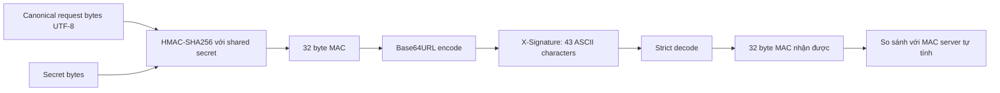
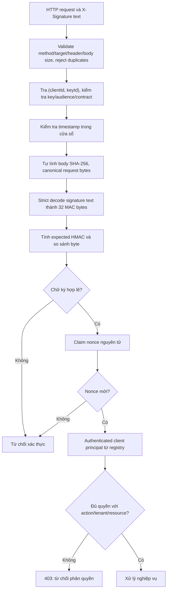

# Binary to text: mã hóa chữ ký HMAC thành chuỗi truyền qua HTTP

## Mục tiêu học tập

Trong chương **Encoding chữ ký**, chủ đề **Binary to text** là bước **biểu diễn byte chữ ký nhị phân thành chuỗi ký tự** để truyền trong HTTP header, JSON hoặc một giao thức yêu cầu dữ liệu dạng văn bản. Khi dùng HMAC-SHA256, `Mac.doFinal()` trả về **32 byte**. Chuỗi hex, Base64 hay Base64URL chỉ là những **cách biểu diễn** của 32 byte đó; chúng **không phải** những thuật toán ký khác nhau.

Bài học thuộc module `SECURITY_AUTHENTICATION_HMAC_REQUEST_AUTHENTICATION`, với mục tiêu thiết kế xác thực HTTP request bằng HMAC và **shared secret**, bảo vệ canonical request gồm method, URI, header hoặc body theo hợp đồng ký, rồi xác minh chữ ký, chống replay bằng timestamp/nonce, key rotation, kiểm thử proxy/gateway và phân biệt **authentication** với **authorization**.

Sau bài học, bạn có thể:

- Phân biệt **raw HMAC bytes**, chuỗi Base64/hex, byte UTF-8 của canonical request, secret key được encode để lưu trữ và SHA-256 body digest.
- Tính đúng độ dài chữ ký HMAC-SHA256 ở dạng hex, Base64 chuẩn và Base64URL không padding.
- Dùng Java 17 `Base64`, `HexFormat`, `Mac`, `SecretKeySpec` và `MessageDigest.isEqual` để mã hóa, giải mã và so sánh chữ ký.
- Thiết kế một định dạng chữ ký **duy nhất, chính xác** trên HTTP; kiểm tra cú pháp, độ dài, canonical encoding, duplicate header và đầu vào sai định dạng.
- Giải thích vì sao dấu `+`, `/`, `=`, percent-encoding và chuyển đổi charset có thể làm chữ ký bị sai ở client, proxy/gateway hoặc backend.
- Tích hợp bước binary-to-text vào xác minh HMAC request **có timestamp/nonce, registry key, rotation và authorization**.

## 1. Binary to text là bước nào của HMAC?

HMAC là một phép toán trên **byte**, không tạo ra chuỗi Unicode:

```text
canonicalText = 11 trường được nối theo hợp đồng ký
canonicalBytes = UTF8(canonicalText)

rawMacBytes = HMAC-SHA256(sharedSecretBytes, canonicalBytes)
             # 32 byte nhị phân, không nhất thiết là UTF-8 hợp lệ

signatureText = Base64URL_NoPadding(rawMacBytes)
              # 43 ký tự ASCII theo hợp đồng ví dụ
```

Client đưa `signatureText` vào header `X-Signature`. Server đọc header, kiểm tra định dạng, **decode** trở lại 32 byte MAC rồi đối chiếu với 32 byte MAC được server tự tính bằng secret trong registry.



**Quan trọng:** Dữ liệu qua mạng ở ví dụ này là **chuỗi chữ ký**, còn phép so sánh bảo mật được thực hiện trên **byte MAC**. Nếu dùng `new String(rawMacBytes, UTF_8)` rồi gửi header, những byte MAC không hợp lệ UTF-8 có thể bị thay thế hoặc biến đổi, khiến chữ ký không còn là biểu diễn chính xác của MAC.

### 1.1. Ba loại byte dễ bị nhầm

| Loại byte | Được tạo từ | Vai trò |
| --- | --- | --- |
| `canonicalBytes` | UTF-8 của chuỗi method/URI/header/body hash/timestamp/nonce | **Thông điệp** được HMAC ký. |
| `sharedSecretBytes` | Raw secret do hệ thống cấp, có thể được **decode từ Base64** khi nạp cấu hình | **Khóa** của HMAC, không gửi trong request. |
| `macBytes` | `Mac.doFinal(canonicalBytes)` | **Chữ ký nhị phân** được encode để truyền. |

Trong hợp đồng có body:

```text
bodyHashBytes = SHA-256(exactHttpBodyBytes)  # không có khóa, 32 byte
bodyHashText = Base64URL_NoPadding(bodyHashBytes)

canonicalBytes = UTF8(join(LF, ... bodyHashText, ...))
macBytes = HMAC-SHA256(sharedSecretBytes, canonicalBytes)
signatureText = Base64URL_NoPadding(macBytes)
```

Dù `bodyHashBytes` và `macBytes` đều dài 32 byte với SHA-256/HMAC-SHA256, **mục đích khác nhau**. Body hash là giá trị không khóa; HMAC là phép MAC có shared secret. Mã hóa chúng thành Base64URL **không biến** body hash thành bằng chứng xác thực.

### 1.2. Encoding khác encryption và signing

- **Encoding (mã biểu diễn):** Base64, Base64URL, hex giúp biểu diễn byte dưới dạng ký tự; **không bí mật**, có thể decode không cần khóa.
- **Hashing:** SHA-256 rút gọn input thành digest có độ dài cố định; **không cần khóa**.
- **Message authentication:** HMAC-SHA256 sử dụng **secret** để kiểm tra tính toàn vẹn và bên ký nắm giữ khóa (theo giả định khóa còn bí mật).
- **Encryption:** bảo vệ tính bí mật của nội dung theo một cơ chế khác, không được tự suy ra từ Base64.
- **Authorization:** quyết định client đã xác thực có quyền tác động đến API/tài nguyên/tenant nào; chữ ký HMAC đúng không thay thế bước này.

Không gọi chuỗi Base64 là “mã hóa bảo mật”. Ai nhận được `X-Signature` đều có thể decode ra raw MAC bytes, nhưng **không thể từ đó suy ra secret thực tế** nếu hệ thống dùng HMAC và secret đủ mạnh, theo giả định mật mã phù hợp.

## 2. Hex, Base64 và Base64URL khác nhau như thế nào?

Với **HMAC-SHA256**, độ dài MAC luôn **256 bit = 32 byte** bất kể secret key dài 32 hay 64 byte. Những dạng text thường gặp:

| Định dạng | Ký tự sử dụng | Độ dài với 32 byte | Điểm cần chú ý |
| --- | --- | --- | --- |
| **Hex thường** | `0-9`, `a-f` | **64 ký tự** | Dễ đọc khi debug/test vector; 2 ký tự đại diện 1 byte. |
| Hex hoa | `0-9`, `A-F` | **64 ký tự** | Cùng bytes với hex thường, nhưng **chuỗi khác**; hợp đồng phải chọn một cách. |
| **Base64 chuẩn có padding** | `A-Z a-z 0-9 + / =` | **44 ký tự**, kết thúc `=` | `+`/`/` có thể gây vấn đề khi đặt vào URL/query hoặc qua middleware. |
| Base64URL có padding | `A-Z a-z 0-9 - _ =` | **44 ký tự**, kết thúc `=` | Bảng chữ cái phù hợp URL, nhưng có `=` padding. |
| **Base64URL không padding** | `A-Z a-z 0-9 - _` | **43 ký tự** | Lựa chọn minh họa trong bài, dễ truyền qua HTTP header. |

Công thức độ dài Base64 có padding là `4 × ceil(n / 3)` ký tự với `n` byte. Với `n = 32`, kết quả là `44`; một ký tự `=` padding được bỏ đi khi dùng Base64URL không padding, còn `43`.

**Không được suy ra “MAC HMAC-SHA256 dài 43 byte”**. MAC vẫn là **32 byte nhị phân**; 43 chỉ là số ký tự của cách biểu diễn Base64URL không padding. Tương tự, hex 64 ký tự là **64 byte ASCII nếu gửi trên HTTP**, không phải MAC 64 byte.

### 2.1. Bảng chữ cái Base64URL

Base64URL theo RFC 4648 thay hai ký tự so với Base64 chuẩn:

```text
Base64 standard:  + /
Base64URL:        - _
```

Bảng chữ cái ở vị trí tương ứng mang **cùng 6 bit dữ liệu**. Dấu `=` là padding (nếu dùng), không phải một byte MAC. Nếu client và server đã thống nhất Base64URL không padding, **không cần** tự thay `-` thành `+` trước khi đưa vào `Base64.getUrlDecoder()`.

### 2.2. Hex và Base64 biểu diễn cùng một MAC

```java
import java.util.Base64;
import java.util.HexFormat;

byte[] macBytes = /* 32 bytes từ Mac.doFinal(...) */;
String hex = HexFormat.of().formatHex(macBytes);
String base64 = Base64.getEncoder().encodeToString(macBytes);
String base64Url = Base64.getUrlEncoder()
        .withoutPadding().encodeToString(macBytes);
```

Ba chuỗi có thể khác nhau hoàn toàn nhưng đều **decode thành cùng 32 byte**. Đổi định dạng từ hex sang Base64URL **không thay thuật toán HMAC**; đó là **thay hợp đồng biểu diễn**, có thể làm mất tương thích nếu server vẫn mong hex.

### 2.3. Nên chọn định dạng nào?

Với một API HMAC tự thiết kế, **Base64URL không padding** là lựa chọn thực tế để giảm rắc rối với ký tự `+`, `/` và `=` trên nhiều tầng HTTP. Tuy nhiên:

- Không có yêu cầu phổ quát rằng **mọi** HMAC request phải dùng Base64URL. Ví dụ, một dịch vụ có thể công bố **hex lowercase**; khi tích hợp phải theo **hợp đồng của dịch vụ đó**.
- Nếu chọn Base64URL, hãy ghi rõ **padding có được phép không**, cách kiểm tra alphabet, độ dài, canonical form và phiên bản.
- Nếu định dạng thay đổi, phát hành test vector/SDK tương thích, không đoán định dạng từ độ dài hay thử nhiều decoder theo kiểu fallback không kiểm soát.

## 3. Một định dạng truyền chữ ký rõ ràng

API minh họa của bài công bố:

```http
X-Signature: <43-character-base64url-no-padding>
X-Content-SHA256: <43-character-base64url-no-padding>
X-Client-Id: report-worker-prod
X-Key-Id: key-2026-11
X-Timestamp: <unix-epoch-seconds>
X-Nonce: <22-character-base64url-no-padding>
```

**Phân biệt ba giá trị được encode:**

| Trường | Nguồn byte | Số byte | Dạng text trong hợp đồng |
| --- | --- | --- | --- |
| `X-Signature` | HMAC-SHA256 của canonical request | **32** | Base64URL không padding, **43 ký tự**. |
| `X-Content-SHA256` | SHA-256 của exact HTTP body | **32** | Base64URL không padding, **43 ký tự**. |
| `X-Nonce` | Nonce ngẫu nhiên từ CSPRNG | **16** | Base64URL không padding, **22 ký tự**. |

**Cùng dùng Base64URL không có nghĩa cùng vai trò.** Server kiểm tra `X-Signature` bằng key và MAC, kiểm tra body hash bằng tự băm payload, và dùng nonce store để chặn request đã xử lý.

### 3.1. Quy tắc cho `X-Signature`

Ví dụ này chỉ chấp nhận **một giá trị header duy nhất** đúng dạng:

```text
^[A-Za-z0-9_-]{43}$
```

Tại bước xác minh:

1. HTTP parser kiểm tra header có **một instance**, không bị gộp/trùng/mâu thuẫn, không chứa CR/LF hoặc ký tự điều khiển.
2. Lấy đúng **giá trị ASCII** theo giao thức. Không tự `trim()` tùy tiện nếu hợp đồng chưa quy định; ví dụ cho phép parser HTTP loại *optional whitespace (OWS)* hai đầu theo HTTP field rules, nhưng tuyệt đối không cho whitespace **ở trong** chuỗi.
3. Kiểm tra alphabet `[A-Za-z0-9_-]` và **độ dài 43** trước khi decode.
4. Dùng `Base64.getUrlDecoder().decode(...)`, yêu cầu kết quả **đúng 32 byte**.
5. **Encode lại** bằng Base64URL không padding và yêu cầu kết quả **chính xác bằng header nhận được**. Bước này loại dạng biểu diễn không canonical.
6. Tự tính expected MAC bằng secret từ registry và canonical request **tự dựng từ HTTP request thực nhận**.
7. So sánh **byte[]** bằng `MessageDigest.isEqual(expected, received)`. Chỉ khi toàn bộ kiểm tra HMAC/freshness khác đạt, mới coi client đã được xác thực.

Tại sao cần bước re-encode? Base64 biểu diễn 32 byte bằng 43 ký tự, trong đó một số bit ở ký tự cuối là **pad bits** theo RFC 4648 và phải bằng 0 ở dạng canonical. Một số decoder có thể chấp nhận những biến thể có pad bits khác 0 nhưng vẫn giải ra cùng byte. **Decode rồi encode lại** là cách kiểm tra dạng text duy nhất theo hợp đồng, tránh các biến thể văn bản tương đương gây sai lệch ở cache, logging hoặc cơ chế ký nhiều lớp.

### 3.2. Không so sánh chuỗi MAC dưới dạng text

Sai sót thường gặp:

```java
String expected = encodeMac(computeMac(secret, request));
return expected.equals(receivedSignature); // Không phải cách so sánh MAC nên chọn.
```

Ngoài độ dài/định dạng, so sánh `String.equals` không được thiết kế làm phép so sánh byte MAC có tính chất thời gian phù hợp. Thay vào đó:

```java
byte[] expectedMac = computeMac(secret, canonicalBytes);
byte[] receivedMac = strictDecodeSignature(receivedSignature);
return MessageDigest.isEqual(expectedMac, receivedMac);
```

Việc xác minh **canonical input**, chuẩn hóa định dạng và so sánh MAC là **ba bước khác nhau**. Không đưa chuỗi ký tự Base64 vào `Mac.doFinal(...)` lần nữa; như vậy bạn đang tạo MAC của **chữ ký**, không phải MAC của canonical request.

## 4. Binary-to-text nằm trong canonical request như thế nào?

Hợp đồng ví dụ dùng **HMAC-SHA256** và canonical request **11 dòng**. Không có một chuẩn canonical request chung cho mọi API HMAC; đây là thiết kế cụ thể để học.

Request minh họa:

```http
POST /v1/reports?tenant=merchant-42 HTTP/1.1
Host: reports.example.test
Content-Type: application/octet-stream
X-Client-Id: report-worker-prod
X-Key-Id: key-2026-11
X-Timestamp: 1795800000
X-Nonce: BVLOV3evw9S3Zewpz5JgYQ
X-Content-SHA256: <body-digest-base64url>
X-Signature: <hmac-base64url>

<exact binary body bytes>
```

Các giá trị nằm trong `<...>` là placeholder. Timestamp cố định chỉ minh họa; khi gửi thực phải dùng timestamp hiện tại và nonce mới.

Canonical request chính xác:

```text
HMAC-SHA256
signature-text-v1
reports-api-prod
report-worker-prod
key-2026-11
POST
/v1/reports?tenant=merchant-42
application/octet-stream
<body-digest-base64url>
1795800000
BVLOV3evw9S3Zewpz5JgYQ
```

Hợp đồng quy định:

- Dòng 1 thuật toán là `HMAC-SHA256` (trong Java `Mac.getInstance("HmacSHA256")`).
- Dòng 2 là `signature-text-v1` để cố định quy tắc canonicalization và cách biểu diễn chữ ký.
- Dòng 3 audience `reports-api-prod` do API/server cấu hình và đối chiếu credential, không lấy từ một header client tùy ý.
- Dòng 4–5 là client ID và key ID, được ký; server tra secret theo `(clientId, keyId)`.
- Dòng 6 method exact `POST`, dòng 7 raw request-target exact `/v1/reports?tenant={id}`, với `id` thuộc `[A-Za-z0-9_-]{1,64}`.
- Dòng 8 Content-Type exact `application/octet-stream`; hợp đồng ví dụ chỉ nhận Content-Encoding vắng mặt hoặc `identity`.
- Dòng 9 **Base64URL(SHA-256(exact body bytes))**, 43 ký tự, không phải binary body được chuyển thành text.
- Dòng 10 timestamp epoch giây; dòng 11 nonce Base64URL 16 byte.
- Các dòng text không chứa CR/LF; nối bằng **LF (`\n`)** ở UTF-8, **không có LF cuối**.
- `X-Signature` **không có trong canonical input**, vì nó chính là kết quả của HMAC trên các trường đó.

Công thức cuối:

```text
bodyHashText = Base64URL_NoPadding(SHA256(bodyBytes))
canonicalText = join(LF, 11 signed fields)
canonicalBytes = UTF8(canonicalText)

signatureBytes = HMAC_SHA256(secretBytes, canonicalBytes)
X-Signature = Base64URL_NoPadding(signatureBytes)
```

Nếu body thực tế là chuỗi Base64 nằm trong JSON, hãy hash **chính byte JSON được gửi**, không decode dữ liệu nội bộ của JSON rồi hash theo cách riêng trừ khi hợp đồng API thực sự quy định điều đó.

### 4.1. Raw path/query và proxy

Server phải dựng canonical từ **method, raw target, Content-Type, body bytes và metadata thực nhận** tại ranh giới đã định. Nếu gateway rewrite `/public/v1/reports` thành `/v1/reports` hoặc sắp lại query, canonical bytes khác dù signature vẫn là Base64URL hợp lệ. **Định dạng đúng không chứng minh chữ ký đúng.**

Ngược lại, ngay cả khi gateway bảo toàn raw target, chuyển đổi `X-Signature` từ Base64URL không padding sang Base64 có padding sẽ khiến request **không còn đúng hợp đồng**. Không sửa header tự động để “cho verify qua”; thay vào đó cần thống nhất SDK, proxy và verifier.

## 5. Java 17: ký, encode, strict decode và xác minh chữ ký

Chương trình dưới đây có thể lưu thành `SignatureEncodingDemo.java` và chạy với **JDK 17+**. Ví dụ dùng một mảng body nhị phân, secret sinh ngẫu nhiên bằng `SecureRandom` và canonical request giống hợp đồng `signature-text-v1`.

Nó minh họa rõ:

- `MessageDigest.getInstance("SHA-256")` dùng cho **body hash**.
- `Mac.getInstance("HmacSHA256")` và `SecretKeySpec` tạo **raw MAC 32 byte**.
- `Base64.getUrlEncoder().withoutPadding()` chuyển raw MAC thành **43 ký tự ASCII**.
- `Base64.getUrlDecoder()` nhận chuỗi chữ ký, sau đó **kiểm tra lại dạng canonical** trước khi so sánh byte.
- `HexFormat` và Base64 chuẩn chỉ dùng để minh họa **biểu diễn khác**; chúng **không được verifier này chấp nhận** như `X-Signature` của contract.

### 5.1. Chương trình đầy đủ

```java
import java.nio.charset.StandardCharsets;
import java.security.GeneralSecurityException;
import java.security.MessageDigest;
import java.security.SecureRandom;
import java.time.Instant;
import java.util.Arrays;
import java.util.Base64;
import java.util.HexFormat;
import java.util.Objects;
import java.util.regex.Pattern;
import javax.crypto.Mac;
import javax.crypto.spec.SecretKeySpec;

public final class SignatureEncodingDemo {
    private static final String AUDIENCE = "reports-api-prod";
    private static final String CONTRACT = "signature-text-v1";
    private static final String MAC_ALGORITHM = "HmacSHA256";

    private static final Base64.Encoder B64_URL =
            Base64.getUrlEncoder().withoutPadding();
    private static final Base64.Decoder B64_URL_DECODER =
            Base64.getUrlDecoder();

    private static final Pattern TARGET = Pattern.compile(
            "/v1/reports\\?tenant=[A-Za-z0-9_-]{1,64}");
    private static final Pattern ID =
            Pattern.compile("[A-Za-z0-9_-]{1,64}");
    private static final Pattern TIMESTAMP =
            Pattern.compile("[1-9][0-9]{0,18}");
    private static final Pattern NONCE =
            Pattern.compile("[A-Za-z0-9_-]{22}");
    private static final Pattern SIGNATURE_TEXT =
            Pattern.compile("[A-Za-z0-9_-]{43}");

    private SignatureEncodingDemo() {}

    record RequestData(
            String method, String rawTarget, String contentType,
            byte[] body, String clientId, String keyId,
            String timestamp, String nonce) {
        RequestData {
            body = Objects.requireNonNull(body, "body").clone();
        }

        @Override public byte[] body() {
            return body.clone();
        }
    }

    record SignedHeaders(String bodyHash, String signature) {}

    private static boolean validId(String value) {
        return value != null && ID.matcher(value).matches();
    }

    private static byte[] strictDecodeBase64Url(
            String encoded, int byteLength, int textLength) {
        if (encoded == null || encoded.length() != textLength ||
                !encoded.matches("[A-Za-z0-9_-]+")) {
            throw new IllegalArgumentException("Invalid Base64URL characters");
        }

        byte[] decoded = B64_URL_DECODER.decode(encoded);
        if (decoded.length != byteLength ||
                !B64_URL.encodeToString(decoded).equals(encoded)) {
            throw new IllegalArgumentException("Non-canonical Base64URL");
        }
        return decoded;
    }

    private static void validateRequest(RequestData r) {
        if (!"POST".equals(r.method())
                || !"application/octet-stream".equals(r.contentType())) {
            throw new IllegalArgumentException("Invalid method/content type");
        }
        if (r.rawTarget() == null
                || !TARGET.matcher(r.rawTarget()).matches()) {
            throw new IllegalArgumentException("Invalid raw target");
        }
        if (!validId(r.clientId()) || !validId(r.keyId())) {
            throw new IllegalArgumentException("Invalid client/key identifier");
        }
        if (r.body().length > 1024 * 1024) {
            throw new IllegalArgumentException("Body too large for demo");
        }
        if (r.timestamp() == null ||
                !TIMESTAMP.matcher(r.timestamp()).matches()) {
            throw new IllegalArgumentException("Invalid timestamp format");
        }
        strictDecodeBase64Url(r.nonce(), 16, 22);
    }

    private static String computeBodyHash(byte[] body)
            throws GeneralSecurityException {
        byte[] digest = MessageDigest.getInstance("SHA-256")
                .digest(body);
        return B64_URL.encodeToString(digest);
    }

    private static String canonical(RequestData r, String bodyHash) {
        validateRequest(r);
        if (bodyHash == null ||
                bodyHash.length() != 43 ||
                !bodyHash.matches("[A-Za-z0-9_-]{43}")) {
            throw new IllegalArgumentException("Invalid body digest format");
        }

        return String.join("\n",
                "HMAC-SHA256", CONTRACT, AUDIENCE,
                r.clientId(), r.keyId(), r.method(), r.rawTarget(),
                r.contentType(), bodyHash, r.timestamp(), r.nonce());
        // 11 dòng UTF-8, LF, không có LF cuối.
    }

    private static byte[] computeHmac(byte[] rawSecret,
                                      String canonicalText)
            throws GeneralSecurityException {
        Mac mac = Mac.getInstance(MAC_ALGORITHM);
        mac.init(new SecretKeySpec(rawSecret, MAC_ALGORITHM));
        return mac.doFinal(canonicalText.getBytes(StandardCharsets.UTF_8));
    }

    static SignedHeaders sign(RequestData r, byte[] rawSecret)
            throws GeneralSecurityException {
        String bodyHash = computeBodyHash(r.body());
        String canonicalText = canonical(r, bodyHash);
        byte[] macBytes = computeHmac(rawSecret, canonicalText);
        return new SignedHeaders(
                bodyHash, B64_URL.encodeToString(macBytes));
    }

    static boolean verify(RequestData received, SignedHeaders headers,
                          byte[] registeredSecret)
            throws GeneralSecurityException {
        if (headers == null || headers.bodyHash() == null ||
                headers.signature() == null) {
            return false;
        }
        try {
            // Không tin giá trị hash body mà client tự gửi:
            String actualBodyHash = computeBodyHash(received.body());
            if (!actualBodyHash.equals(headers.bodyHash())) {
                return false;
            }

            // 43 ASCII chars -> 32 byte MAC; reject padding/alias.
            String value = headers.signature();
            if (!SIGNATURE_TEXT.matcher(value).matches()) {
                return false;
            }
            byte[] supplied = strictDecodeBase64Url(value, 32, 43);

            String canonicalText = canonical(received, actualBodyHash);
            byte[] expected = computeHmac(registeredSecret, canonicalText);
            return MessageDigest.isEqual(expected, supplied);
        } catch (IllegalArgumentException exception) {
            // Reject format/contract failures.
            return false;
        }
    }

    static RequestData withTarget(RequestData r, String newTarget) {
        return new RequestData(r.method(), newTarget, r.contentType(),
                r.body(), r.clientId(), r.keyId(), r.timestamp(), r.nonce());
    }

    public static void main(String[] args)
            throws GeneralSecurityException {
        SecureRandom random = new SecureRandom();

        byte[] secret = new byte[32];
        random.nextBytes(secret); // Chỉ dùng để mô phỏng hai phía.
        byte[] nonceBytes = new byte[16];
        random.nextBytes(nonceBytes);

        byte[] body = {
                0x00, (byte) 0x80, (byte) 0xFF, 0x0D, 0x0A, 0x01
        };
        RequestData request = new RequestData(
                "POST", "/v1/reports?tenant=merchant-42",
                "application/octet-stream", body,
                "report-worker-prod", "key-2026-11",
                Long.toString(Instant.now().getEpochSecond()),
                B64_URL.encodeToString(nonceBytes));

        SignedHeaders headers = sign(request, secret);
        System.out.println("Raw MAC encoding chars: "
                + headers.signature().length());  // 43
        System.out.println("Valid Base64URL: "
                + verify(request, headers, secret)); // true

        byte[] macBytes = strictDecodeBase64Url(
                headers.signature(), 32, 43);
        String hex = HexFormat.of().formatHex(macBytes);
        String standardBase64 = Base64.getEncoder()
                .encodeToString(macBytes);
        System.out.println("Hex chars: " + hex.length()); // 64
        System.out.println("Base64 chars: "
                + standardBase64.length()); // 44

        SignedHeaders hexInstead = new SignedHeaders(
                headers.bodyHash(), hex);
        System.out.println("Hex accepted as Base64URL: "
                + verify(request, hexInstead, secret)); // false

        SignedHeaders paddedInstead = new SignedHeaders(
                headers.bodyHash(),
                Base64.getUrlEncoder().encodeToString(macBytes));
        System.out.println("Padded Base64URL accepted: "
                + verify(request, paddedInstead, secret)); // false

        RequestData changedTarget = withTarget(request,
                "/v1/reports?tenant=merchant-99");
        System.out.println("Changed tenant accepted: "
                + verify(changedTarget, headers, secret)); // false

        byte[] modifiedBody = request.body();
        modifiedBody[2] ^= 0x01;
        RequestData changedBody = new RequestData(
                request.method(), request.rawTarget(),
                request.contentType(), modifiedBody,
                request.clientId(), request.keyId(),
                request.timestamp(), request.nonce());
        System.out.println("Modified body accepted: "
                + verify(changedBody, headers, secret)); // false

        Arrays.fill(secret, (byte) 0);
        Arrays.fill(body, (byte) 0);
        Arrays.fill(modifiedBody, (byte) 0);
        Arrays.fill(macBytes, (byte) 0);
    }
}
```

Kết quả kỳ vọng:

```text
Raw MAC encoding chars: 43
Valid Base64URL: true
Hex chars: 64
Base64 chars: 44
Hex accepted as Base64URL: false
Padded Base64URL accepted: false
Changed tenant accepted: false
Modified body accepted: false
```

**Diễn giải:** `verify` không chỉ xem header có vẻ giống Base64URL; nó **decode đúng 32 byte**, encode lại để kiểm tra dạng chuẩn, rồi so sánh với MAC server tự tính. Khi thay URI, body hoặc đổi cách biểu diễn signature trái hợp đồng, request bị từ chối. Khóa `secret` chỉ được dùng trong bộ nhớ của demo; trong hệ thống thật, server tra secret từ registry theo `(clientId, keyId)` sau khi kiểm tra quyền sử dụng audience/contract.

**Giới hạn có chủ đích:** Đây không phải HTTP server. Nó chưa xử lý header trùng, Content-Encoding trên wire, timestamp có trong cửa sổ, nonce đã được dùng hay chưa, key status hoặc authorization. Việc dùng `Arrays.fill` để dọn mảng không bảo đảm xóa mọi bản sao do JVM/provider tạo. Không nhúng secret production vào source/test fixture hoặc log.

### 5.2. Tại sao phải decode trước khi so sánh?

Đây là điểm học quan trọng nhất của Binary to text:

```text
Received header text: [A-Za-z0-9_-]{43}
       |
       v
Base64URL decode (strict, canonical)
       |
       v
Received MAC bytes (32)
       |
       v
MessageDigest.isEqual(expectedMacBytes, receivedMacBytes)
```

Nếu dùng `getBytes(StandardCharsets.UTF_8)` trên chuỗi header, bạn sẽ nhận được **43 byte ASCII của text đã encode**, không phải **32 byte MAC**. Chúng không thể được so sánh trực tiếp với `Mac.doFinal()`.

Ngược lại, nếu lấy raw MAC 32 byte rồi gọi `new String(macBytes, UTF_8)`, bạn đang cố diễn giải dữ liệu tùy ý thành chữ; nó không đảm bảo round-trip và có thể chứa ký tự không phù hợp với HTTP header.

### 5.3. Tách kiểm tra định dạng và quyết định xác thực

Một request có `X-Signature` đúng 43 ký tự nhưng MAC sai là **lỗi xác thực**. Một request có chữ ký Base64URL sai định dạng, bị padding hoặc noncanonical là **lỗi hợp đồng đầu vào**. Hệ thống có thể phân loại nguyên nhân trong log nội bộ, nhưng response ra ngoài nên tiết chế thông tin để tránh hỗ trợ kẻ tấn công phân tích secret/credential.

Không đặt mặc định “nếu Base64URL decode lỗi thì thử hex, Base64 chuẩn hoặc bỏ ký tự lạ”. Nếu cần hỗ trợ nhiều format trong thời gian migration, nên pin format **theo phiên bản contract/credential**, xác định rõ cách tiếp nhận và kiểm thử, không quyết định bằng thử ngẫu nhiên đến khi MAC khớp.

## 6. Byte bí mật được encode khác với chữ ký được encode

Một hệ thống thường lưu secret ở dạng Base64/hex trong **secret manager** hoặc biến môi trường để thuận tiện lưu trữ. Điều này **khác hoàn toàn** với việc gửi chữ ký ở header.

Ví dụ có một secret **32 byte ngẫu nhiên** được provision dưới dạng Base64URL:

```java
import java.util.Base64;
import javax.crypto.Mac;
import javax.crypto.spec.SecretKeySpec;

// Giá trị bên dưới chỉ minh họa nguồn cấu hình được cấp, không phải key thật.
String configuredSecretBase64Url = obtainSecretFromProtectedConfiguration();
byte[] rawSecret = Base64.getUrlDecoder().decode(configuredSecretBase64Url);

Mac mac = Mac.getInstance("HmacSHA256");
mac.init(new SecretKeySpec(rawSecret, "HmacSHA256"));
byte[] macBytes = mac.doFinal(canonicalBytes);

String signature = Base64.getUrlEncoder()
        .withoutPadding().encodeToString(macBytes);
```

Điểm cần nhớ:

1. `rawSecret` là **byte khóa**. Chuỗi Base64URL trong secret manager chỉ là **dạng lưu trữ** của nó.
2. **Không** dùng `configuredSecretBase64Url.getBytes(UTF_8)` làm HMAC key; như thế dùng byte ký tự của chuỗi Base64 thay vì secret gốc.
3. Kiểm tra cấu hình key có kích thước/entropy đủ mạnh theo chính sách; một secret được encode dài không có nghĩa raw secret thực sự ngẫu nhiên.
4. Secret mới của **key rotation** cần được sinh độc lập; đổi `keyId` hoặc encode lại secret cũ không tạo khóa mới.
5. Trong request chỉ gửi `clientId`/`keyId` để server biết **chọn secret nào**; không gửi secret, dù ở dạng Base64.

### 6.1. Đừng biến Base64URL thành định danh khóa

`keyId` là định danh do registry quản lý, không phải hash của secret và cũng không phải nội dung secret. Một số hệ thống chọn ID có cấu trúc như `key-2026-11`; đó là metadata không bí mật. **Không lưu raw key hoặc Base64 key vào query/header** và gọi nó là key ID.

## 7. Chọn đúng nơi đặt signature text

### 7.1. Trong HTTP header

Đối với hợp đồng minh họa, `X-Signature` được đặt trong **header** riêng:

```http
X-Signature: aValid43CharacterValueMustBeComputedBySigner
```

Chuỗi trên chỉ là **placeholder minh họa**, không phải giá trị có thể xác minh. Khi gửi thật, phải encode raw MAC theo hợp đồng rồi điền chính xác.

Ưu điểm của header: không cần loại trường signature khỏi query canonicalization, dễ phân tách identity metadata với raw path/query và ít rủi ro bị ghi vào access log URL. Tuy nhiên header **vẫn có thể xuất hiện trong log/proxy telemetry** nếu hệ thống ghi lại toàn bộ request headers; nên che/giảm ghi dữ liệu xác thực.

Các quy tắc tiếp nhận: một instance header, không comma-join hai chữ ký, không whitespace ở giữa, giới hạn độ dài, không CR/LF injection. HTTP field name thường không phân biệt chữ hoa/thường; nhưng **giá trị Base64URL** là chuỗi phân biệt chữ hoa/thường.

### 7.2. Trong query string

Ví dụ:

```text
/v1/reports?tenant=merchant-42&sig=<signature>
```

Đặt signature ở query tạo thêm các vấn đề:

- Khi canonicalize query, cần quy tắc loại **đúng tham số `sig`** khỏi dữ liệu ký, nếu không chữ ký sẽ phải ký chính nó.
- Phải xử lý **duplicate `sig`**, thứ tự tham số, giá trị rỗng, percent-decoding và dấu `+` của Base64 chuẩn.
- Signature trong URL có thể xuất hiện ở log, analytics, browser history, cache hoặc telemetry. Không dùng phương án này cho API nhạy cảm nếu không có lý do và thiết kế phù hợp.
- Query không phải nơi phù hợp để đặt **shared secret**; chữ ký không phải secret nhưng vẫn là một bearer artifact có thể bị replay nếu cơ chế nonce/timestamp không đủ mạnh.

**Base64URL giảm ký tự reserved** khi dùng trong URL, nhưng không giải quyết việc **ký đúng raw query** hoặc chống replay. Hợp đồng bài này chọn signature trong header; nếu API thực tế khác, phải tuân thủ đặc tả của API đó.

### 7.3. Trong JSON field

Một số hệ thống chuyển chữ ký trong envelope JSON:

```json
{
  "algorithm": "HMAC-SHA256",
  "payloadBase64Url": "<encoded-raw-bytes>",
  "signatureBase64Url": "<encoded-mac>"
}
```

Khi đó phải phân biệt rõ **ký byte payload nào**: byte raw đã decode từ `payloadBase64Url` hay byte JSON serialization? Nếu client ký raw payload nhưng server ký JSON đã serialize, chữ ký không khớp. Không để JSON key order/whitespace/charset hoặc encoding của chữ ký thay đổi nội dung được ký ngoài hợp đồng.

Đặc biệt, nếu request HTTP mang JSON envelope trên thì **HTTP body thực nhận** là byte JSON, không phải raw payload ẩn bên trong; muốn ký payload đã decode là một hợp đồng riêng. Không nhầm “binary-to-text của chữ ký” với “canonicalization JSON body”.

## 8. Những lỗi signature encoding thường thấy qua HTTP và proxy/gateway

Trong nhiều sự cố, HMAC **đúng về mặt thuật toán** nhưng signature text đến server lại khác text client đã tạo.

| Tình huống | Ví dụ | Hệ quả/cách xử lý |
| --- | --- | --- |
| Base64 chuẩn trong URL | Ký tự `+` bị parser form hiểu là space. | Không dùng Base64 chuẩn trong query nếu chưa encode đúng; hợp đồng ví dụ dùng Base64URL ở header. |
| Padding khác nhau | Client dùng `...=`, server yêu cầu không padding. | Hai chuỗi có thể biểu diễn cùng MAC nhưng **một chuỗi trái hợp đồng**; từ chối và sửa SDK. |
| Alphabet trộn lẫn | Client gửi `+`/`/` trong chuỗi mong Base64URL. | Reject vì không thuộc alphabet hợp đồng. |
| Hex hoa/thường | `A1B2` và `a1b2` có thể decode cùng byte. | Khi dùng hex phải pin uppercase/lowercase; ví dụ này **không chấp nhận hex**. |
| Dấu cách/xuống dòng | Middleware line-wrap Base64, thêm CR/LF hoặc dấu cách giữa chữ ký. | Reject. Không tự xóa whitespace bên trong. |
| Charset sai | Dùng `new String(macBytes, UTF_8)`. | Raw MAC không phải text; encode Base64URL trực tiếp từ bytes. |
| Compare nhầm bytes | Dùng `signature.getBytes(UTF_8)` so với `Mac.doFinal()`. | 43 byte ASCII khác 32 byte MAC; phải decode. |
| Double encoding | Percent-encode Base64URL hai lần. | Request text có `%` ngoài hợp đồng, hoặc bị decode khác giữa các tầng. |
| JSON escape | Serialize rồi parse một field theo charset/escape khác. | Bảo toàn chuỗi ASCII, dùng parser và schema rõ ràng. |
| Header trùng | Hai `X-Signature` hoặc giá trị comma-joined. | Reject tại edge, không chọn giá trị đầu/cuối ngẫu nhiên. |
| Gateway rewrite URI | Ký `/public/reports`, backend nhận `/internal/reports`. | Signature text có thể nguyên vẹn nhưng **expected MAC khác** vì canonical request khác. |
| Gateway đổi body | Nén/giải nén hoặc serialize lại JSON. | Body hash khác; không chữa bằng thay decoder. |
| Unicode/case mang vào signature | Tự lower-case/normalize chuỗi MAC. | Base64URL là ASCII **phân biệt hoa thường**, không được đổi case. |
| Dùng regex quá thoáng | Cho thêm `=` hoặc `-` ở nơi không theo contract. | Pin exact alphabet, byte length và encode lại. |
| Fallback decode nhiều format | Thử Base64, hex, URL decode đến khi MAC khớp. | Tạo bề mặt nhập nhằng và khó debug; cố định format theo credential/contract. |

### 8.1. Ví dụ `+` bị biến thành space

```text
Base64 chuẩn (giả định): A+B/C==
Mô hình form decode:    A B/C==
Base64URL biểu diễn:    A-B_C
```

Những chuỗi trên chỉ minh họa việc **thay bảng chữ cái và xử lý reserved characters**, không phải những chữ ký HMAC-SHA256 đủ độ dài. Base64URL **không cần percent-encode** các ký tự trong alphabet của nó khi đặt làm value của tham số query thông thường, nhưng nếu chữ ký ở query thì bạn vẫn phải giải quyết thứ tự tham số, chính sách duplicate, loại chữ ký khỏi canonical input và nguy cơ lộ qua log.

### 8.2. Header HTTP có thể biến đổi mà không đổi MAC bytes

Một proxy có thể thay chữ hoa/thường của **tên header**, ví dụ `X-Signature` → `x-signature`, mà không thay giá trị. Điều đó thường không ảnh hưởng vì tên HTTP field **không phân biệt chữ hoa/thường**. Nhưng nếu proxy đổi **giá trị signature**, thêm padding, chuẩn hóa case hoặc gộp nhiều header, đó là thay đổi định dạng đáng được phát hiện.

Không nhầm hai lớp:

- **Header name:** được HTTP parser nhận diện theo quy tắc tên field.
- **Header value Base64URL:** chuỗi ASCII **case-sensitive**, phải đúng schema đã công bố.

Nếu framework tự loại OWS ở đầu/cuối field value theo cách của HTTP, hãy ghi rõ đó là bước tiếp nhận trước khi kiểm tra Base64URL. Không tự dùng `String.trim()` để “sửa” tất cả input dù có ký tự điều khiển không hợp lệ.

## 9. Kiểm tra encoding chuẩn và test vector

### 9.1. Dùng test vector HMAC độc lập với HTTP

Đầu tiên, kiểm tra HMAC-SHA256 cơ bản bằng **RFC 4231, test case 1**:

```text
Key:     20 bytes, each byte = 0x0b
Message: ASCII "Hi There"

Expected HMAC-SHA256 (hex lowercase):
b0344c61d8db38535ca8afceaf0bf12b881dc200c9833da726e9376c2e32cff7
```

Java 17:

```java
import java.nio.charset.StandardCharsets;
import java.security.MessageDigest;
import java.util.Arrays;
import java.util.Base64;
import java.util.HexFormat;
import javax.crypto.Mac;
import javax.crypto.spec.SecretKeySpec;

byte[] testKey = new byte[20];
Arrays.fill(testKey, (byte) 0x0b);

Mac mac = Mac.getInstance("HmacSHA256");
mac.init(new SecretKeySpec(testKey, "HmacSHA256"));
byte[] macBytes = mac.doFinal(
        "Hi There".getBytes(StandardCharsets.US_ASCII));

String actualHex = HexFormat.of().formatHex(macBytes);
String expectedHex =
        "b0344c61d8db38535ca8afceaf0bf12b881dc200c9833da726e9376c2e32cff7";

System.out.println(actualHex.equals(expectedHex)); // true
String text = Base64.getUrlEncoder()
        .withoutPadding().encodeToString(macBytes);
byte[] recovered = Base64.getUrlDecoder().decode(text);
System.out.println(text.length()); // 43
System.out.println(MessageDigest.isEqual(macBytes, recovered)); // true
```

Ví dụ test vector chứng minh HMAC algorithm và bước Base64URL round-trip hoạt động. **Nó chưa kiểm tra** canonical request HTTP, query encoding, timestamp, nonce, key registry hoặc authorization.

Khi gặp lỗi, hãy kiểm tra lần lượt: **test vector HMAC** → raw secret bytes → canonical bytes → body hash → signature encoding/decoding → truyền qua gateway → freshness/nonce → authorization.

### 9.2. Canonical form và pad bits

Khi encode 32 byte bằng Base64URL:

- 30 byte đầu đi thành các nhóm đủ 3 byte.
- 2 byte cuối tạo 3 ký tự Base64URL và một ký tự `=` padding nếu dùng format có padding.
- Trong ký tự Base64URL cuối (thứ **43**), **2 bit thấp nhất là pad bits** phải bằng 0 ở biểu diễn canonical.

Vì vậy có thể tồn tại nhiều ký tự cuối khác nhau mà một decoder quá thoáng vẫn suy ra cùng 32 byte nếu nó bỏ qua pad bits không hợp lệ. **Hợp đồng cần đúng một chuỗi biểu diễn cho mỗi MAC bytes.** `strictDecodeBase64Url` trong ví dụ thực hiện kiểm tra bằng cách decode rồi encode lại và so sánh **chính xác chuỗi**.

Đây là kiểm tra **chuẩn biểu diễn**, không phải một cách gia tăng độ mạnh của HMAC. Giữ một biểu diễn duy nhất giúp cache, logging, signature transport và các tầng kiểm tra nhất quán.

### 9.3. Không tự động nhận mọi loại Base64

Bộ decode của Java có nhiều lựa chọn:

```java
Base64.getDecoder();     // Base64 chuẩn: + /
Base64.getUrlDecoder();  // Base64URL: - _
Base64.getMimeDecoder(); // MIME Base64, có quy tắc xuống dòng/format khác
```

Với header `X-Signature` Base64URL không padding, dùng **URL decoder** và validation strict. `getMimeDecoder()` không phù hợp vì hợp đồng không chấp nhận format có line breaks hoặc ký tự ngoài alphabet; bộ parser mềm có thể âm thầm bỏ dữ liệu sai.

`Base64.getUrlDecoder()` có thể chấp nhận các lựa chọn padding khác nhau theo API; **API cho phép decode không đồng nghĩa giao thức của bạn cho phép mọi biểu diễn đó**. Validator phải kiểm tra chính xác 43 ký tự không có `=` và encode lại.

### 9.4. Không suy định dạng chỉ từ độ dài

Hex HMAC-SHA256 dài 64 ký tự, Base64URL không padding dài 43. Độ dài giúp kiểm tra sơ bộ nhưng **không bảo đảm giá trị đúng**. Chuỗi ngẫu nhiên 43 ký tự hợp alphabet có thể decode thành 32 byte nhưng **không phải MAC hợp lệ**; chỉ bước HMAC với registered secret mới quyết định điều đó.

Các chuỗi văn bản có cùng chiều dài cũng có thể chứa pad bits sai. Do đó quy trình chuẩn là **schema → decode → canonical re-encode → compute MAC → constant-time byte comparison**, không phải “độ dài đúng thì accept”.

## 10. Xác minh HMAC HTTP hoàn chỉnh: encoding chỉ là một bước

Một server HMAC request authentication không được chấp nhận request chỉ vì `X-Signature` là chuỗi Base64URL hợp lệ.



Các điều kiện đáng chú ý:

1. **Credential:** client ID và key ID từ request là dữ liệu **tự khai** trước HMAC; registry xác định key đó có thuộc client, còn hạn và đúng audience/contract hay không.
2. **Timestamp:** có chữ ký, chẳng hạn kiểm tra trong cửa sổ **±300 giây** với đồng hồ server đã đồng bộ. Kiểm tra sớm có thể giảm chi phí, nhưng timestamp chưa đáng tin trước khi MAC hợp lệ.
3. **Nonce:** ký cùng canonical request, sinh CSPRNG tối thiểu 128 bit; sau MAC hợp lệ, claim theo `(audience, clientId, keyId, nonce)` bằng thao tác ghi-if-absent **nguyên tử** trong kho chia sẻ. Với cửa sổ ±300 giây, TTL nonce ví dụ **610 giây** tính từ lần claim có biên dự phòng.
4. **Fail closed:** khi nonce store không khả dụng, khóa không hợp lệ, algorithm không hỗ trợ hoặc signature decoder reject, không chuyển sang bỏ xác thực. Bên ngoài có thể trả lỗi xác thực chung; chi tiết lưu ở log nội bộ an toàn.
5. **Key rotation:** client có thể chuyển `keyId` và secret mới nhưng giữ nguyên format Base64URL; server chấp nhận key cũ/mới trong overlap hữu hạn rồi revoke key cũ. Key đã revoke phải bị từ chối dù MAC toán học khớp.
6. **Authorization:** chỉ sau khi HMAC/replay hợp lệ, kiểm tra scope, tenant và resource/action thực mà backend thực hiện. MAC đúng không có nghĩa client được phép tạo báo cáo cho tenant khác.

**Không nhầm encoding với anti-replay.** Nếu một attacker gửi lại **đúng header signature và toàn request** trong cửa sổ thời gian, chuỗi Base64URL vẫn đúng và raw MAC vẫn khớp. Chính timestamp và kho nonce nguyên tử giúp phát hiện request đã dùng.

**Không nhầm replay với idempotency.** Một client tự tạo request thứ hai có nonce mới, signature mới nhưng cùng nội dung nghiệp vụ có thể vượt replay check. Nếu thao tác có side effect không được lặp, cần thêm **idempotency key được ràng buộc với request** và cơ chế lưu kết quả/giao dịch phù hợp.

### 10.1. Khi nào trả 400, 401 hoặc 403?

- **400 Bad Request** có thể phù hợp cho cú pháp header, body hoặc request target trái API contract (tùy chính sách, không bắt buộc mọi server dùng giống nhau).
- **401 Unauthorized** được dùng phổ biến cho request chưa xác thực/không có chữ ký hợp lệ, credential đã thu hồi, timestamp/nonce không đạt. HTTP 401 theo chuẩn gắn với challenge của authentication scheme; khi triển khai custom HMAC, API cần công bố cách trả lỗi/challenge phù hợp hoặc dùng chính sách đã thiết kế.
- **403 Forbidden** khi client đã được xác thực nhưng **không có quyền** đối với action, tenant hoặc tài nguyên.

Không dùng response chi tiết kiểu “key ID tồn tại nhưng secret sai ở byte thứ N” hoặc log lộ secret, MAC đầy đủ và nội dung nhạy cảm.

## 11. Ma trận kiểm thử binary-to-text signature

Bộ test nên xác nhận cả **text form**, **byte MAC giải mã**, **HMAC request** và **hành động** cuối cùng.

| Test case | Dữ liệu thử | Kết quả mong đợi với `signature-text-v1` |
| --- | --- | --- |
| MAC hợp lệ | 32 byte MAC → Base64URL không padding (43 ký tự) | Decode 32 byte, re-encode trùng, MAC khớp. |
| Hex lowercase | 64 ký tự hex của cùng MAC | Reject vì định dạng header không phải hex. |
| Hex uppercase | 64 ký tự hex hoa | Reject, không tự đoán dạng. |
| Base64 chuẩn có `=` | 44 ký tự, padding | Reject vì hợp đồng yêu cầu không padding. |
| Base64URL có `=` | 44 ký tự | Reject dù decode có thể ra cùng MAC. |
| `+` hoặc `/` xuất hiện | Dùng alphabet Base64 chuẩn | Reject, chỉ cho `-` và `_`. |
| Chữ ký có space ở giữa | Thêm space/newline vào chuỗi | Reject, không âm thầm xóa whitespace. |
| Chuỗi 43 ký tự nhưng pad bits sai | Decode có thể cho cùng bytes với một implementation mềm | Reject bằng re-encode canonical check. |
| Chuỗi 43 ký tự đúng schema nhưng MAC sai | Thay một ký tự có ý nghĩa dữ liệu | Reject bằng byte HMAC comparison. |
| Header bị trùng | Hai `X-Signature` | Reject trước khi chọn/so sánh một giá trị. |
| `Content-SHA256` sai | Body hash header khác body thực nhận | Reject; phải tự tính lại body hash. |
| Chuyển byte body thành text | UTF-8 decode/re-encode byte nhị phân | HMAC cũ không hợp lệ nếu byte bị đổi. |
| Thay method/URI sau ký | `POST` → `PUT` hoặc tenant khác | Expected HMAC đổi; chữ ký cũ bị từ chối. |
| Gateway rewrite | Raw URI/body bị biến đổi trước verify | Từ chối/mismatch hoặc verify ở trust boundary đã chọn đúng. |
| Nonce replay | Phát lại nguyên request đã ký | Byte MAC có thể đúng, nhưng nonce store từ chối. |
| Key revoked | MAC đúng với secret cũ đã bị thu hồi | Từ chối trước khi tạo principal. |
| MAC đúng, tenant ngoài quyền | Client tự ký request tenant khác | Authentication có thể đạt; authorization trả 403. |
| Header `X-Signature` bị lower-case | Chuyển chữ hoa trong **giá trị** sang chữ thường | MAC/chuỗi thay đổi; không coi là tương đương. |
| Header name bị lower-case | `X-Signature` → `x-signature`, giá trị giữ nguyên | HTTP parser vẫn nhận ra cùng field theo quy tắc header name. |
| Nhiều SDK | Java/Go/Node với cùng test secret + canonical bytes | Raw MAC bytes và Base64URL text phải giống hệt. |

### 11.1. Test vector nên xuất bản cho các client SDK

Một tập vector liên ngôn ngữ tốt cần gồm:

- Secret **giả chỉ dùng cho test** ở dạng hex hoặc Base64URL **và raw byte length**; client ID, key ID, audience và hợp đồng.
- Method, raw path/query, Content-Type, **exact body bytes** và body SHA-256 (raw hex + Base64URL).
- Timestamp và nonce với byte nguồn + text Base64URL của nonce.
- **Canonical request bytes** (UTF-8, LF không LF cuối), raw HMAC-SHA256 bytes/hex và signature Base64URL không padding.
- Vector tiêu cực: signature hex/padded/noncanonical, chữ ký bị sửa, body khác, path khác, nonce replay, key revoked, tenant ngoài quyền.

Nếu chỉ công bố ví dụ `X-Signature` mà không cho biết raw canonical bytes, việc chẩn đoán giữa các SDK rất khó. Một đầu vào HMAC duy nhất có thể bị lệch bởi charset, dấu LF, thứ tự query, proxy normalize và định dạng body hash.

## 12. Bài thực hành

Xây dựng một Java client signer và một verifier giả lập cho endpoint `POST /v1/reports?tenant={id}`:

1. **Sinh key/nonce:** `SecureRandom` tạo secret 32 byte và nonce 16 byte; đăng ký client ID, key ID và audience trong registry thử nghiệm. Không gửi raw secret qua HTTP.
2. **Định nghĩa contract:** `signature-text-v1` với canonical 11 dòng UTF-8/LF, body hash SHA-256 Base64URL, chữ ký HMAC-SHA256 **Base64URL không padding** trong header `X-Signature`.
3. **Tạo signer:** `Mac.getInstance("HmacSHA256")` + `SecretKeySpec`; nhận 32 byte từ `doFinal()`; xuất thêm hex và Base64 chuẩn để quan sát sự khác nhau nhưng **chỉ gửi Base64URL**.
4. **Viết strict decoder:** reject ký tự ngoài alphabet, chuỗi có `=`, sai 43 ký tự, decoded length khác 32 byte và noncanonical pad bits. So sánh byte với `MessageDigest.isEqual`.
5. **Thử sai định dạng:** gửi hex, Base64 chuẩn, Base64URL có padding, chữ ký có whitespace và các chuỗi 43 ký tự bị sửa. Không fallback.
6. **Thử đúng định dạng nhưng sai MAC:** thay raw URI, body, Content-Type hoặc client/key ID mà giữ signature. Chứng minh schema hợp lệ vẫn không đồng nghĩa MAC hợp lệ.
7. **Thử lỗi key provisioning:** nạp secret dạng Base64URL từ cấu hình; so sánh kết quả khi **decode thành bytes đúng** với khi dùng byte UTF-8 của text Base64 làm key.
8. **Thử gateway/proxy:** gửi request qua middleware có thể thêm whitespace, normalize header value, rewrite path hoặc body. Quan sát giá trị signature và canonical bytes tại signer/verifier với test data.
9. **Bổ sung replay protection:** ký timestamp hiện tại và nonce mới, kiểm tra ±300 giây; dùng atomic nonce store chung, gửi hai request cùng nonce đồng thời.
10. **Bổ sung rotation:** cấp key ID mới và secret độc lập, cho overlap hữu hạn rồi revoke key cũ. Format chữ ký giữ nguyên khi thuật toán/contract không đổi.
11. **Bổ sung authorization:** client chỉ có quyền `reports:create` cho `merchant-42`; ký đúng request cho tenant ngoài quyền và xác nhận authentication có thể thành công nhưng authorization từ chối.
12. **Chạy test vector RFC 4231:** so sánh HMAC raw bytes trước khi kiểm tra encoder; sau đó chứng minh vòng encode/decode trả về cùng 32 byte.

**Câu hỏi tự đánh giá:**

- Vì sao `Mac.doFinal()` trả byte[] chứ không phải chuỗi Base64?
- Vì sao HMAC-SHA256 có 32 byte nhưng được biểu diễn thành 43 ký tự Base64URL không padding hoặc 64 ký tự hex?
- Khi `Base64.getUrlDecoder()` trả 32 byte, server có thể bỏ qua bước kiểm tra format chuẩn không?
- Dùng `new String(macBytes, UTF_8)` rồi `getBytes(UTF_8)` có bảo đảm vòng chuyển đổi không đổi raw MAC không?
- Nếu signature ở query string, ký tự `+` và tham số `sig` đặt ra những vấn đề gì?
- Vì sao `X-Content-SHA256` và `X-Signature` đều dài 43 ký tự nhưng không có cùng tác dụng?
- Key rotation và chuyển đổi format signature có nhất thiết xảy ra cùng lúc không?
- Tại sao request có Base64URL đúng, MAC đúng vẫn có thể bị từ chối bởi nonce store hoặc authorization?

## 13. Tài liệu tham khảo

- **RFC 4648 — The Base16, Base32, and Base64 Data Encodings:** bảng chữ cái Base64/Base64URL, padding và canonical pad bits.
- **RFC 2104 — HMAC: Keyed-Hashing for Message Authentication:** cấu trúc HMAC với shared secret.
- **RFC 4231 — Identifiers and Test Vectors for HMAC-SHA Algorithms:** test vector HMAC-SHA256 và các thuật toán HMAC liên quan.
- **RFC 9110 — HTTP Semantics:** HTTP field name/value, request content, phương thức và ngữ nghĩa HTTP.
- **RFC 9421 — HTTP Message Signatures:** ví dụ một **đặc tả chuẩn khác** về ký HTTP message; không được đồng nhất tự động với hợp đồng `X-Signature` tùy chỉnh của bài học.
- **Java SE API — `java.util.Base64`, `java.util.HexFormat`, `javax.crypto.Mac`, `javax.crypto.spec.SecretKeySpec`, `java.security.MessageDigest`:** encode/decode, tính HMAC và so sánh MAC.

**Kết luận:** *Binary to text* là bước chuyển **raw MAC bytes** thành một dạng văn bản vận chuyển được qua HTTP, không phải bước ký mới và không thay thế bảo mật mật mã. Một hệ thống HMAC request authentication vững chắc phải công bố **một định dạng chữ ký xác định**, strict-decode, đối chiếu byte MAC với canonical request thực nhận, sau đó kiểm tra timestamp/nonce, trạng thái khóa và quyền thao tác trên tài nguyên. Chỉ khi tất cả những lớp này nhất quán, chữ ký biểu diễn bằng text mới là bằng chứng xác thực có ý nghĩa.


