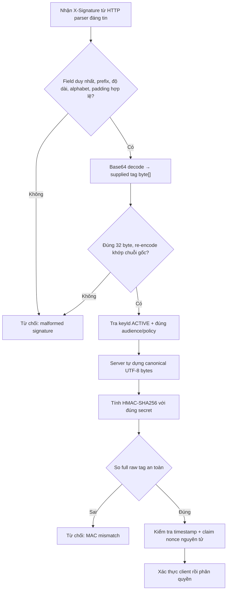

# Lỗi encoding chữ ký HMAC: Nhận diện, xử lý và kiểm thử an toàn

Một chữ ký HMAC có thể **đúng về mặt mật mã** nhưng vẫn bị server từ chối vì hai bên biểu diễn nó bằng văn bản khác nhau. Ví dụ, Java client gửi **Base64URL không padding** trong khi API yêu cầu **Base64 chuẩn có padding**; hoặc client vô tình Base64-encode **chuỗi hex của HMAC** thay vì **32 byte MAC thô**. Khi đó cùng shared secret, cùng canonical request và cùng thuật toán HMAC-SHA256 cũng không đủ để giao tiếp thành công.

Ngược lại, một signature có **encoding hoàn toàn hợp lệ** vẫn có thể **sai MAC**, do client ký khác HTTP method, URI, signed headers, raw body, timestamp hoặc nonce mà server nhìn thấy. Phân biệt hai lỗi này là năng lực quan trọng khi xây API machine-to-machine có chữ ký.

Bài **Lỗi encoding** thuộc chương **Encoding chữ ký** của module `SECURITY_AUTHENTICATION_HMAC_REQUEST_AUTHENTICATION`. Phạm vi của module là thiết kế xác thực HTTP request bằng **HMAC với shared secret** và **canonical request** (method, URI, header hoặc body theo hợp đồng); xác minh chữ ký, chống replay bằng timestamp/nonce, quản lý key rotation, kiểm thử proxy/gateway và phân biệt **authentication** với **authorization**. Bài này tập trung vào **các lỗi xảy ra từ bước biểu diễn/đọc chữ ký** và cách xử lý theo nguyên tắc *fail closed*.

## 1. Mục tiêu học tập

Sau bài này, bạn có thể:

1. Chỉ ra sự khác nhau giữa **raw MAC bytes**, **chữ ký Base64**, **key ID**, **shared secret**, **body digest** và **canonical UTF-8 bytes**.
2. Phân loại lỗi Base64 chuẩn/Base64URL/MIME, padding, pad bits, hex, **double encoding**, xử lý sai charset và thay đổi ký tự ở HTTP header.
3. Định nghĩa bộ quy tắc nhận chữ ký nghiêm ngặt cho một phiên bản giao thức, không tự hạ cấp thuật toán hoặc đoán encoding theo input.
4. Viết Java 17 để kiểm tra cấu trúc header, decode, **re-encode kiểm tra canonical form**, xác minh full HMAC-SHA256 bằng `MessageDigest.isEqual` và phân biệt lỗi hệ thống.
5. Chẩn đoán encoding error khác **MAC mismatch** hay **replay**, kể cả khi request đi qua proxy/gateway.
6. Kiểm thử lỗi encoding với test vector byte-level, bảo vệ log và giữ ranh giới xác thực/phân quyền.

## 2. Pipeline: từ dữ liệu request đến header chữ ký

Giả sử giao thức ứng dụng dùng HMAC-SHA256:

\[
D=\operatorname{SHA256}(\text{rawBodyBytes})
\]

\[
C=\operatorname{UTF8}(\text{canonicalRequest có } \operatorname{hex}(D))
\]

\[
T=\operatorname{HMAC}_{\mathrm{SHA256}}(K,C)
\]

\[
S=\operatorname{Base64}_{\mathrm{standard,padded}}(T)
\]

Trong đó:

| Giá trị | Dạng dữ liệu | Mục đích |
| --- | --- | --- |
| `K` | Shared secret **byte[]**, lấy từ credential registry | Khóa để tạo HMAC. **Không gửi** trong HTTP request. |
| `rawBodyBytes` | Byte HTTP content nhận được | Được băm để ràng buộc body, không phải JSON object đã parse. |
| `D` | SHA-256 digest **32 byte**, thường biểu diễn 64 ký tự hex | Một thành phần trong canonical request; **không phải MAC**. |
| `C` | Canonical request UTF-8 bytes | Ràng buộc method, URI, header được ký, body digest, audience, timestamp và nonce. |
| `T` | HMAC-SHA256 **32 raw bytes** | **MAC thực sự** để server đối chiếu. |
| `S` | Base64 ASCII từ `T` | Cách biểu diễn MAC để truyền qua HTTP header. |
| `X-Signature` | `v1=` nối `S` | Header phiên bản hóa, định dạng do ứng dụng tự quy định. |

Quy trình nhận ở server phải đi **ngược lại có kiểm soát**:



**Encoding không được dùng để tạo danh tính.** Một chuỗi có 44 ký tự Base64 hợp lệ chỉ cho thấy **có thể giải mã ra 32 byte**; nó không chứng minh người gửi sở hữu shared secret. Chỉ sau khi so MAC và kiểm tra các điều kiện xác thực, server mới được gắn principal với credential.

## 3. Ví dụ hợp đồng nhận chữ ký V1

Bài dùng một **hợp đồng minh họa** mang tên `HMAC-SHA256-V1`, dành cho endpoint `POST /v1/orders`. Đây không phải một chuẩn bắt buộc cho mọi giao thức HMAC.

| Hạng mục | Quy tắc V1 |
| --- | --- |
| Thuật toán MAC | `HmacSHA256`, không lấy thuật toán tùy ý từ input của client. |
| Độ dài MAC | **32 byte đầy đủ**, không chấp nhận tag cắt ngắn. |
| Encoding chữ ký | **Base64 chuẩn RFC 4648**, ký tự `A–Z a–z 0–9 + /`. |
| Padding | **Bắt buộc**, signature của 32 byte kết thúc bằng **một** dấu `=`. |
| Header value | Chính xác `v1=<44 ký tự Base64>`, tổng cộng **47 ký tự ASCII**. |
| Header name | `X-Signature`; tên field không phân biệt hoa/thường nhưng **value phân biệt case**. |
| Field occurrence | **Đúng một** `X-Signature` sau khi so tên header case-insensitive. |
| Version | `v1=` là prefix chính xác; credential/endpoint phải được cấu hình cho V1. |
| Body digest | SHA-256 trên raw body bytes (không tái serialize JSON), hex lowercase trong canonical request. |
| Canonical bytes | UTF-8, các dòng phân cách LF, không LF cuối; phiên bản và audience cũng được ký. |
| Freshness | Timestamp UTC được ký; nonce ngẫu nhiên được ký và chỉ dùng một lần. |
| Secret | Credential mới cấp bằng CSPRNG, ví dụ 32 byte; key ID xác định đúng một secret ACTIVE. |

Công thức số ký tự Base64 có padding cho `n` byte là:

\[
L=4\left\lceil\frac{n}{3}\right\rceil
\]

Với `n=32`, `L=44`. 32 byte chia thành 10 nhóm 3 byte và 1 nhóm 2 byte; nhóm cuối cần **một ký tự `=`**.

Không nhầm **Base64 của MAC 32 byte** (44 ký tự) với **hex của MAC 32 byte** (64 ký tự), hoặc **Base64 của 64 ký tự hex** (88 ký tự). Những chuỗi có độ dài tương tự một cách tình cờ cũng **không bảo đảm** chứa MAC đúng.

### Ví dụ request và canonical bytes

```http
POST /v1/orders HTTP/1.1
Host: api.example.test
Content-Type: application/json
X-Key-Id: partner-a-202611
X-Timestamp: 2026-11-28T02:00:00Z
X-Nonce: Zq8DxKtUokcwPGNj3d_yvQ
X-Signature: v1=<BASE64_FULL_HMAC>

{"sku":"BK-42","quantity":2}
```

```text
HMAC-SHA256-V1
orders-api-prod
POST
/v1/orders
content-type:application/json
x-key-id:partner-a-202611
x-timestamp:2026-11-28T02:00:00Z
x-nonce:Zq8DxKtUokcwPGNj3d_yvQ
sha256:<LOWERCASE_SHA256_HEX_OF_RAW_BODY>
```

Các chuỗi `<...>` là **placeholder**, chưa phải MAC/digest thực tế. Tên field được đưa về lowercase theo hợp đồng, nhưng **không lowercase** signature value, nonce hoặc key ID. Server tự lấy method, raw URI, signed headers và body bytes **thực nhận**, không tin một canonical string do client tự khai.

## 4. Bản đồ các lỗi encoding thường gặp

| Lỗi | Ví dụ hoặc dấu hiệu | Nguyên nhân | Cách xử lý V1 |
| --- | --- | --- | --- |
| **Dùng Base64URL thay Base64 chuẩn** | Ký tự `-`/`_` thay `+`/`/`; thường không padding. | Client dùng `Base64.getUrlEncoder()`. | Từ chối nếu không đúng 44 ký tự Base64 chuẩn có padding. |
| **Thiếu padding** | 43 ký tự thay vì 44 cho tag 32 byte. | Client gọi `withoutPadding()` hoặc tự xóa `=`. | Từ chối, dù decoder nới lỏng có thể giải mã. |
| **Padding dư/sai vị trí** | `==` ở cuối tag 32 byte; `=` giữa chuỗi. | Ghép lỗi hoặc nhầm kích thước. | Từ chối; không tự sửa chuỗi. |
| **Noncanonical pad bits** | Hai chuỗi 44 ký tự cùng decode ra 32 byte trong một số decoder. | Bits bỏ trống nhóm cuối không bằng 0. | Decode rồi **encode lại và yêu cầu chuỗi khớp**. |
| **MIME wrapping** | Có CRLF, tab hoặc space bên trong Base64. | Sử dụng MIME encoder/decoder. | Không dùng MIME decoder; từ chối. |
| **Double encoding** | 60 ký tự từ Base64(Base64(tag) dạng UTF-8). | Client encode lại chuỗi Base64. | Encode **một lần** từ raw tag. |
| **Base64 của hex text** | 88 ký tự từ Base64(64 ASCII hex chars). | Đổi tag sang hex trước khi Base64. | Base64 trực tiếp **32 raw tag bytes**. |
| **Hex thay Base64** | 64 ký tự `0–9a–f`. | SDK dùng `HexFormat` thay encoder đã quy định. | Từ chối theo V1; không đoán encoding. |
| **Base64 của SHA-256(body)** | Cũng có thể dài 44 ký tự. | Nhầm digest không có khóa với HMAC. | Encoding pass nhưng **MAC mismatch**. |
| **Base64 của key** | Có thể nhìn như tag 44 ký tự. | Client gửi/encode shared secret thay MAC. | Tuyệt đối không gửi secret; MAC mismatch; xử lý như sự cố lộ khóa nếu xảy ra. |
| **Giải mã MAC thành `String`** | Ký tự thay thế `�` hoặc lỗi charset. | Coi 32 bytes ngẫu nhiên là UTF-8 text. | Không dùng String làm trung gian cho raw tag. |
| **Đổi case signature value** | `A` thành `a` trong chuỗi Base64. | Lowercase toàn bộ header thay vì chỉ tên. | Từ chối nếu MAC khác; không lowercase value. |
| **URL/form decoding không đúng chỗ** | `+` trở thành dấu cách. | Signature đi qua query/form parser. | Đặt trong header; không dùng form decoding cho header. |
| **Trim/sanitize tùy ý** | Bỏ space, CRLF, dấu nháy trước khi decode. | Middleware “sửa” input sai. | Chặn malformed input tại HTTP ingress; verifier không đoán/sửa. |
| **Prefix hoặc version sai** | `V1=...`, `v2=...`, hoặc bỏ `v1=`. | SDK/version không đồng bộ. | Từ chối ngoài policy đã đăng ký, không fallback. |

Một số Base64URL string tình cờ **không chứa `-` hay `_`**, vì vậy có thể trông giống Base64 chuẩn. Đừng suy đoán nguồn encoder chỉ qua vài ký tự: **mục tiêu là kiểm tra giá trị wire phù hợp V1**, bao gồm padding, alphabet và canonical representation. Nếu hai encoder tạo **chính xác cùng một chuỗi** cho một tag thì không có khác biệt wire cần phát hiện.

## 5. Ba lỗi trông giống nhau nhưng nguyên nhân khác nhau

Giả sử API trả lỗi xác thực. Có ba loại cần chẩn đoán theo thứ tự:

### 5.1. Malformed signature encoding

**Dấu hiệu:** Prefix thiếu, Base64 sai alphabet, sai kích thước, thừa whitespace, thiếu padding, duplicate header. **Không cần tính MAC** để biết chuỗi không tuân theo protocol.

```text
X-Signature: v1=...        # 43 data chars, không có "=" cuối
X-Signature: V1=...=       # prefix sai case
X-Signature: v1=...=       # có ký tự LF ẩn hoặc không đúng alphabet
```

Ở đây dấu `...` mang ý nghĩa minh họa, không phải Base64 hoàn chỉnh. Trong hệ thống thật, trả lỗi xác thực chung cho bên ngoài và ghi mã nguyên nhân **không nhạy cảm** nội bộ như `SIG_FORMAT_INVALID`.

### 5.2. Encoding đúng, nhưng MAC mismatch

**Dấu hiệu:** Signature chuẩn, decode ra 32 byte, re-encode khớp; nhưng `MessageDigest.isEqual(supplied, expected)` trả `false`.

Nguyên nhân thường nằm **trước** bước Base64:

- Client và server dùng **khác shared secret** hoặc khác key ID khi key rotation.
- Khác **canonical method**: `POST` vs `PUT`; khác raw URI/query do proxy rewrite hoặc percent-encoding.
- Header được ký không cùng thứ tự/cách viết lowercase tên; giá trị header bị trim hay đổi ngoài contract.
- Body bytes khác do thêm newline, parse/re-serialize JSON, giải nén, charset hoặc BOM.
- Timestamp/nonce/audience trong canonical string khác; khác LF và CRLF hoặc có LF cuối.
- Client tính **HMAC(SHA256(body))** thay vì HMAC(canonical request chứa SHA256(body)), hoặc nhầm loại digest.

**Không giải quyết bằng cách thử cả decoded/raw URI, nhiều secret hoặc nhiều thuật toán đến khi MAC khớp.** Hãy tái tạo hai phía cùng một **test vector không nhạy cảm**, so sánh bytes canonical và raw tag tại môi trường thử nghiệm.

### 5.3. HMAC đúng nhưng freshness, credential hoặc quyền thất bại

**Dấu hiệu:** So MAC thành công nhưng timestamp quá hạn, nonce đã dùng, key bị revoked, audience khác hoặc client thiếu quyền thực hiện hành động.

Đây **không phải lỗi encoding**, và việc Base64-decode thêm lần nữa không thể sửa. Hệ thống cần fail closed, phân biệt đúng tầng lỗi và không phát sinh side effect trái phép.

## 6. Padding bits: vì sao decode–reencode quan trọng?

Base64 biểu diễn mỗi ký tự dữ liệu bằng 6 bit. Với **32 byte**, nhóm cuối chứa **2 byte = 16 bit**, cần 3 ký tự Base64 (18 bit); **hai bit thấp không dùng** phải bằng 0 để có biểu diễn canonical. Ký tự `=` còn lại là padding.

Ví dụ khái niệm:

```text
...<ký tự cuối nhóm 3 data chars>=
                                  ^
                         2 padding bits phải bằng 0
```

Một số decoder có thể **bỏ qua giá trị các bit không dùng**, tức là các chuỗi chữ khác nhau có thể decode ra cùng tag. Khi giao thức cho phép nhiều biểu diễn, log, cache và kiểm tra chữ ký giữa SDK có thể xử lý khác nhau. Vì vậy V1 buộc **re-encode** toàn bộ bytes rồi đối chiếu với chuỗi đã nhận:

```java
byte[] supplied = Base64.getDecoder().decode(encoded);
String canonical = Base64.getEncoder().encodeToString(supplied);
if (!canonical.equals(encoded)) {
    throw new IllegalArgumentException("Noncanonical Base64");
}
```

Đây là kiểm tra **định dạng**, không phải kiểm tra MAC. Điều kiện full tag dài 32 byte và Base64 dài 44 ký tự vẫn phải đi kèm. Decoder có thể trực tiếp từ chối nonzero pad bits ở một phiên bản Java; bước encode–compare vẫn làm quy tắc V1 **tường minh, có thể kiểm thử**.

## 7. Các lỗi byte-to-text khác mà Base64 không sửa được

### 7.1. `new String(rawMac, UTF_8)` là sai

Raw MAC bytes là dữ liệu nhị phân tùy ý, có thể không phải UTF-8 hợp lệ. Chuyển thành Java `String` rồi đưa về `byte[]` có thể sinh ký tự thay thế và **mất dữ liệu**:

```java
// KHÔNG dùng để gửi chữ ký HMAC:
String wrong = new String(rawMac, java.nio.charset.StandardCharsets.UTF_8);
byte[] corrupted = wrong.getBytes(java.nio.charset.StandardCharsets.UTF_8);

// ĐÚNG:
String encoded = Base64.getEncoder().encodeToString(rawMac);
byte[] restored = Base64.getDecoder().decode(encoded);
```

Đoạn này là ví dụ về **kiểu dữ liệu**, chưa khai báo biến `rawMac`; ở code tích hợp, `rawMac` phải là `byte[]` từ `Mac.doFinal`. Base64 cho phép phục hồi byte chính xác; việc coi raw MAC là text thì không.

### 7.2. Mã hóa **secret** khi lưu khác mã hóa **signature**

Giả sử Secret Manager lưu shared secret dưới dạng chuỗi Base64 để tiện cấu hình. Server phải **decode chuỗi đó ra key bytes đúng một lần** trước khi truyền cho `SecretKeySpec`:

```java
// secretBase64 được lấy từ cấu hình bảo mật đáng tin cậy,
// không phải một giá trị do client gửi để chọn khóa.
byte[] keyBytes = Base64.getDecoder().decode(secretBase64);
Mac mac = Mac.getInstance("HmacSHA256");
mac.init(new SecretKeySpec(keyBytes, "HmacSHA256"));
```

Không dùng:

```java
// SAI: biến 44 ASCII chars của key đã Base64 thành 44 bytes khóa khác.
byte[] wrongKey = secretBase64.getBytes(StandardCharsets.UTF_8);
```

Hai phía cùng chọn `HmacSHA256` mà dùng **key bytes khác nhau** chắc chắn không tạo cùng HMAC. Với HSM hoặc provider hỗ trợ khóa không xuất được, có thể dùng `SecretKey` chuyên dụng thay vì decode/copy secret vào memory; chính sách provider phải được kiểm thử riêng.

### 7.3. Canonical request cũng có encoding riêng

Cho dù chữ ký được Base64 đúng, nếu client nối `\r\n` nhưng server nối `\n` trong canonical string, raw MAC vẫn khác. Tương tự, không dùng `String.getBytes()` thiếu charset nếu hợp đồng yêu cầu UTF-8.

Đây là **lỗi encoding của dữ liệu ký**, khác với lỗi Base64 của tag. Khi chẩn đoán, kiểm tra đúng hai lớp:

1. **Canonical UTF-8 bytes** đầu vào `Mac.doFinal`.
2. **Base64 ASCII wire value** tạo từ output raw MAC.

Tách lớp giúp tìm nhanh điểm sai mà không làm suy yếu verifier production.

## 8. Java 17: parser nghiêm ngặt và xác minh HMAC-SHA256

Ví dụ Java 17 dưới đây là **chương trình tự chạy** tập trung vào lỗi encoding. Nó:

- Chỉ chấp nhận `X-Signature` value **chính xác 47 ký tự** theo dạng `v1=` + 44 Base64 chuẩn có padding.
- Kiểm tra raw tag giải mã **đúng 32 byte**, sau đó encode lại để bảo đảm canonical.
- Dùng `Mac.getInstance("HmacSHA256")`, `SecretKeySpec` và `MessageDigest.isEqual`.
- Tính HMAC trên **canonical UTF-8 request**, trong đó có SHA-256(raw body bytes).
- Có test vector HMAC-SHA256 của RFC 4231 và kiểm thử padding, hex, double encoding, pad bits và body bị sửa.

```java
import java.nio.charset.StandardCharsets;
import java.security.GeneralSecurityException;
import java.security.MessageDigest;
import java.util.Arrays;
import java.util.Base64;
import java.util.HexFormat;
import javax.crypto.Mac;
import javax.crypto.spec.SecretKeySpec;

public final class SignatureEncodingErrorsV1 {
    private static final String ALGO = "HmacSHA256";
    private static final String VERSION = "HMAC-SHA256-V1";
    private static final String PREFIX = "v1=";
    private static final int TAG_LEN = 32;
    private static final int B64_LEN = 44;

    private SignatureEncodingErrorsV1() {}

    public record SignedRequest(
            String method, String rawTarget, String keyId,
            String timestamp, String nonce, byte[] rawBody) {
        public SignedRequest {
            if (rawBody != null) {
                rawBody = rawBody.clone();
            }
        }
        @Override
        public byte[] rawBody() {
            return rawBody == null ? null : rawBody.clone();
        }
    }

    private static void validate(SignedRequest r) {
        if (r == null || !"POST".equals(r.method())
                || !"/v1/orders".equals(r.rawTarget())
                || r.keyId() == null
                || !r.keyId().matches("[A-Za-z0-9_-]{1,80}")
                || r.timestamp() == null
                || !r.timestamp().matches(
                        "[0-9]{4}-[0-9]{2}-[0-9]{2}T"
                        + "[0-9]{2}:[0-9]{2}:[0-9]{2}Z")
                || r.nonce() == null
                || !r.nonce().matches("[A-Za-z0-9_-]{22}")
                || r.rawBody() == null
                || r.rawBody().length > 64 * 1024) {
            throw new IllegalArgumentException("Invalid signed request fields");
        }
        // Giới hạn ví dụ: regex chỉ kiểm tra hình thức timestamp/nonce;
        // lớp verifier cần parse thời gian, check clock và nonce store.
    }

    public static byte[] canonicalBytes(SignedRequest r)
            throws GeneralSecurityException {
        validate(r);
        String bodyHash = HexFormat.of().formatHex(
                MessageDigest.getInstance("SHA-256").digest(r.rawBody()));
        String canonical = String.join("\n",
                VERSION, "orders-api-prod", r.method(), r.rawTarget(),
                "content-type:application/json",
                "x-key-id:" + r.keyId(),
                "x-timestamp:" + r.timestamp(),
                "x-nonce:" + r.nonce(),
                "sha256:" + bodyHash);
        return canonical.getBytes(StandardCharsets.UTF_8);
    }

    private static byte[] mac(byte[] secret, byte[] data)
            throws GeneralSecurityException {
        // Chính sách provisioning của ví dụ: secret production >= 32 byte.
        if (secret == null || secret.length < 32) {
            throw new IllegalStateException("Invalid credential key policy");
        }
        Mac hmac = Mac.getInstance(ALGO);
        hmac.init(new SecretKeySpec(secret, ALGO));
        byte[] tag = hmac.doFinal(data);
        if (tag.length != TAG_LEN) {
            throw new IllegalStateException("Unexpected provider MAC length");
        }
        return tag;
    }

    public static String encodeSignature(byte[] rawTag) {
        if (rawTag == null || rawTag.length != TAG_LEN) {
            throw new IllegalArgumentException("Expected full HMAC tag");
        }
        return PREFIX + Base64.getEncoder().encodeToString(rawTag);
    }

    /**
     * Dữ liệu sai contract trả null. Lỗi parser không được “sửa” tự động.
     * HTTP adapter phải chặn duplicate X-Signature trước khi gọi hàm này.
     */
    public static byte[] decodeSignature(String value) {
        if (value == null
                || !value.startsWith(PREFIX)
                || value.length() != PREFIX.length() + B64_LEN) {
            return null;
        }
        String body = value.substring(PREFIX.length());

        // 32 byte => 43 data chars + đúng một dấu '='.
        if (!body.matches("[A-Za-z0-9+/]{43}=")) {
            return null;
        }

        final byte[] supplied;
        try {
            supplied = Base64.getDecoder().decode(body);
        } catch (IllegalArgumentException malformed) {
            return null;
        }

        if (supplied.length != TAG_LEN) {
            return null;
        }
        // Cũng bắt noncanonical padding bits nếu decoder nới lỏng.
        String canonical = Base64.getEncoder().encodeToString(supplied);
        return canonical.equals(body) ? supplied : null;
    }

    public static String sign(byte[] activeSecret, SignedRequest r)
            throws GeneralSecurityException {
        return encodeSignature(mac(activeSecret, canonicalBytes(r)));
    }

    public static boolean verify(
            byte[] activeSecret, SignedRequest received, String sigValue)
            throws GeneralSecurityException {
        byte[] supplied = decodeSignature(sigValue);
        if (supplied == null) {
            return false;
        }
        byte[] expected = mac(activeSecret, canonicalBytes(received));
        return MessageDigest.isEqual(expected, supplied);
    }

    public static void main(String[] args) throws Exception {
        // RFC 4231 test case 1: kiểm tra bản thân HMAC-SHA256.
        byte[] rfcKey = new byte[20];
        Arrays.fill(rfcKey, (byte) 0x0b);
        Mac testMac = Mac.getInstance(ALGO);
        testMac.init(new SecretKeySpec(rfcKey, ALGO));
        byte[] rfcTag = testMac.doFinal(
                "Hi There".getBytes(StandardCharsets.US_ASCII));
        String expectedRfc =
                "b0344c61d8db38535ca8afceaf0bf12b"
                + "881dc200c9833da726e9376c2e32cff7";
        if (!expectedRfc.equals(HexFormat.of().formatHex(rfcTag))) {
            throw new AssertionError("RFC 4231 HMAC failed");
        }
        String encodedRfc = encodeSignature(rfcTag);
        if (encodedRfc.length() != 47
                || !Arrays.equals(rfcTag, decodeSignature(encodedRfc))) {
            throw new AssertionError("HMAC -> Base64 roundtrip failed");
        }

        byte[] secret = new byte[32]; // Secret cố định CHỈ phục vụ test.
        Arrays.fill(secret, (byte) 0x5a);
        SignedRequest original = new SignedRequest(
                "POST", "/v1/orders", "partner-a-202611",
                "2026-11-28T02:00:00Z", "Zq8DxKtUokcwPGNj3d_yvQ",
                "{\"sku\":\"BK-42\",\"quantity\":2}"
                    .getBytes(StandardCharsets.UTF_8));

        String valid = sign(secret, original);
        if (!verify(secret, original, valid)) {
            throw new AssertionError("Valid signature rejected");
        }

        // Bỏ padding: Java decoder có thể chấp nhận, nhưng V1 từ chối.
        if (decodeSignature(valid.substring(0, valid.length() - 1)) != null) {
            throw new AssertionError("Unpadded signature accepted");
        }
        if (decodeSignature(valid + " ") != null) {
            throw new AssertionError("Trailing whitespace accepted");
        }

        // Hex của MAC không phải Base64 chuẩn của raw MAC.
        byte[] rawTag = mac(secret, canonicalBytes(original));
        String hexInstead = PREFIX + HexFormat.of().formatHex(rawTag);
        if (decodeSignature(hexInstead) != null) {
            throw new AssertionError("Hex signature accepted");
        }

        // Base64(Base64(tag) dạng ASCII) là double encoding.
        String once = Base64.getEncoder().encodeToString(rawTag);
        String twice = Base64.getEncoder().encodeToString(
                once.getBytes(StandardCharsets.US_ASCII));
        if (decodeSignature(PREFIX + twice) != null) {
            throw new AssertionError("Double-encoded signature accepted");
        }

        // Sửa 2 padding bits thấp ở ký tự thứ 43 của Base64.
        // Ký tự gốc có index chia hết cho 4 vì raw tag dài 32 byte.
        String alphabet =
                "ABCDEFGHIJKLMNOPQRSTUVWXYZabcdefghijklmnopqrstuvwxyz0123456789+/";
        int index = alphabet.indexOf(once.charAt(42));
        if (index < 0 || index % 4 != 0) {
            throw new AssertionError("Unexpected canonical padding bits");
        }
        String badPadBits = PREFIX + once.substring(0, 42)
                + alphabet.charAt(index + 1) + "=";
        if (decodeSignature(badPadBits) != null) {
            throw new AssertionError("Noncanonical pad bits accepted");
        }

        // Encoding vẫn đúng nhưng chữ ký sai vì raw body thay đổi.
        SignedRequest changed = new SignedRequest(
                "POST", "/v1/orders", original.keyId(),
                original.timestamp(), original.nonce(),
                "{\"sku\":\"BK-42\",\"quantity\":3}"
                    .getBytes(StandardCharsets.UTF_8));
        if (verify(secret, changed, valid)) {
            throw new AssertionError("Modified request accepted");
        }
        System.out.println("Signature encoding checks passed.");
    }
}
```

### Cách đọc đúng ví dụ

- `decodeSignature` **không làm sạch input**: không `trim()`, không bỏ padding, không thử Base64URL hay MIME.
- `[A-Za-z0-9+/]{43}=` chỉ là bước kiểm tra dạng ký tự; decode, kiểm tra 32 byte và re-encode mới hoàn thành quy tắc canonical representation.
- `MessageDigest.isEqual` so **raw MAC bytes**, không phải so Base64 strings. Điều này giảm nguy cơ rò rỉ từ việc trả về sớm theo byte khác biệt của MAC.
- `main` dùng RFC 4231 để kiểm chứng phép MAC độc lập, tránh nhầm lỗi thuật toán với lỗi encoding. Key RFC 4231 **20 byte** chỉ phục vụ vector công khai; policy credential mới của API vẫn yêu cầu ≥32 byte.
- `SignedRequest` tạo snapshot của body bytes để tránh client thay mảng sau khi ký. Khi tích hợp với HTTP stream lớn, cần giới hạn đọc và bảo toàn đúng bytes được verify.
- Code minh họa quy tắc V1; **không thực hiện** kiểm tra duplicate headers, registry, timestamp window, nonce store hoặc authorization.

**Không diễn giải `decodeSignature(...) != null` là xác thực thành công.** Đó chỉ là **format pass**. Phải xác minh HMAC kỳ vọng và các điều kiện policy trước khi tin client.

## 9. Vì sao không nên dùng String equality để xác minh MAC?

Nếu đã quy định một Base64 representation canonical, hai chuỗi Base64 đúng bytes sẽ giống nhau. Nhưng việc dùng:

```java
// Không dùng làm cơ chế xác minh MAC chính:
boolean ok = expectedBase64.equals(receivedBase64);
```

khiến logic so sánh bị gắn trực tiếp vào **định dạng văn bản** và có thể dừng ở vị trí ký tự đầu tiên không khớp. Thực hành phù hợp hơn là:

```java
byte[] supplied = decodeSignature(signatureValue); // kiểm tra wire format
byte[] expected = computeExpectedHmac();            // byte[] từ Mac.doFinal
boolean ok = supplied != null
        && MessageDigest.isEqual(expected, supplied);
```

Đoạn này là **mảnh tích hợp**; `computeExpectedHmac` và `signatureValue` được ứng dụng cung cấp. Java `MessageDigest.isEqual` hỗ trợ so sánh digest/MAC byte arrays theo cách được thiết kế để giảm lệ thuộc vào vị trí byte sai; tuy nhiên toàn bộ request-processing pipeline vẫn có thể khác thời gian do parse, lookup, I/O và nhánh xử lý. Không tuyên bố **toàn hệ thống constant-time tuyệt đối** chỉ vì dùng một API so sánh.

Đối với signature **sai cấu trúc**, kiểm tra độ dài/alphabet rồi từ chối sớm là hợp lý vì định dạng header là dữ liệu công khai. Tránh để mức độ chi tiết của response giúp attacker dò key ID, trạng thái secret hoặc nội dung canonical request.

## 10. Lỗi encoding qua HTTP header, proxy và gateway

**Tên header** không phân biệt chữ hoa/thường; **giá trị Base64** có phân biệt chữ hoa/thường. Ví dụ:

```http
X-Signature: v1=...
x-signature: v1=...
```

Nếu xuất hiện **cả hai**, đây là duplicate của **cùng một field**, không phải hai signature khác nhau. Bộ xác minh phải từ chối duplicate theo chính sách, không chọn first/last và không ghép dấu phẩy.

| Hiện tượng qua hạ tầng | Có thể gây lỗi gì? | Kiểm soát cần thiết |
| --- | --- | --- |
| HTTP/1.1 → HTTP/2/3 lowercase **tên** `X-Signature`. | Không lỗi nếu value nguyên vẹn. | Canonical tên header không phụ thuộc case; HTTP/2/3 field names phải lowercase trên wire. |
| Proxy lowercase **toàn bộ giá trị** Base64. | Giá trị tag thay đổi hoặc bị từ chối. | Tuyệt đối không sửa signature value; test qua proxy. |
| Gateway trim OWS hoặc gộp header duplicate. | Không thể quan sát đúng input; có thể khác chính sách verifier/backend. | Chặn duplicate và malformed headers tại ingress; hiểu parser behavior. |
| Header chứa CR, LF hoặc obs-fold. | Header injection/request smuggling hoặc request bị parser hiểu khác. | HTTP parser từ chối malformed framing; không dùng MIME decoder để bỏ CRLF. |
| Chuyển chữ ký sang query parameter. | `+` có thể bị form-decode thành space; chữ ký rò rỉ vào URL/log. | Ưu tiên header; nếu ký qua URL cần protocol Base64URL khác và quản lý log. |
| Gateway rewrite method/URI/query. | HMAC mismatch dù Base64 không đổi. | Ký/xác minh cùng canonical target ở điểm tin cậy. |
| Middleware parse JSON rồi re-serialize. | Body digest khác, MAC mismatch. | Hash raw content bytes và dùng đúng dữ liệu đã verify. |
| Proxy tự thêm/sửa header đã ký. | MAC mismatch hoặc ngữ nghĩa khác. | Xác định signed-header policy, điểm xác minh và thứ tự filter. |
| HTTP parser chỉ trả một signature trong khi client gửi hai. | Bỏ qua ambiguity/duplicate. | Bắt duplicate trước khi framework chuyển thành map hoặc combine. |

**Điều quan trọng về OWS:** Cú pháp HTTP có quy tắc đối với khoảng trắng tùy vị trí; một servlet/container có thể đã xử lý OWS trước khi ứng dụng nhận value. Muốn từ chối chính xác dạng raw wire có thêm whitespace, phải kiểm tra ở tầng có thể thấy dữ liệu đó. Không khẳng định code Java đã “kiểm tra raw header” nếu chỉ có string đã được HTTP parser chuẩn hóa.

**Không tin header “original signature” do client tự tạo.** Các header như `X-Original-URI` hay `X-Authenticated-Client` chỉ đáng tin khi gateway đã xóa bản do Internet cung cấp và tự sinh metadata trên kênh nội bộ được bảo vệ. Không cố xác minh dựa vào original URI tự khai để cho chữ ký khớp.

## 11. Replay, key rotation và version negotiation

### 11.1. Timestamp/nonce không phải signature encoding

Cùng một hệ thống có thể chọn **signature = Base64 chuẩn có padding** nhưng **nonce = Base64URL không padding**. Đây là hai **giá trị header khác nhau** với mục đích và hợp đồng encoding riêng.

- `X-Timestamp` là chuỗi UTC được ký và kiểm tra trong cửa sổ (ví dụ ±300 giây).
- `X-Nonce` là giá trị ngẫu nhiên do CSPRNG sinh (ví dụ 16 byte = 128 bit, Base64URL **22 ký tự không padding**), được ký đúng value và sử dụng một lần.
- `X-Signature` là full HMAC-SHA256 **32 byte → Base64 chuẩn 44 ký tự có padding**.

Một số SDK vô tình áp `withoutPadding()` cho **cả nonce và signature** vì tái sử dụng cùng helper. Trong V1 này, **nonce nên không có padding; signature bắt buộc có padding**. Phải có hai encoder có tên rõ ràng hoặc hai hàm wrapper khác nhau, với test riêng.

HMAC hợp lệ không tự chống replay. Server phải claim `(keyId, nonce)` **nguyên tử** trong store dùng chung sau khi kiểm tra chữ ký/timestamp và trước khi nghiệp vụ có side effect. Nếu timestamp được chấp nhận trong cửa sổ ±5 phút, một request có timestamp nhanh 5 phút có thể còn hợp lệ đến khoảng 10 phút từ lần nhận sớm nhất; TTL nonce phải kéo dài đến sau thời điểm hết hiệu lực. Nếu nonce store lỗi và endpoint yêu cầu chống replay, **fail closed**.

### 11.2. Key rotation không phải fallback giải mã

| Key ID | Secret | Trạng thái | Encoding signature |
| --- | --- | --- | --- |
| `partner-a-202611` | Secret A | ACTIVE trong overlap. | `v1=` + Base64 HMAC-SHA256. |
| `partner-a-202702` | Secret B độc lập | ACTIVE mới. | Vẫn V1 nếu protocol chưa đổi. |
| `partner-a-202608` | Secret cũ | REVOKED. | Không chấp nhận, dù tag cũ giải mã đúng. |

Server chọn **một secret** theo `keyId`, kiểm tra ACTIVE/audience/expiry. Nếu MAC sai, **không thử những secret khác** chỉ vì có key rotation. Nếu secret manager lưu key bằng Base64, decode secret từ registry **đúng một lần**; đừng trộn khái niệm key encoding với signature encoding.

### 11.3. Protocol version và chống downgrade

Giả sử V2 sau này dùng HMAC-SHA512 hoặc Base64URL. Hợp đồng mới phải chỉ định:

1. Prefix `v2=` và nội dung **version được ký trong canonical request**.
2. Thuật toán/độ dài tag/encoding/padding chính xác.
3. Credential, client và endpoint nào **được phép** dùng V2.
4. Thời gian chuyển đổi và thời điểm tắt V1.
5. Test vector đa ngôn ngữ và kiểm thử gateway.

Không quyết định thuật toán theo số ký tự nhận được rồi thử từng decoder/secret. Cách “thử cho đến khi khớp” có thể khiến một protocol yếu hoặc phiên bản ngoài policy được chấp nhận. Version giúp chọn **policy đã đăng ký**, không trao quyền cho client tự chọn thuật toán không giới hạn.

## 12. Phân loại lỗi, phản hồi và quan sát an toàn

| Trường hợp | Xử lý | HTTP status thường dùng |
| --- | --- | --- |
| Thiếu signature, sai prefix, Base64 malformed hoặc noncanonical. | Từ chối xác thực, không cấp principal. | `401` hoặc mã lỗi request theo API contract. |
| Đủ 32 byte nhưng MAC mismatch. | Từ chối; không fallback algorithm, key hay URI normalization. | `401 Unauthorized`. |
| Key ID unknown/revoked, sai audience/version. | Từ chối xác thực; phản hồi ngoài không tiết lộ registry. | `401` chung. |
| `Mac.getInstance` không có thuật toán cấu hình, `Mac.init` từ chối secret ACTIVE. | **Fail closed**, cảnh báo provider/credential error; không quy thành encoding của client. | `5xx` khi lỗi hạ tầng. |
| Nonce đã dùng hoặc timestamp ngoài cửa sổ. | Từ chối freshness/replay; không tạo side effect. | Mã lỗi xác thực phù hợp hợp đồng. |
| Nonce store bị lỗi. | **Fail closed**, không bỏ kiểm tra replay. | Thường `5xx`/dịch vụ tạm không sẵn sàng. |
| HMAC và freshness đúng nhưng client thiếu quyền. | Từ chối ở authorization. | `403 Forbidden`. |
| HMAC và quyền đúng nhưng dữ liệu nghiệp vụ sai. | Trả lỗi validation/business; không gọi đó là encoding error. | `400`, `409` hoặc `422` tùy API. |

**Vì sao không trả lỗi chi tiết ra Internet?** Thông điệp như “key ID X tồn tại nhưng signature HMAC sai ở byte thứ 9” có thể lộ thông tin không cần thiết. Tách mã nguyên nhân **nội bộ** (ví dụ `SIG_FORMAT_INVALID`, `MAC_MISMATCH`, `KEY_REVOKED`, `NONCE_REPLAY`, `PROVIDER_ERROR`), giới hạn quyền truy cập metric và dùng thông điệp chung cho bên ngoài.

**Không log** shared secret, raw signature production đầy đủ, canonical request chứa dữ liệu nhạy cảm, body cá nhân hoặc key encoding từ secret manager. Khi debug, dùng **test vectors không nhạy cảm**, request ID, độ dài signature, version, mã lỗi và hash của dữ liệu thử nghiệm. Ngay cả digest trên body thật có thể nhạy cảm hoặc giúp đối chiếu request, nên áp chính sách logging riêng.

## 13. Ma trận kiểm thử encoding và HMAC request

| Ca kiểm thử | Kết quả mong đợi |
| --- | --- |
| RFC 4231 HMAC-SHA256 test case 1 (key 20 byte `0x0b`, text `Hi There`). | Raw MAC hex `b0344c61d8db38535ca8afceaf0bf12b881dc200c9833da726e9376c2e32cff7`. |
| HMAC-SHA256 full 32 byte → Base64 chuẩn. | **44 ký tự, một `=` cuối**; với `v1=` tổng **47 ký tự**. |
| Decode rồi encode lại tag chuẩn. | Chuỗi trùng chính xác, raw bytes trùng. |
| Bỏ `=` cuối. | Từ chối dù Java/SDK có thể decode unpadded. |
| Dùng Base64URL không padding cho signature. | Từ chối do sai wire format V1. |
| Dùng hex 64 ký tự hoặc Base64(hex 64 ASCII chars). | Từ chối do sai kích thước/representation. |
| Base64(Base64(tag)). | Từ chối do double encoding. |
| Thay nonzero pad bits nhưng decoder vẫn ra cùng bytes. | Từ chối bởi decode–reencode canonical check. |
| Chèn CR/LF, space, tab hoặc ký tự ngoài alphabet. | Từ chối, không dùng MIME decoder để sửa. |
| Đổi `v1=` thành `V1=` hoặc `v2=`. | Từ chối ngoài policy; không fallback. |
| Hai header `X-Signature` và `x-signature`. | Từ chối duplicate dù khác cách viết tên. |
| Lowercase **tên** `X-Signature`, giữ nguyên value. | Cùng một field; không làm HMAC thay đổi. |
| Lowercase **giá trị Base64**. | Tag có thể đổi; từ chối nếu MAC khác. |
| Chuỗi đúng Base64 44 ký tự nhưng là SHA-256(body) thay vì HMAC. | Encoding pass, **MAC mismatch**. |
| Client dùng ASCII bytes của `secretBase64` làm HMAC key. | HMAC mismatch vì key bytes khác; sửa key decode trong provisioning. |
| Raw JSON body thêm LF, đổi whitespace/encoding hoặc key order. | MAC mismatch nếu giữ tag cũ. |
| URI bị proxy rewrite hoặc header có ký bị đổi. | MAC mismatch, dù Base64 hợp lệ. |
| Timestamp quá hạn hoặc cùng nonce được gửi lại. | Từ chối sau MAC (hoặc theo luồng kiểm tra policy), không gọi là encoding error. |
| Key đã revoked hoặc sai audience/version. | Từ chối trước tạo principal. |
| MAC đúng nhưng thiếu scope `orders:create`. | Authentication có thể pass; authorization từ chối. |

**Test vector liên ngôn ngữ nên có hai lớp dữ liệu:** (a) secret bytes và canonical request UTF-8 → raw HMAC hex; (b) raw HMAC bytes → Base64 wire `v1=...`. Test lớp (a) thất bại nghĩa là lỗi key/canonicalization/MAC; test lớp (a) đúng nhưng lớp (b) sai mới là lỗi signature encoding. Không trộn hai lớp trong một assertion rồi đoán nguyên nhân.

## 14. Bài tập thực hành

### Bài 1 — Cùng secret nhưng signature khác

Java client tính `Mac.doFinal()` đúng 32 byte, sau đó gọi `HexFormat.of().formatHex(...)` và đặt kết quả trong `X-Signature: v1=...`. Server đòi Base64 chuẩn. Đây là lỗi gì, sửa ra sao?

**Gợi ý đáp án:** Lỗi **wire encoding**. Hex tạo 64 ký tự, không phải Base64 của raw tag 32 byte. Client dùng `Base64.getEncoder().encodeToString(rawTag)`, giữ full tag và prefix đúng.

### Bài 2 — Thiếu padding có được tự bổ sung?

Server nhận 43 ký tự Base64, thêm `=` rồi decode được 32 byte. V1 quy định padded Base64. Có nên cho qua?

**Gợi ý đáp án:** Không. Giao thức đã chọn một dạng canonical duy nhất. Tự thêm padding làm nhiều biểu diễn trở thành hợp lệ và khác behavior giữa SDK. Từ chối, yêu cầu client gửi đúng phiên bản.

### Bài 3 — Base64URL và nonce

SDK có helper `base64UrlWithoutPadding(bytes)`. Lập trình viên dùng nó cho cả nonce 16 byte lẫn full HMAC-SHA256 32 byte. V1 của bài xử lý thế nào?

**Gợi ý đáp án:** Nonce dùng Base64URL không padding là đúng nếu theo contract; signature bắt buộc **Base64 chuẩn có padding**. Cần hai hàm encoding tách biệt, test độ dài nonce 22 ký tự và signature 44 ký tự.

### Bài 4 — Encoding đúng nhưng body đổi

Client ký JSON không có LF cuối, proxy thêm LF vào body. Header signature vẫn đúng dạng `v1=` + 44 ký tự. Vì sao verifier thất bại?

**Gợi ý đáp án:** SHA-256(raw body bytes) khác, dẫn tới canonical request khác và **MAC mismatch**. Đây không phải lỗi Base64. Cần bảo toàn body bytes hoặc thiết kế hợp đồng chuyển đổi tin cậy và xác minh trước khi biến đổi.

### Bài 5 — Double encoding của secret

Secret Manager trả Base64 của secret 32 byte. Client dùng `secretBase64.getBytes(UTF_8)` làm `SecretKeySpec`, còn server decode secret ra 32 bytes. Tại sao MAC khác?

**Gợi ý đáp án:** Client dùng **ASCII bytes của chuỗi biểu diễn secret** (thường 44 bytes) thay vì **32 bytes thực**. Đây là lỗi key encoding. Decode secret đúng một lần ở lớp provisioning, không tiết lộ secret trong request/log.

### Bài 6 — Header đúng Base64 có đủ để xác thực không?

Client gửi một chuỗi Base64 chuẩn có padding, decode ra đúng 32 byte nhưng không biết shared secret. Có được tạo principal sau khi `decodeSignature` thành công không?

**Gợi ý đáp án:** Không. Đó mới là **format pass**. Server phải tra credential, tính HMAC kỳ vọng trên canonical bytes, so tag, kiểm tra timestamp/nonce và các policy trước khi chấp nhận danh tính; sau đó vẫn cần phân quyền resource.

### Bài 7 — Key rotation và fallback

Một client đang đổi từ secret A sang B. Chữ ký V1 bằng B bị sai vì client tạo raw URI khác server. Developer đề xuất thử A, thử B, rồi thử thêm HmacSHA1 để tăng tỷ lệ thành công. Có phù hợp không?

**Gợi ý đáp án:** Không. Chọn **đúng một secret** theo key ID và version được đăng ký; không thử thuật toán yếu hoặc URI khác. Debug canonical bytes qua test vector, sửa đúng điểm mismatch, giữ nguyên chính sách xác thực.

## 15. Checklist triển khai và tổng kết

Trước khi đưa xác thực HMAC có Base64 signature vào production:

- [ ] Hợp đồng quy định rõ **signature version**, thuật toán, tag length, Base64 variant, alphabet và padding.
- [ ] Signature V1 được tính theo đúng pipeline **canonical UTF-8 bytes → HMAC raw 32 bytes → Base64 chuẩn padded 44 chars**, không hex/double encode.
- [ ] Header `X-Signature` duy nhất theo so sánh case-insensitive tên, không bị parser/gateway gộp nhiều occurrence.
- [ ] Parser có giới hạn kích thước, kiểm tra prefix, độ dài, alphabet, số ký tự `=` và **re-encode canonical**.
- [ ] MAC được so bằng `MessageDigest.isEqual` trên **raw bytes**, không dựa vào `String.equals` như phép kiểm tra mật mã chính.
- [ ] Shared secret lưu dạng encoded được **decode đúng một lần**, không dùng ASCII bytes của chuỗi cấu hình làm key.
- [ ] Không tự nhận Base64URL/MIME/hex và không sửa thiếu padding/whitespace để request “qua được”.
- [ ] Method, raw URI, signed headers, body digest, timestamp/nonce và audience đều là dữ liệu ký nhất quán ở client/server.
- [ ] HTTP/1.1, HTTP/2/3, proxy/gateway và JSON/charset middleware không đổi những bytes có ý nghĩa sau điểm ký.
- [ ] Có test vector riêng cho **key/canonical bytes/MAC** và **signature encoding**, kèm test malformed/noncanonical input.
- [ ] Credential registry kiểm tra key ACTIVE/version/audience, key rotation đúng key ID, thu hồi secret lộ.
- [ ] Freshness và nonce store chống replay dùng chung, claim nguyên tử, fail closed nếu lỗi; retry phải ký lại bằng nonce mới.
- [ ] Phản hồi ngoài không tiết lộ secret hay trạng thái key; log nội bộ chỉ ghi metadata phù hợp chính sách.
- [ ] Authentication và authorization tách biệt; MAC hợp lệ không tự cho phép sửa mọi tài nguyên hoặc trường.

**Kết luận:** Lỗi encoding chữ ký HMAC xuất hiện khi hai bên không thống nhất **cách biểu diễn raw MAC bytes trên wire**. Trong V1 minh họa, full HMAC-SHA256 tạo **32 byte**, được Base64 chuẩn với padding thành **44 ký tự** và gắn `v1=` thành **47 ký tự**. Hãy **từ chối encoding nhập nhằng**, decode và re-encode kiểm tra canonical form, rồi so tag bytes với HMAC kỳ vọng. Đặc biệt, **Base64 hợp lệ không phải chữ ký hợp lệ**: sau bước encoding vẫn phải xác thực canonical request, secret còn hiệu lực, timestamp/nonce và phân quyền độc lập.
