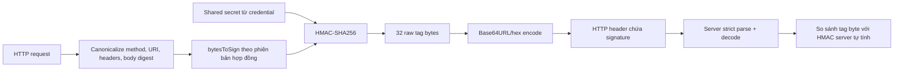
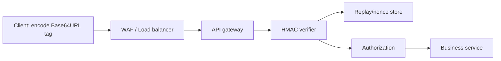

# Chọn format signature: hex, Base64 hay Base64URL cho HMAC HTTP request?

> **Chương:** Encoding chữ ký  
> **Bài học:** Chọn format signature  
> **Ngữ cảnh:** Thiết kế xác thực HTTP request bằng HMAC với shared secret. Client ký canonical request gồm HTTP method, URI, các header và/hoặc body theo hợp đồng ký; server xác minh signature, kiểm timestamp/nonce chống replay, quản lý key rotation, thử nghiệm proxy/gateway và phân tách authentication khỏi authorization.

## 1. Vấn đề: HMAC tạo ra byte, HTTP cần một định dạng truyền rõ ràng

Khi gọi `Mac.doFinal(...)` trong Java, kết quả của HMAC-SHA256 là **32 byte nhị phân**:

```java
Mac mac = Mac.getInstance("HmacSHA256");
mac.init(new SecretKeySpec(sharedSecret, "HmacSHA256"));
byte[] tagBytes = mac.doFinal(bytesToSign); // 32 bytes
```

Trong khi đó, một giao thức HTTP tùy biến thường phải mang chữ ký dưới dạng **text** ở header, chẳng hạn:

```http
X-Signature: v1=<ENCODED_HMAC_TAG>
```

**Chọn format signature** nghĩa là xác định chính xác cách biến `tagBytes` thành văn bản để truyền, cách nhận lại chúng ở server, quy tắc phiên bản và những biểu diễn không hợp lệ phải bị từ chối.

Mục tiêu quan trọng:

- Cùng một dãy **32 byte tag** luôn có **một dạng văn bản canonical**.
- Client và server thống nhất **alphabet**, chữ hoa/thường, padding, prefix, length và vị trí đặt signature.
- Parser ở gateway, framework và verifier không thể hiểu cùng header theo những cách khác nhau.
- **Encoding không thay đổi thuật toán HMAC**, không che giấu tag, không thay shared secret và không tự chống replay.

Một sai lầm phổ biến là nhầm `SHA-256`, `HmacSHA256` và `Base64URL` là những cách ký cạnh tranh. Chúng là **ba tầng khác nhau**: digest/hash, MAC có khóa và encoding biểu diễn byte.

### Chuỗi thao tác đúng



**Phân biệt:**

| Khái niệm | Ví dụ | Chịu trách nhiệm |
| --- | --- | --- |
| Body digest | `SHA-256(rawBodyBytes)` | Ràng buộc nội dung body nếu digest được HMAC bao phủ. |
| Canonical request | Method + canonical URI + signed headers + digest | Quy định những byte HTTP nào được bảo vệ. |
| MAC algorithm | `HmacSHA256` trong Java JCA/JCE | Tính tag có khóa trên `bytesToSign`. |
| Raw tag | 32 byte | Giá trị xác thực cần so sánh sau khi decode. |
| Signature encoding | Hex, Base64, Base64URL | Biến tag byte thành text có grammar rõ ràng. |
| Signature transport | `X-Signature`, custom `Authorization`, RFC 9421... | Chở text/metadata trên HTTP. |
| Credential lookup | `X-Key-Id` → secret/key handle | Chọn đúng khóa và principal đáng tin. |
| Replay/authorization | Timestamp, nonce store, policy | Kiểm request còn mới và được phép thực thi. |

## 2. So sánh các format thường gặp

Đối với **HMAC-SHA256 tag đầy đủ 32 byte**, kích thước được xác định như sau:

| Format | Alphabet / quy tắc | Độ dài text cho 32 byte | Lưu ý |
| --- | --- | --- | --- |
| **Hex chữ thường** | `0123456789abcdef`; mỗi byte → 2 ký tự | **64 ký tự** | Dễ debug, không cần padding; dài hơn. |
| **Hex chữ hoa** | `0123456789ABCDEF` | **64 ký tự** | Tương đương byte, nhưng **khác text** với hex chữ thường. |
| **Base64 chuẩn có padding** | `A-Z a-z 0-9 + /`, `=` ở cuối | **44 ký tự**, kết thúc bằng **một `=`** | Gọn; `+`, `/`, `=` bất tiện nếu nhét vào query mà không encode. |
| **Base64URL có padding** | `A-Z a-z 0-9 - _` và `=` | **44 ký tự**, một `=` cuối | An toàn hơn cho URL nhưng vẫn cần quy tắc padding. |
| **Base64URL không padding** | `A-Z a-z 0-9 - _`; không `=` | **43 ký tự** | Gọn, dễ chở trong header hoặc URL; cần strict canonical decoding. |
| **Raw binary** | 256 bit tùy ý, có thể chứa NUL/control bytes | **32 byte** | Thích hợp cho giao diện nhị phân có framing rõ; **không** cho trực tiếp vào HTTP field value. |

Độ dài Base64 xuất phát từ nhóm 3 byte → 4 ký tự. 32 byte có 10 nhóm đủ 3 byte và còn 2 byte, nên Base64 chuẩn tạo **44 ký tự** với **một `=` padding**. Bỏ padding còn **43 ký tự**. Hex luôn gấp đôi số byte.

### Ví dụ với giá trị một byte

```text
Byte gốc:        0xFB
Hex lowercase:   fb
Hex uppercase:   FB
Base64 standard: +w==
Base64URL:       -w==
Base64URL no pad:-w
```

Ví dụ này chỉ để thấy khác **alphabet và padding**; tag HMAC-SHA256 thực có 32 byte, không phải một byte.

### Ưu và nhược điểm

**Hex:**
- Dễ nhìn từng byte, thuận tiện với log test hoặc `HexFormat`.
- Ít rủi ro nhầm `+` thành khoảng trắng khi dữ liệu đi qua form/query.
- Chiếm 64 ký tự cho tag HMAC-SHA256; cần quy định **chỉ lowercase** hoặc **chỉ uppercase**. Parser nhận cả hai làm phát sinh hai text tương đương nếu hợp đồng đòi canonical.

**Base64 chuẩn:**
- Nhỏ gọn hơn hex, tương thích nhiều hệ thống nhị phân.
- Có `+` và `/`; trong query/form một số thư viện xử lý `+` thành khoảng trắng, `/` có thể bị xử lý không mong muốn khi đi qua URL tooling.
- Phải chốt yêu cầu padding `=`; không nên để bên gửi có thể tùy ý thêm/bỏ padding.

**Base64URL không padding:**
- Dùng `-` và `_` thay `+`, `/`; không có `=` ở cuối.
- Text 43 ký tự cho tag 32 byte, thích hợp với header riêng của API.
- Cần **giới hạn bảng chữ, độ dài, bit padding ngầm và canonical re-encode**; bộ decode thông thường có thể chấp nhận một số biểu diễn phụ.

**Không có format nào làm HMAC mạnh hơn.** Độ an toàn mật mã phụ thuộc thuật toán, secret, độ dài tag, nội dung đã ký và quy trình kiểm tra. Chọn format chủ yếu là quyết định **giao thức/interop và an toàn parser**.

## 3. Những tiêu chí chọn format signature

Trước khi chốt encoding, hãy trả lời:

1. **Vị trí truyền:** HTTP header riêng, `Authorization`, JSON envelope, query của presigned URL, hay chuẩn HTTP Message Signatures?
2. **Đối tác:** các client dùng Java, JavaScript, Go, Python, mobile, proxy hoặc gateway nào? Có thư viện nào tự parse/re-encode giá trị?
3. **Tính canonical:** có được phép hai chuỗi text khác nhau decode thành cùng tag không? Nếu không, định nghĩa duy nhất một biểu diễn.
4. **Giới hạn:** tag HMAC dùng đủ 256 bit hay protocol quy định truncation? Có cần giới hạn header/body/query length?
5. **Versioning:** định dạng truyền `v1` gắn với signing contract nào? Thuật toán được server chọn theo credential/policy hay client có thể tự khai?
6. **Vòng đời:** thay secret/key ID có cần đổi format hay chỉ thay credential?
7. **Chuẩn hóa HTTP:** proxy có thể trim, gộp duplicate, đổi case header name hoặc loại bỏ `Authorization` không?
8. **Hỗ trợ lỗi:** parser thất bại sẽ fail closed hay vô tình bỏ qua xác thực?
9. **Khả năng test:** có golden vectors của tag raw bytes, hex và Base64URL không?
10. **Quan sát/logging:** header signature có bị ghi log hoặc đi qua URL history không?

### Lựa chọn đề xuất cho bài học

Đối với **HTTP API nội bộ** dùng HMAC-SHA256 với shared secret, **Base64URL không padding** trong một header riêng là lựa chọn gọn và dễ triển khai:

```text
X-Signature: v1=<43 ký tự Base64URL không padding>
```

Tuy nhiên, đây chỉ là **một hợp đồng đề xuất**, không phải chuẩn bắt buộc. Nếu hệ thống đã có giao thức hex lowercase được triển khai nhất quán và an toàn, không cần chuyển đổi chỉ vì Base64URL ngắn hơn. Nếu cần chuẩn tương tác giữa bên thứ ba, cân nhắc **RFC 9421 HTTP Message Signatures** thay vì tự nghĩ ra header.

## 4. Định nghĩa một hợp đồng encoding minh họa: `SIG-B64URL-V1`

Một quyết định “dùng Base64URL” chưa đủ. Hãy đặc tả đến từng ký tự.

### 4.1. Định dạng trên wire

```http
POST /v1/payments?orderId=42 HTTP/1.1
Host: api.example.test
Content-Type: application/json
X-Key-Id: merchant-42-k2
X-Timestamp: 1795800000
X-Nonce: 5b4fc54cfaec467991729bb47a848c92
X-Signature: v1=<TAG_B64URL_NO_PADDING_43_CHARS>

{"amount":100000}
```

`<TAG_B64URL_NO_PADDING_43_CHARS>` là **placeholder**, không phải chữ ký thật. Timestamp và nonce trong ví dụ là fixture, không dùng lại trên request thực tế.

Quy ước:

- **MAC algorithm:** duy nhất `HMAC-SHA256`, gọi bằng `Mac.getInstance("HmacSHA256")`.
- **Raw signature:** **đúng 32 byte HMAC tag**, **không truncation**.
- **Encoding:** `Base64.getUrlEncoder().withoutPadding()` (Java), bảng chữ `A-Z a-z 0-9 - _`.
- **Độ dài encoded tag:** chính xác **43 ký tự**.
- **Dạng header value:** `v1=` + encoded tag → tổng **46 ký tự**.
- **Prefix:** chữ thường chính xác `v1=`, không phải `V1=`, `v01=` hoặc `algorithm=none`.
- **Padding:** không có ký tự `=` phía sau tag; dấu `=` duy nhất ở cuối `v1` thuộc **dấu phân tách prefix**.
- **Whitespace:** không cho khoảng trắng trước/sau hoặc bên trong **giá trị ứng dụng sau khi HTTP adapter đã xử lý OWS của field**.
- **Field occurrence:** yêu cầu **đúng một** `X-Signature` và đúng một mỗi `X-Key-Id`, `X-Timestamp`, `X-Nonce`. Reject duplicate, kể cả tên header khác case.
- **Cách parse:** regex full match, decode, kiểm 32 byte, **re-encode và so sánh với chuỗi gốc**.
- **Cách verify:** server tự tính HMAC và so sánh **raw tag bytes**, không so chuỗi Base64URL với chuỗi không được normalize tùy ý.
- **Thành công:** chỉ sau khi tag đúng, freshness hợp lệ, nonce chưa được dùng và credential đang hoạt động; sau đó mới kiểm authorization.

### 4.2. Grammar minh họa

```text
signature-value = "v1=" encoded-tag
encoded-tag    = 43*( ALPHA / DIGIT / "-" / "_" )

Toàn bộ signature-value = 46 ký tự ASCII.
```

Ký hiệu `43*` ở đây là cách diễn đạt bằng lời cho **đúng 43 ký tự** (không phải văn phạm ABNF đầy đủ). Trong mã, dùng regex:

```regex
^v1=[A-Za-z0-9_-]{43}$
```

**Regex chỉ kiểm alphabet và độ dài; chưa đủ.** Với 32 byte tag, ký tự Base64URL cuối có một số **bit đệm ngầm** bắt buộc bằng 0 trong encoding canonical. Vì vậy, sau decode phải **encode lại bằng URL encoder không padding** và kiểm chuỗi có giống hệt input không.

### 4.3. Có nên cho phép nhiều format?

Không nên chấp nhận tùy tiện cả:

```text
v1=<Base64URL-no-padding>
v1=<Base64-padded>
v1=<hex-lowercase>
v1=<hex-uppercase>
```

khi không có trường xác định encoding và grammar. Nếu verifier thử tuần tự các bộ decode cho tới khi một bộ trả về tag khớp, giao thức trở nên mơ hồ, khó audit và có thể bị khai thác qua khác biệt parser.

Nếu cần hỗ trợ một định dạng cũ, hãy gắn với **phiên bản/credential policy rõ ràng** và có kế hoạch loại bỏ, ví dụ:

```text
v1=... : Base64URL không padding, HmacSHA256 full tag
v2=... : Chỉ khi thực sự có signing contract mới được phê duyệt
```

**Không dùng cùng prefix `v1` để biểu thị hai encoding tùy tiện.** Đổi encoding là thay hợp đồng truyền, có thể cần version mới hoặc quy tắc negotiation tin cậy được đặc tả cụ thể.

## 5. Encoding diễn ra **sau** HMAC, không thay đổi dữ liệu ký

Chữ ký được tính trên **bytesToSign**, không phải trên text Base64URL tạo ra sau đó.

```text
rawBodyBytes
    |
    v
SHA-256(rawBodyBytes)
    |
    v
canonicalRequest = method + URI + signedHeaders + bodyDigest + ...
    |
    v
bytesToSign = UTF8("HMAC-SHA256/v1\n" + canonicalRequest)
    |
    v
tagBytes = HMAC-SHA256(sharedSecretBytes, bytesToSign)
    |
    v
tagText = BASE64URL_NO_PADDING(tagBytes)
    |
    v
X-Signature = "v1=" + tagText
```

Điều cần phân biệt:

- **String-to-sign encoding:** ví dụ `UTF-8` biến chuỗi canonical thành **bytes để tính HMAC**.
- **Signature encoding:** `Base64URL` biến **bytes đã được HMAC trả về** thành text để vận chuyển.
- **Body digest encoding:** ví dụ `lowercaseHex(SHA256(rawBody))` biểu diễn digest trong canonical request.

Ba bước này nằm ở những vị trí khác nhau và **không thể tráo thứ tự**.

### Ví dụ nhầm lẫn thường gặp

Sai:

```java
// Sai về giao thức nếu hợp đồng là HMAC trên bytesToSign.
byte[] tag = mac.doFinal(
    Base64.getUrlEncoder().encode(bytesToSign));
```

Đúng:

```java
byte[] tag = mac.doFinal(bytesToSign);
String encodedTag = Base64.getUrlEncoder()
        .withoutPadding()
        .encodeToString(tag);
```

Nếu client ký một biểu diễn Base64 của canonical string trong khi server ký bytes gốc, HMAC khác nhau dù mọi thành phần HTTP trước đó giống nhau.

## 6. Chọn nơi truyền signature: header, Authorization hay query?

**Encoding format** và **signature transport** liên quan nhưng không phải cùng một quyết định.

| Vị trí | Cách dùng | Lợi ích | Điều cần chú ý |
| --- | --- | --- | --- |
| **Header riêng** | `X-Signature: v1=<tag>` | Dễ quy định grammar ngắn và parser đơn giản. | Gateway/WAF có thể loại custom header; cần reject duplicate. |
| **Authorization scheme riêng** | `Authorization: HMAC ...` | Framework thường có đường đi xác thực cho header này. | Phải định nghĩa cú pháp scheme chính xác; middleware có thể chặn/ghi đè. |
| **Query string** | Presigned URL có `signature=...` | Phù hợp link chia sẻ ngắn hạn khi được thiết kế riêng. | URL dễ rơi vào log, browser history, monitoring và có thể bị replay trong hiệu lực. |
| **JSON/body envelope** | `{"signature":"v1=...","data":...}` | Có thể hữu ích với message API riêng. | Phải xác định body nào được ký, tránh ký vòng cả trường signature và lỗi parse/re-serialize. |
| **RFC 9421** | `Signature-Input` và `Signature` theo chuẩn | Hỗ trợ tương tác theo chuẩn HTTP Message Signatures. | Không tự áp format custom `v1=...` vào field chuẩn và tuyên bố tương thích. |

Với **custom HMAC HTTP API**, chọn một vị trí ổn định và chắc chắn verifier nhận **đúng một giá trị signature nguyên vẹn**. Đưa chữ ký vào URL chỉ nên là quyết định có chủ đích cho **presigned URL** với scope và thời hạn rõ ràng; không tự chuyển scheme header hiện tại sang query.

**Lưu ý:** Header field name là case-insensitive, nên `X-Signature` và `x-signature` cùng tên về ngữ nghĩa HTTP. Nhưng **giá trị encoded tag phân biệt hoa/thường**; Base64URL không được lower-case!

## 7. Những lỗi parser có thể dẫn tới chấp nhận input mơ hồ

### 7.1. Dùng Base64 decoder sai alphabet

Trong Java có các API khác nhau:

```java
Base64.getEncoder();       // Base64 chuẩn: + / với padding
Base64.getUrlEncoder();    // Base64URL: - _
Base64.getUrlDecoder();    // Decoder cho Base64URL
Base64.getMimeDecoder();   // Decoder MIME có quy tắc xử lý khoảng trắng
```

Không dùng `getMimeDecoder()` cho header HMAC tùy biến nghiêm ngặt nếu hợp đồng không cho phép xuống dòng/ký tự bị bỏ qua. Không tự dùng Base64 chuẩn rồi “sửa” ký tự `+`, `/`, `=` bằng string replacements rải rác ở nhiều lớp.

### 7.2. Padding không nhất quán

Base64URL của 32 byte có thể được biểu diễn trong những hệ thống khác nhau với hoặc không có `=` cuối nếu bộ decoder chấp nhận. Trong `SIG-B64URL-V1` **chỉ dạng không padding** là hợp lệ.

```text
v1=<43 ký tự Base64URL>       // Dạng chuẩn được phép
v1=<43 ký tự Base64URL>=      // Không hợp lệ theo SIG-B64URL-V1
```

Đừng tự `trimEnd('=')` rồi coi mọi input là hợp lệ; cách đó chấp nhận nhiều biểu diễn và khó kiểm toán.

### 7.3. Các bit đệm ngầm (pad bits) không canonical

Với tag 32 byte, ký tự Base64URL thứ 43 chỉ mang **4 bit dữ liệu**, nên **2 bit thấp** của sextet cuối phải bằng 0 trong encoding chuẩn. Một bộ decoder quá khoan dung có thể bỏ qua các bit đệm này, khiến **hai text khác nhau** tạo cùng raw bytes.

Biện pháp đơn giản:

```text
decoded = Base64URL.decode(encoded)
assert decoded.length == 32
assert BASE64URL_NO_PADDING(decoded) == encoded
```

So sánh ở đây kiểm **tính canonical của representation**. Đây là phép kiểm cú pháp **trước** khi so tag mật mã. Tránh lưu cache/rate limit signature theo text không chuẩn, vì nhiều text có thể cùng đại diện một tag.

### 7.4. Thư viện/HTTP framework xử lý duplicate

Ví dụ:

```http
X-Signature: v1=<tagA>
x-signature: v1=<tagB>
```

Một tầng có thể lấy giá trị đầu, tầng khác lấy cuối hoặc gộp bằng dấu phẩy. Verifier và backend có thể xử lý hai signature khác nhau.

Hợp đồng `SIG-B64URL-V1` yêu cầu **chính xác một field occurrence**, không nhận `v1=<tagA>, v1=<tagB>`. HTTP adapter/gateway phải kiểm số lượng **trước** khi gọi parser value và không chỉ dựa vào `getFirst(...)`.

Nếu framework **đã gộp** headers và không thể khôi phục số lần xuất hiện, cần áp chính sách reject ở ingress đáng tin hoặc chọn API đọc được raw occurrences. Không âm thầm bỏ qua.

### 7.5. Whitespace, control characters và header injection

Trong HTTP, một số OWS quanh field value có quy tắc riêng. Nhưng sau khi adapter đã đưa ra **giá trị ứng dụng**, parser chữ ký nên chấp nhận **chính xác grammar** đã mô tả.

Từ chối:

- Chuỗi bắt đầu/kết thúc bằng space hoặc tab nếu contract không cho.
- Chuỗi có CR/LF/control characters.
- Chuỗi chứa dấu phẩy gộp nhiều tags, hoặc prefix lặp.
- Chuỗi quá dài gây tiêu tốn tài nguyên.
- Chuỗi chứa ký tự Unicode ngoài ASCII alphabet.

Không tự `trim()`/`replaceAll("\\s", "")` trên signature text rồi bỏ qua format ban đầu. Nếu cần normalize OWS theo HTTP, **quy định một lớp duy nhất** và kiểm interop với gateway.

## 8. Java 17+: codec signature nghiêm ngặt và test vector

Đây là chương trình Java 17+ tự chứa, dùng Java SE chuẩn. Nó minh họa:

1. HMAC-SHA256 theo RFC 4231 test case 1.
2. `v1=` + Base64URL không padding, **tag 32 byte**.
3. Parser full-match, decode, length check và re-encode canonical.
4. So sánh tag **theo byte** bằng `MessageDigest.isEqual`.
5. Các negative tests cho padding, alphabet, prefix, whitespace, độ dài, noncanonical pad bits và signature đã bị sửa.

```java
import java.nio.charset.StandardCharsets;
import java.security.GeneralSecurityException;
import java.security.MessageDigest;
import java.util.Arrays;
import java.util.Base64;
import java.util.HexFormat;
import java.util.regex.Matcher;
import java.util.regex.Pattern;
import javax.crypto.Mac;
import javax.crypto.spec.SecretKeySpec;

public final class SignatureFormatDemo {
    // v1= + exactly 43 Base64URL characters for a 32-byte full tag.
    private static final Pattern WIRE =
            Pattern.compile("v1=([A-Za-z0-9_-]{43})");
    private static final String ALPHABET =
            "ABCDEFGHIJKLMNOPQRSTUVWXYZabcdefghijklmnopqrstuvwxyz0123456789-_";
    private static final HexFormat HEX = HexFormat.of();

    private SignatureFormatDemo() {}

    public static byte[] hmacSha256(byte[] key, byte[] bytesToSign)
            throws GeneralSecurityException {
        Mac mac = Mac.getInstance("HmacSHA256");
        mac.init(new SecretKeySpec(key, "HmacSHA256"));
        return mac.doFinal(bytesToSign);
    }

    public static String encode(byte[] tag) {
        if (tag == null || tag.length != 32) {
            throw new IllegalArgumentException("Expected full 32-byte HMAC tag");
        }
        return "v1=" + Base64.getUrlEncoder()
                .withoutPadding()
                .encodeToString(tag);
    }

    public static byte[] decode(String headerValue) {
        if (headerValue == null || headerValue.length() != 46) {
            throw new IllegalArgumentException("Invalid signature length");
        }
        Matcher matcher = WIRE.matcher(headerValue);
        if (!matcher.matches()) {
            throw new IllegalArgumentException("Invalid signature grammar");
        }

        String encoded = matcher.group(1);
        byte[] tag;
        try {
            tag = Base64.getUrlDecoder().decode(encoded);
        } catch (IllegalArgumentException badBase64) {
            throw new IllegalArgumentException(
                    "Invalid Base64URL signature", badBase64);
        }
        if (tag.length != 32) {
            throw new IllegalArgumentException("Wrong HMAC tag length");
        }

        // Reject multiple textual representations of the same raw tag.
        String canonical = Base64.getUrlEncoder()
                .withoutPadding()
                .encodeToString(tag);
        if (!encoded.equals(canonical)) {
            throw new IllegalArgumentException(
                    "Noncanonical Base64URL representation");
        }
        return tag;
    }

    // expectedTag must come from the trusted server-side HMAC computation.
    public static boolean verifyRawTag(
            byte[] expectedTag, String suppliedHeader) {
        if (expectedTag == null || expectedTag.length != 32) {
            throw new IllegalArgumentException("Bad verifier configuration");
        }
        final byte[] suppliedTag;
        try {
            suppliedTag = decode(suppliedHeader);
        } catch (IllegalArgumentException invalidInput) {
            return false;
        }
        return MessageDigest.isEqual(expectedTag, suppliedTag);
    }

    private static void require(boolean condition, String message) {
        if (!condition) throw new AssertionError(message);
    }

    private static void expectRejected(String header) {
        try {
            decode(header);
            throw new AssertionError("Must reject malformed signature");
        } catch (IllegalArgumentException expected) {
            // Only the malformed-input exception counts as expected.
        }
    }

    public static void main(String[] args) throws Exception {
        // RFC 4231 test case 1: public KAT, never use this as prod secret.
        byte[] testKey = new byte[20];
        Arrays.fill(testKey, (byte) 0x0b);
        byte[] message = "Hi There".getBytes(StandardCharsets.US_ASCII);
        byte[] tag = hmacSha256(testKey, message);

        String expectedHex =
                "b0344c61d8db38535ca8afceaf0bf12b" +
                "881dc200c9833da726e9376c2e32cff7";
        require(HEX.formatHex(tag).equals(expectedHex),
                "RFC 4231 HMAC-SHA256 test vector failed");

        String wire = encode(tag);
        require(wire.length() == 46, "Header length must be 46");
        require(wire.startsWith("v1="), "Version prefix mismatch");
        require(Arrays.equals(tag, decode(wire)),
                "Base64URL encode/decode roundtrip failed");
        require(verifyRawTag(tag, wire), "Valid tag rejected");

        // Every mutation below must be rejected by the strict parser.
        expectRejected(null);
        expectRejected("");
        expectRejected("V1=" + wire.substring(3));   // version case
        expectRejected("v2=" + wire.substring(3));   // unsupported version
        expectRejected(wire + "=");                  // padded Base64URL
        expectRejected(" " + wire);                  // extra whitespace
        expectRejected(wire + " ");                  // extra whitespace
        expectRejected(wire.substring(0, 45));      // truncated tag
        expectRejected(wire + ",v1=" + wire.substring(3)); // combined
        expectRejected("v1=+" + wire.substring(4)); // standard Base64 '+'
        expectRejected("v1=/" + wire.substring(4)); // standard Base64 '/'

        // For 32-byte tag, the final Base64URL sextet has 2 zero pad bits.
        // Change only these bits: a permissive decoder might still produce
        // the same 32 bytes, but canonical re-encoding MUST reject it.
        String encoded = wire.substring(3);
        int lastIndex = ALPHABET.indexOf(
                encoded.charAt(encoded.length() - 1));
        require(lastIndex >= 0 && lastIndex % 4 == 0,
                "Unexpected last Base64URL sextet");
        String noncanonical = "v1="
                + encoded.substring(0, encoded.length() - 1)
                + ALPHABET.charAt(lastIndex + 1);
        expectRejected(noncanonical);

        // A changed but well-formed tag can parse; HMAC comparison fails.
        char different = encoded.charAt(0) == 'A' ? 'B' : 'A';
        String tampered = "v1=" + different + encoded.substring(1);
        require(!verifyRawTag(tag, tampered),
                "Tampered signature must not verify");

        // The signature encoding must not depend on the platform charset.
        require(HEX.parseHex(expectedHex).length == 32,
                "Expected HMAC output size");

        System.out.println("PASS: strict HMAC signature encoding");
        System.out.println("Raw tag bytes: " + tag.length);
        System.out.println("Wire header chars: " + wire.length());
    }
}
```

Cách chạy khi đã có JDK 17+ và lưu đúng class name:

```bash
javac SignatureFormatDemo.java
java SignatureFormatDemo
```

**Không sử dụng `testKey` của RFC 4231 làm secret thật.** Test vector công khai chỉ dùng để xác minh implementation.

### Đọc kết quả và những gì code chưa làm

- `PASS` có nghĩa bài test codec **theo logic trong ví dụ** vượt qua khi bạn thực sự chạy; bản tài liệu này **không tự xác nhận đã chạy** trên môi trường production.
- `decode(...)` kiểm đúng **một giá trị header đã được tách ra**. Nó không thể biết request gốc có hai header `X-Signature`; việc reject duplicate phải thực hiện ở HTTP ingress/adapter.
- `verifyRawTag(...)` chỉ so tag đã tính. Trong ứng dụng thật, `expectedTag` phải đến từ `Mac.doFinal(bytesToSign)` với **secret được tra theo key ID** và dữ liệu được canonicalize từ request nhận.
- `Pattern`/`Base64` không tự xác thực caller, chống replay hoặc kiểm quyền.
- Demo không đóng vai trò HTTP server, không tự tạo canonical request, không quản lý key rotation và không dùng nonce store.

**Khi có lỗi input**, parser nên trả về kết quả xác thực thất bại ở lớp HTTP; không bao giờ tiếp tục xử lý nghiệp vụ chỉ vì codec không decode được.

## 9. Tùy chọn hex lowercase: thiết kế đúng thì cũng an toàn

Nếu API chọn hex thay Base64URL, hãy dùng một hợp đồng **riêng và duy nhất**, chẳng hạn:

```text
X-Signature: v1=<64 ký tự thuộc 0-9a-f>
```

Trong Java 17:

```java
import java.util.HexFormat;

// Encode HMAC-SHA256 full tag (32 bytes -> 64 lowercase hex chars).
String encoded = HexFormat.of().formatHex(tagBytes);

// Strict contract: don't silently accept uppercase or whitespace.
if (!encoded.matches("[0-9a-f]{64}")) {
    throw new IllegalArgumentException("Invalid hex signature");
}

byte[] decodedTag = HexFormat.of().parseHex(encoded);
if (decodedTag.length != 32) {
    throw new IllegalArgumentException("Wrong HMAC tag length");
}
```

Đoạn code trên chỉ là mảnh ví dụ: biến `tagBytes` cần được tính trước bằng `Mac`. Trong triển khai thật, parser phải validate **giá trị text nhận từ wire** trước khi `parseHex`; ví dụ dùng `encoded` để minh họa grammar, không phải bước xác minh phía server.

**Điểm mạnh:** dễ copy/paste/đối chiếu với KAT SHA-256/HMAC dạng hex, không có padding. **Điểm yếu:** dài hơn Base64URL, và vẫn cần quy tắc hex case, prefix, version, duplicate header và length.

Có thể xuất hiện đối tác trả hex chữ hoa. Nếu hợp đồng đã yêu cầu lowercase, **reject** thay vì âm thầm lower-case, hoặc định nghĩa nâng cấp có kiểm soát. Tránh hai dạng wire cho cùng raw tag khi không cần.

## 10. Mã hóa tag có liên quan gì đến thuật toán và truncation?

### 10.1. Không nhầm HMAC-SHA256 với SHA-256

`SHA-256(bodyBytes)` là digest **không có khóa**. `HmacSHA256(secret, signingBytes)` tạo tag **có khóa**. Chúng thường đều dài 32 byte, nên **format Base64URL/hex có thể trông cùng độ dài**, nhưng hoàn toàn khác mục đích.

Đừng đặt body digest vào `X-Signature` rồi cho rằng đã xác thực được client.

```text
Body digest:       SHA256(rawBodyBytes)            // Không khóa
Signing input:     canonical method, URI, headers,
                   bodyDigest, timestamp, nonce, ...
HMAC signature:    HMAC-SHA256(secret, bytesToSign) // Có khóa
Encoded signature: Base64URL-no-padding(tagBytes) // Chỉ biểu diễn
```

### 10.2. Tag truncation phải là lựa chọn giao thức có kiểm soát

Có hệ thống chỉ truyền một phần tag HMAC (truncated MAC). Tuy nhiên:

- `SIG-B64URL-V1` trong bài **chỉ chấp nhận full 32-byte tag**.
- **Không** chấp nhận tag 16 byte chỉ vì Base64 decoder vẫn decode được.
- Không tự cắt text Base64URL bằng `substring(...)` để thực hiện truncation; việc cắt phải áp dụng ở **byte layer** với một thiết kế mật mã được phê duyệt.
- Tag ngắn hơn làm thay đổi xác suất đoán giả mạo và cần phân tích cùng rate limits, số request có thể thử và yêu cầu bảo mật.
- Nếu nâng cấp từ full tag sang truncation hoặc ngược lại, cần có **hợp đồng/version khác** và policy phía server.

Điểm quan trọng: **encoding text không phải đơn vị đo độ mạnh của HMAC**. Độ dài thực của tag được tính bằng byte/bit sau decode.

### 10.3. Không cho caller tự hạ cấp thuật toán

Ví dụ nguy hiểm:

```http
X-Algorithm: none
X-Signature: anything
```

hoặc:

```http
X-Algorithm: HmacSHA1
X-Signature: ...
```

Nếu server tự chọn một algorithm chỉ dựa trên header người gửi, attacker có thể cố gây **downgrade**, confusion hoặc đường bỏ qua xác minh. Nên có **allowlist thuật toán và version** gắn với credential, endpoint và chính sách:

```text
protocol v1 → HMAC-SHA256, full 32-byte tag,
              Base64URL without padding
```

Header khai algorithm chỉ là dữ liệu từ request, không có thẩm quyền thay đổi chính sách server.

## 11. Key ID, version và key rotation trong format signature

Một request thường truyền song song:

```http
X-Key-Id: merchant-42-k2
X-Timestamp: 1795800000
X-Nonce: 5b4fc54cfaec467991729bb47a848c92
X-Signature: v1=<TAG_B64URL>
```

Các trường không được nhầm lẫn:

| Trường | Ý nghĩa | Điều phải kiểm |
| --- | --- | --- |
| `v1` | Phiên bản của **signing + encoding contract**. | Server kiểm version được phép; bytesToSign cần ràng buộc version/domain. |
| `merchant-42-k2` | ID credential/khóa. | Registry tra đúng secret, principal, trạng thái, thời hạn. |
| `X-Timestamp` | Giới hạn thời gian hợp lệ. | Grammar và freshness; giá trị **được ký**. |
| `X-Nonce` | Giá trị dùng một lần cho anti-replay. | Được ký; lưu atomic theo key ID/principal policy. |
| `tag` | 32 byte HMAC sau decode. | HMAC byte phải khớp với tag server tự tính. |

Khi **rotation từ k2 sang k3**, format `v1` và Base64URL **không cần đổi** nếu signing contract giữ nguyên. Điều thay đổi là key ID, secret/key handle và tag được tính bằng secret mới.

Luồng server điển hình:

1. Strict parse signature header **và** kiểm số lần xuất hiện của các header xác thực.
2. Kiểm key ID/version/timestamp/nonce theo grammar và kích thước.
3. Tra registry đáng tin: `keyId → secretRef, principal, status, notBefore/notAfter, allowedAlgorithm/version`.
4. Reject key bị revoke/expired hoặc không thuộc môi trường đúng.
5. Dựng lại canonical request từ HTTP request tại điểm xác minh; **ràng buộc key ID, timestamp, nonce và version** trong signing input theo hợp đồng.
6. Tính HMAC-SHA256 với đúng secret; decode signature và so tag bytes.
7. Kiểm freshness, **atomic claim nonce** sau khi tag hợp lệ; reject replay.
8. Từ principal đã xác thực, kiểm authorization trên endpoint, tenant/resource và hành động.

Không thử tất cả secret cũ/mới cho tới khi tìm được tag khớp. Làm vậy gây mơ hồ credential, có thể dùng nhầm key bị thu hồi hoặc sai tenant. **Chọn key theo key ID tin cậy sau khi validate** rồi xác minh.

Java `Mac.reset()` chỉ đặt lại state của một instance đã `init`, **không chuyển secret**; đổi key yêu cầu `Mac.init(newKey)` hoặc instance riêng.

## 12. Encoding không giải quyết replay, idempotency hay authorization

### 12.1. Replay

Một attacker có thể lấy nguyên request hợp lệ, gồm method, path, body và signature text, rồi phát lại. Dù dùng hex, Base64 hay Base64URL, **tag vẫn hợp lệ** vì toàn bộ signing input và secret không đổi.

Cần signed timestamp + nonce, freshness window, và nonce store dùng chung với atomic insert-if-absent. TTL phải bao phủ thời gian timestamp còn được chấp nhận. Ví dụ cửa sổ đối xứng `±300 giây` khiến một timestamp có thể hợp lệ gần `600 giây` từ lần xuất hiện sớm nhất; TTL 300 giây tính từ lần claim sớm nhất có thể hết quá sớm.

### 12.2. Idempotency của POST

HMAC hợp lệ và nonce mới không ngăn một client được cấp khóa gửi **hai POST có cùng ý nghĩa nghiệp vụ**. Với API thanh toán, dùng `Idempotency-Key` đã được ký cùng business fingerprint và cơ chế lưu trữ nguyên tử để xử lý retry mà không nhân đôi tác động. Idempotency key không phải nonce.

### 12.3. Authentication không phải authorization

Nếu client A có secret hợp lệ và ký `POST /v1/tenants/B/payments`, tag chính xác có thể giúp server biết **ai có khả năng sử dụng credential A**, chứ không trao quyền thực hiện giao dịch của tenant B.

Phân quyền phải dựa trên principal được tra từ credential registry và tài nguyên/hành động thực tế. Encoding không làm thay đổi ranh giới này.

## 13. Proxy, gateway và các điểm dễ làm sai signature text

Một API HMAC thường có đường đi:



| Biến đổi hoặc cấu hình | Tác động tới format signature | Cách kiểm soát |
| --- | --- | --- |
| Gateway **xóa `X-Signature`** | Không còn tag để verify. | Fail closed; cấu hình chuyển header đúng. |
| Gateway gộp duplicate `X-Signature` | Có thể thành text có dấu phẩy. | Reject duplicate ở ingress đáng tin, không tự chọn phần tử đầu. |
| Header name đổi case | Không ảnh hưởng field name theo HTTP. | So tên case-insensitive; **không** đổi case encoded value. |
| Middleware trim whitespace | Có thể làm sai grammar nếu hai phía không thống nhất. | Chốt lớp chuẩn hóa OWS và kiểm exact value. |
| Form/query chuyển `+` thành space | Làm sai Base64 chuẩn nếu signature ở URL. | Không tự chuyển header scheme sang query; cân nhắc Base64URL và parse đúng. |
| Gateway decode/re-encode percent escapes | Có thể đổi text trên wire trong presigned URL. | Signing contract/query rules cụ thể, test URL thực tế. |
| Middleware rewrite URI, header, body | HMAC mismatch dù signature text không đổi. | Xác minh ở điểm nhất quán với canonicalization. |
| Proxy gửi lại request sau redirect | Có thể gửi signature cũ tới host/path mới. | Không tự forward credential sang authority khác; ký lại đúng đích nếu được phép. |
| Gateway verify rồi truyền `X-Principal` | Có thể bị spoof nếu backend tin header client tự tạo. | Strip/overwrite untrusted identity headers, bảo vệ kênh nội bộ, chặn bypass. |
| Gateway che `Authorization` trong log | Giúp hạn chế rò rỉ dữ liệu xác thực. | Custom header cũng cần masking policy; tránh log raw signature. |

**Không dùng một dấu hiệu như “request có `X-Signature`” để cho qua gateway.** Gateway/verifier phải kiểm thật tag và toàn bộ credential policy.

### Quan sát và logging

HMAC tag không phải shared secret, nhưng có thể cho kẻ tấn công **phát lại request** nếu thiếu replay protection, và tạo dữ liệu nhận dạng request trong logs. Tránh ghi đầy đủ signature hoặc presigned URL vào log truy cập công khai. Chỉ nên lưu correlation ID, trạng thái `signature_missing` / `malformed_signature` / `bad_signature`, key ID đã giảm nhạy cảm nếu cần và version được chấp thuận.

**Tuyệt đối không log shared secret.** Lỗi decode signature không nên phản hồi chi tiết thuật toán/credential mà attacker có thể dùng để thăm dò registry.

## 14. Kiểm thử format signature trước production

### 14.1. Golden vector độc lập

Một bộ fixture tốt chứa:

```yaml
fixtureId: hmac-sha256-signature-v1
algorithm: HMAC-SHA256
keyHex: <test key, công khai trong test>
bytesToSignHex: <UTF-8 signing input bytes>
expectedTagHex: <64 lowercase hex chars>
expectedTagBase64Url: <43 ASCII URL-safe chars, no padding>
headerValue: v1=<expectedTagBase64Url>
expectedRawTagLength: 32
expectedHeaderLength: 46
```

Đây là **schema minh họa**. Khi chạy thật, placeholder phải được thay bằng giá trị cụ thể **được kiểm chứng độc lập**, không tự copy output của code dưới test vào ô expected.

Gợi ý: kiểm RFC 4231 test case 1 trong Java và implementation thứ hai độc lập; sau đó thêm fixture chính thức của **canonical request nội bộ**, để bắt lỗi UTF-8/LF/path/query/header/body digest trước khi encoding.

### 14.2. Ma trận kiểm thử codec, giao thức và HTTP

| # | Trường hợp | Kỳ vọng |
| --- | --- | --- |
| 1 | HMAC-SHA256 RFC 4231 case 1. | Tag byte bằng known-answer vector. |
| 2 | HMAC full 32 byte mã hóa Base64URL không padding. | Đúng 43 ký tự; header `v1=` + tag dài 46. |
| 3 | Encode/decode cùng 32 byte. | Roundtrip đúng toàn bộ byte. |
| 4 | Encode/decode tag toàn byte `0x00`. | Không mất NUL; tạo text canonical dài 43. |
| 5 | Encode/decode tag có byte `0xFF` và `0x80`. | Không ép nhị phân thành String trước encode. |
| 6 | Hex lowercase từ 32 byte. | Đúng 64 ký tự và decode trùng tag gốc. |
| 7 | Client gửi Base64 chuẩn có ký tự `+` hoặc `/`. | Reject theo `SIG-B64URL-V1`. |
| 8 | Client thêm `=` padding. | Reject, không tự strip. |
| 9 | Prefix `V1=` hoặc `v01=`. | Reject nếu version không đúng grammar. |
| 10 | Prefix `v2=` chưa hỗ trợ. | Reject, không tự fallback. |
| 11 | Header thiếu hoặc value rỗng. | Reject authentication. |
| 12 | Header thừa/thiếu một ký tự. | Reject length trước decode. |
| 13 | Header chứa space, tab hoặc CR/LF. | Reject theo grammar/HTTP ingress. |
| 14 | Base64URL có noncanonical pad bits ở ký tự cuối. | Re-encode mismatch → reject. |
| 15 | Header chứa Unicode ngoài ASCII. | Reject, không đoán charset. |
| 16 | Hai `X-Signature`, kể cả tên khác case. | Reject duplicate trước khi chọn value. |
| 17 | Header bị gateway gộp bằng dấu phẩy. | Reject ambiguous value. |
| 18 | Tag đã đổi một ký tự nhưng grammar vẫn hợp lệ. | Decode được nhưng HMAC comparison thất bại. |
| 19 | Cùng raw tag nhưng client đổi hex case. | Không chấp nhận format khác policy. |
| 20 | Tag chỉ dài 16 byte đã được encode. | Reject full-tag length; không chấp nhận truncation tự ý. |
| 21 | `Mac` được tạo bằng algorithm khác HmacSHA256. | Không được negotiate tùy tiện; policy reject. |
| 22 | Thay method/path/query đã ký nhưng giữ signature. | HMAC mismatch. |
| 23 | Thay `Content-Type` hoặc raw body bytes đã ký. | HMAC mismatch. |
| 24 | Thay key ID nhưng giữ signature. | Reject (signature/policy/credential). |
| 25 | Tag tính bằng secret B, gửi key ID A. | Authentication thất bại. |
| 26 | Key cũ bị revoke sau rotation. | Reject dù tag tính bằng key cũ có thể khớp. |
| 27 | Thay timestamp/nonce đã ký nhưng giữ tag. | HMAC mismatch. |
| 28 | Phát lại nguyên request trong freshness window. | Atomic nonce store từ chối replay. |
| 29 | Gateway loại `Authorization` hoặc `X-Signature`. | Fail closed, không bypass authentication. |
| 30 | Chuyển HTTP/1.1 ↔ HTTP/2, header name lower-case. | Signature value nguyên vẹn, signing input thống nhất. |
| 31 | Proxy rewrite host/path/query sau khi client ký. | Signing input mismatch phải bị xử lý an toàn; không bỏ URI khỏi chữ ký. |
| 32 | Một request có signature hợp lệ cho principal A nhưng truy cập resource B. | Authorization từ chối nếu A không có quyền. |
| 33 | Lỗi provider `Mac` hoặc secret registry không sẵn sàng. | Không chấp nhận request nếu không xác minh được. |
| 34 | Request vượt giới hạn kích thước header. | Reject sớm, không cấp bộ nhớ không kiểm soát. |
| 35 | Retry POST hợp lệ nonce mới, cùng idempotency key. | Business không nhân đôi tác động; HMAC vẫn được kiểm độc lập. |

### 14.3. Test qua các lớp trong hệ thống

Tách test thành nhiều mức:

1. **Unit codec:** `encode`, `decode`, canonical re-encode, tag byte length, prefix, malformed input.
2. **Known-answer cryptography:** kiểm HMAC-SHA256 độc lập bằng RFC 4231, không chỉ kiểm hai hàm Java cùng tạo kết quả.
3. **Canonical signing input:** ký những byte đã chốt cho method/URI/signed headers/body digest, UTF-8/LF rõ ràng.
4. **HTTP integration:** client tạo request thực, gateway forward headers, verifier đọc đủ occurrences, không chấp nhận duplicates.
5. **Multi-instance replay:** atomic nonce claim và TTL bao phủ freshness window.
6. **Credential lifecycle:** key ID, active/revoked, rotation, môi trường, provider support.
7. **End-to-end authorization:** principal đã xác thực không được vượt tenant/resource.
8. **Cross-language fixtures:** Java, Go, JavaScript... cùng tag raw bytes phải encode thành **đúng cùng text canonical**.

### 14.4. Điều tra một lỗi `invalid_signature`

Không mặc định nguyên nhân là Base64URL. So sánh theo thứ tự sau bằng **test fixture không nhạy cảm**:

```text
01. Signing protocol version và algorithm policy
02. Credential keyId -> đúng secret bytes / key handle
03. Method, authority, raw/canonical URI và query
04. Signed header names/values (kể cả duplicate)
05. Raw body bytes và SHA-256 body digest
06. UTF-8 bytes của string-to-sign (LF, trailing newline, version prefix)
07. Raw HMAC-SHA256 tag bytes (32 bytes)
08. Hex/base64url của cùng tag bytes
09. Signature header value thực client đã gửi
10. Header sau WAF/gateway và khi verifier parse
11. Freshness timestamp, nonce/replay store
12. Principal/authorization trên resource thực tế
```

Nếu raw tags khác nhau nhưng codec hoạt động đúng, hãy tìm lỗi ở **secret hoặc signing input**, không đổi encoding “đến khi khớp”. Nếu raw tags bằng nhau nhưng chữ ký HTTP fail, kiểm **format/version/header parser** và đường đi qua gateway.

## 15. Những anti-pattern cần tránh

| Anti-pattern | Vì sao sai? | Cách thay thế |
| --- | --- | --- |
| Gửi raw tag bytes trực tiếp trong HTTP header text. | Byte nhị phân có thể chứa control/NUL hoặc bị transport thay đổi. | Encode hex/Base64URL theo grammar. |
| Dùng `new String(tagBytes)`. | Tag không phải UTF-8 text; byte có thể bị thay bằng replacement char. | `Base64.getUrlEncoder()` hoặc `HexFormat`. |
| Dùng `String.getBytes()` không chỉ rõ charset cho signing input. | Phụ thuộc default charset/môi trường. | `getBytes(StandardCharsets.UTF_8)`. |
| Nhầm body SHA-256 digest với HMAC signature. | Hash không khóa không xác thực client. | HMAC-SHA256 trên canonical signing input với secret. |
| Chấp nhận hex, Base64 và Base64URL trong cùng `v1` tùy ý. | Mơ hồ parser, nhiều representation và khó audit. | Một format/version và allowlist. |
| Tự thêm/bỏ padding `=` sau khi nhận. | Chấp nhận input ngoài wire contract. | Reject, hoặc ghi rõ hợp đồng có padding từ đầu. |
| Chỉ regex rồi không kiểm canonical pad bits. | Có thể có nhiều text cùng decode một tag. | Decode + kiểm 32 byte + re-encode exact. |
| So sánh raw tag bằng `Arrays.equals` trong verifier nhạy timing. | Có thể trả về sớm theo sự khác biệt dữ liệu. | Dùng `MessageDigest.isEqual` cho tag cùng độ dài, hạn chế rò rỉ timing. |
| Chọn key/algorithm theo header client mà không kiểm policy. | Dễ gặp nhầm credential/downgrade. | Registry đáng tin, allowed algorithm/version. |
| Đọc `getFirst("X-Signature")` và bỏ qua header lặp. | Gateway/verifier/backend có thể chọn khác giá trị. | Reject duplicates ở ingress. |
| Ký sau khi thư viện đã/đang tự sửa method/URI/body. | Client gửi signing input khác với cái đã ký. | Sign sau khi request được finalize; test qua HTTP thực. |
| Bỏ signature verification khi gateway làm mất header. | Trở thành anonymous/bypass. | Fail closed, sửa cấu hình gateway. |
| Xem HMAC hợp lệ là đủ xử lý POST. | Thiếu replay, idempotency và authorization. | Signed timestamp/nonce, nonce store, idempotency và access policy. |

## 16. Câu hỏi tự kiểm tra

**Câu 1.** HMAC-SHA256 tạo ra bao nhiêu byte tag khi không truncation? Nếu dùng Base64URL không padding thì dài bao nhiêu ký tự?

*Đáp án:* HMAC-SHA256 đầy đủ cho **32 byte**; Base64URL không padding của 32 byte dài **43 ký tự**.

**Câu 2.** Hex lowercase và Base64URL khác nhau về độ mạnh mật mã không?

*Đáp án:* Không. Cùng raw tag bytes chỉ được **biểu diễn** khác nhau. Độ an toàn phụ thuộc HMAC, secret, signed input và quy trình xác minh.

**Câu 3.** Vì sao không dùng `new String(tagBytes, UTF_8)` để đưa tag vào header?

*Đáp án:* Tag là byte ngẫu nhiên, có thể không hợp lệ dưới UTF-8 và chứa byte điều khiển. Cần encoding nhị phân-sang-text như Base64URL hoặc hex.

**Câu 4.** Tại sao `v1=<43 chars>` vẫn phải decode rồi re-encode?

*Đáp án:* Regex và độ dài chưa chắc loại được các bit pad ngầm không chuẩn. Re-encode giúp chỉ chấp nhận một dạng text canonical cho cùng raw bytes.

**Câu 5.** Nếu client gửi Base64URL có một `=` cuối nhưng server dùng hợp đồng không padding, có nên tự bỏ `=`?

*Đáp án:* Không. Hợp đồng `SIG-B64URL-V1` chỉ cho một dạng; phải reject input ngoài grammar hoặc thay đổi giao thức có kiểm soát.

**Câu 6.** Có nên cho client gửi `X-Algorithm: none` và để server quyết định không xác minh?

*Đáp án:* Không. Thuật toán và signing contract được server ràng buộc theo credential và chính sách; không để caller hạ cấp hoặc bỏ qua xác thực.

**Câu 7.** Vì sao `X-Signature` thường không nằm trong canonical request của custom scheme này?

*Đáp án:* Nó là đầu ra của phép tính HMAC; ký chính giá trị đó tạo phụ thuộc vòng. Metadata key ID, timestamp, nonce và version vẫn phải được ràng buộc vào signing input theo hợp đồng.

**Câu 8.** Một tag có đúng Base64URL format có chứng minh request hợp lệ không?

*Đáp án:* Không. Định dạng chỉ đảm bảo parse được byte. Server còn phải tính HMAC đúng secret và signing input, kiểm credential, freshness, nonce và authorization.

**Câu 9.** Khi rotation từ `k2` sang `k3`, có nhất thiết đổi `v1` hoặc chuyển từ Base64URL sang hex không?

*Đáp án:* Không. Key version và signing/encoding contract version là hai thứ khác nhau; có thể giữ v1 nhưng phải dùng secret đúng key ID mới.

**Câu 10.** HMAC đúng và được encode chuẩn có chống replay hoặc cho phép truy cập tenant khác không?

*Đáp án:* Không. Replay cần signed timestamp/nonce và nonce store; quyền truy cập phải do authorization quyết định dựa trên principal đã xác thực.

---

## Tài liệu tham khảo

- [RFC 4648 – The Base16, Base32, and Base64 Data Encodings](https://www.rfc-editor.org/rfc/rfc4648): hex/base16, Base64, Base64URL, alphabet, padding và pad bits.
- [RFC 4231 – HMAC-SHA-224/256/384/512 Test Vectors](https://www.rfc-editor.org/rfc/rfc4231): known-answer vectors của HMAC-SHA256.
- [RFC 2104 – HMAC: Keyed-Hashing for Message Authentication](https://www.rfc-editor.org/rfc/rfc2104): nguyên lý HMAC.
- [RFC 9110 – HTTP Semantics](https://www.rfc-editor.org/rfc/rfc9110): HTTP field semantics và authentication.
- [RFC 9421 – HTTP Message Signatures](https://www.rfc-editor.org/rfc/rfc9421): chữ ký HTTP chuẩn dùng `Signature-Input` và `Signature`; không đồng nhất với custom `X-Signature: v1=...`.
- [Oracle Java SE 17 – `Base64`](https://docs.oracle.com/en/java/javase/17/docs/api/java.base/java/util/Base64.html): encoder/decoder chuẩn, URL-safe và MIME.
- [Oracle Java SE 17 – `HexFormat`](https://docs.oracle.com/en/java/javase/17/docs/api/java.base/java/util/HexFormat.html): biểu diễn byte bằng hex.
- [Oracle Java SE 17 – `javax.crypto.Mac`](https://docs.oracle.com/en/java/javase/17/docs/api/java.base/javax/crypto/Mac.html): tính HMAC trên signing input.
- [Oracle Java SE 17 – `MessageDigest`](https://docs.oracle.com/en/java/javase/17/docs/api/java.base/java/security/MessageDigest.html): tính SHA-256 và so sánh tag byte qua `isEqual`.

**Ghi nhớ:** Chọn format signature là quyết định về **biểu diễn và kiểm tra 32 byte HMAC tag trên wire**, không phải cách tăng độ mạnh của HMAC. Với API HMAC-SHA256 tùy biến, **Base64URL không padding (43 ký tự)** là một lựa chọn thực dụng, nhưng phải đặc tả **prefix, version, alphabet, độ dài, padding, canonical re-encode, duplicate header và chính sách thuật toán**. Chữ ký chỉ có ý nghĩa khi server tự tính trên **canonical request đúng byte** bằng đúng shared secret, rồi còn kiểm **timestamp/nonce, trạng thái khóa, proxy/gateway và authorization**.
