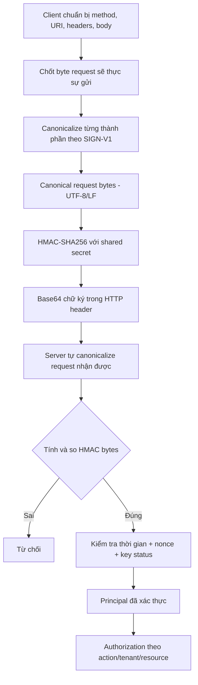
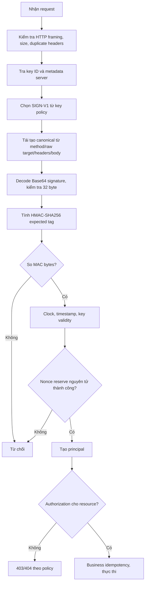

# Tạo canonical request để ký HTTP request bằng HMAC

## 1. Canonical request là gì, và vì sao client phải tạo nó trước khi ký?

Trong module `SECURITY_AUTHENTICATION_HMAC_REQUEST_AUTHENTICATION`, một client được cấp **shared secret** để chứng minh khả năng gửi request thay mặt một principal đã đăng ký. Client dùng HMAC để tạo **message authentication code (MAC)** từ những dữ liệu đã thống nhất. Server tự dựng lại cùng dữ liệu, tính HMAC với secret phía server và so sánh kết quả. Đây là **authentication**; quyền truy cập tài nguyên vẫn do **authorization** kiểm tra riêng.

Điểm khó của quá trình này không chỉ là gọi `Mac.getInstance("HmacSHA256")`. HTTP request gồm nhiều thành phần có thể được biểu diễn theo các cách khác nhau: tên header có thể viết hoa/thường; URI có percent-encoding; JSON có nhiều cách xuống dòng, sắp xếp key; gateway có thể thay đổi HTTP framing. HMAC luôn nhận **byte**, không tự hiểu hai request “có vẻ tương đương”.

**Canonical request** là một dãy byte có bố cục **bất biến theo phiên bản giao thức**, đại diện chính xác cho những phần request được đưa vào chữ ký.



Ví dụ HMAC bảo vệ:

- `POST` thay vì `GET`;
- `/v1/orders?mode=fast&ref=a%2Fb` thay vì path/query khác;
- `Content-Type: application/json`, key ID, timestamp và nonce;
- **SHA-256 của chính byte body đã gửi**, không phải object JSON do server serialize lại;
- **audience** cố định của API để ngăn dùng lại chữ ký ở một dịch vụ khác.

Nếu client dựng canonical từ body A nhưng HTTP adapter gửi body B (chỉ khác khoảng trắng), HMAC không khớp. Nếu client ký `/v1/a%2Fb` nhưng proxy đổi thành `/v1/a/b`, server có thể tính chữ ký khác hoặc hiểu nhầm resource. Nếu client không đưa header kiểm soát tenant vào chữ ký nhưng backend dùng nó để chọn tài nguyên, một HMAC đúng có thể không bảo vệ đầy đủ ý nghĩa request.

> **Nguyên tắc:** *Tạo canonical request* là xác định **chính xác byte và ý nghĩa nào được ký**, rồi đóng băng chúng trước khi tính MAC và gửi HTTP. **Không lấy một chuỗi canonical do client gửi làm dữ liệu tin cậy để server verify**; server phải tự tái tạo từ request thực tế.

Bài học **“Tạo canonical request”** thuộc chương **“Ký request”** tập trung vào góc nhìn **client signer**, nhưng luôn đối chiếu với công việc của server verifier, proxy/gateway, chống replay bằng timestamp/nonce, key rotation và phân quyền.

### Sau bài học, bạn sẽ làm được

1. Chọn và ghi lại một **canonical contract version** đủ rõ cho hai implementation độc lập.
2. Chuẩn bị request có **method, raw URI/query, signed headers, body bytes** nhất quán.
3. Tính **body digest**, ghép các dòng canonical theo byte UTF-8/LF, **không thêm newline cuối**.
4. Sinh timestamp/nonce đúng format, đặt chúng vào dữ liệu đã ký, dùng secret đúng key ID.
5. Dùng Java 17+ tính HMAC-SHA256 và tạo header chữ ký cho một HTTP request.
6. Kiểm thử golden vector, các sai lệch do gateway, key rotation và parser khác nhau.
7. Giải thích vì sao chữ ký hợp lệ chưa đồng nghĩa request mới, không bị lặp hoặc có quyền.

## 2. Phân biệt bốn lớp: request nghiệp vụ, canonical text, MAC bytes và signature text

Hãy coi toàn bộ thao tác ký là **bốn giai đoạn có giao diện rõ ràng**:

| Giai đoạn | Đầu vào / đầu ra | Điều thường bị nhầm |
| --- | --- | --- |
| **Request nghiệp vụ** | Method, raw request target, header values, raw body bytes | Đối tượng `Map`/JSON chưa phải byte HTTP cuối cùng; SDK có thể encode lại. |
| **Canonicalization** | Request đã đóng băng → **canonical bytes** | Không chỉ nối string tùy ý; mỗi trường, thứ tự, charset, delimiter phải được quy định. |
| **MAC computation** | `HMAC(secretBytes, canonicalBytes)` → **raw MAC bytes** | Không dùng SHA-256(body) thay HMAC; không đưa secret vào HTTP. |
| **Signature transport** | Raw MAC → Base64 chuẩn / Base64URL / hex theo contract | Base64 là *encoding*, không phải thuật toán mật mã. |

Ví dụ với HMAC-SHA256 **full tag**, MAC có **32 byte**. Nếu giao thức dùng Base64 chuẩn có padding, signature text có **44 ký tự**. Nếu đổi sang HMAC-SHA512 full tag, MAC có 64 byte và Base64 chuẩn có padding dài 88 ký tự; điều này không tự động thay đổi quy tắc canonicalization.

### 2.1 Canonicalization cần tính xác định

Một hàm canonicalizer tốt có tính chất:

- **Deterministic:** cùng một tập **byte input hợp lệ** và version luôn cho đúng một mảng byte.
- **Specified:** mọi normalization (nếu có) được định nghĩa, không phụ thuộc mặc định framework.
- **Reject ambiguity:** input có hai cách hiểu bảo mật khác nhau bị loại hoặc có một quy tắc duy nhất.
- **Versioned:** khi sửa cách diễn giải byte, tạo contract mới thay vì sửa âm thầm phiên bản cũ.
- **Reproducible:** client Java và verifier Go/Node/Python có thể dùng **golden vector** để kiểm tra từng byte.

Không cần cố “normalize mọi thứ” để tạo canonical request. Một hợp đồng ký **raw request target** và **raw body hash** có thể đơn giản, miễn gateway giữ nguyên dữ liệu đã ký và router/authorizer hiểu thống nhất. Càng nhiều normalization tự phát, càng dễ có parser differential.

### 2.2 Những phần không tự được HMAC bảo vệ

Một request có thể có header `User-Agent`, `Accept`, tracing, `Host`, cookies hoặc custom header không nằm trong contract. Những field không được ký **không được mặc định dùng để quyết định principal/quyền/hành động**.

Nếu backend sử dụng `X-Tenant-Id`, `X-HTTP-Method-Override`, `Content-Encoding` hoặc `Idempotency-Key` làm thay đổi cách thực thi, phải cân nhắc:

- Bổ sung vào **signed header list và version**, hoặc
- Ràng buộc bằng **server-side policy** độc lập, hoặc
- **Từ chối** header không được hợp đồng hỗ trợ.

HMAC không tự bảo vệ thứ không nằm trong dữ liệu ký.

## 3. Định nghĩa một hợp đồng hoàn chỉnh: SIGN-V1

Bài dùng hợp đồng giảng dạy **`HMAC-REQUEST/SIGN-V1`**. Đây **không phải chuẩn HMAC chung** và không được trộn trực tiếp với canonical format của một dịch vụ thứ ba (ví dụ AWS Signature V4 hoặc HTTP Message Signatures). Hợp đồng mô phỏng endpoint tạo đơn hàng.

### 3.1 Các quyết định của SIGN-V1

| Thuộc tính | Quy tắc được chốt |
| --- | --- |
| Endpoint mẫu | `POST /v1/orders` với query; API chỉ chấp nhận method thực tế `POST`. |
| Request target | **Raw origin-form**: path bắt đầu `/` và raw query theo đúng thứ tự, giữ nguyên percent-encoding; không có scheme, authority hoặc fragment. |
| Version / domain | Dòng đầu chính xác `HMAC-REQUEST/SIGN-V1`. |
| Algorithm | `HmacSHA256` trong Java, tên hiển thị trong canonical là `HMAC-SHA256`. |
| Audience | `orders-api/prod`, lấy từ cấu hình client đã được cấp và metadata server; không lấy tùy ý từ `Host` công khai. |
| Signed headers | Đúng 4 tên: `content-type`, `x-hmac-key-id`, `x-hmac-nonce`, `x-hmac-timestamp`. |
| Name và order | Tên ASCII lowercase; sắp xếp lexicographic ASCII tăng dần. |
| Header values | Singleton, trim SP/HTAB **hai đầu** khi contract cho phép; demo chỉ chấp nhận `application/json` và các format ASCII xác định. |
| Signed header manifest | `content-type;x-hmac-key-id;x-hmac-nonce;x-hmac-timestamp`, nằm trong canonical và trong một header khai báo phải khớp chính xác. |
| Key ID | Một header `X-HMAC-Key-Id`; metadata server ghim secret/algorithm/version/audience/principal. |
| Timestamp | `X-HMAC-Timestamp` là Unix epoch **seconds**, dạng số thập phân canonical. |
| Nonce | `X-HMAC-Nonce` là 16 byte ngẫu nhiên mật mã, mã hóa thành 32 ký tự hex lowercase. |
| Body | Chính xác **raw body bytes** được gửi sau HTTP framing, trước mọi body transform; demo cấm `Content-Encoding`. |
| Body size | Số **byte** body thực tế, decimal ASCII, được tính từ chính byte body đã ký. |
| Body digest | SHA-256(raw body bytes), **64 ký tự hex lowercase**. |
| Canonical encoding | UTF-8; mỗi dòng nối bằng **LF (`0x0A`)**; **không** thêm LF cuối; không thêm space quanh dấu `:`. |
| Signature text | HMAC-SHA256 full 32-byte tag → **Base64 chuẩn có padding**, 44 ký tự; đặt tại `X-HMAC-Signature`. |

**Ràng buộc bổ sung:** endpoint mẫu không chấp nhận `X-Tenant-Id`, `X-HTTP-Method-Override`, `X-HMAC-Algorithm`, `Content-Encoding` hay một `Idempotency-Key` ảnh hưởng nghiệp vụ nhưng không được ký. Nếu API cần những field đó, **nâng cấp version** hoặc thiết kế kiểm soát tương đương rồi cập nhật golden vectors.

Lựa chọn **raw target** nghĩa là mọi biến thể query có thứ tự/escape khác nhau tạo canonical bytes khác nhau. Điều này đòi hỏi ingress có parser URL đủ chặt và không có diễn giải resource khác nhau giữa verifier và backend.

### 3.2 Bố cục canonical: đúng 12 dòng

Định dạng chính xác:

```text
1. HMAC-REQUEST/SIGN-V1
2. HMAC-SHA256
3. <UPPERCASE_METHOD>
4. <RAW_ORIGIN_FORM_PATH_AND_QUERY>
5. audience:<SERVER_CONFIGURED_AUDIENCE>
6. content-type:<CANONICAL_CONTENT_TYPE>
7. x-hmac-key-id:<KEY_ID>
8. x-hmac-nonce:<NONCE>
9. x-hmac-timestamp:<EPOCH_SECONDS>
10. signed-headers:content-type;x-hmac-key-id;x-hmac-nonce;x-hmac-timestamp
11. body-size:<ACTUAL_BYTE_COUNT>
12. body-sha256:<LOWERCASE_SHA256_HEX>
```

Các số `1.`–`12.` trong code block chỉ để **chỉ mục giải thích**, **không** có mặt trong canonical bytes thực tế. Ký tự `<...>` là placeholder, cũng không được giữ lại khi ký.

Tại sao dùng dòng `signed-headers:...` khi đã ghi từng giá trị header? Manifest ràng buộc **tập tên và thứ tự** vào byte HMAC, giúp kiểm soát việc bỏ/ký thêm header giữa các phiên bản. Đối với SIGN-V1, server có một manifest **cố định** và chỉ chấp nhận đúng manifest đó. Header `X-HMAC-Signed-Headers` do client gửi là phần **khai báo để server đối chiếu**, **không** là nguồn cho phép client tự chọn tập header.

### 3.3 Những mối quan hệ phải giữ bất biến

- `method` trong canonical phải là **method HTTP thực sự gửi**; không cho middleware đổi hành động sau điểm xác minh.
- `rawTarget` trong canonical phải là **target thực sự verifier nhận** hoặc một biểu diễn gốc đáng tin đã được bảo vệ qua gateway.
- `body-size` và `body-sha256` phải xuất phát từ **cùng bản body bytes** được gửi và được server đọc.
- `x-hmac-key-id` chỉ ra record có secret tương ứng, không cho client tự chọn algorithm/version tùy hứng.
- `x-hmac-timestamp` và `x-hmac-nonce` phải nằm trong byte HMAC để không bị sửa nhằm né replay policy.
- `audience` phải tương ứng **dịch vụ thực sự nhận request**; không cho một request có cùng secret được dùng qua API khác nếu policy không cho phép.

## 4. Ví dụ từng bước: tạo canonical request cho một đơn hàng

Giả sử bên client định gửi:

```http
POST /v1/orders?mode=fast&ref=a%2Fb HTTP/1.1
Host: api.example.test
Content-Type: application/json
X-HMAC-Key-Id: partner-17:v1
X-HMAC-Nonce: 39e219abdf954bf0bfeadfc14986ba02
X-HMAC-Timestamp: 1795838400
X-HMAC-Signed-Headers: content-type;x-hmac-key-id;x-hmac-nonce;x-hmac-timestamp
X-HMAC-Signature: <base64-signature>

{"orderId":"o-7","amountMinor":125000}
```

Chú ý: Ví dụ minh họa **không chứa tag HMAC đã tính sẵn**. Timestamp sẽ cần thay bằng giây epoch hiện tại khi chạy thật, nonce phải được sinh mới. Body được mô tả là **chính xác** các byte UTF-8 của:

```json
{"orderId":"o-7","amountMinor":125000}
```

Không tính thêm newline tự động ở cuối body. Các đoạn code block chỉ là cách trình bày; không lấy dấu xuống dòng của trình soạn thảo làm byte trong request nếu body thực không có nó.

### Bước 1 — Chuẩn bị body bytes một lần

```java
import java.nio.charset.StandardCharsets;

byte[] bodyBytes =
        "{\"orderId\":\"o-7\",\"amountMinor\":125000}"
            .getBytes(StandardCharsets.UTF_8);
```

Nếu dùng một JSON serializer, phải serialize **trước** khi tính digest, rồi dùng **chính byte[] kết quả** để gửi. Không xây canonical từ object JSON rồi nhờ `HttpClient` serialize **lần thứ hai**.

### Bước 2 — Chốt raw request target

```text
/v1/orders?mode=fast&ref=a%2Fb
```

Không tự:

- Chuyển `a%2Fb` thành `a/b`;
- Sort lại query thành `ref=a%2Fb&mode=fast`;
- Đổi `%2F` thành `%2f`;
- Thay `+` bằng space hoặc `%20`;
- Dùng decoded path từ router thay raw target mà client đã gửi.

Những phép biến đổi có thể có mục đích trong **một canonical version khác**, nhưng không thuộc SIGN-V1.

### Bước 3 — Chốt signed header values

Các dòng cần ký trong thứ tự ASCII của **tên header**:

```text
content-type:application/json
x-hmac-key-id:partner-17:v1
x-hmac-nonce:39e219abdf954bf0bfeadfc14986ba02
x-hmac-timestamp:1795838400
```

Thứ tự header trên wire không ảnh hưởng ký vì canonicalizer áp dụng thứ tự cố định. Ngược lại, **giá trị** header là thành phần bảo mật: đổi một ký tự trong nonce hoặc timestamp sẽ đổi canonical bytes.

### Bước 4 — Tính size và digest trên raw body bytes

```text
bodySize    = bodyBytes.length              // đơn vị BYTE, không phải ký tự
bodyHashHex = lowercaseHex(SHA256(bodyBytes))
```

Hợp đồng ký **hash** thay vì in trực tiếp body text vào canonical. Điều này đặc biệt hữu ích với body nhị phân hoặc lớn.

Digest kiểm tra độc lập của chuỗi ASCII `abc`:

```text
SHA256(ASCII("abc")) =
ba7816bf8f01cfea414140de5dae2223b00361a396177a9cb410ff61f20015ad
```

Digest của **body JSON** trong request phải được tính thực tế bằng code; không lấy digest `abc` hoặc placeholder làm body digest.

### Bước 5 — Ghép canonical text không có số thứ tự

Với request mẫu, canonical request thực tế có cấu trúc:

```text
HMAC-REQUEST/SIGN-V1
HMAC-SHA256
POST
/v1/orders?mode=fast&ref=a%2Fb
audience:orders-api/prod
content-type:application/json
x-hmac-key-id:partner-17:v1
x-hmac-nonce:39e219abdf954bf0bfeadfc14986ba02
x-hmac-timestamp:1795838400
signed-headers:content-type;x-hmac-key-id;x-hmac-nonce;x-hmac-timestamp
body-size:<decimal-length-of-actual-json-bytes>
body-sha256:<lowercase-hex-sha256-of-actual-json-bytes>
```

Đây là **template**: hai dòng `body-size`/`body-sha256` vẫn có placeholder và không phải canonical bytes cuối cùng. Trước khi ký, client phải thay chúng bằng kết quả `bodyBytes.length` và SHA-256 của **chính byte[] đã tạo**.

### Bước 6 — Encode chính xác và tính MAC

```text
canonicalText  = String.join("\n", twelveLines)  // không newline cuối
canonicalBytes = UTF8(canonicalText)
macBytes       = HMAC_SHA256(secretBytes, canonicalBytes)
signatureText  = Base64StandardPadded(macBytes)
```

`canonicalBytes` phải là byte UTF-8 của canonical text. Header signature chứa chuỗi `signatureText`, còn server decode về 32 byte để so MAC. **Không đưa `X-HMAC-Signature` vào chính canonical request** vì sẽ tạo phụ thuộc vòng.

## 5. Chuẩn bị client request: “freeze trước khi sign”

Một lỗi thường gặp là dựng canonical từ các biến chưa cố định:

```text
Đúng:
  serialize body một lần
  -> chốt raw target, header values, timestamp, nonce
  -> tính body digest và canonicalBytes
  -> HMAC + Base64
  -> gửi ĐÚNG bản snapshot đã ký

Sai:
  ký từ object JSON / map query
  -> SDK tự serialize và encode lại khi gửi
  -> body/URI/header thực tế khác dữ liệu đã ký
```

### 5.1 Bản snapshot bất biến

Client nên có một đối tượng `PreparedRequest`/`SignedRequest` chứa **byte[] body đã clone**, raw request target, tập signed header values, canonical bytes và signature. Mỗi retry cần xác định lại **timestamp/nonce** theo policy, thay vì thay đổi một header ngay trước khi `send()`.

Những thứ **phải cố định trước HMAC**:

| Trường | Nguồn dữ liệu | Lỗi thường gặp |
| --- | --- | --- |
| Method | Phương thức HTTP sẽ gửi | SDK hoặc middleware chuyển POST thành GET; method override. |
| Raw target | Path/query đã percent-encode theo đúng contract | Router/URI builder tự đổi escape hoặc sort query. |
| Body | Byte array/snapshot được BodyPublisher gửi | JSON serializer chạy lại, thay whitespace/charset. |
| Content-Type | Giá trị header thực gửi | Tự thêm `charset=utf-8` sau khi ký. |
| Key ID | Key profile client được cấp | Dùng secret của key khác với ID trong header. |
| Timestamp | Epoch seconds được tạo tại thời điểm ký | Nhầm milliseconds, dùng UTC offset sai, request queue quá lâu. |
| Nonce | Byte ngẫu nhiên riêng mỗi request | Dùng lại khi retry hoặc nhiều thread dùng chung nonce. |
| Audience | Cấu hình dịch vụ đích/metadata key | Đưa request sang môi trường khác nhưng vẫn dùng chữ ký của prod. |
| Canonical version | Giá trị cố định theo key/protocol | Client thay version mà không thay canonical rules. |

### 5.2 Retry cần được thiết kế trước

Nếu request lỗi mạng **sau khi server đã xử lý**, client không biết server có thực hiện side effect hay chưa. Một retry **y nguyên** với cùng timestamp/nonce có thể bị nonce store từ chối (và điều đó đúng cho chống replay). Một retry **ký lại** với nonce/timestamp mới có thể qua authentication, nhưng có nguy cơ tạo thanh toán/đơn hàng thứ hai.

Do đó:

1. Mỗi attempt được ký theo **timestamp/nonce hợp lệ**.
2. Với thao tác có side effect, dùng **idempotency key** ổn định cho cùng ý định nghiệp vụ, ràng buộc với principal/operation/body.
3. Nếu `Idempotency-Key` ảnh hưởng kết quả, **phải ký nó trong canonical version** hoặc ràng buộc bằng cơ chế server-side được thiết kế tương đương. SIGN-V1 mẫu **không hỗ trợ** client-supplied idempotency header, nên production cần nâng contract trước khi dùng nó.
4. Không biến nonce thành idempotency key; hai cơ chế phục vụ mục tiêu khác nhau.

## 6. Method và URI: chọn đúng byte ở điểm ký

### 6.1 Method: ký action thực tế

HTTP method là case-sensitive ở mức token; trong mẫu chỉ chấp nhận `POST` viết hoa. Không tự coi `post` và `POST` là một khi giao thức chưa quy định. Nếu API cho phép `X-HTTP-Method-Override`, phải làm rõ method nào được định tuyến và ký/ràng buộc nó. SIGN-V1 **từ chối** override để tránh tình huống ký POST nhưng thực thi DELETE.

### 6.2 Raw origin-form khác full URL và decoded path

Ví dụ:

```text
Full URL:
https://api.example.test/v1/orders?mode=fast&ref=a%2Fb

Raw origin-form request target:
 /v1/orders?mode=fast&ref=a%2Fb

Decoded query value (không dùng làm canonical target của SIGN-V1):
 ref = "a/b"
```

Ký raw target **không gồm** `https://api.example.test`, trừ khi giao thức có dòng ký scheme/authority riêng. Audience đã ràng buộc đích nhận theo metadata phía server. Fragment `#...` không được gửi trong HTTP request target thông thường, nên không được đưa vào byte ký.

Trong Java, `URI.getRawPath()`/`getRawQuery()` khác `getPath()`/`getQuery()`: bộ thứ nhất giữ percent-encoding; bộ thứ hai có thể decode. Tuy vậy, `URI` chỉ parse một chuỗi **đã được ứng dụng nhận**; nó không khôi phục raw request target nếu proxy/framework rewrite trước đó.

### 6.3 Query không phải một Map vô hại

| Raw query | Khác biệt cần bảo vệ |
| --- | --- |
| `x=1&y=2` | Thứ tự này khác `y=2&x=1` theo raw signing. |
| `tag=one&tag=two` | Duplicate key; các parser có thể first-wins, last-wins hoặc multimap. |
| `name=a+b` | `+` trong URI query không tự là space như trong form decoding. |
| `name=a%20b` | Byte raw khác `name=a+b`. |
| `ref=a%2Fb` | Raw `%2F` khác dấu `/` trực tiếp. |
| `x` và `x=` | Không có dấu `=` khác value rỗng tường minh. |
| `/orders` và `/orders?` | Query không hiện diện khác query rỗng khi ký raw target. |

Nếu tầng verifier dùng một kiểu parse query nhưng business layer/authorizer lấy tenant từ kiểu khác, HMAC vẫn có thể đúng trong khi resource được thực thi khác. Một lựa chọn phòng thủ là **reject duplicate security-sensitive query keys**, dot segments/encoded slash nguy hiểm theo endpoint policy, double decoding và URI nhập nhằng. Nếu API cần hỗ trợ chúng, phải quy định chính xác và test qua gateway/route/authorization.

### 6.4 Kiểm thử proxy/gateway là bắt buộc

API gateway có thể:

- Gộp hoặc sắp xếp lại query;
- Decode `%2F` thành slash trong path;
- Thay HTTP/2 `:path` bằng HTTP/1.1 request target đã normalize;
- Rewrite path prefix `/api` trước backend;
- Tạo các header `X-Original-URI`, `X-Forwarded-Host` có thể bị giả nếu chưa được strip/overwrite.

**Chọn một điểm verify rõ ràng**. Nếu verify trước rewrite tại gateway, gateway phải truyền authenticated identity và resource context tới backend qua kênh tin cậy, đồng thời backend kiểm tra quyền trên **resource thực tế**. Nếu verify ở backend, gateway phải bảo toàn raw target/signed data hoặc truyền dữ liệu gốc qua kênh được bảo vệ. Không lấy một header `X-Original-URI` do Internet gửi làm nguồn đáng tin.

## 7. Signed headers: ràng buộc tên, giá trị và danh sách

SIGN-V1 chốt bốn header bắt buộc được ký:

```text
content-type
x-hmac-key-id
x-hmac-nonce
x-hmac-timestamp
```

### 7.1 Canonicalize tên

- Header name HTTP **không phân biệt ASCII hoa/thường**; canonicalizer dùng lowercase.
- Sort tên theo **ASCII tăng dần**, không theo thứ tự xuất hiện.
- Dùng một biểu diễn duy nhất khi nối: `name:value`, **không có space** sau dấu `:`.
- Manifest nối tên bằng `;` chính xác, không thêm space/dấu cuối.
- Từ chối duplicate security headers, kể cả khác case: hai `X-HMAC-Timestamp` không được để client/server chọn “cái đầu” hoặc “cái cuối”.

### 7.2 Canonicalize giá trị theo từng field

Bài chọn rule **trim ASCII OWS (SP/HTAB) hai đầu** và kiểm tra field format cố định. Không lowercase giá trị header một cách đại trà: `Idempotency-Key: AbC` và `abc` có thể là hai token khác nhau.

| Header | Format mẫu | Lý do |
| --- | --- | --- |
| `Content-Type` | Chính xác `application/json` sau trim OWS | Đồng nhất cách hiểu raw JSON body. |
| `X-HMAC-Key-Id` | ASCII key ID không rỗng, ví dụ `partner-17:v1` | Tra metadata secret/algorithm/version phía server. |
| `X-HMAC-Nonce` | 32 ký tự hex lowercase | Nonce mới và đã ký; chặn sửa nonce. |
| `X-HMAC-Timestamp` | Chuỗi epoch seconds decimal canonical | Timestamp không thể bị sửa mà giữ MAC. |
| `X-HMAC-Signed-Headers` | Chuỗi manifest cố định | Đối chiếu với contract server, không phải tên header được chọn tùy ý. |
| `X-HMAC-Signature` | Base64 chuẩn 44 ký tự | Giá trị HMAC cuối cùng, **không ký chính nó**. |

Không tự collapse whitespace bên trong value, parse lại header list bằng dấu phẩy hay chấp nhận obs-fold/CRLF. Cần HTTP adapter có thể phát hiện **header occurrences**, không chỉ một `Map<String,String>` đã xóa duplicate.

### 7.3 Tại sao không ký Host/Content-Length mặc định?

`Host`/HTTP/2 `:authority` có thể bị gateway thay đổi; SIGN-V1 dùng **audience** theo metadata thay thế cho việc ký authority tự do. Nếu cần bảo vệ host/port thật, phải có contract authority canonicalization riêng.

`Content-Length` và `Transfer-Encoding` liên quan tới framing; proxy có thể đổi giữa content length, HTTP/1.1 chunked và HTTP/2 DATA frames. Contract ký **`body-size` tự tính** và hash raw application body thay vì các byte framing, nhưng HTTP ingress vẫn phải từ chối framing mâu thuẫn, request smuggling hoặc incomplete body.

## 8. Raw body, body digest và dòng body-size

### 8.1 Không dùng số ký tự thay cho số byte

Với body UTF-8 tiếng Việt:

```java
byte[] bytes = "{\"message\":\"Xin chào\"}"
        .getBytes(java.nio.charset.StandardCharsets.UTF_8);
int byteCount = bytes.length; // byte count, có thể > số char của String
```

HMAC contract cần **số byte thực gửi**. `String.length()` đếm UTF-16 code units của Java, không phải byte UTF-8. Tương tự, `Content-Length` là giá trị framing do tầng HTTP quản lý; client signer nên lấy `bodyBytes.length` từ snapshot, server tính số byte thực nhận.

### 8.2 Hash raw byte một lần, không serialize lại

```text
Client:
  JSON serializer -> bodyBytes
  bodySha256      = SHA256(bodyBytes)
  sendBody        = SAME bodyBytes

Server:
  rawBodyBytes    = bytes after HTTP framing, before transforms
  bodySha256      = SHA256(rawBodyBytes)
  canonical       = independently reconstructed
```

Nếu body không có nội dung (zero bytes), SHA-256 hex phải là:

```text
e3b0c44298fc1c149afbf4c8996fb92427ae41e4649b934ca495991b7852b855
```

Digest **không được bỏ trống** vì endpoint dùng body rỗng. Body absent/zero-length có cho phép hay không là quy tắc endpoint, không thể suy ra chỉ từ hash.

### 8.3 Streaming cần tính digest và bảo toàn đúng bytes

Với file lớn, `MessageDigest.update(chunk)` có thể tính SHA-256 tăng dần mà không load toàn body vào RAM. Nhưng nếu **signature đặt ở header** và phụ thuộc hash **toàn body**, client phải biết toàn digest **trước khi gửi header**. Thường cần:

- Đọc nguồn dữ liệu một lần để hash rồi mở lại **đúng bản snapshot** để gửi;
- Hoặc spool nguồn vào vùng an toàn, hash đồng thời rồi gửi từ spool đã đóng băng;
- Hoặc dùng một **signed streaming/chunk protocol khác** đã quy định rõ thứ tự, chaining và per-chunk auth.

Không mặc định có thể stream một `InputStream` không thể tua lại, vừa gửi body vừa tính cuối cùng ra chữ ký đặt **ở header đầu request**. Nếu body thay đổi giữa lần đọc hash và lần gửi, MAC không còn bảo vệ byte đã gửi.

Phía server có thể hash khi body đến, **spool cách ly**, rồi sau EOF mới xác minh full-request HMAC. Không cho controller tạo side effect hay public object từ dữ liệu chưa xác thực. Cần quota, timeout, backpressure, cleanup và chống TOCTOU để downstream tiêu thụ **đúng bytes đã hash**.

### 8.4 Content-Encoding và multipart

SIGN-V1 **cấm header Content-Encoding** để tránh việc client ký gzip bytes nhưng server hash nội dung đã giải nén, hoặc ngược lại. HTTP/1.1 chunk framing và HTTP/2 DATA frames không phải application body bytes được hash.

Nếu ký `multipart/form-data` raw bytes, cả boundary, line ending và per-part headers đều là body bytes. Cùng file nhưng boundary khác → digest khác. Cần version mới nếu muốn ký theo semantics từng multipart part thay vì raw byte.

## 9. Java 17+: một signer tự chứa cho SIGN-V1

Phần này dùng Java 17/JCA để:

1. Nhận request snapshot `POST` với raw origin-form target và body UTF-8.
2. Kiểm tra format của key ID, timestamp, nonce, raw target.
3. Tính SHA-256(body), ghép **12 dòng canonical** và encode UTF-8.
4. Tính HMAC-SHA256 bằng secret đã được cấu hình.
5. Trả về **cùng byte[] body** và các header để HTTP client gửi.

Đoạn code chỉ là **client signer**. Nó **không** thay thế server verifier/nonce store/authorization. Với production, key config nên lấy từ secret manager hoặc cơ chế bảo mật tương đương.

### 9.1 Lớp `SigningRequestV1`

```java
import java.net.URI;
import java.nio.charset.StandardCharsets;
import java.security.GeneralSecurityException;
import java.security.MessageDigest;
import java.security.SecureRandom;
import java.time.Clock;
import java.util.Base64;
import java.util.HexFormat;
import java.util.Map;
import java.util.Objects;

import javax.crypto.Mac;
import javax.crypto.spec.SecretKeySpec;

public final class SigningRequestV1 {
    public static final String AUDIENCE = "orders-api/prod";
    public static final String MANIFEST =
            "content-type;x-hmac-key-id;x-hmac-nonce;x-hmac-timestamp";

    private static final SecureRandom SECURE_RANDOM = new SecureRandom();

    private SigningRequestV1() {}

    // Defensive copy bảo đảm snapshot byte[] không bị caller thay đổi
    // sau khi HMAC đã được tính.
    public record SignedRequest(
            String method,
            String rawTarget,
            byte[] bodyBytes,
            byte[] canonicalBytes,
            Map<String, String> headers) {

        public SignedRequest {
            bodyBytes = bodyBytes.clone();
            canonicalBytes = canonicalBytes.clone();
            headers = Map.copyOf(headers);
        }

        @Override
        public byte[] bodyBytes() {
            return bodyBytes.clone();
        }

        @Override
        public byte[] canonicalBytes() {
            return canonicalBytes.clone();
        }
    }

    public static String freshNonce() {
        byte[] bytes = new byte[16];
        SECURE_RANDOM.nextBytes(bytes);
        return HexFormat.of().formatHex(bytes); // 32 lowercase hex
    }

    public static String timestampNow(Clock clock) {
        Objects.requireNonNull(clock, "clock");
        return Long.toString(clock.instant().getEpochSecond());
    }

    private static void validateTarget(String target) {
        if (target == null || target.length() > 4096
                || !target.startsWith("/") || target.startsWith("//")
                || target.chars().anyMatch(c ->
                        c < 0x21 || c > 0x7e || c == '#'
                        || c == '\\')) {
            throw new IllegalArgumentException("Invalid raw request target");
        }

        // URI chỉ dùng để validate syntax và bảo toàn raw target;
        // không dùng getPath() hoặc normalize() để ký.
        URI parsed = URI.create(target);
        if (parsed.isAbsolute() || parsed.isOpaque()
                || parsed.getRawAuthority() != null
                || parsed.getRawFragment() != null
                || parsed.getRawPath() == null) {
            throw new IllegalArgumentException("Not origin-form target");
        }

        String reconstructed = parsed.getRawPath()
                + (parsed.getRawQuery() == null
                    ? "" : "?" + parsed.getRawQuery());

        if (!target.equals(reconstructed)) {
            throw new IllegalArgumentException("Target changed by parser");
        }
    }

    public static SignedRequest sign(
            String rawTarget,
            byte[] originalBody,
            String keyId,
            byte[] secretBytes,
            String epochSeconds,
            String nonce) {

        Objects.requireNonNull(originalBody, "body");
        Objects.requireNonNull(secretBytes, "secretBytes");
        validateTarget(rawTarget);

        if (keyId == null
                || !keyId.matches("[A-Za-z0-9._:-]{1,100}")
                || epochSeconds == null
                || !epochSeconds.matches("(0|[1-9][0-9]{0,11})")
                || nonce == null
                || !nonce.matches("[0-9a-f]{32}")
                || secretBytes.length < 32) {
            throw new IllegalArgumentException("Invalid signing inputs");
        }

        // Client được cấp secret >= 32 bytes theo policy SIGN-V1.
        // Ở production nên lấy và giữ secret từ secure configuration.
        byte[] body = originalBody.clone();

        final String bodyDigest;
        try {
            bodyDigest = HexFormat.of().formatHex(
                    MessageDigest.getInstance("SHA-256").digest(body));
        } catch (GeneralSecurityException ex) {
            throw new IllegalStateException("SHA-256 unavailable", ex);
        }

        String canonicalText = String.join("\n",
                "HMAC-REQUEST/SIGN-V1",
                "HMAC-SHA256",
                "POST",
                rawTarget,
                "audience:" + AUDIENCE,
                "content-type:application/json",
                "x-hmac-key-id:" + keyId,
                "x-hmac-nonce:" + nonce,
                "x-hmac-timestamp:" + epochSeconds,
                "signed-headers:" + MANIFEST,
                "body-size:" + body.length,
                "body-sha256:" + bodyDigest);

        byte[] canonical = canonicalText.getBytes(StandardCharsets.UTF_8);

        final byte[] macBytes;
        try {
            Mac mac = Mac.getInstance("HmacSHA256");
            mac.init(new SecretKeySpec(secretBytes, "HmacSHA256"));
            macBytes = mac.doFinal(canonical);
        } catch (GeneralSecurityException ex) {
            throw new IllegalStateException("HMAC signing failed", ex);
        }

        String signature = Base64.getEncoder().encodeToString(macBytes);

        Map<String, String> headers = Map.of(
                "Content-Type", "application/json",
                "X-HMAC-Key-Id", keyId,
                "X-HMAC-Nonce", nonce,
                "X-HMAC-Timestamp", epochSeconds,
                "X-HMAC-Signed-Headers", MANIFEST,
                "X-HMAC-Signature", signature);

        return new SignedRequest(
                "POST", rawTarget, body, canonical, headers);
    }
}
```

**Những điểm quan trọng trong code:**

- `SecureRandom` sinh nonce riêng; không dùng `Random`, đồng hồ hoặc biến đếm dễ đoán thay nguồn ngẫu nhiên mật mã.
- `timestampNow(clock)` dùng **epoch seconds**. Mọi verifier production phải kiểm tra thời gian server, không tin client có đồng hồ hoàn hảo.
- `URI.create` kiểm tra cú pháp và khôi phục raw path/query của input đã nhận; nó **không** chứng minh proxy sẽ gửi đúng target đó hoặc router/authorizer hiểu cùng resource. Cần parser/security policy riêng cho duplicate query, encoded slash, dot segments và route semantics.
- Dòng `body-size` dùng `body.length`, không dùng độ dài chuỗi JSON hoặc giá trị `Content-Length` tự khai.
- `String.join("\n",...)` không thêm LF cuối, bảo đảm **12 dòng**.
- `SecretKeySpec` được khởi tạo từ secret bytes của cấu hình. Chính sách `>= 32 bytes` ở đây là **yêu cầu cấp khóa của ví dụ**, không phải quy tắc bắt buộc với mọi vector HMAC (các test vector RFC có thể dùng khóa ngắn hơn).
- `Map.of` không bảo đảm iteration order, **không sao** vì thứ tự header HTTP trên wire không được dùng để tạo canonical. Tất cả tên/value có thể kiểm soát, một occurrence mỗi field. HTTP adapter thực tế vẫn phải tránh thêm duplicate.
- `SignedRequest` clone mảng byte khi lưu và khi lấy ra để tránh caller thay đổi body/canonical sau ký.
- Kết quả Base64 là chuỗi vận chuyển; **không** dùng `new String(macBytes, UTF_8)` thay Base64.

**Giới hạn:** mẫu không có cơ chế quản lý secret lifecycle/zeroization, bảo vệ thẳng bộ nhớ, rate limit, nonce store, key status hoặc HTTP ingress logic. Đối với client production, key nên có metadata `algorithm, canonicalVersion, audience` được ghim cố định, và không log secret hoặc signature đầy đủ.

### 9.2 Dùng kết quả signer để gửi bằng Java `HttpClient`

Ví dụ một caller có cấu hình `secretBytes` và `keyId` đã được cấp an toàn:

```java
import java.net.URI;
import java.net.http.HttpClient;
import java.net.http.HttpRequest;
import java.net.http.HttpResponse;
import java.nio.charset.StandardCharsets;
import java.time.Clock;

byte[] body = "{\"orderId\":\"o-7\",\"amountMinor\":125000}"
        .getBytes(StandardCharsets.UTF_8);

SigningRequestV1.SignedRequest signed =
        SigningRequestV1.sign(
                "/v1/orders?mode=fast&ref=a%2Fb",
                body,
                "partner-17:v1",
                secretBytes, // secure config, KHÔNG hardcode
                SigningRequestV1.timestampNow(Clock.systemUTC()),
                SigningRequestV1.freshNonce());

URI endpoint =
        URI.create("https://api.example.test" + signed.rawTarget());

HttpRequest.Builder builder = HttpRequest.newBuilder(endpoint)
        .POST(HttpRequest.BodyPublishers.ofByteArray(signed.bodyBytes()));

signed.headers().forEach(builder::header);
HttpRequest httpRequest = builder.build();

HttpClient client = HttpClient.newHttpClient();
HttpResponse<String> response = client.send(
        httpRequest, HttpResponse.BodyHandlers.ofString());
System.out.println(response.statusCode());
```

**Lưu ý về Java 17:** `HttpClient` chưa triển khai `AutoCloseable` để dùng trực tiếp với `try-with-resources`. Trong ứng dụng thật, nên tạo/reuse `HttpClient` theo vòng đời ứng dụng, xử lý `InterruptedException`/`IOException`, timeout và redirect/retry theo chính sách. Nếu redirect làm thay đổi method/host/path hoặc body, cần ký request **mới** cho đích được phép; không tái sử dụng chữ ký ban đầu.

**Kiểm tra integration bắt buộc:** Java `HttpClient`, API gateway hoặc load balancer có thể biểu diễn URL/header/framing khác với snapshot nguồn. Phải xác nhận raw target, body bytes và signed values thực sự tới điểm verify **khớp byte contract**, đặc biệt với URI có percent-encoding, query duplicate và HTTP/2 translation.

## 10. Đọc và tự kiểm tra canonical bytes trước khi ký

Trong môi trường **test** (không chứa secret production), bạn có thể kiểm tra bản canonical text và byte UTF-8:

```java
String canonicalText = new String(
        signed.canonicalBytes(), StandardCharsets.UTF_8);

String[] lines = canonicalText.split("\n", -1);
if (lines.length != 12) {
    throw new AssertionError("Expected exactly 12 canonical lines");
}
if (!"HMAC-REQUEST/SIGN-V1".equals(lines[0])) {
    throw new AssertionError("Wrong canonical version");
}
if (!"HMAC-SHA256".equals(lines[1])) {
    throw new AssertionError("Wrong algorithm label");
}
if (!"POST".equals(lines[2])) {
    throw new AssertionError("Method mismatch");
}
if (!"/v1/orders?mode=fast&ref=a%2Fb".equals(lines[3])) {
    throw new AssertionError("Raw request target changed");
}
if (!lines[9].equals(
        "signed-headers:" + SigningRequestV1.MANIFEST)) {
    throw new AssertionError("Manifest changed");
}
if (!lines[10].equals("body-size:" + signed.bodyBytes().length)) {
    throw new AssertionError("Byte count mismatch");
}
if (!lines[11].matches("body-sha256:[0-9a-f]{64}")) {
    throw new AssertionError("Digest format mismatch");
}
if (canonicalText.endsWith("\n") || canonicalText.contains("\r")) {
    throw new AssertionError("Unexpected canonical newline format");
}
```

### 10.1 Kiểm tra hex để tìm lỗi invisible bytes

Đôi khi hai chuỗi trông giống nhau nhưng khác byte:

```text
LF newline:      0A
CRLF newline:    0D 0A
ASCII space:     20
Horizontal tab:  09
Colon:           3A
Percent sign:    25
Slash:           2F
```

Trong test fixture, có thể in hex **của canonical bytes bằng secret giả** để phát hiện CRLF, UTF-8 BOM, space cuối dòng hoặc một `?` bị mất. Không in toàn bộ canonical request của production nếu nó chứa dữ liệu cá nhân, access token hoặc metadata nhạy cảm; chỉ ghi request ID, loại lỗi và thông tin đã được phép.

### 10.2 Vì sao golden vector phải độc lập?

Một phép thử “client gọi signer rồi server gọi chính cùng signer” có thể cùng mắc lỗi ở cả hai phía, khiến round-trip vẫn pass. Golden vector tốt phải công bố:

- Method, raw request target, raw body bytes **chính xác**;
- Signed headers và canonical header values;
- Timestamp, nonce, key ID, audience, canonical version;
- **Dòng canonical cụ thể**, byte UTF-8 và separator LF;
- Body byte count, SHA-256 hex;
- Secret **test-only**, HMAC algorithm, expected MAC **raw bytes** và Base64 signature;
- Mỗi tình huống **bị reject** do duplicate/header/query ambiguity.

Test phải có phiên bản Java và ít nhất một implementation độc lập khác như Go, Node hoặc Python, nhất là ở phần raw URI/query và header normalization.

## 11. Server kiểm tra lại như thế nào?

Chủ đề bài này là **tạo canonical request phía client**, nhưng ta cần hiểu mô hình server để tránh tạo một chữ ký “đúng ở client nhưng không xác minh được”.



Một verifier cần:

1. **Giới hạn và parse** request tại trust boundary; không để header trùng hoặc URI mơ hồ lọt qua.
2. Lấy `keyId` để tra **record phía server**, biết secret, algorithm `HmacSHA256`, canonical version `SIGN-V1`, audience, trạng thái key và principal.
3. **So manifest client khai với manifest server quy định**. Client không được bỏ signed header để tự ký một canonical ngắn hơn.
4. Lấy raw method/target/body và signed headers từ **request thật**, dựng đúng 12 dòng và encode UTF-8/LF.
5. Strict-decode `X-HMAC-Signature` thành đúng **32 byte MAC**, kiểm tra Base64 chuẩn có padding.
6. Tính expected MAC bằng secret đúng key ID, so bằng primitive hạn chế rò rỉ timing như `MessageDigest.isEqual(expected, received)`.
7. Kiểm tra timestamp theo đồng hồ đáng tin, trạng thái key hiện tại, reserve nonce bằng thao tác nguyên tử.
8. Chỉ sau authentication mới tạo principal và **authorization** theo action/tenant/resource thực tế.

### 11.1 Không nhận canonical string do client gửi thay công việc của server

Một API có thể yêu cầu client gửi thêm header chứa canonical version hoặc signed header list, nhưng đó là **dữ liệu đầu vào cần kiểm tra**, không phải bảo đảm request thực tế đã được ký đúng. Nếu server chỉ kiểm tra:

```text
HMAC(secret, clientProvidedCanonicalString)
```

rồi cho chạy HTTP method/URI/body bên ngoài chuỗi đó mà không đối chiếu, kẻ tấn công có thể đưa một request thực tế khác đi kèm canonical string có MAC hợp lệ. Server phải tự dựng hoặc kiểm tra nghiêm ngặt sự tương ứng giữa chuỗi ký và **request sẽ thực thi**. Cách dễ chứng minh nhất là server tự tái tạo từ dữ liệu thực tế đã validate.

### 11.2 HMAC đúng không tự ngăn replay

Một signed request đã có MAC đúng có thể bị phát lại nguyên vẹn trong cửa sổ thời gian. Timestamp **đã được ký** giúp giới hạn độ cũ; nonce **đã được ký** cho phép phát hiện request lặp. Server cần:

```redis
SET hmac:nonce:partner-17:v1:39e219abdf954bf0bfeadfc14986ba02 1 NX EX 630
```

`NX` reserve nonce chỉ một lần; `EX` gắn TTL nguyên tử. Với cửa sổ timestamp đối xứng ±300 giây, timestamp ở biên tương lai có thể còn hợp lệ tới **600 giây** kể từ lần chấp nhận sớm nhất; TTL 630 giây chỉ là ví dụ cộng dự phòng và phải điều chỉnh theo lệch clock/độ trễ. Nếu kho nonce không sẵn sàng, **fail-closed**. Không làm `GET` rồi `SET` riêng biệt vì race condition trên nhiều replica.

### 11.3 Authentication không phải authorization

Client có secret của `partner-17` hoàn toàn có thể **tự ký request mới** nhắm tới `/v1/tenants/t-99/orders`. Nếu principal chỉ được cấp quyền ở `tenant=t-42`, HMAC có thể pass và nonce mới nhưng **authorization phải từ chối**. Backend phải kiểm tra đúng tenant/resource mà controller hoặc DB sử dụng, không lấy một path/header do client ký làm bằng chứng có quyền.

## 12. Key rotation, versioning và phân tách audience

Mỗi signing profile phía client nên bao gồm **key ID + secret + canonical format version + HMAC algorithm + audience**. Không để client tự chọn algorithm từ một header bất kỳ:

```text
Profile A
  keyId             = partner-17:v1
  secretRef         = managed-secret:v1
  canonicalVersion  = SIGN-V1
  algorithm         = HmacSHA256
  audience          = orders-api/prod
  status            = ACTIVE

Profile B (khi rotate)
  keyId             = partner-17:v2
  secretRef         = managed-secret:v2
  canonicalVersion  = SIGN-V1
  algorithm         = HmacSHA256
  audience          = orders-api/prod
  status            = ACTIVE
```

**Chỉ xoay secret** không nhất thiết phải đổi canonical format. Client có thể giữ SIGN-V1 và HMAC-SHA256, chỉ thay key ID/secret đúng profile. Server có thể verify-only key cũ trong một cửa sổ migration rồi revoke.

Ngược lại, nếu muốn:

- Thay raw query bằng query sort/percent-normalization;
- Thêm `Idempotency-Key` hoặc `X-Target-Account` vào signed headers;
- Bắt buộc ký host/authority hoặc ràng buộc môi trường theo cách khác;
- Thay body digest thành SHA-512;
- Đổi charset, newline, thứ tự dòng hoặc dấu phân cách;

thì phải ban hành **canonical format version mới**, tài liệu chính xác, golden vectors và chính sách server. Không cố làm client cũ pass bằng cách thử `SIGN-V1` rồi thử mọi kiểu normalization đến khi MAC khớp.

**Chống downgrade:** Server ràng buộc mỗi key ID với một canonical version/algorithm được phép. Một key đã chuyển sang version mới không được yêu cầu quay lại version cũ bằng header tự khai. Khi key bị revoke, timestamp “cũ nhưng trong cửa sổ” không khôi phục quyền verify của key.

### 12.1 Audience và cross-service replay

Nếu `orders-api/prod` và `billing-api/prod` dùng chung secret nhưng canonical bytes không phân biệt đích, một signed request có thể bị chuyển sang dịch vụ khác nếu method/path trùng và policy lỏng. Một dòng `audience:orders-api/prod` từ metadata server/client giúp tách domain; tốt hơn nữa là **phân tách secret theo service và môi trường**.

Không đơn giản dùng `Host`/`X-Forwarded-Host` tự khai làm audience đáng tin, vì gateway có thể rewrite và client có thể giả. Audience nên được kiểm soát tại trust boundary và đối chiếu với key metadata.

## 13. Những lỗi thường gặp khi tạo canonical request

| Lỗi | Hậu quả | Cách sửa |
| --- | --- | --- |
| Dùng `bodyString.length()` làm size | Unicode UTF-8 có nhiều byte, chữ ký không khớp hoặc semantics sai. | Lấy `bodyBytes.length` từ snapshot gửi. |
| Hash JSON trước rồi SDK serialize lại | Whitespace/order/escaping đổi làm body digest sai. | Serialize một lần; ký và gửi đúng cùng bytes. |
| Dùng decoded `URI.getPath()` | `%2F` biến thành slash; raw target mismatch. | Chọn raw origin-form target và validate. |
| Sort query vô điều kiện | Raw query đã thay đổi ngoài SIGN-V1. | Giữ byte/thứ tự raw hoặc ban hành version canonical query. |
| Dùng `URLDecoder` cho query path/signing | `+` thành space theo form encoding. | Parse URI theo context/contract, không áp dụng form decoder ngầm. |
| Lấy header names từ `HashMap` không sort | Thứ tự canonical không ổn định. | Tên lowercase, manifest cố định, order ASCII. |
| Chỉ ký manifest tên mà bỏ giá trị | Header value đổi vẫn giữ MAC. | Đưa cả canonical header lines vào HMAC. |
| Client tự chọn subset signed headers | Bỏ bảo vệ field quan trọng rồi ký lại. | Server pin policy manifest theo key/version. |
| Lowercase mọi header value | Token/idempotency hay body semantics có thể đổi. | Canonicalize value theo contract từng field. |
| Dùng `new String(macBytes, UTF_8)` | Byte tùy ý bị hỏng khi diễn giải như text. | Base64 full tag theo contract. |
| Ký bằng secret v1 nhưng gửi key ID v2 | Verifier dùng key khác → MAC mismatch. | Signing profile gắn key ID với secret/version/algorithm. |
| Dùng epoch milliseconds thay seconds | Timestamp ngoài cửa sổ. | Ghi rõ đơn vị, regex/range và test biên. |
| Tái sử dụng nonce mỗi retry | Replay detection từ chối request lặp. | Nonce mới cho attempt mới, idempotency nghiệp vụ riêng. |
| Trust `X-Original-URI` từ Internet | Kẻ tấn công có thể cấp URI khác với request được route. | Strip/overwrite tại gateway, dùng dữ liệu ingress tin cậy. |
| Cho HMAC đúng đồng nghĩa được phép | Client hợp lệ có thể ký request nhắm resource ngoài grant. | Authorization theo principal, action và resource thực tế. |
| Streaming body một lần mà đặt signature header trước digest | Không biết full body hash khi gửi header; dễ gửi chữ ký không khớp. | Prehash/replay snapshot, spool hoặc giao thức chunk signing khác. |

## 14. Ma trận kiểm thử tạo canonical request

Dùng **secret thử nghiệm**, `Clock.fixed` khi kiểm thử timestamp, body snapshot ổn định và fixture URL/header có byte gốc được lưu chính xác. Nên kiểm thử **canonical bytes trước HMAC**, sau đó mới integration client → proxy/gateway → verifier → nonce store → authorization.

| Case | Tình huống | Kỳ vọng |
| --- | --- | --- |
| S01 | `POST /v1/orders?mode=fast&ref=a%2Fb`, header/body đúng SIGN-V1. | Chính xác 12 dòng; UTF-8/LF, không LF cuối. |
| S02 | HTTP header đến khác thứ tự hoặc tên viết hoa. | Canonical header lines vẫn cùng thứ tự và lowercase. |
| S03 | `X-HMAC-Nonce` thay một ký tự sau ký. | MAC verification fail. |
| S04 | `X-HMAC-Timestamp` thay một giây sau ký. | MAC verification fail. |
| S05 | Header manifest thiếu `x-hmac-nonce`. | Reject theo server policy, không chấp nhận subset. |
| S06 | Hai `X-HMAC-Timestamp` khác case trong request. | Reject duplicate, không first/last-wins. |
| S07 | Content-Type thay thành `application/json; charset=utf-8` sau khi ký. | Reject/mismatch vì SIGN-V1 chỉ cho giá trị chính xác. |
| S08 | Body JSON giống nghĩa nhưng đổi whitespace. | SHA-256(raw body) khác → MAC khác. |
| S09 | Body chứa tiếng Việt UTF-8, emoji hoặc `0x00`. | Byte count và digest tính theo bytes, không theo String length. |
| S10 | Body rỗng. | Digest SHA-256 0 byte đúng vector; kiểm tra endpoint policy. |
| S11 | Một byte body bị sửa sau khi ký. | Digest khác → MAC fail; không side effect. |
| S12 | `body-size` bị tính bằng ký tự thay vì byte. | Golden vector phát hiện canonical mismatch. |
| S13 | Client ký body bytes A, HTTP sender gửi bytes B. | Integration phải fail hoặc phát hiện và sửa snapshot. |
| S14 | Raw target `?x=1&y=2` bị đảo thành `?y=2&x=1`. | MAC khác theo raw-target contract. |
| S15 | `%2F` đổi thành `/` hoặc `%2f` trong URI. | Raw bytes khác; reject hoặc MAC fail. |
| S16 | Query có duplicate `tenant=t-42&tenant=t-99`. | Parser/route policy reject nếu ambiguity; verifier/authorizer không chọn khác nhau. |
| S17 | `name=a+b` so với `name=a%20b`. | Hai raw target khác nhau; không form-decode ngầm. |
| S18 | HTTP/2 `:path` được gateway rewrite khi về HTTP/1.1. | Verify từ nguồn raw target đúng hợp đồng hoặc reject mismatch. |
| S19 | Proxy đổi raw body do gzip transform. | SIGN-V1 cấm Content-Encoding; từ chối, không thử hash cả hai representation. |
| S20 | Body stream được chia thành chunk khác nhau. | SHA-256 toàn application body không đổi khi bytes giống nhau. |
| S21 | Header signature là hex thay Base64. | Reject format vì full HMAC-SHA256 yêu cầu Base64 padded 44 ký tự. |
| S22 | Chữ ký Base64 đúng syntax nhưng MAC khác 1 byte. | Decode pass, HMAC fail khi so bytes. |
| S23 | Client gửi `HmacSHA1` để yêu cầu thuật toán yếu. | Reject; metadata key server quyết định HmacSHA256. |
| S24 | Key ID bị đổi nhưng vẫn dùng secret cũ. | MAC fail hoặc key/version policy reject. |
| S25 | Key đã revoke dù MAC tính với secret cũ đúng. | Authentication fail theo key status hiện tại. |
| S26 | Timestamp `now−301s` với maximum age 300s. | Reject ngoài time window dù HMAC đúng. |
| S27 | Timestamp `now+31s` với future allowance 30s. | Reject quá xa tương lai dù HMAC đúng. |
| S28 | Cùng signed request gửi lại trong cửa sổ. | Atomic nonce reserve phát hiện replay. |
| S29 | Hai replica đồng thời nhận cùng nonce. | Tối đa một reserve `SET NX EX` thành công. |
| S30 | Nonce store lỗi hoặc verifier clock không đáng tin. | Fail-closed, không thực thi nghiệp vụ. |
| S31 | Client hợp lệ tự ký tới tenant khác. | Authentication có thể pass, authorization từ chối. |
| S32 | Retry với timestamp/nonce mới nhưng cùng business intent. | Idempotency nghiệp vụ ngăn side effect trùng. |
| S33 | Key rotate v1 → v2, canonical version giữ SIGN-V1. | Client dùng đúng secret theo key ID; verifier chỉ chọn key được phép. |
| S34 | Client key v2 cố yêu cầu canonical version yếu hơn. | Reject downgrade, không fallback nhiều version. |
| S35 | Same fixture Java/Go/Node/Python. | Cùng canonical bytes, raw HMAC tag và Base64 chính xác. |
| S36 | Gateway thêm `X-Verified-Principal` do client tự khai. | Gateway strip/overwrite; backend không tin identity giả. |
| S37 | Spool body bị thay sau khi đã hash, trước nghiệp vụ. | Bảo vệ snapshot bất biến/TOCTOU; không xử lý bytes khác. |
| S38 | Body 100 MiB, signature header phụ thuộc SHA-256 toàn body. | Client prehash/spool trước khi gửi header; không OOM. |

### 14.1 Nên khẳng định điều gì trong golden vector?

Một golden vector hữu dụng không chỉ có kết quả chữ ký:

```text
fixtureVersion     = SIGN-V1
method             = POST
rawTarget          = /v1/orders?mode=fast&ref=a%2Fb
audience           = orders-api/prod
signedHeaderNames  = content-type;x-hmac-key-id;x-hmac-nonce;x-hmac-timestamp
bodyBytes          = UTF8("{\"orderId\":\"o-7\",\"amountMinor\":125000}")
bodyByteCount      = actual_length_from_bytes
bodyHashHex        = lowercase_hex_sha256_of_body
canonicalBytes     = exact_12_lines_UTF8_LF_no_final_LF
keyId              = partner-17:v1
secretBytes        = TEST_ONLY_BYTES
algorithm          = HmacSHA256
rawMacBytes        = expected_32_bytes
signatureText      = expected_padded_base64
```

Các placeholder `actual_length...` và `expected...` là hướng dẫn về cấu trúc vector, **không phải kết quả đã tính**. Khi triển khai test suite thực tế, hãy sinh và kiểm tra các giá trị cụ thể từ nguồn độc lập, lưu chúng cùng fixture và bảo đảm client/server đều đối chiếu theo byte, không chỉ “round-trip có vẻ chạy”.

## 15. Bài tập tình huống: chữ ký đúng ở client nhưng sai sau gateway

**Đề bài:** Một nhóm làm client Java để ký `POST /v1/orders?mode=fast&ref=a%2Fb`. Họ:

- Dùng `Map<String,Object>` để dựng body JSON, hash một lần, sau đó chuyển nguyên Map cho thư viện HTTP tự serialize lần nữa.
- Dùng `URI.getPath()` để ký, nên raw `%2F` bị biến thành `/`.
- Ghi timestamp bằng `System.currentTimeMillis()` nhưng server mong epoch seconds.
- Gửi `X-HMAC-Signed-Headers: content-type;x-hmac-key-id`, bỏ nonce/timestamp.
- Khi HMAC fail, server thử thêm một phiên bản canonical “bỏ body hash” để tìm cách xác minh.
- Sau khi verify theo phương án yếu, backend dựa vào `X-Tenant-Id` chưa được ký để chọn tenant.

**Phân tích:**

1. **Body khác snapshot:** hai lần serialize Map có thể tạo body bytes khác nhau. Phải serialize một lần thành `byte[]`, tính digest từ byte đó và dùng `BodyPublishers.ofByteArray` để gửi đúng byte.
2. **Sai raw target:** `URI.getPath()` đã decode `%2F`. SIGN-V1 ký raw origin-form target đã validate; không thay bằng decoded path.
3. **Sai đơn vị timestamp:** milliseconds khác seconds 1.000 lần. Client cần epoch seconds từ `Clock.instant().getEpochSecond()`; server kiểm tra format và time window.
4. **Signed header list bị rút gọn:** Server phải pin manifest có đủ key ID, nonce, timestamp và content-type; không cho client tự chọn subset.
5. **Fallback nguy hiểm:** Thử version “không ký body hash” có thể khiến request giả mạo phần body được chấp nhận. Server chọn một version/algorithm theo key metadata; lỗi phải được tìm bằng so sánh golden bytes, không hạ cấp policy.
6. **Lỗ hổng phân quyền:** Client có secret hợp lệ có thể tự gửi `X-Tenant-Id: t-99`. Header không ký càng nguy hiểm, nhưng **ngay cả khi được ký** vẫn phải kiểm tra principal có quyền thao tác tenant thực sự hay không.
7. **Chống replay:** Timestamp/nonce cần được ký và server dựa vào clock đáng tin + kho nonce nguyên tử. Nếu retry request thanh toán bằng nonce mới, vẫn cần business idempotency.
8. **Kiểm thử:** Tạo golden vector body bytes, raw target, signed headers, canonical 12 dòng; kiểm tra actual HTTP request tại ingress và resource thực tế backend xử lý, không chỉ test method `sign()`.

### Câu hỏi tự kiểm tra

1. Canonical request khác raw HTTP request và khác raw HMAC tag ở điểm nào?
2. Vì sao phải serialize body trước khi ký, rồi gửi đúng cùng mảng byte?
3. Vì sao `SHA256(body)` không thay thế `HMAC(secret, canonicalRequest)`?
4. SIGN-V1 có bao nhiêu dòng canonical, dùng delimiter gì và có newline cuối không?
5. `URI.getRawPath()` khác `URI.getPath()` như thế nào khi path chứa `%2F`?
6. Nếu query bị proxy sắp xếp lại, signature theo raw-target contract có giữ nguyên không?
7. Vì sao phải đưa timestamp và nonce vào **cả signed headers lẫn canonical bytes**?
8. HMAC key ID do client gửi có đủ để tạo principal ngay không?
9. Tại sao server cần pin danh sách header bắt buộc thay vì dùng subset client khai?
10. Header `Idempotency-Key` chưa ký có nên được dùng để trả kết quả giao dịch cũ không?
11. Khi key rotation chỉ thay secret, có nhất thiết đổi SIGN-V1 không?
12. Với body lớn nhưng signature ở header phụ thuộc digest toàn body, client có thể ký streaming thế nào?
13. Vì sao ký Host qua gateway có thể khó hơn ràng buộc audience?
14. Vì sao HMAC valid chưa chứng minh client có quyền đọc/ghi tài nguyên trong URI?
15. Những test nào cho thấy verifier, gateway, router và authorizer đều hiểu **cùng request**?

**Ghi nhớ:** **Tạo canonical request** là biến một snapshot HTTP đã chọn và đã kiểm tra thành **đúng chuỗi byte có version**. Đóng băng method/raw URI/signed headers/body, tính body-size và SHA-256(raw body), ghép 12 dòng UTF-8/LF, rồi mới tính HMAC và Base64. Phía server phải tự tái tạo canonical từ request thật, dùng secret/algorithm/version ghim theo key ID, kiểm tra timestamp/nonce chống replay, bảo vệ dữ liệu qua proxy/gateway và **authorization theo principal + resource thực tế**. Một chữ ký HMAC mạnh không thể sửa những sai khác trong cách hiểu request.

