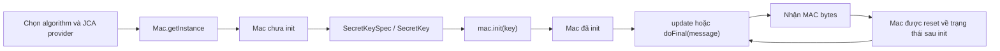
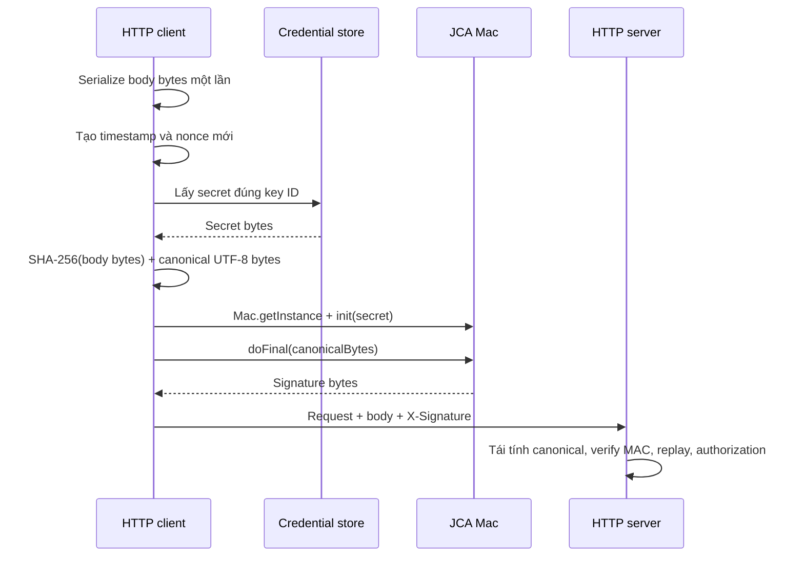
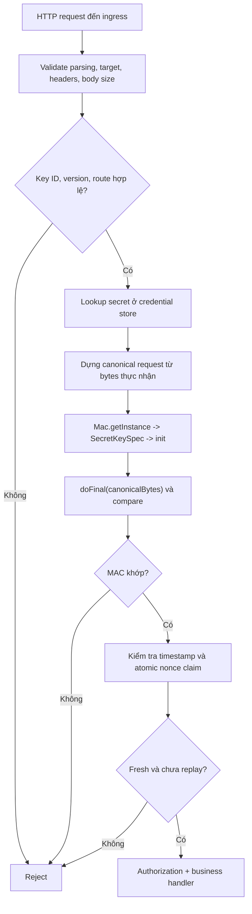

# Khởi tạo Mac trong Java để ký HTTP request bằng HMAC

## 1. Khởi tạo `Mac` là bước gì trong quá trình ký request?

Khi xác thực HTTP request bằng HMAC, bên gửi cần tính một **Message Authentication Code (MAC)** từ **shared secret** và **canonical request bytes**. Trong Java, API chuẩn để thực hiện phép tính đó là `javax.crypto.Mac` thuộc **Java Cryptography Architecture (JCA)**. Trước khi gọi `update(...)` hoặc `doFinal(...)`, đối tượng `Mac` **phải được khởi tạo bằng một khóa tương thích**.

```java
Mac mac = Mac.getInstance("HmacSHA256");
SecretKeySpec key = new SecretKeySpec(secretBytes, "HmacSHA256");
mac.init(key);
byte[] signatureBytes = mac.doFinal(canonicalRequestBytes);
```

Bốn dòng trên giải quyết bốn nhiệm vụ khác nhau:

1. `Mac.getInstance("HmacSHA256")`: chọn **thuật toán MAC** và implementation do một JCA provider cung cấp.
2. `new SecretKeySpec(secretBytes, "HmacSHA256")`: đóng gói **byte khóa bí mật** theo tên thuật toán tương thích.
3. `mac.init(key)`: nạp khóa, đưa đối tượng `Mac` vào trạng thái **đã khởi tạo, sẵn sàng nhận dữ liệu**.
4. `mac.doFinal(canonicalRequestBytes)`: tính MAC bằng khóa vừa nạp và các byte thông điệp; trả về **byte array của MAC**, không phải hex hay Base64.

Bài **Khởi tạo Mac** thuộc chương **Ký request** của module `SECURITY_AUTHENTICATION_HMAC_REQUEST_AUTHENTICATION`. Trong module này, người học thiết kế **HMAC request authentication** với shared secret và canonical request gồm **HTTP method, URI, signed headers và/hoặc body** theo hợp đồng; đồng thời thực hành xác minh chữ ký, chống replay bằng timestamp/nonce, key rotation, kiểm thử proxy/gateway và phân biệt **authentication** với **authorization**. Vì vậy, trọng tâm của bài là **khởi tạo `Mac` đúng cách trong luồng ký/xác minh HTTP**, không chỉ tính HMAC cho một chuỗi bất kỳ.

### `Mac` khác `MessageDigest` như thế nào?

| API JCA | Đầu vào | Kết quả | Vai trò trong request signing |
| --- | --- | --- | --- |
| `MessageDigest.getInstance("SHA-256")` | Body bytes, **không có secret** | SHA-256 digest 32 byte | Tính `bodyDigest` để đưa vào canonical request. |
| `Mac.getInstance("HmacSHA256")` | **Secret key** và canonical request bytes | HMAC 32 byte | Xác thực request và bảo vệ integrity của các trường đã ký. |
| `SecretKeySpec` | Byte khóa và tên thuật toán | Đối tượng `SecretKey` | Cung cấp khóa cho `Mac.init`; bản thân nó **không tạo chữ ký**. |

**Lỗi phổ biến:** tính `SHA-256(secret || request)` bằng `MessageDigest` rồi gọi kết quả là HMAC. Đây **không phải** thuật toán HMAC chuẩn. Hãy dùng `Mac` và `HmacSHA256`; JCA thực hiện cấu trúc HMAC bên trong.

## 2. Chuỗi trạng thái của một đối tượng `Mac`



Một số điểm phải hiểu trước khi ký HTTP request:

- `Mac.getInstance` **chưa cấp key**. Gọi `doFinal` trên `Mac` chưa được khởi tạo dẫn tới lỗi trạng thái.
- `mac.init(key)` là **bước bắt buộc để gắn secret với thuật toán**. Khóa phải có thuật toán/phần tử key material phù hợp với provider đã chọn.
- `mac.update(bytes)` đưa thêm dữ liệu vào phép tính MAC hiện tại. `doFinal()` kết thúc và trả kết quả. Có thể gọi `doFinal(message)` cho một message byte array đã chuẩn bị xong.
- Sau `doFinal`, đối tượng được đưa về trạng thái **đã khởi tạo với khóa đó** để tính MAC khác. Tuy nhiên, **không chia sẻ cùng một instance `Mac` đang mutable giữa các thread/request**.
- Gọi `mac.reset()` xóa trạng thái message đang tích lũy nhưng **không chọn khóa mới**; khi đổi key phải `init` với key mới. Không nhầm `reset` với key rotation.
- `mac.getMacLength()` cho biết độ dài MAC của algorithm/provider, ví dụ `HmacSHA256` thường cho **32 byte**. Hợp đồng ký cần chốt **độ dài và encoding**, không tùy ý cắt ngắn mà không thiết kế riêng.

Ví dụ tương đương trong **một phép tính**:

```java
// Cách A: truyền toàn bộ canonical bytes một lần
byte[] a = mac.doFinal(canonicalBytes);

// Cách B: khi message lớn và đã reset/khởi tạo đúng:
mac.update(part1);
mac.update(part2);
byte[] b = mac.doFinal();
```

Hai cách chỉ cho kết quả giống nhau nếu `canonicalBytes` **đúng bằng** `part1 || part2`, dùng cùng secret và cùng algorithm. Không nên gọi `update` rồi `doFinal(canonicalBytes)` nếu không cố ý MAC của **cả phần đã update lẫn canonicalBytes**.

## 3. Chọn thuật toán trước khi khởi tạo: server quyết định, không phải header tùy ý

Một HTTP request có thể khai báo:

```http
X-Signature-Version: hmac-http-v1
X-Key-Id: client-a-2026-11
```

Các header đó **do client gửi**, chưa được tin cậy trước khi MAC xác minh thành công. Server được phép dùng chúng làm **đầu vào tra cứu có kiểm soát**, nhưng **không** để client chọn thuật toán tùy ý:

```java
// KHÔNG NÊN LÀM:
Mac mac = Mac.getInstance(request.getHeader("X-Algorithm"));
```

Thay vào đó, định nghĩa **registry cố định**:

| Signature version | MAC algorithm | Canonical schema | Signature encoding |
| --- | --- | --- | --- |
| `hmac-http-v1` (profile bài này) | `HmacSHA256` | `HMAC-HTTP-REQUEST-V1` + method/URI/headers/body digest | 64 ký tự lowercase hex |
| Một phiên bản tương lai | Chỉ thay khi có hợp đồng mới | Có thể thay field hoặc normalization | Quy tắc version mới được công bố |

Những thay đổi liên quan canonical schema, thuật toán MAC, cách encode signature hoặc cách canonical hóa URL/header/body cần được **version hóa**. Server tra `X-Key-Id`, kiểm tra key còn hoạt động, đúng service/tenant/audience và **được phép sử dụng version khai báo**. Nếu MAC mismatch, **không tự thử các version yếu hơn hoặc thử nhiều secret**.

**Tên thuật toán trong JCA** cho ví dụ là `"HmacSHA256"`, không phải `"SHA-256"`, `"SHA256"` hay chuỗi tên header do client cung cấp. `MessageDigest.getInstance("SHA-256")` dùng để hash body; `Mac.getInstance("HmacSHA256")` dùng để tính HMAC.

### Lựa chọn JCA provider

`Mac.getInstance("HmacSHA256")` yêu cầu JCA tìm một provider có hỗ trợ thuật toán. Có thể chọn provider theo chính sách môi trường, nhưng **không nên tự fallback sang MAC yếu hơn** khi provider không hỗ trợ HmacSHA256. Những lỗi như `NoSuchAlgorithmException`, `InvalidKeyException` hoặc provider lỗi phải được xử lý **fail closed** và theo dõi như vấn đề cấu hình.

Nếu triển khai trong môi trường có yêu cầu tuân thủ chuyên biệt, dùng **provider và key management đã được phê duyệt**, chạy kiểm thử interoperability/golden vectors. Không khẳng định mọi provider có cùng hành vi ngoài phần đã chuẩn hóa nếu code phụ thuộc extension riêng.

## 4. Khởi tạo khóa HMAC đúng cách

Đầu vào của `SecretKeySpec` là **byte khóa**, không phải “tên key”, không phải chuỗi key ID:

```java
byte[] secretBytes = ...; // Đọc từ credential store/secret manager.
SecretKeySpec hmacKey = new SecretKeySpec(secretBytes, "HmacSHA256");
Mac mac = Mac.getInstance("HmacSHA256");
mac.init(hmacKey);
```

Các yêu cầu cần thực hiện:

1. **Key material đủ entropy:** với profile demo, cấp secret ngẫu nhiên **32 byte** từ CSPRNG hoặc hệ thống cấp phát khóa được quản lý. Đây là **chính sách ví dụ**, không phải yêu cầu rằng HMAC-SHA256 không thể hoạt động với khóa ngắn hơn. Khóa dễ đoán (mật khẩu người dùng, timestamp, email hoặc chuỗi có format cố định) là không phù hợp.
2. **Client và server phải có cùng bytes:** nếu key được lưu dạng Base64, **decode Base64 thành bytes trước `Mac.init`**; không dùng UTF-8 bytes của chính chuỗi Base64.
3. **Key ID khác secret:** `X-Key-Id` dùng để tra khóa từ store; gửi key ID trong request là bình thường, gửi shared secret là không chấp nhận được.
4. **Không hard-code secrets:** không đưa key vào source, Git, cấu hình công khai, log, URL hoặc body; dùng secret manager, KMS/HSM hoặc kho credential phù hợp.
5. **Đúng phạm vi và vòng đời:** tách secret giữa tenant, service và môi trường. Khi rotate, key ID mới trỏ tới secret mới; key cũ bị hạn chế/sunset và có thể revoke ngay.
6. **Không tạo key mới ngẫu nhiên ở mỗi lần verify:** nếu server sinh key ngẫu nhiên thay vì tra cùng credential đã cấp cho client, signature sẽ không thể khớp.

Tạo secret demo **chỉ để phát hành credential một lần**:

```java
import java.security.SecureRandom;
import java.util.Base64;

byte[] newSecret = new byte[32];
new SecureRandom().nextBytes(newSecret);
String secretForSecureProvisioning =
        Base64.getEncoder().encodeToString(newSecret);
// Chuyển qua kênh cấp khóa được bảo vệ, không in/log lên production.
```

Khi đã có secret dạng Base64 trong **secret manager**:

```java
byte[] keyBytes = Base64.getDecoder().decode(storedBase64Secret);
Mac mac = Mac.getInstance("HmacSHA256");
mac.init(new SecretKeySpec(keyBytes, "HmacSHA256"));
```

Chỉ dùng cách decode này nếu **định dạng lưu khóa đã được xác định là Base64 chuẩn**; nếu kho khóa dùng Base64URL hoặc raw bytes thì phải dùng đúng định dạng. `SecretKeySpec` là wrapper cho key bytes, không phải chức năng sinh khóa, mã hóa hay xác minh tính mạnh của secret. Trong Java, key bytes có thể lưu trong memory; hạn chế số bản sao, quản lý thời gian lưu và không log chúng. Xóa tạm các mảng khi có thể chỉ là **giảm rủi ro best-effort**, không bảo đảm toàn bộ bản sao trong JVM đã bị xóa.

## 5. Xây canonical request trước khi gọi `doFinal`

Đối tượng `Mac` **không có khái niệm HTTP**. Nó nhận đúng **byte[] message** mà ứng dụng cung cấp. Vì vậy bước `init` đúng nhưng canonical request sai vẫn dẫn đến chữ ký sai, hoặc nghiêm trọng hơn, bỏ sót trường quan trọng khỏi phần được bảo vệ.

Giả sử client gửi:

```http
POST /v1/payments?dryRun=false HTTP/1.1
Host: api.example.test
Content-Type: application/json
X-Key-Id: client-a-2026-11
X-Signature-Version: hmac-http-v1
X-Timestamp: 2026-11-28T02:05:00Z
X-Nonce: Fu8VpE7PXoZbsE9ycmGoGQ
X-Signature: <64 ký tự hex thường>

{"account":"A123","amount":250000}
```

Hợp đồng ký `hmac-http-v1` dưới đây là **minh họa tự định nghĩa**, không phải cú pháp mặc định của HTTP. Bên gửi và bên nhận cùng thống nhất:

- **Method:** chính xác `POST`.
- **Audience/origin:** `https://api.example.test`, lấy từ destination/routing đã cấu hình tin cậy; không tùy tiện tin `Host` hay `X-Forwarded-Host` do người gửi chỉnh sửa.
- **Raw request target:** `/v1/payments?dryRun=false`. Không tự reorder query, decode `%2F`, bỏ segment hoặc normalize giữa signing và verification.
- **Signed header values:** `Content-Type`, `X-Key-Id`, `X-Signature-Version`, `X-Timestamp`, `X-Nonce` **đúng một giá trị**, đúng cú pháp và không chứa CR/LF. Adapter từ chối duplicate/canonical ambiguities.
- **Body:** hash `SHA-256` trên **body bytes thực sự sẽ được ứng dụng xử lý**, sau khi gỡ HTTP transfer framing; trong profile này không dùng `Content-Encoding`/body transform.
- **MAC:** `HmacSHA256` full length 32 byte, lowercase hex 64 ký tự; không cắt ngắn MAC.
- **Framing canonical:** mỗi dòng nối bằng LF (`0A`), UTF-8, **không có LF cuối cùng**; dòng prefix là domain separator `HMAC-HTTP-REQUEST-V1`.

Canonical message:

```text
HMAC-HTTP-REQUEST-V1
POST
https://api.example.test
/v1/payments?dryRun=false
content-type:application/json
x-key-id:client-a-2026-11
x-signature-version:hmac-http-v1
x-timestamp:2026-11-28T02:05:00Z
x-nonce:Fu8VpE7PXoZbsE9ycmGoGQ
<64 ký tự lowercase hex của SHA-256(bodyBytes)>
```

**Dòng cuối chỉ là placeholder**. Khi thực hiện phải thay bằng digest thật, không ký dấu `<` hoặc `>`. `X-Signature` **không nằm trong canonical** vì đó là kết quả được tạo **sau** `Mac.doFinal`.

Luồng ký:



Không được ký một body snapshot nhưng để `HttpClient` serialize JSON lại khác bytes sau đó. Hãy serialize **một lần**, ký trên đúng bytes sẽ gửi và giữ nguyên URI/signed headers tới khi gửi.

## 6. Ví dụ Java 17 hoàn chỉnh: khởi tạo `Mac`, ký và xác minh request

Đoạn chương trình dưới đây minh họa các điểm chính:

- `newMac(secret)` chọn `HmacSHA256`, tạo `SecretKeySpec` và gọi **`mac.init`** trước `doFinal`.
- Mỗi lần ký/xác minh tạo **một instance `Mac` riêng**; không chia sẻ trạng thái mutable giữa request hoặc thread.
- `canonicalBytes` tính digest của **body snapshot** và xây message đúng thứ tự.
- `sign` tạo `X-Signature` từ canonical bytes; `verify` tự tính lại MAC, kiểm tra key/version, timestamp và nonce.
- Demo thay body nhưng giữ chữ ký cũ để chứng minh integrity; lần gửi lại giữ nguyên nonce để chứng minh MAC đúng **chưa đủ chống replay**.

**Ranh giới ví dụ:** HTTP adapter giả định đã từ chối duplicate signed headers, header chứa CR/LF, body compression, request smuggling, path/query mơ hồ, và cung cấp `trustedOrigin` từ routing tin cậy. Demo chỉ hỗ trợ **một endpoint cố định**. `NonceStore` giả lập trong `main` chỉ lưu bộ nhớ, **không có TTL và không dùng chung giữa các instance**; production phải thay bằng atomic distributed store có TTL. Key demo do `SecureRandom` tạo, không lấy từ key store thật.

```java
import java.nio.charset.StandardCharsets;
import java.security.GeneralSecurityException;
import java.security.MessageDigest;
import java.security.SecureRandom;
import java.time.Clock;
import java.time.Duration;
import java.time.Instant;
import java.time.format.DateTimeParseException;
import java.time.temporal.ChronoUnit;
import java.util.Base64;
import java.util.HexFormat;
import java.util.Set;
import java.util.concurrent.ConcurrentHashMap;
import javax.crypto.Mac;
import javax.crypto.spec.SecretKeySpec;

public final class HmacRequestMacInitializationDemo {
    private static final String ALGORITHM = "HmacSHA256";
    private static final String VERSION = "hmac-http-v1";
    private static final String PREFIX = "HMAC-HTTP-REQUEST-V1";
    private static final String ORIGIN = "https://api.example.test";
    private static final String TARGET = "/v1/payments?dryRun=false";
    private static final Duration MAX_SKEW = Duration.ofMinutes(5);
    private static final Duration NONCE_TTL = Duration.ofMinutes(11);
    private static final HexFormat HEX = HexFormat.of();

    // Body được copy vào record và khi đọc ra: tránh sửa từ bên ngoài.
    public record Request(
            String method, String rawTarget, String trustedOrigin,
            String contentType, String keyId, String version,
            String timestamp, String nonce, byte[] body,
            String signatureHex) {
        public Request {
            body = body == null ? null : body.clone();
        }
        @Override
        public byte[] body() {
            return body == null ? null : body.clone();
        }
    }

    public record Credential(
            String keyId, byte[] secret, boolean active,
            String allowedOrigin, Set<String> allowedVersions) {
        public Credential {
            secret = secret == null ? null : secret.clone();
        }
        @Override
        public byte[] secret() {
            return secret == null ? null : secret.clone();
        }
    }

    public interface NonceStore {
        // Production: insert-if-absent nguyên tử, dùng chung, có TTL.
        boolean claim(String keyId, String nonce, Duration ttl);
    }

    // Đây là bước trọng tâm: chỉ dùng algorithm do profile quy định.
    private static Mac newMac(byte[] secret)
            throws GeneralSecurityException {
        if (secret == null || secret.length < 32) {
            // Chính sách tối thiểu 32 byte entropy từ credential store.
            throw new IllegalArgumentException("Weak/missing HMAC secret");
        }
        Mac mac = Mac.getInstance(ALGORITHM);
        SecretKeySpec key = new SecretKeySpec(secret, ALGORITHM);
        mac.init(key);
        if (mac.getMacLength() != 32) {
            throw new GeneralSecurityException("Unexpected MAC length");
        }
        return mac;
    }

    public static byte[] canonicalBytes(Request r)
            throws GeneralSecurityException {
        byte[] body = r.body(); // Snapshot đã được adapter giữ nguyên.
        String bodyDigest = HEX.formatHex(
                MessageDigest.getInstance("SHA-256").digest(body));
        String canonical = String.join("\n",
                PREFIX,
                r.method(),
                ORIGIN,
                r.rawTarget(),
                "content-type:" + r.contentType(),
                "x-key-id:" + r.keyId(),
                "x-signature-version:" + r.version(),
                "x-timestamp:" + r.timestamp(),
                "x-nonce:" + r.nonce(),
                bodyDigest);
        return canonical.getBytes(StandardCharsets.UTF_8);
    }

    private static byte[] calculateMac(Request r, byte[] secret)
            throws GeneralSecurityException {
        Mac mac = newMac(secret);   // getInstance + SecretKeySpec + init
        return mac.doFinal(canonicalBytes(r));
    }

    // Client: signer dùng bytes sẽ được gửi trên HTTP.
    public static Request sign(Request unsigned, byte[] secret)
            throws GeneralSecurityException {
        String signature = HEX.formatHex(calculateMac(unsigned, secret));
        return new Request(unsigned.method(), unsigned.rawTarget(),
                unsigned.trustedOrigin(), unsigned.contentType(),
                unsigned.keyId(), unsigned.version(),
                unsigned.timestamp(), unsigned.nonce(),
                unsigned.body(), signature);
    }

    // Server: key đã được lookup từ server-side credential store.
    public static boolean verify(
            Request r, Credential credential,
            NonceStore nonceStore, Clock clock)
            throws GeneralSecurityException {
        if (r == null || credential == null || nonceStore == null
                || clock == null || r.method() == null
                || r.rawTarget() == null || r.trustedOrigin() == null
                || r.contentType() == null || r.keyId() == null
                || r.version() == null || r.timestamp() == null
                || r.nonce() == null || r.body() == null
                || r.signatureHex() == null) return false;

        if (!"POST".equals(r.method())
                || !TARGET.equals(r.rawTarget())
                || !ORIGIN.equals(r.trustedOrigin())
                || !"application/json".equals(r.contentType())
                || !VERSION.equals(r.version())
                || !r.keyId().matches("[A-Za-z0-9._-]{1,128}")
                || !r.nonce().matches("[A-Za-z0-9_-]{22,128}")
                || !r.signatureHex().matches("[0-9a-f]{64}")
                || r.body().length == 0
                || r.body().length > 1_048_576) {
            return false;
        }

        Instant issuedAt;
        try {
            issuedAt = Instant.parse(r.timestamp());
        } catch (DateTimeParseException ex) {
            return false;
        }
        if (issuedAt.getNano() != 0
                || !issuedAt.toString().equals(r.timestamp())
                || Duration.between(clock.instant(), issuedAt)
                        .abs().compareTo(MAX_SKEW) > 0) return false;

        // Mọi điều kiện credential đều đến từ server-side policy.
        if (!credential.active()
                || !r.keyId().equals(credential.keyId())
                || !ORIGIN.equals(credential.allowedOrigin())
                || credential.allowedVersions() == null
                || !credential.allowedVersions().contains(VERSION)) {
            return false;
        }

        byte[] expected = calculateMac(r, credential.secret());
        byte[] received = HEX.parseHex(r.signatureHex());
        if (!MessageDigest.isEqual(expected, received)) return false;

        // Chỉ claim nonce sau MAC đúng; không xử lý trước khi claim xong.
        return nonceStore.claim(r.keyId(), r.nonce(), NONCE_TTL);
        // Sau true: business handler VẪN PHẢI authorization theo resource.
    }

    public static void main(String[] args) throws Exception {
        // Demo cấp credential 32 byte ngẫu nhiên, không in secret ra log.
        byte[] secret = new byte[32];
        SecureRandom rng = new SecureRandom();
        rng.nextBytes(secret);
        Credential credential = new Credential("client-a-2026-11",
                secret, true, ORIGIN, Set.of(VERSION));

        // Timestamp thực, nonce mới 24 byte ngẫu nhiên.
        byte[] nonceBytes = new byte[24];
        rng.nextBytes(nonceBytes);
        String nonce = Base64.getUrlEncoder().withoutPadding()
                .encodeToString(nonceBytes);
        String timestamp = Instant.now()
                .truncatedTo(ChronoUnit.SECONDS).toString();

        byte[] body = (
                "{\"account\":\"A123\",\"amount\":250000}")
                .getBytes(StandardCharsets.UTF_8);
        Request unsigned = new Request("POST", TARGET, ORIGIN,
                "application/json", credential.keyId(), VERSION,
                timestamp, nonce, body, "");
        Request signed = sign(unsigned, secret);

        // Chỉ dùng test in-memory, không TTL, không dùng ở production.
        Set<String> seen = ConcurrentHashMap.newKeySet();
        NonceStore demoNonces = (id, n, ttl) -> seen.add(id + ":" + n);

        // Tamper: giữ MAC cũ, thay body bytes.
        Request tampered = new Request(signed.method(),
                signed.rawTarget(), signed.trustedOrigin(),
                signed.contentType(), signed.keyId(), signed.version(),
                signed.timestamp(), signed.nonce(),
                "{\"account\":\"A123\",\"amount\":900000}"
                    .getBytes(StandardCharsets.UTF_8),
                signed.signatureHex());
        System.out.println("Tampered accepted? "
                + verify(tampered, credential, demoNonces,
                        Clock.systemUTC())); // false
        System.out.println("Original accepted? "
                + verify(signed, credential, demoNonces,
                        Clock.systemUTC())); // true
        System.out.println("Replay accepted? "
                + verify(signed, credential, demoNonces,
                        Clock.systemUTC())); // false
    }
}
```

### Phân tích các dòng khởi tạo quan trọng

<escape>Trong hàm</escape> `newMac`:

```java
Mac mac = Mac.getInstance(ALGORITHM);
SecretKeySpec key = new SecretKeySpec(secret, ALGORITHM);
mac.init(key);
```

- `ALGORITHM` là hằng do **signature profile của server** quyết định, không phải một giá trị tùy ý của HTTP caller.
- `secret` phải là **byte khóa thật** từ credential có key ID được xác minh theo policy. Với các request khác nhau, secret có thể khác do tenant hoặc key rotation.
- `Mac.init` chuẩn bị trạng thái nội bộ cho **một khóa**. Không được thay secret bằng `keyId.getBytes(UTF_8)`; key ID là định danh công khai, không phải secret.
- `mac.getMacLength() == 32` kiểm tra kỳ vọng của profile `HmacSHA256`. Kiểm tra này không thay cho policy về độ dài và entropy của secret.
- `mac.doFinal(canonicalBytes(r))` tính MAC trên **bytes do ứng dụng dựng lại từ request**, không nhận nguyên chuỗi canonical do client tự gửi rồi ký lại chuỗi đó.
- `HexFormat.of().formatHex(...)` tạo lowercase hex mặc định. Việc đổi sang Base64 hoặc uppercase hex mà không đổi hợp đồng khiến verifier từ chối đúng cách.

**Điểm giới hạn của demo:** nó nhận `Credential` đã được lookup sẵn và `Request` đã được HTTP adapter kiểm tra. Một backend thật cần **đếm/từ chối signed headers trùng**, chống parser ambiguity, giới hạn body trước khi giữ trong memory, xác định raw URI/authority tin cậy và fail closed khi secret store hoặc nonce store lỗi. Tất cả những bước đó phải diễn ra trước khi business handler có side effect.

## 7. Kiểm thử riêng `Mac.getInstance` / `Mac.init` bằng test vector

Trước khi debug canonical HTTP request, nên chứng minh **implementation HMAC** đang hoạt động đúng trên một vector độc lập. Ví dụ dưới đây là test case HMAC-SHA256 với khóa gồm **20 byte 0x0b** và message ASCII `Hi There`, có kết quả kỳ vọng chuẩn:

```text
key:    0b0b0b0b0b0b0b0b0b0b0b0b0b0b0b0b0b0b0b0b
input:  "Hi There" (8 ASCII bytes)
HMAC-SHA256:
b0344c61d8db38535ca8afceaf0bf12b881dc200c9833da726e9376c2e32cff7
```

Chạy độc lập:

```java
import java.nio.charset.StandardCharsets;
import java.util.Arrays;
import java.util.HexFormat;
import javax.crypto.Mac;
import javax.crypto.spec.SecretKeySpec;

public class MacInitializationVector {
    public static void main(String[] args) throws Exception {
        byte[] vectorKey = new byte[20];
        Arrays.fill(vectorKey, (byte) 0x0b);

        Mac mac = Mac.getInstance("HmacSHA256");
        mac.init(new SecretKeySpec(vectorKey, "HmacSHA256"));
        byte[] result = mac.doFinal(
                "Hi There".getBytes(StandardCharsets.US_ASCII));

        String actual = HexFormat.of().formatHex(result);
        String expected =
                "b0344c61d8db38535ca8afceaf0bf12b881dc200c9833da"
                + "726e9376c2e32cff7";
        if (!expected.equals(actual)) {
            throw new AssertionError("HMAC-SHA256 vector mismatch");
        }
        System.out.println("HMAC-SHA256 vector PASS");
    }
}
```

**Vì sao test vector dùng 20 byte trong khi profile HTTP yêu cầu secret 32 byte?** Vector này kiểm tra **đúng thuật toán** và API `Mac`; HMAC-SHA256 vẫn có thể tính với khóa ngắn hơn. Còn **ít nhất 32 byte ngẫu nhiên** là yêu cầu **chính sách cấp khóa mới** trong hợp đồng HTTP minh họa. Không được dùng test vector làm credential production.

Nếu test vector trên thất bại, hãy kiểm tra tên thuật toán, encoding của message, bytes key và provider JCA trước khi điều tra HTTP URI/query/body. Nếu vector PASS nhưng chữ ký HTTP vẫn không khớp, khả năng cao là vấn đề **canonical request, charset, signed headers, body bytes hoặc secret mapping**, chứ không phải phép HMAC.

### Khi nào nên dùng `update` thay cho `doFinal(message)`?

Với canonical message ngắn, `doFinal(canonicalBytes)` rõ ràng và giảm lỗi. Nếu message được tạo từ nhiều byte buffers, có thể dùng:

```java
Mac mac = Mac.getInstance("HmacSHA256");
mac.init(new SecretKeySpec(secret, "HmacSHA256"));
mac.update(prefixBytes);
mac.update(methodBytes);
mac.update(delimiterBytes);
mac.update(pathBytes);
byte[] signature = mac.doFinal();
```

Khi đó trách nhiệm của code là đảm bảo **byte nối theo thứ tự** đúng hợp đồng: `prefixBytes || methodBytes || delimiterBytes || pathBytes` phải giống chính xác `canonicalBytes`. Mọi trường phải có **phân cách/độ dài không mơ hồ**, nếu không hai cách nối có thể tạo cùng chuỗi dù field boundaries khác nhau. Đối với bài này, hãy ưu tiên xây canonical UTF-8 bytes rõ ràng rồi gọi một lần `doFinal`.

Nếu cần hash body lớn, có thể stream từng đoạn vào **`MessageDigest` cho body**, lưu body ở snapshot/buffer được bảo vệ, rồi đưa **digest hex đã tính** vào canonical HMAC. **Không tự động gọi `mac.update(bodyChunk)` song song với phần canonical đã được định nghĩa chứa body digest**; như vậy sẽ tạo một **giao thức ký khác**.

## 8. Lifecycle, thread safety và hiệu năng của `Mac`

### Đối tượng `Mac` không phải singleton cho tất cả request

Một thiết kế có vẻ tiết kiệm nhưng sai:

```java
// Sai: một Mac mutable chia sẻ cho các request concurrent.
static final Mac SHARED_MAC = createAndInitSomehow();

byte[] sign(byte[] request) {
    return SHARED_MAC.doFinal(request);
}
```

`Mac` tích lũy trạng thái khi `update` và `doFinal`, có thể được khởi tạo lại bằng khóa khác. Nó **không có cam kết thread-safe chung**. Hai request có thể xen lẫn các lời gọi và tạo MAC từ trạng thái không đúng, hoặc một request vô tình dùng khóa của tenant khác.

Lựa chọn phù hợp:

- **Mỗi request một `Mac` mới:** `getInstance` → `init` → `doFinal`. Đây là cách demo chọn, dễ kiểm toán và tránh shared mutable state.
- **Tối ưu có kiểm soát:** có thể cache factory/config hoặc sử dụng pool theo từng key/provider khi có đo đạc, nhưng phải tránh chia sẻ instance concurrent, bảo đảm reset/init đúng key, tránh key stale sau rotation và quản lý lifetime secret. Chỉ tối ưu khi có benchmark thực tế.
- **Không giữ `Mac` trong `static` toàn cục** cho mọi user/tenant. `Mac.reset()` không thay đổi secret; không thể dùng `reset` để thay cho `init(newKey)`.

Nếu server phải xác minh hàng chục nghìn request mỗi giây, hiệu năng còn phụ thuộc **HMAC, xây canonical request, đọc body, lookup secret, phân tán nonce store và JSON parsing**. Tối ưu `Mac.getInstance` riêng lẻ mà bỏ qua chính sách khóa hoặc concurrency sẽ làm mất an toàn nhanh hơn lợi ích đạt được.

### Client và server có thể tạo cùng `Mac` như thế nào?

Đây là cách đối chiếu:

```text
Client                                        Server
------                                        ------
Key ID -> secretBytes             Key ID -> credential store -> secretBytes
signature version -> HmacSHA256   signature version -> allowed profile
body bytes -> SHA-256(body)        actual body bytes -> SHA-256(body)
method/URI/headers -> canonical   actual method/URI/headers -> canonical
Mac.getInstance("HmacSHA256")      Mac.getInstance("HmacSHA256")
mac.init(secretBytes)              mac.init(secretBytes)
doFinal(canonicalBytes)            doFinal(canonicalBytes)
send lowercase hex                 decode lowercase hex + compare bytes
                                             |
                                             v
                                   timestamp/nonce + authorization
```

Cùng algorithm nhưng khác secret, khác charset, thiếu một LF, đổi path/query, thay body hoặc chọn sai signature version đều có thể dẫn đến MAC khác. Để debug, trước hết so **canonical bytes trong golden fixtures test**; không log shared secrets hoặc payload thực của người dùng.

## 9. Lỗi thường gặp khi khởi tạo `Mac` và cách xử lý

| Lỗi | Biểu hiện | Cách khắc phục |
| --- | --- | --- |
| Gọi `doFinal` trước `init`. | Exception trạng thái hoặc không có MAC hợp lệ. | Luôn `getInstance` → `init(key)` → `doFinal(message)`. |
| Gọi `Mac.getInstance("SHA-256")`. | `NoSuchAlgorithmException` hoặc không chọn đúng MAC. | Dùng `HmacSHA256`; `SHA-256` chỉ dành cho `MessageDigest`. |
| Tạo `SecretKeySpec` từ UTF-8 của Base64 secret. | Client/server có key bytes khác. | Decode Base64 thành raw secret bytes trước `init`. |
| Dùng `X-Key-Id` làm secret. | Dữ liệu công khai, có thể bị giả mạo chữ ký. | Key ID chỉ để lookup; secret lấy từ credential store. |
| Key thiếu/sai hoặc key bị revoke. | HMAC mismatch hoặc credential bị chặn. | Kiểm tra key status, tenant, route, version; rotate/revoke theo policy. |
| Dùng algorithm từ header do client chọn. | Downgrade hoặc cấu hình bị lợi dụng. | Map signature version từ registry cố định; allowlist per credential. |
| Reuse `Mac` giữa các thread. | Chữ ký chập chờn, trạng thái/khóa xen lẫn. | Tạo instance riêng cho mỗi phép tính, hoặc pool an toàn theo policy. |
| Gọi `update` rồi `doFinal(message)` không chủ ý. | MAC bao gồm bytes cũ **và** message mới. | Xây message một lần hoặc kiểm soát state; `reset` đúng lúc. |
| So sánh hex signature bằng so sánh chuỗi thông thường. | Không theo pattern so sánh MAC an toàn. | Decode đúng encoding/độ dài; dùng `MessageDigest.isEqual` trên bytes. |
| Cắt HMAC còn một vài byte hoặc đổi sang hex hoa. | Signature sai profile, hoặc giảm mức bảo vệ nếu truncation quá ngắn. | Dùng MAC full 32 byte, lowercase hex theo hợp đồng; truncation chỉ khi được thiết kế/đánh giá riêng. |
| Ký `body.toString()` hoặc `Map.toString()`. | Bytes không phải HTTP payload thực gửi. | Serialize một lần, ký trên snapshot bytes cuối cùng. |
| Proxy thay path, header hoặc giải nén body. | Canonical mismatch dù `Mac.init` đúng. | Cố định contract và ranh giới xác minh trước/sau gateway. |
| Header ký xuất hiện hai lần. | Verifier và handler có thể chọn khác giá trị. | Reject duplicate signed headers trước canonicalization. |
| Nonce không được kiểm tra. | HMAC đúng nhưng request cũ có thể replay. | Ký timestamp/nonce, kiểm tra freshness và claim atomic nonce. |
| Provider/key store hoặc nonce store gặp lỗi. | Không thể xác minh an toàn. | **Fail closed**; không bỏ qua HMAC hay replay check để request thành công. |

### Xử lý exception không được “thành công giả”

Trong Java, những exception liên quan đến `Mac`/credential phải được đưa vào đường xử lý **từ chối request an toàn**:

```java
try {
    Mac mac = Mac.getInstance("HmacSHA256");
    mac.init(new SecretKeySpec(secretBytes, "HmacSHA256"));
    byte[] macBytes = mac.doFinal(canonicalBytes);
    // Tiếp tục so sánh MAC, kiểm tra nonce và authorization.
} catch (java.security.GeneralSecurityException
         | IllegalArgumentException ex) {
    // Log error category/trace ID, không log secret hay raw body.
    // Request bị từ chối hoặc báo lỗi dịch vụ theo policy; KHÔNG accept.
    throw new IllegalStateException("HMAC verification unavailable", ex);
}
```

Mã ví dụ chọn ném exception cho tầng HTTP xử lý; một hệ thống thật phải chuyển lỗi một cách phù hợp với API contract và tránh tiết lộ liệu một `X-Key-Id` có tồn tại hay không. Phân biệt request sai cú pháp, signature không hợp lệ, lỗi kho khóa và thiếu quyền để vận hành/giám sát nhưng **không hiển thị chi tiết mật mã nhạy cảm cho caller**.

## 10. Tác động của HTTP gateway, replay và key rotation đến bước `init`



**Gateway và proxy:** bước `Mac.init` chỉ xử lý thuật toán/khóa; nó **không nhận biết** rằng gateway đã sắp query, rewrite path, hợp nhất signed headers hoặc đổi body. Nếu verifier tính canonical từ dữ liệu đã transform còn client ký dữ liệu gốc, chữ ký khác. Hãy kiểm thử xuyên gateway và đảm bảo **dữ liệu handler xử lý chính là dữ liệu đã được xác minh**.

**Replay:** ký `X-Timestamp` và `X-Nonce` chỉ làm hai trường không bị sửa mà giữ nguyên MAC. Một request cũ **nguyên vẹn** vẫn có cùng MAC. Server phải kiểm tra timestamp trong cửa sổ (ví dụ ±5 phút) và `nonceStore.claim(keyId, nonce)` bằng **insert-if-absent nguyên tử** trên storage dùng chung. Nếu nonce đã dùng, từ chối dù MAC đúng. Với cửa sổ ±5 phút, TTL khoảng 11 phút ở demo giúp giữ nonce qua gần 10 phút tối đa sau lần đến đầu tiên; hệ thống thật cần xét clock skew và cấu hình thích hợp.

**Key rotation:** sau khi cấp secret mới, client chọn **key ID mới**, còn server phải lookup secret tương ứng rồi gọi `mac.init(newKey)` ở **instance mới**. `reset()` trên instance đã nạp key cũ **không** đổi sang key mới. Trong giai đoạn chuyển tiếp, policy có thể cho phép hai key ID khác nhau, nhưng **không thử hàng loạt khóa** để cứu request có signature sai. Key bị revoke phải bị chặn ngay cả khi phép HMAC toán học vẫn tính đúng.

**Phân quyền:** MAC hợp lệ chỉ chứng minh **người gọi nắm shared secret tương ứng** và các trường đã ký giữ tính toàn vẹn. Nó không tự cấp quyền cho account/tenant hay xác nhận giao dịch hợp lệ. Sau `verify`, vẫn phải kiểm tra authorization, hạn mức, idempotency, business validation, và sử dụng HTTPS/TLS để mã hóa lưu lượng và xác minh server.

## 11. Ma trận kiểm thử khởi tạo Mac và ký request

Để tách lỗi JCA khỏi lỗi HTTP, xây hai nhóm test: **cryptographic fixture** độc lập và **canonical HTTP request fixture** chứa đầy đủ canonical bytes, body bytes, secret test, header values và MAC kỳ vọng.

| Test | Kết quả mong đợi |
| --- | --- |
| Vector HMAC-SHA256 khóa 20 byte 0x0b, message `Hi There`. | Đúng digest `b0344c61...` của test vector ở mục 7. |
| `newMac` với secret 32 byte đúng entropy/policy. | `init` thành công; `getMacLength() == 32`. |
| `newMac` với secret `null` hoặc 0 byte. | Từ chối, không MAC bằng khóa trống. |
| `newMac` với secret 20 byte theo profile HTTP demo. | Từ chối theo **policy 32 byte**, dù vector HMAC ngắn hơn có thể hoạt động. |
| `Mac.doFinal` khi chưa gọi `init`. | Lỗi trạng thái; không có chữ ký hợp lệ. |
| Tạo MAC với key bytes thật vs UTF-8 của chuỗi Base64 tương ứng. | Hai MAC khác; chỉ raw secret bytes từ đúng encoding hợp đồng được chấp nhận. |
| Đổi `HmacSHA256` thành `HmacSHA512` không đổi profile. | Verifier từ chối vì không đúng thuật toán/độ dài của version. |
| Tạo `Mac` riêng cho hai request concurrent. | Không có shared mutable state; chữ ký được tính độc lập. |
| Gọi `update(part1)`, `update(part2)`, `doFinal()` và so với `doFinal(part1 || part2)`. | Cùng MAC nếu bytes và secret giống nhau. |
| Chữ ký hợp lệ trên đúng canonical HTTP bytes. | MAC khớp; tiếp tục kiểm tra freshness, nonce, authorization. |
| Đổi một byte body hoặc đổi số tiền, giữ MAC. | MAC không khớp. |
| Đổi path `/v1/payments`, query `dryRun` hoặc method `POST`. | Từ chối do contract hoặc MAC mismatch. |
| Thêm hoặc đổi khoảng trắng JSON sau khi client ký. | Digest body đổi, MAC cũ thất bại. |
| Header ký trùng hoặc khác cú pháp so với contract. | HTTP adapter từ chối trước khi đưa vào `Mac`. |
| Thay `X-Key-Id` sang key khác hoặc key đã revoke. | Từ chối theo key lookup/scope và HMAC/policy. |
| Chỉ đổi `X-Signature-Version` sang phiên bản cũ. | Từ chối; không fallback thuật toán/canonical schema. |
| Request ký đúng nhưng timestamp hết hạn. | Từ chối theo freshness. |
| Request ký đúng được gửi lại với nonce cũ. | MAC vẫn có thể đúng nhưng nonce store từ chối. |
| MAC đúng, caller không có quyền thao tác account. | Authorization từ chối. |
| Gateway rewrite path/query, nén/giải nén body, đổi signed header. | Test end-to-end phát hiện mismatch hoặc dữ liệu xử lý không nhất quán. |
| KMS, JCA provider hoặc nonce store lỗi. | **Fail closed** và ghi log lỗi an toàn. |

### Bài tập thực hành

1. Tạo một `Mac` bằng `Mac.getInstance("HmacSHA256")` rồi thử gọi `doFinal` **trước** `init`. Quan sát exception và sửa bằng `SecretKeySpec`.
2. Đọc một test secret **32 byte** dưới dạng Base64 và decode thành bytes. Thử ký với UTF-8 của chuỗi Base64 để xác định khác biệt.
3. Chạy test vector `Hi There` để xác minh implementation HMAC-SHA256 độc lập với HTTP; giải thích vì sao vector 20 byte không phủ định key policy 32 byte của profile.
4. Dùng code `HmacRequestMacInitializationDemo`, in **hex của canonical bytes trong môi trường test** và so với một fixture cố định. Thay method, URI, `Content-Type` và một byte body.
5. Thử hai worker thread cùng dùng **một instance `Mac` mutable** trong unit test có kiểm soát, sau đó sửa để mỗi thread/request có instance riêng. Không dùng shared mutable MAC ở production.
6. Giả lập rotation: cấp key ID mới với secret mới, ký bằng key cũ và verify bằng key mới. Chỉ ra vì sao `mac.reset()` không thể thay cho `mac.init(newKey)`.
7. Gửi lại request cùng timestamp/nonce hai lần. Phân biệt **MAC verification**, **replay protection** và **authorization**.
8. Chạy request qua gateway có path rewrite hoặc header normalization; ghi lại canonical bytes phía client/ingress/backend bằng **test fixture không nhạy cảm** và xác định hop gây lệch.

## 12. Checklist trước khi triển khai

- [ ] Signature version ánh xạ **cố định** đến `HmacSHA256`, canonical schema, cách encode/dài MAC và policy khóa.
- [ ] Secret được cấp phát từ CSPRNG/credential store, đủ entropy; byte khóa được lấy đúng encoding, không nhầm `X-Key-Id` với secret.
- [ ] Mỗi phép ký/xác minh gọi `Mac.getInstance`, tạo `SecretKeySpec`, **`mac.init(key)`**, rồi `doFinal(canonicalBytes)`; không dùng hash tự chế thay HMAC.
- [ ] Không chia sẻ `Mac` mutable đồng thời, không để key stale khi rotation; `reset` không thay key.
- [ ] Canonical request ràng buộc method, raw target/URI, audience, signed headers, body digest, timestamp, nonce và version theo contract.
- [ ] Serialize body **một lần**; ký đúng byte thực gửi và xác minh đúng snapshot handler sẽ xử lý.
- [ ] HTTP adapter chặn duplicate signed headers, parsing nhập nhằng, path/query rewrite không được thỏa thuận, content transformation ngoài contract.
- [ ] `Mac.doFinal` trả byte array; định dạng signature và độ dài được kiểm tra, so sánh MAC dạng byte bằng hàm phù hợp.
- [ ] Verifier chọn key/profile theo allowlist server; không thử nhiều key hoặc downgrade khi signature mismatch.
- [ ] Timestamp được ký và kiểm tra; nonce được ký và claim nguyên tử trên storage dùng chung có TTL phù hợp.
- [ ] Lỗi provider, key lookup, nonce store phải **fail closed**; log không được chứa secret/body nhạy cảm.
- [ ] HMAC xác thực credential và integrity, **không thay thế authorization** hay HTTPS/TLS server identity.
- [ ] Có test vector JCA độc lập, golden HTTP fixtures và negative tests xuyên gateway, key rotation, replay, concurrency.

**Điểm cần nhớ:** Khởi tạo `Mac` đúng cách là **chọn thuật toán do signature profile quy định, lấy đúng secret bytes, tạo `SecretKeySpec` và gọi `mac.init(key)` trước khi `doFinal(canonicalRequestBytes)`**. Đối tượng `Mac` không hiểu HTTP và không được dùng chung mutable giữa nhiều request. Tính đúng thuật toán vẫn chưa đủ: canonical request, body snapshot, key scope, timestamp/nonce, gateway behavior và authorization phải cùng nhất quán để chữ ký bảo vệ đúng thao tác thực thi.
