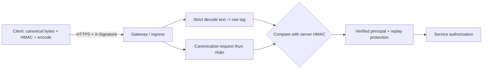

# Encode kết quả

## 1. Encode kết quả là bước nào trong quá trình ký HTTP request?

Trong hệ thống xác thực HTTP request bằng HMAC, client có một **shared secret** được cấp riêng và sử dụng hợp đồng ký để dựng **canonical request** từ HTTP method, URI, một số header và body hoặc digest của body. Client dùng secret và canonical bytes tính HMAC; server dựng lại cùng dữ liệu rồi tự tính tag để xác minh.

Tính HMAC và **encode kết quả** là **hai bước hoàn toàn khác nhau**:

```text
Client:
  HTTP request
    └── canonicalization theo hợp đồng
          └── canonical bytes (UTF-8)
                └── HMAC-SHA256(secret, canonical bytes)
                      └── MAC tag: 32 byte nhị phân
                            └── Base64url no-padding encoding
                                  └── X-Signature: 43 ký tự ASCII

Server:
  X-Signature (text)
    └── kiểm tra format + decode
          └── received tag: 32 byte
  HTTP request thực nhận
    └── dựng lại canonical bytes
          └── HMAC-SHA256(secret trong credential store, bytes)
                └── expected tag: 32 byte
                      └── so sánh raw tag bytes
```

Bài **Encode kết quả** thuộc chương *Ký request*, nằm trong module `SECURITY_AUTHENTICATION_HMAC_REQUEST_AUTHENTICATION`. Trọng tâm là **biến output của phép ký thành một representation được công bố**, truyền qua HTTP không bị hỏng và giải mã chính xác tại verifier.

**Encode không có nghĩa là mã hóa bí mật.** Bất kỳ ai cũng có thể giải mã Base64 hoặc Base64url thành byte gốc. Mức an toàn đến từ **secret mà attacker không biết**, tính toàn vẹn của **canonical request**, kiểm tra chống replay và authorization, chứ không đến từ độ khó đọc của chuỗi chữ ký.

Sau bài này, người học có thể:

- Phân biệt **raw MAC tag**, **text encoding**, **signature header**, **canonical request input** và shared secret.
- Chọn rõ giữa **hex**, **Base64 chuẩn** và **Base64url**, hiểu length, alphabet, padding và canonical representation.
- Thiết kế wire contract một nghĩa cho chữ ký, tránh alias hoặc decoder dễ dãi.
- Triển khai Java 17 từ canonical bytes đến HMAC raw bytes, encode, decode nghiêm ngặt và so sánh tag.
- Kiểm thử client–proxy/gateway–server với Golden vectors, malformed encoding và signature tampering.
- Đặt việc encode đúng vị trí trong pipeline xác thực: key ID/rotation, timestamp/nonce chống replay, verified principal và phân quyền riêng.

## 2. Raw MAC tag không phải là một chuỗi văn bản

Giả sử gọi:

```java
Mac mac = Mac.getInstance("HmacSHA256");
mac.init(new SecretKeySpec(secret, "HmacSHA256"));
byte[] rawTag = mac.doFinal(canonicalBytes);
```

Với `HmacSHA256` và **tag không bị cắt ngắn**, `rawTag` là một mảng **32 byte nhị phân**, có thể chứa các giá trị từ `0x00` đến `0xFF`. Không thể giả định các byte đó là văn bản UTF-8 hợp lệ.

Ví dụ sai:

```java
// SAI: Byte nhị phân MAC không phải text UTF-8.
String signature = new String(rawTag, StandardCharsets.UTF_8);

// SAI: Không được dùng default charset làm protocol.
String signature = new String(rawTag);
```

Một decoder UTF-8 có thể thay các chuỗi byte không hợp lệ bằng ký tự thay thế. Sau đó `signature.getBytes(UTF_8)` **không đảm bảo tái tạo tag gốc**. Những byte điều khiển còn có thể làm hỏng HTTP header hoặc bị intermediary từ chối.

Đúng là **encode toàn bộ raw tag** bằng một thuật toán biểu diễn nhị phân được hợp đồng quy định:

```java
String signature = Base64.getUrlEncoder().withoutPadding()
        .encodeToString(rawTag);
```

**Không ký lại chuỗi `signature`.** Base64url chỉ là bước sau khi phép HMAC đã tạo tag. Nếu đổi cách encode nhưng vẫn decode trở về đúng 32 byte, bản chất tag mật mã không đổi; song **wire contract vẫn có thể từ chối** representation không được phép.

### 2.1. Thứ gì được encode và thứ gì được hash?

| Đối tượng | Kết quả | Mục đích |
| --- | --- | --- |
| Canonical request text | UTF-8 bytes | Input cho HMAC |
| Exact body bytes | SHA-256 digest 32 byte | Ràng buộc nội dung body vào canonical request |
| SHA-256 body digest | 64 ký tự **hex lowercase** trong ví dụ | Biểu diễn body digest bên trong canonical request |
| HMAC-SHA256(secret, canonical bytes) | 32 **raw MAC bytes** | Chứng cứ xác thực mật mã |
| HMAC raw bytes → Base64url | 43 ký tự ASCII, không padding | Truyền kết quả ký trong `X-Signature` |
| `X-Signature` ở server | Decode thành 32 raw bytes | So với HMAC server tự tính |

**Hai digest 32 byte không đồng nghĩa nhau:** SHA-256 của body là **hash không khóa**. HMAC của canonical request là **MAC có khóa**, trong đó có thể bao gồm chuỗi hex body digest đã tính. Không dùng SHA-256(body) thay HMAC, cũng không xem body digest là shared secret.

## 3. Ba lựa chọn phổ biến: hex, Base64 và Base64url

Cùng một raw HMAC tag có thể biểu diễn theo nhiều cách. Quan trọng là **chọn đúng một cách** cho mỗi phiên bản giao thức và không đoán nhiều cách ở verifier.

| Thuộc tính | Hex lowercase | Base64 chuẩn | Base64url không padding |
| --- | --- | --- | --- |
| Alphabet | `0-9a-f` | `A-Z a-z 0-9 + /` | `A-Z a-z 0-9 - _` |
| Độ dài cho 32-byte tag | **64** ký tự | **44** ký tự gồm một `=` | **43** ký tự |
| Đổi ký tự `+` và `/`? | Không dùng | Có thể xuất hiện | Thay bằng `-` và `_` |
| Dấu `=` padding | Không | Có theo encoding chuẩn | **Bị cấm trong hợp đồng này** |
| Ưu điểm | Dễ đối chiếu với hex dump/log test | Phổ biến ở hệ thống cũ | Gọn, tránh `+`/`/` trong URL |
| Điểm cần chú ý | Case phải nhất quán; text dài hơn | `+` có thể thành space trong form query; `/` có nghĩa trong path | Phải xử lý padding và unused bits rõ ràng |

### 3.1. Hex encoding

Hex thể hiện một byte bằng hai ký tự từ `0` đến `f`, nên tag HMAC-SHA256 đầy đủ có **64 ký tự**:

```java
String hexTag = HexFormat.of().formatHex(rawTag);
byte[] decoded = HexFormat.of().parseHex(hexTag);
```

Hex dễ dùng cho **golden vector** và so sánh raw byte, nhưng không được tùy ý chấp nhận cả lowercase lẫn uppercase nếu giao thức chỉ quy định lowercase. Cũng không cho phép tiền tố `0x` hoặc khoảng trắng giữa các byte nếu hợp đồng không nêu.

### 3.2. Base64 chuẩn

```java
String base64 = Base64.getEncoder().encodeToString(rawTag);
byte[] decoded = Base64.getDecoder().decode(base64);
```

Ba byte được mã hóa thành bốn ký tự; output có thể chứa `+`, `/` và `=`. Khi đi qua URL query, dấu `+` đôi khi bị bộ giải mã form xem là space. Base64 chuẩn có thể phù hợp **nếu** hợp đồng cho phép và mọi hop bảo toàn đúng text; nhưng không được trộn với Base64url.

### 3.3. Base64url không padding

```java
String base64url = Base64.getUrlEncoder().withoutPadding()
        .encodeToString(rawTag);
byte[] decoded = Base64.getUrlDecoder().decode(base64url);
```

Theo RFC 4648, Base64url thay `+` bằng `-` và `/` bằng `_`. Dấu `=` có thể có hoặc không tùy protocol, **vì vậy protocol phải nói rõ**. Trong bài này **chỉ chấp nhận no-padding**.

**Lý do chọn Base64url trong ví dụ:** output của HMAC-SHA256 toàn phần là 32 byte, được encode gọn thành 43 ký tự ASCII; tiện truyền qua header và giảm vấn đề nếu phải đặt vào URL. Nó **không** làm tag an toàn hơn về mặt mật mã so với hex/Base64; mọi format decode về cùng raw bytes.

### 3.4. Không dùng MIME Base64 encoder cho HTTP signature

Java có `Base64.getMimeEncoder()`, có thể chèn dấu xuống dòng theo độ dài output. HTTP signature theo hợp đồng này yêu cầu **một giá trị header duy nhất không có CR/LF**. Dù tag HMAC-SHA256 ngắn, thói quen dùng MIME encoder cho signature là không đúng giao thức và dễ gây lỗi khi thay thuật toán/định dạng.

## 4. Padding, độ dài và biểu diễn duy nhất

### 4.1. Vì sao 32-byte HMAC-SHA256 thành 43 ký tự Base64url?

Độ dài Base64 có padding cho `n` byte:

```text
lengthWithPadding = 4 × ceil(n / 3)

n = 32:
  4 × ceil(32 / 3) = 4 × 11 = 44 ký tự

32 = 10 × 3 + 2:
  Nhóm cuối gồm 2 byte → một ký tự '=' padding

Base64url no-padding:
  44 - 1 = 43 ký tự
```

**Độ dài signature phụ thuộc độ dài raw tag**, không phụ thuộc số byte của secret. Key HMAC 32 byte hay 64 byte đều có thể tạo ra **HMAC-SHA256 tag 32 byte** nếu dùng toàn bộ output.

Ví dụ thay đổi primitive làm thay đổi độ dài:

| Tag | Raw bytes | Hex | Base64url no-padding |
| --- | ---: | ---: | ---: |
| HMAC-SHA256 đầy đủ | 32 | 64 | 43 |
| HMAC-SHA512 đầy đủ | 64 | 128 | 86 |
| Tag 16 byte theo giao thức riêng | 16 | 32 | 22 |

**Không tự cắt ngắn tag.** Nếu một hệ thống chủ đích thiết kế truncated MAC, phải đánh giá mức bảo mật, quy định độ dài cố định và version giao thức; verifier không nhận prefix tùy độ dài do client cung cấp.

### 4.2. Base64url no-padding không đồng nghĩa decoder permissive

Một decoder có thể cho phép dấu `=`, hoặc bỏ qua khác biệt giữa các bit đệm ở cuối. Với output 32 byte, ký tự Base64url thứ 43 mang **4 bit có ý nghĩa**, còn **2 bit thấp phải bằng 0** khi encode canonical.

Để chỉ chấp nhận **một cách viết** cho một tag:

1. Kiểm tra signature có **đúng 43 ký tự ASCII**.
2. Chỉ cho phép alphabet `[A-Za-z0-9_-]`; **không có dấu `=`**, `+`, `/`, SP/HTAB hoặc CR/LF.
3. Decode bằng `Base64.getUrlDecoder()` và yêu cầu **đúng 32 raw bytes**.
4. Encode lại bằng `Base64.getUrlEncoder().withoutPadding()`.
5. Yêu cầu chuỗi encode lại **giống hệt text ban đầu**; nếu khác là noncanonical alias.
6. Sau đó mới so raw HMAC tag với tag expected tính lại từ request.

Lưu ý: `String.equals` ở bước 5 là kiểm tra **cách biểu diễn**, không phải phép xác thực mật mã. Để so tag, dùng `MessageDigest.isEqual(expected, received)` hoặc một kỹ thuật so sánh MAC bytes phù hợp; không lấy việc decoder chạy thành công làm bằng chứng xác thực.

### 4.3. Không trộn canonicalization và output encoding

```text
ĐÚNG:
  inputBytes = UTF8(CanonicalRequest(request))
  tagBytes   = HMAC_SHA256(secret, inputBytes)
  wireTag    = BASE64URL_NOPADDING(tagBytes)

SAI:
  tagBytes = HMAC_SHA256(secret, Base64url(CanonicalRequest(request)))

SAI:
  tagBytes = SHA256(secret || bodyBytes)

SAI:
  wireTag = String(rawMacBytes, UTF-8)
```

Các biểu thức “SAI” không tuân theo **hợp đồng ví dụ này**. Một hệ thống có thể thiết kế giao thức ký dữ liệu đã encode theo cách khác, nhưng cả hai bên phải biết chính xác những bytes được ký và primitive phải đúng tiêu chuẩn; **không được tự đổi công thức tại một phía**.

## 5. Hợp đồng minh họa HTTP-HMAC-OUTPUT-V1

Để mọi bước có thể được đối chiếu, ta định nghĩa **một hợp đồng học tập riêng** tên `HTTP-HMAC-OUTPUT-V1`. Nó không phải chuẩn HTTP signature mặc định.

### 5.1. Request fixture

```http
POST /v1/invoices?currency=VND HTTP/1.1
Host: api.example.test
Content-Type: application/json
X-Client-Id: merchant-42
X-Key-Id: rot-2026-11
X-Timestamp: 1790000000
X-Nonce: U4a26K_Qm7pT9vL2
X-Signature: <base64url-tag>

{"invoiceId":"inv-017","amount":125000}
```

Trong fixture này:

- `POST` và `/v1/invoices` là method/path, phân biệt chữ hoa/thường và lấy từ request thực nhận trước rewrite.
- `currency=VND` là raw query đúng byte; nếu API cần query sorting hoặc xử lý duplicate, phải quy định trong cùng hợp đồng.
- `authority:api.example.test` dùng external authority đã được ingress kiểm tra; không tin `X-Forwarded-Host` bên ngoài tự khai.
- `content-type`, `x-client-id`, `x-key-id`, `x-timestamp`, `x-nonce` là signed headers. Header bắt buộc phải có đúng một occurrence; tên canonical lowercase, value có quy tắc rõ và phải được kiểm tra cú pháp.
- `x-client-id` và `x-key-id` giúp tra secret của đúng credential ở server, **chưa chứng minh danh tính** trước khi HMAC verification thành công.
- `x-timestamp` và `x-nonce` nằm trong signed input nhưng còn cần kiểm tra freshness và replay state ngoài phép HMAC.
- Body được dùng dưới dạng exact UTF-8 bytes **không có newline cuối**, trước khi framework parse rồi reserialize JSON. Hợp đồng giới hạn content coding là identity.
- `X-Signature` **không** nằm trong signed input, vì đó là output của phép ký.

### 5.2. Canonical input 11 dòng

```text
HTTP-HMAC-OUTPUT-V1
POST
/v1/invoices
currency=VND
authority:api.example.test
content-type:application/json
x-client-id:merchant-42
x-key-id:rot-2026-11
x-timestamp:1790000000
x-nonce:U4a26K_Qm7pT9vL2
b3a548d02bd1a8eb783a57bfae46261276d1c3a4466e95c677fbfdc3f781296c
```

Dòng cuối là **SHA-256 hex lowercase của body fixture**. Có 11 dòng, nối bằng LF byte `0x0A`, **không thêm LF cuối**, UTF-8, tổng cộng **265 byte**.

Bài tập sử dụng những giá trị cố định để tạo golden vector. Timestamp `1790000000` có thể không còn trong cửa sổ cho phép khi gọi API thật; **golden test mật mã** phải tách khỏi **integration test freshness**.

### 5.3. Contract vận chuyển output

```text
Algorithm: HmacSHA256
MAC output: raw 32 bytes, không truncate
Signature encoding: Base64url (RFC 4648 URL-safe alphabet)
Padding: forbidden (no '=')
Signature header: X-Signature
Header occurrences: exactly one
Encoded length: exactly 43 ASCII chars
Format: ^[A-Za-z0-9_-]{43}$
Canonical validation: decode rồi encode lại, string phải trùng
Comparison: raw 32-byte received tag vs server-computed tag
```

Một API production có thể chọn `Authorization: Custom-HMAC ...` thay vì `X-Signature`. Dù đặt ở đâu, **cấu trúc header phải có version/algorithm policy và parser độc lập**, không được tự suy luận từ vài ký tự trông như Base64url.

## 6. Golden vector độc lập: từ body đến raw tag và encoded output

Golden vector dưới đây sử dụng **test key công khai**, không phải credential thực:

```text
Key hex (32 bytes):
000102030405060708090a0b0c0d0e0f101112131415161718191a1b1c1d1e1f

Body exact UTF-8:
{"invoiceId":"inv-017","amount":125000}

SHA-256(body) lowercase hex:
b3a548d02bd1a8eb783a57bfae46261276d1c3a4466e95c677fbfdc3f781296c

Canonical request:
11 dòng theo mục 5.2; 265 bytes UTF-8; LF; không LF cuối

HMAC-SHA256 tag bytes, hex (32 bytes):
f5a6252fec9b8a8b88af26910b26932fa83568211fc74c0f3daaf8fc5dda47af

HMAC-SHA256 tag, Base64 chuẩn có padding:
9aYlL+ybiouIryaRCyaTL6g1aCEfx0wPPar4/F3aR68=

HMAC-SHA256 tag, Base64url không padding:
9aYlL-ybiouIryaRCyaTL6g1aCEfx0wPPar4_F3aR68
```

Các giá trị trên được tính độc lập từ cùng byte input và khóa test để làm chuẩn đối chiếu. Quan sát `+` → `-`, `/` → `_`, dấu `=` cuối biến mất; **raw tag hex không thay đổi**.

**Bốn assertion quan trọng:**

1. SHA-256 của exact body fixture khớp hex công bố.
2. UTF-8 canonical request có đúng **265 byte**, không CRLF hoặc LF cuối.
3. HMAC-SHA256 của canonical bytes với key test khớp **raw tag hex**.
4. Encode raw tag thành Base64url no-padding khớp **chính xác 43 ký tự** ở trên.

Đừng chỉ gọi `sign()` và `verify()` của cùng class rồi kết luận giao thức đúng. Hai hàm cùng mắc lỗi có thể vẫn pass. Golden vector phải kiểm tra **các byte ở ranh giới giữa canonicalization, MAC và encoding**.

### 6.1. So lỗi nằm ở đâu?

| Golden check thất bại | Ưu tiên điều tra |
| --- | --- |
| SHA-256 body khác | JSON whitespace, charset, newline, body transform |
| Độ dài canonical input khác 265 | Thiếu/thừa dòng, LF/CRLF, encoding, authority/header |
| Canonical bytes đúng, raw tag khác | Secret bytes, tên thuật toán, JCA provider hoặc dữ liệu input truyền vào Mac |
| Raw tag đúng, Base64url khác | Dùng Base64 chuẩn/hex, có padding, encoder dùng MIME line wraps |
| Text đúng, server vẫn từ chối | Key ID/state, timestamp/nonce, credential lookup, authorization hoặc HTTP transport |
| Text khác nhưng decode cùng raw bytes | Noncanonical alias, cần strict re-encode equality |

## 7. Java 17: sign và verify kết quả HMAC theo hợp đồng

Ví dụ dưới đây **tự chứa** để chạy lab với Java 17. Các phần canonical request, signature encoding và raw tag comparison đều nằm trong một class để quan sát luồng dữ liệu rõ ràng. Lớp HTTP production phải cung cấp các trường từ **request thực nhận tại authentication boundary**, validate duplicate headers, raw URI/query, proxy authority và giới hạn kích thước trước khi tạo `SignedParts`.

```java
import java.nio.charset.StandardCharsets;
import java.security.GeneralSecurityException;
import java.security.MessageDigest;
import java.util.Arrays;
import java.util.Base64;
import java.util.HexFormat;
import java.util.regex.Pattern;
import javax.crypto.Mac;
import javax.crypto.spec.SecretKeySpec;

public final class EncodedHmacResultV1 {
    private static final String ALGORITHM = "HmacSHA256";
    private static final String VERSION = "HTTP-HMAC-OUTPUT-V1";
    private static final int MAC_BYTES = 32;
    private static final Pattern WIRE_TAG =
        Pattern.compile("[A-Za-z0-9_-]{43}");

    public record SignedParts(
        String method,
        String rawPath,
        String rawQuery,
        String authority,
        String contentType,
        String clientId,
        String keyId,
        String timestamp,
        String nonce,
        byte[] exactBodyBytes
    ) {}

    private EncodedHmacResultV1() {}

    // Lab giới hạn một route/authority để tập trung vào output encoding.
    // Production adapter phải áp dụng validator HTTP đầy đủ.
    private static void validateParts(SignedParts p) {
        if (p == null || p.exactBodyBytes() == null
                || p.exactBodyBytes().length > 1_048_576) {
            throw new IllegalArgumentException("Invalid request/body");
        }
        if (!"POST".equals(p.method())
                || !"/v1/invoices".equals(p.rawPath())
                || !"currency=VND".equals(p.rawQuery())
                || !"api.example.test".equals(p.authority())
                || !"application/json".equals(p.contentType())) {
            throw new IllegalArgumentException("Unsupported request target");
        }
        if (p.clientId() == null
                || !p.clientId().matches("[A-Za-z0-9._-]{1,64}")
                || p.keyId() == null
                || !p.keyId().matches("[A-Za-z0-9._-]{1,64}")
                || p.nonce() == null
                || !p.nonce().matches("[A-Za-z0-9_-]{16,64}")
                || p.timestamp() == null
                || !p.timestamp().matches("[1-9][0-9]{0,18}")) {
            throw new IllegalArgumentException("Invalid signed header fields");
        }
        try {
            Long.parseLong(p.timestamp());
        } catch (NumberFormatException ex) {
            throw new IllegalArgumentException("Timestamp out of range", ex);
        }
    }

    public static byte[] canonicalBytes(SignedParts p)
            throws GeneralSecurityException {
        validateParts(p);
        String bodySha = HexFormat.of().formatHex(
            MessageDigest.getInstance("SHA-256")
                .digest(p.exactBodyBytes()));

        String canonical = String.join("\n",
            VERSION,
            p.method(),
            p.rawPath(),
            p.rawQuery(),
            "authority:" + p.authority(),
            "content-type:" + p.contentType(),
            "x-client-id:" + p.clientId(),
            "x-key-id:" + p.keyId(),
            "x-timestamp:" + p.timestamp(),
            "x-nonce:" + p.nonce(),
            bodySha
        );
        return canonical.getBytes(StandardCharsets.UTF_8);
    }

    public static byte[] rawMac(byte[] secret, byte[] canonical)
            throws GeneralSecurityException {
        if (secret == null || secret.length < 32 || canonical == null) {
            throw new IllegalArgumentException("Invalid configured secret");
        }
        // Mac chứa trạng thái; không dùng một static instance cho nhiều luồng.
        Mac mac = Mac.getInstance(ALGORITHM);
        mac.init(new SecretKeySpec(secret, ALGORITHM));
        return mac.doFinal(canonical);
    }

    public static String encodeResult(byte[] rawTag) {
        if (rawTag == null || rawTag.length != MAC_BYTES) {
            throw new IllegalArgumentException("Expected 32-byte MAC");
        }
        return Base64.getUrlEncoder().withoutPadding()
            .encodeToString(rawTag);
    }

    public static byte[] strictDecodeResult(String encodedTag) {
        if (encodedTag == null
                || !WIRE_TAG.matcher(encodedTag).matches()) {
            throw new IllegalArgumentException(
                "Signature must be 43 Base64url chars without padding");
        }
        final byte[] decoded;
        try {
            decoded = Base64.getUrlDecoder().decode(encodedTag);
        } catch (IllegalArgumentException malformed) {
            throw new IllegalArgumentException(
                "Malformed Base64url signature", malformed);
        }
        if (decoded.length != MAC_BYTES
                || !encodeResult(decoded).equals(encodedTag)) {
            throw new IllegalArgumentException(
                "Noncanonical signature representation");
        }
        return decoded;
    }

    public static String sign(SignedParts p, byte[] secret)
            throws GeneralSecurityException {
        byte[] canonical = canonicalBytes(p);
        byte[] tag = rawMac(secret, canonical);
        return encodeResult(tag);
    }

    public static boolean verify(
            SignedParts p, byte[] secret, String suppliedSignature)
            throws GeneralSecurityException {
        final byte[] supplied;
        try {
            supplied = strictDecodeResult(suppliedSignature);
        } catch (IllegalArgumentException malformedSignature) {
            return false;
        }

        byte[] expected = rawMac(secret, canonicalBytes(p));
        return MessageDigest.isEqual(expected, supplied);
    }

    private static void rejectFormat(String encoded) {
        try {
            strictDecodeResult(encoded);
            throw new AssertionError("Expected format rejection");
        } catch (IllegalArgumentException expected) {
            // OK: chữ ký không đúng format của protocol.
        }
    }

    public static void main(String[] args)
            throws GeneralSecurityException {
        byte[] testKey = new byte[32];
        for (int i = 0; i < testKey.length; i++) {
            testKey[i] = (byte) i; // key test công khai 00..1f
        }

        byte[] body = (
            "{\"invoiceId\":\"inv-017\",\"amount\":125000}"
        ).getBytes(StandardCharsets.UTF_8);

        SignedParts fixture = new SignedParts(
            "POST", "/v1/invoices", "currency=VND",
            "api.example.test", "application/json",
            "merchant-42", "rot-2026-11",
            "1790000000", "U4a26K_Qm7pT9vL2", body
        );

        byte[] canonical = canonicalBytes(fixture);
        if (canonical.length != 265) {
            throw new AssertionError("Canonical bytes changed");
        }

        String expectedRawHex =
            "f5a6252fec9b8a8b88af26910b26932f"
          + "a83568211fc74c0f3daaf8fc5dda47af";
        byte[] tag = rawMac(testKey, canonical);
        if (!Arrays.equals(
                tag, HexFormat.of().parseHex(expectedRawHex))) {
            throw new AssertionError("Golden raw HMAC differs");
        }

        String expectedBase64url =
            "9aYlL-ybiouIryaRCyaTL6g1aCEfx0wPPar4_F3aR68";
        if (!expectedBase64url.equals(encodeResult(tag))) {
            throw new AssertionError("Golden encoded tag differs");
        }
        if (!verify(fixture, testKey, expectedBase64url)) {
            throw new AssertionError("Golden signature must verify");
        }

        // Không nhận Base64 chuẩn, padding, whitespace hoặc alias.
        rejectFormat(expectedBase64url + "=");
        rejectFormat(
            "9aYlL+ybiouIryaRCyaTL6g1aCEfx0wPPar4/F3aR68");
        rejectFormat(" " + expectedBase64url);
        rejectFormat(expectedBase64url + "\n");
        // Ký tự cuối '8' có two unused low bits = 0;
        // đổi thành '9' tạo noncanonical alias trên decoder lỏng.
        rejectFormat(expectedBase64url.substring(0, 42) + "9");

        // Body mới, signature cũ: tag không còn hợp lệ.
        byte[] alteredBody = Arrays.copyOf(body, body.length);
        alteredBody[0] ^= 1;
        SignedParts changed = new SignedParts(
            fixture.method(), fixture.rawPath(), fixture.rawQuery(),
            fixture.authority(), fixture.contentType(),
            fixture.clientId(), fixture.keyId(),
            fixture.timestamp(), fixture.nonce(), alteredBody
        );
        if (verify(changed, testKey, expectedBase64url)) {
            throw new AssertionError("Tampered body must fail");
        }
        System.out.println("HMAC output encoding checks OK");
    }
}
```

### 7.1. Phần nào của ví dụ thuộc production và phần nào chưa?

Mã trên cung cấp đúng primitive và format của hợp đồng học tập, nhưng **chưa là full HTTP authentication system**:

- `validateParts` cố định một method/route/query/authority để tránh mơ hồ; production cần parser HTTP đáng tin, policy theo endpoint, canonical headers và query/body rules được công bố.
- `SignedParts` nhận dữ liệu đã trích xuất, không chứng minh rằng HTTP adapter đã phát hiện **duplicate signed headers**, `X-Signature` trùng, obs-fold, CRLF injection hoặc Host spoofing. Phải kiểm tra các trường này trước khi xây object.
- `verify` giả định server đã tra đúng secret theo `(clientId, keyId)`. Không bao giờ nhận secret từ client và không cấp principal chỉ vì `clientId` có định dạng hợp lệ.
- HMAC-SHA256 không có state dùng chung giữa requests; ví dụ tạo instance `Mac` riêng mỗi lần.
- `NoSuchAlgorithmException` từ `Mac.getInstance` hoặc `InvalidKeyException` từ `mac.init` là lỗi hệ thống/credential. Không catch rồi bỏ kiểm tra xác thực, không fallback sang HMAC-SHA1.
- `verify` mới chỉ trả giá trị kết quả MAC; **timestamp/nonce freshness, revocation, authorization và idempotency** phải thực hiện thêm ở service.
- Key test trong `main` là test fixture công khai, không phải shared secret nên dùng ở production.

### 7.2. Đặt encode/decode ở đúng phía

Client chỉ nên truyền **tag dạng text** trong signature header; không truyền `expectedMac`, secret hoặc canonical string từ client cho server tin theo. Server sẽ:

1. Đọc **một** chữ ký từ request sau validation.
2. **Strict decode** text thành raw tag.
3. Tra credential và dựng canonical request từ request thực nhận.
4. Tính lại HMAC raw bytes bằng secret phía server.
5. So sánh raw tag phù hợp về thời gian.
6. Áp dụng freshness/replay rồi mới tạo verified principal.

Đường đi trong source có thể đổi thứ tự một vài bước để giảm chi phí hoặc che thông tin, nhưng **không có đường nào được bỏ raw MAC comparison**.

## 8. HTTP transport: header và query có những lưu ý khác nhau

### 8.1. Chữ ký trong header

```http
POST /v1/invoices?currency=VND HTTP/1.1
Host: api.example.test
Content-Type: application/json
X-Client-Id: merchant-42
X-Key-Id: rot-2026-11
X-Timestamp: 1790000000
X-Nonce: U4a26K_Qm7pT9vL2
X-Signature: 9aYlL-ybiouIryaRCyaTL6g1aCEfx0wPPar4_F3aR68

{"invoiceId":"inv-017","amount":125000}
```

Trường `X-Signature` có tên **case-insensitive** theo quy tắc HTTP: `X-Signature` và `x-signature` là cùng tên. Nhưng **giá trị** Base64url là chuỗi **case-sensitive**: chữ hoa và chữ thường mang các chỉ số khác nhau trong alphabet.

Kiểm tra gateway/HTTP adapter:

- Chỉ nhận **đúng một occurrence** của signature field; từ chối duplicate kể cả khác case.
- Chỉ chấp nhận text Base64url **43 ký tự**, không có padding, `+`, `/`, whitespace hay newline.
- Không dùng `String.trim()` hoặc MIME decoder để “làm sạch” chữ ký sai contract; nếu parser HTTP đã loại OWS cú pháp theo chuẩn, phải xác định rõ representation ở boundary.
- Không cho phép client gửi `X-Verified-Client` hoặc các forwarded identity headers nhằm bypass authn.
- Không ký lại `X-Signature` cùng chính giá trị của nó, vì tạo vòng phụ thuộc.

### 8.2. Nếu chữ ký nằm trong query string

Một số hệ thống dùng signed URL: ví dụ `?expires=...&sig=...`. Base64url hỗ trợ URL tốt hơn Base64 chuẩn nhưng **không tự giải quyết** cách chuẩn hóa query.

Hợp đồng signed URL riêng phải quy định:

- Trường `sig` được loại khỏi các tham số đi vào MAC **theo quy tắc có thể kiểm thử**.
- Từ chối duplicate `sig` hoặc query parameters ảnh hưởng tài nguyên/quyền.
- Cách xử lý `%HH`, `+`, thứ tự tham số, absent/empty và Unicode giống nhau giữa client, gateway và verifier.
- Timestamp/expiry và nonce hoặc ràng buộc phù hợp để hạn chế sử dụng lại link.
- Giới hạn rủi ro URL bị log, chia sẻ qua browser history, analytics và referrer. **Không bao giờ gửi shared secret trong URL**.

Bài này dùng `X-Signature` trong header. Không được tự chuyển tag từ header sang query nếu hệ thống chưa version và công bố rõ contract tương ứng.

## 9. Gateway/proxy: khi encoded signature và signed bytes bị biến đổi



Những lỗi tích hợp thường gặp:

| Tình huống | Bản chất | Test/biện pháp |
| --- | --- | --- |
| Gateway lowercases tên `X-Signature` | Tên field HTTP không phân biệt case | Vẫn đọc đúng header |
| Gateway lowercases **giá trị** tag | Phá representation và raw bytes | Chữ ký phải fail; không lowercase value |
| Một client dùng Base64 có `+`, `/`, `=` | Sai wire format | Strict validator từ chối; sửa client |
| Proxy gộp hai `X-Signature` | Mất occurrence hoặc tạo value comma-joined | Reject duplicate trước khi coalesce |
| Header bị bẻ dòng (MIME wrapping/obs-fold) | Có CRLF, parser disagreement | Chặn tại ingress; không sửa để pass |
| Client query dùng `+` thay `-` | Form parser có thể biến thành space | Chỉ nhận đúng Base64url nếu dùng signed URL |
| Middleware `URLDecoder.decode` signature header | Header value bị xử lý như query form | Không form-decode signature header |
| Gateway rewrite path/query | Canonical bytes phía server khác client | Verify trước rewrite hoặc truyền original request representation đáng tin |
| Gateway đổi `Host` thành host nội bộ | Authority trong input không khớp | Verify tại ingress hoặc bảo vệ external authority |
| JSON được parse rồi reserialize | Body digest khác dù đối tượng logic giống | Hash exact bytes ở đúng boundary |
| Header chứa verified principal tự khai | Có thể spoof identity | Gateway xóa/ghi đè, backend chỉ tin internal hop có xác thực |
| Hệ thống log full signature | Có khả năng replay khi freshness layer sai | Redact/giới hạn log và thực thi replay check |

**Lưu ý:** Base64url chỉ đảm bảo những ký tự được chọn thuận tiện cho HTTP transport; nếu request đã ký bị proxy rewrite thì **encode đúng cũng không cứu được signature mismatch**. Khi gateway là authentication boundary, verified principal chuyển xuống service phải qua **kênh có xác thực nguồn** (ví dụ mTLS hoặc internal assertion được kiểm tra), không chỉ một header caller có thể tự đặt.

HTTP/2 và HTTP/3 thay đổi cách biểu diễn tên field và request framing, nhưng bộ ký cần làm việc với **các thành phần ngữ nghĩa theo contract**, không ký nguyên request line/header framing HTTP/1.1.

## 10. Phân loại lỗi đúng: encode khác xác thực

| Triệu chứng | Nguyên nhân khả dĩ | Hành vi an toàn |
| --- | --- | --- |
| Tag dạng text có 42 hoặc 44 ký tự | Sai độ dài Base64url no-padding | Reject format trước authn |
| Tag có `=`, `+` hoặc `/` | Base64 chuẩn/padding thay vì Base64url V1 | Reject format; không fallback |
| Decoder trả 32 byte nhưng re-encode khác input | Unused bits hoặc alias noncanonical | Reject wire representation |
| Tag 43 ký tự chuẩn nhưng HMAC không khớp | Khác secret, canonical bytes hoặc tag bị sửa | Reject authentication |
| MAC khớp nhưng timestamp quá hạn | Request không còn mới | Reject freshness |
| MAC khớp nhưng nonce đã dùng | Replay request đã ký | Reject replay |
| MAC khớp nhưng key ID `REVOKED` | Credential không còn hợp lệ | Reject authentication |
| MAC khớp và key active nhưng client thiếu quyền | Authorization không cho phép resource/action | Thường trả `403 Forbidden` |
| JCA provider không có `HmacSHA256` | Hạ tầng không thể xác minh HMAC | Fail-closed; alert/readiness |
| Nonce store không thể claim | Không thể bảo đảm replay protection | Fail-closed cho endpoint nhạy cảm |

Có thể chọn `400` cho HTTP input sai cú pháp rất sớm, thường `401` khi không xác thực được credential và `403` khi principal đã xác thực nhưng không đủ quyền. Với lỗi hạ tầng verifier, nên trả lỗi dịch vụ phù hợp thay vì **trả 401 giả cho mọi client** hoặc, nguy hiểm hơn, **cho request qua**.

Để debug, tách log nội bộ thành nhóm như `INVALID_SIGNATURE_ENCODING`, `INVALID_HMAC`, `KEY_REVOKED`, `REPLAY_DETECTED` và `AUTHZ_DENIED`. Không đưa raw secret, full canonical request chứa dữ liệu cá nhân hay production signature vào log truy cập rộng.

## 11. Chống replay, key rotation và authorization: encode không làm thay các lớp này

### 11.1. Timestamp và nonce phải được ký

Timestamp và nonce có trong signature input V1. Server chỉ chấp nhận request khi:

- Timestamp Unix seconds nằm trong cửa sổ thời gian cho phép, ví dụ ±300 giây quanh server clock.
- Nonce là giá trị ngẫu nhiên đủ entropy và chưa được **claim** trước đó trong cùng phạm vi client/credential.
- Thao tác claim nonce **nguyên tử** ở kho chia sẻ giữa các replica, TTL bao phủ toàn bộ cửa sổ có thể chấp nhận request và clock skew.
- **Chỉ claim nonce sau khi HMAC hợp lệ**. Nếu claim trước, attacker không có secret có thể chiếm nonce của client thật qua các request giả.
- Khi nonce store không hoạt động, endpoint nhạy cảm phải **fail-closed**.

**Tag Base64url hợp lệ vẫn có thể bị phát lại**: attacker sao chép nguyên request, timestamp và tag; phép MAC vẫn đúng. Chống replay đến từ kiểm tra freshness/nonce, không phải việc encode tag thành 43 ký tự.

### 11.2. Key ID và rotation

Server tra shared secret theo `(clientId,keyId)` từ credential store đáng tin, xác minh owner, môi trường, algorithm policy và trạng thái `ACTIVE/REVOKED`. Rotation định kỳ có thể có thời gian chấp nhận key cũ theo chính sách được phê duyệt; khi **secret bị lộ**, key phải bị thu hồi nhanh trên mọi verifier.

**Rotation không làm đổi encoded length** nếu vẫn dùng HMAC-SHA256 full tag: bất kể khóa 32 hay 64 byte, tag vẫn 32 byte và Base64url no-padding vẫn 43 ký tự. Nếu thay thuật toán/tag size, cần version hợp đồng mới, điều chỉnh verifier và kiểm thử tương thích, không tự nhận mọi độ dài ở runtime.

Kẻ đã lấy được secret có thể tạo **request mới với timestamp/nonce mới và tag Base64url hoàn toàn hợp lệ**. Cách khắc phục là thu hồi secret, rà soát giao dịch và cấp key mới, không đổi encoder.

### 11.3. Authentication không phải authorization

Sau khi HMAC, key state, timestamp và nonce đều hợp lệ, verifier mới có thể gắn verified principal từ bản ghi credential. Principal ấy vẫn **không tự có quyền** với mọi tài nguyên.

Ví dụ `merchant-42` tự ký một request thanh toán cho account `merchant-73`. Chữ ký HMAC/encoding có thể hoàn toàn đúng nhưng service phải kiểm tra owner, scope, action và hạn mức; nếu thiếu quyền thì từ chối (`403` hoặc chính sách che giấu resource).

**Idempotency** cho tạo hóa đơn, thanh toán hay chuyển tiền là cơ chế bổ sung: retry với request mới hợp lệ không được xử lý gây giao dịch trùng. Idempotency key/transaction ID phải được ràng buộc với dữ liệu đã ký hoặc kiểm soát tương đương; nó không thay thế nonce và HMAC.

## 12. Ma trận kiểm thử encode kết quả

Các nhóm test dưới đây phân biệt **encoding format**, **raw HMAC/tag** và **HTTP integration/security**. Trong golden tests, dùng secret cố định chỉ dành cho test; trong hệ thống thật, shared secret phải được sinh ngẫu nhiên bằng CSPRNG và bảo vệ trong secret manager.

### 12.1. Encoding thuần

| Test | Input hoặc thay đổi | Expected |
| --- | --- | --- |
| E01 | Encode UTF-8 `foo` bằng Base64url no-pad | `Zm9v` |
| E02 | Encode UTF-8 `fo` | `Zm8`, không có `=` |
| E03 | Encode UTF-8 `f` | `Zg`, không có `==` |
| E04 | Encode byte hex `FB FF FF` | `-___`, khác `+///` |
| E05 | Encode byte hex `FF` | `_w`, khác `/w==` |
| E06 | Encode 32-byte tag | Chính xác **43 ký tự** |
| E07 | Hex 32-byte tag | 64 ký tự lowercase |
| E08 | Base64 chuẩn 32-byte tag | 44 ký tự và một dấu `=` |
| E09 | Signature có `+` hoặc `/` | Reject wire format V1 |
| E10 | Signature có padding `=` | Reject |
| E11 | Signature có SP/HTAB/CR/LF | Reject, không tự trim |
| E12 | Signature chứa Unicode/homoglyph | Reject |
| E13 | Signature dài 42/44 ký tự | Reject |
| E14 | Decoder trả dữ liệu sai raw length | Reject |
| E15 | Đổi unused low pad bits nhưng decoder lỏng vẫn giải mã cùng bytes | Reject qua re-encode equality |
| E16 | `decodeCanonicalTag(encode(raw32))` với random raw32 | Luôn khôi phục chính xác 32 byte |

### 12.2. HMAC, golden vector và tampering

| Test | Thay đổi | Expected |
| --- | --- | --- |
| H01 | Hash exact body fixture | Khớp `b3a548d0...781296c` |
| H02 | Canonical input V1 | 11 dòng, 265 UTF-8 bytes |
| H03 | Key bytes `00..1f`, HmacSHA256, canonical bytes | Raw tag khớp `f5a6252f...dda47af` |
| H04 | Encode golden tag | `9aYlL-ybiouIryaRCyaTL6g1aCEfx0wPPar4_F3aR68` |
| H05 | Decode golden signature | Raw 32-byte tag đúng expected hex |
| H06 | Dùng Base64 chuẩn cho golden raw tag | Reject theo protocol dù raw bytes có thể giống |
| H07 | Đổi một byte method/path/query đã ký, giữ tag | Route reject hoặc HMAC mismatch |
| H08 | Đổi `X-Client-Id`/`X-Key-Id` giữ tag | Credential reject hoặc HMAC mismatch |
| H09 | Đổi timestamp hoặc nonce giữ tag | HMAC mismatch |
| H10 | Đổi JSON body một byte giữ tag | Body digest/HMAC khác |
| H11 | Secret khác nhưng cùng canonical request | Verify fail |
| H12 | Dùng `String(rawBytes, UTF_8)` thay encoder | Không khôi phục chính xác raw tag; test reject |
| H13 | Header `X-Signature` xuất hiện hai lần | HTTP adapter từ chối |
| H14 | `NoSuchAlgorithmException` hoặc `InvalidKeyException` | Fail-closed, không bypass/downgrade |

### 12.3. Gateway, replay, rotation và phân quyền

| Test | Bối cảnh | Expected |
| --- | --- | --- |
| I01 | HTTP/1.1 tên `X-Signature` hỗn hợp case | Đọc đúng tên, giữ nguyên tag value |
| I02 | HTTP/2 chuyển tên header thành lowercase | Chữ ký text không bị đổi case |
| I03 | Gateway gộp hai signature fields | Reject duplicate trước coalescing |
| I04 | Proxy thêm `=` padding hoặc đổi `-` thành `+` | Reject strict wire format |
| I05 | Proxy rewrite path/query sau client ký | HMAC mismatch hoặc verify tại boundary đúng |
| I06 | Proxy sửa Host/authority | Kiểm tra authority tin cậy, không tin forwarded host giả |
| I07 | Middleware reserialize JSON | Body digest/HMAC mismatch, chọn đúng vị trí verify |
| I08 | Timestamp quá hạn nhưng HMAC đúng | Từ chối freshness |
| I09 | Replay nguyên request | Nonce đã dùng, từ chối |
| I10 | Replay cùng nonce trên hai replica | Tối đa một atomic nonce claim thành công |
| I11 | Nonce store ngừng hoạt động | Endpoint nhạy cảm fail-closed |
| I12 | Key bị `REVOKED` dù tag đúng theo secret cũ | Từ chối ở mọi verifier |
| I13 | Rotation sang secret mới nhưng vẫn HMAC-SHA256 | Tag vẫn 32 byte/43 chars, key ID đúng được dùng |
| I14 | Caller gửi `X-Verified-Client: admin` | Không cấp quyền, gateway xóa header giả |
| I15 | HMAC đúng nhưng principal thiếu quyền tài nguyên | Authn pass, authz từ chối (`403`) |
| I16 | Backend bị truy cập trực tiếp bỏ qua gateway | Test phát hiện/khắc phục bypass |
| I17 | Signature và secret xuất hiện trong access logs | Redaction/telemetry policy phát hiện và ngăn rò rỉ |
| I18 | Client gửi hàng loạt chữ ký sai format | Rate limit + metrics hoạt động; không xử lý nghiệp vụ |

### 12.4. Property-based tests bổ sung

Với `rawTag` là mảng 32 byte bất kỳ, các thuộc tính cần giữ:

```text
strictDecode(encodeResult(rawTag)) == rawTag
encodeResult(strictDecode(validText)) == validText

Nếu malformedText không đạt length/alphabet/canonical:
  strictDecode(malformedText) -> reject

Nếu originalSignedBytes != tamperedSignedBytes:
  signature từ original không được chấp nhận cho tampered
  (bỏ qua xác suất va chạm MAC cực kỳ nhỏ)
```

Với ký request HMAC, nên kết hợp thêm test hoán vị signed headers theo những phép biến đổi hợp đồng coi tương đương. Không dùng “HMAC của mọi input khác nhau bắt buộc khác nhau” như một khẳng định tuyệt đối toán học; MAC có độ dài hữu hạn nên có thể tồn tại collisions, chỉ là xác suất giả mạo ngẫu nhiên cực thấp đối với full HMAC-SHA256.

## 13. Các tình huống thường gặp và lời giải

### A. Client dùng Base64 chuẩn

Client tạo raw HMAC đúng nhưng dùng `Base64.getEncoder()`. Server yêu cầu Base64url no-padding và từ chối.

**Phân tích:** lỗi nằm ở **encode output**, không nhất thiết ở primitive HMAC hoặc canonical request. Sửa client dùng `Base64.getUrlEncoder().withoutPadding()`, kiểm thử golden vector. Không “thử thêm Base64 chuẩn” tại verifier nếu protocol đã chốt một format.

### B. Decode được 32 byte mà verifier vẫn từ chối

Signature dài 43 ký tự và dùng alphabet Base64url. Decoder giải mã về 32 byte, nhưng khi encode lại được một chuỗi khác.

**Phân tích:** đây là **noncanonical representation** (ví dụ unused pad bits ở ký tự cuối khác 0), phải từ chối theo V1. Đúng raw length **không đủ** để chứng minh wire representation hợp lệ.

### C. Key rotation khiến signature dài hơn?

Một nhóm muốn dùng secret 64 byte thay vì 32 byte và dự kiến tăng signature lên 86 ký tự.

**Phân tích:** độ dài **key** không quyết định độ dài **tag**. Với `HmacSHA256` và full tag, output vẫn **32 byte → 43 ký tự Base64url**. Chỉ khi đổi thuật toán/tag length theo contract mới thay định dạng.

### D. Gateway giữ Base64url đúng nhưng HMAC sai

Client ký `/public/v1/invoices`; gateway rewrite thành `/v1/invoices` trước khi verifier ở backend chạy. Tag vẫn có đúng 43 ký tự.

**Phân tích:** encoder không có lỗi. **Canonical request bytes khác nhau** do đổi path. Cần xác minh ở ingress trước rewrite hoặc truyền original request representation qua kênh đáng tin; không decode/encode tag nhiều lần để cố làm khớp.

### E. Tag hợp lệ nhưng nonce đã dùng

Một request được ký đúng và gửi thành công. Kẻ khác sao chép nguyên request, bao gồm `X-Signature` Base64url, rồi gửi lại trong cửa sổ timestamp.

**Phân tích:** HMAC vẫn đúng vì mọi byte được ký giống nhau. Server phải từ chối ở bước **atomic nonce claim** (và idempotency nghiệp vụ), không phải dựa vào encoding để phát hiện replay.

### F. Lấy raw tag làm principal

Một endpoint chỉ kiểm tra `X-Signature` decode thành 32 byte rồi gắn `VerifiedPrincipal(merchant-42)`.

**Phân tích:** đây là **bypass authentication**. Bất kỳ caller nào cũng có thể encode 32 byte bất kỳ. Phải tự tính HMAC bằng secret từ credential store và so raw bytes, kiểm tra freshness/key state trước khi cấp principal.

### G. HMAC đúng nhưng người gọi không có quyền

`merchant-42` ký bằng secret hợp lệ một yêu cầu tạo hóa đơn cho account của `merchant-73`. Backend thấy signature đúng rồi bỏ qua kiểm tra quyền.

**Phân tích:** Base64url + HMAC chỉ chứng minh credential đã ký đúng dữ liệu, **không cấp quyền truy cập tài nguyên**. Service phải kiểm tra principal, scope, owner/account và quy tắc nghiệp vụ; từ chối authorization khi không đủ quyền.

## 14. Checklist triển khai encode kết quả

- [ ] Phân biệt **canonical input bytes**, raw MAC bytes, body digest và wire signature text.
- [ ] Chọn một format **hex/Base64/Base64url** cho mỗi protocol version, quy định alphabet, case, padding, length, header/query transport.
- [ ] Với full HMAC-SHA256 của bài, nhận **32 raw bytes** và **43 Base64url chars không padding**; không nhận tag bị cắt hoặc tự thử nhiều encoding.
- [ ] Encode output tag **sau HMAC**; không dùng `new String(rawTag, UTF_8)` và không HMAC nhầm chuỗi output đã encode.
- [ ] Decode nghiêm ngặt: regex ASCII, length, raw byte length và canonical re-encoding; reject alias/whitespace/padding.
- [ ] So raw HMAC bytes bằng `MessageDigest.isEqual` hoặc kỹ thuật phù hợp, không lấy “decode thành công” làm kết quả xác thực.
- [ ] Có **golden test vector độc lập** gồm exact canonical bytes, SHA-256 body digest, raw HMAC hex và expected Base64url.
- [ ] `X-Signature` chỉ xuất hiện một lần; không nằm trong canonical signed headers; tránh duplicate/coalescing/CRLF.
- [ ] Hợp đồng ký ràng buộc method, URI/query, selected headers, timestamp/nonce và body digest theo byte-level rules rõ ràng.
- [ ] Dùng secret đủ entropy, cấp theo client/môi trường, lưu secret manager, tra theo client ID + key ID với key state/rotation/revocation.
- [ ] Bảo đảm ingress/gateway và backend cùng hiểu request; không tin `X-Forwarded-*` hoặc verified principal do client tự khai.
- [ ] Timestamp/nonce đã ký phải được kiểm tra; claim nonce **nguyên tử sau HMAC hợp lệ**, fail-closed khi không thể xác minh.
- [ ] Authorization riêng theo verified principal, scope, action và tài nguyên; dùng idempotency cho giao dịch quan trọng.
- [ ] Test gateway, HTTP/2/3, Base64 khác alphabet, key rotation, replay, provider/nonce-store errors và monitoring/redaction.
- [ ] Dùng TLS và không log full signature/secret hoặc canonical request chứa thông tin nhạy cảm; encoding không cung cấp bí mật.

**Kết luận:** *Encode kết quả* là bước **chuyển raw HMAC tag thành dạng văn bản để truyền qua HTTP**, không phải bước tính chữ ký. Trong hợp đồng này, client tính HMAC-SHA256 trên **canonical request bytes**, nhận **32 byte** rồi encode thành **43 ký tự Base64url không padding**; server strict-decode, tự tính lại HMAC và **so raw bytes**. Dù format hoàn toàn hợp lệ, request vẫn chỉ được xử lý sau khi credential, timestamp/nonce, trạng thái khóa và **quyền đối với hành động/tài nguyên** đều được kiểm tra.

