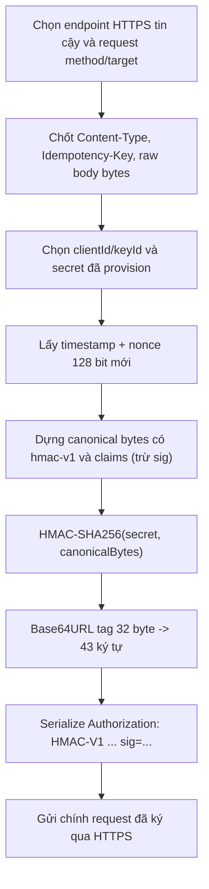
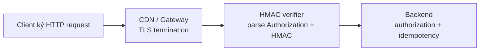

# Tạo Authorization header khi ký HTTP request bằng HMAC

## Mục tiêu học tập

Sau bài học này, bạn có thể:

- Giải thích **`Authorization` header** là nơi client gửi **thông tin xác thực** theo một *authentication scheme*, và phân biệt nó với HTTP status `401 Unauthorized` hay thao tác phân quyền của backend.
- Đề xuất **một định dạng Authorization có phiên bản rõ ràng** để mang client ID, key ID, timestamp, nonce và HMAC signature mà **không gửi shared secret**.
- Hiểu tại sao **không thể ký toàn bộ Authorization header một cách đệ quy** khi chính header chứa signature; thay vào đó, ký các claim đã parse và thuật toán/phiên bản theo một canonical request đã đặc tả.
- Tạo Authorization header **sau khi chốt** method, request-target, header nghiệp vụ và raw body bytes; kiểm tra Base64URL, ký tự, dấu nháy, duplicate parameter và key lookup.
- Viết ví dụ Java/JCA dùng `javax.crypto.Mac` và `MessageDigest.isEqual` để xây dựng và kiểm tra header HMAC-SHA256, với một hợp đồng canonical HTTP cụ thể.
- Phân tích lỗi qua proxy/gateway, header `Authorization` trùng, lộ secret trong log/redirect và khác biệt giữa xác thực, chống replay, idempotency, key rotation và authorization.
- Thiết kế bộ kiểm thử cho cả **định dạng header** lẫn **HMAC thực tế**, bao gồm request bị sửa và giả mạo danh tính.

**Bối cảnh:** Bài thuộc chương **Ký request** của module `SECURITY_AUTHENTICATION_HMAC_REQUEST_AUTHENTICATION`. Module xây dựng xác thực HTTP request bằng HMAC với **shared secret** và **canonical request** gồm method, URI, header hoặc body theo hợp đồng ký. Sau khi ký còn phải xác minh chữ ký, chống replay bằng timestamp/nonce, quản lý key rotation, kiểm thử proxy/gateway và phân biệt authentication với authorization. Chủ đề của bài là bước **tạo Authorization header** để mang chữ ký và các thông tin cần thiết tới verifier.

> **Phạm vi:** `HMAC-V1` và các tham số `client`, `keyid`, `ts`, `nonce`, `sig` dưới đây là một **authentication scheme tự định nghĩa cho bài thực hành**, không phải định dạng tiêu chuẩn dùng chung như AWS Signature Version 4. Không được giả định một server bất kỳ sẽ hiểu header này nếu chưa được cấu hình đúng hợp đồng.

## 1. Authorization header có vai trò gì?

`Authorization` là trường HTTP thường được client sử dụng để gửi **credentials** cho server theo một authentication scheme, ví dụ `Basic` hoặc `Bearer`. Một giao thức dùng HMAC cũng có thể định nghĩa scheme riêng để mang chữ ký của **chính request đang gửi**.

Ví dụ khái niệm:

```http
POST /v1/orders HTTP/1.1
Host: api.example.test
Content-Type: application/json
Authorization: HMAC-V1 client="partner-17", keyid="k2", ts="<unix-seconds>", nonce="<nonce>", sig="<hmac-tag>"

{"orderId":"O-42","amount":120000}
```

Các mục trong dấu `<...>` là placeholder; đây chưa phải request có signature hợp lệ.

| Thành phần | Ý nghĩa | Có phải secret? |
|---|---|---|
| `Authorization` | Tên HTTP header mang credential của scheme | Không |
| `HMAC-V1` | Tên scheme/phiên bản hợp đồng ký | Không |
| `client="partner-17"` | Client ID **tự khai**, giúp chọn scope tra khóa | Không |
| `keyid="k2"` | Mã phiên bản khóa HMAC thuộc client/môi trường | Không |
| `ts="..."` | Timestamp được client đưa vào thông điệp ký | Không |
| `nonce="..."` | Giá trị dùng một lần để chống replay, cũng được ký | Không |
| `sig="..."` | HMAC tag đã encode để truyền trong header | Không phải secret; tag có thể bị quan sát hoặc phát lại |
| Shared secret `K` | Dữ liệu khóa dùng cho HMAC, lưu ở client/verifier | **Có**; tuyệt đối không gửi trong Authorization |

Khi nhận header, server **chưa tin bất cứ claim nào**. Nó cần parse theo hợp đồng, tra đúng secret, **tự dựng lại canonical request từ HTTP request thực nhận**, tính HMAC và so tag. Chỉ sau bước đó client mới có thể được gắn **principal đã xác thực**.

### Authorization không có nghĩa "đã được phân quyền"

Tên header dễ gây nhầm: trong HTTP, `Authorization` mang thông tin **xác thực**. Một chữ ký đúng không chứng minh client có quyền cập nhật mọi đơn hàng, mọi tenant hay mọi tài nguyên. **Authentication** trả lời “request được ký bởi bên có thể dùng khóa nào?”, còn **authorization** trả lời “principal ấy được thực hiện thao tác này lên tài nguyên này không?”.

Ví dụ đối tác A tự ký chính xác một request nhắm tới đơn hàng của B. Server có thể xác thực A thành công, nhưng backend vẫn phải **từ chối thao tác lên tài nguyên của B**.

## 2. Vì sao chọn Authorization thay vì một header X-Signature?

Cùng một giá trị HMAC có thể được đặt ở nhiều vị trí khác nhau nếu giao thức quy định:

```http
Authorization: HMAC-V1 ...
```

hoặc:

```http
X-Client-Id: partner-17
X-Key-Id: k2
X-Timestamp: <unix-seconds>
X-Nonce: <nonce>
X-Signature: <signature>
```

Hai cách này **không tự tương thích**; chúng chỉ là hai hình thức vận chuyển credentials. Lựa chọn `Authorization` có một số điểm thuận tiện:

- Có một vị trí chuẩn mà nhiều HTTP client/framework và gateway đã nhận biết là nơi chứa credentials.
- Có thể khai báo *authentication scheme* để phân biệt HMAC với `Basic`, `Bearer` hoặc một phiên bản giao thức khác.
- Dễ định nghĩa một parser chung trả về `clientId`, `keyId`, timestamp, nonce và signature từ một header.
- Một số hạ tầng đã có quy tắc **redact/log-scrubbing** với `Authorization`; tuy nhiên không được **giả định** hạ tầng tự bảo vệ, chuyển tiếp hay xác minh header đúng cách.

Đổi lại, các hệ thống web có thể:

- Bỏ hoặc biến đổi `Authorization` ở reverse proxy, middleware, load balancer.
- Có filter khác ưu tiên `Bearer`/`Basic` hoặc trả lỗi trước HMAC verifier.
- Bị cấu hình logging ghi nguyên header chứa tag, client ID và metadata.
- Vô tình chuyển credential sang một domain khác khi HTTP client tự động follow redirect.
- Cho phép header trùng hoặc gộp nhiều field values, khiến các tầng parse khác nhau.

**Nguyên tắc:** vị trí đặt chữ ký trong `Authorization` không thay đổi tính chất của HMAC. Server vẫn phải xác minh **cùng một tập canonical bytes**, chống replay và phân quyền riêng.

## 3. Định nghĩa một format `HMAC-V1` chặt chẽ

Một Authorization header tự định nghĩa cần **wire grammar rõ ràng**. Hợp đồng của bài chọn:

```text
Authorization: HMAC-V1 client="<clientId>", keyid="<keyId>", ts="<unixSeconds>", nonce="<base64urlNonce>", sig="<base64urlHmac>"
```

Trong đó:

| Thuộc tính | Hợp đồng `HMAC-V1` của bài |
|---|---|
| Header | **Đúng một** `Authorization` tại điểm HTTP parser/ingress |
| Scheme | `HMAC-V1`; so tên scheme **không phân biệt hoa/thường** theo HTTP, chuẩn hóa thành `hmac-v1` khi ký |
| Parameter names | `client`, `keyid`, `ts`, `nonce`, `sig`; tên không phân biệt hoa/thường, canonical hóa về tên chữ thường |
| Số lượng tham số | **Chính xác năm**; không thiếu, không thêm, không có duplicate kể cả khác case |
| Thứ tự/format client tạo | `client` → `keyid` → `ts` → `nonce` → `sig`, mỗi field là `name="value"`, phân cách bằng `, ` |
| Parsing tại verifier trong profile | Chấp nhận tên scheme/parameter khác case nhưng **không chấp nhận thứ tự, dấu phẩy/space, quoting biến thể** ngoài grammar |
| `clientId`, `keyId` | ASCII `[A-Za-z0-9][A-Za-z0-9._-]{0,63}`, phân biệt hoa/thường ở **giá trị** |
| `ts` | Unix seconds dạng số thập phân chuẩn, 1–12 chữ số, không leading zero, không dấu `+`/`-` |
| `nonce` | Base64URL không padding của 16 byte CSPRNG: **22 ký tự**, decode/re-encode phải canonical |
| `sig` | Base64URL không padding của **32 byte HMAC-SHA256**: **43 ký tự**, decode/re-encode canonical |
| Quoted values | Chỉ ký tự ASCII theo allowlist; **không chấp nhận** `\"`, escape `\`, dấu xuống dòng, control char hoặc dấu phẩy bên trong giá trị |
| Thuật toán | HMAC-SHA256 **do server cấu hình**, không có tham số `alg=none` |
| Secret | Không xuất hiện trên wire; tra từ hệ thống quản lý khóa qua `(environment, clientId, keyId, audience)` |

Về mặt cú pháp HTTP authentication, các tham số theo dạng `name="value"` tương thích ý tưởng `auth-param`. **Tên scheme và auth-param là case-insensitive**, nhưng **giá trị** client ID, key ID và Base64URL signature **không** tự chuyển case. Trong một triển khai hỗ trợ nhiều cách biểu diễn header hợp lệ, parser phải chuẩn hóa một cách nhất quán và phát hiện duplicate. Bài chọn **profile serialization hạn chế** để tránh nhập nhằng; đây là một lựa chọn triển khai, không phải khẳng định HTTP nói chung cấm mọi biến thể khoảng trắng hoặc thứ tự tham số.

### Không bao giờ giải mã header theo cách "đoán"

Các input sau phải bị từ chối theo profile bài học:

```http
Authorization: HMAC-V1 client="partner-17", client="admin", keyid="k2", ts="123", nonce="...", sig="..."
Authorization: HMAC-V1 client="partner-17", keyid="k2", ts="123", sig="...", nonce="..."
Authorization: HMAC-V1 client="partner-17", keyid="k2", ts="123", nonce="...", sig="..." , extra="..."
Authorization: Bearer <some-token>
```

Giá trị `...` chỉ minh họa cú pháp sai, không phải signature thật. Không được:

- Tự chọn `client` đầu hoặc cuối khi xuất hiện trùng.
- Tách header chỉ bằng dấu phẩy nếu không có parser biết quoted-string; trong profile hạn chế này, mọi dấu phẩy chỉ xuất hiện tại đúng các vị trí cố định.
- Suy client ID đã xác thực chỉ vì chuỗi `client="admin"` có trong header.
- Thử ngẫu nhiên tất cả key ID hoặc toàn bộ secret để tìm tag khớp.
- Fallback từ HMAC sang Bearer/Basic hoặc thuật toán yếu vì một input không parse được.

## 4. Những gì nằm trong chữ ký khi Authorization chứa chính signature?

**Bẫy quan trọng:** không thể xây dựng một công thức trực tiếp kiểu:

```text
signature = HMAC(K, method + URI + rawAuthorizationHeader)
```

nếu `rawAuthorizationHeader` đã chứa **chính giá trị signature đang được tạo**. Công thức trở nên tự tham chiếu: muốn tính tag phải biết tag trước.

Giải pháp là định nghĩa **các metadata được ký** riêng biệt, không đưa tham số `sig` vào thông điệp ký. Hợp đồng `hmac-v1` trong bài tạo canonical string từ:

1. HTTP method thực tế.
2. Raw request-target gồm path/query theo quy ước của endpoint.
3. Host/authority công khai đã được ingress kiểm tra.
4. Content-Type và các signed headers có ý nghĩa nghiệp vụ.
5. Scheme/contract version **hmac-v1**.
6. `clientId`, `keyId`, `ts`, `nonce` lấy từ các claim đã parse.
7. SHA-256 của **chính raw body bytes**.

Ví dụ canonical string:

```text
POST
/v1/orders
host:api.example.test
content-type:application/json
idempotency-key:order-20261128-01
auth-scheme:hmac-v1
client:partner-17
keyid:k2
ts:<unix-seconds>
nonce:<base64url-nonce-128-bit>
body-sha256:<base64url-sha256-of-exact-body>
```

Quy tắc:

- Các dòng có thứ tự cố định, nối bằng **LF (0x0A)** và không có LF cuối; encode canonical text bằng **UTF-8 không BOM**.
- Version `hmac-v1` được ràng buộc vào phần ký để tránh diễn giải lại tag theo giao thức hoặc scheme khác.
- `client` và `keyid` được ký như **giá trị**, không bao gồm dấu nháy, dấu phẩy và tên parameter ở wire format.
- `ts` và `nonce` được ký để attacker không thể thay metadata chống replay rồi giữ signature cũ.
- Dòng `body-sha256` là Base64URL của SHA-256 trên **raw body bytes**, không phải JSON được parse rồi serialize lại.
- `Idempotency-Key` (được yêu cầu trong ví dụ tạo đơn) cũng được ký để attacker không thể sửa chính sách khử trùng lặp nghiệp vụ.
- **Không đưa `sig` vào dữ liệu ký**. Server tính expected MAC bằng dữ liệu còn lại, rồi so với `sig` nhận được.

**Đừng nhầm:** server không tin các giá trị `client`/`keyid` trước khi HMAC đúng. Việc dùng chúng để **chọn khóa ứng viên** chỉ là lookup có kiểm soát, chưa phải xác thực danh tính.

## 5. Quy trình client tạo Authorization header

Thứ tự thao tác quan trọng vì HMAC gắn với **một request cụ thể**, không gắn với một object nghiệp vụ có thể được HTTP client serialize lại.



### Từng bước cụ thể

**Bước 1 – chốt endpoint.** Chọn `https://api.example.test/v1/orders` từ cấu hình client đáng tin. Đừng ký một host rồi tự cho phép HTTP library follow redirect tới host không liên quan và mang theo credential. Nếu cần redirect sang authority khác, phải đánh giá đích, xây dựng lại request và **ký lại theo chính sách**.

**Bước 2 – chốt bytes nghiệp vụ.** Chọn `POST`, request-target `/v1/orders`, `Content-Type: application/json`, `Idempotency-Key` và body JSON UTF-8. Serialize body thành `byte[]` **một lần**. Nếu interceptor thay header/body sau khi ký, signature cũ không được tái sử dụng.

**Bước 3 – chọn khóa và metadata.** Client đã có `clientId` và `keyId`, cùng shared secret bytes nhận qua kênh bảo mật. Sinh timestamp theo Unix seconds và nonce mới bằng **CSPRNG**. Không lấy secret từ request hoặc tự đưa secret vào URL/header.

**Bước 4 – tính HMAC.** Xây dựng canonical string đã công bố, đổi thành UTF-8 bytes, tính `HMAC-SHA256`. Đầu ra là tag **32 byte**.

**Bước 5 – serialize header.** Base64URL-encode tag **không padding** thành chuỗi 43 ký tự rồi gắn vào `sig`, cùng bốn tham số còn lại. Đừng biến raw HMAC bytes thành `String` bằng UTF-8 hoặc Base64 thường nếu contract đòi Base64URL.

**Bước 6 – gửi qua TLS.** Dùng HTTPS; bảo đảm request được gửi có cùng method, target, signed headers và **raw body bytes** mà HMAC vừa tính. Không để URL builder tự sort query hoặc form serializer tự bỏ field rỗng sau bước ký.

## 6. HTTP request hoàn chỉnh và canonical string

Request minh họa:

```http
POST /v1/orders HTTP/1.1
Host: api.example.test
Content-Type: application/json
Idempotency-Key: order-20261128-01
Authorization: HMAC-V1 client="partner-17", keyid="k2", ts="<unix-seconds>", nonce="<22-char-base64url>", sig="<43-char-base64url>"

{"orderId":"O-42","amount":120000}
```

**Các mục trong `<...>` là placeholder.** Trong request thực tế, cả `ts`, `nonce` và `sig` phải là giá trị hợp lệ, `ts` còn trong cửa sổ chấp nhận. Body đã ký là **chính xác chuỗi bytes** UTF-8 của JSON hiển thị, không có newline cuối.

Ví dụ:

```text
canonical =
"POST\n" +
"/v1/orders\n" +
"host:api.example.test\n" +
"content-type:application/json\n" +
"idempotency-key:order-20261128-01\n" +
"auth-scheme:hmac-v1\n" +
"client:partner-17\n" +
"keyid:k2\n" +
"ts:<unix-seconds>\n" +
"nonce:<22-char-base64url>\n" +
"body-sha256:<base64url-sha256-of-raw-utf8-json>"
```

- Byte `LF` được viết minh họa là `\n` trong chuỗi ở trên.
- Dòng cuối **không thêm `\n`**.
- Digest của body là một phần của canonical message nên HMAC ràng buộc body, dù không chèn nguyên body JSON vào canonical text.
- Header `Authorization` được tạo **sau** khi đã tính tag; verifier parse header ra claims và signature rồi dựng lại **chính canonical bytes ấy**.
- Bản thân HTTP authorization scheme không tự cấp quyền; backend vẫn kiểm tra principal với order/tenant.

### Nếu muốn ký thêm header thì sao?

Nếu hệ thống bổ sung `X-Tenant-Id`, `If-Match` hoặc tham số query có ý nghĩa nghiệp vụ, những trường ấy cũng phải được ràng buộc bằng hợp đồng ký **có phiên bản**. Nếu backend xử lý một trường do client tự gửi **ngoài thông điệp đã ký**, việc sửa nó có thể không làm HMAC thay đổi.

Không thêm hoặc bỏ signed header theo cảm tính chỉ tại một phía. Một phiên bản hợp đồng mới cần test client/verifier đồng bộ, và giới hạn nơi nào được phép dùng phiên bản cũ trong giai đoạn chuyển đổi.

## 7. Server parse và xác minh Authorization theo trình tự nào?

Verifier không nên gọi `split(",")` rồi tùy ý xử lý mọi input. Nó phải có **parser chính thức** với giới hạn chiều dài, số lượng header, duplicate detection, cú pháp scheme và giá trị.

```mermaid
sequenceDiagram
    autonumber
    participant C as Client
    participant G as Gateway / Ingress
    participant V as HMAC Verifier
    participant K as Key Store
    participant N as Shared Nonce Store
    participant B as Backend
    C->>C: Serialize body và Authorization HMAC-V1
    C->>G: HTTPS POST + signed fields + Authorization
    G->>G: Header/body size limits; reject duplicate Authorization
    G->>V: Request với Host/target/body tin cậy qua nội bộ
    V->>V: Parse scheme/claims/tag; validate format và timestamp window
    V->>K: Lookup(env, clientId, keyId, audience)
    K-->>V: Key state + secret + principal
    V->>V: Rebuild canonical request từ HTTP thực nhận
    V->>V: HMAC-SHA256, constant-time style tag comparison
    alt Key không hợp lệ hoặc signature sai
        V-->>G: Reject authentication
        G-->>C: Error response
    else Chữ ký hợp lệ
        V->>N: Atomic insert-if-absent(principal, nonce)
        alt Nonce cũ hoặc store không hoạt động
            V-->>G: Reject replay / fail closed
            G-->>C: Error response
        else Nonce mới
            N-->>V: Inserted
            V->>B: Principal đã xác thực + body/request context
            B->>B: Authorization + idempotency + transaction
            B-->>G: Business response
            G-->>C: HTTPS response
        end
    end
```

### Những điều kiện kiểm tra quan trọng

1. **HTTP parser/ingress:** đúng một `Authorization`; giới hạn chiều dài, số lượng header, body size; từ chối header bị gộp hoặc có ký tự CR/LF/control không hợp lệ. Với HTTP/1.1 và HTTP/2 phải kiểm soát Host/`:authority` nhất quán.
2. **Format:** đúng `HMAC-V1`, đủ và đúng tên năm parameter, không duplicate, đúng quoting, chữ ký Base64URL 43 ký tự decode 32 byte, nonce Base64URL 22 ký tự decode 16 byte, re-encode canonical.
3. **Time policy:** từ chối timestamp quá cũ/quá xa tương lai theo clock server. Đây là bộ lọc sớm; chỉ sau HMAC đúng mới kết luận timestamp thực sự được bên có khóa ký.
4. **Key lookup:** tra đúng `(environment, clientId, keyId, audience)` và kiểm tra owner/state/time; không thử chéo tenant, không tự chọn thuật toán theo input không đáng tin.
5. **Canonical request:** dựng từ method, target, host và raw body **thực nhận**, không từ một `canonical` string do client gửi. Sử dụng claims đã parse, chuẩn hóa tên scheme/field theo contract.
6. **MAC:** tính HMAC-SHA256 bằng secret đúng, decode tag và so bytes bằng `MessageDigest.isEqual` (hoặc primitive thích hợp). Format hợp lệ chưa chứng minh MAC đúng.
7. **Replay:** chỉ sau khi MAC hợp lệ mới ghi nonce bằng **insert-if-absent nguyên tử** vào kho dùng chung; nonce trùng bị từ chối.
8. **Principal và authorization:** principal đến từ bản ghi khóa đã verify; backend kiểm tra quyền theo tenant/resource/action và xử lý idempotency riêng.

### Error response và challenge

Khi request không có credential hoặc HMAC không hợp lệ, API có thể dùng **`401 Unauthorized`**; về ngữ nghĩa HTTP, phản hồi 401 phải kèm **`WWW-Authenticate`** với ít nhất một challenge áp dụng cho tài nguyên. Với scheme riêng, một ví dụ là:

```http
HTTP/1.1 401 Unauthorized
WWW-Authenticate: HMAC-V1 realm="orders-api"
Cache-Control: no-store
Content-Type: application/json

{"error":"authentication_failed"}
```

`403 Forbidden` dùng khi đã xác thực nhưng không có quyền theo chính sách; một số API có thể dùng mã khác cho format sai hoặc replay theo hợp đồng. Không đưa secret, key existence, canonical request chứa dữ liệu nhạy cảm hoặc phân tích HMAC từng byte vào lỗi công khai. Không bao giờ echo nguyên `Authorization` trong response.

## 8. Java 17+: tạo và parse Authorization HMAC-V1

Đoạn mã dưới đây tự chứa phần **serializer, parser, canonical request và HMAC-SHA256**. Nó **không** giả vờ là toàn bộ HTTP authentication middleware: HTTP adapter cần kiểm tra duplicate header, route/host đáng tin, key lookup, timestamp/nonce và authorization riêng.

```java
import java.nio.charset.StandardCharsets;
import java.security.GeneralSecurityException;
import java.security.MessageDigest;
import java.security.SecureRandom;
import java.time.Instant;
import java.util.Base64;
import java.util.regex.Matcher;
import java.util.regex.Pattern;
import javax.crypto.Mac;
import javax.crypto.spec.SecretKeySpec;

public final class HmacAuthorizationV1 {
    private static final String TARGET = "/v1/orders";
    private static final String HOST = "api.example.test";
    private static final String CONTENT_TYPE = "application/json";
    private static final Base64.Encoder B64 =
            Base64.getUrlEncoder().withoutPadding();

    private static final Pattern ID =
            Pattern.compile("[A-Za-z0-9][A-Za-z0-9._-]{0,63}");
    private static final Pattern TS =
            Pattern.compile("[1-9][0-9]{0,11}");
    private static final Pattern NONCE =
            Pattern.compile("[A-Za-z0-9_-]{22}");
    private static final Pattern SIG =
            Pattern.compile("[A-Za-z0-9_-]{43}");

    // Tên scheme/parameter được parse case-insensitively theo HTTP.
    // Giá trị và dấu phân cách phải khớp profile minh họa.
    private static final Pattern AUTH = Pattern.compile(
            "(?i:HMAC-V1) (?i:client)=\"([A-Za-z0-9][A-Za-z0-9._-]{0,63})\", " +
            "(?i:keyid)=\"([A-Za-z0-9][A-Za-z0-9._-]{0,63})\", " +
            "(?i:ts)=\"([1-9][0-9]{0,11})\", " +
            "(?i:nonce)=\"([A-Za-z0-9_-]{22})\", " +
            "(?i:sig)=\"([A-Za-z0-9_-]{43})\"");

    private HmacAuthorizationV1() {}

    public record RequestData(
            String method, String rawTarget, String effectiveHost,
            String contentType, String idempotencyKey, byte[] rawBody) {}

    public record Claims(
            String clientId, String keyId, String timestamp, String nonce) {}

    public record ParsedAuthorization(Claims claims, byte[] receivedTag) {}

    private static byte[] decodeCanonical(
            String text, Pattern format, int expectedLength) {
        if (text == null || !format.matcher(text).matches()) {
            throw new IllegalArgumentException("Invalid auth parameter");
        }
        final byte[] raw;
        try {
            raw = Base64.getUrlDecoder().decode(text);
        } catch (IllegalArgumentException badBase64) {
            throw new IllegalArgumentException("Invalid auth encoding");
        }
        if (raw.length != expectedLength ||
                !B64.encodeToString(raw).equals(text)) {
            throw new IllegalArgumentException("Noncanonical Base64URL");
        }
        return raw;
    }

    private static void validateClaims(Claims c) {
        if (c == null || c.clientId() == null ||
                !ID.matcher(c.clientId()).matches() ||
                c.keyId() == null ||
                !ID.matcher(c.keyId()).matches() ||
                c.timestamp() == null ||
                !TS.matcher(c.timestamp()).matches()) {
            throw new IllegalArgumentException("Invalid HMAC claims");
        }
        decodeCanonical(c.nonce(), NONCE, 16);
    }

    // Giá trị Authorization header đã qua bước check cardinality HTTP.
    public static ParsedAuthorization parse(String headerValue) {
        if (headerValue == null || headerValue.length() > 512) {
            throw new IllegalArgumentException("Invalid Authorization");
        }
        Matcher m = AUTH.matcher(headerValue);
        if (!m.matches()) {
            throw new IllegalArgumentException("Invalid Authorization");
        }

        Claims claims = new Claims(
                m.group(1), m.group(2), m.group(3), m.group(4));
        validateClaims(claims);
        byte[] tag = decodeCanonical(m.group(5), SIG, 32);
        return new ParsedAuthorization(claims, tag);
    }

    private static String canonical(RequestData r, Claims c)
            throws GeneralSecurityException {
        if (r == null || !"POST".equals(r.method()) ||
                !TARGET.equals(r.rawTarget()) ||
                !HOST.equals(r.effectiveHost()) ||
                !CONTENT_TYPE.equals(r.contentType()) ||
                r.idempotencyKey() == null ||
                !ID.matcher(r.idempotencyKey()).matches() ||
                r.rawBody() == null || r.rawBody().length > 16384) {
            throw new IllegalArgumentException("Invalid signed request");
        }
        validateClaims(c);
        String bodyHash = B64.encodeToString(
                MessageDigest.getInstance("SHA-256").digest(r.rawBody()));

        return String.join("\n",
                "POST",
                TARGET,
                "host:" + HOST,
                "content-type:" + CONTENT_TYPE,
                "idempotency-key:" + r.idempotencyKey(),
                "auth-scheme:hmac-v1",  // Scheme chuẩn hóa, được ký
                "client:" + c.clientId(),
                "keyid:" + c.keyId(),
                "ts:" + c.timestamp(),
                "nonce:" + c.nonce(),
                "body-sha256:" + bodyHash);
    }

    private static byte[] mac(
            byte[] secret, RequestData request, Claims claims)
            throws GeneralSecurityException {
        Mac hmac = Mac.getInstance("HmacSHA256");
        hmac.init(new SecretKeySpec(secret, "HmacSHA256"));
        byte[] canonicalBytes = canonical(request, claims)
                .getBytes(StandardCharsets.UTF_8);
        return hmac.doFinal(canonicalBytes);
    }

    // Client: ký đúng request đã chốt, sau đó mới gắn Authorization.
    public static String createAuthorization(
            byte[] secret, RequestData request, Claims claims)
            throws GeneralSecurityException {
        byte[] rawTag = mac(secret, request, claims);
        String sig = B64.encodeToString(rawTag);
        return "HMAC-V1 client=\"" + claims.clientId() +
               "\", keyid=\"" + claims.keyId() +
               "\", ts=\"" + claims.timestamp() +
               "\", nonce=\"" + claims.nonce() +
               "\", sig=\"" + sig + "\"";
    }

    // Verifier gọi SAU KHI đã tra đúng secret của (env, client, keyid).
    public static boolean verifyWithKey(
            byte[] storedSecret, RequestData request,
            ParsedAuthorization auth) throws GeneralSecurityException {
        if (auth == null || auth.claims() == null ||
                auth.receivedTag() == null ||
                auth.receivedTag().length != 32) {
            return false;
        }
        final byte[] expected;
        try {
            expected = mac(storedSecret, request, auth.claims());
        } catch (IllegalArgumentException invalidFields) {
            return false;
        }
        return MessageDigest.isEqual(expected, auth.receivedTag());
    }

    public static void main(String[] args)
            throws GeneralSecurityException {
        // Demo local: production không tạo key mới tại verifier mỗi request.
        byte[] secret = new byte[32];
        new SecureRandom().nextBytes(secret);
        byte[] nonce = new byte[16];
        new SecureRandom().nextBytes(nonce);

        Claims claims = new Claims(
                "partner-17", "k2",
                Long.toString(Instant.now().getEpochSecond()),
                B64.encodeToString(nonce));

        RequestData request = new RequestData(
                "POST", TARGET, HOST, CONTENT_TYPE,
                "order-20261128-01",
                "{\"orderId\":\"O-42\",\"amount\":120000}"
                    .getBytes(StandardCharsets.UTF_8));

        String header = createAuthorization(secret, request, claims);
        ParsedAuthorization parsed = parse(header);

        if (!verifyWithKey(secret, request, parsed)) {
            throw new AssertionError("Valid Authorization rejected");
        }

        // Chỉ đổi body, giữ nguyên Authorization chứa sig cũ.
        RequestData tampered = new RequestData(
                request.method(), request.rawTarget(),
                request.effectiveHost(), request.contentType(),
                request.idempotencyKey(),
                "{\"orderId\":\"O-42\",\"amount\":999999}"
                    .getBytes(StandardCharsets.UTF_8));
        if (verifyWithKey(secret, tampered, parsed)) {
            throw new AssertionError("Tampered body was accepted");
        }

        // Đổi keyid nhưng giữ sig cũ; claim này được HMAC bảo vệ.
        String changedKeyId = header.replace(
                "keyid=\"k2\"", "keyid=\"k3\"");
        if (verifyWithKey(secret, request, parse(changedKeyId))) {
            throw new AssertionError("Changed key ID was accepted");
        }

        System.out.println("Authorization HMAC-V1 demo: PASS");
    }
}
```

### Cách sử dụng đúng trong ứng dụng HTTP thực tế

**Client:** tạo `RequestData` từ method, target, Host, Content-Type, Idempotency-Key và **byte[] body đã finalize**; tạo `Claims` bằng client/key ID đã provision và timestamp/nonce mới; gọi `createAuthorization()` rồi đặt kết quả vào **một** `Authorization` header. Sau đó gửi **cùng bytes** đã ký qua HTTPS.

**Server:** đọc toàn bộ header instances từ HTTP parser để bảo đảm `Authorization` chỉ xuất hiện một lần; gọi `parse(headerValue)`. Dùng `claims.clientId` và `claims.keyId` chỉ để **lookup key candidate** theo scope; kiểm tra key state, audience, time window, rồi dựng `RequestData` từ **request thực nhận**. Sau đó gọi `verifyWithKey()`. Chỉ khi tag khớp, verifier mới kiểm tra nonce atomically và gắn principal thuộc key record vào context.

**Giới hạn mã:** class này chưa tự kiểm tra timestamp theo đồng hồ server, chưa ghi nonce vào store, chưa thực hiện lookup key hay nhận biết header trùng, chưa kiểm tra HTTP framing/host public, cũng chưa xử lý authorization. `validateClaims` chỉ kiểm tra **format** timestamp/nonce, không chứng minh nonce mới hoặc timestamp đang hợp lệ. Với ứng dụng production, cần HTTP filter và persistence policy riêng.

### Vì sao không parse bằng `String.split(",")`?

Trong giao thức HTTP authentication tổng quát, giá trị tham số có thể được viết dưới dạng quoted-string và có quy tắc escaping. Một chuỗi chứa dấu phẩy bên trong quoted-string có thể khiến `split(",")` chia sai. Ví dụ lớp `HMAC-V1` **cố tình cấm** escape và các ký tự ngoài allowlist, dùng **một regex toàn chuỗi** để parse grammar đơn giản. Khi thiết kế scheme linh hoạt hơn, nên dùng parser authentication chuẩn hoặc một grammar parser thật, **không** tự vá nhiều nhánh `split`.

## 9. Những lỗi thường gặp khi tạo Authorization

| Tình huống | Hậu quả | Hướng xử lý |
|---|---|---|
| Client ký **toàn bộ** header gồm cả `sig` | Signature tự tham chiếu, không có quy trình một-pass rõ | Ký riêng scheme/claims và request; không đưa `sig` vào canonical |
| Gửi `key`/`secret` trong Authorization | Lộ credential dùng để tạo chữ ký vô hạn | Chỉ gửi key ID, không gửi raw secret |
| Chỉ gửi `client` và `sig`, không có timestamp/nonce | Dễ phát lại request cũ | Ký timestamp và nonce, dùng shared replay store |
| `sig` là raw binary chuyển thành Java String | Mất byte hoặc xuất ký tự không hợp lệ | Encode Base64URL/hex theo contract |
| Client dùng Base64 có `+`, `/`, `=` | Format sai so với Base64URL unpadded | Dùng đúng alphabet, length, re-encode check |
| Key ID không được ký | Khó ràng buộc phiên bản/audience, nguy cơ key confusion | Đưa `keyid` và `client` vào canonical request |
| Chọn key theo client ID chưa xác thực và coi là principal | Giả mạo danh tính | Chỉ tạo principal sau khi MAC đúng |
| Không ký `Idempotency-Key` nhưng backend dùng header này | Có thể sửa tiêu chí khử trùng lặp mà tag không đổi | Ký header nghiệp vụ quan trọng |
| Chỉ ký body, không ký method/URI/Host | Signature có thể được dùng sai hành động/đích | Canonical request phải bao phủ các trường có ý nghĩa |
| Ký rồi để HTTP client serialize lại body | Digest khác hoặc request bị đổi nghĩa | Serialize body một lần, ký đúng bytes gửi |
| Fallback sang `Bearer` nếu `HMAC-V1` parse lỗi | Authentication downgrade | Scheme allowlist do endpoint/server quyết định |
| Duplicate `Authorization` hoặc parameter trùng | Parser/gateway và backend chọn khác giá trị | Reject ngay từ ingress và parser |
| Không redact Authorization trong log | Lộ tag, client metadata; hỗ trợ replay trong cửa sổ | Redact header, hạn chế log signed fields |
| Tự follow redirect sang authority khác | Credential có thể bị chuyển tiếp sai nơi | Không forward Authorization sang origin lạ; re-sign có kiểm soát |
| Proxy xóa Authorization | Request thất bại dù client ký đúng | Cấu hình đường truyền bảo toàn header, xác minh tại trust boundary |
| Khi verifier nhận chữ ký đúng thì bỏ qua quyền | Request cross-tenant có thể gây hại | Authorization theo principal/action/resource |

## 10. Proxy/gateway và các trust boundary của Authorization

Trong hệ thống nhiều hop:



Có những thay đổi cần tính đến:

- **Host/authority:** client ký `api.example.test` nhưng gateway chuyển tới `orders.internal`. Verifier phải ký public authority **được ingress tin cậy xác lập**, hoặc verify trước rewrite. Không tự tin `X-Forwarded-Host` từ client.
- **Path/query:** proxy có thể bỏ prefix, decode percent-encoding, thay thứ tự query. Phải có hợp đồng xác định **request-target ký ở đâu**; tuyệt đối không để backend thực thi resource khác với resource đã verify.
- **Body:** gateway hoặc framework có thể nén/giải nén, parse JSON rồi serialize lại, thay charset hoặc body newline. Với hợp đồng ký raw body, các thao tác đó làm HMAC mismatch hoặc tạo parser differential.
- **Authorization:** reverse proxy có thể strip header, filter auth khác có thể đọc `Bearer` trước, hoặc nhiều header `Authorization` có thể bị gộp. Phải kiểm soát cardinality và đường đi; backend không tự tin claims do client đặt.
- **HTTP framing:** xác định điểm body digest là **representation bytes sau khi tách framing** (không gồm các byte chunk-size), đồng thời xử lý `Content-Length`/`Transfer-Encoding` nhất quán để không phát sinh request smuggling.
- **Identity propagation:** verifier chuyển principal qua context nội bộ/mTLS hoặc header **chỉ gateway được phép tạo**; loại bỏ/ghi đè mọi `X-Authenticated-*` do client tự chèn.

**Điểm kiến trúc:** nếu verifier nằm ở gateway, hãy giới hạn truy cập trực tiếp backend. Nếu verifier nằm sau gateway, hãy bảo đảm signed fields (method, target, host, headers, body) và **Authorization** được chuyển tới nó **không bị biến đổi ngoài hợp đồng**.

### Logging và privacy

Nên dùng cơ chế redact `Authorization` hoàn toàn trước khi log request. Kể cả signature chỉ là tag chứ không phải secret, nó có thể **được phát lại** trong cửa sổ timestamp nếu nonce chưa được tiêu thụ, hoặc bị sử dụng trong các cuộc tấn công phối hợp. Không ghi shared secret, raw body chứa dữ liệu cá nhân, thông tin tenant nhạy cảm hay canonical request đầy đủ vào log production nếu không cần thiết.

## 11. Replay, rotation, idempotency và authorization

### 11.1. Chống replay là bước riêng sau xác minh HMAC

Một request có Authorization hợp lệ vẫn có thể bị ghi lại và gửi lần nữa. Nếu verifier chỉ so HMAC, tag không thay đổi khi gửi lại nguyên request.

- Ký `ts` và `nonce` trong canonical request.
- Kiểm tra timestamp theo **clock server**, ví dụ cửa sổ ±300 giây; đồng bộ đồng hồ giữa hệ thống.
- Chỉ **sau khi tag HMAC hợp lệ**, ghi `(principal/clientId, nonce)` bằng **insert-if-absent nguyên tử** vào kho chia sẻ giữa mọi replica.
- TTL phải bao phủ thời gian timestamp đó còn có thể được chấp nhận, kể cả request đến sớm trong cửa sổ.
- Endpoint nhạy cảm nên **fail closed** nếu nonce store không khả dụng.

Nếu client retry với **nonce mới**, nó tạo request và signature mới hợp lệ. Đây không phải replay theo định nghĩa nonce store; backend vẫn cần **Idempotency-Key** đã ký và transaction để tránh tạo hai đơn khi response đầu tiên bị mất.

### 11.2. Key ID và rotation

Verifier dùng `client` + `keyid` trong header để tra `(environment, clientId, keyId, audience)`. Các giá trị này chưa được tin trước khi xác minh, nhưng phục vụ lookup. Trong giai đoạn rotation có thể:

1. Provision khóa `k2` mới cho client với secret mới, giữ `k1` ở trạng thái tạm được verify.
2. Client chuyển sang tạo Authorization với `keyid="k2"` và ký bằng secret mới.
3. Verifier chấp nhận đúng các key đang cho phép theo policy; theo dõi tỷ lệ `k1` còn xuất hiện.
4. Thu hồi `k1` và đồng bộ trạng thái cache/replica để ngăn chấp nhận tag tính bằng khóa cũ.

Không tái sử dụng một key ID cho secret khác và không thử mọi secret khi `keyid` không tìm được. Nếu secret bị lộ, attacker có thể tự ký request **mới** với ts/nonce mới; replay gate không giải quyết vấn đề key compromise, phải thu hồi và rotation.

### 11.3. Xác thực không bằng quyền truy cập

Một request có `Authorization: HMAC-V1 ...` và tag khớp với khóa `partner-17` có thể nhắm tới đơn hàng của `partner-42`. Backend phải kiểm tra **principal đã xác thực** có quyền với order/tenant mục tiêu hay không. Không lấy `client` tự khai trong Authorization làm role, không lấy `Host` làm bằng chứng caller là admin, không chấp nhận signed request như một chứng nhận toàn quyền.

## 12. Ma trận kiểm thử Authorization header đã ký

| Kiểm thử | Input hoặc thao tác | Kết quả cần có |
|---|---|---|
| Happy path | Header đúng format, key đúng, body/headers không đổi, nonce mới | MAC đúng, principal được xác thực |
| Thiếu Authorization | Không có header | Reject authentication |
| Duplicate Authorization | Hai header cùng tên, kể cả khác case | Reject trước parser |
| Scheme khác | `Bearer ...` hoặc `Basic ...` trên endpoint chỉ hỗ trợ HMAC-V1 | Reject, không fallback |
| Scheme khác case | `hmac-v1` thay `HMAC-V1` | Có thể pass theo case-insensitive scheme; canonical scheme vẫn `hmac-v1` |
| Parameter khác case | `CLIENT` thay `client` | Có thể pass theo parser đã định nghĩa; giá trị không đổi |
| Sai thứ tự param | Đưa `sig` lên trước `nonce` | Reject theo strict profile |
| Param trùng hoặc thiếu | Hai `keyid` hoặc không có `ts` | Reject format |
| Thêm tham số không định nghĩa | `alg="none"` | Reject; không đàm phán thuật toán không an toàn |
| Dấu nháy/escape sai | Thiếu quote, dấu phẩy, backslash, ký tự control | Reject format |
| Nonce quá ngắn | Base64URL không decode ra 16 byte | Reject |
| Noncanonical nonce | Decode rồi encode lại khác chuỗi gốc | Reject |
| Signature có padding | `sig` có dấu `=` cuối | Reject theo Base64URL unpadded |
| Tag sai chiều dài | Khác 43 ký tự hoặc decode không ra 32 byte | Reject |
| Noncanonical tag | Pad bits tạo nhiều biểu diễn cùng MAC bytes | Reject |
| Sửa `client` sau ký | `partner-17` → `partner-42` | MAC không khớp hoặc scope lookup fail |
| Sửa `keyid` sau ký | `k2` → `k1` | MAC không khớp hoặc key state reject |
| Sửa timestamp/nonce | Giữ tag cũ nhưng đổi claims | HMAC fail |
| Đổi method/URI/Host | Ký `POST /v1/orders` rồi gửi target khác | HMAC fail hoặc reject contract |
| Sửa raw JSON body | Đổi `amount` hoặc whitespace sau ký | HMAC fail do body digest |
| Sửa Idempotency-Key | Đổi key nhưng giữ Authorization cũ | HMAC fail |
| Header bị proxy strip | Gateway xóa Authorization | Reject; cần sửa cấu hình hạ tầng |
| Header qua redirect | Tự gửi credential sang host không thuộc allowlist | Không được gửi; client re-sign có kiểm soát |
| Replay qua hai replica | Hai request cùng nonce và signature | Tối đa một request qua nonce gate |
| Key bị thu hồi | HMAC đúng với `k1` đã revoke | Reject theo key lifecycle |
| HMAC đúng nhưng vượt tenant | Principal A nhắm tài nguyên B | Authn pass, authz deny |
| Retry với nonce mới | Cùng Idempotency-Key, chữ ký mới | Idempotency nghiệp vụ không tạo đơn trùng |

Bộ test phải có **unit tests** cho serializer/parser/HMAC và **integration tests** qua HTTP client, proxy/gateway, verifier, shared nonce store, backend. Unit test `HmacAuthorizationV1` không chứng minh header trùng đã bị chặn hoặc body/Host không đổi khi đi qua proxy.

### Gợi ý test format riêng biệt với HMAC

Để kiểm tra format validator, tạo chuỗi signature có 43 chữ `A` (decode ra 32 byte `0x00`). Chuỗi 42 chữ `A` và chữ `B` cuối có thể được một số Base64URL decoder giải thành **cùng bytes** nếu không kiểm tra pad bits. `decodeCanonical` ở ví dụ sẽ **từ chối** biến thể này khi re-encode không khớp. Đây chỉ là **format test**, không phải test HMAC hợp lệ cho một request.

## 13. Bài tập thực hành

Hệ thống `orders-api` nhận `POST /v1/orders` từ nhiều đối tác, sử dụng HMAC-SHA256, HTTPS và một API gateway. Mỗi đối tác có `clientId`, `keyId`, shared secret riêng; verifier có ba replica dùng chung nonce store.

Hãy thiết kế và thực hiện:

1. **Wire contract:** mô tả `Authorization: HMAC-V1 ...` với chính xác năm tham số, quy tắc quote/comma/space, case của scheme và tham số, ID, timestamp, nonce và chữ ký Base64URL.
2. **Canonical request:** ràng buộc method, raw request-target, public Host, Content-Type, Idempotency-Key, scheme `hmac-v1`, client/key ID, timestamp, nonce và SHA-256 raw body. Nêu rõ UTF-8/LF và vì sao không đưa `sig` vào message ký.
3. **Java client:** serialize JSON một lần, sinh timestamp và nonce CSPRNG, tính HMAC-SHA256 bằng `javax.crypto.Mac`, Base64URL-encode tag và tạo Authorization **sau khi finalize request**.
4. **Java verifier:** kiểm tra chính xác một Authorization header, parse strict profile, tra key đúng scope `(env, clientId, keyId, audience)`, kiểm tra key status, dựng canonical bytes từ request thực nhận và so MAC bằng `MessageDigest.isEqual`.
5. **Replay protection:** kiểm tra timestamp trong cửa sổ; chỉ sau HMAC hợp lệ mới insert nonce nguyên tử vào kho dùng chung; thử phát lại cùng nonce qua ba replica.
6. **Idempotency:** mô tả vì sao retry với nonce mới vẫn có thể tạo tác vụ trùng; dùng Idempotency-Key đã ký và ràng buộc nó với principal + nội dung thao tác.
7. **Proxy/gateway:** chạy test Host rewrite, duplicate Authorization, Bearer fallback, body reserialization, query normalize và redirect sang host khác.
8. **Rotation:** chuyển `k1 → k2` với overlapping verify có hạn; thu hồi `k1` và kiểm thử cache stale.
9. **Authorization:** cho partner A gửi request HMAC đúng đến đơn của partner B; yêu cầu backend từ chối theo quyền tài nguyên.

**Tiêu chí hoàn thành:** Người học trình bày được chuỗi **canonical request bytes → HMAC tag → Authorization string** và quy trình xác minh tương ứng, chứng minh header không chứa secret, metadata được ký (trừ tham số `sig`), không có đường fallback bypass, replay bị chặn và principal không tự động có quyền với mọi tài nguyên.

---

## Ghi nhớ

Trong `SECURITY_AUTHENTICATION_HMAC_REQUEST_AUTHENTICATION`, tạo **Authorization header** là bước **đóng gói phiên bản scheme, danh tính/phiên bản khóa, timestamp, nonce và HMAC tag** sau khi client đã chốt HTTP request và tính chữ ký. Header mang **thông tin để server xác minh**, không mang **shared secret**, và bản thân nó không chứng minh client đã được xác thực cho tới khi verifier kiểm tra HMAC đúng scope. Hãy ký các claim (trừ `sig`) cùng method, URI, header/body theo hợp đồng; kiểm tra định dạng nghiêm ngặt, bảo toàn dữ liệu qua proxy, kết hợp **nonce chống replay, key rotation, idempotency và authorization**.
