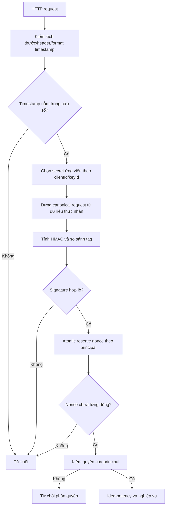

# Thêm timestamp

## 1. Vì sao cần thêm timestamp khi ký HTTP request bằng HMAC?

Trong xác thực HTTP request bằng **HMAC (Hash-based Message Authentication Code)**, client và server chia sẻ một secret. Client tạo **canonical request** từ những thành phần HTTP đã thỏa thuận rồi ký bằng HMAC; server dùng secret tương ứng để tính lại và so sánh chữ ký.

Nếu chỉ ký method, URI, headers và body, một request hợp lệ có thể **vẫn hợp lệ khi bị gửi lại nhiều lần**. Kẻ tấn công không cần biết secret để sao chép toàn bộ HTTP request và signature đã quan sát được. Đây là nguy cơ **replay attack**: ví dụ lặp một yêu cầu tạo thanh toán.

Thêm **timestamp** là đưa **thời điểm tạo chữ ký** vào request **và vào chính dữ liệu được HMAC bảo vệ**. Server có thể từ chối request quá cũ hoặc có thời điểm quá xa tương lai.

```text
Sender tạo timestamp T
        |
        v
Canonical request = method + URI + signed headers
                  + timestamp T + nonce N + body hash
        |
        v
HMAC(sharedSecret, canonical request)
        |
        v
Gửi request + T + N + signature
        |
        v
Server tự dựng canonical request và HMAC
        |
        v
Kiểm tra timestamp window + nonce chưa dùng
        |
        v
Thiết lập principal, phân quyền, xử lý nghiệp vụ
```

Bài **“Thêm timestamp”** thuộc chương **Ký request** của mô-đun **`SECURITY_AUTHENTICATION_HMAC_REQUEST_AUTHENTICATION`**. Toàn mô-đun thiết kế xác thực HTTP bằng HMAC với shared secret và canonical request chứa phương thức, URI, header hoặc body theo hợp đồng ký; thực hành xác minh chữ ký, chống replay bằng timestamp/nonce, quản lý key rotation, kiểm thử proxy/gateway và phân biệt xác thực với phân quyền.

**Điều cần nhớ:** timestamp **giới hạn khoảng thời gian** một request có thể được chấp nhận, nhưng **không tự ngăn được việc phát lại trong khoảng thời gian đó**. Muốn chống replay hiệu quả cần thêm **nonce được ký**, một **replay store nguyên tử** ở phía server, cùng chính sách xử lý retry và idempotency.

## 2. Phân biệt timestamp, nonce, signature và idempotency key

Bốn khái niệm thường xuất hiện cùng nhau nhưng có mục đích khác nhau:

| Thành phần | Câu hỏi nó trả lời | Vai trò | Giới hạn |
| --- | --- | --- | --- |
| **Timestamp** | “Request tuyên bố được ký vào lúc nào?” | Giới hạn độ tuổi của request | Bản sao trong cửa sổ thời gian vẫn có timestamp hợp lệ |
| **Nonce** | “Định danh duy nhất của lần gửi này là gì?” | Phát hiện request đã được chấp nhận trước đó | Cần kho ghi nonce đủ nhất quán; phải được ký |
| **HMAC signature** | “Bên gửi có secret hợp lệ và dữ liệu đã ký còn nguyên không?” | Xác thực bên nắm key và bảo vệ toàn vẹn | Không tự phân quyền, không tự có trí nhớ replay |
| **Idempotency key** | “Những lần thử nào cùng một ý định nghiệp vụ?” | Tránh thực hiện lại thao tác như tạo thanh toán | Không thay HMAC hay nonce; cần chính sách lưu kết quả riêng |

Ví dụ:

```text
Lần gửi 1:
  POST /v1/payments
  timestamp = T1
  nonce     = N1
  signature = S1
  idempotencyKey = PAY-O42

Kẻ tấn công gửi lại nguyên request:
  timestamp = T1
  nonce     = N1
  signature = S1
  idempotencyKey = PAY-O42

Client retry hợp lệ sau timeout:
  timestamp = T2
  nonce     = N2
  signature = S2
  idempotencyKey = PAY-O42
```

Ở lần phát lại nguyên vẹn, timestamp và HMAC vẫn có thể đúng. Server phải kiểm tra **nonce N1 đã được sử dụng** để chặn bản sao. Ở lần retry hợp lệ, nonce N2 cho phép nhận một lần gửi mới; **idempotency key** giúp tầng thanh toán nhận biết đây vẫn là một ý định nghiệp vụ, không tạo giao dịch trùng.

Nếu `Idempotency-Key` được gửi qua header và ảnh hưởng đến hành vi nghiệp vụ, cần đưa nó vào hợp đồng ký hoặc bảo vệ bằng một ràng buộc tin cậy tương đương.

## 3. Chọn định dạng timestamp thống nhất

Có nhiều dạng biểu diễn thời gian, nhưng **không được pha trộn tùy tiện khi ký HMAC**. Một hợp đồng rõ ràng thường chọn **Unix timestamp tính bằng giây**, ở dạng **số nguyên thập phân ASCII**.

Ví dụ:

```http
X-Timestamp: 1795856400
```

Quy tắc hợp đồng minh họa **HMAC-SHA256-V1** của bài này:

1. `X-Timestamp` là **Unix epoch seconds** — số giây kể từ 1970-01-01T00:00:00Z.
2. Chuỗi chỉ gồm các chữ số ASCII `0-9`, **không có dấu `+`**, dấu `-`, khoảng trắng, phần thập phân hoặc hậu tố múi giờ.
3. **Không có số 0 đứng đầu** khi giá trị có nhiều chữ số; biểu diễn chuẩn do `Long.toString(epochSeconds)` tạo ra.
4. Giá trị phải parse thành kiểu `long` và phù hợp với cửa sổ thời gian server cho phép.
5. Server phải **tự đọc timestamp từ request thực nhận**, không lấy timestamp do gateway/client chưa đáng tin cung cấp qua một nguồn khác.
6. Chuỗi timestamp đi vào canonical request với tên field lowercase cố định, ví dụ `x-timestamp:1795856400`.
7. Header phải xuất hiện **đúng một lần**; duplicate, giá trị rỗng hoặc cú pháp không hợp lệ bị từ chối.

### 3.1. Unix seconds không phải milliseconds

Trong Java:

```java
import java.time.Instant;

long seconds = Instant.now().getEpochSecond(); // Unix seconds
long millis = System.currentTimeMillis();      // Unix milliseconds
```

Vào cùng thời điểm, giá trị tính theo millisecond thường lớn hơn khoảng **1.000 lần** so với số giây. Nếu client gửi millisecond trong khi server hiểu seconds, request sẽ bị xem là từ rất xa tương lai.

```text
Đúng định dạng minh họa:
  X-Timestamp: 1795856400

Sai theo hợp đồng giây:
  X-Timestamp: 1795856400000
```

Không tự phát hiện theo số chữ số rồi “chia 1.000 nếu thấy dài”. Việc tự đoán đơn vị khiến giao thức mơ hồ và tạo thêm biến thể khó kiểm thử. Nếu chuyển từ seconds sang milliseconds, cần **phiên bản hợp đồng ký mới** hoặc thỏa thuận chuyển đổi tường minh.

### 3.2. Múi giờ và đồng hồ hệ thống

Unix timestamp gắn với **UTC epoch**, không có múi giờ địa phương trong chuỗi. Sender ở Việt Nam và server ở nơi khác có thể tính **cùng số giây** khi cùng một thời điểm.

Trong Java, dùng `Instant.now(clock).getEpochSecond()`. Tránh các phương án như `LocalDateTime.now().toString()` hoặc định dạng thời gian theo locale vì hai máy có thể cho chuỗi khác nhau. **Clock đúng giờ** vẫn là điều kiện vận hành: nếu thời gian hệ thống lệch quá nhiều, request hợp lệ sẽ bị từ chối.

### 3.3. Không dùng dấu giờ ở client làm bằng chứng tin cậy

Timestamp do client **tự khai báo**. Ký nó bằng HMAC giúp ngăn người không biết secret **thay đổi giá trị mà vẫn giữ signature hợp lệ**, nhưng không chứng minh client có đồng hồ chính xác. Một client sở hữu secret vẫn có thể ký timestamp bất kỳ; server phải dùng **đồng hồ đáng tin cậy của chính mình** để kiểm cửa sổ chấp nhận.

## 4. Timestamp phải nằm bên trong canonical request

Giả sử hợp đồng chỉ ký:

```text
POST
/v1/payments
merchantId=m-42
<body-sha256>
```

Sau đó client thêm:

```http
X-Timestamp: 1795856400
```

Nếu timestamp **không được đưa vào canonical bytes**, attacker có thể sửa header thành thời điểm mới mà **không làm thay đổi HMAC**. Kiểm timestamp ở server khi ấy không ngăn được việc “làm mới” bản sao của một request cũ.

**Thiết kế đúng:** đưa timestamp vào chuỗi canonical trước khi gọi `Mac.doFinal(...)`:

```text
HMAC-SHA256-V1
POST
/v1/payments
merchantId=m-42
content-type:application/json
x-client-id:client-42
x-key-id:key-demo-01
x-timestamp:1795856400
x-nonce:AAAAAAAAAAAAAAAAAAAAAA
<body-sha256-hex>
```

Tên header lowercase `x-timestamp`, dấu hai chấm `:`, vị trí dòng và encoding UTF-8 phải nhất quán giữa sender và verifier. Dùng ký tự **LF** (`\n`) giữa các dòng và không thêm LF cuối nếu hợp đồng quy định như vậy.

Khi thay một chữ số timestamp từ `1795856400` thành `1795856401` mà **giữ signature cũ**, canonical request khác byte và HMAC không còn hợp lệ.

### 4.1. Tại sao phải ký cả nonce và key ID?

- **Nonce:** nếu nonce không được ký, attacker có thể thay `N1` bằng `N2` trên một request cũ và tìm cách đi qua replay store mà không cần tạo lại signature.
- **Key ID:** nếu key ID quyết định secret dùng để xác minh, phải ràng buộc việc chọn key với client và hợp đồng; không để attacker điều khiển lựa chọn key/algorithm bằng một trường không được bảo vệ.
- **Client ID:** ban đầu chỉ là gợi ý tra khóa, chưa phải principal đã xác thực. Server chỉ thiết lập danh tính sau khi HMAC khớp với một secret còn hiệu lực và đúng client.

Timestamp là một **signed field**, không phải yếu tố bảo mật hoạt động độc lập với các field còn lại.

## 5. Cửa sổ thời gian chấp nhận request

Server không thể yêu cầu timestamp **bằng đúng giây hiện tại**, vì cần tính đến độ trễ mạng, load balancer, hàng đợi xử lý và sai lệch nhỏ giữa đồng hồ client–server.

Một chính sách minh họa:

- Request **không được cũ hơn 300 giây** so với đồng hồ server.
- Request được phép có timestamp **sớm hơn đồng hồ server nhiều nhất 60 giây**.
- Hai giới hạn này là **ví dụ vận hành**, không phải chuẩn bắt buộc cho mọi API.

Điều kiện:

\[
t_{\text{server}} - 300 \le t_{\text{signed}} \le t_{\text{server}} + 60
\]

Bảng ví dụ khi thời điểm server cố định bằng `1795856400`:

| Signed timestamp | Chênh lệch | Kết quả |
| --- | --- | --- |
| `1795856100` | Cũ đúng 300 giây | Chấp nhận **về thời gian** |
| `1795856099` | Cũ 301 giây | Từ chối |
| `1795856399` | Cũ 1 giây | Chấp nhận về thời gian |
| `1795856400` | Bằng server | Chấp nhận về thời gian |
| `1795856460` | Tương lai đúng 60 giây | Chấp nhận về thời gian |
| `1795856461` | Tương lai 61 giây | Từ chối |

**“Chấp nhận về thời gian” chưa phải chấp nhận request.** HMAC, nonce, trạng thái key, authorization và validation nghiệp vụ vẫn phải thành công.

### 5.1. Chọn cửa sổ bao nhiêu là đủ?

Cửa sổ ngắn làm giảm thời gian một request bị đánh cắp có thể được thử replay, nhưng dễ loại bỏ request hợp lệ do đồng hồ lệch hoặc mạng chậm. Cửa sổ rộng tăng độ tương thích nhưng cũng **kéo dài khoảng thời gian có thể replay** nếu nonce store hỏng hoặc không được áp dụng.

Nên cân nhắc:

- Độ trễ thực tế từ sender đến điểm verifier, kể cả retry và queueing.
- Sai lệch đồng hồ được giám sát của client, gateway và server.
- Tính nhạy cảm của endpoint (thanh toán, chuyển tiền, thay đổi cấu hình).
- Khả năng vận hành của replay store và thời gian lưu nonce.
- Yêu cầu sản phẩm về retry và idempotency.

Không mở rộng vô hạn cửa sổ để che lỗi đồng bộ thời gian. Nên dùng dịch vụ đồng bộ đồng hồ như NTP phù hợp môi trường vận hành, giám sát **clock offset**, và cảnh báo khi vượt ngưỡng.

### 5.2. Tại sao không dùng `Math.abs(now - timestamp)` vô điều kiện?

Kiểu `long` có giới hạn; phép trừ cực trị có thể overflow. Với HTTP input **không tin cậy**, trước hết phải kiểm tra định dạng và dải số có thể parse. Một so sánh theo **giới hạn trên/dưới** như `timestamp < now - maxPastAge` hoặc `timestamp > now + maxFutureSkew` dễ đọc và phù hợp khi dải thời gian `now` đang được kiểm soát.

Trong code production cần xét overflow nếu hỗ trợ thời điểm cực trị hoặc dùng phép toán thời gian có kiểm tra giới hạn. Dù dùng cách nào, **không chấp nhận input timestamp chứa dấu `+`, dấu `-` hay số vượt khả năng parse** rồi bỏ qua kiểm tra thời gian.

## 6. Hợp đồng ký HMAC-SHA256-V1 có timestamp

Để có dữ liệu kiểm chứng, chọn một endpoint mẫu cố định:

```http
POST /v1/payments?merchantId=m-42 HTTP/1.1
Host: api.example.test
Content-Type: application/json
X-Client-Id: client-42
X-Key-Id: key-demo-01
X-Timestamp: 1795856400
X-Nonce: AAAAAAAAAAAAAAAAAAAAAA
X-Signature: <base64-hmac-sha256>

{"orderId":"O-42","amount":250000,"currency":"VND"}
```

**Đây là test fixture**, không phải HTTP request có thể tái sử dụng trong production. Timestamp cố định, nonce toàn ký tự `A` và key test ở dưới phải **chỉ** được dùng để thử khả năng tương thích.

Hợp đồng V1 minh họa:

| Thuộc tính | Giá trị |
| --- | --- |
| HTTP method | `POST` |
| Public raw path | `/v1/payments` |
| Raw query | `merchantId=m-42` |
| Header được ký | `Content-Type`, `X-Client-Id`, `X-Key-Id`, `X-Timestamp`, `X-Nonce` |
| Timestamp | Unix seconds ASCII, **đúng một giá trị** |
| Nonce | 16 byte ngẫu nhiên, Base64URL không padding thành 22 ký tự |
| Body hash | `SHA-256` trên byte JSON UTF-8 **được gửi thật** |
| HMAC | `HmacSHA256`, output đầy đủ **32 byte** |
| Signature encoding | Base64 Basic có padding, **44 ký tự** với `=` cuối |
| Canonical encoding | UTF-8, 10 dòng nối bằng LF, không LF cuối |

Body chính xác **51 byte**, không có LF cuối, có SHA-256 dạng lowercase hex:

```text
ea646bb8b1903a83256034142a633e90ffad35b3a40bb4c5f0e8f1eb4f4f27f9
```

Canonical request **10 dòng**:

```text
HMAC-SHA256-V1
POST
/v1/payments
merchantId=m-42
content-type:application/json
x-client-id:client-42
x-key-id:key-demo-01
x-timestamp:1795856400
x-nonce:AAAAAAAAAAAAAAAAAAAAAA
ea646bb8b1903a83256034142a633e90ffad35b3a40bb4c5f0e8f1eb4f4f27f9
```

Dùng secret test gồm đúng 32 byte ASCII:

```text
0123456789abcdef0123456789abcdef
```

HMAC-SHA-256(Base64 Basic padded) cho canonical request trên:

```text
GMGNFyHLvQHRH53KE9+jTILR1qc0HauQJiX06bXm1n0=
```

Giá trị này là **golden vector**, dùng để so sánh implementation theo cùng byte canonical. Khi timestamp thay đổi mà nonce/body/URI/key giữ nguyên, nội dung canonical đổi, nên output HMAC phải được tính lại; **không dùng lại signature cũ**.

### 6.1. Vì sao có thể dùng vector tĩnh để test timestamp?

Một test vector cố định được thiết kế để kiểm tra **tính tất định của encoding và HMAC**. Nó không dùng để kiểm tra request có “mới” tại thời điểm chạy test hay không.

Để test chính sách thời gian, ta dùng **`Clock.fixed`** đặt thời gian server giả lập tương ứng với timestamp fixture. Không so timestamp tĩnh với đồng hồ hiện tại trong một test unit; nếu làm vậy, bài test sẽ thất bại theo thời gian dù HMAC luôn đúng.

## 7. Java 17: tạo timestamp và nonce trước khi ký

Trong Java, nên dùng **`java.time.Clock`** để code có thể kiểm thử ổn định. Ở production sử dụng `Clock.systemUTC()`; trong unit test sử dụng `Clock.fixed(...)`.

```java
import java.security.SecureRandom;
import java.time.Clock;
import java.time.Instant;
import java.util.Base64;

Clock clock = Clock.systemUTC();
SecureRandom random = new SecureRandom();

String timestampSeconds =
        Long.toString(Instant.now(clock).getEpochSecond());

byte[] nonceBytes = new byte[16]; // 128 bit
random.nextBytes(nonceBytes);
String nonce = Base64.getUrlEncoder()
        .withoutPadding()
        .encodeToString(nonceBytes);

// timestampSeconds và nonce phải được đưa vào canonical
// trước khi tính HMAC và gắn vào HTTP request.
```

**Thứ tự bắt buộc:** timestamp/nonce được sinh **trước** khi dựng canonical request. Không được tính HMAC trước rồi mới gắn `X-Timestamp` vào header. Không dùng `Random` hoặc dấu thời gian làm nonce nếu yêu cầu nonce khó đoán và ít trùng; dùng nguồn ngẫu nhiên mật mã như `SecureRandom`.

### 7.1. Chọn thời điểm tạo timestamp

Giao thức mẫu coi timestamp là **thời điểm chuẩn bị ký request**, không phải thời điểm nghiệp vụ được khởi tạo hoặc thời điểm body JSON lần đầu được serialize.

Nếu một yêu cầu nằm lâu trong hàng đợi:

```text
10:00:00  Tạo payment intent
10:00:01  Serialize body
10:15:00  Worker lấy job khỏi queue
10:15:01  Tạo timestamp mới + nonce, ký rồi gửi
```

Không dùng timestamp **10:00:00** để ký request thực gửi lúc **10:15:01** nếu cửa sổ chỉ 300 giây. Nên lưu **ý định nghiệp vụ** trong queue, và chỉ tạo **chữ ký transport** sát thời điểm gửi. Khi retry, ký mới theo policy thay vì tái sử dụng chữ ký đã cũ.

### 7.2. Canonicalize một lần từ chính dữ liệu sẽ gửi

Dùng **một dãy byte body cố định** cho cả việc tính hash và phát HTTP request. Phương thức, path/query, signed headers, timestamp và nonce phải là **những giá trị sau cùng** mà HTTP client thực sự gửi.

Một interceptor thay header hoặc proxy rewrite URI **sau khi ký** sẽ tạo khác biệt giữa canonical request bên sender và verifier. Khi đó lỗi có thể trông như lỗi timestamp dù nguyên nhân thực sự là thay đổi method, URI, header hoặc body.

## 8. Java 17: utility ký request có timestamp

Để minh họa luồng từ timestamp đến HMAC, ta xây một utility cho **một endpoint cố định** `POST /v1/payments?merchantId=m-42`. Việc cố định endpoint giúp bài học tập trung vào timestamp; đây **không phải SDK tổng quát** để ký tùy ý mọi URI.

```java
import java.nio.charset.StandardCharsets;
import java.security.GeneralSecurityException;
import java.security.MessageDigest;
import java.util.Base64;
import java.util.HexFormat;
import java.util.Objects;
import javax.crypto.Mac;
import javax.crypto.spec.SecretKeySpec;

public final class TimestampedHmacV1 {

    public record Parts(
            String method,
            String rawPath,
            String rawQuery,
            String contentType,
            String clientId,
            String keyId,
            String timestamp,
            String nonce,
            byte[] bodyBytes) {

        public Parts {
            Objects.requireNonNull(bodyBytes, "bodyBytes");
            // Snapshot chống caller sửa array sau khi chuẩn bị ký.
            bodyBytes = bodyBytes.clone();
        }

        @Override
        public byte[] bodyBytes() {
            return bodyBytes.clone();
        }
    }

    private TimestampedHmacV1() {}

    public static String canonical(Parts p)
            throws GeneralSecurityException {
        Objects.requireNonNull(p, "parts");

        // Đây là hợp đồng của endpoint minh họa, không tự nhận
        // một path/query tùy ý rồi cho qua.
        if (!"POST".equals(p.method())
                || !"/v1/payments".equals(p.rawPath())
                || !"merchantId=m-42".equals(p.rawQuery())
                || !"application/json".equals(p.contentType())) {
            throw new IllegalArgumentException(
                    "Request differs from HMAC-SHA256-V1 endpoint");
        }
        if (!validId(p.clientId()) || !validId(p.keyId())
                || !validTimestampSyntax(p.timestamp())
                || p.nonce() == null
                || !p.nonce().matches("[A-Za-z0-9_-]{22}")) {
            throw new IllegalArgumentException(
                    "Invalid signed metadata");
        }

        String bodyHash = HexFormat.of().formatHex(
                MessageDigest.getInstance("SHA-256")
                        .digest(p.bodyBytes()));

        return String.join("\n",
                "HMAC-SHA256-V1",
                p.method(),
                p.rawPath(),
                p.rawQuery(),
                "content-type:" + p.contentType(),
                "x-client-id:" + p.clientId(),
                "x-key-id:" + p.keyId(),
                "x-timestamp:" + p.timestamp(),
                "x-nonce:" + p.nonce(),
                bodyHash);
    }

    public static byte[] rawHmac(byte[] secret, String canonical)
            throws GeneralSecurityException {
        Objects.requireNonNull(secret, "secret");
        Objects.requireNonNull(canonical, "canonical");
        if (secret.length == 0) {
            throw new IllegalArgumentException("Missing secret");
        }
        // Mỗi lần gọi tạo Mac local, không chia sẻ mutable state.
        Mac mac = Mac.getInstance("HmacSHA256");
        mac.init(new SecretKeySpec(secret, "HmacSHA256"));
        return mac.doFinal(canonical.getBytes(StandardCharsets.UTF_8));
    }

    public static String sign(Parts p, byte[] secret)
            throws GeneralSecurityException {
        return Base64.getEncoder()
                .encodeToString(rawHmac(secret, canonical(p)));
    }

    public static boolean validTimestampSyntax(String text) {
        // Không cho '+'/'-'/whitespace/decimal/leading zero.
        // Tối đa 12 chữ số là giới hạn minh họa, tránh overflow long.
        return text != null && text.matches("0|[1-9][0-9]{0,11}");
    }

    private static boolean validId(String id) {
        return id != null && id.matches("[A-Za-z0-9._-]{1,80}");
    }
}
```

Lưu ý thiết kế:

- `Parts` tạo snapshot của `bodyBytes`; dữ liệu dùng để phát HTTP phải là **cùng snapshot**.
- `canonical` kiểm tra cú pháp timestamp nhưng **không tự xem timestamp là còn hạn**; đó là trách nhiệm của verifier với đồng hồ server.
- `sign` dùng timestamp và nonce đã có trong `Parts`, không tự tạo timestamp khác ở giữa quy trình.
- `Mac` và `MessageDigest` dùng riêng cho mỗi phép tính. Không lưu một `Mac` dùng chung trong Spring singleton.
- `validTimestampSyntax` chỉ kiểm dạng số; không chứng minh giá trị ấy hiện tại hoặc do client đáng tin gửi.
- Không dùng mẫu này để ký endpoint khác mà không xây **hợp đồng canonical URI, signed headers, body và version** tương ứng.
- Secret phải được cấp phát và giữ bởi backend tin cậy. Không đặt shared secret dài hạn trong JavaScript chạy ở trình duyệt.

### 8.1. Kết hợp utility với Java HttpClient

```java
import java.net.URI;
import java.net.http.HttpRequest;
import java.nio.charset.StandardCharsets;
import java.security.SecureRandom;
import java.time.Clock;
import java.time.Instant;
import java.util.Base64;

byte[] bodyBytes = (
        "{\"orderId\":\"O-42\",\"amount\":250000,\"currency\":\"VND\"}"
).getBytes(StandardCharsets.UTF_8);

Clock clock = Clock.systemUTC();
String timestamp =
        Long.toString(Instant.now(clock).getEpochSecond());

byte[] randomNonce = new byte[16];
new SecureRandom().nextBytes(randomNonce);
String nonce = Base64.getUrlEncoder()
        .withoutPadding().encodeToString(randomNonce);

TimestampedHmacV1.Parts parts = new TimestampedHmacV1.Parts(
        "POST", "/v1/payments", "merchantId=m-42",
        "application/json", "client-42", "key-demo-01",
        timestamp, nonce, bodyBytes);

// secretBytes được lấy từ secret manager theo client/key ID.
String signature = TimestampedHmacV1.sign(parts, secretBytes);

HttpRequest request = HttpRequest.newBuilder(
        URI.create("https://api.example.test"
                + "/v1/payments?merchantId=m-42"))
        .header("Content-Type", parts.contentType())
        .header("X-Client-Id", parts.clientId())
        .header("X-Key-Id", parts.keyId())
        .header("X-Timestamp", parts.timestamp())
        .header("X-Nonce", parts.nonce())
        .header("X-Signature", signature)
        .POST(HttpRequest.BodyPublishers.ofByteArray(parts.bodyBytes()))
        .build();
```

Đây là **ví dụ sender**, chưa thực hiện gửi network trong bài học. Nó dùng `parts.bodyBytes()` cho cả nội dung được hash và byte được phát, tránh serialize JSON lần hai sau khi ký. `key-demo-01` chỉ là định danh key minh họa; production phải dùng key ID đang hiệu lực gắn với secret tương ứng.

Nếu SDK tự động redirect, retry, rewrite host/path, đổi `Content-Type` hoặc gzip body, cần bảo đảm bước ký được thực hiện lại đúng **sau những biến đổi được phép**. Không được gửi một request đã bị biến đổi với chữ ký của dữ liệu cũ.

## 9. Java 17: kiểm tra timestamp ở phía verifier

Timestamp là dữ liệu **chưa đáng tin trước khi HMAC được kiểm tra**. Server có thể dùng cú pháp/thời gian để loại request bất khả thi sớm, nhưng chỉ coi timestamp là **được xác thực** sau khi HMAC khớp.

Một validator dễ kiểm thử nhờ `Clock`:

```java
import java.time.Clock;
import java.time.Instant;
import java.util.Objects;

public final class TimestampWindow {
    public static final long MAX_PAST_AGE_SECONDS = 300L;
    public static final long MAX_FUTURE_SKEW_SECONDS = 60L;

    private TimestampWindow() {}

    public static boolean isAccepted(String signedTimestamp,
                                     Clock serverClock) {
        Objects.requireNonNull(serverClock, "serverClock");
        if (!TimestampedHmacV1.validTimestampSyntax(signedTimestamp)) {
            return false;
        }

        long timestamp = Long.parseLong(signedTimestamp);
        long now = Instant.now(serverClock).getEpochSecond();

        // Áp dụng trên thời gian hệ thống thực tế, tránh
        // abs(now - timestamp) với đầu vào long tùy ý.
        return timestamp >= now - MAX_PAST_AGE_SECONDS
                && timestamp <= now + MAX_FUTURE_SKEW_SECONDS;
    }
}
```

Ở production, hệ thống vận hành quanh epoch thực tế nên `now ± 300` nằm an toàn trong dải `long`; nếu yêu cầu hỗ trợ thời điểm cực trị, cần dùng phép tính có kiểm tra overflow. `validTimestampSyntax` giới hạn tối đa 12 chữ số cho profile này, không cho đầu vào tùy ý gây overflow khi parse.

**Hai nguyên tắc quan trọng:**

- Cú pháp và time window chỉ là **prechecks**, không phải xác thực HMAC. Kẻ không biết secret vẫn có thể gửi timestamp hiện tại.
- Server phải xác minh **chính timestamp đã ký**, không tự thay nó bằng `Instant.now()` khi tạo canonical string; nếu thay, sender và verifier sẽ ký hai thông điệp khác nhau.

### 9.1. Kiểm tra trước hay sau HMAC?

Có thể kiểm tra timestamp **trước** HMAC để tiết kiệm tài nguyên cho request hiển nhiên hết hạn, miễn là không thực hiện xử lý nghiệp vụ hay ghi nhận nonce từ một request chưa xác thực.

Một luồng đúng về mặt logic:



Nếu không lấy được thời gian đáng tin cậy, kho nonce lỗi hoặc không lấy được secret theo policy, **không bỏ qua bước kiểm tra tương ứng** để cho request đi tiếp.

## 10. Timestamp + nonce: chống replay cần trạng thái

Timestamp có thể giới hạn một request trong khoảng `[now-300, now+60]`, nhưng một bản sao được gửi trong vài giây vẫn có chữ ký hợp lệ.

Ví dụ:

```text
10:00:00 - Client ký request R, T=10:00:00, N=abc...
10:00:01 - Server nhận R, HMAC hợp lệ, chấp nhận nonce N
10:00:02 - Attacker phát lại nguyên R, cùng T, N, signature
10:00:02 - Timestamp vẫn hợp lệ, HMAC vẫn hợp lệ
10:00:02 - Nonce N đã có trong store -> từ chối replay
```

Server cần một **replay store** có thao tác **check-and-set nguyên tử**, chẳng hạn insert-if-absent. Pseudocode:

```text
key = "hmac-nonce:" + authenticatedClientId + ":" + nonce
accepted = atomicInsertIfAbsent(key, ttl = 420 seconds)

if not accepted:
    reject("replay")
```

Giá trị **420 giây** là tham số minh họa cho cửa sổ `300` giây quá khứ + `60` giây tương lai + `60` giây an toàn. Thiết kế sản phẩm phải đảm bảo TTL thực tế **không kết thúc sớm hơn thời điểm bất kỳ verifier nào còn có thể chấp nhận timestamp tương ứng**, kể cả clock skew giữa các node, thời gian xử lý và chính sách làm tròn.

### 10.1. Vì sao cần atomic insert-if-absent?

Một quy trình sai:

```text
Instance A: kiểm N chưa tồn tại -> đúng
Instance B: kiểm N chưa tồn tại -> đúng
Instance A: ghi N
Instance B: ghi N
Cả A và B đều thực thi giao dịch -> replay race
```

Chỉ một thao tác nguyên tử có tính nhất quán phù hợp mới bảo đảm tối đa **một** request thắng trong cuộc đua cùng nonce. Nếu triển khai bằng kho như Redis, có thể dùng một primitive tương ứng với `SET key value NX EX ttl` trong cấu hình phù hợp; hệ thống production cần xét replication/failover, durability và consistency chứ không coi một câu lệnh đơn lẻ là bảo đảm toàn hệ thống trong mọi sự cố.

### 10.2. Gắn nonce vào principal nào?

Sau khi HMAC hợp lệ, server có **authenticated client identity**. Nên phân vùng nonce theo principal, ví dụ `client-42 + nonce`, để các client độc lập không gây va chạm không cần thiết.

**Không nhất thiết gắn key ID vào khóa replay store.** Nếu client đang có hai key trong giai đoạn rotation, dùng `(clientId, keyId, nonce)` có thể cho phép cùng nonce được chấp nhận lần nữa khi chuyển key, trái với chính sách nonce một lần **trên mỗi client**. Nếu giao thức quy định nonce scope khác, phải đặc tả và kiểm thử rõ; ví dụ ở đây chọn **`(authenticatedClientId, nonce)`**.

**Không ghi nonce trước khi xác minh HMAC**: attacker không biết secret có thể gửi nonce dự đoán được để chiếm chỗ, ngăn request hợp lệ của sender. Sau khi HMAC đã được kiểm tra, việc lưu nonce là một bước bảo vệ server-side và phải **fail closed** khi kho không sẵn sàng với những thao tác nhạy cảm.

### 10.3. Clock skew và TTL nonce không được thiết kế độc lập

Giả sử server chấp nhận timestamp mới hơn đồng hồ mình **60 giây**, rồi cho phép request đó cũ tối đa **300 giây**. Từ góc nhìn server ở thời điểm đầu, cùng timestamp có thể còn được chấp nhận trong khoảng **360 giây** nữa. Nếu nonce store chỉ lưu **300 giây tính từ lúc chấp nhận**, nonce có thể bị xóa trong khi cùng request vẫn nằm trong cửa sổ hợp lệ — mở ra cơ hội replay.

Vì vậy, TTL nên tính từ **thời gian còn lại của timestamp window**, hoặc dùng một TTL cố định **dài hơn trường hợp xấu nhất** cộng margin phù hợp. Phải áp dụng nhất quán giữa các API instance.

## 11. Ví dụ kiến trúc verifier có key resolver và nonce store

Đoạn dưới đây gắn validator thời gian vào HMAC verifier của mục 8. Những interface được cung cấp bởi tầng ứng dụng; ví dụ **không tự triển khai Redis, secret manager hay authorization**.

```java
import java.security.GeneralSecurityException;
import java.security.MessageDigest;
import java.time.Clock;
import java.util.Base64;

public final class RequestVerifierV1 {

    @FunctionalInterface
    public interface KeyResolver {
        // Chỉ trả secret còn hiệu lực và thuộc đúng client/keyId.
        byte[] resolveActiveKey(String clientId, String keyId);
    }

    @FunctionalInterface
    public interface NonceStore {
        // Phải là thao tác insert-if-absent nguyên tử, đủ
        // nhất quán giữa các API instance, có TTL thực.
        boolean reserve(String authenticatedClientId,
                        String nonce, long ttlSeconds);
    }

    private RequestVerifierV1() {}

    public static boolean verify(
            TimestampedHmacV1.Parts parts,
            String signatureHeader,
            Clock serverClock,
            KeyResolver keys,
            NonceStore nonces)
            throws GeneralSecurityException {

        // Bước 1: cú pháp và time window.
        if (!TimestampWindow.isAccepted(
                parts.timestamp(), serverClock)) {
            return false;
        }

        // Bước 2: chọn đúng secret ứng viên. clientId/keyId trước
        // HMAC vẫn chỉ là dữ liệu chưa được xác thực.
        byte[] secret = keys.resolveActiveKey(
                parts.clientId(), parts.keyId());
        if (secret == null || secret.length == 0) {
            return false;
        }

        // Bước 3: kiểm tra signature full 32B -> Base64 44 chars.
        if (signatureHeader == null || signatureHeader.length() != 44) {
            return false;
        }

        final byte[] received;
        try {
            received = Base64.getDecoder().decode(signatureHeader);
        } catch (IllegalArgumentException badBase64) {
            return false;
        }
        if (received.length != 32
                || !Base64.getEncoder().encodeToString(received)
                        .equals(signatureHeader)) {
            return false;
        }

        // Bước 4: canonical bytes do server tự dựng từ request thật.
        String canonical = TimestampedHmacV1.canonical(parts);
        byte[] expected = TimestampedHmacV1.rawHmac(
                secret, canonical);

        if (!MessageDigest.isEqual(expected, received)) {
            return false;
        }

        // Bước 5: chỉ khi HMAC hợp lệ mới chấp nhận nonce.
        // TTL minh họa phải phù hợp clock skew của toàn hệ thống.
        return nonces.reserve(parts.clientId(), parts.nonce(), 420);
    }
}
```

**Trách nhiệm của tầng tích hợp:**

- Trước khi gọi `verify`, lấy method, raw path/query, các signed headers và **raw body bytes** thực nhận; giới hạn kích thước, từ chối duplicate/malformed headers và các input mơ hồ.
- `Parts` phải đến từ **request gốc** ở ranh giới xác minh đáng tin, không do một client-supplied `X-Original-URI` tự khai báo.
- Nếu canonicalization ném lỗi do request sai, adapter phải **từ chối request**, không bypass xác thực.
- `KeyResolver` chỉ trả key thuộc client và nằm trong thời gian hiệu lực, không fallback vô hạn sang secret cũ.
- `NonceStore.reserve` phải nguyên tử và có TTL thật. Nếu kho gặp sự cố, không coi exception hoặc timeout như `true`.
- Chỉ sau `verify == true` mới thiết lập **authenticated principal** và tiếp tục **authorization**. Một chữ ký HMAC hợp lệ không tự cấp quyền trên merchant khác.
- Với endpoint thật có nhiều path/query, xây hợp đồng ký tổng quát riêng; code mẫu này **cố ý chỉ chấp nhận một endpoint**.

### 11.1. Vấn đề độ trễ giữa kiểm timestamp và xử lý nghiệp vụ

Một request có thể được kiểm timestamp ở đầu gateway nhưng vào business handler muộn hơn do queueing. Cần định nghĩa **điểm chấp nhận**: thường là tại verifier ở ingress. Sau khi được xác thực và ghi nonce, downstream xử lý trong một pipeline được kiểm soát; không được âm thầm coi một chữ ký cũ là một **credential vĩnh viễn** có thể dùng ngoài request/transaction đã xác minh.

Nếu có nhiều hop xác minh lại cùng request, cần quyết định rõ mô hình: **xác minh một lần và chuyển principal qua kênh tin cậy**, hoặc **mỗi hop có hợp đồng và replay scope riêng**. Một request đã được chấp nhận ở gateway mà backend lại cố reserve cùng nonce trong cùng store có thể bị backend xem là replay của chính nó.

## 12. Retry an toàn: timestamp mới, nonce mới, chữ ký mới

Lỗi timeout có thể xảy ra sau khi server đã thực hiện nghiệp vụ nhưng trước khi response về client. Đây là tình huống đặc biệt quan trọng với thanh toán và API thay đổi trạng thái.

```mermaid
sequenceDiagram
    autonumber
    participant C as Client
    participant V as HMAC verifier
    participant D as Business/idempotency store
    C->>V: POST (T1,N1,S1) + Idempotency-Key: PAY-O42
    V->>V: HMAC đúng; reserve N1
    V->>D: Tạo thanh toán PAY-O42
    D-->>V: Đã xử lý
    Note over C,V: Response bị mất, client timeout
    C->>C: Sinh T2,N2 và tính S2 mới
    C->>V: POST (T2,N2,S2) + cùng Idempotency-Key
    V->>V: HMAC đúng; reserve N2
    V->>D: Kiểm lại idempotency key
    D-->>C: Trả trạng thái giao dịch đã có, không tạo trùng
```

**Không gửi lại nguyên byte của request có nonce cũ** nếu server đã chấp nhận nó: anti-replay sẽ chặn. Thay vào đó, sender tạo một **lần ký mới** từ cùng ý định nghiệp vụ, với timestamp/nonce mới. **Idempotency key ổn định** phải nằm trong signed data nếu giá trị ấy ảnh hưởng đến hiệu ứng nghiệp vụ.

Bảng phân biệt:

| Tình huống | Timestamp/nonce | Signature | Idempotency key | Kết quả mong muốn |
| --- | --- | --- | --- | --- |
| Lần gửi đầu | `T1/N1` | `S1` | `PAY-O42` | Có thể tạo giao dịch |
| Attacker replay nguyên request | `T1/N1` | `S1` | `PAY-O42` | Nonce store từ chối |
| Client retry chủ đích | `T2/N2` | `S2` | `PAY-O42` | Anti-replay nhận lần gửi; idempotency tránh tạo trùng |
| Ý định thanh toán mới | `T3/N3` | `S3` | `PAY-O43` | Có thể tạo giao dịch mới nếu được phép |

**Timestamp của request** không thay thế **thời gian nghiệp vụ**. Một order được tạo hôm qua nhưng HTTP request được ký lúc này vẫn cần timestamp **hiện tại của lần ký**.

## 13. Timestamp qua proxy, gateway và hệ thống phân tán

Một hệ thống production có thể gồm:

```text
Partner backend (ký HMAC)
    |
    v
CDN / WAF / Load Balancer
    |
    v
API Gateway (có thể xác minh HMAC)
    |
    v
Backend verifier / service
    |
    v
Business handler + replay store
```

Những sai khác thường gặp:

| Hiện tượng | Nguyên nhân | Hướng xử lý |
| --- | --- | --- |
| Client luôn bị báo “expired” | Clock của client/server lệch | Đồng bộ NTP, giám sát offset và đơn vị seconds |
| Lúc pass lúc fail qua load balancer | API instances có đồng hồ lệch nhau | Đồng bộ thời gian, thống nhất window trên toàn cluster |
| Chữ ký sai sau gateway | Gateway đổi method, raw URI, header hoặc body đã ký | Xác minh trước rewrite hoặc bảo toàn public canonical data |
| Timestamp đã ký đổi giữa các hop | Middleware thay `X-Timestamp` | Không sửa signed header sau khi ký |
| Header timestamp xuất hiện hai lần | Parser/gateway gộp hoặc chọn giá trị khác | Từ chối duplicate tại ingress |
| Request chờ trong queue quá lâu | Timestamp tạo trước thời điểm gửi | Ký sát thời điểm thực gửi, không giữ signature trong queue |
| Nonce bị chấp nhận ở hai node | Replay store cục bộ hoặc thiếu atomicity | Kho dùng chung với thao tác reserve nguyên tử |
| Nonce hết TTL trước timestamp | TTL không tính future skew | Giữ nonce đến khi timestamp chắc chắn hết hiệu lực |
| Gateway pass nhưng backend reject replay | Hai hop dùng cùng nonce store không có thiết kế scope | Xác minh một lần/chuyển principal tin cậy hoặc định nghĩa hop-specific scope |
| Ẩn lỗi bằng cách bỏ timestamp | Fallback không an toàn | Không bỏ kiểm thời gian; sửa clock/protocol |
| Timestamp milliseconds bị parse như seconds | Hai SDK hiểu sai unit | Cố định hợp đồng Unix seconds và test fixture |
| CORS preflight bị yêu cầu ký | Filter HMAC chạy trước CORS | Tách OPTIONS preflight không có nghiệp vụ khỏi request thực cần ký |

### 13.1. HTTP request không được phép bị đổi sau khi ký

Ngay cả khi timestamp không đổi, signer và verifier vẫn phải thống nhất **method, raw URI, signed headers và body bytes**. Nếu client ký public path `/v1/payments` nhưng gateway chuyển backend thành `/internal/payments`, HMAC có thể sai vì canonical request khác — đây **không phải lỗi thời gian**.

Giải pháp thường là:

1. **Xác minh tại gateway trước rewrite**, rồi chuyển principal đã xác thực qua kênh nội bộ đáng tin.
2. Hoặc giữ **public-original method/URI và body** qua gateway đến backend, với metadata có bảo vệ và không chấp nhận header `X-Original-*` do Internet tự đặt.

Nếu gateway kết thúc TLS và backend vẫn xác minh, phải xác định nơi lấy **raw path/query** đúng contract. Chỉ có timestamp đúng không bảo đảm canonical request đúng.

### 13.2. Clock của gateway và backend là vấn đề an ninh vận hành

Nếu nhiều node có clock offset khác nhau, cùng request có thể được node A chấp nhận nhưng node B từ chối. Replay store cũng có thể hết TTL dựa trên clock/TTL của một hệ thống khác. Cần giám sát và kiểm thử:

- Độ lệch đồng hồ tối đa giữa nodes.
- Thời gian chờ từ ingress đến verifier.
- Replay TTL từ thời điểm **reserve**, không chỉ số giây danh nghĩa.
- Kết quả khi đồng hồ nhảy tới/lùi do điều chỉnh thời gian.
- Hành vi khi clock service hoặc replay store gặp lỗi.

Timestamp không phải một giải pháp thay cho **monitoring và đồng bộ đồng hồ**.

## 14. Key rotation và phân quyền không phụ thuộc timestamp

### 14.1. Timestamp không quyết định key có hợp lệ hay không

Trong giai đoạn xoay khóa, `client-42` có thể có `key-A` và `key-B` cùng được phép trong một khoảng ngắn. Một request có timestamp hợp lệ nhưng dùng **key đã thu hồi** vẫn phải bị từ chối.

Key resolver cần dựa trên **client ID, key ID, key status, thời hạn hiệu lực và chính sách rotation**. Không nên dùng timestamp client tự khai báo để hồi sinh một key đã bị thu hồi hoặc chọn bừa secret cũ. Một request ký trong quá khứ bằng key cũ có thể đã bị revoke ngay thời điểm server nhận request; **chính sách xác minh hiện tại** quyết định có chấp nhận hay không.

Nếu client thay `X-Key-Id` từ A sang B mà vẫn dùng secret A, HMAC theo secret B sẽ không khớp. Trong contract mẫu, key ID cũng nằm trong canonical request nên sửa key ID là sửa dữ liệu đã ký.

### 14.2. Authentication không tự cấp authorization

Sau khi xác minh HMAC + timestamp/nonce:

- Server có thể tin rằng request được tạo bởi bên có secret phù hợp **trong giới hạn bảo mật của key**.
- Server biết các trường **được ký** không bị sửa.
- Server có thể kết luận request **chưa bị replay theo chính sách nonce**.

Nhưng server vẫn **không biết client có quyền** tạo thanh toán cho `merchantId=m-99` nếu chỉ dựa vào những điều trên. Tầng authorization cần kiểm tra principal, scope, tenant và tài nguyên thực được route tới.

Một signed timestamp còn hạn không phải **access token toàn quyền** và không phải bằng chứng về quyết định phân quyền.

## 15. Kiểm thử timestamp bằng `Clock.fixed`

Test thời gian dùng đồng hồ hiện tại sẽ **khó tái lập**: một request test hợp lệ hôm nay có thể hết hạn ngày mai. Hãy inject `Clock` và cố định thời điểm.

```java
import static org.junit.jupiter.api.Assertions.*;
import java.time.Clock;
import java.time.Instant;
import java.time.ZoneOffset;
import org.junit.jupiter.api.Test;

class TimestampWindowTest {
    private static final Clock FIXED = Clock.fixed(
            Instant.ofEpochSecond(1795856400L), ZoneOffset.UTC);

    @Test
    void acceptsInclusiveBounds() {
        assertTrue(TimestampWindow.isAccepted(
                "1795856100", FIXED));
        assertTrue(TimestampWindow.isAccepted(
                "1795856400", FIXED));
        assertTrue(TimestampWindow.isAccepted(
                "1795856460", FIXED));
    }

    @Test
    void rejectsOutsideWindow() {
        assertFalse(TimestampWindow.isAccepted(
                "1795856099", FIXED));
        assertFalse(TimestampWindow.isAccepted(
                "1795856461", FIXED));
    }

    @Test
    void rejectsNonCanonicalAndWrongUnit() {
        String[] invalid = {
                "", " 1795856400", "+1795856400",
                "01795856400", "1795856400.0",
                "1795856400000", "not-a-timestamp"
        };
        for (String value : invalid) {
            assertFalse(TimestampWindow.isAccepted(value, FIXED));
        }
    }
}
```

Với test vector HMAC, kiểm tra **timestamp đúng được ký** và **sửa timestamp làm signature cũ sai**:

```java
import static org.junit.jupiter.api.Assertions.*;
import java.nio.charset.StandardCharsets;
import org.junit.jupiter.api.Test;

class TimestampedHmacV1Test {

    @Test
    void goldenSignatureIncludesTimestamp() throws Exception {
        byte[] body = (
                "{\"orderId\":\"O-42\",\"amount\":250000,"
              + "\"currency\":\"VND\"}"
        ).getBytes(StandardCharsets.UTF_8);
        byte[] secret = (
                "0123456789abcdef0123456789abcdef"
        ).getBytes(StandardCharsets.US_ASCII);

        var original = new TimestampedHmacV1.Parts(
                "POST", "/v1/payments", "merchantId=m-42",
                "application/json", "client-42", "key-demo-01",
                "1795856400", "AAAAAAAAAAAAAAAAAAAAAA",
                body);

        String signature =
                TimestampedHmacV1.sign(original, secret);
        assertEquals(
                "GMGNFyHLvQHRH53KE9+jTILR1qc0HauQJiX06bXm1n0=",
                signature);

        var changedTimestamp = new TimestampedHmacV1.Parts(
                original.method(), original.rawPath(),
                original.rawQuery(), original.contentType(),
                original.clientId(), original.keyId(),
                "1795856401", original.nonce(), original.bodyBytes());

        assertNotEquals(signature,
                TimestampedHmacV1.sign(changedTimestamp, secret));
    }
}
```

Những đoạn test trên dùng **JUnit 5** và cần khai báo dependency tương ứng trong dự án. Đây là minh họa tài liệu học tập; không chạy Gradle/Python hoặc Content QA ở bước viết bài STEP 4.

### 15.1. Các test khác cần có

| Nhóm kiểm thử | Thao tác | Kỳ vọng |
| --- | --- | --- |
| **Đúng format** | Timestamp decimal canonical Unix seconds | Parse được, đưa đúng byte vào canonical |
| Sai đơn vị | Gửi millisecond | Từ chối |
| Leading zero | `01795856400` | Từ chối theo contract V1 |
| Âm/dấu cộng | `-1`, `+1795856400` | Từ chối |
| Whitespace | Timestamp có space/tab/CRLF | Từ chối |
| Số quá dài | Timestamp vượt giới hạn số chữ số | Từ chối trước khi parse long |
| Boundary past | `now-300` | Pass time-window |
| Past quá hạn | `now-301` | Fail |
| Boundary future | `now+60` | Pass time-window |
| Future quá xa | `now+61` | Fail |
| Tamper timestamp | Giữ HMAC cũ, đổi một chữ số | HMAC không khớp |
| Timestamp không ký | Thử bỏ dòng `x-timestamp` khỏi canonical | Test phát hiện thiếu ràng buộc |
| Nonce không ký | Sửa nonce giữ signature | HMAC phải không khớp ở contract đúng |
| Replay nguyên request | Gửi lại nonce đã reserve | Bị chặn |
| Replay đồng thời | Hai node reserve cùng nonce | Tối đa một được chấp nhận |
| TTL quá ngắn | Nonce hết hạn khi timestamp còn valid | Test phát hiện lỗi thiết kế |
| Clock lệch | Client chậm/nhanh ngoài window | Từ chối rõ theo policy |
| Retry hợp lệ | Timestamp/nonce/signature mới, idempotency key cũ | Không tạo nghiệp vụ trùng |
| Key rotation | Secret/key ID cũ đã revoke | Bị từ chối dù timestamp còn mới |
| Gateway rewrite | Đổi signed URI hoặc header | HMAC không khớp |
| Header trùng | Hai `X-Timestamp` với giá trị khác nhau | Từ chối trước khi chọn timestamp |
| HMAC valid, thiếu quyền | Gọi merchant không thuộc client | Authorization từ chối |

Một bộ kiểm thử tốt cần kết hợp **unit tests** cho cửa sổ thời gian, **golden HMAC vectors** cho byte canonical và **end-to-end tests** qua HTTP stack/gateway. Chỉ để sender tự gọi verifier trong cùng codebase chưa đủ: hai hàm có thể cùng mắc một lỗi canonicalization.

## 16. Những lỗi thường gặp và cách chẩn đoán

| Triệu chứng | Nguyên nhân có thể | Cách kiểm tra/sửa |
| --- | --- | --- |
| “Expired request” ngay sau khi gửi | Dùng millisecond thay vì second | Xem `Instant.getEpochSecond()` và timestamp header |
| Chỉ fail ở một số node | Clock offset giữa API instances | Giám sát đồng hồ và đồng bộ NTP |
| Request qua queue bị hết hạn | Timestamp tạo quá sớm | Sinh timestamp/nonce sát lúc ký/gửi |
| HMAC sai dù timestamp trong window | Timestamp không nằm trong canonical hoặc định dạng khác | So canonical bytes sender/verifier |
| HMAC sai nếu timestamp có `0` đầu | Một phía chuẩn hóa số, phía kia ký chuỗi gốc | Cố định cú pháp decimal canonical |
| Header `X-Timestamp` bị đổi ở gateway | Middleware chỉnh signed metadata | Không sửa sau ký; xác minh đúng ranh giới |
| Replay vẫn chạy lần thứ hai | Chỉ có timestamp, thiếu atomic nonce store | Ký nonce, reserve nguyên tử sau HMAC |
| Một replay qua key mới được chấp nhận | Nonce scope theo key ID riêng biệt | Chọn scope theo authenticated client, kiểm thử rotation |
| Retry bị chặn | Client tái sử dụng nonce/signature cũ | Tạo bộ T/N/S mới, giữ idempotency key |
| Ký đúng nhưng request `403` | Client thiếu quyền với tài nguyên | Kiểm authorization độc lập |
| HMAC đúng nhưng body sai | Body hash không được ký hoặc server không tự tính | Ký hash raw body bytes, kiểm cùng payload |
| Signature sai khi vào backend | Proxy rewrite public path/query | Xác minh trước rewrite hoặc bảo toàn original target đáng tin |
| Timestamp không hợp lệ nhưng backend vẫn xử lý | Bắt exception rồi cho qua | Fail closed; không bypass verifier |
| TTL nonce không đủ | Không tính future skew hoặc cluster offset | Giữ đến khi timestamp hết khả năng được nhận |
| Timestamp/key ID xuất hiện hai lần | Parser chọn first/last khác nhau | Từ chối duplicate tại ingress |
| Lỗi chỉ khi clock thay đổi | Server dùng wall clock lệch/không đồng bộ | Giám sát thời gian, test clock jump, không “tăng window vô hạn” |

### 16.1. Logging và bảo vệ dữ liệu khi debug

Trong môi trường test có thể so **canonical bytes** bằng hex dump với dữ liệu giả. Trong production, tránh ghi **shared secret**, toàn bộ chữ ký có thể bị replay, body nhạy cảm hoặc URL chứa dữ liệu riêng tư. Có thể log có kiểm soát:

- Request ID và loại lỗi chung (`bad_timestamp`, `bad_signature`, `replay`).
- Phiên bản hợp đồng ký, key ID không nhạy cảm nếu chính sách cho phép.
- Độ lệch timestamp ở mức tổng hợp/giám sát, không nhất thiết ghi nguyên request.
- Kết quả key resolver và replay store dưới dạng trạng thái, không log secret.

Không biến API thành một **oracle cho attacker** bằng cách công khai chi tiết khác biệt giữa key sai, signature sai hoặc secret đã bị thu hồi. Nội bộ vẫn nên có metrics để xử lý sự cố mà không tiết lộ dữ liệu bảo mật.

## 17. Bài tập thực hành: thêm timestamp cho API thanh toán

Một ứng dụng backend Java ký `POST /v1/payments` bằng HMAC-SHA-256. Canonical request đang gồm method, URI, Content-Type và body hash. Nhóm phát triển muốn chống replay, sử dụng cửa sổ 300 giây quá khứ và 60 giây tương lai.

**Yêu cầu:**

1. Chọn một định dạng timestamp cụ thể. Vì sao `System.currentTimeMillis()` không được gửi trực tiếp khi hợp đồng yêu cầu Unix seconds?
2. Đặt timestamp ở HTTP header nào và biểu diễn thành dòng canonical ra sao?
3. Điều gì xảy ra nếu chỉ thêm header timestamp **sau** khi HMAC đã được tính?
4. Với server time `1795856400`, timestamp `1795856099` và `1795856460` được xử lý ra sao?
5. Vì sao timestamp đã ký vẫn không chặn được replay trong 10 giây đầu?
6. Nonce phải được tạo như thế nào và lưu ở đâu để nhiều API instance không nhận đồng thời cùng nonce?
7. Có nên ghi nonce vào store **trước** khi xác minh HMAC không? Vì sao?
8. Nếu past window là 300 giây và future skew là 60 giây, TTL 300 giây tính từ lúc reserve có luôn đủ không?
9. Client retry sau timeout khi server có thể đã tạo giao dịch. Nên thay timestamp/nonce/signature và giữ nguyên trường nào để tránh trùng nghiệp vụ?
10. Nếu client dùng key ID cũ đã bị thu hồi nhưng timestamp mới, server có nên chấp nhận không?
11. Server xác minh HMAC thành công nhưng client không được quyền thanh toán cho merchant chỉ định. Bước nào phải từ chối?
12. Gateway đổi public URI trước khi backend xác minh. Lỗi có thể do timestamp không? Cần kiểm tra những thành phần nào?
13. Làm sao unit test timestamp hôm nay và ngày mai cho cùng kết quả?
14. Nếu clock của một API node lệch +120 giây so với các node khác, cần giải pháp nào thay vì tăng window vô hạn?

**Gợi ý đáp án:** (1) Unix seconds, dùng `Instant.now(clock).getEpochSecond()`; (2) `X-Timestamp` và dòng `x-timestamp:<seconds>`; (3) timestamp không được bảo vệ nên có thể bị sửa; (4) `6099` quá cũ, `6460` đúng biên tương lai nên pass time-window; (5) cần nonce store; (6) CSPRNG 128 bit, replay store dùng chung với atomic insert-if-absent; (7) không, tránh attacker chiếm nonce; (8) không, request có timestamp ở tương lai có thể còn valid lâu hơn 300 giây; (9) T/N/S mới, idempotency key cũ; (10) không, key policy quyết định; (11) authorization; (12) method, raw URI, signed headers, body hash, canonical bytes; (13) inject `Clock.fixed`; (14) đồng bộ và giám sát clock, sửa hạ tầng.

## 18. Tổng kết

**Thêm timestamp vào HTTP request chỉ thực sự có giá trị bảo mật khi timestamp được đưa vào chính canonical request và được ký bằng HMAC.** Nên dùng một định dạng rõ ràng như **Unix epoch seconds ở dạng thập phân ASCII không có leading zeros**, lấy từ đồng hồ UTC, và kiểm tra cửa sổ quá khứ/tương lai ở server.

Timestamp giúp giới hạn thời gian hiệu lực nhưng **không thay nonce**: server phải ghi nonce bằng thao tác nguyên tử, đủ nhất quán giữa các node và giữ TTL bao trùm toàn bộ khả năng request còn được chấp nhận. Khi retry, client tạo timestamp, nonce và signature mới nhưng giữ idempotency key cho cùng ý định nghiệp vụ. Đồng thời, **method, URI, headers, body**, key rotation, proxy/gateway và **authorization** phải được xử lý đúng hợp đồng.

Hãy kiểm thử riêng **timestamp parsing**, **window boundaries**, **golden HMAC vectors**, **replay concurrency** và **end-to-end qua gateway**. Một request có timestamp hợp lệ chưa chắc có HMAC hợp lệ; một request có HMAC hợp lệ cũng chưa chắc mới, chưa chắc dùng key còn hiệu lực và chưa chắc có quyền thực hiện thao tác.

