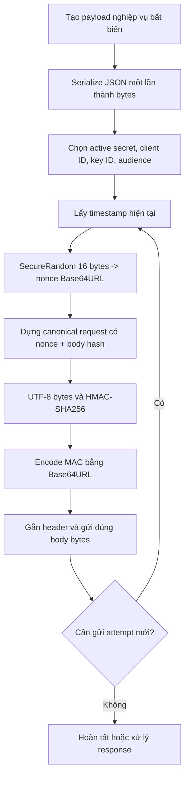
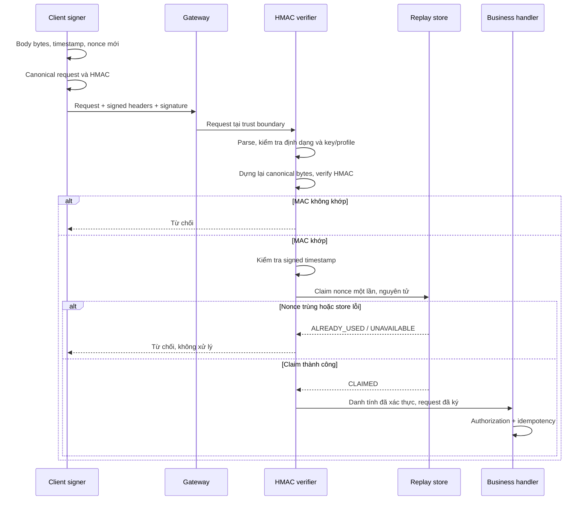

# Thêm nonce khi ký HTTP request bằng HMAC

> **Chương:** Ký request  
> **Bài học:** Thêm nonce — tích hợp một giá trị dùng một lần vào **quy trình client tạo request và chữ ký HMAC**, từ lúc chuẩn bị HTTP payload đến gửi request, retry và kiểm tra ở server.  
> **Ngữ cảnh module:** Xác thực HTTP request bằng shared secret và canonical request gồm phương thức, URI, header hoặc body theo hợp đồng ký. Cần kiểm soát replay bằng timestamp/nonce, luân chuyển key, biến đổi proxy/gateway và phân biệt xác thực với phân quyền.

## 1. Tại sao phải thêm nonce ngay trong bước ký request?

Giả sử một client đã biết shared secret và có thể tạo chữ ký HMAC hợp lệ:

```http
POST /v1/orders?mode=commit HTTP/1.1
Host: orders.example.test
Content-Type: application/json
X-Client-Id: partner-01
X-Key-Id: partner-2026-11
X-Timestamp: 1795800000
X-Nonce: hCEr8MA3-lEZiNtoV8hFrQ
X-Idempotency-Key: ORD-1024
X-Signature: <base64url-hmac-sha256>

{"orderId":"ORD-1024","amount":100000,"currency":"VND"}
```

HMAC chứng minh rằng một bên giữ shared secret đã tạo mã xác thực cho những bytes được ký. HMAC **không tự ghi nhớ** request nào đã được sử dụng. Nếu kẻ tấn công phát lại toàn bộ request, kể cả chữ ký, phép kiểm tra HMAC trên cùng bytes vẫn khớp.

Để chống phát lại (*replay*), phía gửi phải **thêm nonce mới vào request trước khi tính HMAC**, còn phía nhận phải lưu trạng thái một lần sử dụng:

```text
Client:
  sinh nonce mới → đưa nonce vào signed headers
  → dựng canonical request có nonce
  → tính HMAC → gửi HTTP request + chữ ký

Server:
  đọc nonce từ HTTP request thực
  → dựng lại canonical bytes có nonce
  → kiểm tra HMAC và timestamp
  → claim nonce nguyên tử → tiếp tục phân quyền/nghiệp vụ
```

Nếu client thêm `X-Nonce` **sau khi ký**, header đó không nằm trong HMAC. Attacker có thể sửa nonce và thử vượt qua replay store mà không cần biết secret. Nếu client tạo nonce mới nhưng vô tình **tái sử dụng signature cũ**, request mới phải bị server từ chối vì dữ liệu đã ký đã thay đổi.

**Mục tiêu của bài:** tự xây một signer Java 17 tạo nonce cho mỗi lần gửi, gắn nonce với timestamp/body/method/URI trong canonical bytes, chuyển đúng header qua HTTP client, thiết kế retry không tái sử dụng nonce, và biết những xác minh nào bắt buộc ở server.

## 2. Nonce ở client là gì?

*Nonce* thường được dịch là “số dùng một lần”, nhưng không cần là số nguyên; nó có thể là chuỗi Base64URL của các bytes ngẫu nhiên. Trong API dùng HMAC, nonce là **giá trị định danh một lần gửi đã ký**, không phải shared secret hay token phân quyền.

| Thuộc tính | Quy tắc của profile ví dụ | Mục đích |
| --- | --- | --- |
| Nguồn sinh | `SecureRandom` (CSPRNG) | Khó dự đoán và giảm va chạm |
| Độ dài | 16 bytes ngẫu nhiên = 128 bit | Không gian giá trị lớn |
| Biểu diễn header | Base64URL không padding | Chỉ ký tự ASCII an toàn cho header |
| Độ dài biểu diễn | Chính xác **22 ký tự** | Parser không cần đoán định dạng |
| Thời điểm sinh | Gần sát lúc tạo chữ ký cho **mỗi lần gửi** | Tránh dùng lại và tránh timestamp cũ |
| Phạm vi một lần | Mỗi `clientId + audience` trong cửa sổ chấp nhận | Hỗ trợ store ngăn replay nhất quán |
| Bảo vệ | Nonce nằm trong canonical bytes được HMAC ký | Không thể đổi nonce mà giữ tag cũ |
| Xác minh | Server claim nonce bằng thao tác nguyên tử | Chặn nhiều lần sử dụng cùng nonce |

Một nonce có thể được **truyền công khai** trong HTTP header. Tính an toàn không dựa vào việc nonce được giữ kín; nó dựa trên HMAC, tính khó dự đoán và replay store ở phía nhận.

### 2.1 Vì sao không dùng timestamp làm nonce?

Timestamp có độ phân giải giây; nhiều request cùng client có thể được ký trong cùng một giây. Hai request có thể nhận cùng timestamp, nhưng **phải có nonce khác nhau**.

```text
X-Timestamp: 1795800000
X-Nonce: first-random-value

X-Timestamp: 1795800000
X-Nonce: second-random-value
```

Timestamp và nonce bổ sung cho nhau:

- **Timestamp đã ký** giới hạn thời gian một request có thể được chấp nhận.
- **Nonce đã ký + store** xác nhận request chưa dùng trong phạm vi đó.
- Timestamp **không** thay thế nonce; nonce mà không có timestamp/TTL phù hợp cũng không tạo chống replay bền vững.

### 2.2 Vì sao không dùng bộ đếm hoặc `Math.random()`?

Một bộ đếm cục bộ có thể được đặt lại khi restart, dùng trùng giữa nhiều process hoặc không được đồng bộ trên nhiều instance client. `Math.random()` và `java.util.Random` không được thiết kế để cung cấp độ ngẫu nhiên mật mã.

Với 128 bit CSPRNG, xác suất va chạm ngẫu nhiên sau `n` lần sinh, theo xấp xỉ bài toán sinh nhật:

\[
P(\text{collision}) \approx \frac{n(n-1)}{2^{129}}.
\]

Khi `n = 10^9`, xác suất xấp xỉ `1,47 × 10^{-21}` nếu bộ sinh thực sự có chất lượng phù hợp. Dù rất nhỏ, điều đó **không thay thế** kiểm tra đã dùng ở server.

## 3. Sinh nonce an toàn bằng Java 17

JCA cung cấp `java.security.SecureRandom`. Ví dụ sau sinh 16 bytes rồi encode Base64URL không padding:

```java
import java.security.SecureRandom;
import java.util.Base64;

public final class NonceGenerator {
    private static final SecureRandom RNG = new SecureRandom();

    private NonceGenerator() {}

    public static String nextNonce() {
        byte[] raw = new byte[16];
        RNG.nextBytes(raw);
        return Base64.getUrlEncoder()
                .withoutPadding()
                .encodeToString(raw);
    }

    public static void main(String[] args) {
        String nonce = nextNonce();
        System.out.println(nonce);
        System.out.println(nonce.length()); // 22
    }
}
```

Không hardcode nonce từ ví dụ trong production. Không dùng cùng nonce cho nhiều request; ngay cả hai request có body giống nhau vẫn cần nonce khác nhau khi ký mới.

### 3.1 Định dạng phải được kiểm tra ở hai phía

Quy tắc của bài: chuỗi Base64URL không padding mã hóa **đúng 16 bytes**.

```java
import java.util.Base64;

public final class NonceFormat {
    private NonceFormat() {}

    public static boolean validNonce(String value) {
        if (value == null
                || !value.matches("[A-Za-z0-9_-]{22}")) {
            return false;
        }
        try {
            byte[] decoded = Base64.getUrlDecoder().decode(value);
            return decoded.length == 16
                    && Base64.getUrlEncoder()
                            .withoutPadding()
                            .encodeToString(decoded).equals(value);
        } catch (IllegalArgumentException malformed) {
            return false;
        }
    }
}
```

Bước decode rồi re-encode giúp loại một số dạng biểu diễn không canonical. Chỉ kiểm tra 22 ký tự hoặc regex **không chứng minh** nonce được sinh từ CSPRNG; phía client phải bảo đảm nguồn sinh, còn server vẫn phải claim một lần.

Không cho phép giá trị nonce rỗng, có dấu `=` padding nếu profile cấm, ký tự `+` hoặc `/` của Base64 thường, whitespace, dấu phẩy hoặc CR/LF. Adapter HTTP phải từ chối **header `X-Nonce` bị lặp**, vì framework/proxy có thể chọn hoặc gộp giá trị khác nhau.

## 4. Vị trí của nonce trong quy trình ký request

Một quy trình client an toàn không chỉ là “tạo nonce rồi đặt vào header”. Phải đảm bảo **cùng giá trị nonce và cùng body bytes** đi vào cả chuỗi ký lẫn HTTP request thật.

### 4.1 Thứ tự thực hiện khuyến nghị

1. **Chốt request nghiệp vụ:** method, URI (path + query), signed headers, Content-Type và payload JSON đã serialize thành bytes. Tránh thay đổi chúng sau bước ký.
2. **Chọn key còn hiệu lực:** client ID, key ID, thuật toán/phiên bản, audience và shared secret từ nơi lưu bảo mật.
3. **Sinh timestamp mới:** Unix epoch seconds từ đồng hồ được đồng bộ. Giới hạn clock skew theo hợp đồng.
4. **Sinh nonce mới:** 16 bytes từ CSPRNG; Base64URL không padding, 22 ký tự.
5. **Dựng canonical request:** bao gồm method, target, client/key ID, timestamp, **nonce**, signed business headers và hash raw body bytes.
6. **Encode canonical text thành bytes:** UTF-8, ký tự LF giữa các dòng, không thêm LF cuối theo profile.
7. **Tính HMAC:** dùng shared secret hiện tại và thuật toán đã thống nhất; encode tag thành Base64URL.
8. **Gắn headers và gửi:** `X-Timestamp`, `X-Nonce`, `X-Key-Id`, `X-Client-Id`, signature và header nghiệp vụ; HTTP client phải gửi đúng body bytes đã ký.
9. **Xử lý response/retry:** nếu cần phát một HTTP attempt mới, sinh lại timestamp/nonce và chữ ký, nhưng giữ nguyên idempotency key của **cùng một thao tác nghiệp vụ**.



Không lấy nonce từ request ID do proxy tạo sau khi ký. Nếu client dùng một thư viện tự retry trong nền, phải bảo đảm **mỗi attempt được ký lại** hoặc hiểu rằng attempt dùng lại nonce sẽ bị replay store từ chối nếu bản trước đã được claim.

### 4.2 Nonce không được đặt ngoài phạm vi HMAC

Sai lầm:

```text
message = method + LF + uri + LF + bodyHash
tag = HMAC(secret, message)
headers["X-Nonce"] = newNonce()    // Không nằm trong message đã ký
```

Kẻ tấn công chỉ cần thay `X-Nonce` mà tag không thay đổi. Server nếu dựa vào nonce mới để cho qua replay có thể xử lý request lại.

Đúng:

```text
nonce = newNonce()
message = version + LF + audience + LF + method + LF
        + uri + LF + timestamp + LF + nonce + LF + bodyHash
tag = HMAC(secret, UTF8(message))
headers["X-Nonce"] = nonce         // Cùng bytes đã xuất hiện khi ký
```

Trong một hệ thống thật, client ID, key ID, Content-Type và các dữ liệu khác ảnh hưởng đến xử lý cũng cần được ký hoặc ràng buộc theo trust boundary. Đây chỉ là đoạn mã giả tập trung vào nonce.

## 5. Hợp đồng canonical request có nonce

Chọn signing profile minh họa `hmac-nonce-v1` cho lệnh tạo đơn hàng.

| Dòng canonical | Giá trị minh họa | Ràng buộc |
| --- | --- | --- |
| 1. Version | `hmac-nonce-v1` | Có trong bytes ký để không lẫn profile |
| 2. Audience | `orders-api-prod` | Đích API/môi trường đáng tin |
| 3. HTTP method | `POST` | Phương thức thực nhận tại verifier |
| 4. Raw target | `/v1/orders?mode=commit` | Path và query theo hợp đồng |
| 5. Content-Type | `application/json` | Đúng loại body được ký |
| 6. Client ID | `partner-01` | Map sang identity/key policy |
| 7. Key ID | `partner-2026-11` | Key đang còn hiệu lực |
| 8. Timestamp | `1795800000` | Unix seconds, ký và kiểm tra time window |
| 9. **Nonce** | `hCEr8MA3-lEZiNtoV8hFrQ` | 16 bytes ngẫu nhiên được encode Base64URL |
| 10. Idempotency key | `ORD-1024` | Giữ ổn định khi retry cùng nghiệp vụ |
| 11. Body digest | Hex SHA-256 của raw JSON bytes | Phát hiện body thay đổi |

Chuỗi ví dụ:

```text
hmac-nonce-v1
orders-api-prod
POST
/v1/orders?mode=commit
application/json
partner-01
partner-2026-11
1795800000
hCEr8MA3-lEZiNtoV8hFrQ
ORD-1024
<sha256-hex-of-raw-json-body>
```

Các dòng ngăn bằng **một byte LF `0x0A`**, mã hóa UTF-8 và **không có LF cuối**. Chuỗi hash của body phải thay placeholder bằng digest 64 ký tự hex chữ thường đã tính từ **chính bytes sẽ gửi**.

Công thức:

```text
bodyHash = lowercase_hex(SHA256(rawBodyBytes))
canonicalBytes = UTF8(joinFieldsWithLF(
    version, audience, method, rawTarget, contentType,
    clientId, keyId, timestamp, nonce, idempotencyKey, bodyHash))
tag = HMAC_SHA256(sharedSecret, canonicalBytes)
signature = BASE64URL_NO_PADDING(tag)
```

**Lưu ý:** Đây là hợp đồng tự thiết kế để học tập, không phải format signature HTTP áp dụng toàn cục. Với API phụ thuộc `Host`, tenant header, Content-Encoding hoặc metadata khác, cần đưa các trường ảnh hưởng hành động vào HMAC hoặc cố định bằng nguồn tin cậy. Hợp đồng riêng phải xử lý URI percent-encoding, query duplicate, header duplicate và biến đổi gateway nhất quán.

### 5.1 Nonce phải gắn với audience và client

Nonce nằm trong một request được ký theo client và audience. Replay store nên có namespace tương ứng:

```text
hmac-replay:v1:orders-api-prod:partner-01:<nonce-digest>
```

Nếu cùng một client và audience được phục vụ bởi nhiều API instance, mọi instance phải dùng chung quyết định đã dùng. Không nên thêm key ID vào namespace một cách máy móc nếu điều đó cho phép cùng nonce của client được dùng lại trong thời gian chuyển từ key cũ sang key mới.

### 5.2 Idempotency key khác nonce

| Thuộc tính | Nonce | Idempotency key |
| --- | --- | --- |
| Đối tượng nhận diện | Một HTTP attempt được ký | Một thao tác nghiệp vụ logic |
| Khi retry | **Tạo mới** | **Giữ nguyên** cho cùng thao tác |
| Khi request hoàn toàn mới | Tạo mới | Tạo mới theo chính sách |
| Nơi kiểm tra | Replay store sau khi xác thực | Kho nghiệp vụ/idempotency |
| Điều nó ngăn | Dùng lại nguyên request đã ký trong thời hạn | Tạo side effect lặp dù có nonce mới |
| Bắt buộc được ký? | **Có** | Nên ký nếu ảnh hưởng xử lý nghiệp vụ |

Ví dụ client tạo đơn hàng `ORD-1024`, lần đầu đã được backend ghi thành công nhưng response mất trên đường truyền. Client không thể biết chắc request đã thực thi hay chưa. Lần retry với **nonce mới và chữ ký mới** có thể qua anti-replay, nhưng backend cần nhận **cùng idempotency key** để trả kết quả cũ, không tạo đơn hàng thứ hai.

Không dùng nonce làm idempotency key nếu mục tiêu nghiệp vụ là gom nhiều attempt thành cùng một thao tác.

## 6. Java 17: signer tạo nonce cho từng HTTP attempt

Ví dụ dưới đây dùng JDK 17, gồm `SecureRandom`, `Mac`, `MessageDigest` và `java.net.http.HttpRequest`. Chương trình:

- Serialize JSON thành byte array UTF-8 **một lần**; không gửi request thật qua mạng.
- Sinh nonce 16 bytes và timestamp cho từng lần ký.
- Ký method, URI, metadata, nonce, idempotency key và raw body digest.
- Tạo một `HttpRequest` với header đúng theo hợp đồng và body bytes đã ký.
- Tạo một retry mới với **nonce khác** nhưng **cùng idempotency key/body**.
- Chứng minh sửa nonce mà giữ chữ ký cũ làm MAC sai; replay nguyên request vẫn có **MAC hợp lệ**, cần store chống replay riêng.

Lưu vào `NonceSigningDemo.java`:

```java
import java.net.URI;
import java.net.http.HttpRequest;
import java.nio.charset.StandardCharsets;
import java.security.GeneralSecurityException;
import java.security.MessageDigest;
import java.security.SecureRandom;
import java.time.Clock;
import java.time.Duration;
import java.util.Base64;
import java.util.HexFormat;

import javax.crypto.Mac;
import javax.crypto.spec.SecretKeySpec;

public final class NonceSigningDemo {
    private static final String PROFILE = "hmac-nonce-v1";
    private static final String AUDIENCE = "orders-api-prod";
    private static final String METHOD = "POST";
    private static final String TARGET = "/v1/orders?mode=commit";
    private static final String CONTENT_TYPE = "application/json";
    private static final String CLIENT_ID = "partner-01";
    private static final String KEY_ID = "partner-2026-11";
    private static final String MAC_ALGORITHM = "HmacSHA256";

    private NonceSigningDemo() {}

    public record SignedRequest(
            String method,
            String rawTarget,
            String contentType,
            String clientId,
            String keyId,
            String timestamp,
            String nonce,
            String idempotencyKey,
            byte[] body,
            String signature) {

        public SignedRequest {
            body = body == null ? null : body.clone();
        }

        @Override
        public byte[] body() {
            return body == null ? null : body.clone();
        }
    }

    static String newNonce(SecureRandom rng) {
        byte[] nonceBytes = new byte[16];
        rng.nextBytes(nonceBytes);
        return Base64.getUrlEncoder()
                .withoutPadding()
                .encodeToString(nonceBytes);
    }

    static boolean validNonce(String nonce) {
        if (nonce == null
                || !nonce.matches("[A-Za-z0-9_-]{22}")) {
            return false;
        }
        try {
            byte[] decoded = Base64.getUrlDecoder().decode(nonce);
            return decoded.length == 16
                    && Base64.getUrlEncoder().withoutPadding()
                            .encodeToString(decoded).equals(nonce);
        } catch (IllegalArgumentException malformed) {
            return false;
        }
    }

    static byte[] canonicalBytes(
            String method,
            String rawTarget,
            String contentType,
            String clientId,
            String keyId,
            String timestamp,
            String nonce,
            String idempotencyKey,
            byte[] body) throws GeneralSecurityException {

        // Demo cố định method/target/audience để không suy đoán
        // cách normalize URL của HTTP client hoặc gateway.
        if (!METHOD.equals(method)
                || !TARGET.equals(rawTarget)
                || !CONTENT_TYPE.equals(contentType)
                || clientId == null
                || !clientId.matches("[A-Za-z0-9._-]{1,64}")
                || keyId == null
                || !keyId.matches("[A-Za-z0-9._-]{1,64}")
                || timestamp == null
                || !timestamp.matches("[1-9][0-9]{9,11}")
                || !validNonce(nonce)
                || idempotencyKey == null
                || !idempotencyKey.matches("[A-Za-z0-9._-]{1,80}")
                || body == null || body.length > 1_048_576) {
            throw new IllegalArgumentException("Invalid signed fields");
        }

        String bodyHash = HexFormat.of().formatHex(
                MessageDigest.getInstance("SHA-256").digest(body));

        String canonical = String.join("\n",
                PROFILE,
                AUDIENCE,
                method,
                rawTarget,
                contentType,
                clientId,
                keyId,
                timestamp,
                nonce,
                idempotencyKey,
                bodyHash);
        return canonical.getBytes(StandardCharsets.UTF_8);
    }

    static byte[] hmac(byte[] secret, byte[] message)
            throws GeneralSecurityException {
        Mac mac = Mac.getInstance(MAC_ALGORITHM);
        mac.init(new SecretKeySpec(secret, MAC_ALGORITHM));
        return mac.doFinal(message);
    }

    static SignedRequest signNewAttempt(
            byte[] secret,
            byte[] serializedJson,
            String idempotencyKey,
            Clock clock,
            SecureRandom rng) throws GeneralSecurityException {

        if (secret == null || secret.length < 32
                || serializedJson == null) {
            throw new IllegalArgumentException("Invalid demo input");
        }

        byte[] bodySnapshot = serializedJson.clone();
        String timestamp =
                Long.toString(clock.instant().getEpochSecond());
        String nonce = newNonce(rng);

        byte[] canonical = canonicalBytes(
                METHOD, TARGET, CONTENT_TYPE,
                CLIENT_ID, KEY_ID, timestamp, nonce,
                idempotencyKey, bodySnapshot);

        String signature = Base64.getUrlEncoder()
                .withoutPadding()
                .encodeToString(hmac(secret, canonical));

        return new SignedRequest(
                METHOD, TARGET, CONTENT_TYPE,
                CLIENT_ID, KEY_ID, timestamp, nonce,
                idempotencyKey, bodySnapshot, signature);
    }

    static boolean verifyMacOnly(
            byte[] secret, SignedRequest request)
            throws GeneralSecurityException {

        if (secret == null || secret.length < 32
                || request == null
                || request.signature() == null
                || !request.signature()
                        .matches("[A-Za-z0-9_-]{43}")) {
            return false;
        }

        final byte[] supplied;
        try {
            supplied = Base64.getUrlDecoder()
                    .decode(request.signature());
        } catch (IllegalArgumentException malformed) {
            return false;
        }

        if (supplied.length != 32
                || !Base64.getUrlEncoder().withoutPadding()
                        .encodeToString(supplied)
                        .equals(request.signature())) {
            return false;
        }

        try {
            byte[] canonical = canonicalBytes(
                    request.method(), request.rawTarget(),
                    request.contentType(), request.clientId(),
                    request.keyId(), request.timestamp(),
                    request.nonce(), request.idempotencyKey(),
                    request.body());

            byte[] expected = hmac(secret, canonical);
            return MessageDigest.isEqual(expected, supplied);
        } catch (IllegalArgumentException invalidRequest) {
            return false;
        }
    }

    // Tạo HTTP request nhưng KHÔNG gửi ra mạng.
    static HttpRequest buildHttpRequest(SignedRequest signed) {
        URI uri = URI.create(
                "https://orders.example.test" + signed.rawTarget());

        return HttpRequest.newBuilder(uri)
                .timeout(Duration.ofSeconds(10))
                .header("Content-Type", signed.contentType())
                .header("X-Client-Id", signed.clientId())
                .header("X-Key-Id", signed.keyId())
                .header("X-Timestamp", signed.timestamp())
                .header("X-Nonce", signed.nonce())
                .header("X-Idempotency-Key",
                        signed.idempotencyKey())
                .header("X-Signature", signed.signature())
                .POST(HttpRequest.BodyPublishers.ofByteArray(
                        signed.body()))
                .build();
    }

    public static void main(String[] args)
            throws GeneralSecurityException {

        SecureRandom rng = new SecureRandom();
        byte[] demoSecret = new byte[32];
        rng.nextBytes(demoSecret);

        // Serialize một lần, dùng lại đúng bytes cho retry.
        byte[] body = (
                "{\"orderId\":\"ORD-1024\","
                + "\"amount\":100000,\"currency\":\"VND\"}"
        ).getBytes(StandardCharsets.UTF_8);

        String businessKey = "ORD-1024";
        Clock clock = Clock.systemUTC();

        SignedRequest first = signNewAttempt(
                demoSecret, body, businessKey, clock, rng);
        SignedRequest retry = signNewAttempt(
                demoSecret, body, businessKey, clock, rng);

        HttpRequest httpRequest = buildHttpRequest(first);

        System.out.println("Nonce format: "
                + validNonce(first.nonce()));
        System.out.println("Nonce changed on retry: "
                + !first.nonce().equals(retry.nonce()));
        System.out.println("Idempotency key stable: "
                + first.idempotencyKey().equals(
                        retry.idempotencyKey()));
        System.out.println("First MAC valid: "
                + verifyMacOnly(demoSecret, first));
        System.out.println("Retry MAC valid: "
                + verifyMacOnly(demoSecret, retry));
        System.out.println("Signatures differ: "
                + !first.signature().equals(retry.signature()));

        SignedRequest tampered = new SignedRequest(
                first.method(), first.rawTarget(),
                first.contentType(), first.clientId(),
                first.keyId(), first.timestamp(),
                retry.nonce(), first.idempotencyKey(),
                first.body(), first.signature());

        System.out.println("Changed nonce, old MAC valid: "
                + verifyMacOnly(demoSecret, tampered));
        System.out.println("Exact replay MAC valid: "
                + verifyMacOnly(demoSecret, first));
        System.out.println("HTTP method: "
                + httpRequest.method());
        System.out.println("HTTP nonce header matches: "
                + httpRequest.headers().firstValue("X-Nonce")
                        .orElse("").equals(first.nonce()));
    }
}
```

Chạy bằng JDK 17:

```bash
javac -encoding UTF-8 NonceSigningDemo.java
java NonceSigningDemo
```

Kết quả kỳ vọng:

```text
Nonce format: true
Nonce changed on retry: true
Idempotency key stable: true
First MAC valid: true
Retry MAC valid: true
Signatures differ: true
Changed nonce, old MAC valid: false
Exact replay MAC valid: true
HTTP method: POST
HTTP nonce header matches: true
```

**Diễn giải:**

- Hai lần ký có cùng body, idempotency key và có thể cùng timestamp trong một giây; **nonce khác nhau** khiến canonical bytes và signature khác.
- Nếu thay `X-Nonce` nhưng giữ chữ ký cũ, HMAC không còn khớp.
- Nếu gửi lại **nguyên request đã ký**, MAC vẫn khớp. Đó là lý do server cần replay store; tên `verifyMacOnly` cố ý nhấn mạnh phần còn thiếu.
- `buildHttpRequest` chỉ tạo một đối tượng HTTP request minh họa; **không có cuộc gọi mạng** và không thể thay thế kiểm thử với gateway thật.
- `HttpRequest.BodyPublishers.ofByteArray` sử dụng body bytes từ snapshot đã ký. Không nên serialize lại object JSON sau khi tạo chữ ký.
- Secret trong demo sinh ngẫu nhiên chỉ cho lần chạy thử; production dùng key manager/secret store và key ID đang active.

### 6.1 Những giới hạn cần bù khi đưa vào API thực

Đoạn mã dùng method, URI và audience cố định, không parse JSON nghiêm ngặt, không phát hiện duplicate HTTP headers từ mạng, không xử lý timeout/retry thật, chưa xác minh thời gian hay nonce đã dùng và chưa phân quyền. Trong production:

- Một HTTP adapter ở server phải dựng lại canonical bytes từ **method, raw target, signed headers và raw body thực nhận**, không tin một `SignedRequest` do client tự dựng như nguồn đáng tin.
- Request có query/header nhập nhằng phải bị từ chối trước khi xác minh. Không tin `X-Original-URI` hoặc `X-Forwarded-*` do client ngoài tự khai.
- Kết quả xác thực phải gắn đúng client/key/audience; idempotency key phải được liên kết với body hash, client và operation để chống lạm dụng.
- Nếu ứng dụng dùng Spring/Servlet, cần kiểm soát body stream một lần, filter order và cách HTTP client/framework thay đổi URI hoặc header.
- Mã mới minh họa **bước thêm nonce ở client**, không tự tạo một hệ thống anti-replay hoàn chỉnh.

## 7. Đừng nhầm “thêm nonce” với “chống replay thành công”

Một sender có thể tạo nonce mới đúng cách, nhưng nếu server không lưu dấu đã dùng, attacker vẫn có thể phát lại nguyên request với nonce đó. **Tính một lần không nằm trong chuỗi ký tự nonce**, mà nằm ở phép kiểm tra trạng thái phía server.

### 7.1 Pipeline server cần có



Thao tác claim có ba kết quả đáng phân biệt:

| Kết quả | Ý nghĩa | Hành động |
| --- | --- | --- |
| `CLAIMED` | Nonce chưa dùng và đã được lưu thành công | Có thể kiểm tra quyền rồi xử lý |
| `ALREADY_USED` | Nonce từng được claim trong phạm vi bảo vệ | Từ chối replay |
| `UNAVAILABLE` / không rõ | Lỗi kết nối, timeout, failover hoặc không chắc đã ghi | **Fail closed**, không thực hiện nghiệp vụ |

Không dùng `GET` rồi `SET` thành hai bước độc lập. Khi nhiều request cùng nonce đến song song, chúng có thể cùng vượt qua kiểm tra tồn tại trước khi ghi. Cần thao tác **insert-if-absent nguyên tử** tại một nơi có mức nhất quán phù hợp.

### 7.2 Redis `SET NX EX` và TTL

Ví dụ một kho nonce chia sẻ:

```redis
SET hmac-replay:v1:orders-api-prod:partner-01:<nonce-digest> 1 NX EX 660
```

- `NX`: chỉ ghi nếu key chưa tồn tại.
- `EX 660`: xóa key sau 660 giây.
- `OK` nghĩa là claim thành công; nil nghĩa là đã tồn tại; timeout/lỗi là không rõ và phải từ chối.
- Namespace phải ràng buộc identity đã chứng thực và audience. Có thể hash nonce trước khi làm Redis key nếu muốn tránh raw nonce ở key; không lưu hoặc log shared secret.

**Vì sao ví dụ dùng TTL 660 giây?** Với signed timestamp được chấp nhận trong cửa sổ ±300 giây, một request có timestamp đi trước đồng hồ server 300 giây có thể được nhận lần đầu sớm và vẫn còn hiệu lực đến khoảng **600 giây sau**. TTL từ lần claim đầu phải bao phủ quãng này cộng margin theo mô hình thời gian, ví dụ 660 giây. Không copy TTL mà chưa phân tích cửa sổ thực tế, clock skew và sai lệch giữa các instance.

Redis `SET NX EX` nguyên tử trên một primary **không tự bảo đảm** bản ghi vừa ACK luôn tồn tại qua failover với replication bất đồng bộ. Với giao dịch nhạy cảm, phải đánh giá durability, eviction, multi-region và thiết kế idempotency/transaction ở database.

### 7.3 Thứ tự kiểm tra để tránh “chiếm nonce”

Server nên kiểm tra format, key/profile, canonical HMAC và timestamp **trước khi ghi nonce**. Nếu claim nonce cho request không có MAC hợp lệ, attacker có thể tiêu tốn store và chiếm các nonce dự đoán được.

Dù HMAC và nonce hợp lệ, API vẫn phải thực hiện **authorization theo client + operation + resource/tenant**. Không dùng nonce làm bằng chứng client có quyền.

## 8. Retry: nonce mới, chữ ký mới, nghiệp vụ vẫn là một

Đây là điểm dễ sai khi triển khai signer bằng HTTP client tự động retry.

### 8.1 Trường hợp mất response

Giả sử:

1. Client ký request A với timestamp `T1`, nonce `N1` và idempotency key `ORD-1024`.
2. Server xác minh MAC, claim `N1` và tạo đơn hàng.
3. Response bị mất do mạng; client không biết request đã thành công.
4. Client gửi lại chính request A (cùng `T1, N1, signature`): server phải **từ chối replay**.
5. Nếu policy cho retry, client ký **attempt B** với `T2, N2, signature2` nhưng giữ idempotency key `ORD-1024` và cùng nội dung nghiệp vụ.
6. Server xác thực attempt B (nonce mới) rồi tầng idempotency trả **kết quả đã lưu**, không tạo đơn hàng thứ hai.

```text
Attempt A:
  nonce = N1
  timestamp = T1
  idempotencyKey = ORD-1024
  signature = HMAC(secret, canonical(... N1, T1, ORD-1024 ...))

Attempt B:
  nonce = N2 (khác N1)
  timestamp = T2 (mới, có thể cùng giây nếu quá gần)
  idempotencyKey = ORD-1024 (giữ nguyên)
  signature = HMAC(secret, canonical(... N2, T2, ORD-1024 ...))
```

**Không** tự tạo idempotency key mới cho mỗi retry của cùng một giao dịch. Nếu tạo mới, backend có thể coi mỗi attempt là một lệnh nghiệp vụ độc lập và nhân đôi side effect.

### 8.2 Retry khi request đang ở trạng thái không rõ

Một timeout không chứng minh server chưa xử lý. Có thể:

- Request chưa tới gateway.
- Gateway nhận nhưng chưa tới verifier.
- Verifier đã claim nonce, còn nghiệp vụ chưa xong.
- Nghiệp vụ đã commit nhưng response chưa tới client.

Client không thể giải quyết sự bất định này chỉ bằng nonce. Cần idempotency store có chính sách rõ và API tra cứu trạng thái giao dịch. Trong quy trình thanh toán giá trị cao, việc gửi lại request mới phải tuân thủ chính sách idempotency và retry của nghiệp vụ; không được cứ ký nonce mới rồi retry vô hạn.

### 8.3 Hàng đợi và công việc gửi trễ

Nếu một request nằm trong queue 30 phút trước khi gửi, timestamp ký lúc enqueue có thể đã hết hạn. Vì vậy, đối với hệ thống trì hoãn:

```text
Enqueue:
  lưu business operation + payload/idempotency key

Ngay trước network attempt:
  chọn key active, lấy timestamp mới
  sinh nonce mới
  dựng canonical request và HMAC
  gửi payload đã đóng băng
```

Không lưu sẵn một signed HTTP request để phát lại sau nhiều phút mà bỏ qua cửa sổ timestamp, nonce hay key rotation.

### 8.4 Auto-retry của HTTP library

Một HTTP library có thể retry khi connection reset, redirect hoặc khi kết nối tới proxy lỗi. Với signed requests cần xem xét:

- Retry có **gửi lại đúng headers/signature cũ** không?
- Retry có thay URL, method, body bytes hoặc Content-Encoding không?
- Có redirect sang host/audience khác không?
- Có body publisher chỉ dùng được một lần không?
- Signature còn hợp lệ khi retry sau vài phút không?

**Ưu tiên:** kiểm soát retry ở tầng ứng dụng đủ gần signer để **mỗi network attempt mới có timestamp, nonce, chữ ký mới**, dùng lại business key ổn định. Nếu request đã được server claim mà library gửi lại nguyên request, lần sau bị từ chối là hành vi bảo mật đúng, không phải “lỗi ngẫu nhiên của HMAC”.

## 9. Gateway và canonicalization khi thêm nonce

Một request HMAC có nonce đi qua proxy/gateway có thể gặp một số vấn đề:

| Thành phần | Rủi ro | Biện pháp |
| --- | --- | --- |
| Header `X-Nonce` | Bị xóa, sửa, gộp hoặc nhân đôi | Từ chối thiếu/trùng; ký đúng header nhận được |
| Header `X-Timestamp` | Proxy sửa format/clock hoặc duplicate | Signed value phải nhất quán; không “sửa giờ” request sau khi ký |
| URI/path/query | Redirect/rewrite/percent decode | Xác minh ở trust boundary đã thống nhất, ký raw hoặc canonical target theo profile |
| Content-Type | HTTP client tự thêm charset parameter | Chốt format trước khi ký, kiểm thử trên wire |
| Body publisher | Serialize lại JSON sau khi HMAC đã tính | Giữ snapshot bytes bất biến |
| HTTP/2 → HTTP/1.1 | Pseudo-header/method/target chuyển đổi | Xác minh đúng method/target thực theo contract |
| Client identity | Gateway tin `X-Client-Id` từ bên ngoài | Chỉ xác thực identity sau MAC với key chính sách; làm sạch forwarded headers |
| API instance | Mỗi instance có cache nonce riêng | Dùng replay store chia sẻ |
| Multi-region | Hai vùng claim cùng nonce gần đồng thời | Cần uniqueness/consistency theo phạm vi audience |
| Key rotation | Một gateway dùng key cũ, backend dùng key mới | Policy/key propagation có thời gian chuyển tiếp rõ |
| CORS OPTIONS | Preflight không mang signature nghiệp vụ | Phân biệt preflight với request ký thật; không bypass HMAC cho POST |

**Một quy tắc quan trọng:** Gateway không được tự tạo nonce mới cho request đã ký trừ khi gateway là một bên ký lại hợp lệ theo một giao thức riêng. Sửa nonce làm tag client cũ không khớp.

Header `X-Original-URI` hoặc `X-Forwarded-*` do client ngoài tự gửi không tự đáng tin. Nếu verifier dùng chúng, gateway phải xóa/tái tạo và bảo vệ trust boundary, tránh tình trạng client ký một đường dẫn nhưng backend xử lý đường dẫn khác.

## 10. Key rotation và cách chọn nonce trong signing profile

Key rotation và sinh nonce là hai trách nhiệm độc lập nhưng cần tương thích.

Một key resolver có thể dựa trên:

```text
(clientId, keyId, audience, signingProfile)
    -> active shared secret + thời gian hiệu lực
```

Khi chuyển từ key cũ sang key mới, request mới phải dùng `keyId` thực sự tương ứng secret. Key ID phải là trường được ký hoặc được ràng buộc vào hợp đồng; server chỉ chọn key thuộc đúng client/profile và còn hiệu lực.

Nonce vẫn nên là **mới cho mỗi attempt**, kể cả sau khi đổi key. Không nên đặt key ID vào phạm vi uniqueness mà không đánh giá rủi ro: nếu replay store ghi `clientId:keyId:nonce`, một nonce có thể được dùng lại khi client chuyển từ key A sang B. Với profile minh họa, nonce được bảo vệ theo client + audience trong toàn bộ cửa sổ, không tùy key ID.

Một attacker có được shared secret có thể ký request mới với nonce mới, vì vậy **nonce không cứu được key bị lộ**. Cần thu hồi/rotate key, giới hạn quyền theo client, giám sát bất thường, TLS và các biện pháp phòng thủ khác.

Nếu chuyển thuật toán HMAC hoặc thay cách canonicalize nonce, đó là thay đổi **signing profile**, cần version mới và cơ chế chặn downgrade. Không để client yêu cầu fallback qua một header thuật toán không được policy cho phép.

## 11. Kiểm thử phần “thêm nonce” từ client đến server

### 11.1 Ma trận kiểm thử

| Ca kiểm thử | Thao tác | Kết quả mong đợi |
| --- | --- | --- |
| Nonce hợp lệ | Sinh 16 bytes CSPRNG, encode Base64URL | 22 ký tự, decode đúng 16 bytes |
| Hai attempts liên tiếp | Ký cùng payload trong cùng giây | Nonce khác nhau, chữ ký khác nhau |
| Nonce rỗng/sai encoding | Gửi `X-Nonce` thiếu, có padding hoặc ký tự `+` | Server từ chối |
| Nonce sai độ dài | Encode 8 bytes hoặc 32 bytes | Server từ chối theo profile |
| Nonce không được ký | Đổi nonce mà giữ MAC cũ | Test phải phát hiện lỗi thiết kế; không được chấp nhận |
| Nonce đã ký | Đổi `X-Nonce`, giữ signature | HMAC sai |
| Thay timestamp | Giữ nonce và signature | HMAC sai |
| Thay method | `POST` thành `PUT`, giữ tag | HMAC sai |
| Thay target | `mode=commit` thành `mode=preview` | HMAC sai |
| Thay body | Đổi `amount` rồi giữ tag | HMAC sai |
| Thay idempotency key | Giữ chữ ký cũ | HMAC sai |
| Duplicate nonce header | Hai `X-Nonce` khác nhau hoặc cùng nhau | Từ chối nhập nhằng |
| Replay nguyên request | Gửi lại cùng nonce/timestamp/tag | HMAC có thể đúng, store từ chối |
| Hai request đồng thời | Cùng nonce đến hai API instances | Chỉ một claim thành công |
| Replay store timeout | Không nhận được trạng thái claim chắc chắn | Fail closed, không chạy nghiệp vụ |
| TTL hết hạn quá sớm | Xóa nonce trước khi signed timestamp hết hạn | Kiểm thử phát hiện khả năng replay |
| Multi-region replication | Gửi cùng nonce qua hai vùng | Uniqueness theo yêu cầu kiến trúc |
| Key rotation | Ký bằng key ID đã thu hồi | Từ chối |
| Retry sau mất response | Ký nonce mới, giữ idempotency key | Không tạo hai side effect |
| HTTP client auto retry | Library tự gửi lại headers cũ | Phát hiện và xử lý theo retry policy |
| Gateway rewrite | Path/query/header thay đổi khi chuyển tiếp | Canonical phải nhất quán hoặc từ chối |
| Chữ ký đúng nhưng thiếu quyền | Client ký lệnh ngoài phạm vi cho phép | Authorization từ chối |

### 11.2 Golden vectors cho signer

Khi kiểm thử chéo ngôn ngữ Java/Go/Node/Python, lưu một bộ vector **cố định** bằng secret thử nghiệm:

```text
profile: hmac-nonce-v1
algorithm: HmacSHA256
test_secret_hex: <test-key-bytes>
method: POST
raw_target: /v1/orders?mode=commit
content_type: application/json
client_id: partner-01
key_id: partner-2026-11
timestamp: <fixed-epoch-seconds>
nonce: <fixed-22-char-base64url>
idempotency_key: ORD-1024
raw_body_utf8_hex: <exact-json-bytes>
body_sha256_hex: <64-hex>
canonical_utf8_hex: <exact-bytes>
hmac_tag_hex: <64-hex>
signature_base64url: <43-char-tag>
```

**Phân biệt production và test:** Test vector có nonce cố định là cần thiết để kiểm tra tính tương thích. **Không dùng nonce cố định trong production**. Trong test unit, có thể inject một nguồn nonce xác định để tái tạo vector; production luôn dùng CSPRNG.

Một test “Java ký rồi chính Java verifier kiểm tra bằng cùng một hàm canonicalization” chưa chứng minh giao thức tương thích với SDK khác. Cần so sánh canonical bytes và tag với implementation độc lập.

### 11.3 Debug khi HMAC của nonce không khớp

Kiểm tra theo thứ tự:

1. Cả client và server có cùng signing profile, algorithm, client ID, key ID, audience và secret đang active không?
2. `X-Nonce` thực gửi có đúng giá trị client đã dùng khi dựng canonical request không?
3. Timestamp có bị sinh trước quá lâu hoặc bị chỉnh sửa khi đi qua proxy không?
4. Client có dùng **cùng raw JSON body bytes** để ký và gửi không? Content-Type có bị thêm parameter ngoài hợp đồng không?
5. Method, raw URI và query ở trust boundary có giống bytes mà profile quy định không?
6. Các dòng canonical có đúng thứ tự, UTF-8, LF và không LF cuối không?
7. Tag được encode đúng Base64URL không padding hay không? Server decode và so sánh bytes HMAC hay chỉ so chuỗi?
8. Nếu MAC đã hợp lệ mà API vẫn từ chối, kiểm tra replay store, signed timestamp, key policy và authorization.

Không log shared secret, expected MAC hoặc toàn bộ body nhạy cảm. Có thể log correlation ID, client ID, key ID, nonce validation result, dạng lỗi và thông tin thống kê an toàn; hạn chế log full nonce/signature trong production.

## 12. Bài tập thực hành

**Bài 1 — Đặt nonce đúng vị trí:** Viết một signer chỉ ký method/target/body hash rồi đặt nonce vào header sau. Cho biết cách attacker phát lại request bằng cách đổi nonce. Sửa lại để nonce nằm trong canonical bytes **trước** bước HMAC.

**Bài 2 — Nonce trong một giây:** Tạo 1.000 HTTP attempt có cùng timestamp và body bằng `SecureRandom`. Kiểm tra nonce khác nhau, tag khác nhau và giải thích vì sao timestamp giống không phải lỗi.

**Bài 3 — HTTP client:** Mở rộng `NonceSigningDemo` để gửi request tới một mock server do bạn kiểm soát. Ở server, kiểm tra header duplicate, tái dựng canonical bytes từ HTTP request thật và chứng minh đổi nonce sau khi ký làm MAC không hợp lệ.

**Bài 4 — Retry:** Mô phỏng lần đầu server commit đơn hàng nhưng client mất response. Tạo attempt thứ hai với nonce/timestamp/tag mới và cùng idempotency key. Thiết kế kết quả trả về sao cho không có hai đơn hàng.

**Bài 5 — Replay store:** Thiết kế interface `claimOnce(clientId, audience, nonce, ttl)` có trạng thái `CLAIMED`, `ALREADY_USED`, `UNAVAILABLE`. Thử hai luồng đồng thời và lỗi timeout; không cho nghiệp vụ chạy nếu kết quả không xác định.

**Bài 6 — Key rotation:** Giả lập một client đang chuyển từ `key-old` sang `key-new`. Cho biết vì sao mỗi attempt vẫn cần nonce mới và namespace replay không nên tự động tách theo key ID khi chính sách nonce áp dụng toàn client.

**Bài 7 — Proxy/gateway:** Dùng HTTP/1.1 và HTTP/2 qua một gateway test, kiểm tra URI rewrite, `X-Nonce` trùng, body bytes, Content-Encoding và vị trí verifier. Chỉ ra hop có quyền tạo lại signature nếu có.

**Bài 8 — TTL:** Với timestamp chấp nhận ±300 giây, tính thời điểm chấp nhận sớm nhất/muộn nhất của cùng một request. Chứng minh vì sao giữ nonce 300 giây từ lần đầu nhận có thể chưa đủ.

## 13. Câu hỏi tự kiểm tra

1. Vì sao nonce phải được sinh **trước** khi tính HMAC, không phải sau khi đặt signature vào header?
2. Nonce dùng một lần khác timestamp, request ID và idempotency key ở những điểm nào?
3. Tại sao CSPRNG 128 bit và Base64URL không padding là lựa chọn phù hợp cho header nonce?
4. Nếu hai request được ký trong cùng một giây, timestamp có bắt buộc khác nhau không? Nonce thì sao?
5. Nếu client thay nonce nhưng giữ signature cũ, server phải phản ứng thế nào?
6. Vì sao gửi lại nguyên request có thể có HMAC hợp lệ nhưng vẫn bị server từ chối?
7. Tại sao không thể chỉ dùng một `HashSet` trong từng instance để chống replay?
8. Khi replay store timeout, có nên cho request chạy tiếp vì MAC đã khớp không?
9. Vì sao TTL nonce phải bao phủ toàn bộ thời gian signed timestamp còn hợp lệ, đặc biệt khi cho timestamp tương lai?
10. Trong retry sau mất response, thông tin nào phải mới và thông tin nào phải giữ nguyên?
11. API gateway có được tự ý thay giá trị `X-Nonce` của request đã ký không?
12. Khi rotation shared secret, có thể bỏ bước sinh nonce hoặc bỏ bước kiểm tra quyền không?
13. Một client có nonce mới, HMAC đúng và timestamp hợp lệ đã chắc chắn có quyền tạo đơn hàng của tenant khác chưa?

**Ghi nhớ:** Thêm nonce khi ký request nghĩa là **tạo nonce ngẫu nhiên mới cho từng HTTP attempt, gắn cùng giá trị đó vào canonical request và signed header trước khi tính HMAC**, rồi gửi chính body/method/URI đã được ký. Server phải dựng lại bytes từ request thực, xác minh MAC và timestamp, **claim nonce nguyên tử trong replay store** và từ chối an toàn khi store không sẵn sàng. Khi retry, tạo nonce/chữ ký mới nhưng giữ idempotency key cho cùng nghiệp vụ; key rotation, gateway canonicalization và phân quyền vẫn là những lớp bảo vệ độc lập.
