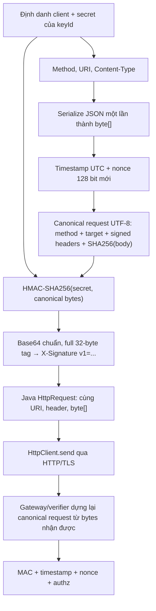

# Gửi request đã ký HMAC: Từ canonical bytes đến HTTP thực tế

Khi nói “ký request”, người học thường tập trung vào phép tính `Mac.doFinal()`. Nhưng **chữ ký chỉ có ý nghĩa nếu client thực sự gửi đúng method, URI, header và body đã dùng để ký**. Một client có thể tính HMAC-SHA256 chính xác, rồi vô tình để HTTP library đổi cách encode query, JSON serializer thêm newline hoặc interceptor sửa header; server sẽ nhận **một request khác** và tính ra chữ ký không khớp.

**Gửi request** là bước ghép **canonical request, shared secret, header chữ ký và HTTP client** thành một hành động mạng có thể kiểm chứng. Đây là chủ đề của chương **Ký request** trong module `SECURITY_AUTHENTICATION_HMAC_REQUEST_AUTHENTICATION`: thiết kế xác thực HTTP request bằng HMAC với shared secret và canonical request bao gồm phương thức, URI, header hoặc body theo hợp đồng ký; xác minh chữ ký, chống replay bằng timestamp/nonce, quản lý key rotation, kiểm thử proxy/gateway và phân biệt xác thực với phân quyền.

Bài này đi theo góc nhìn **bên gửi (client)**, rồi dùng một server thử nghiệm cục bộ để chứng minh server dựng lại cùng chuỗi ký. Mục tiêu không phải “gửi được một HTTP POST” mà là **gửi đúng từng byte có ảnh hưởng đến tính xác thực**, xử lý lỗi mạng an toàn và biết cách kiểm thử thực tế.

## 1. Mục tiêu học tập

Sau bài học, bạn có thể:

1. Mô tả đúng trình tự **tạo nội dung → cố định byte → dựng canonical request → HMAC → Base64 signature → xây HTTP request → gửi**.
2. Chọn nguồn method, raw URI/query, signed headers và raw body nhất quán giữa dữ liệu được ký và dữ liệu thực gửi.
3. Gửi HTTP request đã ký bằng **Java 17 `HttpClient`**, dùng `BodyPublishers.ofByteArray(...)` để bảo toàn body bytes.
4. Sinh timestamp UTC và nonce đủ ngẫu nhiên, xử lý retry với **nonce mới** nhưng không gây lặp nghiệp vụ ngoài ý muốn.
5. Phân loại lỗi từ client encoding, gateway rewrite, credential/key rotation, replay, authorization và mạng.
6. Xây test end-to-end với server Java cục bộ, kiểm chứng request thật và phản hồi; xác định giới hạn của demo so với hệ thống production.

## 2. Một request đã ký cần được gửi như thế nào?

Ví dụ đối tác `partner-a` gửi thao tác tạo đơn:

```http
POST /v1/orders?channel=partner HTTP/1.1
Host: api.example.test
Content-Type: application/json
X-Key-Id: partner-a-202611
X-Timestamp: 2026-11-28T02:00:00Z
X-Nonce: Zq8DxKtUokcwPGNj3d_yvQ
X-Signature: v1=<BASE64_FULL_HMAC_SHA256>

{"sku":"BK-42","quantity":2}
```

Các giá trị `<...>` là **placeholder**, chưa phải chữ ký thực. Các thành phần có vai trò khác nhau:

| Thành phần | Client quyết định ở đâu? | Vì sao quan trọng khi gửi? |
| --- | --- | --- |
| Method `POST` | API contract và `HttpRequest.Builder.POST`. | Đổi sang `PUT` hoặc `PATCH` làm thay đổi hành động và chuỗi ký. |
| Raw target `/v1/orders?channel=partner` | URI được xây trước khi ký. | Query order, percent-encoding, path và dấu `?` phải nhất quán. |
| `Content-Type` | Header được thiết lập trong HTTP builder. | Server cần diễn giải body đúng media type đã ký. |
| `X-Key-Id` | Credential được client cấu hình. | Server tra **một** secret ACTIVE theo key ID; key ID không phải secret. |
| `X-Timestamp` | Thời gian UTC tạo cho lần gửi. | Server kiểm tra cửa sổ; phải được đưa vào chữ ký. |
| `X-Nonce` | Giá trị ngẫu nhiên mới cho lần gửi. | Chống replay khi server claim nonce một lần. |
| Raw JSON body | Một `byte[]` UTF-8 đã serialize. | HTTP publisher phải gửi **chính bytes** đã băm. |
| `X-Signature` | Base64 của HMAC trên canonical request. | Server decode và so sánh tag, **không** dùng nó làm danh tính trước khi xác minh. |
| Transport | `https://...` và HTTP version được client chọn. | TLS bảo mật kênh, gateway có thể chuyển HTTP/1.1 ↔ HTTP/2. |

**Cần phân biệt:** `Host` và scheme có thể ảnh hưởng định tuyến. Hợp đồng trong bài dùng **audience cố định** `orders-api-local` cho demo; sản phẩm nhiều virtual host/tenant cần ràng buộc authority đáng tin hoặc quy định host cụ thể. Không suy ra chỉ ký path là đủ cho mọi topology.

## 3. Quy trình gửi: chuẩn bị đủ dữ liệu rồi mới ký

Một quy trình nhất quán gồm tám bước:

1. **Chọn credential:** lấy `keyId` và shared secret của đúng client, audience và môi trường. Secret phải đến từ secret manager/keystore; không ghi vào URL, log, source code production.
2. **Chọn method và URI:** chốt token method `POST`, raw path và raw query. Không build lại URI sau khi ký.
3. **Tạo body bytes một lần:** serialize dữ liệu thành UTF-8 `byte[]`. Đừng ký `object.toString()` rồi để HTTP library serialize object khác.
4. **Chọn signed headers:** ví dụ `Content-Type: application/json`, `X-Key-Id`, timestamp và nonce; xác định thứ tự canonical.
5. **Tạo freshness:** timestamp UTC ở độ chính xác giây và nonce mới từ `SecureRandom` (ví dụ 16 byte Base64URL không padding).
6. **Dựng canonical UTF-8 bytes:** bao gồm version, audience, method, raw target, các header đã ký và SHA-256 của raw body bytes; dùng LF giữa dòng, không LF cuối.
7. **Tính HMAC và encode:** `Mac.getInstance("HmacSHA256")` với secret; `doFinal(canonicalBytes)` cho 32 byte; Base64 chuẩn có padding thành 44 ký tự rồi gắn prefix `v1=`.
8. **Gửi đúng request đã ký:** đặt các header trong `HttpRequest.Builder`, dùng `BodyPublishers.ofByteArray(body)`, gửi qua `HttpClient` và xử lý status/timeout. Không để một interceptor thay các trường đã ký ở giữa bước 7 và 8.



Điểm cốt lõi: **chữ ký không phải dữ liệu client “khai” để server tin**. Server tự tạo canonical bytes từ HTTP request thực nhận, chọn secret theo key ID đã đăng ký và tính MAC kỳ vọng. Do đó client phải bảo đảm **HTTP request được gửi đúng với bản đã ký**.

## 4. Hợp đồng ký minh họa HMAC-SHA256-V1

Ví dụ dùng một giao thức **do ứng dụng tự định nghĩa**, không phải tiêu chuẩn chung cho mọi HMAC HTTP API:

| Quy tắc | HMAC-SHA256-V1 của bài |
| --- | --- |
| Audience | `orders-api-local` cho demo loopback; production dùng audience riêng đúng dịch vụ/môi trường. |
| Method | Chính xác `POST`, không tự đổi case. |
| Raw target | Chính xác `/v1/orders?channel=partner`. |
| HTTP body | UTF-8 JSON, **raw content bytes** được giữ nguyên; tối đa 8 KiB ở demo. |
| `Content-Type` | Chính xác `application/json`, một giá trị, không có encoding phụ. |
| `Content-Encoding` | Không được gửi trong V1; không nén body. |
| `X-Key-Id` | Định danh credential, được đưa vào canonical request. |
| `X-Timestamp` | UTC ISO-8601 có giây, ví dụ `2026-11-28T02:00:00Z`; cửa sổ ±300 giây. |
| `X-Nonce` | 16 byte CSPRNG, Base64URL không padding (22 ký tự); dùng một lần. |
| Hash body | SHA-256 trên **raw body bytes**, hex chữ thường. |
| Ghép canonical | UTF-8, một dòng/mục, phân cách LF (`\n`), không LF cuối. |
| Thuật toán | `HmacSHA256`, sử dụng full MAC tag **32 byte**. |
| `X-Signature` | `v1=` + Base64 chuẩn có padding của 32 byte (44 ký tự Base64, 47 ký tự cả prefix). |

Canonical request tương ứng với ví dụ đầu bài:

```text
HMAC-SHA256-V1
orders-api-local
POST
/v1/orders?channel=partner
content-type:application/json
x-key-id:partner-a-202611
x-timestamp:2026-11-28T02:00:00Z
x-nonce:Zq8DxKtUokcwPGNj3d_yvQ
sha256:<LOWERCASE_HEX_SHA256_OF_RAW_BODY>
```

Client thay dòng cuối bằng digest thật, rồi thực hiện:

\[
\begin{aligned}
D &= \operatorname{SHA256}(\mathrm{rawBodyBytes}),\\
C &= \operatorname{UTF8}(\mathrm{canonicalString\ containing\ hex}(D)),\\
T &= \operatorname{HMAC}_{\mathrm{SHA256}}(K,C),\\
\mathrm{signatureValue} &= \texttt{v1=} \Vert \operatorname{Base64}_{\mathrm{padded}}(T).
\end{aligned}
\]

**SHA-256(body) không phải HMAC**: digest body không có khóa chỉ đại diện cho payload trong chuỗi canonical. HMAC trên toàn bộ chuỗi đó mới xác nhận bên gửi biết secret và ràng buộc **cả hành động, URI, header, payload và freshness**.

### Vì sao không ký `Content-Length`?

`Content-Length` và transfer framing có thể khác sau khi proxy chuyển HTTP/1.1 chunked sang HTTP/2 DATA frames dù **content bytes** giữ nguyên. V1 băm content bytes **sau khi HTTP parser loại transport framing**. Server vẫn phải kiểm tra framing an toàn, content length/truncation và request smuggling ở ingress; không phải cứ ký `Content-Length` là giải quyết được hai parser hiểu request khác nhau.

### Vì sao không tự ký `Host` trong demo?

Demo chỉ chạy một origin loopback, một audience và một endpoint cố định nên dễ thấy tác dụng của canonical signing. Trong production có nhiều domain hoặc tenant dựa trên host, cần ràng buộc **authority/host tin cậy** theo hợp đồng ký phù hợp và kiểm thử sự khác biệt giữa host công khai với backend sau TLS termination. Không dùng `Host` do client tự khai để thay cho cấu hình audience hoặc lựa chọn secret.

## 5. Java 17: chuẩn bị request với `HttpClient`

Java 17 có `java.net.http.HttpClient` và `HttpRequest` chuẩn JDK. Với body cần giữ nguyên byte:

```java
byte[] body = "{\"sku\":\"BK-42\",\"quantity\":2}"
        .getBytes(java.nio.charset.StandardCharsets.UTF_8);

// Tạo body một lần và dùng đúng mảng này ở cả bước SHA-256 lẫn gửi mạng.
// Trong ví dụ đầy đủ bên dưới, các giá trị này được đưa vào canonical.
java.net.http.HttpRequest request = java.net.http.HttpRequest.newBuilder(uri)
        .header("Content-Type", "application/json")
        .header("X-Key-Id", keyId)
        .header("X-Timestamp", timestamp)
        .header("X-Nonce", nonce)
        .header("X-Signature", signature)
        .POST(java.net.http.HttpRequest.BodyPublishers.ofByteArray(body))
        .build();
```

Đây là **mảnh tích hợp**, không phải chương trình độc lập: `uri`, `keyId`, `timestamp`, `nonce`, `signature` được xây từ **cùng request** trước khi gọi builder.

**Không dùng** `BodyPublishers.ofString(json)` với một chuỗi khác chuỗi đã ký, `ObjectMapper` serialization lần hai hoặc logic interceptor sửa URI/headers sau bước tính HMAC. `ofString(json, StandardCharsets.UTF_8)` có thể đúng nếu serialize và encode nhất quán, nhưng `ofByteArray(body)` làm mối liên hệ “ký byte nào, gửi byte ấy” tường minh hơn.

### URI và raw query

Một query có thứ tự:

```text
/v1/orders?channel=partner&currency=VND
```

khác chuỗi:

```text
/v1/orders?currency=VND&channel=partner
```

ở cấp **raw bytes**. Nếu HTTP client xây URI từ `Map` không có thứ tự ổn định hoặc encode `%2F` khác bản client đã ký, server tính HMAC trên raw request target có thể thất bại. Nên **chốt một `URI` duy nhất**, dựng raw target từ URI đúng quy tắc, và đưa **chính URI đó** vào `HttpRequest`. Không ký một path do mapper normalize rồi gửi URI khác.

Với Java `URI`, `getRawPath()` và `getRawQuery()` giữ phần percent escape đang tồn tại trong **đối tượng URI**. Tuy nhiên, proxy/gateway hoặc HTTP stack có thể thay đổi URI **trước khi verifier nhận**; chỉ dùng tên phương thức “Raw” trong Java không chứng minh bytes giữ nguyên end-to-end.

### Header có ảnh hưởng đến body

`Content-Type` thường cần được ký để ràng buộc parser backend. Nếu chọn hỗ trợ gzip, phải định nghĩa bytes băm nằm **trước hay sau giải nén** và ký `Content-Encoding`. Trong V1 của bài, **cấm Content-Encoding** để loại bỏ nhập nhằng. Client không được gửi `Content-Encoding: gzip` rồi băm body đã giải nén hoặc ngược lại.

## 6. Java 17: demo gửi request thật tới server loopback

Đoạn sau là **chương trình tự chạy** bằng JDK 17, không cần thư viện ngoài. Nó khởi động `HttpServer` của JDK trên **127.0.0.1**, tạo một HTTP request bằng `HttpClient`, ký HMAC-SHA256 và gửi tới server ngay trong cùng JVM. Server **không tin chữ ký được client đưa sẵn**: nó đọc method, URI, header và body nhận được, dựng lại canonical bytes, tính HMAC rồi kiểm tra timestamp và nonce.

**Chỉ để học/test:** Demo dùng **HTTP không TLS trên loopback**, shared secret nằm trong cùng quá trình và nonce store là bộ nhớ JVM. **Production phải sử dụng HTTPS**, registry/secret manager riêng, nonce store dùng chung nhiều instance và kiểm tra parser/gateway ở ingress. Không triển khai nguyên mẫu này nguyên trạng ra Internet.

Lưu file `SignedRequestSendDemo.java`, biên dịch/chạy bằng JDK 17 đầy đủ (có module `jdk.httpserver`). Tùy JDK image hoặc cấu hình module, có thể cần thêm `--add-modules jdk.httpserver`.

```java
import com.sun.net.httpserver.Headers;
import com.sun.net.httpserver.HttpExchange;
import com.sun.net.httpserver.HttpServer;
import java.io.ByteArrayOutputStream;
import java.io.IOException;
import java.io.InputStream;
import java.io.OutputStream;
import java.net.InetSocketAddress;
import java.net.URI;
import java.net.http.HttpClient;
import java.net.http.HttpRequest;
import java.net.http.HttpResponse;
import java.nio.charset.StandardCharsets;
import java.security.GeneralSecurityException;
import java.security.MessageDigest;
import java.security.SecureRandom;
import java.time.Instant;
import java.time.Duration;
import java.time.temporal.ChronoUnit;
import java.time.format.DateTimeParseException;
import java.util.Base64;
import java.util.HexFormat;
import java.util.List;
import java.util.Set;
import java.util.concurrent.ConcurrentHashMap;
import javax.crypto.Mac;
import javax.crypto.spec.SecretKeySpec;

public final class SignedRequestSendDemo {
    private static final String VERSION = "HMAC-SHA256-V1";
    private static final String AUDIENCE = "orders-api-local";
    private static final String TARGET = "/v1/orders?channel=partner";
    private static final String KEY_ID = "partner-a-202611";
    private static final String CONTENT_TYPE = "application/json";
    private static final String ALGORITHM = "HmacSHA256";
    private static final String SIG_PREFIX = "v1=";
    private static final int MAX_BODY = 8192;

    private SignedRequestSendDemo() {}

    private static String rawTarget(URI uri) {
        String path = uri.getRawPath();
        String query = uri.getRawQuery();
        if (path == null) {
            throw new IllegalArgumentException("Missing path");
        }
        return query == null ? path : path + "?" + query;
    }

    private static byte[] readBounded(InputStream in, int limit)
            throws IOException {
        ByteArrayOutputStream output = new ByteArrayOutputStream();
        byte[] buffer = new byte[2048];
        int count;
        while ((count = in.read(buffer)) != -1) {
            if (count > limit - output.size()) {
                throw new IllegalArgumentException("Body too large");
            }
            output.write(buffer, 0, count);
        }
        return output.toByteArray();
    }

    private static String singleHeader(Headers headers, String name) {
        List<String> values = headers.get(name); // Tên header case-insensitive.
        if (values == null || values.size() != 1) {
            throw new IllegalArgumentException("Missing/duplicate: " + name);
        }
        return values.get(0);
    }

    private static void validateSignedFields(
            String method, String target, String type, String keyId,
            String timestamp, String nonce, byte[] body) {
        if (!"POST".equals(method) || !TARGET.equals(target)
                || !CONTENT_TYPE.equals(type)
                || !KEY_ID.equals(keyId)
                || body == null || body.length > MAX_BODY
                || timestamp == null
                || !timestamp.matches(
                    "[0-9]{4}-[0-9]{2}-[0-9]{2}T"
                    + "[0-9]{2}:[0-9]{2}:[0-9]{2}Z")
                || nonce == null || nonce.length() != 22) {
            throw new IllegalArgumentException("Invalid signed fields");
        }
        try {
            byte[] bytes = Base64.getUrlDecoder().decode(nonce);
            if (bytes.length != 16
                    || !Base64.getUrlEncoder().withoutPadding()
                            .encodeToString(bytes).equals(nonce)) {
                throw new IllegalArgumentException("Invalid nonce");
            }
        } catch (IllegalArgumentException ex) {
            throw new IllegalArgumentException("Invalid nonce", ex);
        }
        try {
            Instant.parse(timestamp);
        } catch (DateTimeParseException ex) {
            throw new IllegalArgumentException("Invalid UTC timestamp", ex);
        }
    }

    private static byte[] canonical(
            String method, String target, String type, String keyId,
            String timestamp, String nonce, byte[] body)
            throws GeneralSecurityException {
        validateSignedFields(method, target, type, keyId,
                timestamp, nonce, body);
        String hash = HexFormat.of().formatHex(
                MessageDigest.getInstance("SHA-256").digest(body));
        String canonical = String.join("\n",
                VERSION, AUDIENCE, method, target,
                "content-type:" + type,
                "x-key-id:" + keyId,
                "x-timestamp:" + timestamp,
                "x-nonce:" + nonce,
                "sha256:" + hash);
        return canonical.getBytes(StandardCharsets.UTF_8);
    }

    private static byte[] mac(byte[] secret, byte[] bytes)
            throws GeneralSecurityException {
        if (secret == null || secret.length < 32) {
            throw new IllegalStateException("Credential not provisioned");
        }
        Mac m = Mac.getInstance(ALGORITHM);
        m.init(new SecretKeySpec(secret, ALGORITHM));
        return m.doFinal(bytes);
    }

    private static String sign(byte[] secret, byte[] canonical)
            throws GeneralSecurityException {
        return SIG_PREFIX + Base64.getEncoder()
                .encodeToString(mac(secret, canonical));
    }

    private static boolean verify(
            byte[] secret, byte[] canonical, String signature)
            throws GeneralSecurityException {
        if (signature == null || !signature.startsWith(SIG_PREFIX)
                || signature.length() != 47) {
            return false;
        }
        String encoded = signature.substring(SIG_PREFIX.length());
        if (!encoded.matches("[A-Za-z0-9+/]{43}=")) {
            return false;
        }
        byte[] supplied;
        try {
            supplied = Base64.getDecoder().decode(encoded);
        } catch (IllegalArgumentException ex) {
            return false;
        }
        if (supplied.length != 32
                || !Base64.getEncoder().encodeToString(supplied)
                        .equals(encoded)) {
            return false;
        }
        return MessageDigest.isEqual(mac(secret, canonical), supplied);
    }

    private static void reply(HttpExchange exchange, int status, String json)
            throws IOException {
        byte[] bytes = json.getBytes(StandardCharsets.UTF_8);
        exchange.getResponseHeaders().set(
                "Content-Type", "application/json; charset=utf-8");
        exchange.sendResponseHeaders(status, bytes.length);
        try (OutputStream output = exchange.getResponseBody()) {
            output.write(bytes);
        }
    }

    public static void main(String[] args) throws Exception {
        // Một secret cho cả hai đầu trong demo; production cấp qua registry.
        byte[] sharedSecret = new byte[32];
        SecureRandom random = new SecureRandom();
        random.nextBytes(sharedSecret);
        Set<String> seenNonces = ConcurrentHashMap.newKeySet();

        HttpServer server = HttpServer.create(
                new InetSocketAddress("127.0.0.1", 0), 0);
        server.createContext("/v1/orders", exchange -> {
            try {
                if (!"POST".equals(exchange.getRequestMethod())
                        || !TARGET.equals(
                              rawTarget(exchange.getRequestURI()))) {
                    reply(exchange, 404, "{\"error\":\"not-found\"}");
                    return;
                }

                // HTTP adapter demo: chặn thiếu/duplicate value được ký.
                // Production phải kiểm tra duplicate/merged header ở ingress.
                Headers headers = exchange.getRequestHeaders();
                if (headers.containsKey("Content-Encoding")) {
                    reply(exchange, 400, "{\"error\":\"bad-request\"}");
                    return;
                }
                String type = singleHeader(headers, "Content-Type");
                String keyId = singleHeader(headers, "X-Key-Id");
                String timestamp = singleHeader(headers, "X-Timestamp");
                String nonce = singleHeader(headers, "X-Nonce");
                String signature = singleHeader(headers, "X-Signature");

                byte[] receivedBody =
                        readBounded(exchange.getRequestBody(), MAX_BODY);
                byte[] expectedCanonical = canonical(
                        exchange.getRequestMethod(),
                        rawTarget(exchange.getRequestURI()),
                        type, keyId, timestamp, nonce, receivedBody);

                if (!verify(sharedSecret, expectedCanonical, signature)) {
                    reply(exchange, 401, "{\"error\":\"unauthorized\"}");
                    return;
                }

                Instant now = Instant.now();
                Instant requestTime = Instant.parse(timestamp);
                if (requestTime.isBefore(now.minusSeconds(300))
                        || requestTime.isAfter(now.plusSeconds(300))) {
                    reply(exchange, 401, "{\"error\":\"unauthorized\"}");
                    return;
                }
                // Trong demo, lưu nonce không có TTL; không dùng cho production.
                if (!seenNonces.add(keyId + ":" + nonce)) {
                    reply(exchange, 401, "{\"error\":\"unauthorized\"}");
                    return;
                }

                // Production: sau đó mới gắn principal, phân quyền,
                // kiểm tra idempotency và transaction tạo đơn.
                reply(exchange, 201, "{\"orderId\":42}");
            } catch (IllegalArgumentException invalidInput) {
                reply(exchange, 400, "{\"error\":\"bad-request\"}");
            } catch (GeneralSecurityException cryptoFailure) {
                reply(exchange, 500, "{\"error\":\"server-error\"}");
            } finally {
                exchange.close();
            }
        });
        server.start();

        try {
            int port = server.getAddress().getPort();
            URI uri = URI.create(
                    "http://127.0.0.1:" + port + TARGET);
            String target = rawTarget(uri);
            byte[] body = "{\"sku\":\"BK-42\",\"quantity\":2}"
                    .getBytes(StandardCharsets.UTF_8);
            String timestamp = Instant.now()
                    .truncatedTo(ChronoUnit.SECONDS).toString();
            byte[] nonceBytes = new byte[16];
            random.nextBytes(nonceBytes);
            String nonce = Base64.getUrlEncoder().withoutPadding()
                    .encodeToString(nonceBytes);

            // Ký dữ liệu sẽ gửi thật, trước khi tạo HttpRequest.
            byte[] signedBytes = canonical(
                    "POST", target, CONTENT_TYPE, KEY_ID,
                    timestamp, nonce, body);
            String signature = sign(sharedSecret, signedBytes);

            HttpRequest request = HttpRequest.newBuilder(uri)
                    .header("Content-Type", CONTENT_TYPE)
                    .header("X-Key-Id", KEY_ID)
                    .header("X-Timestamp", timestamp)
                    .header("X-Nonce", nonce)
                    .header("X-Signature", signature)
                    .timeout(Duration.ofSeconds(5))
                    .POST(HttpRequest.BodyPublishers.ofByteArray(body))
                    .build();

            HttpClient client = HttpClient.newBuilder()
                    .connectTimeout(Duration.ofSeconds(5))
                    .build();
            HttpResponse<String> first = client.send(
                    request, HttpResponse.BodyHandlers.ofString(
                            StandardCharsets.UTF_8));
            if (first.statusCode() != 201) {
                throw new AssertionError(
                        "Expected 201, got " + first.statusCode());
            }

            // Phát lại nguyên request: MAC vẫn đúng nhưng nonce đã dùng.
            HttpResponse<String> replay = client.send(
                    request, HttpResponse.BodyHandlers.ofString(
                            StandardCharsets.UTF_8));
            if (replay.statusCode() != 401) {
                throw new AssertionError(
                        "Replay was not blocked: " + replay.statusCode());
            }
            System.out.println("Signed request sent; replay rejected.");
        } finally {
            server.stop(0);
        }
    }
}
```

### Chương trình chứng minh điều gì?

Chạy `main` sẽ gửi một **request HTTP thực** trên loopback. Lần đầu, server tính cùng canonical HMAC và trả `201`; lần thứ hai gửi lại đúng request có nonce cũ sẽ bị từ chối với `401`. Kết quả mong đợi:

```text
Signed request sent; replay rejected.
```

Mã demo cố ý **không** dùng credential cố định trong source production: secret ngẫu nhiên chỉ sống trong JVM thử nghiệm, hai vai trò client/server chia sẻ nó thông qua biến nội bộ để minh họa. Nó không chứng minh TLS, key rotation, routing qua nhiều gateway hay hệ thống phân quyền đầy đủ.

**Giới hạn rất quan trọng:**

- `HttpServer` chỉ được dùng cho demo cục bộ, không phải lớp ingress hardened. Header API có thể đã xử lý OWS/duplicate; `singleHeader` không thể tự khôi phục các duplicate đã bị parser merge.
- Body bị giới hạn khi đọc; production cần giới hạn cả header, path, request time, truyền dữ liệu và xử lý lỗi I/O. Không dùng body đã verify xong rồi thay đổi nó trước khi handler xử lý.
- `seenNonces` là set trong một JVM, không TTL, không phân tán, không lưu trạng thái khi restart. Production phải dùng **atomic insert-if-absent** trong store dùng chung với TTL chính xác.
- Timestamp được parse và kiểm tra ±300 giây, nhưng đồng bộ đồng hồ giữa hệ thống thật và chính sách từ chối khi kho nonce lỗi vẫn phải được triển khai.
- Demo trả `201` mà chưa ghi DB, chưa xét `orders:create`, chưa có idempotency key, quota/rate limit hay business validation.
- Audience demo là `orders-api-local` chứ không phải production. HTTPS, credential registry/secret manager, kiểm tra host/authority đáng tin và policy thuật toán là bắt buộc khi triển khai thật.
- Nếu `client.send` bị gián đoạn sau khi server xử lý nhưng trước khi response đến client, client không thể suy ra thao tác chưa xảy ra. Đây là lý do quản lý **retry và idempotency** là phần của thiết kế gửi request.

## 7. Luồng tích hợp với API HTTPS production

Trong môi trường thực, client không tự khởi động server. Nó gọi một endpoint HTTPS đã được đăng ký:

```java
URI uri = URI.create(
        "https://api.example.test/v1/orders?channel=partner");

// Credential lấy từ secret manager/keystore của client.
// byte[] secret = ...; String keyId = ...;
// byte[] body = serializeJsonOnce(...);
// timestamp, nonce, signature = signRequestUsingSameData(...);

HttpRequest request = HttpRequest.newBuilder(uri)
        .header("Content-Type", "application/json")
        .header("X-Key-Id", keyId)
        .header("X-Timestamp", timestamp)
        .header("X-Nonce", nonce)
        .header("X-Signature", signature)
        .timeout(Duration.ofSeconds(10))
        .POST(HttpRequest.BodyPublishers.ofByteArray(body))
        .build();

HttpResponse<String> response =
        HttpClient.newHttpClient().send(
                request, HttpResponse.BodyHandlers.ofString(
                        StandardCharsets.UTF_8));
```

Đây là **mảnh tích hợp**: `secret`, `keyId`, `body`, `timestamp`, `nonce`, `signature` phải được xây cùng request bằng logic ký đã công bố. Đừng chép đoạn mà bỏ bước canonicalization.

**HTTPS không được thay bởi HMAC:** HMAC xác thực các byte được ký, nhưng không mã hóa nội dung. Nếu gửi qua HTTP công khai, body, key ID, nonce, chữ ký và dữ liệu khách hàng có thể bị quan sát; signature cũng có thể bị replay khi chưa hết cửa sổ và nonce chưa được claim. Dùng HTTPS/TLS, xác thực certificate của server và quản lý trust store đúng chính sách. Không vô hiệu hóa hostname verification để “sửa lỗi chứng chỉ”.

### `send` và `sendAsync`

Java `HttpClient` hỗ trợ:

- `send(request, handler)`: đợi phản hồi và trả `HttpResponse`; có thể ném `IOException` hoặc `InterruptedException`.
- `sendAsync(request, handler)`: trả `CompletableFuture<HttpResponse<T>>`; lỗi thường được truyền trong future.

Dù gửi đồng bộ hay bất đồng bộ, **ký request phải hoàn tất trước khi gửi**, body publisher phải gửi đúng bytes đã ký, và việc retry **không** được vô tình phát lại nonce cũ.

Ví dụ callback bất đồng bộ:

```java
// request và client đã được tạo; đây là mảnh tích hợp.
client.sendAsync(
        request,
        java.net.http.HttpResponse.BodyHandlers.ofString(
                java.nio.charset.StandardCharsets.UTF_8))
    .whenComplete((response, failure) -> {
        if (failure != null) {
            // Ghi metric/log an toàn và áp retry policy có kiểm soát.
            return;
        }
        // Kiểm tra statusCode, không in secret hay signature ra log.
        int status = response.statusCode();
    });
```

Trong code thực tế, future phải được chờ, ghép hoặc quản lý vòng đời phù hợp; chỉ gọi `sendAsync` rồi kết thúc process không đảm bảo request đã được xử lý.

## 8. Những sai lầm thường xảy ra ở phía client

### 8.1. Ký một body nhưng gửi body khác

```java
// SAI: client ký chuỗi đầu...
byte[] signedBody = "{\"sku\":\"BK-42\",\"quantity\":2}"
        .getBytes(StandardCharsets.UTF_8);

// ...nhưng khi gửi lại serialize và thêm newline:
byte[] sentBody = "{\"sku\":\"BK-42\",\"quantity\":2}\n"
        .getBytes(StandardCharsets.UTF_8);
```

Các byte cuối khác nhau, do đó SHA-256(body) trong canonical request khác, dẫn tới HMAC không khớp. **Serialize một lần rồi reuse cùng `byte[]`**.

### 8.2. Ký một URL, gửi URL đã chuẩn hóa

Client ký `/v1/items?b=2&a=1` nhưng HTTP request builder hoặc SDK tự sắp xếp thành `?a=1&b=2`. Hai raw target khác byte nếu hợp đồng ký raw query. Với percent-encoding `%2f` và `%2F`, dấu `+` và `%20`, trailing slash hoặc duplicate query parameters, cùng vấn đề có thể xảy ra.

Không xử lý bằng cách để server thử cả hai URI. Hãy kiểm tra URI **sau khi dựng builder** và test qua gateway, hoặc thiết kế canonicalization contract có phiên bản nếu thật sự cần normalization.

### 8.3. Chữ ký dùng Base64 sai biến thể

Full HMAC-SHA256 trả 32 byte. `Base64.getEncoder()` tạo **44 ký tự chuẩn có một `=` cuối**; `Base64.getUrlEncoder().withoutPadding()` tạo chuỗi 43 ký tự với alphabet khác. V1 này **chỉ chấp nhận Base64 chuẩn padded** cho signature, trong khi nonce **dùng Base64URL unpadded**. Hai field có hợp đồng encoding riêng; không dùng nhầm helper.

### 8.4. Timestamp bị tạo lại sau khi ký

Nếu ký timestamp `T1` nhưng interceptor tạo mới header `X-Timestamp: T2` ngay trước gửi, MAC không khớp. Tương tự, nếu mã nonce bị sinh lại sau khi ký thì chữ ký không còn khớp. Hãy tạo **một immutable request context**, chứa method, URI, body, key ID, timestamp, nonce và signed headers, rồi dựng HMAC và HTTP request từ **cùng context**.

### 8.5. Lộ secret qua URL, log hoặc mã nguồn

Không đưa shared secret vào query, body, request header, exception message hoặc log. `X-Key-Id` chỉ là định danh công khai, không phải key bytes. Trong development, có thể in **độ dài** của MAC hoặc test-vector hex từ dữ liệu giả; production tránh in secret, full signature và canonical request có dữ liệu nhạy cảm.

## 9. Retry: ký lại không đồng nghĩa tránh xử lý trùng

Gửi request qua mạng luôn có trường hợp “**không nhận được response**” nhưng server **đã xử lý**. Đặc biệt với `POST` tạo đơn, retry mù có thể tạo hai đơn khác nhau.

| Tình huống | Client biết gì? | Hướng xử lý |
| --- | --- | --- |
| Kết nối không thiết lập được trước khi request được gửi. | Có thể chưa có side effect, nhưng tầng client phải biết rõ điểm thất bại. | Có thể retry theo policy; ký lại với timestamp/nonce mới. |
| Timeout khi chờ response. | **Không biết chắc** server đã xử lý hay chưa. | Không tự động tạo lại đơn nếu không có idempotency hoặc cơ chế đối chiếu trạng thái. |
| Nhận `401` do timestamp hết hạn/nonce replay. | Request bị từ chối theo policy; **không** thể sửa bằng cách phát lại signature cũ. | Kiểm tra đồng hồ, nonce và credential; tạo request mới nếu đúng nguyên nhân và policy cho phép. |
| Nhận `429` hoặc `503` và `Retry-After`. | Server yêu cầu giãn tốc độ/tạm ngừng. | Tôn trọng backoff và retry policy, với request mới được ký; vẫn cần idempotency cho mutation. |
| Nhận `201` và request ID/business ID. | Server báo tạo thành công. | Ghi nhận trạng thái, không retry cùng nghiệp vụ. |
| Lỗi gateway xảy ra sau khi backend commit. | Trạng thái cuối có thể đã thay đổi dù client nhận `5xx`. | Dùng idempotency/status lookup thay vì giả định “thất bại nghĩa là chưa tạo”. |

### Nonce mỗi lần gửi và idempotency key

Ví dụ client có nhu cầu retry một request tạo đơn:

1. Sinh một **Idempotency-Key** ổn định cho **cùng ý định nghiệp vụ**, ví dụ UUID ngẫu nhiên.
2. Với mỗi **lần truyền HTTP mới**, sinh timestamp và nonce mới, dựng lại canonical bytes, tính HMAC mới.
3. Đưa **Idempotency-Key vào canonical request và signed headers** nếu API dùng nó để deduplicate. Hợp đồng **V1 ở ví dụ code chưa có idempotency key**; production cần mở rộng **protocol version hoặc endpoint contract** trước khi bổ sung.
4. Server dùng idempotency key kết hợp principal/client, method, raw target và fingerprint payload; áp dụng **một giao dịch** cho một ý định nghiệp vụ, trả lại kết quả có kiểm soát cho các request lặp.

**Nonce và idempotency key không được dùng thay nhau.** Nonce là giá trị **mới mỗi request** để chống replay cùng chữ ký; idempotency key **giữ nguyên giữa các retry của một giao dịch** để không lặp side effect. Nếu dùng lại nonce cũ, server có thể chặn ngay trước cả logic idempotency. Nếu tạo nonce mới mà không có idempotency, mỗi request có thể được xác thực và xử lý như nghiệp vụ mới.

### Lưu nonce bao lâu?

Với timestamp chấp nhận trong cửa sổ ±300 giây, request được client ký **trước 5 phút trong tương lai** so với đồng hồ server ở lần nhận sớm có thể vẫn hợp lệ tới khoảng **600 giây sau lần nhận sớm nhất**. Vì vậy nonce store cần giữ đến khi timestamp hết khả năng được chấp nhận (cộng biên an toàn), không đơn giản xóa sau 5 phút kể từ khi lưu. Trong hệ thống nhiều node, claim `(keyId, nonce)` phải **nguyên tử và dùng chung**; store lỗi thì endpoint bắt buộc chống replay phải *fail closed*.

## 10. Chuyển qua proxy/gateway: “đã ký” không có nghĩa “đã được giữ nguyên”

Đường đi thực tế có thể gồm client → CDN → API gateway → service mesh → backend. Mỗi tầng có khả năng thay đổi cách biểu diễn HTTP.

| Thay đổi khi chuyển tiếp | Tác động đến chữ ký | Thiết kế/kiểm thử |
| --- | --- | --- |
| HTTP/1.1 ↔ HTTP/2/HTTP/3. | Framing khác nhưng method, raw target và content bytes có thể giữ nguyên. | Kiểm thử `:method`/`:path`, signed headers và raw body thực nhận. |
| Gateway strip prefix `/public`. | Client ký path công khai, backend thấy path sau rewrite. | Xác minh tại edge trước rewrite hoặc chuyển metadata đã xác thực qua kênh tin cậy. |
| Proxy đảo thứ tự query hay decode `%2F`. | Canonical target thay đổi; HMAC mismatch hoặc router hiểu resource khác. | Chặn path ambiguity; đặt điểm xác minh trước normalization nguy hiểm. |
| Header name `X-Key-Id` chuyển thành `x-key-id`. | Theo HTTP, tên không phân biệt case, không nên đổi MAC. | Canonicalize **tên** header lowercase; giữ nguyên **value**. |
| Proxy sửa `Content-Type` hoặc `X-Timestamp`. | Signed header value khác; MAC mismatch. | Không thay field có ký, trừ khi hợp đồng chuyển đổi được kiểm chứng. |
| Middleware giải nén JSON gzip hoặc reserialize body. | Body digest thay đổi. | V1 từ chối content coding; xác minh raw content bytes trước parsing. |
| Proxy gộp duplicate `X-Signature` hoặc `X-Key-Id`. | Verifier/backend có thể chọn khác occurrence. | Phát hiện duplicate tại ingress, không tin map đã bị merge. |
| Gateway thêm `X-Authenticated-Client`. | Backend có thể tin nhầm client tự khai. | Xóa header do Internet gửi, tự tạo principal đã xác thực qua kênh nội bộ bảo vệ. |

**Nguồn URI gốc:** Những header như `X-Original-URI` hoặc `X-Forwarded-*` không tự đáng tin chỉ vì có tên “original”. Client bên ngoài có thể tự đặt chúng. Nếu backend cần thông tin URI trước rewrite, gateway phải xóa giá trị do client gửi rồi cung cấp metadata **đã được bảo vệ** và bảo đảm router thực thi đúng resource đã xác thực.

**Kiểm thử đúng thứ tự**: ngoài unit test canonical/HMAC, gửi request thật qua **đúng HTTP client, proxy, gateway, framework và backend**. Một unit test gọi `Mac.doFinal()` không chứng minh HTTP request thực tế không bị mutate sau khi ký.

## 11. Phản hồi HTTP, lỗi xác thực và phân quyền

Sau khi gửi, client không nên chỉ kiểm tra “có response” mà phải xử lý theo trạng thái:

| Kết quả | Ý nghĩa thường gặp | Client nên làm gì? |
| --- | --- | --- |
| `200 OK`, `201 Created`, `204 No Content` | Thành công theo API contract. | Lưu business ID/ETag/trạng thái; không retry nghiệp vụ vô cớ. |
| `400 Bad Request` hoặc `415 Unsupported Media Type` | Sai method/headers/body/format hợp đồng hoặc media type. | Sửa request builder/serializer, **không** thử thuật toán khác. |
| `401 Unauthorized` | Signature/credential/freshness/replay không hợp lệ. | Kiểm tra policy, key ID, đồng hồ, nonce và canonical bytes bằng test vector. |
| `403 Forbidden` | **Đã xác thực** nhưng không đủ quyền theo principal/resource. | Không sửa chữ ký để vượt phân quyền; yêu cầu scope/quyền đúng. |
| `404 Not Found` | Resource/route không tồn tại hoặc được che theo policy. | Kiểm tra raw path và môi trường, không thử nhiều path để qua MAC. |
| `409 Conflict`, `412 Precondition Failed` | Xung đột nghiệp vụ hoặc phiên bản không còn phù hợp. | Lấy lại trạng thái rồi tạo request mới, không phát lại patch/đơn mù. |
| `429 Too Many Requests` | Rate limit. | Backoff và tôn trọng `Retry-After` theo policy. |
| `500`, `502`, `503`, `504` | Lỗi dịch vụ/hạ tầng. | Cân nhắc idempotency/status lookup trước retry mutation. |

Các status trên là **ví dụ phổ biến**, không thay API contract. Lỗi `Mac.getInstance`/`Mac.init` do provider hoặc secret manager sai là lỗi **cấu hình phía server**, nên **fail closed** và báo vận hành thay vì luôn quy cho client. Phản hồi ngoài không được tiết lộ secret, tag bytes, cấu trúc registry hoặc chi tiết phép so MAC.

**Phân biệt ranh giới:** HMAC hợp lệ chỉ cho biết client sở hữu secret ứng với credential và request có các byte đã ký toàn vẹn. Nó **không** chứng minh client có quyền tạo đơn cho tenant A, sửa giá, hoàn tiền hoặc xóa tài nguyên. Sau authentication, backend còn phải kiểm tra **principal + method + resource/tenant + scope + business rules**. Một client gửi đúng `POST /v1/orders` vẫn có thể nhận `403` hoặc lỗi validation nghiệp vụ.

## 12. Key rotation khi đang gửi request

Khi rotation, cùng một client có thể có hai credential ACTIVE trong khoảng chuyển:

| Key ID | Secret | Trạng thái | Gửi/xác minh |
| --- | --- | --- | --- |
| `partner-a-202611` | Secret A | ACTIVE cũ trong overlap. | Client chọn A thì header dùng ID cũ, MAC tính bằng A. |
| `partner-a-202702` | Secret B độc lập | ACTIVE mới. | Client chuyển sang ID mới và tính HMAC bằng B. |
| `partner-a-202608` | Đã thu hồi | REVOKED. | Không gửi hoặc chấp nhận request mới bằng key này. |

Client phải chọn **một cặp `(keyId, secret)` nhất quán cho toàn bộ lần gửi**. Sai lầm thường gặp là thay header `X-Key-Id` thành ID mới nhưng vẫn ký bằng secret cũ. Vì key ID được đưa vào canonical request, ngay cả đổi ID mà giữ secret cũng làm canonical bytes khác; với key mới lại cần dùng **secret B**.

Server tra đúng một credential theo key ID, kiểm tra ACTIVE/audience/expiry, không thử A rồi B khi signature sai. Các client SDK nên cấu hình rotation theo cặp khóa bất biến, tránh race khi một thread đọc key ID ở bản cấu hình mới nhưng secret ở bản cũ.

Nếu secret đã lộ, phải revoke credential và provision secret mới; **đổi riêng key ID không đủ**. Nếu nâng từ HMAC-SHA256 lên thuật toán khác hoặc đổi cách canonical request, đó là **thay đổi version giao thức**, cần test vector/rollout riêng, không chỉ là rotation.

## 13. Ma trận kiểm thử client gửi request có HMAC

| Ca kiểm thử | Kết quả mong đợi |
| --- | --- |
| Client tạo body UTF-8 một lần, ký rồi gửi đúng byte[]. | HMAC hợp lệ khi server dựng lại canonical bytes. |
| Thêm một ký tự newline vào body sau khi ký. | Server từ chối MAC mismatch. |
| Đổi method `POST` thành `PUT` trong HTTP builder. | Validation hoặc HMAC từ chối. |
| Ký `?a=1&b=2` nhưng gửi `?b=2&a=1`. | MAC mismatch nếu ký raw target theo thứ tự. |
| Đổi percent escape `%2f` → `%2F` sau khi ký. | HMAC mismatch nếu contract ký raw URI. |
| Header name được proxy chuyển `X-Key-Id` → `x-key-id`, giữ value. | Canonical header name lowercase giúp MAC không đổi. |
| `X-Key-Id` có hai occurrence khác case. | Ingress từ chối duplicate, không chọn first/last. |
| Body được gzip hoặc JSON reserialize ở proxy. | Endpoint V1 từ chối content coding hoặc phát hiện digest không khớp. |
| Client gửi Base64URL/no padding thay Base64 chuẩn padded. | Server từ chối signature encoding. |
| Client ký timestamp T1 nhưng gửi header T2. | HMAC mismatch. |
| Nonce trùng trong hai request gần đồng thời. | Nonce store nguyên tử chỉ chấp nhận tối đa một claim. |
| Client phát lại nguyên request cũ khi nonce đã dùng. | MAC có thể đúng nhưng bị chặn replay. |
| Timestamp quá cũ hoặc quá xa tương lai. | Từ chối dù MAC đúng. |
| Key ID mới nhưng secret ký cũ. | MAC mismatch; không fallback secret khác. |
| Key đã REVOKED hoặc sai audience. | Từ chối dù signature từng đúng với khóa đó. |
| `send` timeout sau khi server commit tạo đơn. | Client không tự động retry mù; dùng idempotency/status lookup. |
| Retry với timestamp/nonce mới và cùng idempotency key đã ký. | Auth mới hợp lệ; nghiệp vụ không lặp nếu server triển khai idempotency đúng. |
| HTTP/1.1 request chuyển qua HTTP/2/3 và ngược lại. | Signed semantic fields/content bytes nhất quán; test trên proxy thật. |
| HMAC hợp lệ nhưng client thiếu quyền `orders:create`. | Authentication có thể thành công; authorization từ chối. |
| Lỗi secret manager/nonce store ở verifier. | Fail closed, cảnh báo vận hành, không tạo side effect. |

Nên có **test vector liên ngôn ngữ** dùng secret thử nghiệm và dữ liệu không nhạy cảm: method, raw target, signed-header names/values, timestamp, nonce, raw body bytes (hex hoặc Base64), SHA-256 body, canonical UTF-8 bytes, raw HMAC tag hex, Base64 wire signature. Khi kiểm thử qua gateway, so **dữ liệu mà client đã ký** với **dữ liệu thật ở điểm verifier nhận**, không chỉ đối chiếu hai JSON object sau parse.

## 14. Bài tập áp dụng

### Bài 1 — Gửi JSON khác JSON đã ký

Client ký bytes của `{"a":1,"b":2}`, nhưng SDK gửi `{"b":2,"a":1}`. Hai JSON có vẻ tương đương. HMAC còn hợp lệ không?

**Gợi ý:** Không theo hợp đồng ký raw body bytes. Thứ tự key khác tạo SHA-256 khác, canonical request khác. Serialize **một lần**, dùng cùng byte[] cho tính digest và HTTP publisher.

### Bài 2 — Retry một POST bị timeout

Client tạo đơn bằng POST có HMAC hợp lệ. Server commit đơn, response bị mất. Client không biết điều đó và gửi lại với nonce mới. Có rủi ro gì?

**Gợi ý:** Nonce mới cho phép xác thực request mới, nhưng **có thể tạo đơn thứ hai**. Cần idempotency key được ký, hoặc cơ chế truy vấn/trạng thái để xác định kết quả trước khi retry mutation. Không được coi timeout nghĩa là server chưa xử lý.

### Bài 3 — Nonce cũ nhưng chữ ký đúng

Client phát lại nguyên HTTP request đã ký. Vì method/URI/header/body không đổi, HMAC vẫn khớp. Server có nên chạy nghiệp vụ lần nữa?

**Gợi ý:** Không. Server phải kiểm tra timestamp và claim nonce nguyên tử. Cùng `(keyId, nonce)` đã tồn tại phải bị từ chối, bất kể HMAC đúng.

### Bài 4 — Key ID chuyển sang phiên bản mới

Client đổi `X-Key-Id: partner-a-202702` nhưng vẫn giữ secret A của `partner-a-202611`. Vấn đề là gì?

**Gợi ý:** Cặp key ID–secret không nhất quán. Server sẽ tra secret B theo ID mới và MAC mismatch. Khi rotation, lấy cả cặp credential mới một cách nguyên tử và ký lại đầy đủ request.

### Bài 5 — HTTPS có thể thay HMAC không?

API đã dùng HTTPS. Có cần HMAC ở tầng ứng dụng nữa không?

**Gợi ý:** Tùy mục tiêu/hợp đồng. TLS bảo mật kênh giữa các điểm kết nối, trong khi HMAC có thể dùng để xác thực client và ràng buộc các phần request qua các tầng tin cậy. HMAC không tự mã hóa nội dung; khi hệ thống yêu cầu HMAC request auth, dùng TLS **cùng** HMAC và kiểm tra nonce/quyền. Không mặc nhiên xem một cơ chế là thay thế hoàn toàn cho cơ chế kia.

### Bài 6 — Verify ở backend sau path rewrite

Client ký `POST /public/v1/orders`, gateway rewrite thành `POST /v1/orders` rồi backend tính HMAC trên target sau rewrite. Cần làm gì?

**Gợi ý:** Hai chuỗi ký khác nhau; không thử hàng loạt URI để chữ ký tình cờ khớp. Nên xác minh ở edge trước rewrite hoặc thiết kế cơ chế tin cậy để bảo toàn thông tin target gốc và bảo đảm resource thực thi khớp với request đã xác thực.

### Bài 7 — Chữ ký đúng có được sửa mọi đơn hàng?

Client có HMAC hợp lệ cho `PATCH /v1/orders/42` nhưng credential chỉ được cập nhật đơn hàng trong tenant B, còn đơn 42 thuộc tenant A. Server có được cho qua không?

**Gợi ý:** Không. HMAC xác thực request đã ký và principal của credential; authorization phải kiểm tra resource/tenant và từ chối dù chữ ký đúng.

## 15. Checklist triển khai và kết luận

Trước khi phát hành một HTTP client ký request bằng HMAC:

- [ ] Client có cấu hình `(keyId, secret, audience, protocolVersion)` nhất quán theo từng credential; secret không nằm trong log/URL/source code production.
- [ ] HTTPS/TLS được bật, kiểm tra certificate và hostname; không coi HMAC là mã hóa dữ liệu.
- [ ] URI và method được **chốt trước khi ký**; không thay URI/query/order/encoding sau bước canonicalization.
- [ ] Body được serialize thành **byte[] một lần**, dùng cùng bytes cho SHA-256 và `BodyPublishers.ofByteArray`.
- [ ] Signed headers được đặt đúng tên và **đúng value đã ký**; không có duplicate, không tự lowercase giá trị.
- [ ] Timestamp UTC và nonce CSPRNG được tạo **một lần cho mỗi HTTP attempt**, đưa vào chuỗi ký và gửi nguyên vẹn.
- [ ] Canonical request có version, audience, method, raw target, signed headers và body digest, ghép UTF-8/LF theo hợp đồng.
- [ ] Signature là Base64 chuẩn padded của full HMAC-SHA256 32 byte (nếu dùng hợp đồng V1), không nhầm với Base64URL nonce.
- [ ] HTTP client/gateway không sửa signed fields sau ký; chạy integration test qua proxy và HTTP/1.1, HTTP/2/3.
- [ ] Client xử lý `send`/`sendAsync`, timeout, `401`, `403`, `429` và `5xx` theo nguyên nhân và retry policy phù hợp.
- [ ] Retry mutation cần timestamp/nonce/signature **mới** và **idempotency** hoặc status lookup; không phát lại request cũ.
- [ ] Key rotation thay cả `keyId` lẫn secret đúng cặp; backend chỉ dùng secret ứng với credential đã đăng ký.
- [ ] Server giữ nonce trong store dùng chung, claim nguyên tử và fail closed; principal chỉ được tạo sau authentication/freshness.
- [ ] Business layer kiểm tra **authorization theo principal, method, resource, tenant và scope**, không coi HMAC đúng là đủ quyền.
- [ ] Log chỉ ghi request ID, mã lỗi/phân loại, các metadata đã lọc; không lưu secret, full signature production hoặc body nhạy cảm.

**Kết luận:** *Gửi request đã ký* là một **quy trình byte-level từ đầu đến cuối**, không phải một lời gọi `Mac.doFinal()` đứng riêng. Client phải ký **chính các method, raw URI, signed headers và raw body bytes mà HTTP library sẽ gửi**, đặt signature đúng encoding và tạo timestamp/nonce mới cho mỗi lần truyền. Server/gateway phải dựng lại cùng canonical request, kiểm tra MAC, freshness và vòng đời khóa; backend sau đó mới thực hiện **phân quyền và nghiệp vụ**. Một hệ thống chỉ an toàn khi **request được ký, request được nhận và request được thực thi có cùng ý nghĩa**.
