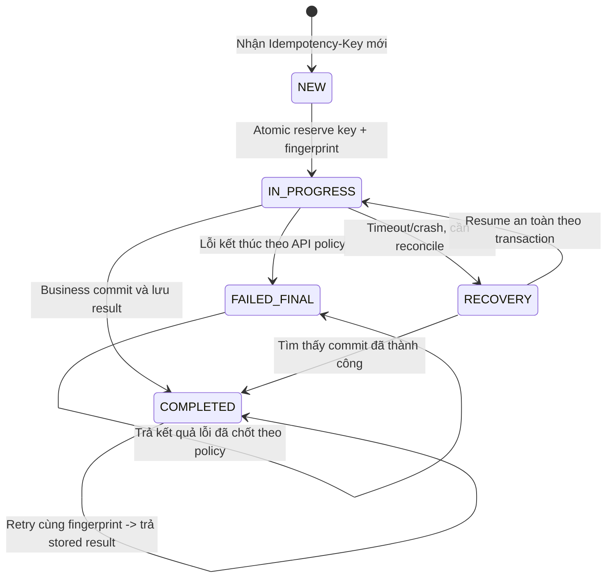

# Ký lại khi retry trong HMAC request authentication

## Mục tiêu học tập

Trong chương **Ký request**, bài **Ký lại khi retry** giải quyết một tình huống phổ biến: client gửi HTTP request có chữ ký HMAC, nhưng không nhận được phản hồi vì mất kết nối, timeout, gateway trả lỗi tạm thời hoặc server quá tải. Client có thể cần gửi lại yêu cầu; tuy nhiên **sao chép nguyên request đã ký** có thể bị cơ chế chống replay từ chối, trong khi **tạo một request đã ký mới** lại có nguy cơ khiến thao tác nghiệp vụ được thực hiện **hai lần**.

Đây là nội dung thuộc module `SECURITY_AUTHENTICATION_HMAC_REQUEST_AUTHENTICATION`: thiết kế xác thực HTTP request bằng **shared secret** và canonical request bao gồm method, URI, header hoặc body theo hợp đồng ký; thực hành xác minh chữ ký, chống replay bằng timestamp/nonce, quản lý key rotation, kiểm thử proxy/gateway và phân biệt **authentication** với **authorization**.

Sau bài này, người học có thể:

- Phân biệt **network retry**, **replay attack**, **idempotent HTTP method** và **business idempotency**.
- Giải thích tại sao khi retry HMAC request cần tạo **timestamp mới, nonce mới và chữ ký mới**, nhưng **giữ cùng Idempotency-Key** cho một thao tác nghiệp vụ duy nhất.
- Chốt các trường **bất biến** qua nhiều attempt và những trường **thay đổi theo từng attempt** trong canonical request.
- Thiết kế hợp đồng HMAC-SHA256 có **Idempotency-Key được ký**, body hash, method/URI, timestamp, nonce và key ID.
- Viết ví dụ Java 17 mô phỏng **server đã xử lý request đầu nhưng client mất response**, sau đó ký lại và nhận kết quả đã lưu mà không tạo giao dịch lần hai.
- Áp dụng retry policy có điều kiện, giới hạn số lần, exponential backoff, jitter, `Retry-After`, timeout budget, key rotation, proxy/gateway và authorization.
- Kiểm thử nonce replay, trùng thao tác có chủ đích, payload thay đổi sau retry và những tình huống trả lời không chắc chắn.

## 1. Retry là gì, và tại sao HMAC khiến retry khó hơn?

Một request có chữ ký được gửi như sau:

```http
POST /v1/payouts?tenant=merchant-42 HTTP/1.1
Host: payments.example.test
Content-Type: application/json
X-Client-Id: payout-worker-prod
X-Key-Id: key-2026-11
Idempotency-Key: <stable-operation-id>
X-Timestamp: <epoch-seconds>
X-Nonce: <random-nonce>
X-Content-SHA256: <body-hash>
X-Signature: <hmac-signature>

{"amount":120000,"currency":"VND"}
```

Client gửi request, nhưng xảy ra timeout. Có ít nhất ba khả năng:

1. **Request chưa đến server:** client có thể thử gửi lại để hoàn thành thao tác.
2. **Request đến server nhưng chưa được thực thi:** client có thể thử lại sau khi dịch vụ hồi phục.
3. **Server đã thực thi thành công nhưng response bị mất:** client **không biết chắc** kết quả, và gửi lại có thể tạo giao dịch thứ hai nếu backend không có cơ chế chống xử lý trùng.

Khi xác thực bằng HMAC, client không nên coi một request đã ký là “vé sử dụng nhiều lần”. Server dùng **timestamp và nonce được ký** để giới hạn tuổi request và từ chối request từng được tiếp nhận hợp lệ. Vì thế cần phân biệt hai hoạt động:

- **Replay:** gửi lại **cùng attempt**, giữ nguyên method/URI/body, timestamp, nonce và signature. Với nonce store hiệu quả, lần tiếp theo bị chặn.
- **Retry hợp lệ:** tạo **attempt mới** cho cùng thao tác nghiệp vụ, dùng nonce mới và ký lại toàn bộ canonical request. Có thể vượt kiểm tra replay, nhưng backend vẫn phải tránh xử lý nghiệp vụ trùng.

**Kết luận quan trọng:** HMAC và nonce giải quyết **tính xác thực/toàn vẹn và phát lại thông điệp**; Idempotency-Key cùng cơ chế lưu kết quả giải quyết **xử lý nghiệp vụ một lần về mặt hiệu ứng được quy định**. Chúng bổ sung cho nhau, không thay thế nhau.

### 1.1. Vì sao giữ nguyên signature cũ thường thất bại?

Giả sử request đầu đã vượt xác thực và nonce đã được claim:

```text
Attempt 1:
  timestamp = 1795800000
  nonce     = N1
  signature = HMAC(secret, canonical(..., N1, timestamp1))
  outcome   = server xử lý; client mất response

Retry sai:
  timestamp = 1795800000
  nonce     = N1
  signature = signature1
  outcome   = server từ chối vì nonce N1 đã được sử dụng
```

Ngay cả khi nonce chưa từng được claim, chữ ký cũ có thể **hết hạn** khi timestamp vượt cửa sổ cho phép. Bởi vậy không thiết kế retry bằng cách cache và phát lại nguyên chữ ký.

### 1.2. Có phải cứ đổi nonce là đủ?

Một nonce ngẫu nhiên mới sẽ làm canonical bytes và HMAC thay đổi. Tuy nhiên, hợp đồng an toàn nên quy định **mỗi attempt mới lấy timestamp hiện tại và nonce mới**, rồi ký lại:

```text
Attempt 1: businessId = OP-1, timestamp = T1, nonce = N1, MAC = M1
Attempt 2: businessId = OP-1, timestamp = T2, nonce = N2, MAC = M2
                         ^ cùng thao tác           ^ chữ ký mới
```

`T1` và `T2` **có thể trùng số giây** nếu retry xảy ra trong cùng một giây; điều đó bình thường. **Nonce phải khác** để input HMAC khác. Không cố tăng timestamp giả tạo cho mỗi retry hoặc sửa giờ hệ thống để “chống replay”. Hãy dùng đồng hồ được đồng bộ để lấy thời gian thực và `SecureRandom` để tạo nonce mạnh.

## 2. Phân biệt retry, replay và idempotency

| Cơ chế | Khóa/đầu vào quan trọng | Phạm vi giải quyết | Giới hạn |
| --- | --- | --- | --- |
| **HMAC authentication** | Shared secret + canonical request | Xác minh dữ liệu đã ký và credential | Không chứng minh client được quyền, không ngăn thao tác mới cùng nghiệp vụ. |
| **Timestamp freshness** | Epoch seconds có chữ ký | Từ chối request ngoài cửa sổ thời gian | Không nhận biết hai request trong cùng cửa sổ là trùng nhau. |
| **Nonce replay store** | Nonce có chữ ký và phạm vi credential/audience | Từ chối dùng lại cùng attempt đã được claim | Một retry với nonce **mới** có thể vượt kiểm tra này. |
| **HTTP idempotency** | Semantics của method như GET/PUT/DELETE | Nhiều yêu cầu giống nhau có cùng tác động **dự định** theo chuẩn | Không đảm bảo status/side effect phụ giống nhau; không thay nonce. |
| **Business idempotency** | Idempotency-Key + scope + fingerprint của thao tác | Nhận biết **cùng một thao tác** qua nhiều attempt | Cần lưu/đồng bộ kết quả, xử lý race, chính sách TTL và xung đột payload. |
| **Authorization** | Principal, tenant, resource, action | Quyết định thao tác có được phép hay không | HMAC hợp lệ hoặc Idempotency-Key đúng không tự cấp quyền. |

### 2.1. Vì sao HTTP POST cần quan tâm đặc biệt?

`POST` không được HTTP semantics bảo đảm idempotent. Hai request `POST /v1/payouts` giống nhau có thể tạo **hai khoản thanh toán**, dù server kiểm tra HMAC và nonce cho cả hai lần.

Với API tạo giao dịch, **Idempotency-Key** do client sinh cho một thao tác logic giúp server trả về **cùng một kết quả đã lưu** khi nhận lại request có payload và scope tương ứng, thay vì tạo giao dịch thứ hai. Key đó phải được bảo vệ bằng HMAC (hoặc một cơ chế ràng buộc đáng tin tương đương).

Với GET/HEAD, request được định nghĩa là safe; với PUT/DELETE, tác động dự định là idempotent. Nhưng chúng vẫn có thể phải dùng timestamp/nonce để bảo vệ API, giới hạn tải, ngăn audit/side effect lặp hoặc giữ chính sách thống nhất. Việc dùng Idempotency-Key cho các method này phụ thuộc yêu cầu nghiệp vụ, **không phải yêu cầu bắt buộc của HTTP**.

### 2.2. Không nhầm *at-most-once attempt* với *exactly-once business effect*

Nonce store chỉ làm tốt công việc **claim một nonce tối đa một lần**. Hai attempt với nonce khác nhau là hai thông điệp khác nhau.

Để đạt hiệu ứng nghiệp vụ không bị nhân đôi, server thường cần **ràng buộc kết quả idempotency với transaction**, unique constraint, atomic claim/commit hoặc transactional outbox tùy kiến trúc. Không thể tuyên bố đảm bảo “exactly once” toàn hệ thống chỉ vì có `ConcurrentHashMap`, Redis cache hay header Idempotency-Key.

## 3. Khi retry: trường nào giữ nguyên, trường nào thay đổi?

Hãy phân biệt **logical operation** (*đơn vị công việc*) và **signed attempt** (*một lần gửi trên mạng*).

| Thành phần | Qua các retry của **cùng một thao tác** | Lý do |
| --- | --- | --- |
| `Idempotency-Key` | **Giữ nguyên** | Server nhận biết cùng một thao tác logic. |
| HTTP method | **Giữ nguyên** | Đổi POST thành PUT/GET là thao tác khác. |
| Raw URI/path/query | **Giữ nguyên** | Đổi tenant, ID, query hoặc target thay đổi đối tượng/tác động. |
| Content-Type và header ảnh hưởng semantics | **Giữ nguyên** | Tránh cùng key nhưng diễn giải body khác. |
| Exact body bytes | **Giữ nguyên** | Fingerprint và MAC phải ràng buộc cùng nội dung. |
| Body hash | **Giữ nguyên** | SHA-256 của cùng byte phải giống nhau. |
| Audience/API đích | **Giữ nguyên** | Không mang Idempotency-Key/credential qua dịch vụ khác. |
| Client principal | **Giữ nguyên** | Idempotency được scope theo danh tính client đáng tin. |
| Timestamp | **Lấy lại từ đồng hồ cho attempt mới** | Chống chữ ký hết hạn; có thể trùng số giây nếu retry rất nhanh. |
| Nonce | **Tạo mới bằng CSPRNG** | Chống replay và phân biệt từng attempt. |
| Signature | **Tính lại** | Canonical bytes đổi khi nonce/timestamp đổi. |
| Key ID / shared secret | Thường giữ; **có thể đổi** khi rotation đã xác thực | Retry với credential hiện hành hợp lệ; danh tính client/scope nghiệp vụ không tự thay. |
| Correlation/trace ID | Theo chính sách tracing, **không dùng thay Idempotency-Key** | Trace có thể đổi theo attempt; ID nghiệp vụ phải ổn định. |

**Không chỉnh payload sau timeout rồi tái sử dụng cùng Idempotency-Key.** Nếu nội dung hoặc tác động thực sự thay đổi, đó là **thao tác mới** với key mới, hoặc phải dùng một API cập nhật được định nghĩa riêng. Server phải từ chối **cùng key nhưng fingerprint khác**.

### 3.1. Khi nào chính sách phải cố định cả key ID?

Nếu hợp đồng idempotency scope theo `(clientId, keyId, operationKey)`, key rotation có thể khiến retry bị coi là thao tác mới. Thiết kế thường phù hợp hơn là scope idempotency theo **principal/client identity ổn định, audience và operation key**, **không chỉ theo key ID**; xác thực mỗi attempt vẫn dùng đúng key ID được khai và kiểm tra trạng thái key.

Dù lưu kết quả theo principal, server vẫn cần **authorization cho request hiện tại** trước khi trả bản ghi kết quả nhạy cảm; một key cũ từng có quyền không tự cho key mới với scope khác được đọc kết quả nếu chính sách không cho phép.

## 4. Hợp đồng HMAC có Idempotency-Key được ký

Không có một định dạng HMAC canonical request chung cho mọi dịch vụ. Ví dụ `retry-v1` dưới đây cố ý có **12 trường**, do thêm Idempotency-Key vào các thành phần cần bảo vệ.

Giả sử API nhận:

```http
POST /v1/payouts?tenant=merchant-42 HTTP/1.1
Host: payments.example.test
Content-Type: application/json
X-Client-Id: payout-worker-prod
X-Key-Id: key-2026-11
Idempotency-Key: <stable-22-char-operation-id>
X-Timestamp: 1795800000
X-Nonce: <fresh-22-char-nonce>
X-Content-SHA256: <sha256-body-base64url>
X-Signature: <hmac-base64url>

{"amount":120000,"currency":"VND"}
```

Mọi giá trị trong `<...>` chỉ là placeholder. Timestamp cố định để minh họa, không được phát thật nếu đã hết cửa sổ cho phép.

### 4.1. Canonical request `retry-v1` — 12 dòng, UTF-8

```text
HMAC-SHA256
retry-v1
payments-api-prod
payout-worker-prod
key-2026-11
POST
/v1/payouts?tenant=merchant-42
application/json
<sha256-body-base64url>
<stable-22-char-operation-id>
1795800000
<fresh-22-char-nonce>
```

| Dòng | Thành phần | Quy tắc |
| --- | --- | --- |
| 1 | `HMAC-SHA256` | Nhãn thuật toán HMAC của hợp đồng; Java JCA dùng `HmacSHA256`. |
| 2 | `retry-v1` | Phiên bản cố định của quy tắc ký và retry. |
| 3 | `payments-api-prod` | Audience được server cấu hình và kiểm tra trong registry. |
| 4 | Client ID | `X-Client-Id`; được ký, chỉ được tin khi HMAC/credential đạt. |
| 5 | Key ID | `X-Key-Id`; dùng tra credential của đúng client, được ký. |
| 6 | `POST` | Method thực nhận; không cho method override ở API mẫu. |
| 7 | Raw request-target | Exact `/v1/payouts?tenant={id}` được client gửi và verifier nhận. |
| 8 | `application/json` | Content-Type exact được hợp đồng cho phép. |
| 9 | SHA-256 body | Base64URL không padding của exact HTTP body bytes. |
| **10** | **Idempotency-Key** | 16 byte CSPRNG, Base64URL không padding thành **22 ký tự**, **giữ nguyên** qua retry. |
| 11 | Timestamp | Unix epoch tính bằng giây; lấy lại mỗi attempt. |
| 12 | Nonce | 16 byte ngẫu nhiên, Base64URL 22 ký tự; **mới cho mỗi attempt**. |

**Định dạng byte:** Mỗi dòng là một trường text; nối các dòng bằng đúng `LF (\n)`, **không có LF cuối**. Các trường do client điều khiển phải đáp ứng allowlist và không có CR/LF; thuật toán MAC nhận **UTF-8** của chuỗi 12 dòng.

```text
bodyHashText = Base64URL_NoPadding(SHA256(exactBodyBytes))
canonical    = join(LF, 12 fields above)
macBytes     = HMAC_SHA256(sharedSecretBytes, UTF8(canonical))
signature    = Base64URL_NoPadding(macBytes)
```

HMAC-SHA256 tạo **32 byte MAC**, được encode thành **43 ký tự** Base64URL không padding. Nonce và Idempotency-Key từ 16 byte ngẫu nhiên nên mỗi giá trị có **22 ký tự**. Chúng **không cùng mục đích** và phải được sinh độc lập.

### 4.2. Vì sao ký Idempotency-Key?

Nếu server dùng header này để quyết định **đã xử lý thao tác hay chưa**, nó ảnh hưởng trực tiếp đến semantics nghiệp vụ. Nếu không ký, một bên trung gian có thể đổi hoặc bỏ Idempotency-Key mà **HMAC trên các trường khác vẫn khớp**, khiến server xử lý mới hoặc trả nhầm kết quả của một thao tác khác.

HMAC chỉ ràng buộc giá trị Idempotency-Key vào request; server vẫn phải xác định **phạm vi lưu**, **vòng đời**, **fingerprint** và **kết quả trả lại**. Không tin key do client tự khai như một bằng chứng quyền.

### 4.3. Grammar của endpoint minh họa

- Chỉ nhận method exact `POST` và raw target `/v1/payouts?tenant=[A-Za-z0-9_-]{1,64}`. Không nhận query key trùng, percent-encoding mơ hồ, unknown param hoặc path rewrite ngoài hợp đồng.
- Content-Type exact `application/json`, body theo **byte thực nhận**; Content-Encoding chỉ được vắng mặt hoặc `identity`. Body có giới hạn kích thước, ví dụ 1 MiB.
- Client ID và key ID thuộc `[A-Za-z0-9_-]{1,64}`.
- Idempotency-Key và nonce dùng **Base64URL không padding** của 16 byte: 22 ký tự trong `[A-Za-z0-9_-]`, giải mã lại đúng 16 byte và encode lại phải bằng input.
- Timestamp là số epoch giây thập phân, được xác minh theo cửa sổ, chẳng hạn `±300 giây`; không chấp nhận CR/LF hay timestamp dạng locale.
- Các header được ký chỉ có **một giá trị**, không gộp duplicate hoặc tự thêm giá trị sau khi xác minh.
- Server xác minh bằng secret được tra theo `(clientId, keyId)` và audience; không nhận secret từ request.

### 4.4. Fingerprint nghiệp vụ phải bỏ trường thay đổi theo attempt

Server cần gắn Idempotency-Key với **nội dung thao tác**, không phải HMAC của attempt. Một fingerprint minh họa:

```text
operationFingerprint = SHA256(UTF8(join(LF, [
  "payout-operation-v1",
  "payments-api-prod",
  clientId,
  method,
  rawTarget,
  contentType,
  bodyHashText
])))
```

Cố ý **không** đưa timestamp, nonce, signature hoặc key ID vào fingerprint: chúng có thể đổi giữa các retry cùng thao tác. Fingerprint phải có phiên bản và bao phủ **mọi đầu vào ảnh hưởng đến kết quả** theo nghiệp vụ; nếu có signed currency header, request option hoặc expected amount khác, chúng cũng cần được ràng buộc theo contract.

Server lưu bản ghi theo key tương tự `(audience, authenticatedClientId, idempotencyKey)` cùng fingerprint, trạng thái `IN_PROGRESS`/`COMPLETED` và kết quả được phép trả. **Cùng key + fingerprint khác → xung đột**, không thực thi lại. Thời gian sống của bản ghi phải đủ **retry horizon và nghĩa vụ nghiệp vụ**, thường dài hơn nonce TTL và theo đặc tả API; không dùng TTL nonce ~610 giây làm TTL idempotency mặc định.

## 5. Luồng thực hành: response đã mất nhưng thao tác đã thành công

```mermaid
sequenceDiagram
    autonumber
    participant C as Client
    participant G as API gateway
    participant A as HMAC verifier
    participant N as Shared nonce store
    participant I as Idempotency registry
    participant D as Business DB
    C->>G: POST attempt 1 (ID=K, TS=T1, nonce=N1, MAC=M1)
    G->>A: Chuyển request đúng byte được ký
    A->>A: Verify method/target/body + key + HMAC + timestamp
    A->>N: Atomic claim nonce N1
    N-->>A: Chưa dùng
    A->>I: Atomic reserve key K + fingerprint F
    I-->>A: New operation
    A->>D: Commit payout + result theo transaction
    D-->>I: COMPLETED, stored result
    A--x C: Response bị mất sau commit
    Note over C: Không biết server đã commit hay chưa
    C->>C: Backoff; giữ K/F, sinh N2, lấy T2, ký M2
    C->>G: POST attempt 2 (ID=K, TS=T2, nonce=N2, MAC=M2)
    G->>A: Verify lại attempt mới
    A->>N: Atomic claim nonce N2
    N-->>A: Chưa dùng
    A->>I: Lookup K + fingerprint F
    I-->>A: COMPLETED, kết quả đã lưu
    A-->>C: Trả cùng kết quả nghiệp vụ, không tạo payout nữa
```

**Điểm quyết định:** Client **không biết** rằng response bị mất có nghĩa server chưa xử lý. Retry phải được thiết kế cho cả trường hợp server **đã commit thành công**.

Nếu request đầu đang `IN_PROGRESS`, server có thể thông báo còn xử lý, trả trạng thái cho phép tra cứu hoặc cho retry có kiểm soát theo API contract. **Không cho hai instance cùng “thấy chưa có bản ghi” rồi cùng tạo payout**. Thiết kế thực tế cần atomic reservation, unique constraint, transaction hoặc outbox để bảo vệ side effect.

### 5.1. Những câu hỏi phải trả lời trước khi bật automatic retry

1. Retry được phép với **method và operation** nào? POST không tự idempotent.
2. Những status, network error hoặc timeout nào được xem là **tạm thời** theo API contract?
3. Trạng thái chưa biết (lost response sau commit) được giải quyết bằng Idempotency-Key hoặc API tra cứu nào?
4. Credential còn hạn và đúng audience không? Nếu key đã thu hồi, retry không được tự downgrade.
5. HTTP client có giữ được **exact body bytes** qua nhiều lần gửi không? Stream one-shot cần snapshot/spool hoặc cơ chế mở lại cùng nội dung an toàn.
6. Backoff, số attempt, thời gian tổng và `Retry-After` áp dụng ra sao để không gây retry storm?
7. Gateway có rewrite method/URI/body/header giữa client và verifier không?
8. Kết quả trả từ idempotency store có được bảo vệ theo **principal và authorization hiện tại** không?

## 6. Java 17: mô phỏng ký lại sau khi mất response

Chương trình **`RetrySigningDemo.java`** dưới đây chỉ dùng JDK 17+. Nó thực hiện:

1. Client tạo **một Operation bất biến**: method/URI/body, client/key ID và một Idempotency-Key ngẫu nhiên được giữ suốt các attempt.
2. Client tạo **SignedAttempt 1** với timestamp và nonce riêng, rồi gửi đến `MockServer`.
3. Server xác minh HMAC, timestamp và nonce, phân quyền tenant, sau đó tạo một bản ghi kết quả cho Idempotency-Key.
4. Chương trình **cố ý bỏ response của attempt 1**, mô phỏng response bị mất trên mạng sau khi server đã xử lý.
5. Client ký lại cùng Operation thành **SignedAttempt 2** có nonce mới và MAC mới.
6. Server chấp nhận chữ ký mới nhưng nhận ra **Idempotency-Key + fingerprint cũ**, trả kết quả đã lưu; **không tạo giao dịch thứ hai**.
7. Chương trình thử **replay attempt 1** và **tái dùng cùng Idempotency-Key với body khác** để thấy hai kiểu lỗi khác nhau.

Ví dụ `MockServer` có cache trong bộ nhớ để minh họa logic; **không phải triển khai production**. Production cần nonce store có TTL, atomic claim liên node và idempotency/result store liên kết với business transaction bền vững.

### 6.1. Chương trình hoàn chỉnh

```java
import java.nio.charset.StandardCharsets;
import java.security.GeneralSecurityException;
import java.security.MessageDigest;
import java.security.SecureRandom;
import java.time.Clock;
import java.time.Instant;
import java.util.Base64;
import java.util.Objects;
import java.util.Set;
import java.util.concurrent.ConcurrentHashMap;
import java.util.concurrent.ConcurrentMap;
import java.util.concurrent.atomic.AtomicBoolean;
import java.util.concurrent.atomic.AtomicInteger;
import java.util.regex.Pattern;
import javax.crypto.Mac;
import javax.crypto.spec.SecretKeySpec;

public final class RetrySigningDemo {
    private static final String AUDIENCE = "payments-api-prod";
    private static final String CLIENT_ID = "payout-worker-prod";
    private static final String KEY_ID = "key-2026-11";

    private static final Pattern RAW_TARGET = Pattern.compile(
            "/v1/payouts\\?tenant=[A-Za-z0-9_-]{1,64}");
    private static final Pattern IDENTIFIER = Pattern.compile(
            "[A-Za-z0-9_-]{1,64}");
    private static final Pattern TIMESTAMP = Pattern.compile(
            "[1-9][0-9]{0,18}");
    private static final Pattern SIGNATURE = Pattern.compile(
            "[A-Za-z0-9_-]{43}");
    private static final Pattern SHORT_TOKEN = Pattern.compile(
            "[A-Za-z0-9_-]{22}");

    private static final Base64.Encoder ENCODE =
            Base64.getUrlEncoder().withoutPadding();
    private static final Base64.Decoder DECODE =
            Base64.getUrlDecoder();

    private RetrySigningDemo() {}

    record Operation(
            String clientId, String keyId, String method,
            String rawTarget, String contentType,
            byte[] body, String idempotencyKey) {
        Operation {
            body = Objects.requireNonNull(body, "body").clone();
        }

        @Override public byte[] body() {
            return body.clone();
        }
    }

    record SignedAttempt(
            Operation operation, String timestamp, String nonce,
            String bodyHash, String signature) {}

    record Reply(int status, String businessResult, boolean fromCache) {}

    record StoredResult(String fingerprint, String result, int status) {}

    private static String randomToken(SecureRandom rng) {
        byte[] randomBytes = new byte[16];
        rng.nextBytes(randomBytes);
        return ENCODE.encodeToString(randomBytes);
    }

    private static byte[] strictDecode(
            String text, int expectedTextLength, int expectedByteLength) {
        if (text == null || text.length() != expectedTextLength
                || !text.matches("[A-Za-z0-9_-]+")) {
            throw new IllegalArgumentException("Invalid Base64URL syntax");
        }
        byte[] bytes = DECODE.decode(text);
        if (bytes.length != expectedByteLength
                || !ENCODE.encodeToString(bytes).equals(text)) {
            throw new IllegalArgumentException("Noncanonical Base64URL");
        }
        return bytes;
    }

    private static void validateOperation(Operation op) {
        if (!"POST".equals(op.method())
                || !"application/json".equals(op.contentType())) {
            throw new IllegalArgumentException("Unexpected method/type");
        }
        if (op.rawTarget() == null
                || !RAW_TARGET.matcher(op.rawTarget()).matches()) {
            throw new IllegalArgumentException("Invalid raw target");
        }
        if (op.clientId() == null
                || !IDENTIFIER.matcher(op.clientId()).matches()
                || op.keyId() == null
                || !IDENTIFIER.matcher(op.keyId()).matches()) {
            throw new IllegalArgumentException("Invalid client/key ID");
        }
        if (op.body().length == 0 || op.body().length > 1_048_576) {
            throw new IllegalArgumentException("Body size invalid");
        }
        if (op.idempotencyKey() == null
                || !SHORT_TOKEN.matcher(op.idempotencyKey()).matches()) {
            throw new IllegalArgumentException("Invalid operation token");
        }
        strictDecode(op.idempotencyKey(), 22, 16);
    }

    private static String sha256Base64Url(byte[] bytes)
            throws GeneralSecurityException {
        return ENCODE.encodeToString(
                MessageDigest.getInstance("SHA-256").digest(bytes));
    }

    private static String canonical(SignedAttempt attempt) {
        Operation op = attempt.operation();
        validateOperation(op);
        if (attempt.timestamp() == null
                || !TIMESTAMP.matcher(attempt.timestamp()).matches()) {
            throw new IllegalArgumentException("Invalid timestamp");
        }
        if (attempt.nonce() == null
                || !SHORT_TOKEN.matcher(attempt.nonce()).matches()) {
            throw new IllegalArgumentException("Invalid nonce");
        }
        strictDecode(attempt.nonce(), 22, 16);

        return String.join("\n",
                "HMAC-SHA256", "retry-v1", AUDIENCE,
                op.clientId(), op.keyId(), op.method(),
                op.rawTarget(), op.contentType(), attempt.bodyHash(),
                op.idempotencyKey(), attempt.timestamp(), attempt.nonce());
        // 12 dòng UTF-8, LF, không LF ở cuối.
    }

    private static byte[] hmac(byte[] secret, String canonical)
            throws GeneralSecurityException {
        Mac engine = Mac.getInstance("HmacSHA256");
        engine.init(new SecretKeySpec(secret, "HmacSHA256"));
        return engine.doFinal(canonical.getBytes(StandardCharsets.UTF_8));
    }

    static SignedAttempt sign(
            Operation op, byte[] secret, Clock clock, SecureRandom rng)
            throws GeneralSecurityException {
        String timestamp =
                Long.toString(Instant.now(clock).getEpochSecond());
        String nonce = randomToken(rng); // KHÁC với Idempotency-Key.
        String bodyHash = sha256Base64Url(op.body());
        SignedAttempt unsigned = new SignedAttempt(
                op, timestamp, nonce, bodyHash, "");
        String signature = ENCODE.encodeToString(
                hmac(secret, canonical(unsigned)));
        return new SignedAttempt(
                op, timestamp, nonce, bodyHash, signature);
    }

    static boolean verifySignature(
            SignedAttempt received, byte[] registeredSecret)
            throws GeneralSecurityException {
        if (received == null || received.operation() == null
                || received.bodyHash() == null
                || received.signature() == null) {
            return false;
        }
        try {
            String actualHash =
                    sha256Base64Url(received.operation().body());
            if (!actualHash.equals(received.bodyHash())) {
                return false;
            }
            if (!SIGNATURE.matcher(received.signature()).matches()) {
                return false;
            }
            byte[] supplied = strictDecode(received.signature(), 43, 32);
            byte[] expected = hmac(
                    registeredSecret, canonical(received));
            return MessageDigest.isEqual(expected, supplied);
        } catch (IllegalArgumentException ex) {
            return false;
        }
    }

    static String fingerprint(Operation op, String bodyHash)
            throws GeneralSecurityException {
        // Không bao gồm timestamp, nonce, MAC hoặc keyId.
        String stable = String.join("\n",
                "payout-operation-v1", AUDIENCE, op.clientId(),
                op.method(), op.rawTarget(), op.contentType(), bodyHash);
        return sha256Base64Url(
                stable.getBytes(StandardCharsets.UTF_8));
    }

    static final class MockServer {
        private final byte[] registeredSecret;
        // Bộ nhớ minh họa, không có TTL/persistence.
        private final Set<String> seenNonces =
                ConcurrentHashMap.newKeySet();
        private final ConcurrentMap<String, StoredResult> completed =
                new ConcurrentHashMap<>();
        private final AtomicInteger commits = new AtomicInteger();
        private final Clock clock;

        MockServer(byte[] secret, Clock clock) {
            this.registeredSecret = secret.clone();
            this.clock = clock;
        }

        Reply handle(SignedAttempt attempt)
                throws GeneralSecurityException {
            Operation op = attempt.operation();
            // Mock registry: chỉ một client và một key đang ACTIVE.
            if (!CLIENT_ID.equals(op.clientId())
                    || !KEY_ID.equals(op.keyId())
                    || !verifySignature(attempt, registeredSecret)) {
                return new Reply(401, "invalid-auth", false);
            }

            long timestamp;
            try {
                timestamp = Long.parseLong(attempt.timestamp());
            } catch (NumberFormatException ex) {
                return new Reply(401, "invalid-time", false);
            }
            long now = Instant.now(clock).getEpochSecond();
            if (Math.abs(now - timestamp) > 300) {
                return new Reply(401, "expired-request", false);
            }

            String nonceKey = AUDIENCE + "|" + op.clientId()
                    + "|" + op.keyId() + "|" + attempt.nonce();
            if (!seenNonces.add(nonceKey)) {
                return new Reply(401, "replayed-nonce", false);
            }

            // Mock policy: client chỉ được payout cho merchant-42.
            if (!op.rawTarget().equals(
                    "/v1/payouts?tenant=merchant-42")) {
                return new Reply(403, "forbidden-tenant", false);
            }

            String fp = fingerprint(op, attempt.bodyHash());
            // Scope bằng principal+audience; không dùng keyId.
            String opKey = AUDIENCE + "|" + op.clientId()
                    + "|" + op.idempotencyKey();

            AtomicBoolean firstExecution = new AtomicBoolean(false);
            StoredResult stored = completed.computeIfAbsent(opKey, ignored -> {
                firstExecution.set(true);
                // Đây chỉ là side effect giả lập trong bộ nhớ.
                int sequence = commits.incrementAndGet();
                return new StoredResult(fp, "payout-" + sequence, 201);
            });
            if (!stored.fingerprint().equals(fp)) {
                return new Reply(409, "idempotency-conflict", false);
            }

            return new Reply(stored.status(), stored.result(),
                    !firstExecution.get());
        }

        int createdPayoutCount() {
            return commits.get();
        }
    }

    public static void main(String[] args)
            throws GeneralSecurityException {
        SecureRandom random = new SecureRandom();
        Clock clock = Clock.systemUTC();
        byte[] secret = new byte[32];
        random.nextBytes(secret);

        // SINH MỘT LẦN cho logical operation, không sinh lại khi retry.
        String operationId = randomToken(random);
        Operation operation = new Operation(
                CLIENT_ID, KEY_ID, "POST",
                "/v1/payouts?tenant=merchant-42",
                "application/json",
                "{\"amount\":120000,\"currency\":\"VND\"}"
                        .getBytes(StandardCharsets.UTF_8),
                operationId);

        MockServer server = new MockServer(secret, clock);

        SignedAttempt first = sign(operation, secret, clock, random);
        Reply lostResponse = server.handle(first);
        // Giả lập response đã mất: client KHÔNG dùng lostResponse.
        System.out.println("Server processed first attempt: "
                + (lostResponse.status() == 201));

        // Sau backoff, client giữ nguyên Operation và ký attempt MỚI.
        SignedAttempt second = sign(operation, secret, clock, random);
        Reply received = server.handle(second);
        System.out.println("New nonce on retry: "
                + !first.nonce().equals(second.nonce()));
        System.out.println("New MAC on retry: "
                + !first.signature().equals(second.signature()));
        System.out.println("Same logical operation: "
                + first.operation().idempotencyKey()
                    .equals(second.operation().idempotencyKey()));
        System.out.println("Retry reused stored outcome: "
                + received.fromCache());
        System.out.println("Payout commits: "
                + server.createdPayoutCount());

        // Phát lại nguyên first attempt -> nonce đã dùng.
        System.out.println("Old attempt replay rejected: "
                + (server.handle(first).status() == 401));

        // Cùng Idempotency-Key nhưng body đã đổi -> 409.
        Operation changed = new Operation(
                CLIENT_ID, KEY_ID, operation.method(),
                operation.rawTarget(), operation.contentType(),
                "{\"amount\":240000,\"currency\":\"VND\"}"
                        .getBytes(StandardCharsets.UTF_8),
                operation.idempotencyKey());
        SignedAttempt changedSigned =
                sign(changed, secret, clock, random);
        System.out.println("Different payload with same key rejected: "
                + (server.handle(changedSigned).status() == 409));

        java.util.Arrays.fill(secret, (byte) 0);
    }
}
```

Kết quả điển hình:

```text
Server processed first attempt: true
New nonce on retry: true
New MAC on retry: true
Same logical operation: true
Retry reused stored outcome: true
Payout commits: 1
Old attempt replay rejected: true
Different payload with same key rejected: true
```

Các chuỗi ID/MAC cụ thể được sinh ngẫu nhiên nên khác qua mỗi lần chạy. Về mặt xác suất, hai nonce 128 bit độc lập trùng nhau là **cực kỳ khó xảy ra**, nhưng không phải điều tuyệt đối; production vẫn phải dựa vào nonce store để phát hiện trùng.

### 6.2. Phân tích những phần quan trọng của code

**`Operation` là dữ liệu nghiệp vụ bất biến:** constructor clone `body[]` và getter trả bản sao để không vô tình sửa payload sau khi tạo attempt đầu. Với body rất lớn hoặc file stream, dùng snapshot/spool có kiểm soát để tránh lỗi `hash bytes A nhưng gửi bytes B`.

**`sign(...)` được gọi lại cho mỗi attempt:** nó lấy timestamp ở lúc chuẩn bị gửi, sinh nonce mới, hash byte body, dựng canonical 12 dòng rồi tính HMAC mới. Không cache và tái sử dụng header `X-Signature` đã gửi lần trước.

**`verifySignature(...)` không dùng chuỗi canonical do client gửi:** nó tự dựng canonical từ `SignedAttempt` mô phỏng request thực nhận, tự hash body, strict-decode MAC Base64URL và dùng `MessageDigest.isEqual`.

**`seenNonces` chỉ là mô phỏng:** `ConcurrentHashMap.newKeySet()` không có TTL, durability hay chia sẻ giữa nhiều node. Khi chạy production, cần kho dùng chung có atomic claim, TTL đúng cửa sổ replay và chính sách fail-closed. Không dùng set trong JVM làm giải pháp chống replay triển khai phân tán.

**`completed.computeIfAbsent(...)` chỉ mô phỏng lưu kết quả:** Trong chương trình, side effect đơn giản là tăng counter ở bên trong mapping function và lưu kết quả ngay trong bộ nhớ. Không suy ra rằng đặt DB call/network call vào `computeIfAbsent` là transaction nguyên tử; ứng dụng thật cần unique constraint, transaction, xử lý `IN_PROGRESS` và consistency giữa commit payout với bản ghi idempotency.

**`403` và `409` là hai quyết định khác nhau:** cùng Idempotency-Key cho body khác được phát hiện bằng fingerprint; quyền của client trên tenant vẫn phải kiểm tra **độc lập**. Response từ idempotency cache cũng cần áp dụng authz hiện tại, không tự trao nội dung có thể nhạy cảm cho caller vừa mất quyền.

### 6.3. Kết nối với HTTP client thật

`MockServer` là mô phỏng để nhìn thấy kết quả, không thực hiện HTTP I/O. Trong ứng dụng sử dụng Java `HttpClient`, quy tắc quan trọng nằm ở **thời điểm tạo request cho từng attempt**:

```java
// Pseudocode cấu trúc retry; các hàm sender/policy do ứng dụng định nghĩa.
Operation stableOperation = /* một snapshot body + idempotency key */;
for (int attemptNumber = 1; attemptNumber <= maxAttempts; attemptNumber++) {
    if (attemptNumber > 1) {
        waitWithBoundedBackoffAndJitter(attemptNumber); // Chờ TRƯỚC khi ký.
    }

    SignedAttempt signed = sign(
            stableOperation, secretForCurrentActiveKey(), clock, secureRandom);
    // Tạo HttpRequest MỚI: method/URI/body/Idempotency-Key ổn định,
    // X-Timestamp/X-Nonce/X-Signature đúng của signed attempt hiện tại.
    HttpResponse<byte[]> response = sendFreshHttpRequest(signed);

    if (isTerminalOrSuccess(response)) return response;
    if (!retryPolicyAllows(response, attemptNumber)) return response;
}
```

Đây là **pseudocode**, không phải lớp `RetrySigningDemo` có sẵn các hàm `waitWithBoundedBackoffAndJitter` hay `sendFreshHttpRequest`. Để chạy thực tế, phải triển khai policy, HTTP client, cấu hình redirect, timeout, lỗi mạng, body publisher, credential manager và logging.

**Ký sau khi chờ:** Nếu client ký trước backoff hoặc trước khi đợi `Retry-After` trong thời gian dài, timestamp/nonce có thể đã cũ ngay khi request được gửi. Cần tạo **signed attempt sát thời điểm phát request** và bảo đảm HTTP client không tự retry lại chính raw HTTP message đã ký ở lớp thấp mà ứng dụng không biết.

### 6.4. Chuẩn hóa signature và key material

Hợp đồng dùng:

```java
byte[] rawSecret = /* byte secret được cấp từ registry/config */;
Mac mac = Mac.getInstance("HmacSHA256");
mac.init(new SecretKeySpec(rawSecret, "HmacSHA256"));

byte[] rawMac = mac.doFinal(
        canonical.getBytes(StandardCharsets.UTF_8));
String text = Base64.getUrlEncoder()
        .withoutPadding().encodeToString(rawMac);
```

Không dùng `new String(rawMac, UTF_8)` để truyền chữ ký; không dùng byte UTF-8 của **chuỗi Base64 secret** làm HMAC key nếu secret thực được provision ở dạng Base64URL. Trước khi khởi tạo `SecretKeySpec`, secret phải là **raw bytes đúng**. Định dạng signature phải khớp với verifier và test vector.

## 7. Khi nào được retry, và khi nào phải dừng?

**Không tự động retry mọi request hay mọi lỗi.** Chính sách phải dựa trên khả năng thao tác có side effect, hợp đồng API, Idempotency-Key có được server hỗ trợ thật hay không, và ngân sách thời gian của caller.

| Tình huống sau attempt | Có nên tự retry? | Hành động phù hợp |
| --- | --- | --- |
| Timeout kết nối **trước khi gửi byte request** | Thường có thể, trong giới hạn policy | Tạo signed attempt mới; việc chưa gửi không cần thiết phải replay nhưng vẫn ký lại. |
| Timeout/đứt kết nối **sau khi gửi một phần hoặc toàn bộ request** | **Chỉ khi có cơ chế xử lý kết quả không chắc chắn** | Cùng Idempotency-Key, snapshot body cũ, nonce/timestamp/MAC mới; hoặc tra cứu trạng thái. |
| Response bị mất sau server commit | Cần idempotency hoặc reconciliation | Không tự kết luận thất bại; retry có kiểm soát để nhận kết quả đã lưu. |
| `408 Request Timeout` | Có thể theo hợp đồng | Tạo attempt mới; với POST có side effect cần idempotency. |
| `429 Too Many Requests` | Thường có thể sau khi chờ | Tôn trọng `Retry-After` và rate limit; tránh retry storm. |
| `502 Bad Gateway`, `503 Service Unavailable`, `504 Gateway Timeout` | Có thể theo chính sách | Backoff và ký lại; không suy ra request đầu chưa được server xử lý. |
| `500 Internal Server Error` | Chỉ khi API công bố tính retry-safe | 500 có thể xảy ra **sau** side effect; cần Idempotency-Key/reconciliation. |
| `401 Unauthorized` | Thông thường **không** tự retry như lỗi tạm | Kiểm tra credential, clock skew, key status và MAC bằng chẩn đoán an toàn; không thử key/algorithm ngẫu nhiên. |
| `403 Forbidden` | Không | Client không có quyền; ký lại không cấp quyền. |
| `400 Bad Request` hoặc body/schema sai | Không | Sửa request; khi thay semantics phải tạo operation mới/key mới. |
| `404 Not Found`, `412 Precondition Failed` | Thường không | Đánh giá resource/precondition; không coi là lỗi mạng tạm thời. |
| `409 Conflict` do **cùng Idempotency-Key, fingerprint khác** | **Không** | Đây là lỗi sử dụng key; không gửi lại vô hạn. |
| `409` hoặc `202` do **operation đang xử lý** | Tùy hợp đồng | Chờ `Retry-After` hoặc poll trạng thái bằng API đã phân quyền; không tạo operation mới. |
| Redirect `307` hoặc `308` | **Không coi là retry thông thường** | Nếu đích được phép, build request mới đúng URI, audience và ký lại; giữ method/body theo redirect semantics. |
| Redirect `303` | Là thao tác follow-up khác | Có thể chuyển GET; **không dùng lại chữ ký POST** hay mang secret sang host lạ. |

Trong HTTP chuẩn, 401 có ngữ nghĩa challenge của authentication scheme; hệ thống HMAC tùy chỉnh cần công bố schema lỗi phù hợp thay vì giả định mọi HTTP client đều biết cách hồi phục. Dù lớp HTTP báo kết nối đã đóng, client **không thể suy ra chắc chắn** yêu cầu đã/đang được server thực thi đến đâu khi request đã có khả năng rời máy.

### 7.1. Exponential backoff và jitter

Một retry policy mẫu có thể cho **tối đa 3 attempt** tổng cộng (1 lần đầu + 2 retry), bắt đầu với backoff 200 ms và cap 2 s, áp dụng **full jitter**:

```text
base = 200 milliseconds
cap = 2000 milliseconds

for retryNumber = 1, 2:
    backoffCap = min(cap, base * 2^(retryNumber-1))
    delay = random duration within [0, backoffCap]

    wait(delay)
    newTimestamp = clock.nowSeconds()
    newNonce = secureRandom(16 bytes)
    newSignature = HMAC(secret, canonical(... newTimestamp, newNonce))
    sendFreshAttempt()
```

Đây là **minh họa chính sách**, không phải công thức bắt buộc của HTTP. Mỗi thao tác còn phải tuân **deadline tổng** của caller (ví dụ 10 s), request timeout, timeout kết nối, retry budget chung và trạng thái cancellation.

Nếu server gửi `Retry-After` (có thể là **delta-seconds** hoặc **HTTP-date**), client cần parse theo HTTP semantics và **tôn trọng giới hạn tối thiểu chờ** phù hợp với API; đồng thời giới hạn bằng deadline của caller. Nếu thời gian chờ vượt deadline, **dừng hoặc trả trạng thái chưa chắc chắn**, không tự tạo thêm attempt bất chấp deadline.

### 7.2. Đặt việc ký sau bước chờ

Sai:

```text
build and sign retry attempt -> sleep 5 minutes -> send old signed attempt
```

Đúng hơn:

```text
detect retryable condition -> choose delay -> wait -> obtain active key
    -> capture current timestamp -> generate fresh nonce
    -> rebuild canonical + HMAC -> send immediately
```

Client cũng cần kiểm tra thư viện HTTP và proxy có **retry ngầm** bằng cách phát lại chính request cũ, nhất là khi kết nối hỏng. Nếu lớp transport tự retry mà ứng dụng không biết, có thể gửi lại **cùng nonce** và bị server từ chối. Với endpoint yêu cầu attempt mới, nên đặt quyền điều khiển retry ở lớp signer hoặc dùng hook ký lại thực sự chạy cho mỗi lần phát.

### 7.3. Khi server không hỗ trợ Idempotency-Key

Chỉ gửi thêm một header `Idempotency-Key` vào một API bất kỳ **không làm API trở nên idempotent**. Server phải triển khai dedup và công bố semantics. Nếu API tạo giao dịch **không hỗ trợ idempotency hay API tra cứu**, client không thể tự bảo đảm retry POST sau trạng thái chưa rõ là an toàn.

Cách xử lý có thể là **tra cứu theo mã nghiệp vụ**, reconciliation theo nguồn sự thật hoặc yêu cầu người vận hành xác nhận trước khi tạo thao tác mới. Không tự tạo key mới và gửi lại “đến khi được 2xx” cho một giao dịch thanh toán.

## 8. Thiết kế idempotency store cho retry có chữ ký

Một triển khai production thường cần lưu **state machine** của thao tác logic:



Từ `NEW` đến `IN_PROGRESS` phải ngăn hai worker cùng thực thi thao tác. `IN_PROGRESS` cần thời hạn lease, job recovery hoặc cơ chế khôi phục khi server chết, **không chỉ cache key vĩnh viễn và trả “đang xử lý” mãi mãi**.

### 8.1. Khóa lưu và fingerprint

Một khóa idempotency gợi ý:

```text
storeKey = (audience, authenticatedClientId, idempotencyKey)
```

Nội dung bản ghi gợi ý:

```text
fingerprint = SHA256(versioned stable operation fields)
status = NEW | IN_PROGRESS | COMPLETED | FAILED_FINAL
resultStatus = HTTP status theo contract
resultBody = kết quả được phép lưu/trả
createdAt, expiresAt, operationReference, transactionReference
```

Nếu cùng key nhưng fingerprint khác, trả một lỗi xung đột được API định nghĩa (thường `409 Conflict`). Nếu cùng key và fingerprint:

- `COMPLETED`: có thể trả lại kết quả đã lưu sau **authentication và authorization hiện tại**.
- `IN_PROGRESS`: không thực hiện thêm; có thể thông báo xử lý đang tiếp diễn hoặc chỉ dẫn poll có phân quyền.
- `FAILED_FINAL`: tùy hợp đồng, có thể trả lại lỗi đã chốt để giữ semantics; không mặc định cache mọi lỗi 5xx.
- `RECOVERY`: cần đối chiếu với state nghiệp vụ, không tự tạo payout lại khi chưa biết commit cũ.

Key nên có entropy cao, không thể đoán dễ; nhưng **không coi Idempotency-Key là secret hoặc credential**. Scope theo principal giúp ngăn client khác đọc kết quả qua một key mà họ tình cờ biết.

### 8.2. Transaction và side effect phải gắn với nhau

Anti-pattern:

```text
if (!cache.contains(key)) {
    insertPayout();     // Giao dịch có thể đã commit.
    cache.put(key);     // Server có thể crash trước dòng này.
}
```

Hai request đồng thời có thể cùng không thấy key; crash sau `insertPayout` nhưng trước `cache.put` có thể tạo payout lần thứ hai khi retry.

Thiết kế cần **unique constraint/atomic reservation và transaction** (hoặc chiến lược outbox/worker/reconciliation được mô hình hóa kỹ). Ví dụ lưu bản ghi có unique key trên `(clientId, audience, idempotencyKey)` và liên kết với transaction của payout hoặc một business operation ID duy nhất. Với nhiều dịch vụ, **không tồn tại transaction cục bộ đảm bảo atomicity xuyên mọi hệ thống**; phải thiết kế trạng thái phục hồi và bảo đảm hiệu ứng idempotent cho từng downstream.

**Không trộn TTL nonce với TTL idempotency.** Nonce lưu để che phủ một cửa sổ xác thực thường tính theo phút. Idempotency records có thể cần tồn tại nhiều giờ/ngày hoặc hơn theo chính sách nghiệp vụ, thời gian retry/reconciliation, retention và quy định dữ liệu.

### 8.3. Authorization trước khi trả kết quả đã lưu

Dù server thấy key `K` từng tạo thành công payout, request hiện tại vẫn phải:

1. Có credential HMAC hợp lệ, timestamp/nonce mới và không bị thu hồi.
2. Thuộc **cùng authenticated principal** và audience được phép.
3. Được **phân quyền** đọc trạng thái/kết quả tương ứng theo chính sách hiện tại.

Không lấy việc đoán được Idempotency-Key làm điều kiện đủ để đọc payout của tenant khác. Nếu quyền client bị thu hồi giữa hai attempt, server không được bỏ bước authorization chỉ vì bản ghi COMPLETED đã tồn tại.

## 9. Key rotation và ký lại khi retry

Một request có thể được gửi ngay lúc secret/key ID đang rotation.

Ví dụ:

```text
Attempt 1:
  clientId = payout-worker-prod
  keyId = key-A  (ACTIVE lúc ký)
  nonce = N1
  signature = HMAC(secret-A, canonical with key-A)
  Idempotency-Key = K

Attempt 2 sau rotation:
  clientId = payout-worker-prod
  keyId = key-B  (ACTIVE)
  nonce = N2
  signature = HMAC(secret-B, canonical with key-B)
  Idempotency-Key = K   # Giữ nguyên thao tác nghiệp vụ.
```

Nếu client được cấp key mới qua cơ chế quản lý khóa đáng tin, retry có thể ký bằng key ID/secret mới **khi server cho phép**, miễn vẫn là cùng principal/audience và cùng operation. Server đối chiếu key ID theo registry, trạng thái `ACTIVE`/`RETIRING`/`REVOKED` và scope của client.

**Không thử secret/algorithm theo danh sách khi MAC thất bại.** Không tự dùng lại key đã `REVOKED` vì một attempt cũ từng thành công. Nếu credential không còn hợp lệ, báo lỗi hoặc chờ cơ chế cấp lại đáng tin thay vì retry vô hạn.

### 9.1. Scope idempotency qua rotation

Nếu server lưu key theo `(clientId, keyId, idempotencyKey)`, một attempt dùng key-B có thể tạo **record mới** và lặp side effect đã được key-A thực hiện. Cách tránh thường là scope theo **client principal ổn định** (và audience/operation), đồng thời ghi nhận key ID phục vụ audit nhưng **không dùng riêng key ID để phân biệt logical operation**.

Tất nhiên, nếu chuyển sang principal thật sự khác hoặc tenant khác, không được tái sử dụng Idempotency-Key để lấy kết quả của danh tính cũ.

## 10. Proxy, gateway, redirect và body stream

### 10.1. Gateway xác minh trước hay sau rewrite?

```text
Client ký:
POST /public/v1/payouts?tenant=merchant-42

Gateway rewrite:
POST /internal/v1/payouts?tenant=merchant-42
```

Nếu verifier tính HMAC trên URI **sau rewrite** nhưng client ký URI **trước rewrite**, chữ ký sẽ không khớp dù nonce và key đúng. Khi retry, lỗi này vẫn lặp lại với mọi chữ ký mới.

Có hai cách thường dùng:

- **Verify tại gateway trước rewrite**, rồi chuyển authenticated principal/operation đã xác minh tới backend qua kết nối nội bộ được bảo vệ, xóa header principal giả do client internet tự gửi.
- **Verify tại backend với raw target gốc đáng tin**, được gateway bảo toàn hoặc truyền qua metadata nội bộ chống giả mạo và gắn với đúng request. Không tin `X-Original-URI` từ internet nếu edge chưa xóa/thiết lập lại.

Khi backend xử lý, operation thực tế phải khớp với method, target, tenant và body mà HMAC bảo vệ. HMAC đúng ở gateway không cho phép backend biến thành operation khác.

### 10.2. Redirect không phải “gửi lại y hệt”

- `307` và `308` bảo toàn method theo semantics của redirect, nhưng URI đích thay đổi; client phải **kiểm tra đích được phép**, audience/credential có hợp lệ không, và **ký lại raw target mới** nếu cho follow.
- `303` thường chuyển sang `GET` để lấy kết quả; đây không còn là request POST tạo giao dịch. Không tái dùng signature hoặc nguyên Idempotency-Key như thể cùng một attempt POST.
- Với `301`/`302`, hành vi đổi `POST` sang `GET` có khác biệt lịch sử giữa client. Với HMAC, nên **tắt automatic redirect** hoặc tự xử lý theo policy đã kiểm thử.

Không tự chuyển shared secret, header nội bộ hoặc chữ ký sang host ngoài audience. Việc đổi đích có thể thay đổi **logical operation**, khi đó phải xem xét lại Idempotency-Key thay vì coi mọi redirect là retry của cùng target.

### 10.3. Retry request body theo stream

HTTP client có thể không gửi lại được một `InputStream` đã đọc xong. Nếu client đọc file/stream một lần để hash, rồi lần khác để gửi và file đã thay đổi, **body hash/ID fingerprint và byte thật khác nhau**.

Các phương án:

- Với body nhỏ: giữ **snapshot byte[] bất biến** xuyên các attempt, mỗi lần tạo body publisher từ cùng bytes.
- Với file lớn: sử dụng file snapshot/spool có giới hạn, kiểm tra size/digest và mở lại đúng phiên bản nội dung.
- Với streaming một lần không thể tái tạo: **không tự retry** sau timeout; cần API upload theo chunk/session hoặc một cơ chế replayable body được thiết kế rõ.

Không ghi file chính thức, phát event hoặc thực hiện business side effect **trước khi** xác thực HMAC/nonce và authorization xong. Nếu server cần stream body lớn trước khi biết MAC, hãy spool tạm có quota rồi commit đúng snapshot đã xác minh.

## 11. Ma trận kiểm thử ký lại khi retry

| Ca thử | Điều kiện | Kết quả mong đợi |
| --- | --- | --- |
| Attempt đầu thành công, response nhận được | Status terminal thành công | Client **không** retry. |
| Timeout trước khi gửi | Không có request đến server | Có thể ký attempt mới theo policy và gửi một lần. |
| Timeout sau khi gửi, server đã commit | Response bị mất | Retry nonce/MAC mới, **cùng Idempotency-Key**, nhận stored result; chỉ một commit. |
| Retry sao chép nguyên request cũ | Cùng timestamp, nonce, MAC | Nonce store từ chối replay; không thực thi lại. |
| Retry ký lại trong cùng một giây | Timestamp giống nhưng nonce mới | MAC khác; request mới có thể hợp lệ. |
| Retry sau khi hết hạn chữ ký | Đợi qua cửa sổ thời gian | Lấy timestamp hiện tại và nonce mới rồi ký, nếu còn trong retry budget. |
| Retry với cùng key và body khác | Đổi amount từ 120000 → 240000 | HMAC mới có thể đúng, nhưng **idempotency fingerprint mismatch → conflict**. |
| Retry với Idempotency-Key mới | Cùng POST/body | Server coi là thao tác logic mới, có thể tạo payout thứ hai; client phải tránh. |
| Hai retry đồng thời, cùng logical key | Nonce khác nhau trên hai node | Cả hai có thể xác thực, nhưng **chỉ một business operation** được commit. |
| Hai request đồng thời cùng nonce | Chữ ký cùng attempt | Nonce store atomic cho tối đa một claim. |
| Operation đang `IN_PROGRESS` | Kết quả chưa hoàn tất | Theo API contract: 202/poll/retry-after; không tạo payout mới. |
| Crash sau business commit nhưng trước idempotency result | Trạng thái chưa rõ | Cần transaction/recovery/reconciliation; không tự tạo giao dịch nữa. |
| 429 và có `Retry-After` | Rate limit | Chờ theo giới hạn/thời hạn, sau đó ký attempt mới; không gây retry storm. |
| 503 tạm thời | Service unavailable | Backoff+jitter, deadline, policy; không suy ra request đầu chưa xử lý. |
| 401 từ key bị thu hồi | Credential revoked | Không retry bằng key cũ hoặc downgrade algorithm. |
| Rotation giữa hai attempt | Key A → key B, cùng principal | Xác thực bằng key hiện hành; idempotency scope vẫn nối cùng operation. |
| Client mất quyền sau attempt đầu | Principal không còn scope | Không trả dữ liệu nhạy cảm chỉ vì có stored result. |
| Gateway rewrite URI | Raw URI signer khác verifier | Xác minh ở ranh giới đúng; retry chữ ký mới không chữa mismatch. |
| Body stream bị thay | Byte thực gửi khác byte đã hash | MAC/body hash sai hoặc server phát hiện fingerprint conflict. |
| Redirect sang host lạ | Khác audience | Không forward secret/chữ ký; từ chối theo policy. |
| Retry POST khi server không hỗ trợ idempotency | Outcome chưa rõ | Không bảo đảm an toàn; tra cứu/reconcile trước khi thử lại. |

### 11.1. Test vector cho nhiều SDK

Bộ test vector nên công bố secret **chỉ dùng cho test**, client ID/key ID, audience, method, raw target, Content-Type, exact body bytes, body SHA-256, **Idempotency-Key K**, hai timestamp/nonce khác nhau, canonical bytes của **mỗi attempt** và hai MAC Base64URL mong đợi.

Yêu cầu xác minh:

- **Cùng logical operation K** nhưng hai signature khác nhau khi nonce khác.
- Hai attempt có cùng fingerprint nghiệp vụ vì method/URI/body/headers ổn định.
- Replay **cùng nonce** bị chặn, nhưng retry nonce mới vượt anti-replay và đi vào cùng idempotency record.
- Khi đổi body/URI và giữ K, cả chữ ký mới **vẫn có thể hợp lệ**, nhưng idempotency store phải báo conflict, không tạo operation mới.
- Key rotation thay HMAC key ID nhưng không làm thay business operation ID và principal được xác thực.

## 12. Bài thực hành

Thiết kế client và server giả lập cho `POST /v1/payouts?tenant=merchant-42`:

1. **Cấp credential:** sinh 32 byte secret bằng `SecureRandom`; lưu trong registry theo `(clientId, keyId)` với audience, scopes/tenant và trạng thái key. Không đưa secret vào log/header.
2. **Tạo logical operation:** body JSON giữ nguyên byte, method/URI/Content-Type ổn định; sinh **một Idempotency-Key** bằng 16 byte CSPRNG rồi Base64URL không padding.
3. **Viết canonical builder:** 12 dòng `retry-v1` gồm algorithm/version/audience/client/key/method/target/type/body hash/Idempotency-Key/timestamp/nonce; UTF-8, LF, không LF cuối.
4. **Viết signer theo attempt:** mỗi lần tạo timestamp hiện tại, nonce 128 bit mới, body hash và HMAC-SHA256; không dùng lại signature cũ.
5. **Viết server verifier:** đọc request thực nhận, kiểm tra header trùng/framing/body, tra key đúng, strict-decode signature, so sánh MAC theo byte; timestamp ±300 giây và nonce store atomic với TTL đủ bao phủ cửa sổ.
6. **Viết idempotency registry:** unique key trên authenticated client/audience/operation key, fingerprint ổn định; cùng key/cùng fingerprint trả kết quả cũ, khác fingerprint trả conflict. Có trạng thái `IN_PROGRESS` và cách khôi phục.
7. **Mô phỏng lost response:** server commit nhưng client không nhận response. Client chờ backoff, ký lại với nonce mới, giữ K; xác nhận chỉ một business commit.
8. **Thử duplicate delivery:** hai instance nhận hai nonce khác nhau cho cùng K gần đồng thời; transaction/unique constraint phải ngăn double payout.
9. **Thử 429/503 và timeout budget:** áp dụng exponential backoff, jitter, `Retry-After`, số attempt tối đa và deadline. Ký **sau khi chờ**.
10. **Thử rotation:** key cũ và key mới cùng principal trong overlap; sau revoke, ký lại bằng credential mới từ nguồn đáng tin và giữ K nếu đúng cùng logical operation.
11. **Thử proxy/gateway:** rewrite URI, reorder query, đổi Content-Type, auto retry ở HTTP client; kiểm tra signer/verifier nhìn cùng canonical fields.
12. **Thử phân quyền:** client có HMAC hợp lệ nhưng thiếu `payouts:create` hoặc tenant ngoài quyền; request bị từ chối, không vì Idempotency-Key đã tồn tại mà tự trả kết quả nhạy cảm.

**Câu hỏi tự đánh giá:**

- Vì sao giữ nguyên `X-Signature`/nonce khi retry không tương đương “retry hợp lệ”?
- Tại sao retry có nonce mới, HMAC mới vẫn có thể tạo hai payout nếu thiếu idempotency nghiệp vụ?
- Khi retry trong cùng một giây, timestamp có bắt buộc khác attempt đầu không?
- Vì sao Idempotency-Key phải nằm trong các trường HMAC bảo vệ?
- Vì sao **fingerprint nghiệp vụ** không nên chứa timestamp, nonce hoặc key ID?
- Nếu response bị mất sau commit, client có thể biết chắc request chưa thành công chỉ qua lỗi mạng không?
- Vì sao đổi body mà giữ Idempotency-Key phải bị từ chối thay vì coi là retry?
- Khi key rotation diễn ra giữa hai attempt, server scope idempotency theo key ID có thể gây vấn đề gì?
- Tại sao 401/403 và redirect không nên được xử lý như mọi lỗi tạm thời 503?
- Nếu request body là `InputStream` không thể mở lại, client nên làm gì trước khi cho phép retry?

## 13. Tài liệu tham khảo

- **RFC 9110 — HTTP Semantics:** safe/idempotent methods, retry, HTTP status code, `Retry-After` và redirect semantics.
- **RFC 6585 — Additional HTTP Status Codes:** `429 Too Many Requests`.
- **RFC 2104 — HMAC: Keyed-Hashing for Message Authentication:** phép MAC dùng shared secret.
- **RFC 4648 — Base Encodings:** Base64URL dùng cho nonce, operation key, body hash và signature.
- **Java SE API — `javax.crypto.Mac`, `javax.crypto.spec.SecretKeySpec`, `java.security.MessageDigest`, `java.security.SecureRandom`, `java.net.http.HttpClient`:** ký, so sánh MAC và gửi request HTTP.
- **Tài liệu API/SDK đang tích hợp:** chính sách thực tế của Idempotency-Key, retention, in-progress behavior, loại lỗi được retry và timeout budget có thể **khác nhau giữa nhà cung cấp**; phải kiểm tra đúng API contract, không áp ví dụ `retry-v1` như chuẩn chung.

**Kết luận:** Ký lại khi retry không phải thao tác “gửi lại chữ ký cũ”. Mỗi attempt cần **timestamp/nonce hợp lệ và MAC mới** trên request thực sự gửi; nhưng các trường định danh **cùng logical operation** — đặc biệt **Idempotency-Key được ký**, method, URI, byte body và semantic headers — phải ổn định. Server cần chống replay theo nonce, quản lý credential/key rotation, deduplicate bằng state nghiệp vụ nguyên tử và kiểm tra authorization độc lập. Chỉ kết hợp đủ các lớp đó mới có thể retry HMAC request an toàn khi kết quả lần gửi trước chưa được biết chắc.


