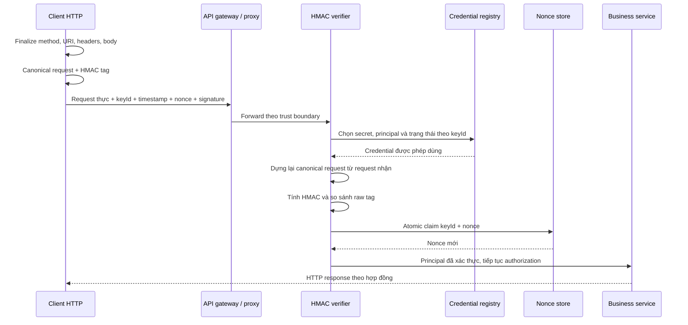
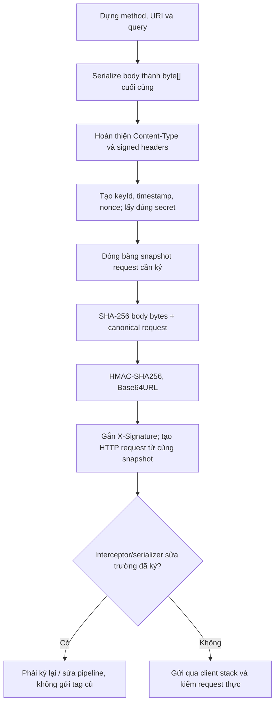

# Kiểm tra client signing: xác nhận HTTP request được ký đúng trước khi gửi

> **Chương:** Ký request  
> **Bài học:** Kiểm tra client signing  
> **Bối cảnh:** Xây dựng cơ chế xác thực HTTP request bằng HMAC với shared secret và canonical request. Client ký method, URI, các header và/hoặc body theo hợp đồng; phía nhận xác minh chữ ký, timestamp/nonce chống replay, trạng thái credential/key rotation, tương tác proxy/gateway và quyền truy cập. Bài này tập trung vào **cách kiểm tra toàn bộ quy trình ký phía client**, không chỉ vào phép gọi `Mac.doFinal`.

## 1. “Client signing đúng” nghĩa là gì?

Trong HTTP HMAC authentication, **client signing** là việc ứng dụng gửi request tạo **signature tag** từ secret đã được cấp và **dữ liệu request thật sẽ gửi đi**. Quy trình thường có bốn tầng:

1. Hoàn thiện request: chọn HTTP method, URL, query, signed headers, timestamp, nonce và body bytes.
2. Dựng canonical request và string-to-sign **theo đúng phiên bản hợp đồng ký**.
3. Tính HMAC, mã hóa tag sang định dạng truyền đã thỏa thuận và gắn các authentication headers.
4. Gửi đúng request đã được ký, **không để serializer, interceptor hay gateway thay nội dung được bảo vệ một cách không kiểm soát**.

Điều kiện thành công không phải “client xuất ra một chuỗi Base64URL hợp lệ”. Một client có thể tạo HMAC-SHA256 rất đúng về mặt toán học nhưng vẫn sai vì ký nhầm path, bỏ body, dùng secret sai, ký một JSON rồi gửi JSON khác hoặc ký trước khi HTTP client tự thêm header.

### Những bất biến cần chứng minh

| Bất biến | Câu hỏi kiểm tra |
| --- | --- |
| **Đúng khóa** | Client dùng secret thuộc `keyId`, môi trường và trạng thái credential được cấp hay chưa? |
| **Đúng thuật toán** | Có thực sự dùng `HmacSHA256` thay vì `SHA-256` không khóa hoặc thuật toán khác không? |
| **Đúng request** | Method, authority, path, query, header và body được ký có giống dữ liệu phát ra trên HTTP không? |
| **Đúng byte** | UTF-8, LF, percent-encoding, body hash và thứ tự các dòng có nhất quán không? |
| **Đúng metadata** | Timestamp, nonce, key ID, version và idempotency key (nếu áp dụng) có được ký không? |
| **Đúng định dạng tag** | HMAC bytes được mã hóa đúng Base64URL/hex, padding, độ dài và prefix không? |
| **Tương tác thực** | Một verifier độc lập có xác minh được request đi qua gateway, proxy và server framework thực tế không? |
| **Thất bại an toàn** | Sửa một trường được ký, đổi key hoặc dùng request cũ có bị từ chối ở lớp phù hợp không? |

**Phân biệt:** Client signing tạo bằng chứng mật mã về request; **server verification** kiểm bằng chứng đó. Bài kiểm tra phía client cần sử dụng **verifier độc lập và request thực trên wire** làm bằng chứng bổ sung, không chỉ gọi lại chính hàm signing ở client.

## 2. Mô hình ký và kiểm HMAC HTTP request



Cùng một request muốn được xác minh thành công cần hai phía cùng biết:

```text
bytesToSign = UTF8(contractPrefix + canonicalRequest)

clientTag = HMAC-SHA256(clientSecret, bytesToSign)
serverExpectedTag = HMAC-SHA256(serverSecret, rebuiltBytesToSign)

successful cryptographic match =
    same secret bytes
    + same signing-input bytes
    + same algorithm
    + same full-tag length/encoding rules
```

Một signature khớp **không đủ** để thực hiện nghiệp vụ: timestamp có thể hết hạn, nonce có thể đã dùng, credential có thể bị thu hồi và principal có thể thiếu quyền trên tài nguyên.

## 3. Chốt hợp đồng ký trước khi kiểm thử

Để các ví dụ có thể tái lập, bài sử dụng một hợp đồng **tùy biến cho mục đích học tập** mang tên `CLIENT-SIGN-V1`. Nó **không phải chuẩn chung** cho mọi API HMAC và không tự tương thích với RFC 9421 HTTP Message Signatures.

### 3.1. Request mẫu

```http
POST /v1/payments?currency=VND&orderId=42 HTTP/1.1
Host: api.example.test
Content-Type: application/json
Idempotency-Key: pay-ord-42-001
X-Key-Id: merchant-test-k1
X-Timestamp: 1795800000
X-Nonce: 4f7213e195ea4ad7bc03523b4a8da811
X-Signature: v1=<BASE64URL_NO_PADDING_HMAC_TAG>

{"amount":100000}
```

`<BASE64URL_NO_PADDING_HMAC_TAG>` là placeholder, không phải tag đã được tính. `timestamp` và `nonce` là fixture cố định **chỉ để test**, không sử dụng lại trên hệ thống thật.

### 3.2. Quy tắc canonicalization của ví dụ

1. **Method:** chính xác `POST`, không tự đổi mọi method thành chữ hoa; API dùng allowlist method.
2. **Scheme/authority:** HTTPS tới `api.example.test` không có explicit port; trong hệ thống đa host cần quy tắc ký/cố định authority rõ ràng.
3. **Path:** chính xác `/v1/payments`. Đường dẫn khác, encoded slash, dot segments và alias route không được chấp nhận trong ví dụ.
4. **Query:** chính xác dạng canonical `currency=VND&orderId=42`, hai key duy nhất. Endpoint này từ chối duplicate parameters hoặc biểu diễn mơ hồ. API tổng quát cần bộ canonicalizer riêng cho percent-encoding.
5. **Signed headers:** `content-type`, `idempotency-key`, `x-key-id`, `x-nonce`, `x-timestamp`; tên lower-case, giá trị đúng dạng đã validate và sắp xếp theo thứ tự cố định.
6. **Body:** SHA-256 trên **raw body bytes** sau khi tháo transfer framing và trước content decoding. Ví dụ chỉ cho JSON không nén, nên `Content-Type` là `application/json` và không có `Content-Encoding`.
7. **Body digest encoding:** 64 ký tự hex chữ thường.
8. **Dấu phân tách:** nối các dòng canonical bằng LF (`\n`) và **không có LF cuối**.
9. **Domain/version:** `stringToSign = "HMAC-SHA256/CLIENT-SIGN-V1\n" + canonicalRequest`.
10. **MAC:** `HmacSHA256`, shared secret là **byte** của credential được chọn, tag đầy đủ **32 byte**.
11. **Transport:** header `X-Signature` mang `v1=` + **Base64URL không padding** của 32-byte tag, chính xác 43 ký tự tag.
12. **Phần không ký:** `X-Signature` là đầu ra, không nằm trong canonical request; nhưng **key ID, timestamp, nonce và idempotency key được ký**.

Đây là contract **có chủ đích rất hẹp** để tập trung kiểm tra client signing; nó không khẳng định mọi URI/query, media type và cách xử lý gateway đều tuân theo những quy tắc này.

### 3.3. Canonical request của fixture

```text
POST
api.example.test
/v1/payments
currency=VND&orderId=42
content-type:application/json
idempotency-key:pay-ord-42-001
x-key-id:merchant-test-k1
x-nonce:4f7213e195ea4ad7bc03523b4a8da811
x-timestamp:1795800000
content-type;idempotency-key;x-key-id;x-nonce;x-timestamp
<SHA256_HEX_OF_RAW_BODY_BYTES>
```

Dòng cuối là **placeholder**; khi tính HMAC phải thay bằng SHA-256 của byte UTF-8 chính xác của `{"amount":100000}`, **không có newline cuối**.

**Lưu ý về idempotency:** Hợp đồng này ký `Idempotency-Key` vì POST tạo giao dịch. Idempotency key không thay nonce; nó giúp service tránh thực hiện lại **cùng thao tác nghiệp vụ** khi client retry hợp lệ bằng nonce mới.

## 4. Thứ tự thực hiện: ký sau khi đã hoàn thiện request

Đây là chỗ nhiều client ký sai.



**Ví dụ lỗi phổ biến:**

```java
// Minh họa ý tưởng KHÔNG NÊN LÀM:
// Ký một JSON object trước khi HTTP library serialize object.
String canonicalBody = object.toString();
byte[] tag = sign(canonicalBody.getBytes(StandardCharsets.UTF_8));

// Sau đó thư viện lại serialize JSON object thành byte khác.
// Signature có thể sai dù Java Mac hoạt động hoàn hảo.
httpLibrary.sendJson(object);
```

**Đúng hướng:**

```java
byte[] bodyBytes = jsonSerializer.serializeToUtf8Bytes(payload);
// BodyPublisher/RequestBody phải gửi CHÍNH byteBytes này.
byte[] tag = sign(buildCanonicalRequest(bodyBytes, finalizedHeaders));
sendWithExactBytes(bodyBytes, finalizedHeaders, tag);
```

Các tên hàm trên là pseudocode để diễn giải thứ tự. Trong code thật cần có cơ chế bảo vệ **snapshot bất biến**, tránh sửa mảng byte sau khi ký.

### Các nguồn thay đổi sau khi signer chạy

| Tầng | Thay đổi có thể xảy ra | Dấu hiệu |
| --- | --- | --- |
| JSON serializer | Whitespace, field order, Unicode escape, newline, định dạng số. | Body SHA-256 ở client khác server. |
| Form encoder | `+`/`%20`, parameter order, duplicate key. | Canonical query/form khác. |
| Multipart builder | Sinh boundary, CRLF, part headers, filename. | Body digest và `Content-Type` cùng đổi. |
| HTTP interceptor | Thêm/sửa `Content-Type`, idempotency key hoặc auth headers. | Signed headers khác wire. |
| Redirect handler | Thay authority/path hoặc gửi lại tới host khác. | Key/credential có thể bị gửi sai đích; HMAC mismatch. |
| Retry handler | Gửi lại nguyên nonce/timestamp/tag. | Bị anti-replay từ chối; cần retry policy an toàn. |
| Reverse proxy | Rewrite prefix, percent-encoding, query, host, body compression. | Trực tiếp pass nhưng qua gateway fail. |
| Framework body reader | Decode gzip, parse JSON rồi serialize lại. | Verifier ký khác byte do client phát. |

## 5. Kiểm tra trước gửi: một checklist byte-level

Một test hữu ích không chỉ kiểm `signatureHeader.startsWith("v1=")`; nó kiểm **mọi thành phần ký**.

| Thành phần | Kiểm điều gì? | Vì sao quan trọng? |
| --- | --- | --- |
| HTTP method | `POST` chính xác, không bị method override. | Tránh dùng tag POST cho thao tác khác. |
| URI raw path | `/v1/payments` đúng byte và percent-encoding. | Path quyết định endpoint. |
| Raw query | `currency=VND&orderId=42`, không mất duplicate. | Query có thể quyết định amount, tenant hoặc resource. |
| Authority | `api.example.test` đúng host được phép. | Bảo vệ routing/tenant và tránh gửi secret sang domain lạ. |
| Content-Type | `application/json` đúng dạng signed. | Backend có thể parse khác nếu header đổi. |
| Body bytes | Độ dài/hex/SHA-256 trước ký và trước gửi. | Không ký object/chuỗi khác với bytes phát đi. |
| Idempotency-Key | Đúng nghiệp vụ và có trong signed headers. | Tránh thay khóa retry mà giữ tag. |
| Key ID | Trùng credential đã dùng để tính HMAC. | Server chọn đúng secret và principal. |
| Timestamp | Epoch seconds đúng đơn vị, clock sync. | Tránh sai freshness window vì ms/giây. |
| Nonce | Tạo từ CSPRNG, dùng một lần cho mỗi signing attempt. | Chống replay. |
| Signing input | UTF-8, LF, không trailing LF, đúng thứ tự. | Một byte khác cho HMAC khác. |
| Signature encoding | Base64URL không padding, 43 ký tự, `v1=`. | Parser server có thể reject format sai. |

Trong production không log secret hoặc raw body nhạy cảm chỉ để kiểm. Dùng **fixture vô hại** trong test, hoặc chỉ ghi diagnostic đã được kiểm soát truy cập.

## 6. Java 17+: client signer và kiểm thử offline có thể chạy độc lập

Đoạn mã sau dùng **JDK 17+** để minh họa trọn đường đi:

- Chuẩn bị một **snapshot** chứa đúng URI, signed headers và body bytes.
- Tạo canonical request và HMAC-SHA256 trên `UTF-8 bytesToSign`.
- Tạo `java.net.http.HttpRequest` với `BodyPublishers.ofByteArray(...)` từ **chính snapshot byte body**.
- Kiểm `HttpRequest` thực được dựng có method/URI/headers như đã ký.
- Kiểm test vector công khai RFC 4231 và SHA-256 của `abc`.
- Kiểm **thay body, nonce và credential key** làm tag khác.
- Kiểm tag Base64URL đúng độ dài và decode trở lại 32 byte.

**Đây là chương trình offline**: nó tạo `HttpRequest` nhưng không gửi lên mạng, nên chưa chứng minh gateway hay server thật tiếp nhận đúng wire bytes. Hãy dùng thêm integration tests ở mục 8.

```java
import java.net.URI;
import java.net.http.HttpRequest;
import java.nio.charset.StandardCharsets;
import java.security.GeneralSecurityException;
import java.security.MessageDigest;
import java.util.Arrays;
import java.util.Base64;
import java.util.HexFormat;
import java.util.Objects;
import javax.crypto.Mac;
import javax.crypto.spec.SecretKeySpec;

public final class ClientSigningCheck {
    private static final HexFormat HEX = HexFormat.of();
    private static final String SIGNING_PREFIX =
            "HMAC-SHA256/CLIENT-SIGN-V1\n";
    private static final String SIGNED_NAMES =
            "content-type;idempotency-key;x-key-id;x-nonce;x-timestamp";

    private ClientSigningCheck() {}

    // Giữ một snapshot của body bytes; caller không được sửa nội dung
    // đã ký qua tham chiếu byte[] gốc hoặc accessor.
    public record Prepared(
            URI uri,
            String contentType,
            String idempotencyKey,
            String keyId,
            String timestamp,
            String nonce,
            byte[] body) {

        public Prepared {
            Objects.requireNonNull(uri);
            Objects.requireNonNull(contentType);
            Objects.requireNonNull(idempotencyKey);
            Objects.requireNonNull(keyId);
            Objects.requireNonNull(timestamp);
            Objects.requireNonNull(nonce);
            Objects.requireNonNull(body);
            body = body.clone();
        }

        @Override
        public byte[] body() {
            return body.clone();
        }
    }

    private static void check(boolean condition, String message) {
        if (!condition) throw new AssertionError(message);
    }

    // Bộ validate dưới đây chỉ phục vụ fixture endpoint cố định.
    // Production cần canonicalizer URI/header tổng quát theo contract.
    private static void validate(Prepared p) {
        if (!"https".equals(p.uri().getScheme())
                || !"api.example.test".equals(p.uri().getHost())
                || p.uri().getPort() != -1
                || p.uri().getRawUserInfo() != null
                || p.uri().getRawFragment() != null
                || !"/v1/payments".equals(p.uri().getRawPath())
                || !"currency=VND&orderId=42".equals(
                        p.uri().getRawQuery())) {
            throw new IllegalArgumentException("Unexpected URI fixture");
        }
        if (!"application/json".equals(p.contentType())
                || !p.keyId().matches("[A-Za-z0-9._-]{1,64}")
                || !p.idempotencyKey().matches("[A-Za-z0-9._-]{1,64}")
                || !p.timestamp().matches("[0-9]{10,11}")
                || !p.nonce().matches("[0-9a-f]{32}")) {
            throw new IllegalArgumentException("Invalid signed metadata");
        }
    }

    private static String sha256Hex(byte[] bytes)
            throws GeneralSecurityException {
        return HEX.formatHex(MessageDigest
                .getInstance("SHA-256").digest(bytes));
    }

    public static String canonical(Prepared p)
            throws GeneralSecurityException {
        validate(p);
        return String.join("\n",
                "POST",
                "api.example.test",
                p.uri().getRawPath(),
                p.uri().getRawQuery(),
                "content-type:" + p.contentType(),
                "idempotency-key:" + p.idempotencyKey(),
                "x-key-id:" + p.keyId(),
                "x-nonce:" + p.nonce(),
                "x-timestamp:" + p.timestamp(),
                SIGNED_NAMES,
                sha256Hex(p.body()));
    }

    private static byte[] hmacSha256(
            byte[] secret, byte[] input)
            throws GeneralSecurityException {
        Mac mac = Mac.getInstance("HmacSHA256");
        mac.init(new SecretKeySpec(secret, "HmacSHA256"));
        return mac.doFinal(input);
    }

    public static byte[] sign(byte[] secret, Prepared p)
            throws GeneralSecurityException {
        String toSign = SIGNING_PREFIX + canonical(p);
        return hmacSha256(secret,
                toSign.getBytes(StandardCharsets.UTF_8));
    }

    public static String signatureHeader(byte[] tag) {
        if (tag == null || tag.length != 32) {
            throw new IllegalArgumentException(
                    "Expected full HMAC-SHA256 tag");
        }
        return "v1=" + Base64.getUrlEncoder()
                .withoutPadding().encodeToString(tag);
    }

    public static HttpRequest buildRequest(
            Prepared p, String signature) {
        validate(p);
        if (signature == null
                || !signature.matches("v1=[A-Za-z0-9_-]{43}")) {
            throw new IllegalArgumentException("Invalid signature grammar");
        }
        // Cùng snapshot body bytes được dùng cho SHA-256 và publisher.
        return HttpRequest.newBuilder(p.uri())
                .header("Content-Type", p.contentType())
                .header("Idempotency-Key", p.idempotencyKey())
                .header("X-Key-Id", p.keyId())
                .header("X-Timestamp", p.timestamp())
                .header("X-Nonce", p.nonce())
                .header("X-Signature", signature)
                .POST(HttpRequest.BodyPublishers.ofByteArray(p.body()))
                .build();
    }

    private static Prepared withBody(Prepared p, byte[] changed) {
        return new Prepared(p.uri(), p.contentType(),
                p.idempotencyKey(), p.keyId(), p.timestamp(),
                p.nonce(), changed);
    }

    private static Prepared withNonce(Prepared p, String changed) {
        return new Prepared(p.uri(), p.contentType(),
                p.idempotencyKey(), p.keyId(), p.timestamp(),
                changed, p.body());
    }

    public static void main(String[] args) throws Exception {
        // KAT độc lập với HTTP canonicalization.
        check(sha256Hex("abc".getBytes(StandardCharsets.US_ASCII))
                .equals("ba7816bf8f01cfea414140de5dae2223"
                      + "b00361a396177a9cb410ff61f20015ad"),
                "SHA-256 abc KAT failed");

        byte[] rfcKey = new byte[20];
        Arrays.fill(rfcKey, (byte) 0x0b);
        byte[] rfcTag = hmacSha256(
                rfcKey, "Hi There".getBytes(StandardCharsets.US_ASCII));
        check(HEX.formatHex(rfcTag).equals(
                "b0344c61d8db38535ca8afceaf0bf12b"
              + "881dc200c9833da726e9376c2e32cff7"),
                "RFC 4231 HMAC-SHA256 KAT failed");

        // Secret cố định để demo tái lập; không phải khóa production.
        byte[] testSecret = HEX.parseHex(
                "000102030405060708090a0b0c0d0e0f"
              + "101112131415161718191a1b1c1d1e1f");
        byte[] body = "{\"amount\":100000}"
                .getBytes(StandardCharsets.UTF_8);
        Prepared p = new Prepared(
                URI.create("https://api.example.test/v1/payments"
                        + "?currency=VND&orderId=42"),
                "application/json", "pay-ord-42-001",
                "merchant-test-k1", "1795800000",
                "4f7213e195ea4ad7bc03523b4a8da811", body);

        String canonicalRequest = canonical(p);
        byte[] tag = sign(testSecret, p);
        String header = signatureHeader(tag);
        HttpRequest http = buildRequest(p, header);

        check("POST".equals(http.method()), "Wrong HTTP method");
        check(http.uri().equals(p.uri()), "Wrong HTTP URI");
        check(http.headers().firstValue("Content-Type")
                .orElseThrow().equals(p.contentType()),
                "Content-Type changed");
        check(http.headers().firstValue("Idempotency-Key")
                .orElseThrow().equals(p.idempotencyKey()),
                "Idempotency-Key changed");
        check(http.headers().firstValue("X-Key-Id")
                .orElseThrow().equals(p.keyId()),
                "Key ID changed");
        check(http.headers().firstValue("X-Timestamp")
                .orElseThrow().equals(p.timestamp()),
                "Timestamp changed");
        check(http.headers().firstValue("X-Nonce")
                .orElseThrow().equals(p.nonce()),
                "Nonce changed");
        check(http.headers().firstValue("X-Signature")
                .orElseThrow().equals(header),
                "Signature changed");

        // Full 32-byte HMAC -> 43 Base64URL chars -> 46 total with v1=.
        check(tag.length == 32 && header.length() == 46,
                "Wrong tag or wire length");
        check(Arrays.equals(tag, Base64.getUrlDecoder()
                .decode(header.substring(3))),
                "Base64URL tag round-trip failed");

        // Caller sửa mảng sau khi snapshot được tạo: signature phải ổn.
        body[0] ^= (byte) 0x01;
        check(MessageDigest.isEqual(tag, sign(testSecret, p)),
                "Mutable caller buffer changed the prepared request");

        // Mutation negative tests: các thành phần có tác động đã được ký.
        check(!MessageDigest.isEqual(tag, sign(testSecret,
                withBody(p, "{\"amount\":900000}"
                        .getBytes(StandardCharsets.UTF_8)))),
                "Tampered body should not match");
        check(!MessageDigest.isEqual(tag, sign(testSecret,
                withNonce(p, "2f7213e195ea4ad7bc03523b4a8da811"))),
                "Tampered nonce should not match");

        byte[] otherSecret = testSecret.clone();
        otherSecret[0] ^= (byte) 0x01;
        check(!MessageDigest.isEqual(tag, sign(otherSecret, p)),
                "Different credential secret should not match");

        check(canonicalRequest.contains(
                "content-type:application/json\n"
              + "idempotency-key:pay-ord-42-001"),
                "Signed headers missing or reordered");

        System.out.println("PASS: client signing fixture");
        System.out.println("Body SHA-256: " + sha256Hex(p.body()));
        System.out.println("Signature header length: " + header.length());
        // Không in secret/tag đầy đủ trong production.
    }
}
```

Chạy với Java 17+ khi đã lưu class đúng tên:

```bash
javac ClientSigningCheck.java
java ClientSigningCheck
```

**Giới hạn kỹ thuật:** `HttpRequest` trong ví dụ dùng `BodyPublishers.ofByteArray` từ một snapshot byte. Chương trình kiểm method, URI và headers của object được xây nhưng **không bắt gói mạng và không kiểm byte mà proxy/server thật nhận**. Nó cũng không triển khai full canonicalizer URL/query cho mọi input, freshness window hay authorization. Cần integration/contract tests bổ sung.

### 6.1. Vì sao không dùng secret hard-code trong production?

`testSecret` chỉ là dữ liệu fixture. Hệ thống thật cần:

- Secret đủ entropy, lưu qua secret manager hoặc key store phù hợp.
- Liên kết `keyId` với đúng client, môi trường, quyền và trạng thái credential.
- Không gửi shared secret trong HTTP header/body.
- Đổi secret theo kế hoạch rotation; không tái sử dụng key production làm fixture.
- Không lưu raw key hoặc signature trong log, crash report hay telemetry.

### 6.2. Vì sao không dùng cùng timestamp/nonce mãi?

Fixture cố định giúp kiểm tính quyết định của signer; client production phải dùng:

```java
import java.security.SecureRandom;
import java.time.Instant;
import java.util.HexFormat;

String timestamp = Long.toString(Instant.now().getEpochSecond());
byte[] nonceBytes = new byte[16];
new SecureRandom().nextBytes(nonceBytes);
String nonce = HexFormat.of().formatHex(nonceBytes);
```

Đây là mảnh code riêng. Trong hệ thống thực tế nên dùng một `SecureRandom` dùng lại theo chính sách phù hợp. **Timestamp phải là epoch seconds**, không lấy trực tiếp milliseconds từ `System.currentTimeMillis()` để đưa vào hợp đồng dùng giây.

Client tạo nonce mới cho **mỗi lần gửi có ý nghĩa là request mới**. Nếu retry một POST do timeout, không được dùng lại nguyên nonce cũ rồi mong replay check bỏ qua; thay vào đó tạo timestamp/nonce mới, ký lại, và giữ cùng `Idempotency-Key` đã được ràng buộc khi retry cùng thao tác nghiệp vụ.

## 7. Kiểm tra client signing bằng golden vectors và test độc lập

Một test chỉ gọi `sign(request)` rồi gọi lại `sign(request)` và assert hai kết quả giống nhau là chưa đủ. Hai lần có thể **cùng sai hợp đồng ký**.

### 7.1. Golden fixture phải lưu **byte**, không chỉ text

Một fixture nên có:

```yaml
fixtureId: post-payment-client-sign-v1
contract: CLIENT-SIGN-V1
method: POST
url: https://api.example.test/v1/payments?currency=VND&orderId=42
keyId: merchant-test-k1
timestamp: "1795800000"
nonce: 4f7213e195ea4ad7bc03523b4a8da811
contentType: application/json
idempotencyKey: pay-ord-42-001
bodyUtf8: '{"amount":100000}'
bodyBytesHex: <hex của đúng byte body>
bodySha256Hex: <SHA-256 golden độc lập>
canonicalRequestUtf8Hex: <hex của canonical request>
stringToSignUtf8Hex: <hex của string-to-sign>
expectedHmacHex: <64 ký tự hex của full HMAC tag>
expectedBase64Url: <43 ký tự URL-safe không padding>
```

Đây là **khung fixture**. Mọi chỗ `<...>` cần thay bằng **giá trị thực được kiểm chéo độc lập** trước khi đưa vào test. Chỉ dùng dữ liệu key công khai dành cho test.

Mỗi test cần kiểm:

1. Body byte length và hex đúng với fixture.
2. `SHA-256(rawBodyBytes)` đúng giá trị golden.
3. Canonical request **UTF-8 hex** đúng, bao gồm LF, thứ tự header, URI và dòng cuối.
4. String-to-sign bytes đúng prefix/version.
5. HMAC raw bytes khớp golden tag từ implementation độc lập.
6. Base64URL text trên wire đúng định dạng và decode về đúng tag.

### 7.2. Known-answer tests của mật mã không thay test canonicalization

Có thể dùng:

```text
SHA-256(ASCII "abc") =
ba7816bf8f01cfea414140de5dae2223b00361a396177a9cb410ff61f20015ad

RFC 4231, HMAC-SHA256 test case 1:
key = 20 bytes of 0x0b
message = ASCII "Hi There"
tag = b0344c61d8db38535ca8afceaf0bf12b
      881dc200c9833da726e9376c2e32cff7
```

Nếu KAT thành công, Java crypto provider đang thực hiện phép hash/HMAC đúng cho test vectors. Nhưng điều đó **không chứng minh** client dựng đúng URI/query/headers/body hay gửi đúng các byte được ký.

### 7.3. Independent verifier

Để bắt lỗi “hai phía cùng sai”, nên dùng **verifier độc lập**:

- Triển khai tại server bằng một thư viện hoặc code path tách khỏi client signer.
- Lấy request nhận từ HTTP adapter, không tin trực tiếp `canonicalRequest` do client gửi.
- Tự đọc raw body, dựng canonical request và tra secret theo key ID.
- So tag raw bytes sau strict decode và kiểm policy.
- So golden fixtures giữa Java và client khác ngôn ngữ (nếu có), ví dụ JavaScript hoặc Go.

**Không nên truyền canonical request do client gửi như nguồn tin tuyệt đối để server ký lại.** Server phải xây từ **request thực sự nhận được ở trust boundary**; nếu không, attacker có thể tạo một canonical string đẹp nhưng gửi HTTP request có method/URI/body khác.

## 8. Kiểm tra request thực được gửi: từ HttpRequest object tới gateway

Có ba lớp kiểm tra:

| Mức | Quan sát được | Chưa bảo đảm |
| --- | --- | --- |
| **Unit signer** | Canonical string, body digest, raw HMAC tag, encoding. | Không biết HTTP stack đã đổi dữ liệu trước khi gửi. |
| **Client transport integration** | Method/URI/headers/body bytes do test server hoặc byte-capturing adapter nhận. | Chưa chứng minh reverse proxy/gateway production giữ nguyên. |
| **End-to-end qua ingress thật** | Dữ liệu đến verifier và kết quả authorization/business. | Cần quan sát thêm multi-instance replay, retry, rotation và lỗi hạ tầng. |

### 8.1. Lập một test HTTP capture endpoint

Trong môi trường thử nghiệm, tạo một HTTP server/endpoint có khả năng:

1. Nhận request và lưu **method thực**, `raw path/query`, mọi lần xuất hiện của signed headers, **raw body bytes** và body byte length.
2. Giới hạn body size, thời gian, log access và dữ liệu test; tránh capture secret hoặc request production.
3. Tự dựng canonical request **từ giá trị nhận**, không lấy canonical string do client gửi.
4. Decode `X-Signature` nghiêm ngặt; kiểm 32-byte HMAC và so với tag server tự tính.
5. Trả kết quả test có correlation ID và reason code, không trả secret/raw key.

Sau đó chạy cùng fixture:

```text
Client (offline fixture)
    -> client HTTP library / interceptors
    -> capture endpoint trực tiếp
    -> capture endpoint qua gateway
    -> service verifier + nonce store
```

Đối chiếu `raw body byte length`, `SHA-256(body bytes)`, URI, signed headers và tag ở từng bước. **Không lấy log đã redact/normalize làm nguồn chứng minh raw bytes** nếu log formatter đã thay đổi dữ liệu.

### 8.2. Trường hợp proxy/gateway phải kiểm

| Thay đổi qua mạng | Nguy cơ đối với client signing | Cách kiểm |
| --- | --- | --- |
| Rewrite `/public/v1/payments` thành `/v1/payments` | Client và verifier ký khác path. | Chốt điểm xác minh hoặc nguồn logical path đáng tin cậy. |
| Đổi `Host`/`:authority` | Chữ ký khác nếu authority được ràng buộc. | Kiểm host mà client ký và authority mà verifier dùng. |
| Normalize query hoặc percent-encoding | Có thể mất duplicate, đổi `+`/`%20`. | Test raw query và canonical query độc lập. |
| Header name đổi case | HTTP field name vốn không phân biệt case. | Hợp đồng ký dùng lower-case names; không đổi case values. |
| Gộp duplicate `X-Key-Id`/`X-Signature` | Verifier có thể nhận một giá trị, backend giá trị khác. | Reject duplicate ở ingress có toàn bộ field occurrences. |
| Thêm `Content-Type` sau lúc ký | Signed header không còn khớp. | Finalize header trước signer. |
| Giải nén gzip, nén lại hoặc serialize JSON | Thay body bytes. | Ký đúng representation tại điểm xác minh; test body digest trước/sau. |
| Chuyển HTTP/1.1 sang HTTP/2 | Wire framing và cách biểu diễn field khác. | Ký HTTP semantic components đã đặc tả, không ký raw framing. |
| Redirect sang host khác | Có thể làm lộ credential metadata hoặc gửi tag sai đích. | Không tự forward request đã ký tới authority khác; đánh giá lại/ ký lại theo policy. |
| Chuyển tag vào query/form | Base64 chuẩn có `+` dễ bị parse thành space. | Giữ đúng transport contract; Base64URL nếu protocol chọn. |

**Bất biến then chốt:** Business handler phải xử lý **đúng body và các trường request đã được verifier bảo vệ**. Một signature có thể khớp nhưng handler lại dùng query/body được parse khác cách verifier hiểu thì vẫn có thể tồn tại lỗi an ninh.

## 9. Kiểm thử negative: sửa một thứ, giữ tag cũ

Negative tests có giá trị vì chúng chứng minh hệ thống **không chấp nhận** request bị thay đổi sau lúc ký.

### 9.1. Các mutation ở lớp request

| # | Thao tác | Kỳ vọng |
| --- | --- | --- |
| 1 | Đổi `POST` thành `GET`, giữ tag cũ. | Signature/contract reject vì method được ký. |
| 2 | Đổi host sang virtual host/tenant khác. | Reject nếu authority nằm trong hợp đồng ký hoặc bị cố định tin cậy. |
| 3 | Đổi `/v1/payments` thành `/v1/refunds`. | Signature mismatch / endpoint reject. |
| 4 | Đổi `orderId=42` thành `orderId=99`. | HMAC mismatch. |
| 5 | Thêm `orderId` lặp. | Reject query ambiguity trước khi xử lý. |
| 6 | Đổi percent-encoding hoặc encoded slash. | Reject noncanonical route hoặc signature mismatch theo contract. |
| 7 | Đổi `Content-Type` từ JSON sang form. | Reject unsupported/mismatch vì parser metadata được ký. |
| 8 | Đổi `Idempotency-Key`, giữ tag cũ. | HMAC mismatch. |
| 9 | Đổi một byte `amount`. | SHA-256 body đổi và HMAC mismatch. |
| 10 | Chỉ đổi JSON whitespace. | HMAC mismatch nếu hợp đồng ký raw body bytes. |
| 11 | Đổi JSON field order. | HMAC mismatch theo raw-body contract. |
| 12 | Thêm BOM, LF hoặc CRLF cuối body. | HMAC mismatch khi bytes khác. |
| 13 | Thay key ID nhưng giữ tag. | Reject do signature/policy/secret mismatch. |
| 14 | Thay timestamp hoặc nonce, giữ tag. | HMAC mismatch vì metadata được ký. |
| 15 | Thay phiên bản `v1` thành `v2` không hỗ trợ. | Reject, không tự fallback. |
| 16 | Thay ký tự Base64URL trong tag mà vẫn đúng grammar. | Decode có thể thành công, nhưng tag compare fail. |
| 17 | Thêm `=` padding vào tag. | Reject nếu hợp đồng chỉ nhận unpadded Base64URL. |
| 18 | Tạo hai `X-Signature`. | Reject duplicate, không chọn first/last. |
| 19 | Gửi tag hex thay cho Base64URL trong `v1`. | Reject format. |
| 20 | Gửi tag 16 byte bị truncation ngoài contract. | Reject độ dài; không tự nhận tag ngắn. |

**Không bao giờ sửa bug client signer bằng cách bỏ method, path, query, body digest hoặc signed headers khỏi hợp đồng** khi các trường đó ảnh hưởng hành động nghiệp vụ.

### 9.2. Những kết quả “thất bại” có nguyên nhân khác nhau

Một hệ thống kiểm HMAC tốt phải phân biệt nội bộ:

- `malformed_signature`: chữ ký không có hoặc sai grammar/encoding.
- `unknown_key` / `revoked_key`: credential không dùng được.
- `bad_signature`: tag không khớp.
- `stale_timestamp`: request ngoài cửa sổ thời gian.
- `nonce_reused`: request có tag hợp lệ nhưng đã được gửi trước đó.
- `forbidden`: xác thực có thể thành công nhưng principal không đủ quyền.

Không nhất thiết tiết lộ mọi reason code cụ thể cho caller bên ngoài; log/metrics phải tránh lộ secret và tránh hỗ trợ dò credential.

## 10. Replay, retry và idempotency: kiểm client signing theo vòng đời request

### 10.1. HMAC ký request, không bảo đảm request chỉ được dùng một lần

HMAC trên cùng input và secret luôn cho cùng tag. Nếu client phát lại:

```text
POST /v1/payments?orderId=42
timestamp: 1795800000
nonce: 4f7213e195ea4ad7bc03523b4a8da811
signature: v1=<same-tag>
```

server có thể tính HMAC đúng như lần đầu. **Replay protection** cần:

1. Timestamp và nonce **được ký** trong canonical request.
2. Server kiểm freshness, ví dụ `abs(serverNow - timestamp) <= 300` giây.
3. Server chỉ **claim nonce sau khi HMAC đúng**, bằng thao tác atomic insert-if-absent trên kho chung cho các instance.
4. Nonce trùng bị từ chối; TTL phải bao phủ **toàn bộ thời gian timestamp còn được chấp nhận**.
5. Với cửa sổ đối xứng ±300 giây, request có timestamp ở tương lai có thể hợp lệ gần 600 giây tính từ lần nhận sớm nhất; TTL 300 giây tính từ claim sớm nhất có thể quá ngắn.

Client production nên tạo nonce đủ entropy, ví dụ **16 byte ngẫu nhiên từ `SecureRandom`**, và không tái sử dụng cùng nonce trong phạm vi credential.

### 10.2. Retry POST sau khi bị timeout

Giả sử server đã tạo thanh toán, nhưng response mất. Client không biết kết quả và muốn retry.

- **Không tái gửi nguyên request với nonce đã dùng** chỉ vì timeout.
- Tạo **timestamp mới, nonce mới và signature mới** cho retry theo quy tắc của API.
- **Giữ nguyên `Idempotency-Key` đã ký** và những dữ liệu nghiệp vụ được định nghĩa là cùng thao tác.
- Business service dùng idempotency store nguyên tử và fingerprint request để tránh tạo hai thanh toán; nếu cùng idempotency key nhưng body nghiệp vụ khác, từ chối conflict.
- Nếu chính sách API không cho retry tự động, client phải kiểm trạng thái trước khi gửi lại để tránh tác động ngoài ý muốn.

**Nonce** giải quyết chống phát lại một request cũ; **idempotency key** giải quyết lặp một **tác động nghiệp vụ**. Hai cơ chế không thay thế nhau.

### 10.3. Đồng hồ và concurrency

Các bài test client nên có:

- Timestamp epoch seconds; không dùng milliseconds.
- Lệch giờ client nhanh/chậm hơn server và freshness window.
- Hai thread ký cùng thời điểm nhưng sinh nonce khác nhau.
- Không chia sẻ đối tượng `Mac` mutable giữa các thread nếu không có cơ chế sở hữu/đồng bộ; mỗi phép ký nên có `Mac` được init với đúng key.
- Retry không âm thầm dùng lại `Mac`/snapshot đã có nonce cũ nếu request mới cần nonce mới.

## 11. Kiểm tra key rotation và credential policy ở phía client

Server chọn secret theo key ID, và client cũng phải bảo đảm **khóa dùng để ký khớp key ID gửi trên wire**.

Ví dụ chuyển từ `merchant-42-k1` sang `merchant-42-k2`:

| Giai đoạn | Client | Kỳ vọng ở server |
| --- | --- | --- |
| Trước rotation | Ký bằng secret k1, gửi `X-Key-Id: ...-k1`. | Chấp nhận nếu k1 đang ACTIVE. |
| Trong overlap được phép | Chọn rõ k1 hoặc k2, mỗi request chỉ dùng **một key ID + secret tương ứng**. | Chấp nhận credential còn hiệu lực theo policy. |
| Sau chuyển đổi | Ký bằng secret k2, gửi ID k2. | Chấp nhận k2, không đòi đổi format signature nếu contract giữ nguyên. |
| Sau revoke k1 | Không tiếp tục dùng k1. | Từ chối k1 dù tag HMAC bằng secret k1 có thể đúng. |
| Mất khóa/lộ khóa | Dừng dùng credential, cập nhật secret store và phối hợp revoke. | Không coi đổi encoding là cách xử lý lộ secret. |

Những ca test nên có:

- Header ghi key ID k2 nhưng client ký bằng key k1 → xác minh thất bại.
- Client đọc secret là text Base64 nhưng quên decode, dùng **UTF-8 bytes của chuỗi Base64** làm key → tag sai.
- Secret UTF-8/password tự đặt thay vì key bytes được cấp → không đạt chính sách key material.
- Client thay secret nhưng cache `Mac` instance đã init bằng khóa cũ → tag sai.
- Client bị thu hồi credential → không fallback sang credential khác tenant hoặc môi trường.
- Một client thử dùng credential staging với API production → bị từ chối theo registry/environment.

**Java `Mac.reset()` không chuyển key.** Khi đổi credential, phải `Mac.init(newKey)` hoặc tạo đối tượng `Mac` mới. Không log secret trong quá trình tìm lỗi.

## 12. Client ký thành công chưa có nghĩa được phân quyền

Giả sử merchant A có shared secret hợp lệ và ký:

```http
POST /v1/merchants/B/payments HTTP/1.1
X-Key-Id: merchant-A-k2
X-Signature: v1=<VALID_HMAC_FOR_REQUEST>
```

Server có thể xác minh signature và kết luận request được ký bởi người có quyền dùng credential **A**. Nhưng **không được suy ra A có quyền tạo thanh toán cho B**.

Quy trình đúng:

```text
Parse and validate request
    -> Credential lookup and status
    -> Canonical HTTP request + HMAC verification
    -> Timestamp freshness + nonce replay claim
    -> Authenticated principal
    -> Authorization(principal, action, resource/tenant)
    -> Business logic with idempotency/transaction policy
```

Trong kiểm thử client signing, đừng cố “sửa” lỗi HTTP 403 bằng cách đổi signature: một HMAC tag hợp lệ có thể đã vượt qua authentication nhưng bị từ chối **authorization**, và đó là hành vi an toàn đúng.

## 13. Ma trận kiểm thử client signing toàn diện

Bảng này dùng để lập kế hoạch test từ client đến verifier. Trạng thái “reject” có thể đến từ kiểm syntax/contract, chữ ký, freshness, nonce hoặc authorization; cần assert đúng lớp thất bại trong test.

| # | Ca kiểm thử | Kết quả mong đợi |
| --- | --- | --- |
| 1 | SHA-256 `abc` known-answer test. | Đúng digest chuẩn. |
| 2 | RFC 4231 HMAC-SHA256 test case 1. | Đúng tag 32 byte. |
| 3 | Cùng snapshot request và same secret. | Canonical bytes/tag giống nhau. |
| 4 | Golden fixture body digest và signing input UTF-8 hex. | Khớp giá trị kiểm độc lập. |
| 5 | Base64URL 32-byte tag. | Đúng 43 ký tự không padding, header có `v1=`. |
| 6 | HTTP client request object có đúng method/URI. | Không đổi dữ liệu đã ký. |
| 7 | HTTP client gửi đúng `Content-Type` và idempotency key. | Header trên wire trùng signing snapshot. |
| 8 | HTTP client gửi đúng body byte length/digest. | Byte gửi trùng byte được SHA-256 băm. |
| 9 | Serializer đổi whitespace JSON sau ký. | Signature mismatch; signer phải chạy sau serializer. |
| 10 | JSON body đổi amount hoặc field order. | Mismatch theo raw-body contract. |
| 11 | Body rỗng, LF, CRLF, BOM và Unicode. | Digest khác phù hợp byte fixtures. |
| 12 | Form-urlencoded với `+`/`%20` hoặc duplicate key. | Query/body parse đúng contract; reject ambiguity. |
| 13 | Multipart builder đổi boundary sau ký. | Mismatch; hoàn thiện multipart trước signer. |
| 14 | Binary body có NUL/`0xFF`. | Không chuyển qua String; byte hash đúng. |
| 15 | Thay GET/POST hoặc dùng method override. | Không thể thực thi method khác điều đã ký. |
| 16 | Encoded slash, query duplicate, URI alias. | Reject hoặc canonicalize an toàn theo contract. |
| 17 | Đổi hostname/tenant target. | Không reuse chữ ký trái contract/authority policy. |
| 18 | Đổi signed header name/value/case có ý nghĩa. | Header name canonical đúng, value thay đổi làm tag khác. |
| 19 | Gửi hai `X-Signature` hoặc hai `X-Key-Id`. | Reject duplicate, không chọn first/last. |
| 20 | Thiếu/sai `v1=` hoặc tag padding trái contract. | Reject format. |
| 21 | Tag bị đổi một ký tự nhưng vẫn hợp lệ Base64URL. | HMAC comparison fail. |
| 22 | Secret k1 với key ID k2. | Authentication thất bại. |
| 23 | Secret Base64 chưa decode thành raw key bytes. | Tag khác golden fixture. |
| 24 | Key đã revoked hoặc hết hạn. | Server từ chối dù HMAC tính đúng với secret cũ. |
| 25 | Client timestamp milliseconds thay vì seconds. | Reject theo timestamp grammar/freshness. |
| 26 | Timestamp ngoài cửa sổ hợp lệ. | Reject freshness. |
| 27 | Đổi timestamp/nonce đã ký mà giữ tag. | Signature mismatch. |
| 28 | Phát lại cùng request có nonce đã claim. | Reject replay dù tag đúng. |
| 29 | Hai request đồng thời cùng nonce qua hai instance. | Chỉ một atomic nonce claim thành công. |
| 30 | Retry POST nonce mới, cùng idempotency key/body. | Không nhân đôi tác động nghiệp vụ. |
| 31 | Cùng idempotency key nhưng body khác. | Reject conflict theo idempotency policy. |
| 32 | Gateway rewrite path/query/host. | Verify đúng contract hoặc fail closed; không bỏ trường ký. |
| 33 | Proxy reserialize/giải nén body. | Detect body mismatch hoặc verify tại đúng điểm. |
| 34 | Gateway xóa `X-Signature`. | Reject authentication, không bypass. |
| 35 | HTTP/1.1 → HTTP/2, header name lowercase. | Signature hoạt động nếu semantic bytes được giữ. |
| 36 | Verifier lấy canonical string client tự khai thay vì tự dựng. | Test phát hiện thiết kế sai; server phải dựng từ request nhận. |
| 37 | Backend tin header `X-Authenticated-Client` do caller gửi. | Gateway strip/overwrite; chặn direct backend bypass. |
| 38 | Client A ký hợp lệ request tới tài nguyên B. | Authentication có thể thành công; authorization từ chối. |
| 39 | Secret store, HMAC provider hoặc nonce store lỗi. | Fail closed theo chính sách; không gửi/cho qua unsigned fallback. |
| 40 | Thay JDK, HTTP library, proxy hoặc serializer version. | Chạy lại golden, wire-level và integration fixtures. |

### Đánh giá test như thế nào?

Không nên chỉ assert **HTTP status 401** cho tất cả lỗi:

- **400/4xx parser/contract**: request không có cấu trúc hợp lệ, header trùng, URI mơ hồ.
- **401 hoặc mã auth đã định nghĩa**: thiếu/sai credential hoặc chữ ký.
- **403 hoặc mã authorization đã định nghĩa**: principal hợp lệ nhưng không đủ quyền.
- **409 hoặc mã idempotency conflict đã định nghĩa**: cùng idempotency key nhưng dữ liệu khác.
- **5xx/503 theo chính sách**: hạ tầng xác minh không khả dụng; tuyệt đối không biến thành cho phép bỏ qua xác thực.

Mã thực tế tùy API, nhưng **security outcome** phải đúng. Không nên đưa đủ chi tiết key tồn tại hay không vào response để tránh rò rỉ metadata credential.

## 14. Debug một request client ký sai: đi từ byte tới hệ thống

Nếu server báo `invalid_signature`, cách điều tra hiệu quả là tạo **test fixture không nhạy cảm** và so sánh lần lượt:

```text
01. Contract ID/version: CLIENT-SIGN-V1
02. HMAC algorithm: HmacSHA256, full 32-byte tag
03. keyId và key bytes/decoding đúng credential
04. Method thực được gửi / method được backend thực thi
05. Authority/host mà client ký và verifier nhận
06. URI raw path / canonical path / percent-encoding
07. Raw query / canonical query / duplicate parameters
08. Signed header names, order, duplicate occurrences
09. Content-Type, Idempotency-Key, Timestamp, Nonce values
10. Body byte length, UTF-8 encoding, newline, BOM
11. SHA-256 của đúng body bytes sau finalize
12. Canonical request bytes (UTF-8, LF, không trailing LF)
13. String-to-sign prefix/version và UTF-8 bytes
14. Raw HMAC bytes (32 byte), không phải chuỗi hex tự suy
15. Base64URL encoding và X-Signature header trên wire
16. Gateway rewrite hoặc framework body transformations
17. Freshness window, atomic nonce status, credential state
18. Authenticated principal và authorization outcome
```

Có thể chia nguyên nhân thành ba nhóm:

| Triệu chứng | Nghi vấn ưu tiên |
| --- | --- |
| **Client KAT SHA/HMAC sai** | Algorithm/provider/key bytes hoặc code mật mã cơ bản. |
| **KAT đúng nhưng client và server raw tags khác nhau** | Secret không khớp hoặc **bytesToSign không giống nhau**. |
| **Raw tags giống nhau nhưng request vẫn bị từ chối** | Wire encoding/parser, credential status, timestamp, nonce, policy hoặc authorization. |

**Không “làm cho test pass” bằng cách tắt HMAC, bỏ signed headers/body digest, tắt nonce hoặc cho phép mọi key ID.** Đó là làm suy yếu protocol thay vì tìm đúng nguồn sai khác.

## 15. Bài tập thực hành

### Bài tập A – Xây bộ golden tests cho client Java

Với hợp đồng `CLIENT-SIGN-V1` và test secret cố định:

1. Chuẩn bị một POST có method/path/query đúng, JSON body UTF-8 và timestamp/nonce đã cố định.
2. Ghi lại body bytes dưới dạng hex cùng SHA-256, canonical request bytes và HMAC full tag.
3. Nhờ **implementation độc lập** kiểm lại golden vector.
4. Viết negative test đổi `amount`, query, timestamp và idempotency key nhưng giữ signature cũ.
5. Kiểm `HttpRequest` thực gửi bằng capture endpoint.

**Tiêu chí đạt:** golden values bất biến, mọi sửa đổi đã ký bị reject, không có trường hợp server tin canonical text do client tự cung cấp thay cho request nhận.

### Bài tập B – Khôi phục một lỗi qua gateway

Giả sử:

```text
Client ký:
POST https://api.example.test/public/v1/payments?currency=VND&orderId=42

Gateway chuyển:
POST http://payment.internal/v1/payments?currency=VND&orderId=42
```

Hãy thiết kế hai phương án:

- Gateway xác minh HMAC **trước khi rewrite** và chuyển principal qua kênh nội bộ đã bảo vệ.
- Service xác minh **sau khi rewrite**, nhưng nhận logical/original request target đáng tin theo signing contract và không tin `X-Original-URI` do client tự gửi.

**Tiêu chí đạt:** verifier ký đúng URI theo hợp đồng, không bỏ path khỏi signature, backend không thể bị bypass và authorization vẫn kiểm tài nguyên thật.

### Bài tập C – Retry an toàn một POST thanh toán

Client gửi POST, server tạo giao dịch nhưng response timeout. Viết test đảm bảo:

- Retry bằng **nonce/timestamp/signature mới**.
- Giữ cùng `Idempotency-Key` và cùng fingerprint nghiệp vụ.
- Một lúc hai retry có nonce mới vẫn không tạo hai thanh toán.
- Client dùng đúng credential đang ACTIVE; key cũ bị revoke không được chấp nhận.
- Tenant khác không được thực thi cùng request chỉ vì có HMAC hợp lệ.

**Tiêu chí đạt:** authentication, replay, idempotency và authorization đều có assertion riêng.

## 16. Câu hỏi tự kiểm tra

**Câu 1.** Nếu `Mac.doFinal` tạo tag 32 byte và Base64URL đúng, đã chứng minh client signing chính xác chưa?

*Đáp án:* Chưa. Cần bảo đảm đúng key và signing input, đúng request bytes phát ra, đúng metadata, verifier độc lập và trạng thái bảo mật khác.

**Câu 2.** Vì sao nên serialize JSON trước khi ký?

*Đáp án:* Vì HMAC của raw-body contract bảo vệ **body bytes cuối cùng**. Serializer chạy sau signer có thể đổi whitespace, field order, escape hoặc newline.

**Câu 3.** Tại sao test `sign(request) == sign(request)` chưa đủ?

*Đáp án:* Hai lần có thể cùng gọi một implementation đang ký sai canonical request. Cần golden vector độc lập và verifier phía nhận dựng signing input từ HTTP request nhận.

**Câu 4.** Nếu client ký `POST` nhưng gửi `GET` cùng URL, server có nên chấp nhận?

*Đáp án:* Không. Method là thành phần được ký; hai request có ý nghĩa khác nhau và signature phải khác.

**Câu 5.** Tại sao key ID trong header không đủ chứng minh danh tính?

*Đáp án:* Key ID chỉ giúp server tra credential. Phải tính lại HMAC với secret tương ứng và kiểm trạng thái credential mới có bằng chứng xác thực.

**Câu 6.** Vì sao Java code demo tạo `HttpRequest` vẫn cần integration test?

*Đáp án:* Request object chưa chứng minh HTTP library, interceptor, redirect, gateway và server framework đã bảo toàn toàn bộ method/URI/headers/body bytes trên wire.

**Câu 7.** Client gửi lại một request đã ký đúng và cùng nonce sau timeout, chuyện gì nên xảy ra?

*Đáp án:* Nonce đã dùng phải bị replay store từ chối. Retry hợp lệ cần nonce/timestamp/tag mới và idempotency policy riêng để không nhân đôi nghiệp vụ.

**Câu 8.** Khi rotation sang k2, gọi `Mac.reset()` có đủ không?

*Đáp án:* Không. `reset()` giữ key đã init; phải dùng `Mac.init(key2)` hoặc instance mới, và gửi key ID k2 phù hợp.

**Câu 9.** Client A có HMAC hợp lệ khi POST lên tài nguyên B có được tự thực thi không?

*Đáp án:* Không. HMAC chỉ xác thực credential/signing input; authorization phải kiểm quyền của principal A đối với B.

**Câu 10.** Khi client trực tiếp vào verifier thì signature hợp lệ nhưng qua gateway lại sai, nên bỏ path/body khỏi phần ký không?

*Đáp án:* Không. Phải kiểm điểm xác minh, path/authority/query rewrite, signed headers, body transformations và trust boundary rồi sửa kiến trúc/hợp đồng.

---

## Tài liệu tham khảo

- [RFC 2104 – HMAC: Keyed-Hashing for Message Authentication](https://www.rfc-editor.org/rfc/rfc2104): khái niệm HMAC và tag.
- [RFC 4231 – Test Vectors for HMAC-SHA-224/256/384/512](https://www.rfc-editor.org/rfc/rfc4231): known-answer test cho HMAC-SHA256.
- [RFC 3986 – URI Generic Syntax](https://www.rfc-editor.org/rfc/rfc3986): URI, path/query và percent-encoding.
- [RFC 9110 – HTTP Semantics](https://www.rfc-editor.org/rfc/rfc9110): method, HTTP fields và ngữ nghĩa request.
- [RFC 9112 – HTTP/1.1](https://www.rfc-editor.org/rfc/rfc9112): HTTP/1.1 framing và request-line.
- [RFC 9421 – HTTP Message Signatures](https://www.rfc-editor.org/rfc/rfc9421): chuẩn ký thành phần HTTP; khác format custom `CLIENT-SIGN-V1` trong bài.
- [RFC 9530 – Digest Fields](https://www.rfc-editor.org/rfc/rfc9530): body/content digest trong HTTP.
- [Oracle Java SE 17 – `HttpRequest`](https://docs.oracle.com/en/java/javase/17/docs/api/java.net.http/java/net/http/HttpRequest.html): xây HTTP request và `BodyPublisher`.
- [Oracle Java SE 17 – `MessageDigest`](https://docs.oracle.com/en/java/javase/17/docs/api/java.base/java/security/MessageDigest.html): SHA-256 của body và so sánh tag raw bytes.
- [Oracle Java SE 17 – `javax.crypto.Mac`](https://docs.oracle.com/en/java/javase/17/docs/api/java.base/javax/crypto/Mac.html): dùng `HmacSHA256` trên signing input.
- [Oracle Java SE 17 – `Base64`](https://docs.oracle.com/en/java/javase/17/docs/api/java.base/java/util/Base64.html): Base64URL encoding cho tag trên wire.

**Ghi nhớ:** Kiểm tra client signing là chứng minh **client ký đúng request cuối cùng sẽ gửi**, không chỉ kiểm `Mac.doFinal` trả 32 byte. Cần chốt signing contract, hoàn thiện body/URI/headers trước ký, giữ snapshot byte ổn định, so golden vectors và verifier độc lập, rồi thử trên đường HTTP qua proxy/gateway. **Timestamp/nonce chống replay, key rotation, idempotency và authorization** vẫn là các lớp kiểm soát riêng ngay cả khi HMAC tag hoàn toàn chính xác.
