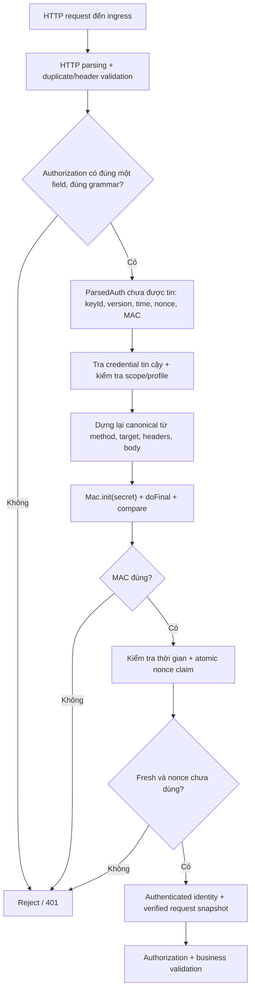
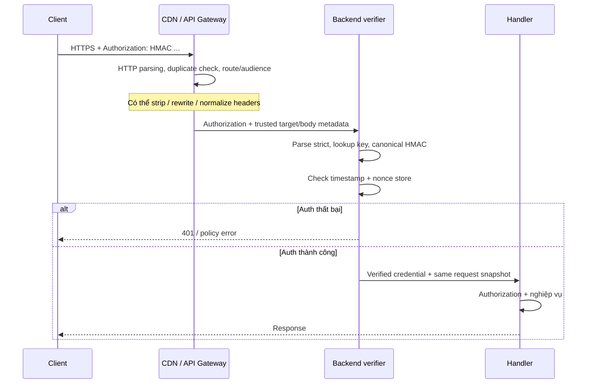

# Đọc authentication header khi xác minh HTTP request bằng HMAC

## 1. Đọc authentication header là bước nào?

Trong HTTP request authentication, server cần nhận **thông tin định danh credential** và **bằng chứng xác thực** từ client, sau đó tự tính lại chữ ký để xác minh. Với một thiết kế dùng **HMAC (Hash-based Message Authentication Code)**, thông tin thường bao gồm key ID, phiên bản hợp đồng ký, timestamp, nonce và MAC. Những giá trị này có thể được truyền trong header `Authorization` hoặc nhiều header riêng, tùy **signature contract** đã thống nhất.

Bài **Đọc authentication header** thuộc chương **Xác minh request**, trong module `SECURITY_AUTHENTICATION_HMAC_REQUEST_AUTHENTICATION`. Module tập trung vào xác thực HTTP request bằng **shared secret** và **canonical request** bảo vệ method, URI, header hoặc body theo hợp đồng; thực hành kiểm tra HMAC, chống replay bằng timestamp/nonce, quản lý key rotation, kiểm thử proxy/gateway và phân biệt **authentication** với **authorization**.

Trọng tâm của bài là **đọc và phân tích header một cách không nhập nhằng**. Đây là bước đầu của verification; việc một header **có mặt và có cú pháp đúng** chưa chứng minh client biết shared secret. Chỉ sau khi server:

1. Phân tích header theo một hợp đồng duy nhất;
2. Tra key ID trong **credential store tin cậy**;
3. Tái tạo canonical request từ **HTTP request thực nhận**;
4. Tính HMAC và so sánh MAC;
5. Kiểm tra timestamp/nonce, key scope và sau đó authorization;

... thì request mới đủ điều kiện tiếp tục xử lý nghiệp vụ.

### Header nào thường dùng?

| Header | Vai trò | Điểm dễ nhầm |
| --- | --- | --- |
| `Authorization` | Request header truyền thông tin xác thực của caller cho origin server. | Có nhiều **authentication scheme** khác nhau; không phải cứ có `Authorization` là HMAC. |
| `WWW-Authenticate` | Response header thường dùng để đưa authentication challenge khi trả `401 Unauthorized`. | **Không phải** request header mang MAC của client. |
| `Proxy-Authorization` | Credentials dành cho proxy khi proxy authentication được yêu cầu. | **Không thay thế** `Authorization` dành cho API origin. |
| `X-Key-Id`, `X-Signature`, `X-Timestamp`, `X-Nonce` | Cách truyền thông tin HMAC bằng nhiều field riêng trong một số API. | Chỉ hợp lệ nếu **hợp đồng ký của API** quy định; không có format HMAC chung áp dụng tự động. |
| `Authentication-Info` | Thông tin phản hồi gắn với một số cơ chế authentication. | Không phải nơi server lấy chữ ký HMAC của request. |

**Không tồn tại một `Authorization: HMAC ...` chuẩn chung cho tất cả API.** Ví dụ ở các mục sau là **một profile tự định nghĩa để học tập**. Không được mặc định nó tương thích AWS SigV4, OAuth Bearer, HTTP Message Signatures hoặc hệ thống HMAC có format riêng.

## 2. Phân biệt authentication scheme với dữ liệu credentials

Header `Authorization` thường có hình thức:

```text
Authorization: <auth-scheme> <credentials>
```

Ví dụ:

```http
Authorization: Basic dXNlcjpwYXNz
Authorization: Bearer eyJhbGciOi...
Authorization: HMAC keyId="merchant-2026-11",version="hmac-auth-v1",timestamp="2026-11-28T02:05:00Z",nonce="wJ0Npw6W_Q7tWbX8Fkp0SgABCdef0123",signature="<64 lowercase hex>"
```

Ba dòng trên chỉ để minh họa **ba giá trị khả dĩ của cùng một header trong ba request khác nhau**, **không phải ba header nên gửi trong một request**.

- **Basic** dùng một định dạng credentials riêng; Base64 **không phải mã hóa bảo mật**, không phải HMAC.
- **Bearer** mang access token; bất kỳ bên nắm token hợp lệ có thể sử dụng nó trong phạm vi được cấp. Token không tự có cú pháp HMAC request signing.
- **HMAC** trong bài là tên **scheme minh họa**. Credentials bao gồm key ID, version, timestamp, nonce và signature, không chứa shared secret.

Tên HTTP field `Authorization` **không phân biệt chữ hoa/thường**, và tên **authentication scheme** cũng không phân biệt chữ hoa/thường theo HTTP auth framework. Nhưng **giá trị parameter** như key ID, timestamp, nonce và chữ ký phải được kiểm tra **theo chính xác schema và encoding của profile**, không tự lowercase hoặc sửa.

Một số ứng dụng dùng `Authorization: HMAC ...`, số khác dùng `Authorization: Signature ...` hoặc các `X-` headers. **Không thay đổi scheme hoặc format giữa client và server** nếu chưa phát hành/chọn một signature version tương thích.

## 3. Những dữ liệu phải được đọc và những dữ liệu phải được xác minh

Giả sử request gửi:

```http
POST /v1/payments?dryRun=false HTTP/1.1
Host: api.example.test
Content-Type: application/json
Authorization: HMAC keyId="merchant-2026-11",version="hmac-auth-v1",timestamp="2026-11-28T02:05:00Z",nonce="wJ0Npw6W_Q7tWbX8Fkp0SgABCdef0123",signature="<64 lowercase hex>"

{"account":"A123","amount":250000}
```

Từng thông tin có vai trò khác nhau:

| Thành phần | Đọc từ đâu? | Kiểm tra ở server | Có đưa vào canonical HMAC? |
| --- | --- | --- | --- |
| Scheme `HMAC` | Header `Authorization`. | Chỉ chấp nhận scheme của profile; không thử Basic/Bearer. | Được ràng buộc bằng **domain separator** và một dòng scheme cố định. |
| `keyId` | Tham số trong Authorization. | Hợp lệ về cú pháp; tra khóa có trạng thái active, đúng tenant/audience. | **Có**, để ràng buộc credential context. |
| `version` | Tham số trong Authorization. | Phải có trong registry/allowlist cho credential. | **Có**, tránh đổi profile mà không đổi MAC. |
| `timestamp` | Tham số trong Authorization. | Parse UTC dạng quy định và kiểm tra cửa sổ thời gian. | **Có**, tránh sửa thời điểm. |
| `nonce` | Tham số trong Authorization. | Cú pháp/độ dài, random phía client, chưa claim tại server. | **Có**, tránh sửa nonce. |
| `signature` | Tham số trong Authorization. | Đúng encoding, độ dài; so sánh với MAC server tính. | **Không**: MAC là **đầu ra** của việc ký. |
| HTTP method | HTTP parser/adapter. | Method đúng route/contract. | **Có**. |
| Raw path + query | Request target thật sau ranh giới ingress được định nghĩa. | Không có rewrite/decoding mơ hồ; đúng route/params. | **Có**. |
| Trusted origin/audience | Route/ingress metadata tin cậy. | Khớp service/credential scope. | **Có** hoặc ràng buộc đáng tin cậy tương đương. |
| `Content-Type` | HTTP header đơn trị. | Đúng parser contract, không duplicate. | **Có** trong ví dụ. |
| Body bytes | Snapshot payload sau gỡ transfer framing, trước JSON parse. | Giới hạn kích thước, đúng content encoding, cùng bytes handler xử lý. | **SHA-256(bodyBytes)** được đưa vào canonical. |

**Điểm quyết định:** Đọc được `keyId` **không có nghĩa đã xác thực caller**. Trước HMAC, mọi trường lấy từ request đều là **dữ liệu không tin cậy**. Server được dùng key ID để tra credential có kiểm soát, nhưng không được dùng riêng key ID hoặc header tự khai `X-Authenticated-User` để cấp identity đã xác minh.

## 4. Thiết kế cú pháp header: một profile minh họa, không nhập nhằng

Để có thể viết parser chặt chẽ và kiểm thử được, bài chọn **`hmac-auth-v1`** với các quy tắc sau:

1. HTTP request phải có **chính xác một field line `Authorization`**, bất kể cách viết hoa/thường. Nếu thiếu hoặc trùng, **từ chối**; không lấy dòng đầu/cuối.
2. Sau khi bỏ **optional whitespace SP/HTAB ở đầu/cuối field value**, giá trị phải có dạng `HMAC ` (một dấu cách ASCII) theo sau bởi **năm tham số theo thứ tự cố định**.
3. Thứ tự parameter chính xác là `keyId`, `version`, `timestamp`, `nonce`, `signature`; mỗi cặp có dạng `name="value"` và ngăn bằng dấu phẩy **không có khoảng trắng bổ sung**. Không nhận parameter lặp, thiếu, thừa hoặc thay đổi thứ tự.
4. Scheme **`HMAC` không phân biệt hoa/thường**. Trong khi đó, **tên parameter** theo profile này phải dùng đúng chính tả/case đã công bố; value không được tự sửa case.
5. Không hỗ trợ dấu ngoặc kép escape, backslash, quoted-string tùy ý, dấu phẩy bên trong value hoặc Unicode ngoài ASCII trong header này. Từng value phải khớp grammar chặt dưới đây.
6. `keyId` khớp `[A-Za-z0-9._-]{1,128}`; `version` chính xác `hmac-auth-v1`; timestamp UTC `YYYY-MM-DDTHH:mm:ssZ`; nonce là **32 ký tự base64url không padding**, decode thành **24 byte**; signature là **64 lowercase hex**, tức HMAC-SHA256 32 byte.
7. Bản thân giá trị `signature` **không được đưa vào canonical request**, để tránh vòng lặp tự tham chiếu. Thay vào đó, phải ký toàn bộ các thành phần authentication còn lại (key ID/version/timestamp/nonce/scheme) cùng method/target/headers/body digest.

**Lưu ý về chuẩn HTTP:** Trong HTTP authentication framework, một auth scheme có thể sử dụng cú pháp `auth-param` với tên/giá trị và phân tách bằng dấu phẩy. Profile này cố tình yêu cầu **một biểu diễn con duy nhất** của cú pháp đó, thay vì chấp nhận tất cả các dạng whitespace/quoted-string/case tương đương. Đây là chính sách liên thông **riêng của client và server trong ví dụ**, không phải quy tắc chung bắt buộc của HTTP. Hệ thống thực phải kiểm tra các HTTP client/proxy có giữ nguyên biểu diễn credentials đã chọn hay không.

### Bảng ví dụ parsing

| Authorization field value | Kết quả theo profile |
| --- | --- |
| `HMAC keyId="A",version="hmac-auth-v1",timestamp="2026-11-28T02:05:00Z",nonce="wJ0Npw6W_Q7tWbX8Fkp0SgABCdef0123",signature="<hex>"` | Chỉ hợp lệ nếu `<hex>` được thay bằng **64 ký tự hex thường thực tế**. |
| `hmac keyId="A",...` | Scheme không phân biệt hoa/thường; vẫn phải có **đủ năm tham số thực**, đúng định dạng. |
| `Bearer abc` | Từ chối: scheme khác. |
| `HMAC keyId="A", keyId="B",...` | Từ chối: trùng/thừa parameter và whitespace ngoài grammar. |
| `HMAC keyId="A", version="hmac-auth-v1",...` | Từ chối theo profile strict: có space sau dấu phẩy. |
| `HMAC keyId=A,version=...` | Từ chối: giá trị không được bao bởi dấu ngoặc kép theo profile. |
| `HMAC keyId="A",version="legacy",...` | Từ chối: version ngoài hợp đồng. |
| Hai header `Authorization` khác case | Từ chối, ngay cả khi hai value giống nhau. |
| Một header `Authorization: HMAC ... , HMAC ...` bị proxy gộp | Từ chối vì credentials không khớp grammar. |

Trong sản phẩm thật, có thể chọn một cách truyền khác, nhưng phải **công bố parser, canonical schema và policy** tương ứng. Tuyệt đối không cho phép một tầng hiểu header kiểu A, tầng khác hiểu kiểu B.

## 5. Parse authentication header chưa phải là verification

Có bốn ranh giới tin cậy liên tiếp cần tách bạch:



**Parser** chỉ trả về một cấu trúc chứa dữ liệu từ request, ví dụ:

```java
record ParsedAuth(
        String keyId, String version, String timestamp,
        String nonce, String signatureHex) {}
```

Từ khóa `Parsed` là có chủ đích: nó **không phải `AuthenticatedUser`**. Một key ID hợp lệ về regex vẫn có thể không tồn tại hoặc đã bị revoke; timestamp có thể quá hạn; chữ ký có thể sai; credential có thể không được cấp quyền cho route.

### Không dùng `firstValue` để chứng minh header đơn trị

Ví dụ HTTP adapter kiểu:

```java
String auth = request.getHeader("Authorization");
```

có thể chỉ trả về **giá trị đầu**, hoặc một giá trị đã bị proxy/framework gộp. Không suy ra header chỉ xuất hiện một lần chỉ vì `auth != null`. Tại ranh giới còn giữ field lines, phải kiểm tra số lượng theo **tên case-insensitive**; nếu không còn dữ liệu gốc, chuyển duplicate validation về gateway/HTTP ingress và chỉ tin một snapshot đã được bảo vệ.

Với một số API, framework cung cấp `getHeaders("Authorization")`, `allValues("Authorization")` hoặc một collection nhiều giá trị, nhưng các API đó **chỉ phản ánh những gì tầng trước đã chuyển tới**, không chứng minh không có duplicate ở wire. Cần kiểm tra hành vi thật của gateway và HTTP stack.

### Không tự động gộp nhiều credentials hoặc thử nhiều scheme

Đặc biệt không nên:

- Chọn `Authorization` đầu hoặc cuối tùy tiện.
- Nối hai `Authorization` thành một chuỗi bằng dấu phẩy rồi parse như một credential.
- Chấp nhận đồng thời `Authorization: Bearer ...` và `Authorization: HMAC ...` với fallback không định nghĩa.
- Lấy `signature` từ một header và `keyId` từ header khác nếu profile không cho phép.
- Cho caller gửi `X-Verified-User` để middleware bỏ qua bước tính HMAC.

Một số authentication scheme có quy định riêng; profile HMAC của bài cố ý **chỉ chấp nhận một scheme và một grammar** để tránh nhập nhằng.

## 6. Canonical request ràng buộc các trường đọc từ Authorization

Với request minh họa ở mục 3, server xây canonical message **sau khi kiểm tra cú pháp**:

```text
HMAC-AUTH-V1
POST
https://api.example.test
/v1/payments?dryRun=false
content-type:application/json
auth-scheme:hmac
key-id:merchant-2026-11
signature-version:hmac-auth-v1
timestamp:2026-11-28T02:05:00Z
nonce:wJ0Npw6W_Q7tWbX8Fkp0SgABCdef0123
<SHA-256 body digest dưới dạng 64 ký tự lowercase hex>
```

**Các quy tắc chính xác của profile `hmac-auth-v1`:**

| Hạng mục | Quy tắc minh họa |
| --- | --- |
| Domain separation | Dòng đầu `HMAC-AUTH-V1`; đổi contract phải đổi profile. |
| Method | `POST` chính xác. |
| Origin/audience | `https://api.example.test`, lấy từ routing tin cậy, đối chiếu key scope. |
| Raw target | `/v1/payments?dryRun=false`, bao gồm path **và** query; không tự rewrite, decode hoặc sort khi verify. |
| Content-Type | Một field line `application/json`; không hỗ trợ `Content-Encoding` trong ví dụ. |
| Auth scheme | Canonical `auth-scheme:hmac` dù header gửi `HMAC` hay `hmac`; chỉ scheme này được chấp nhận. |
| Auth parameters | Key ID, version, timestamp và nonce có dòng riêng **theo thứ tự cố định**; không ký raw `Authorization` chứa cả MAC. |
| Body | SHA-256 trên **body bytes thực nhận sẽ được handler xử lý**, 64 ký tự hex thường. |
| Canonical encoding | Các dòng nối bằng **LF (0A)**, UTF-8, **không có LF cuối**. |
| MAC | `HmacSHA256`, **32 byte**, encode `64 lowercase hex`. |

Dòng cuối trong ví dụ là **placeholder** cho digest thực, không ký dấu `<`, `>`. Client và server phải tính:

```text
bodyDigestHex  = lowercaseHex(SHA-256(bodyBytes))
canonicalBytes = UTF8(canonicalRequest)
macBytes       = HMAC-SHA256(sharedSecret, canonicalBytes)
signatureHex   = lowercaseHex(macBytes)
```

**Vì sao không ký nguyên `Authorization`?** Nếu đưa cả `signature="..."` vào dữ liệu để tính chữ ký của chính nó, ta tạo vòng lặp tự tham chiếu. Thay vào đó, profile ký **từng tham số có ý nghĩa bảo mật** và scheme đã cố định; MAC được gửi sau đó như dữ liệu đầu ra. Đây là một phương án cụ thể để tránh việc chỉ ký body nhưng bỏ qua thông tin credential/replay metadata.

Header `Authorization` vẫn là **dữ liệu đầu vào không tin cậy** cho đến khi server tự tính lại MAC bằng secret lấy từ store tin cậy. Việc có scheme `HMAC` hoặc key ID trong header **chưa bảo đảm** caller nào đã được xác thực.

## 7. Java 17+: đọc và xác minh `Authorization` an toàn

Ví dụ dùng Java 17+ và JCA. Mục tiêu chính là **không mất header trùng và không parse nhập nhằng**; phần HMAC sau đó cho thấy kết quả parser được sử dụng đúng cách.

Giả định của HTTP adapter:

- Cung cấp **từng HTTP field line** trước khi chúng bị gộp hoặc loại mất; trường `Authorization` và `Content-Type` phải được kiểm tra đơn trị theo cách này.
- Đã xử lý HTTP message framing và từ chối `Content-Length`/`Transfer-Encoding` mâu thuẫn; có raw request target nhất quán với routing.
- `trustedOrigin` đến từ **tuyến ingress được xác thực**, không phải chỉ `Host`/`X-Forwarded-Host` do caller tự khai báo.
- Body snapshot là byte array sau khi gỡ transfer framing, trước JSON parse và **không bị thay đổi sau khi verify**.
- Các header có khả năng thay đổi ngữ nghĩa request nhưng không thuộc profile ký (như `Content-Encoding`, các forwarding headers chưa tin cậy) phải được ingress loại/từ chối theo policy. Đoạn code tự từ chối `Content-Encoding`.

Để giữ ví dụ kiểm chứng được, verifier nhận đúng một `POST /v1/payments?dryRun=false`, chỉ hỗ trợ profile `hmac-auth-v1`. Production nhiều route cần một registry route/profile và authorization cụ thể, không mở rộng bằng cách bỏ ký method/path.

```java
import java.nio.charset.StandardCharsets;
import java.security.GeneralSecurityException;
import java.security.MessageDigest;
import java.time.Clock;
import java.time.Duration;
import java.time.Instant;
import java.time.format.DateTimeParseException;
import java.util.Base64;
import java.util.HexFormat;
import java.util.List;
import java.util.Optional;
import java.util.Set;
import javax.crypto.Mac;
import javax.crypto.spec.SecretKeySpec;

public final class HmacAuthorizationVerifier {
    private static final String SCHEME = "HMAC";
    private static final String VERSION = "hmac-auth-v1";
    private static final String ORIGIN = "https://api.example.test";
    private static final String TARGET = "/v1/payments?dryRun=false";
    private static final HexFormat HEX = HexFormat.of();
    private static final Duration MAX_SKEW = Duration.ofMinutes(5);
    private static final Duration NONCE_TTL = Duration.ofMinutes(11);

    public record FieldLine(String name, String value) {}

    public record Request(
            String method, String rawTarget, String trustedOrigin,
            List<FieldLine> headers, byte[] body) {
        public Request {
            body = body == null ? null : body.clone();
            headers = headers == null ? null : List.copyOf(headers);
        }
        @Override public byte[] body() {
            return body == null ? null : body.clone();
        }
    }

    // ParsedAuth CHƯA phải authenticated identity.
    public record ParsedAuth(
            String keyId, String version, String timestamp,
            String nonce, String signatureHex) {}

    public record Credential(
            String keyId, byte[] secret, boolean active,
            String audience, Set<String> allowedVersions,
            Set<String> allowedTargets) {
        public Credential {
            secret = secret == null ? null : secret.clone();
        }
        @Override public byte[] secret() {
            return secret == null ? null : secret.clone();
        }
    }

    public interface CredentialStore {
        Credential find(String keyId);
    }

    public interface NonceStore {
        // Production: atomic insert-if-absent trên storage dùng chung có TTL.
        boolean claim(String keyId, String nonce, Duration ttl);
    }

    public record VerifiedRequest(String keyId, byte[] body) {
        public VerifiedRequest {
            body = body.clone();
        }
        @Override public byte[] body() { return body.clone(); }
    }

    private static String trimOws(String value) {
        if (value == null) {
            throw new IllegalArgumentException("Null field value");
        }
        int start = 0, end = value.length();
        while (start < end
                && (value.charAt(start) == ' '
                    || value.charAt(start) == '\t')) start++;
        while (end > start
                && (value.charAt(end - 1) == ' '
                    || value.charAt(end - 1) == '\t')) end--;
        return value.substring(start, end);
    }

    // Chỉ dùng một tập tên field đơn giản hơn HTTP token grammar;
    // HTTP ingress phải xử lý đầy đủ HTTP grammar trước đó.
    private static void validateFieldLine(FieldLine line) {
        if (line == null || line.name() == null
                || !line.name().matches("[A-Za-z0-9-]{1,128}")
                || line.value() == null) {
            throw new IllegalArgumentException("Malformed field");
        }
        for (int i = 0; i < line.value().length(); i++) {
            char c = line.value().charAt(i);
            // Demo chỉ chấp nhận ASCII field values:
            // HTAB cho phép ở rìa, nhưng không dùng trong auth params.
            if ((c < 0x20 && c != '\t') || c > 0x7E) {
                throw new IllegalArgumentException("Unsafe field value");
            }
        }
    }

    // Không dùng firstValue vì nó có thể che duplicate field lines.
    private static String readSingleHeader(
            List<FieldLine> lines, String requiredName) {
        if (lines == null) {
            throw new IllegalArgumentException("Headers unavailable");
        }
        String found = null;
        for (FieldLine line : lines) {
            validateFieldLine(line);
            if ("content-encoding".equalsIgnoreCase(line.name())) {
                throw new IllegalArgumentException("Unsupported encoding");
            }
            if (requiredName.equalsIgnoreCase(line.name())) {
                if (found != null) {
                    throw new IllegalArgumentException(
                            "Duplicate field: " + requiredName);
                }
                found = trimOws(line.value());
            }
        }
        if (found == null || found.isEmpty()) {
            throw new IllegalArgumentException(
                    "Missing/empty field: " + requiredName);
        }
        return found;
    }

    // Profile cố ý không cho escaped quoted-string hoặc embedded comma.
    private static String param(String item, String expectedName) {
        String prefix = expectedName + "=\"";
        if (item.length() <= prefix.length()
                || !item.startsWith(prefix) || !item.endsWith("\"")) {
            throw new IllegalArgumentException("Wrong auth parameter");
        }
        String value = item.substring(prefix.length(), item.length() - 1);
        if (value.indexOf('"') >= 0 || value.indexOf('\\') >= 0
                || value.indexOf(',') >= 0) {
            throw new IllegalArgumentException("Ambiguous auth parameter");
        }
        return value;
    }

    public static ParsedAuth readAuthorization(List<FieldLine> lines) {
        String value = readSingleHeader(lines, "Authorization");
        if (value.length() > 2048) {
            throw new IllegalArgumentException("Authorization too long");
        }
        // Scheme case-insensitive, separator đúng một SP.
        if (!value.regionMatches(true, 0, SCHEME + " ", 0, 5)) {
            throw new IllegalArgumentException("Unsupported auth scheme");
        }
        String credentials = value.substring(5);
        String[] items = credentials.split(",", -1);
        if (items.length != 5) {
            throw new IllegalArgumentException("Wrong parameter count");
        }
        String keyId = param(items[0], "keyId");
        String version = param(items[1], "version");
        String timestamp = param(items[2], "timestamp");
        String nonce = param(items[3], "nonce");
        String signature = param(items[4], "signature");

        if (!keyId.matches("[A-Za-z0-9._-]{1,128}")
                || !VERSION.equals(version)
                || !timestamp.matches(
                    "[0-9]{4}-[0-9]{2}-[0-9]{2}T"
                    + "[0-9]{2}:[0-9]{2}:[0-9]{2}Z")
                || !nonce.matches("[A-Za-z0-9_-]{32}")
                || !signature.matches("[0-9a-f]{64}")) {
            throw new IllegalArgumentException("Invalid auth format");
        }
        // Base64url 32 chars phải decode ra 24 byte, canonical/no padding.
        try {
            byte[] decoded = Base64.getUrlDecoder().decode(nonce);
            if (decoded.length != 24
                    || !Base64.getUrlEncoder().withoutPadding()
                            .encodeToString(decoded).equals(nonce)) {
                throw new IllegalArgumentException("Invalid nonce bytes");
            }
        } catch (IllegalArgumentException ex) {
            throw new IllegalArgumentException("Invalid nonce", ex);
        }
        return new ParsedAuth(keyId, version, timestamp, nonce, signature);
    }

    private static byte[] canonicalBytes(
            Request request, ParsedAuth auth, String contentType)
            throws GeneralSecurityException {
        byte[] body = request.body();
        String bodyDigestHex = HEX.formatHex(
                MessageDigest.getInstance("SHA-256").digest(body));
        String canonical = String.join("\n",
                "HMAC-AUTH-V1",
                request.method(),
                ORIGIN,
                request.rawTarget(),
                "content-type:" + contentType,
                "auth-scheme:hmac",
                "key-id:" + auth.keyId(),
                "signature-version:" + auth.version(),
                "timestamp:" + auth.timestamp(),
                "nonce:" + auth.nonce(),
                bodyDigestHex);
        return canonical.getBytes(StandardCharsets.UTF_8);
    }

    private static byte[] hmacSha256(
            byte[] secret, byte[] canonical)
            throws GeneralSecurityException {
        Mac mac = Mac.getInstance("HmacSHA256");
        mac.init(new SecretKeySpec(secret, "HmacSHA256"));
        return mac.doFinal(canonical);
    }

    public static Optional<VerifiedRequest> verify(
            Request r, CredentialStore credentials,
            NonceStore nonces, Clock clock)
            throws GeneralSecurityException {
        if (r == null || credentials == null || nonces == null
                || clock == null || r.method() == null
                || r.rawTarget() == null || r.trustedOrigin() == null
                || r.body() == null || r.headers() == null) {
            return Optional.empty();
        }
        // Profile chỉ áp dụng cho đúng endpoint và body nhỏ, không rỗng.
        if (!"POST".equals(r.method())
                || !TARGET.equals(r.rawTarget())
                || !ORIGIN.equals(r.trustedOrigin())
                || r.body().length == 0
                || r.body().length > 1_048_576) {
            return Optional.empty();
        }

        final ParsedAuth auth;
        final String contentType;
        try {
            auth = readAuthorization(r.headers());
            contentType = readSingleHeader(r.headers(), "Content-Type");
        } catch (IllegalArgumentException invalid) {
            // Không dùng field vừa parse được làm identity.
            return Optional.empty();
        }
        if (!"application/json".equals(contentType)) {
            return Optional.empty();
        }

        Instant sentAt;
        try {
            sentAt = Instant.parse(auth.timestamp());
        } catch (DateTimeParseException invalid) {
            return Optional.empty();
        }
        // Không nhận fractional seconds, timezone dạng +00:00 hay text
        // có biểu diễn khác dạng UTC chuẩn đã công bố.
        if (sentAt.getNano() != 0
                || !sentAt.toString().equals(auth.timestamp())
                || Duration.between(clock.instant(), sentAt)
                        .abs().compareTo(MAX_SKEW) > 0) {
            return Optional.empty();
        }

        Credential key = credentials.find(auth.keyId());
        if (key == null || !key.active()
                || !auth.keyId().equals(key.keyId())
                || !ORIGIN.equals(key.audience())
                || key.allowedVersions() == null
                || !key.allowedVersions().contains(auth.version())
                || key.allowedTargets() == null
                || !key.allowedTargets().contains(TARGET)) {
            return Optional.empty();
        }
        byte[] secret = key.secret();
        if (secret == null || secret.length < 32) {
            // Chính sách cấp khóa của profile minh họa.
            return Optional.empty();
        }

        // Signature bị loại khỏi canonical để tránh tự tham chiếu.
        byte[] expected = hmacSha256(
                secret, canonicalBytes(r, auth, contentType));
        byte[] supplied = HEX.parseHex(auth.signatureHex());
        if (!MessageDigest.isEqual(expected, supplied)) {
            return Optional.empty();
        }

        // Bảo vệ replay: claim chỉ sau MAC hợp lệ, phải nguyên tử.
        if (!nonces.claim(auth.keyId(), auth.nonce(), NONCE_TTL)) {
            return Optional.empty();
        }
        // Chỉ lúc này mới xuất verified identity/snapshot.
        // Handler tiếp theo VẪN phải kiểm tra authorization.
        return Optional.of(new VerifiedRequest(auth.keyId(), r.body()));
    }
}
```

### Vì sao phải giữ `List<FieldLine>` thay vì `Map<String,String>`?

Giả sử raw request chứa:

```http
Authorization: HMAC keyId="merchant-A",version="hmac-auth-v1",timestamp="2026-11-28T02:05:00Z",nonce="wJ0Npw6W_Q7tWbX8Fkp0SgABCdef0123",signature="<64 hex>"
authorization: HMAC keyId="merchant-B",version="hmac-auth-v1",timestamp="2026-11-28T02:05:00Z",nonce="wJ0Npw6W_Q7tWbX8Fkp0SgABCdef0123",signature="<64 hex>"
```

Trong `readSingleHeader`, hai tên cùng khớp `Authorization` theo `equalsIgnoreCase`, nên lập tức từ chối **duplicate**; không chọn key ID A hay B. Nếu đã ép dữ liệu vào `Map<String,String>` bằng quy tắc “last wins”, thông tin header lặp có thể bị mất. `List.copyOf` và copy body bytes trong `Request` giúp giảm nguy cơ nguồn dữ liệu bị thay đổi sau khi parser thu thập.

**Cảnh báo về giới hạn code:** `validateFieldLine` cố tình hạn chế tên/value header hơn grammar HTTP tổng quát. Trên production, HTTP ingress phải parse hợp lệ theo HTTP trước, sau đó adapter ràng buộc **profile cụ thể**. Đừng coi demo là bộ HTTP parser chung: nó không tự giải quyết request smuggling, forwarded metadata, signature scheme khác, JSON duplicate keys hoặc timeout/size trên luồng mạng.

### Khởi tạo `Mac` ở bước nào và lấy secret từ đâu?

```java
Credential key = credentials.find(auth.keyId());
byte[] secret = key.secret();
Mac mac = Mac.getInstance("HmacSHA256");
mac.init(new SecretKeySpec(secret, "HmacSHA256"));
byte[] expectedMac = mac.doFinal(canonicalBytes);
```

`auth.keyId()` **chỉ chọn** credential, không phải secret. Không được `Mac.init(new SecretKeySpec(auth.keyId().getBytes(...), ...))` hoặc lấy secret trực tiếp từ header. Thuật toán `HmacSHA256` phải do **profile registry của server** quy định, không dùng một `X-Algorithm` do client gửi để gọi `Mac.getInstance`. Nếu JCA provider, credential store hoặc nonce store gặp lỗi, request **không được chấp nhận**.

### Client tạo header Authorization đúng profile

Client tạo **body bytes cuối cùng sẽ gửi**, timestamp và nonce mới, dựng canonical message theo mục 6 rồi tính HMAC bằng `Mac`. Sau đó nó đặt kết quả vào header:

```java
import java.util.HexFormat;

// keyId, timestamp, nonce, signatureHex đã có giá trị hợp lệ
// và signatureHex = lowercaseHex(HmacSHA256(secret, canonicalBytes)).
String authorization =
        "HMAC keyId=\"" + keyId
        + "\",version=\"hmac-auth-v1"
        + "\",timestamp=\"" + timestamp
        + "\",nonce=\"" + nonce
        + "\",signature=\"" + signatureHex + "\"";

// Đặt đúng MỘT Authorization field.
// httpRequestBuilder.header("Authorization", authorization);
// Body gửi đi phải đúng snapshot đã dùng khi ký.
```

Với snippet này, **không in authorization hoặc signature ra log production**. Không gửi shared secret. Khi request phải retry, client nên tạo **nonce mới và chữ ký mới**; replay nguyên Authorization có thể bị nonce store từ chối ngay cả khi MAC vẫn đúng.

## 8. Authentication header, chống replay và quản lý khóa

Đọc `Authorization` đúng grammar chưa đủ để ngăn **replay attack**. Một HTTP request đã có HMAC hợp lệ vẫn có thể bị sao chép **nguyên vẹn** và gửi lại:

```text
Authorization hợp lệ + method/target/body không đổi
                    |
                    v
           canonical bytes không đổi
                    |
                    v
           HMAC vẫn có thể đúng
                    |
                    v
       Timestamp và nonce store quyết định replay
```

Chống replay yêu cầu **hai lớp cùng tồn tại**:

1. **Dữ liệu chống replay được ký:** `timestamp` và `nonce` nằm trong canonical. Nếu người khác sửa chúng mà không biết shared secret, HMAC không khớp.
2. **Dữ liệu chống replay được kiểm tra:** server yêu cầu thời gian còn mới (ví dụ ±5 phút) và claim nonce bằng **atomic insert-if-absent** trên kho dùng chung giữa các instance. Một nonce đã được dùng thì không chấp nhận lại, ngay cả khi MAC còn đúng.

Trong ví dụ, TTL nonce là 11 phút: với độ lệch timestamp ±5 phút theo cả hai hướng, một request có timestamp nằm ở **phía tương lai** khi được nhận lần đầu có thể còn hợp lệ gần 10 phút sau đó. TTL cần bao phủ cửa sổ hợp lệ thực tế và biên đồng hồ. Nếu client retry sau timeout, nên sinh **nonce mới** và **ký lại**. Nonce không giúp phân biệt bản gốc với bản bị relay **đến trước**, nên TLS và bảo vệ credential vẫn cần thiết.

### Key ID được đọc nhưng secret phải được lấy từ đâu?

Khi parser trả về:

```text
keyId = merchant-2026-11
version = hmac-auth-v1
```

server phải **tra chính xác key ID** trong kho credential của chính server. Không đọc secret từ Authorization, không dùng key ID như một khóa bí mật, không quét toàn bộ key để tìm một chữ ký khớp. Với mỗi credential, cần kiểm tra:

- Key còn **active**, chưa expired/revoked.
- Đúng **tenant/service/audience**, phương thức hoặc route được phép.
- `hmac-auth-v1` nằm trong **signature-version allowlist**; thuật toán `HmacSHA256` do registry server quyết định, không từ header do caller tự chọn.
- Đúng secret bytes theo encoding của secret store; nếu lưu Base64, phải **decode thành bytes**, không dùng UTF-8 của chuỗi Base64 làm key.
- Quy tắc **key rotation**: key cũ và mới có thể cùng active trong giai đoạn chuyển tiếp nhưng **mỗi request chỉ tham chiếu một key ID**. Key đã revoke phải bị từ chối ngay cả khi HMAC toán học vẫn tính đúng.

**Không tự fallback khi MAC sai.** Một request khai báo version mới nhưng signature không khớp **không được** tự thử legacy canonicalizer, HmacSHA1 hay những secret khác cho đến khi có kết quả. Nếu muốn hỗ trợ migration, phải có **policy per-key rõ ràng**, có ngày sunset và test downgrade.

### Authentication không phải authorization

`VerifiedRequest(keyId, body)` chỉ thể hiện rằng request đã vượt qua authentication/replay policy của ví dụ. Nó **không** xác nhận caller được phép tạo thanh toán cho `account=A123`, được phép dùng tiền của tenant khác hay vượt hạn mức. Handler vẫn phải:

- Tra quyền theo **identity đã xác minh từ credential**, không theo `X-User-Id` tùy ý.
- Kiểm tra resource ownership, action/scope, business constraints, idempotency và hạn mức.
- Parse JSON từ **cùng body snapshot** được bảo vệ; tránh parser ambiguity, duplicate JSON keys hoặc body transform sau HMAC.

HMAC cũng không mã hóa body hay thông tin trong header; hệ thống vẫn cần **HTTPS/TLS** để xác minh server và bảo vệ tính bí mật đường truyền.

## 9. Gateway, HTTP versions và các lỗi hay gặp khi đọc Authorization

Trong production, client thường đi qua nhiều lớp:



| Lỗi ở tuyến HTTP | Điều có thể xảy ra | Biện pháp |
| --- | --- | --- |
| Gateway **xóa Authorization** trước backend. | Backend thấy thiếu header, xác minh thất bại. | Cấu hình forwarding rõ ràng hoặc thực hiện HMAC ở gateway trước khi xóa. |
| Gateway thay `Authorization` bằng token dành cho upstream. | Backend không còn MAC gốc, không thể verify theo contract. | Xác định một điểm verify tin cậy; truyền identity đã verify qua kênh bảo vệ. |
| Client gửi hai `Authorization` khác case. | Proxy/servlet chọn đầu/cuối hoặc gộp, gây parser differential. | Từ chối duplicate ngay tại ingress còn nhìn thấy field lines. |
| Framework tự gộp header thành một chuỗi. | Backend không khôi phục chắc chắn số field lines gốc. | Kiểm tra duplicate ở gateway/HTTP parser trước khi merge. |
| HTTP/2 dùng tên field chữ thường và `:authority`, `:path`. | Adapter dựa sai vào `Host`/request target. | Lấy trusted route/target nhất quán, xử lý pseudo-header theo HTTP version. |
| Client gửi `Proxy-Authorization` thay `Authorization`. | Origin không nhận credential HMAC. | Phân biệt proxy auth với origin auth; chỉ dùng header contract quy định. |
| Proxy rewrite path/query sau khi ký. | Canonical ở client và server khác, MAC không khớp. | Verify trước rewrite hoặc công bố logical canonical target rõ ràng. |
| Proxy thêm `X-Forwarded-Host` không được tin cậy. | Server dùng sai audience hoặc service. | Chỉ tin forwarding header do ingress được xác thực tạo ra; strip giá trị client. |
| Gateway decompress/chỉnh body. | Body digest client ký khác body backend nhận. | Giữ snapshot/điểm verify nhất quán, version hóa nếu cho phép transform. |
| Browser/SDK tự redirect sang host khác. | Có thể vô tình chuyển Authorization/identity sang đích ngoài policy. | Không auto-forward HMAC credentials sang origin lạ; xác minh đích, tạo request và chữ ký mới. |
| Cache/CDN trả response riêng tư trước bước xác thực. | Backend không nhìn thấy request và không thể kiểm tra quyền. | Không cache dữ liệu nhạy cảm theo URL chung; xét `Cache-Control: no-store` và enforcement ở edge. |
| Proxy hoặc application log full Authorization. | Rò rỉ MAC và metadata có thể hỗ trợ replay trong cửa sổ còn hạn. | Redact Authorization, signature, secret và PII trong logs/traces. |

### Nên xác minh HMAC ở gateway hay backend?

**Gateway verify:** gateway còn nhìn được raw request trước rewrite, có thể kiểm tra header duplicate và chính sách key/nonce tập trung. Nhưng backend phải **chỉ tin verified identity từ gateway**, qua TLS/mTLS hoặc cơ chế trust tương đương, và chặn bypass mạng. Nếu backend tin một `X-Authenticated-Client` do caller tự gửi, toàn bộ xác thực có thể bị qua mặt.

**Backend verify:** backend tự lookup key và tính MAC trên request thực nhận. Gateway phải bảo toàn **signed fields, raw target, body bytes và trusted audience** theo contract, hoặc chuyển metadata gốc đã được bảo vệ. Không tin `X-Original-URI` do client Internet tự đặt; ingress cần strip các header untrusted trước khi tự tạo metadata cho backend.

Mọi lựa chọn đều đòi hỏi kiểm thử **đúng HTTP stack thực tế**. Các API như `getHeader`, `getHeaders`, HTTP/2 pseudo-headers và proxy mapping không nhất thiết giữ cùng field lines hoặc ký tự raw mà client ban đầu gửi.

### Trả lỗi HTTP và giảm rò rỉ thông tin

Thông thường:

| Kết quả | Phản hồi thường phù hợp | Lưu ý |
| --- | --- | --- |
| Thiếu/sai Authorization, MAC sai hoặc credential không hợp lệ. | `401 Unauthorized` theo chính sách authentication. | Nếu dùng `401`, cần xử lý `WWW-Authenticate` theo scheme/challenge được hệ thống định nghĩa; ví dụ không áp đặt một challenge chưa thiết kế. |
| Request framing/header HTTP không hợp lệ. | Có thể `400 Bad Request` do HTTP ingress. | Không cố gắng tính HMAC trên request mà hai tầng có thể parse khác nhau. |
| Caller đã được xác thực nhưng không đủ quyền. | `403 Forbidden` hoặc phản hồi phù hợp chính sách che giấu resource. | Không nhầm thiếu authorization với signature sai. |
| Key store hoặc nonce store không khả dụng. | Lỗi dịch vụ theo policy, thường ở lớp 5xx, nhưng **không accept request**. | Fail closed; tránh tiết lộ key tồn tại, chữ ký đúng hay cơ chế nội bộ. |

Client có thể cần biết “request bị từ chối”, nhưng không nên được trả chi tiết như “key ID này tồn tại”, “MAC đúng nhưng nonce của tenant A đã dùng” hoặc canonical bytes đầy đủ của request nhạy cảm. Log nội bộ có thể phân loại lỗi theo mã sự kiện, request ID, signature version và hop, với **redaction** thích hợp.

## 10. Ma trận kiểm thử đọc authentication header

Một bộ **golden fixtures** tốt nên chứa: HTTP method, raw request target, từng field line (kể cả case và duplicate), body bytes, secret test, parsed parameters, canonical UTF-8 bytes, expected HMAC, nonce-store outcome, authorization outcome và verdict.

| Ca kiểm thử | Kết quả mong đợi |
| --- | --- |
| Đúng một `Authorization: HMAC ...` với năm parameter, đúng MAC, key active, nonce mới. | Parser PASS; MAC PASS; replay PASS; mới chuyển sang authorization. |
| Không có `Authorization`. | Từ chối do thiếu authentication header. |
| `Authorization:` rỗng hoặc chỉ có OWS. | Từ chối; không dùng credential mặc định. |
| Có hai `Authorization`, gồm `authorization` khác case, cùng value. | Từ chối duplicate, **kể cả value giống nhau**. |
| Hai header khác scheme: HMAC và Bearer. | Từ chối, không chọn ưu tiên/fallback tùy tiện. |
| `Authorization: Basic ...` hoặc `Bearer ...`. | Từ chối do profile chỉ nhận HMAC. |
| `Authorization: hmac ...` với mọi parameter đúng. | Scheme case-insensitive; parser có thể chấp nhận. |
| Thiếu keyId, dư parameter hoặc đổi thứ tự. | Từ chối cú pháp profile. |
| Thêm dấu phẩy, khoảng trắng sau dấu phẩy hoặc quoted escape không hỗ trợ. | Từ chối; không sửa hộ header. |
| Thêm dòng `Authorization` qua proxy hoặc gộp thành chuỗi. | Ingress/parser từ chối biểu diễn không canonical. |
| Key ID có ký tự comma, CR/LF, space, dài hơn 128. | Từ chối theo grammar/HTTP parser. |
| Version không phải `hmac-auth-v1`. | Từ chối; không fallback sang thuật toán khác. |
| Timestamp không phải UTC format chính xác, có fractional seconds hoặc sai ngày. | Từ chối format hoặc parse time. |
| Timestamp quá cũ hoặc ở tương lai ngoài cửa sổ ±5 phút. | Từ chối freshness ngay cả khi MAC có thể khớp. |
| Nonce chứa `+`, `/`, `=` hoặc không dài 32 ký tự. | Từ chối theo base64url unpadded policy. |
| Nonce decode không đúng 24 byte hoặc không round-trip canonical. | Từ chối ở parser. |
| Signature hex viết hoa, dài 63/65 ký tự, có ký tự ngoài `0-9a-f`. | Từ chối encoding trước khi so sánh HMAC. |
| Signature dạng 64 chữ `0`, nhưng không phải MAC thực. | **Parser PASS; HMAC FAIL** — thể hiện phân biệt parse và verify. |
| Đổi `keyId`, timestamp hoặc nonce nhưng giữ signature cũ. | Canonical/MAC khác; từ chối. |
| Đổi method, path, query, Content-Type hoặc body, giữ signature cũ. | Từ chối theo policy, body digest hoặc HMAC. |
| Signed header `Content-Type` trùng hoặc có CR/LF. | HTTP adapter từ chối; không đưa request mơ hồ tới handler. |
| MAC đúng nhưng `NonceStore.claim` từ chối vì đã dùng. | Replay FAIL; request không được xử lý. |
| MAC đúng nhưng key ID đã bị revoke hoặc sai target scope. | Credential policy từ chối. |
| MAC đúng, nonce mới, nhưng caller thiếu quyền tạo payment. | Authentication PASS; **authorization FAIL**. |
| Proxy strip Authorization hoặc rewrite signed URL/body. | Test end-to-end phát hiện thiếu header/mismatch. |
| Nonce store hoặc key store lỗi. | Fail closed; không cấp verified identity. |

### Unit test nhỏ cho riêng parser Java 17

Ví dụ dưới đây minh họa rằng **chữ ký có đúng dạng hex chưa có nghĩa HMAC hợp lệ**:

```java
import java.util.List;

String demoValue =
        "HMAC keyId=\"merchant-2026-11\",version=\"hmac-auth-v1\","
        + "timestamp=\"2026-11-28T02:05:00Z\","
        + "nonce=\"wJ0Npw6W_Q7tWbX8Fkp0SgABCdef0123\","
        + "signature=\"" + "0".repeat(64) + "\"";

var one = List.of(
        new HmacAuthorizationVerifier.FieldLine(
                "Authorization", demoValue));
var parsed = HmacAuthorizationVerifier.readAuthorization(one);
System.out.println(parsed.keyId()); // merchant-2026-11
// Dù parse PASS, 64 chữ số 0 KHÔNG phải MAC hợp lệ cho request thực.

var duplicated = List.of(
        new HmacAuthorizationVerifier.FieldLine(
                "Authorization", demoValue),
        new HmacAuthorizationVerifier.FieldLine(
                "authorization", demoValue));
try {
    HmacAuthorizationVerifier.readAuthorization(duplicated);
    throw new AssertionError("Expected duplicate rejection");
} catch (IllegalArgumentException expected) {
    System.out.println("Duplicate Authorization rejected");
}
```

## 11. Bài tập thực hành

1. Cho ba request riêng `Authorization: Basic ...`, `Bearer ...`, và `HMAC ...`. Viết logic phân biệt **auth scheme** trước khi đọc credentials; chứng minh profile `hmac-auth-v1` không thử fallback.
2. Gửi hai `Authorization` giống nhau nhưng khác case field name, sau đó kiểm tra cách **gateway** và **backend** hiển thị chúng. Xác định điểm cần chặn duplicate.
3. Tạo credential string đúng grammar với `signature="000...0"` (64 số 0). Chứng minh **parser PASS** nhưng **MAC verification FAIL**; không xuất authenticated identity sau parser.
4. Thay đổi riêng `keyId`, `version`, `timestamp` và `nonce`, giữ MAC cũ. Kiểm tra các dòng canonical thay đổi và kết quả verifier.
5. Đổi body JSON số tiền hoặc đổi `dryRun=false` thành `dryRun=true`; giữ nguyên Authorization. Phân biệt lỗi do route policy và lỗi do chữ ký không khớp.
6. Cho timestamp hợp lệ ở biên ±5 phút rồi phát lại cùng nonce lần hai; giải thích vì sao HMAC đúng nhưng request thứ hai bị replay layer từ chối.
7. Mô phỏng credential A active và credential B revoked; đảm bảo server không thử B khi `keyId=A` nhưng MAC sai, và key revoked không được chấp nhận.
8. Thiết kế một cache/CDN có thể nhận GET dữ liệu riêng tư. Chỉ ra nơi cần thực thi authentication/authorization trước cache hit, hoặc cấu hình không lưu dữ liệu nhạy cảm.
9. Mô phỏng proxy tự loại `Authorization` khi chuyển tới backend; chọn một trong hai kiến trúc: gateway verify hoặc backend verify, nêu metadata nào phải được bảo vệ.
10. Xây golden fixture với canonical bytes, secret **kiểm thử**, MAC dự kiến và parsed fields; chạy cùng fixture trên Java client, gateway và backend. Không dùng secret hay body production trong fixtures/logs.

## 12. Checklist trước khi đưa parser HMAC vào production

- [ ] Chọn **một signature scheme/profile có version**, công bố cú pháp Authorization hoặc các header riêng; không trộn với Basic/Bearer.
- [ ] Đếm **đúng một `Authorization` field line** theo tên case-insensitive; reject thiếu/rỗng/trùng trước khi mất thông tin do proxy/framework merge.
- [ ] Parse credentials theo grammar chính xác, giới hạn độ dài và cú pháp; từ chối parameter thiếu/thừa/trùng, dấu phẩy/quote/whitespace nhập nhằng.
- [ ] Scheme chỉ được dùng để chọn parser; **đừng coi header có mặt là authenticated identity**.
- [ ] Kiểm tra key ID, version, timestamp, nonce, signature encoding và độ dài; không tin dữ liệu client tự khai báo làm secret hoặc quyền.
- [ ] Dựng lại canonical bytes từ **method, target, trusted audience, signed headers, body snapshot và auth parameters** đã được ràng buộc.
- [ ] Không ký nguyên signature value để tránh tự tham chiếu; thay vào đó ký key ID/version/timestamp/nonce và scheme/domain separation.
- [ ] Tra secret từ credential store tin cậy; kiểm tra active/revocation, tenant/service/route scope, allowed versions, key rotation và sunset.
- [ ] `Mac.init` với đúng secret và `HmacSHA256` do registry server quyết định; tính MAC trên UTF-8 canonical bytes, so sánh bytes bằng `MessageDigest.isEqual`.
- [ ] Timestamp được ký và kiểm tra freshness; nonce được ký và claim bằng atomic insert-if-absent trên kho dùng chung có TTL đủ dài.
- [ ] HTTP ingress xử lý `Host`/`:authority`, CL/TE framing, duplicate signed headers, URI normalization và body transformations trước verify.
- [ ] Gateway strip forwarding headers giả mạo, bảo vệ identity/route nếu gateway verify; backend không tin `X-Authenticated-Client` do Internet gửi.
- [ ] Không log `Authorization`, MAC, secret hoặc body nhạy cảm; có rate limiting, timeout và fail-closed behavior.
- [ ] Phân biệt authentication (`401` theo policy) và authorization (`403` hoặc chính sách tương ứng); vẫn dùng HTTPS/TLS xác minh server.
- [ ] Kiểm thử negative cases và golden fixtures xuyên client, HTTP/1.1/HTTP/2, API gateway, backend, nonce store và business handler.

**Điểm cần nhớ:** **Đọc authentication header** là việc **nhận và phân tích dữ liệu do caller gửi**, chưa phải chứng minh caller đã được xác thực. Một verifier HMAC an toàn phải chặn header trùng, dùng grammar/version cố định, xác minh các auth parameters trong canonical request bằng **secret lấy từ server-side credential store**, rồi kiểm tra freshness/nonce và quyền truy cập. Điều cốt lõi là **cùng method, URI, signed headers, body và authenticated identity** được hiểu nhất quán từ ingress đến business handler — kể cả khi request đi qua proxy/gateway.
