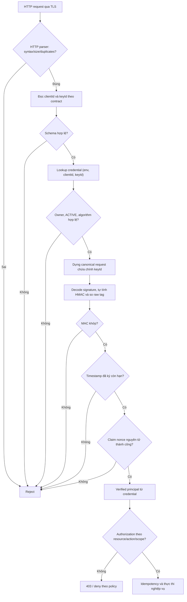

# Đọc key identifier

## 1. Vị trí của key identifier trong quá trình xác minh request HMAC

Trong hệ thống xác thực HTTP request bằng **HMAC với shared secret**, một server thường phục vụ nhiều đối tác. Mỗi đối tác có thể có nhiều secret trong thời gian **key rotation**. Trước khi so sánh HMAC, verifier cần biết **secret nào** sẽ được dùng để tính tag đối chiếu. Key identifier chính là tín hiệu chọn bản ghi khóa đó.

Ví dụ request tạo đơn hàng:

```http
POST /v1/orders?currency=VND HTTP/1.1
Host: api.example.test
Content-Type: application/json
X-Client-Id: merchant-42
X-Key-Id: key-2026-b
X-Timestamp: 1790000000
X-Nonce: Pe7wTh3d93a4M8_n
X-Signature: <base64url-hmac-sha256>

{"orderId":"o-204","amount":190000}
```

Header `X-Key-Id: key-2026-b` có nghĩa: **“Hãy tìm bản ghi key này cho client đã khai, rồi kiểm tra chữ ký.”** Nó **không** chứng minh người gửi sở hữu secret. Kẻ không được cấp khóa cũng có thể gửi cùng header nếu quan sát hoặc đoán được ID.

Bài **Đọc key identifier** nằm trong chương *Xác minh request* của module `SECURITY_AUTHENTICATION_HMAC_REQUEST_AUTHENTICATION`. Toàn module thiết kế HMAC trên **canonical request** gồm method, URI, header/body theo hợp đồng; chống replay bằng timestamp/nonce, quản lý rotation, kiểm thử proxy/gateway và phân biệt authentication với authorization. Bài này tập trung vào bước **đọc, validate, lookup và ràng buộc key ID vào chữ ký**.

Mục tiêu:

- Phân biệt **client ID**, **key ID**, **shared secret**, **key version**, **algorithm**, **HMAC tag** và **verified principal**.
- Đọc key ID từ một nguồn HTTP đã công bố, không bị lừa bởi duplicate headers, case, khoảng trắng, giá trị sai schema hoặc header giả do client tự đặt.
- Tra secret đúng theo **client + key ID + môi trường**, không lấy secret từ request và không thử mọi khóa.
- Kiểm tra owner, algorithm, trạng thái hiệu lực, rotation và revocation.
- Đưa chính key ID đã đọc vào canonical HMAC input; sau MAC mới kiểm tra freshness/nonce và tạo principal.
- Tự viết Java 17, golden test vector, integration tests và các tình huống lỗi thực tế.

## 2. Đọc metadata không đồng nghĩa đã xác thực

| Khái niệm | Ví dụ | Có phải bí mật? | Mục đích |
| --- | --- | --- | --- |
| `clientId` | `merchant-42` | Thường không | Chọn đối tác dự kiến |
| `keyId` | `key-2026-b` | Thường không | Chọn bản ghi secret/version |
| Shared secret | 32 byte ngẫu nhiên | **Có** | Đầu vào khóa của HMAC |
| Key state | `ACTIVE` / `REVOKED` | Không | Quyết định có chấp nhận credential không |
| Algorithm | `HmacSHA256` | Không | Primitive do server policy quy định |
| Signature | 32-byte raw HMAC, Base64url 43 ký tự | Không phải secret | Tag cần xác minh |
| Verified principal | `merchant-42` sau xác thực | Context đáng tin | Dùng cho bước authorization |

Trong Java, `keyId` chỉ là chuỗi định danh, còn `javax.crypto.spec.SecretKeySpec` bọc **secret bytes** thật:

```java
String keyId = "key-2026-b";   // Dùng để lookup
byte[] secret = credential.secret();
Mac mac = Mac.getInstance("HmacSHA256");
mac.init(new SecretKeySpec(secret, "HmacSHA256"));
```

Không bao giờ dùng `keyId.getBytes(UTF_8)` như thể đó là shared secret; key ID dễ dự đoán và không có entropy cần thiết.

**Không tự lấy thuật toán từ key ID.** Một key ID như `hmac-sha1-old` không được phép khiến verifier chọn HMAC-SHA1 nếu chính sách chỉ chấp nhận HMAC-SHA256. Algorithm và secret phải nằm trong bản ghi credential/phiên bản giao thức đáng tin.

### 2.1. Key ID có cần bí mật không?

Thông thường **không**. Key ID có thể xuất hiện trong log đã giảm thiểu thông tin, telemetry hoặc tài liệu tích hợp. Dù vậy, đừng cố tình tiết lộ danh sách key ID hợp lệ, owner, trạng thái revoked hoặc thời điểm rotation cho người lạ. Các thông tin ấy hỗ trợ enumeration và trinh sát hệ thống.

Secret mới là dữ liệu **phải giữ kín**: sinh bằng CSPRNG, cấp theo client/môi trường, bảo vệ bằng secret manager/KMS hoặc vault, không hardcode, không truyền qua URL/header, không ghi vào logs.

### 2.2. Vì sao cần cả client ID và key ID?

Một hệ thống có thể có:

```text
environment   clientId       keyId         status
production    merchant-42    key-2026-a    RETIRED
production    merchant-42    key-2026-b    ACTIVE
production    merchant-73    key-2026-b    ACTIVE
staging       merchant-42    key-2026-b    ACTIVE
```

Hai client có thể có cùng chuỗi key ID nếu ID được quản lý theo namespace riêng. Dù ID toàn cục được thiết kế duy nhất, verifier vẫn cần kiểm tra owner và môi trường. Khóa tra cứu logic:

```text
(environment, clientId, keyId) -> credential
```

Không dùng chỉ `findByKeyId(keyId)` rồi suy ra client từ header khác, và không lấy một key có tag khớp bất kỳ làm bằng chứng danh tính.

## 3. Nguồn của key identifier: chọn một giao thức, không tự fallback

### 3.1. Header riêng

Hợp đồng của bài dùng:

```http
X-Client-Id: merchant-42
X-Key-Id: key-2026-b
X-Signature: <tag>
```

Tên header HTTP **không phân biệt chữ hoa/thường**. `X-Key-Id`, `x-key-id` và `X-KEY-ID` cùng là một field name. Nhưng **giá trị key ID phân biệt chữ hoa/thường**: `key-2026-b` và `KEY-2026-B` là hai identifier khác nhau.

Một framework có thể cho gọi `getHeader("X-Key-Id")` nhưng chỉ trả giá trị đầu trong trường hợp field lặp. Vì thế phải kiểm tra **đúng một occurrence trước khi dữ liệu bị framework/gateway gộp**.

### 3.2. Có thể dùng `Authorization` hoặc query, nhưng cần hợp đồng riêng

Một API khác có thể dùng:

```http
Authorization: HMAC-V1 Credential=merchant-42/key-2026-b,Signature=<tag>
```

Khi đó phải có grammar riêng cho `Authorization` (scheme, delimiter, quote, duplicate attributes, whitespace). Không thể tùy tiện `split(",")` rồi cho rằng đã parse đúng một header có thể có cấu trúc phức tạp.

Signed URL có thể dùng `?kid=key-2026-b&expires=...&sig=...`, nhưng phải giải quyết canonical query, percent encoding, duplicate `kid` và quy tắc loại `sig` khỏi signature input.

**Hợp đồng V1 này chỉ đọc từ `X-Key-Id`**. Không fallback sang `Authorization`, query `kid`, cookie, `X-Original-Key-Id` hoặc `X-Forwarded-Key-Id`. Nếu cần migration, version giao thức phải chỉ rõ cách parse; không thử nhiều nguồn “đến khi verify thành công”.

### 3.3. `kid` trong JWT/JWS không phải cùng giao thức

JWT/JWS cũng có metadata `kid` để chọn key; nhưng canonical input, key type, trust model và syntax khác. Không sao chép parser `kid` của JWT/JWS vào HTTP HMAC request verifier hoặc coi một chuỗi 43 ký tự là JWT chỉ vì nó dùng Base64url.

## 4. Hợp đồng đọc key identifier HTTP-HMAC-KEYID-V1

Đây là **hợp đồng minh họa cho bài học**, không phải chuẩn mặc định của Java/JCA hay tất cả API.

### 4.1. Chốt trường bắt buộc và schema

Hệ thống yêu cầu các header singleton:

```text
Content-Type    -> application/json
X-Client-Id     -> [A-Za-z0-9._-]{1,64}
X-Key-Id        -> [A-Za-z0-9._-]{1,64}
X-Timestamp     -> [1-9][0-9]{0,18} (Unix seconds)
X-Nonce         -> [A-Za-z0-9_-]{16,64}
X-Signature     -> [A-Za-z0-9_-]{43} (Base64url no padding)
```

Các quy tắc:

1. HTTP parser tại ingress phải kiểm tra cú pháp và giới hạn kích thước, **bảo toàn đủ field occurrences** để kiểm tra duplicate. Mỗi field bắt buộc có đúng **một** occurrence, kể cả khi các tên khác cách viết hoa/thường.
2. Tên field kiểm tra cú pháp token ASCII và chuẩn hóa thành **lowercase ASCII**; không dùng locale mặc định để biến đổi tên.
3. HTTP parser xử lý optional whitespace ở tầng framing. Verifier nhận **semantic value đã tách OWS cú pháp**; không tự động trim tiếp. Value có SP/HTAB bên trong, ở rìa sau parse, CR/LF, ký tự điều khiển hoặc Unicode ngoài schema phải bị từ chối.
4. ID phải là opaque string tối đa 64 ký tự, không chấp nhận `/`, `:`, `,`, `=`, wildcard, path traversal, percent encoding hay control characters.
5. **Không lowercase value** của key ID/client ID. Việc đổi case có thể chọn credential khác.
6. Signature header mang HMAC-SHA256 full tag, Base64url no-padding đúng 43 ký tự; strict decode thành 32 byte và re-encode phải trùng chuỗi nhận được.
7. Client ID và key ID phải nằm trong **canonical request được ký**, cùng method, URI, các signed headers và body digest.
8. Algorithm `HmacSHA256` cố định theo protocol/credential policy, không cho caller đổi.
9. Thiếu, trùng hoặc sai schema: **từ chối trước khi cấp verified principal**. Không tự sửa input để giúp chữ ký khớp.

### 4.2. Một số request phải bị từ chối

| Input | Nguyên nhân |
| --- | --- |
| Không có `X-Key-Id` | Thiếu required field |
| `X-Key-Id: key-a` và `x-key-id: key-b` | Trùng tên case-insensitive |
| Hai `X-Key-Id: key-a` giống nhau | Vẫn duplicate, parser disagreement risk |
| `X-Key-Id: key-a,key-b` | Không đúng schema singleton |
| `X-Key-Id: ../private` | Chứa slash/path traversal |
| `X-Key-Id: key a` | Value chứa SP không hợp lệ |
| `X-Key-Id: key%2Da` | Không thuộc grammar V1 |
| `X-Key-Id: key-a\u00A0` | Unicode space ngoài ASCII |
| Key ID dài 65 ký tự | Quá giới hạn |
| `X-Key-Id: key-a\r\nX-Role: admin` | CRLF injection, phải chặn ở HTTP parser |

**OWS cần hiểu đúng:** raw dòng `X-Key-Id:  key-a` có thể hợp lệ do dấu cách sau dấu `:` là HTTP framing OWS; HTTP adapter đưa vào value chuẩn `key-a`. Không được tự xem một value đã bị parser diễn giải là hợp lệ nếu parser đã làm mất duplicate hoặc nhận obs-fold không an toàn.

### 4.3. Key ID không trở thành filename hay URL do caller điều khiển

Không dùng:

```java
// Thiết kế sai: HTTP caller kiểm soát path truy xuất key.
String path = "/secrets/" + keyId;
byte[] secret = Files.readAllBytes(Path.of(path));
```

Cách đúng là repository nhận **ID đã validate** và tra theo record/index tin cậy, với phân quyền nội bộ của dịch vụ. Ngay cả khi regex cấm slash, không nên coi việc chặn path traversal là đủ để biến arbitrary request value thành đường dẫn secret.

## 5. Credential lookup đúng client, key, môi trường và trạng thái

Lược đồ bản ghi gợi ý:

| Trường | Ví dụ | Vai trò kiểm tra |
| --- | --- | --- |
| `environment` | `prod` | Không dùng nhầm secret từ staging |
| `clientId` | `merchant-42` | Chủ credential |
| `keyId` | `key-2026-b` | Khóa/version được chọn |
| `algorithm` | `HmacSHA256` | Do server quyết định |
| `secretRef` | KMS/vault reference | Truy xuất key material an toàn |
| `status` | `ACTIVE`/`REVOKED` | Quyết định chấp nhận |
| `notBefore`/`expiresAt` | Thời gian hiệu lực | Kiểm tra theo clock đáng tin |
| `revokedAt` | Thời điểm bị thu hồi | Ưu tiên từ chối nếu compromised |
| `scopes` | `orders:create` | Phân quyền sau authn |

Quy trình:

```text
HTTP request
  -> parse và validate clientId/keyId (chưa đáng tin)
  -> lookup (environment, clientId, keyId)
  -> kiểm tra owner, algorithm, active, notBefore/expiry, revoked
  -> dựng canonical request từ request thật, gồm clientId/keyId
  -> strict decode X-Signature và tính HMAC bằng đúng secret
  -> compare raw MAC bytes
  -> kiểm tra timestamp + atomic nonce claim
  -> VerifiedPrincipal(credential.owner)
  -> authorization theo scope, action, resource
```

### 5.1. Không scan/try-all secret

```java
// SAI: không duyệt mọi secret để tìm một signature khớp.
// for (Credential c : allActiveKeys) {
//     if (hmacMatches(c.secret(), request)) return authenticated;
// }
```

Việc này dễ gây DoS khi số key tăng, khó xác định key được dùng, và có thể nhận nhầm key của client khác hoặc key đã retired. Nếu key B được khai nhưng client ký bằng secret A, **phải từ chối**. Sửa việc cấp/phân phối key ở client, không fallback thử key A.

### 5.2. Key rotation đúng nghĩa

```text
merchant-42/key-2026-a -> ACTIVE trong thời gian chuyển đổi có kiểm soát
merchant-42/key-2026-b -> ACTIVE, client chuyển sang ký bằng B

Sau khi hết migration:
merchant-42/key-2026-a -> DISABLED/REVOKED theo policy
merchant-42/key-2026-b -> ACTIVE
```

Khi secret lộ, key cũ phải bị **REVOKED** trên tất cả replica, không giữ grace period chỉ vì lo gián đoạn. Key ID có thể trùng giữa namespace nhưng không được trùng owner/record selection.

Nếu cache gateway A đã nhận revocation nhưng gateway B vẫn chấp nhận key, đó là lỗi **state propagation**, không phải lỗi encoding hoặc HMAC. Thiết kế cần TTL, invalidation, sự kiện thu hồi khẩn và kiểm thử chéo nhiều verifier.

### 5.3. Khóa chưa biết và key enumeration

Input đúng regex nhưng không có bản ghi vẫn phải bị từ chối. Tránh trả ra ngoài các thông báo như `key exists but revoked`, `key belongs to merchant-73` hay danh sách key hợp lệ. Trong nội bộ vẫn phân loại lỗi để vận hành, nhưng thông báo ngoài nên đủ thống nhất theo chính sách.

Có thể bị DoS nếu caller thử hàng triệu IDs làm DB/KMS tốn chi phí. Giới hạn rate, kích thước header, timeout, dùng index thích hợp và cân nhắc negative caching có TTL; không thử mọi secret để tránh lookup miss. `MessageDigest.isEqual` không làm toàn bộ pipeline constant-time; cần đánh giá timing/response information leaks riêng.

## 6. Bắt buộc ràng buộc key ID vào signature input

Nếu key ID chỉ dùng **trước HMAC** để chọn secret, nhiều trường hợp khác key sẽ dẫn tới tag mismatch, nhưng điều đó chưa đủ làm một hợp đồng rõ ràng và audit được. Các hệ thống có thể alias một secret dưới nhiều key IDs, copy key trong migration hoặc dùng metadata route khác nhau. **Explicit binding** bảo đảm request đã ký chính xác lựa chọn credential được khai.

Hợp đồng `HTTP-HMAC-KEYID-V1` sử dụng 11 dòng, LF (`0x0A`), UTF-8, **không có LF cuối**:

```text
HTTP-HMAC-KEYID-V1
POST
/v1/orders
currency=VND
authority:api.example.test
content-type:application/json
x-client-id:merchant-42
x-key-id:key-2026-b
x-timestamp:1790000000
x-nonce:Pe7wTh3d93a4M8_n
568dabdecc1b7a311117658b7d01d64e1bb6e175f7aa61e8db75ee657d9e14a1
```

Dòng cuối là SHA-256 hex chữ thường của đúng body bytes:

```json
{"orderId":"o-204","amount":190000}
```

Key ID có **hai vai trò**: (1) làm selector ban đầu **chưa đáng tin**; (2) trở thành **nội dung đã được MAC bảo vệ** cùng các trường khác khi chữ ký được xác minh thành công.

Hợp đồng lab này chỉ chấp nhận `POST /v1/orders?currency=VND` tại `api.example.test` để làm rõ key ID; production cần quy tắc path/query/authority/body và signed headers đầy đủ. Đặc biệt method phân biệt case, raw URI không tự decode/encode, body hash tính từ exact bytes, authority lấy từ ingress tin cậy chứ không từ `X-Forwarded-Host` tự khai.

### 6.1. Golden HMAC test vector độc lập

Dùng **secret test công khai** là bytes `00` đến `1f`:

```text
Test secret (32 bytes, hex):
000102030405060708090a0b0c0d0e0f101112131415161718191a1b1c1d1e1f

Canonical input: 11 dòng ở trên, 261 UTF-8 bytes
Body SHA-256 (hex):
568dabdecc1b7a311117658b7d01d64e1bb6e175f7aa61e8db75ee657d9e14a1

Expected raw HMAC-SHA256 tag (hex):
89cd8304c9571eaf767aeb49aeca81f5abaeb28105086a63be5b26e12d6ef3d1

Expected Base64url no-padding (43 chars):
ic2DBMlXHq92eutJrsqB9auusoEFCGpjvlsm4S1u89E
```

Các giá trị được tính độc lập bằng primitive SHA-256/HMAC-SHA256. **Đây là fixture mật mã, không phải request sẽ được chấp nhận ở mọi thời điểm**: timestamp `1790000000` có thể đã hết hạn. Test authn end-to-end cần timestamp/nonce mới và phải **ký lại**.

### 6.2. Vì sao signature header không được tự ký chính nó?

`X-Signature` chở HMAC tag **được tính từ canonical request**. Đưa chính giá trị của nó vào input sẽ tạo phụ thuộc vòng tròn. Thay vào đó, key ID, client ID, timestamp, nonce và các trường nghiệp vụ được ký; signature header có schema/duplicate validation riêng, rồi decode và so raw bytes.

## 7. Java 17: đọc key ID, chọn secret và xác minh HMAC

Đoạn code dưới đây minh họa ba ranh giới:

1. **HTTP adapter/parser:** cung cấp từng header occurrence trước khi bị gộp, cùng method, raw path/query, trusted authority và exact body bytes.
2. **Credential repository:** tra key theo `(clientId,keyId)` trong môi trường server đã chọn, kiểm tra owner, algorithm và trạng thái.
3. **Verifier:** dựng canonical request có key ID, tính tag HMAC-SHA256, so raw tag, kiểm tra timestamp và claim nonce; cuối cùng mới trả về verified principal.

Để tập trung vào đề bài, ví dụ chỉ cho phép một route cụ thể và một content type. **Đây không phải HTTP server hoàn chỉnh**; triển khai thật cần kiểm soát HTTP parser, toàn bộ schema route, body/content coding, authority và định dạng lỗi ở ingress.

### 7.1. Class KeyIdVerifierV1

```java
import java.nio.charset.StandardCharsets;
import java.security.GeneralSecurityException;
import java.security.MessageDigest;
import java.util.Base64;
import java.util.HashMap;
import java.util.HexFormat;
import java.util.List;
import java.util.Map;
import java.util.Optional;
import javax.crypto.Mac;
import javax.crypto.spec.SecretKeySpec;

public final class KeyIdVerifierV1 {
    private static final String VERSION = "HTTP-HMAC-KEYID-V1";
    private static final String ALGORITHM = "HmacSHA256";
    private static final long FRESHNESS_WINDOW = 300L;

    private static final List<String> REQUIRED = List.of(
        "content-type", "x-client-id", "x-key-id",
        "x-timestamp", "x-nonce", "x-signature"
    );

    public record Header(String name, String value) {}

    public record HttpRequest(
        String method,
        String rawPath,
        String rawQuery,
        String trustedAuthority,
        List<Header> headerOccurrences,
        byte[] bodyBytes
    ) {}

    public record SignedFields(
        String contentType,
        String clientId,
        String keyId,
        String timestamp,
        String nonce,
        String signature
    ) {}

    public record Credential(
        String ownerClientId,
        String keyId,
        String algorithm,
        boolean active,
        byte[] secret
    ) {}

    public record VerifiedPrincipal(String clientId) {}

    // Repository phải scope theo deployment environment;
    // method find chỉ truy cập trusted store, không truy cập URL caller.
    public interface CredentialRepository {
        Optional<Credential> find(String clientId, String keyId);
    }

    // claim là thao tác nguyên tử ở shared storage. False = đã dùng.
    // Lỗi storage phải được propagate/fail-closed.
    public interface NonceStore {
        boolean claim(String clientId, String nonce, long expiresAtEpoch);
    }

    private KeyIdVerifierV1() {}

    private static String lowerHttpToken(String fieldName) {
        if (fieldName == null || fieldName.isEmpty()
                || fieldName.length() > 128) {
            throw new IllegalArgumentException("Invalid field name length");
        }
        String allowedPunctuation = "!#$%&'*+-.^_`|~";
        StringBuilder out = new StringBuilder(fieldName.length());
        for (int i = 0; i < fieldName.length(); i++) {
            char c = fieldName.charAt(i);
            boolean upper = c >= 'A' && c <= 'Z';
            boolean lower = c >= 'a' && c <= 'z';
            boolean number = c >= '0' && c <= '9';
            if (!upper && !lower && !number
                    && allowedPunctuation.indexOf(c) < 0) {
                throw new IllegalArgumentException("Invalid HTTP token");
            }
            out.append(upper ? (char) (c + 32) : c);
        }
        return out.toString();
    }

    public static SignedFields readSignedFields(List<Header> occurrences) {
        if (occurrences == null || occurrences.size() > 100) {
            throw new IllegalArgumentException("Invalid field list");
        }

        Map<String, String> selected = new HashMap<>();
        for (Header header : occurrences) {
            if (header == null) {
                throw new IllegalArgumentException("Null header");
            }
            String name = lowerHttpToken(header.name());
            if (!REQUIRED.contains(name)) continue;

            String value = header.value();
            if (value == null || value.isEmpty()
                    || value.length() > 1024) {
                throw new IllegalArgumentException("Invalid field value");
            }
            // HTTP adapter đã loại framing OWS; ứng dụng không trim tiếp.
            for (int i = 0; i < value.length(); i++) {
                char c = value.charAt(i);
                if (c < 0x21 || c > 0x7E) {
                    throw new IllegalArgumentException(
                        "Signed header must be printable ASCII without SP");
                }
            }
            if (selected.putIfAbsent(name, value) != null) {
                throw new IllegalArgumentException(
                    "Duplicate signed header " + name);
            }
        }

        for (String required : REQUIRED) {
            if (!selected.containsKey(required)) {
                throw new IllegalArgumentException(
                    "Missing signed header " + required);
            }
        }

        String client = selected.get("x-client-id");
        String kid = selected.get("x-key-id");
        String timestamp = selected.get("x-timestamp");
        String nonce = selected.get("x-nonce");
        String signature = selected.get("x-signature");

        if (!client.matches("[A-Za-z0-9._-]{1,64}")
                || !kid.matches("[A-Za-z0-9._-]{1,64}")
                || !timestamp.matches("[1-9][0-9]{0,18}")
                || !nonce.matches("[A-Za-z0-9_-]{16,64}")
                || !signature.matches("[A-Za-z0-9_-]{43}")
                || !"application/json".equals(
                    selected.get("content-type"))) {
            throw new IllegalArgumentException("Signed fields not canonical");
        }
        try {
            Long.parseLong(timestamp);
        } catch (NumberFormatException exception) {
            throw new IllegalArgumentException(
                "Timestamp outside long range", exception);
        }

        return new SignedFields(
            selected.get("content-type"),
            client, kid, timestamp, nonce, signature
        );
    }

    public static byte[] canonicalBytes(
            HttpRequest request, SignedFields fields)
            throws GeneralSecurityException {
        if (request == null || fields == null
                || request.bodyBytes() == null
                || request.bodyBytes().length > 1_048_576) {
            throw new IllegalArgumentException("Missing or oversized body");
        }
        // Route/authority cố định trong lab: tránh parser ambiguity.
        if (!"POST".equals(request.method())
                || !"/v1/orders".equals(request.rawPath())
                || !"currency=VND".equals(request.rawQuery())
                || !"api.example.test".equals(
                    request.trustedAuthority())) {
            throw new IllegalArgumentException(
                "Unsupported method/URI/authority");
        }

        String bodySha = HexFormat.of().formatHex(
            MessageDigest.getInstance("SHA-256")
                .digest(request.bodyBytes())
        );

        String canonical = String.join("\n",
            VERSION,
            request.method(),
            request.rawPath(),
            request.rawQuery(),
            "authority:" + request.trustedAuthority(),
            "content-type:" + fields.contentType(),
            "x-client-id:" + fields.clientId(),
            "x-key-id:" + fields.keyId(),
            "x-timestamp:" + fields.timestamp(),
            "x-nonce:" + fields.nonce(),
            bodySha
        );
        return canonical.getBytes(StandardCharsets.UTF_8);
    }

    private static byte[] strictDecodeTag(String text) {
        if (text == null || !text.matches("[A-Za-z0-9_-]{43}")) {
            throw new IllegalArgumentException("Malformed Base64url tag");
        }
        final byte[] result;
        try {
            result = Base64.getUrlDecoder().decode(text);
        } catch (IllegalArgumentException error) {
            throw new IllegalArgumentException("Invalid tag encoding", error);
        }
        if (result.length != 32
                || !Base64.getUrlEncoder().withoutPadding()
                    .encodeToString(result).equals(text)) {
            throw new IllegalArgumentException(
                "Noncanonical Base64url tag");
        }
        return result;
    }

    private static byte[] computeMac(
            byte[] secret, byte[] canonicalBytes)
            throws GeneralSecurityException {
        if (secret == null || secret.length < 32) {
            // Credential misconfiguration: hệ thống fail-closed.
            throw new IllegalStateException("Invalid stored HMAC secret");
        }
        Mac mac = Mac.getInstance(ALGORITHM);
        mac.init(new SecretKeySpec(secret, ALGORITHM));
        return mac.doFinal(canonicalBytes);
    }

    public static Optional<VerifiedPrincipal> verify(
            HttpRequest request,
            CredentialRepository credentials,
            NonceStore nonces,
            long nowEpochSeconds
    ) throws GeneralSecurityException {
        // Adapter chuyển malformed input thành authentication reject.
        SignedFields fields =
            readSignedFields(request.headerOccurrences());
        byte[] receivedTag = strictDecodeTag(fields.signature());

        // Đây mới chỉ là lookup dựa vào user-controlled selectors.
        Optional<Credential> match =
            credentials.find(fields.clientId(), fields.keyId());
        if (match.isEmpty()) return Optional.empty();

        Credential credential = match.get();
        if (!credential.active()
                || !fields.clientId().equals(credential.ownerClientId())
                || !fields.keyId().equals(credential.keyId())
                || !ALGORITHM.equals(credential.algorithm())) {
            return Optional.empty();
        }

        // Key ID trong canonicalBytes chính là ID dùng lookup.
        byte[] expected = computeMac(
            credential.secret(), canonicalBytes(request, fields)
        );
        if (!MessageDigest.isEqual(expected, receivedTag)) {
            return Optional.empty();
        }

        long timestamp = Long.parseLong(fields.timestamp());
        if (timestamp < nowEpochSeconds - FRESHNESS_WINDOW
                || timestamp > nowEpochSeconds + FRESHNESS_WINDOW) {
            return Optional.empty();
        }

        // Không claim nonce trước MAC; shared store phải atomic.
        if (!nonces.claim(
                credential.ownerClientId(),
                fields.nonce(),
                timestamp + FRESHNESS_WINDOW + 1)) {
            return Optional.empty();
        }

        // Danh tính được lấy từ trusted credential record.
        return Optional.of(
            new VerifiedPrincipal(credential.ownerClientId())
        );
    }
}
```

### 7.2. Mã đã làm được gì và còn giới hạn nào?

Mã **đã** validate field name/value, từ chối signed headers thiếu/trùng, lấy `keyId` không đổi case, lookup đúng cặp `(clientId,keyId)`, kiểm tra owner/algorithm/active, dựng canonical bytes, strict decode tag Base64url, tính HMAC và chỉ claim nonce sau MAC.

Mã **chưa** là lớp HTTP parser: `HttpRequest.headerOccurrences()` phải còn từng occurrence. Nếu gateway đã coalesce duplicate từ trước, không thể phát hiện lại bằng Java helper. Phải test hoặc chặn duplicate ở ingress sớm hơn.

Trong production, `CredentialRepository` còn phải kiểm tra **environment, notBefore, expiresAt, revokedAt** và trạng thái cache; `NonceStore.claim` cần thao tác nguyên tử như Redis `SET NX` với TTL phù hợp, hoặc một cơ sở dữ liệu có unique constraint/transaction được thiết kế đúng. Ví dụ không triển khai authorization; tầng nghiệp vụ phải kiểm tra scope/action/resource.

`nowEpochSeconds` là thời gian từ clock server đáng tin (có thể inject clock trong test). `Mac` chứa state, không nên dùng một instance static chung cho nhiều thread; code tạo instance mới. `NoSuchAlgorithmException`/`InvalidKeyException` hoặc credential/nonce backend outage phải **fail-closed**. Không catch exception rồi tạo principal.

Mã không log secret và không cung cấp secret qua HTTP; production phải quản lý secret references, key material và quyền truy cập storage phù hợp. Bản ghi `Credential` có `byte[]` chỉ nhằm minh họa, không phải thiết kế zeroization/caching secret hoàn chỉnh.

### 7.3. Golden-vector test Java 17

Đoạn sau chỉ chạy ở **môi trường học tập/test**, không cần một HTTP server. Nó đối chiếu canonical HMAC với **expected tag đã tính độc lập**. Timestamp fixture cố định không bảo đảm còn hợp lệ lúc chạy, nên test này không kiểm tra freshness.

```java
import java.nio.charset.StandardCharsets;
import java.util.Base64;
import java.util.HexFormat;
import java.util.List;
import javax.crypto.Mac;
import javax.crypto.spec.SecretKeySpec;

byte[] testSecret = HexFormat.of().parseHex(
    "000102030405060708090a0b0c0d0e0f"
  + "101112131415161718191a1b1c1d1e1f"
);

var request = new KeyIdVerifierV1.HttpRequest(
    "POST",
    "/v1/orders",
    "currency=VND",
    "api.example.test",
    List.of(
        new KeyIdVerifierV1.Header("Content-Type", "application/json"),
        new KeyIdVerifierV1.Header("X-Client-Id", "merchant-42"),
        new KeyIdVerifierV1.Header("X-Key-Id", "key-2026-b"),
        new KeyIdVerifierV1.Header("X-Timestamp", "1790000000"),
        new KeyIdVerifierV1.Header("X-Nonce", "Pe7wTh3d93a4M8_n"),
        new KeyIdVerifierV1.Header(
            "X-Signature",
            "ic2DBMlXHq92eutJrsqB9auusoEFCGpjvlsm4S1u89E")
    ),
    "{\"orderId\":\"o-204\",\"amount\":190000}"
        .getBytes(StandardCharsets.UTF_8)
);

var fields = KeyIdVerifierV1.readSignedFields(
    request.headerOccurrences());
byte[] canonical = KeyIdVerifierV1.canonicalBytes(request, fields);

if (canonical.length != 261) {
    throw new AssertionError("Canonical bytes changed");
}

Mac mac = Mac.getInstance("HmacSHA256");
mac.init(new SecretKeySpec(testSecret, "HmacSHA256"));
String tag = Base64.getUrlEncoder().withoutPadding()
    .encodeToString(mac.doFinal(canonical));

if (!tag.equals("ic2DBMlXHq92eutJrsqB9auusoEFCGpjvlsm4S1u89E")) {
    throw new AssertionError("Golden HMAC mismatch");
}
```

**Không chỉ thử `sign()` rồi `verify()` cùng implementation:** cả hai có thể cùng bỏ sót field key ID mà test vẫn pass. Golden test nên cố định cả **body digest, canonical UTF-8 bytes, MAC hex và Base64url tag**, sau đó thực hiện test tương thích giữa SDK của client và verifier.

## 8. Quy trình end-to-end từ key ID đến principal



Nếu HMAC sai, key ID chỉ còn là selector chưa xác thực. Nếu HMAC đúng nhưng key đã bị thu hồi, request vẫn bị từ chối. Nếu HMAC và freshness đều đúng nhưng principal không có quyền tạo đơn cho account bên thứ ba, đó là lỗi **authorization**, không phải lỗi đọc key ID.

**Nonce phải được claim sau HMAC:** nếu attacker có thể gửi một header `X-Nonce` tùy ý và khiến kho nonce ghi nhận mà không có secret, hắn có thể gây DoS cho client hợp pháp. Kho nonce cần dùng chung giữa các instance, claim nguyên tử và TTL bao phủ cửa sổ chấp nhận timestamp.

## 9. Proxy/gateway và các điểm dễ bị lệch key identifier

Một request có thể qua client library → load balancer → API gateway → backend. Những thay đổi sau cần test ở đúng trust boundary:

| Biến đổi | Rủi ro | Hành vi mong muốn |
| --- | --- | --- |
| Tên `X-Key-Id` đổi case | HTTP/2 yêu cầu lowercase names | Vẫn đọc đúng semantic field name |
| **Giá trị** key ID bị lowercase | Có thể chọn key khác | Không normalize value; reject/mismatch |
| Proxy gộp hai `X-Key-Id` | Mất khả năng phát hiện duplicate | Reject tại ingress trước coalescing |
| Proxy tự thêm key ID khi thiếu | Chọn secret thay caller | V1 reject; chỉ hỗ trợ nếu có trusted protocol mới |
| Caller gửi `X-Original-Key-Id` | Giả nguồn key selector | Không dùng thay cho `X-Key-Id` |
| Gateway đổi `Host` | Authority/tenant không khớp | Verify tại public ingress hoặc dùng trusted original authority |
| Gateway rewrite method/path/query | Input MAC khác | Không biến đổi sau ký hoặc truyền representation đáng tin |
| HTTP/1.1 → HTTP/2/3 | Header names/framing khác | Ký canonical semantic components, không raw framing |
| Client gửi `X-Verified-Client: admin` | Spoof principal | Gateway xóa, backend tin internal assertion đã xác thực |
| Hai verifier cùng claim nonce | Request hợp lệ có thể bị xem là replay | Một replay owner hoặc giao thức nội bộ khác |
| Một replica chưa nhận key revocation | Chấp nhận secret bị thu hồi | Cache invalidation và test toàn bộ replicas |

**Vị trí xác minh ưu tiên:** public ingress **trước** các rewrite ảnh hưởng method, URI, header hoặc body. Nếu verifier nằm ở service, gateway phải truyền đúng request representation qua kênh đã xác thực nguồn, không tin `X-Forwarded-*` hay `X-Original-*` của caller ngoài mạng.

**Không trao principal bằng header tự khai.** Sau khi gateway verify, backend nhận danh tính qua mTLS/internal signed assertion/security context hoặc kênh đã bảo vệ; caller ngoài không được truy cập backend trực tiếp để lách HMAC.

## 10. Phân loại lỗi và chống key enumeration

| Trạng thái | Ví dụ | Xử lý |
| --- | --- | --- |
| Missing key ID | Không có `X-Key-Id` | Reject cấu trúc/authn |
| Duplicate | Hai `X-Key-Id` khác case | Reject trước khi chọn value |
| Malformed | `key/../secret`, Unicode, SP, CR/LF | Reject trước lookup |
| Unknown | ID hợp regex nhưng không tồn tại | Reject authn, không tiết lộ danh sách key |
| Wrong owner | ID thuộc tenant khác | Reject; không lookup chéo |
| Revoked/expired | Bản ghi không được chấp nhận | Reject ở mọi verifier |
| Algorithm mismatch | Credential không phải `HmacSHA256` | Fail-closed, không fallback |
| Malformed signature | Base64url không chuẩn | Reject format |
| Invalid HMAC | Tag không khớp | Reject authn |
| Stale/replayed | Tag đúng nhưng timestamp cũ/nonce lặp | Reject freshness/replay |
| Missing permission | Principal hợp lệ thiếu scope | Authorization reject, thường `403` |
| Backend unavailable | KMS/secret store/nonce store lỗi | Fail-closed, lỗi dịch vụ phù hợp |

Tránh trả public response kiểu `Unknown key ID: key-2026-b`, `This key exists but revoked` hay `Key belongs to merchant-73`. Chúng hỗ trợ **enumeration**. Bên ngoài có thể dùng phản hồi authn thất bại đủ đồng nhất, bên trong ghi mã lỗi tối thiểu và metric theo policy mà không log secret.

Rate limit lookup và signature attempts, đặt index theo `(environment,clientId,keyId)`, timeout/caching có giới hạn, không scan mọi secret. `MessageDigest.isEqual` chỉ giúp so raw tag; nó không tự làm toàn bộ HTTP pipeline constant-time hay xóa mọi timing side channel.

HTTP status phụ thuộc API: `400` cho malformed HTTP input rất sớm, `401` cho authn thiếu/sai, `403` khi đã xác thực nhưng thiếu quyền. Lỗi hạ tầng xác minh nên có phản hồi dịch vụ phù hợp, **không bỏ qua HMAC**.

## 11. Bài thực hành và ma trận kiểm thử

Dựng hai client, mỗi client có key active và key revoked, cộng thêm một giai đoạn rotation. Mỗi key dùng một test secret khác nhau. Thiết lập gateway và backend với nonce store chia sẻ, đo cả **điểm chặn** lẫn kết quả HTTP. Không dùng secret production.

### 11.1. Header parsing

| Test | Đầu vào | Mong đợi |
| --- | --- | --- |
| P01 | `X-Key-Id: key-2026-b` | Đọc đúng ID, **chưa** gán principal |
| P02 | `x-key-id`, `X-KEY-ID` | Cùng tên field case-insensitive |
| P03 | Không có `X-Key-Id` | Reject trước lookup |
| P04 | Hai `X-Key-Id` giá trị khác nhau | Reject duplicate |
| P05 | Hai `X-Key-Id` giống nhau | Vẫn reject duplicate |
| P06 | Hai tên khác case | Reject duplicate |
| P07 | Value `KEY-2026-B` | Không tự lowercase thành `key-2026-b` |
| P08 | Value `key-a,key-b` | Reject theo schema singleton |
| P09 | Value chứa `/`, `:`, `=` hay SP | Reject |
| P10 | Value chứa Unicode NBSP hoặc CRLF | Parser/validator reject |
| P11 | Value 65 ký tự, rỗng hoặc null | Reject |
| P12 | OWS cú pháp ở raw HTTP/1.1 | Adapter parse thành semantic value thống nhất |
| P13 | `kid` ở query khi thiếu header | V1 reject, không fallback |
| P14 | Client gửi `X-Original-Key-Id` | Không được tin làm key selector |

### 11.2. Credential lookup và rotation

| Test | Đầu vào | Mong đợi |
| --- | --- | --- |
| K01 | Active key đúng owner/namespace | Tìm **đúng một** credential |
| K02 | Key ID không tồn tại | Reject authn không tiết lộ tồn tại |
| K03 | Key ID thuộc client khác | Reject, không chọn secret chéo tenant |
| K04 | Hai tenant dùng cùng chuỗi key ID | Không nhầm secret |
| K05 | Key revoked nhưng raw HMAC đúng | Reject trên mọi verifier |
| K06 | Key hết hạn hoặc chưa tới notBefore | Reject theo policy |
| K07 | Key old active trong migration hợp lệ | Chấp nhận đúng key ID cũ nếu policy cho phép |
| K08 | Key new active | Chấp nhận đúng secret mới |
| K09 | Request khai key B nhưng ký bằng secret A | Reject, không try-all |
| K10 | Algorithm field của credential sai policy | Fail-closed |
| K11 | Credential store/KMS unavailable | Không cấp principal |
| K12 | Cache một replica còn `ACTIVE` sau thu hồi | Integration test phát hiện revocation lag |
| K13 | Gửi nhiều ID random hợp regex | Rate limiting và index bảo vệ lookup |
| K14 | Secret record null/yếu | Internal config error, không bypass |

### 11.3. MAC, replay và quyền

| Test | Tình huống | Mong đợi |
| --- | --- | --- |
| H01 | Golden fixture ở mục 6 | 11 dòng, 261 UTF-8 bytes |
| H02 | Exact body hash | `568dabde...9e14a1` |
| H03 | Secret test `00..1f` | Raw HMAC `89cd8304...6ef3d1` |
| H04 | Base64url no-padding | `ic2DBMlXHq92eutJrsqB9auusoEFCGpjvlsm4S1u89E` |
| H05 | Thay `X-Key-Id` nhưng giữ tag | Lookup khác hoặc MAC mismatch |
| H06 | Thay `X-Client-Id` nhưng giữ tag | Không gán principal giả |
| H07 | Thay method/path/query/body giữ tag | Reject route hoặc MAC mismatch |
| H08 | Signature malformed, padded hoặc duplicate | Reject |
| H09 | Timestamp cũ dù MAC đúng | Reject freshness |
| H10 | Replay nguyên request | Nonce đã dùng, reject |
| H11 | Hai replicas claim cùng nonce | Tối đa một claim thành công |
| H12 | Nonce store unavailable | Fail-closed |
| H13 | Key revoked mà MAC vẫn đúng | Reject |
| H14 | HMAC đúng nhưng thiếu `orders:create` | Authn pass, authz `403` |
| H15 | HMAC đúng nhưng resource owner khác | Authz reject |
| H16 | Caller khai `X-Verified-Client: admin` | Không gán admin |
| H17 | Provider JCA không hỗ trợ algorithm | Fail-closed |
| H18 | Gateway rewrite authority/path | MAC mismatch hoặc verify đúng boundary |
| H19 | Parser backend đọc key ID khác verifier | Test phát hiện thiếu consistency |
| H20 | Secret/signature lộ qua log | Redaction/test phát hiện |

### 11.4. Property-based và liên thông

- Biến đổi ngẫu nhiên **case của tên header** phải giữ cùng semantic key ID nếu chỉ có một occurrence.
- Biến đổi **case của value key ID** phải được xem là ID khác; không được tự gộp.
- Duplicate ở bất kỳ biến thể case nào phải bị reject trước lookup.
- Mọi ID sai regex/giới hạn phải bị reject trước KMS/secret lookup.
- Credential ở tenant khác không bao giờ được chọn cho request đang khai client hiện tại.
- Mọi key `REVOKED` phải bị từ chối dù MAC có thể tính đúng theo secret cũ.
- Golden vector nên chạy trên SDK Java và client ngôn ngữ khác, so **canonical bytes và HMAC**, không chỉ thử sign/verify cùng class.

## 12. Tình huống thực tế có lời giải

### A. “Tra được key ID tức là đã đăng nhập”

Server nhận `X-Client-Id: merchant-42` và `X-Key-Id: key-2026-b`, lookup thấy bản ghi rồi cấp principal ngay.

**Phân tích:** Đây là **authentication bypass**. ID là dữ liệu selector ai cũng có thể gửi. Phải kiểm tra key state và **HMAC thực sự khớp** với canonical request trước khi gán verified principal.

### B. Hai client dùng cùng tên key

Hai tenant đều cấp `key-main`. Service chỉ gọi `findByKeyId("key-main")` và đôi lúc dùng secret của tenant khác.

**Phân tích:** Bắt buộc scope bằng `(environment,clientId,keyId)`, xác nhận owner của credential và ràng buộc cả client ID/key ID trong MAC input. Không thử key đến khi một tag khớp.

### C. Gateway chọn key A nhưng backend chọn key B

Request có `X-Key-Id: key-a` và `x-key-id: key-b`. Gateway chọn giá trị đầu, backend chọn giá trị cuối.

**Phân tích:** Đây là duplicate của cùng field name case-insensitive. Reject tại ingress **trước coalescing**; backend không được tự diễn giải lại identity đã được verifier xác thực.

### D. “Rotation không chạy thì cứ thử cả old và new secret”

Client khai `key-2026-b` nhưng dùng secret cũ A. Team muốn server verify lần lượt A và B.

**Phân tích:** Không. Key ID xác định credential candidate duy nhất. Sửa SDK/key provisioning và migration rollout thay vì thêm fallback mơ hồ, khó kiểm toán và tăng rủi ro downgrade.

### E. Secret cũ bị lộ nhưng MAC vẫn đúng

Key A đã bị thu hồi, kẻ có secret A tạo request mới với timestamp/nonce mới và HMAC đúng.

**Phân tích:** Nonce không cứu được key compromise. Kiểm tra trạng thái `REVOKED` tại mọi verifier trước khi chấp nhận; cấp secret mới, thu hồi key cũ và rà soát hành vi đã xảy ra.

### F. Key và HMAC đúng nhưng request vượt quyền

`merchant-42` dùng key hợp lệ để đặt đơn cho account của `merchant-73`.

**Phân tích:** Đây là **authorization**. Authentication chỉ chứng minh sở hữu shared secret của `merchant-42`; service vẫn phải kiểm tra scope, owner/resource và action, từ chối khi không có quyền.

## 13. Checklist triển khai đọc key identifier

- [ ] Có **một nguồn key ID chính thức** cho mỗi protocol version; không fallback sang forwarded headers, cookie hoặc query.
- [ ] Header parser xác minh syntax/size và giữ đủ **field occurrences** để bắt duplicate case-insensitive trước khi gộp.
- [ ] `X-Client-Id`, `X-Key-Id` và `X-Signature` xuất hiện đúng một lần, values theo ASCII schema rõ ràng.
- [ ] Phân biệt OWS cú pháp ở HTTP parser với semantic value; **không tự lowercase key ID value**, không trim CR/LF để cho qua.
- [ ] Key ID chỉ là metadata không bí mật, **không dùng làm shared secret**, role, algorithm hoặc file path.
- [ ] Lookup đúng `(environment,clientId,keyId)`, kiểm tra owner, algorithm, status, validity và revocation.
- [ ] Key ID và client ID **nằm trong canonical HMAC input** cùng method, URI/query, signed headers và body digest.
- [ ] Strict decode Base64url signature đúng 32 bytes, so raw HMAC tag bằng `MessageDigest.isEqual`.
- [ ] Không scan/try-all secrets khi key ID sai; giới hạn rate, cache/index và tránh key enumeration response.
- [ ] Secret đủ entropy, lưu trong secret manager; rotation có window rõ và revocation lan truyền tới mọi replica.
- [ ] Timestamp/nonce đã ký; kiểm tra freshness và claim nonce **nguyên tử sau MAC hợp lệ**.
- [ ] Gateway/proxy/HTTP versions được kiểm thử với duplicate, casing, Host rewrite, identity spoofing, direct-backend bypass.
- [ ] Chỉ sau authn mới tạo verified principal; **authorization riêng** theo principal, scope, action và resource.
- [ ] Fail-closed khi KMS, JCA provider, credential store hoặc nonce store không hoạt động.
- [ ] Test độc lập gồm golden canonical bytes/HMAC, cross-tenant lookup, key rotation/revocation và race nonce.

**Kết luận:** *Đọc key identifier* là bước **chọn credential để thử xác minh**, không phải bằng chứng xác thực. Verifier an toàn phải **đọc đúng một ID, validate và tra khóa đúng client/môi trường, ràng buộc ID vào canonical HMAC request, so raw MAC bytes và kiểm tra trạng thái/replay**, rồi mới tạo principal từ credential đáng tin. Quyền đối với tài nguyên và hành động vẫn phải được kiểm tra riêng ở bước authorization.


