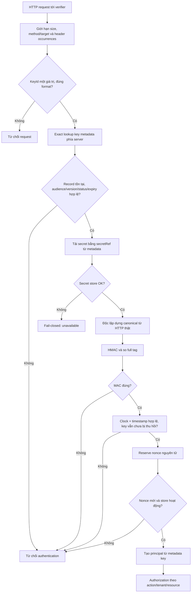

# Tải shared secret khi xác minh HTTP request bằng HMAC

## 1. Vì sao “tải shared secret” là một bước xác thực, không phải thao tác đọc cấu hình đơn giản?

Trong module `SECURITY_AUTHENTICATION_HMAC_REQUEST_AUTHENTICATION`, client tạo chữ ký HMAC từ **shared secret** và **canonical request** gồm các trường như HTTP method, raw URI/query, signed headers, timestamp, nonce và SHA-256 của raw body. Server nhận request, tự tạo lại canonical bytes, tính MAC kỳ vọng bằng **đúng secret của client được phép xác minh**, rồi so với chữ ký nhận được. Sau đó server còn phải chống replay và phân quyền.

Ở phía server, câu hỏi đầu tiên thường là: **“Request này tuyên bố dùng key nào và tôi lấy secret tương ứng ở đâu?”**. Đây là chủ đề **“Tải shared secret”**, thuộc chương **“Xác minh request”**.

Cách làm tưởng đơn giản nhưng nguy hiểm là đọc `X-HMAC-Key-Id` rồi lấy đại một biến môi trường, dùng secret mặc định hoặc thử tất cả secret cho tới khi MAC đúng. Cách đó có thể gây nhầm danh tính, bỏ qua key bị thu hồi, cho phép downgrade thuật toán, tạo nguy cơ replay xuyên tenant hoặc phơi lộ bí mật qua cấu hình/log.

**Thiết kế đúng cần hai loại dữ liệu khác nhau:**

- **Key metadata / policy:** định danh key, principal/tenant đã được cấp, audience/môi trường, thuật toán HMAC, canonical format version, trạng thái khóa, thời gian hiệu lực, secret reference và phiên bản metadata. Metadata là **nguồn tin cậy phía server**, không được quyết định bằng các header do client tự khai.
- **Secret material:** byte khóa bí mật dùng cho phép tính `HMAC(secretBytes, canonicalBytes)`. Chúng được cấp qua kênh an toàn, lưu trong secret manager/vault/HSM hoặc một cơ chế tương đương; không đưa vào request, URL, response, log hay source repository.

Hợp đồng xác thực có thể xem như:

```text
HTTP request
  X-HMAC-Key-Id: merchant-42:k2026b      (dữ liệu CHƯA tin)
  X-HMAC-Timestamp: 1795838400
  X-HMAC-Nonce: 9fc41749ac56ccfd4589b032779f6aee
  X-HMAC-Signature: <base64-tag>
            |
            v
  Validate + exact keyId lookup trong registry của server
            |
            v
  Key metadata được phép VERIFY? audience/version/algorithm?
            |
            v
  Tải secret qua secretRef đáng tin từ metadata
            |
            v
  Server dựng canonical bytes từ HTTP request thực tế
            |
            v
  HMAC và so MAC --> kiểm tra timestamp/nonce --> tạo principal
            |
            v
  Authorization theo action/resource/tenant
```

> **Nguyên tắc:** `keyId` chỉ là **con trỏ tra cứu do người gửi khai báo**, không phải bằng chứng danh tính. Chỉ sau khi HMAC hợp lệ, key còn được phép verify và anti-replay thành công, hệ thống mới được gắn request với principal tương ứng. Một request đã xác thực vẫn có thể **không có quyền** thực hiện hành động.

### Mục tiêu học tập

Sau bài này, bạn có thể:

1. Phân biệt `keyId`, **shared secret**, **secret reference**, **key metadata**, **principal** và **audience**.
2. Xây dựng thứ tự tra cứu key và tải secret an toàn, không tin client quyết định key path/algorithm/version.
3. Lựa chọn giữa **secret manager, encrypted configuration, KMS/HSM, remote MAC service** và caching theo yêu cầu bảo mật.
4. Thiết kế vòng đời `ACTIVE → VERIFY_ONLY → REVOKED/EXPIRED` cùng key rotation và xử lý cache khi thu hồi.
5. Viết mã Java 17+ mô tả registry/provider/loader và dùng key để xác minh HMAC với dữ liệu canonical do server tạo.
6. Xử lý lỗi secret store và cache theo nguyên tắc **fail-closed**, không làm rò rỉ secret hay trạng thái key.
7. Kiểm thử proxy/gateway, timestamp/nonce, cross-tenant, downgrade, concurrency và authorization độc lập.

## 2. Bốn định danh cần tách bạch

Giả sử đối tác được cấp cấu hình ký:

```text
Principal (đối tác)     = merchant-42
Public keyId            = merchant-42:k2026b
Canonical format       = HMAC-REQUEST/VERIFY-V1
Algorithm              = HmacSHA256
Audience               = payments-api/prod
Secret reference       = vault://hmac/payments/merchant-42/k2026b
Secret material        = [32 random bytes, KHÔNG hiển thị]
```

Ở hệ thống thật, **secret reference là thông tin nội bộ**; client thường chỉ cần key ID, key material và hợp đồng ký được cấp theo một quy trình bảo mật.

| Khái niệm | Là bí mật? | Ai tạo hoặc kiểm soát? | Có thể dùng để kết luận danh tính? |
| --- | --- | --- | --- |
| `X-HMAC-Key-Id` trong request | Thường không phải secret | Client **khai báo**, registry server biết key hợp lệ | **Chưa**; chỉ là lookup selector. |
| `secretRef` nội bộ | Không phải MAC key, nhưng cần bảo vệ như thông tin nội bộ | Registry/secret service phía server | Không trực tiếp. |
| Raw shared secret bytes | **Có** | Provisioning/secret manager, phân phối an toàn cho hai phía | Gián tiếp, **sau** MAC đúng với metadata đáng tin. |
| `principalId`/`tenantId` trên metadata | Không phải secret nhưng nhạy về danh tính | IAM/key registry phía server | Chỉ được gắn cho request **sau** xác minh. |
| `audience` | Thường là identifier | Chính sách server và cấu hình client | Giúp ràng buộc API đích, không tự cấp quyền. |
| Key status/expiry | Không phải secret | Quản trị vòng đời key phía server | Quyết định key còn được phép verify hay không. |

Một đối tác có thể có **nhiều key ID** vì đang rotation. Một key ID luôn cần ánh xạ tới một metadata record cụ thể; đừng biến key ID thành principal một cách máy móc. Khi key cũ và mới cùng đại diện `merchant-42`, cả hai có thể được verify trong thời gian chuyển tiếp nhưng phải ánh xạ về **cùng principal** và được kiểm tra quyền theo policy hiện tại.

### 2.1 HMAC dùng shared secret, không dùng public/private key pair

HMAC là **mật mã khóa đối xứng**: người tạo MAC và người xác minh đều cần khả năng tính HMAC với cùng bí mật (hoặc dùng dịch vụ mật mã có quyền truy cập bí mật). Điều này khác chữ ký số bất đối xứng, nơi verifier có thể chỉ dùng public key.

Nếu client đã biết shared secret, việc server lưu bản đối ứng trong HSM **không ngăn client hợp lệ tạo request mới** theo ý muốn. HSM bảo vệ mặt server; kiểm soát quyền truy cập tài nguyên và audit việc cấp secret vẫn là nhiệm vụ độc lập. Một secret bị lộ cho kẻ tấn công cho phép họ **tự ký request mới** cho tới khi key bị thu hồi, không chỉ replay request cũ.

### 2.2 Chọn secret theo key ID, không thử danh sách secret

Sai:

```java
// KHÔNG dùng trong production:
for (byte[] secret : allSecretsForAllCustomers) {
    if (hmacMatches(secret, canonical, receivedTag)) {
        return authenticated();
    }
}
```

Cách này làm khó xác định principal/audience, có thể vô tình dùng key đã revoke hoặc secret của tenant khác, làm tăng bề mặt timing/DoS và che giấu cấu hình không đồng bộ.

Đúng:

```text
untrustedKeyId
   -> parse + validate format/length
   -> exact lookup trong registry server
   -> metadata: principal, audience, algorithm, version, status, secretRef
   -> load đúng secretRef nội bộ
   -> đúng một canonicalizer và một HMAC algorithm
   -> compare MAC
```

Server có thể trả **cùng một lỗi authentication bên ngoài** cho key ID không tồn tại, revoked, sai audience hoặc MAC sai để giảm khả năng dò khóa; ghi nguyên nhân nội bộ bằng log/metrics đã bảo vệ.

## 3. Contract VERIFY-V1: những gì metadata phải ghim

Tài liệu sử dụng một hợp đồng minh họa `HMAC-REQUEST/VERIFY-V1`, không phải chuẩn HMAC chung của mọi API. Một HTTP request có thể như sau:

```http
POST /v1/payments?channel=partner HTTP/1.1
Host: api.example.test
Content-Type: application/json
X-HMAC-Key-Id: merchant-42:k2026b
X-HMAC-Timestamp: 1795838400
X-HMAC-Nonce: 9fc41749ac56ccfd4589b032779f6aee
X-HMAC-Signature: <base64-full-hmac-sha256>

{"amountMinor":125000,"currency":"VND"}
```

Timestamp và signature trên là dữ liệu minh họa; khi gửi request thật phải dùng thời gian hiện tại, nonce mới và tính tag đúng secret. Request body được hiểu là **chính xác các byte UTF-8 của JSON ở trên**, không tự thêm newline khi tính digest.

Metadata server cho `merchant-42:k2026b`:

| Trường metadata | Giá trị minh họa | Vai trò |
| --- | --- | --- |
| `keyId` | `merchant-42:k2026b` | Exact-match với header. |
| `principalId` | `merchant-42` | Danh tính tạo ra **sau** HMAC/replay pass. |
| `audience` | `payments-api/prod` | Ngăn chuyển request sang service/môi trường khác. |
| `algorithm` | `HmacSHA256` | Không lấy thuật toán từ header client. |
| `canonicalVersion` | `VERIFY-V1` | Chọn đúng canonicalizer, không fallback bản yếu. |
| `secretRef` | `vault://hmac/payments/merchant-42/k2026b` | Địa chỉ nội bộ do registry đáng tin quyết định. |
| `status` | `ACTIVE` | Key được phép tạo/verify request theo policy. |
| `verifyNotBefore` | Instant đầu hiệu lực | Không chấp nhận khi chưa được mở verify. |
| `verifyUntil` | Instant hết hiệu lực | Nên dùng biên trên exclusive; không chấp nhận sau hạn. |
| `revision` | `rev-17` | Hỗ trợ phát hiện metadata stale khi cache/rotation. |

### 3.1 Server không để client tự chỉ định policy

Các header như sau **không được phép tự sửa quyết định server**:

```http
X-HMAC-Algorithm: HmacSHA1
X-HMAC-Canonical-Version: legacy-v0
X-HMAC-Secret-Ref: /etc/app/default-secret
```

Trong VERIFY-V1 mẫu, server **từ chối** những header điều khiển trên vì chúng không thuộc contract. `keyId` chỉ dùng exact lookup; metadata record đã xác định algorithm, canonical version, audience và secret reference. Nếu giao thức muốn truyền version header, nó phải được ký và đối chiếu với server policy, không cho phép client chuyển sang bản yếu.

**Không lấy key ID làm filename/path, URL hoặc tên biến môi trường theo cách nối chuỗi không kiểm soát.** Ví dụ `vaultBase + "/" + request.header("X-HMAC-Key-Id")` tạo rủi ro confused-deputy/truy xuất secret ngoài phạm vi nếu thiếu mapping/quyền. Secret reference chỉ được lấy từ registry nội bộ đã kiểm soát và theo **least-privilege** của service.

### 3.2 Canonical request phải chứa key ID để ràng buộc selector

Ví dụ VERIFY-V1 ký:

```text
HMAC-REQUEST/VERIFY-V1
HMAC-SHA256
POST
/v1/payments?channel=partner
audience:payments-api/prod
content-type:application/json
x-hmac-key-id:merchant-42:k2026b
x-hmac-timestamp:1795838400
x-hmac-nonce:9fc41749ac56ccfd4589b032779f6aee
body-sha256:<lowercase-hex-sha256-of-raw-body>
```

Đây là **10 dòng**, dùng UTF-8, nối bằng `LF` và **không thêm LF cuối**. Dòng digest phải thay bằng SHA-256 hex thực tế của raw body; không gửi placeholder trong chữ ký.

Client tính:

```text
digest    = lowercase_hex(SHA256(rawBodyBytes))
canonical = UTF8(exactly_10_lines_joined_by_LF)
macBytes  = HMAC_SHA256(sharedSecretBytes, canonical)
signature = BASE64_STANDARD_PADDED(macBytes)
```

Server tự tạo lại các dòng từ **method/URI/header/body thực nhận**. Không dùng một chuỗi canonical do client tự gửi thay cho request thực tế. `x-hmac-key-id` được ký để không thể tráo selector mà giữ nguyên signature, nhưng **bản thân selector vẫn chưa đáng tin trước MAC**.

Quy tắc HTTP khác phải được chốt ở ingress: raw origin-form URI giữ nguyên percent-encoding/query order, header signed singleton (reject duplicate), `Content-Type` chính xác `application/json`, body hash trên bytes sau HTTP framing và trước transform. Ví dụ cấm `Content-Encoding` để tránh gateway tự giải nén làm đổi digest.

## 4. Những nơi có thể lưu và tải secret

Không có một backend storage duy nhất phù hợp mọi hệ thống; điều kiện quan trọng là **secret có nguồn gốc đáng tin, phân quyền truy cập chặt, audit được, có cơ chế rotation/revoke và không lộ qua vận hành**.

| Phương án | Cách verifier dùng secret | Ưu điểm | Cảnh báo |
| --- | --- | --- | --- |
| **Secret manager / vault** | Resolve secretRef → lấy secret bytes qua API có xác thực | Central audit, versioning, IAM, rotation, có thể cache có giới hạn | Phụ thuộc availability, latency; bí mật có thể xuất hiện trong bộ nhớ ứng dụng. |
| **Encrypted config / secret mount** | Secret được inject qua kênh an toàn và chỉ đọc lúc startup/refresh | Ít call runtime, đơn giản cho số key rất nhỏ | Rotation/revocation khó đồng bộ; file/env có thể lộ qua dump/process/diagnostics; không phù hợp kho nhiều tenant tùy ý. |
| **KMS decrypt / envelope encryption** | Registry giữ encrypted data key/secret; service được quyền decrypt qua KMS | Secret-at-rest mã hóa, IAM/audit trên decrypt | **Decrypt đưa plaintext vào memory** nếu triển khai theo cách này; cần phân biệt key mã hóa và HMAC secret. |
| **HSM / managed MAC service** | Service gửi canonical bytes tới API MAC/verify bằng non-exportable key | Server-side key có thể không xuất khỏi ranh giới phần cứng/service | Chỉ dùng được khi **API thực sự hỗ trợ HMAC/MAC verify phù hợp** và key provisioning hợp đồng; tốn network/latency. |
| **Database tự quản lý** | Lưu blob secret đã mã hóa với KEK quản trị riêng; load theo ID nội bộ | Linh hoạt cho rất nhiều tenant | Cần tự giải quyết KMS, access controls, audit, cache, rotation, encryption, backup và incident. |

### 4.1 Không phải KMS nào cũng có API “lấy secret”

Một số KMS chủ yếu cung cấp **encrypt/decrypt data key** hoặc **MAC/VerifyMac** trên key do KMS giữ; không nên giả định mọi sản phẩm KMS hỗ trợ “export HMAC key”. Nếu HMAC key **không exportable**, ứng dụng có thể phải gọi API MAC/verify thay vì lấy raw bytes. Nếu dùng envelope encryption, KMS có thể decrypt ciphertext secret để ứng dụng tính HMAC bằng JCA — khi đó raw HMAC secret đã đi vào process memory.

Phân biệt hai cách triển khai:

```text
A) Exportable symmetric secret:
   secret store -> plaintext secret bytes -> Mac.init(SecretKeySpec)
   -> HMAC(canonicalBytes) -> verify

B) Non-exportable key, supported MAC service:
   key reference -> server-side KMS/HSM verify MAC on canonicalBytes
   -> verified/not verified
   [HMAC secret không đi vào JVM]
```

Trong **cả hai**, client hợp lệ vẫn phải có khả năng tạo cùng HMAC theo giao thức đã cấp. Nếu API remote chỉ hỗ trợ chữ ký số bất đối xứng hoặc chỉ hỗ trợ một thuật toán HMAC khác, không thể tự coi chúng tương đương. Hợp đồng **thuật toán, tag length, canonical bytes, key material** phải khớp.

### 4.2 Cấp secret cho client an toàn

Quy trình cấp khóa nên:

1. Sinh secret bằng **cryptographically secure random** ở phía hệ thống cấp phát; với HMAC-SHA256, một policy thông dụng là **ít nhất 32 byte ngẫu nhiên** cho key mới.
2. Tạo key ID ngẫu nhiên/đủ phân biệt hoặc gắn version rõ; ghi metadata principal, audience, scopes/quota và hạn dùng.
3. Phân phối secret **một lần hoặc qua kênh bảo vệ được xác thực** tới đúng đối tác; không gửi qua query, email/plaintext log, ticket công khai.
4. Lưu bản phía server vào secret service; client lưu trong kho bảo mật của mình, không commit source.
5. Có khả năng thu hồi khẩn cấp, cấp key mới và giám sát key usage.

Một số test vector HMAC chuẩn sử dụng khóa ngắn hơn 32 byte để dễ kiểm chứng; điều đó không làm thay đổi **policy entropy** mà hệ thống production của bạn yêu cầu.

## 5. Chọn key theo trình tự nào trong verifier?

Đọc secret không phải bước đầu tiên của mọi request. Để bảo vệ tài nguyên và tránh bị ép truy cập vault liên tục, có thể **từ chối sớm dữ liệu sai format** mà không tin chúng là danh tính.



**Trình tự kiểm tra chi tiết:**

1. **Ingress:** Giới hạn header/URI/body size, reject duplicate `X-HMAC-Key-Id`/signature/timestamp/nonce, kiểm tra framing, raw target và signed fields nhất quán. Không dựa vào giá trị do client khai như principal.
2. **Key ID:** Yêu cầu chính xác một key ID, giới hạn độ dài và ký tự; không cho newline, path separator hoặc ký tự điều khiển.
3. **Registry lookup:** Tìm bằng **exact-match** trên indexed identifier trong registry nội bộ. Không tự tạo secret path từ input.
4. **Policy:** Kiểm tra trạng thái `ACTIVE` hoặc `VERIFY_ONLY` đang trong hạn, audience đúng service, algorithm/canonical version được phép, principal mapping tồn tại.
5. **Load secret:** Gọi provider qua `secretRef` đã tin cậy; kiểm tra định dạng/độ dài và lỗi hạ tầng. Secret là byte, không dùng `String` tùy ý làm vật mang secret.
6. **Verify MAC:** Dựng canonical request **từ raw HTTP thực tế**, strict-decode signature Base64 thành đúng tag length, tính HMAC bằng secret, so byte bằng `MessageDigest.isEqual`.
7. **Recheck:** Với request có body dài hoặc trạng thái key có thể đổi giữa lúc đọc, kiểm tra lại thời hạn/trạng thái/revision tại thời điểm cho request đi tiếp.
8. **Replay:** Timestamp đã được ký phải nằm trong cửa sổ; reserve nonce mới bằng thao tác nguyên tử ở kho dùng chung.
9. **Principal và quyền:** Sau khi authentication hoàn tất, gắn principal theo metadata server, rồi **authorization** cho operation và resource. Idempotency nghiệp vụ vẫn là một bước riêng.

**Lưu ý về quyền:** Không kiểm tra `principalId` từ metadata rồi gọi business trước khi MAC đúng. Việc key ID tồn tại không chứng minh caller biết secret.

## 6. Trạng thái key và key rotation

Một đối tác cần xoay secret mà không ngắt dịch vụ. Ta nên mô hình hóa key version và khoảng thời gian có thể xác minh.

| Trạng thái | Client nên làm gì? | Verifier làm gì? |
| --- | --- | --- |
| `ACTIVE` | Có thể sử dụng key để ký request mới | Cho phép verify nếu metadata, audience, time và MAC đạt. |
| `VERIFY_ONLY` | Dừng ký request mới, chuyển sang key mới | **Tạm cho phép verify** đến hạn chuyển tiếp rõ ràng. |
| `REVOKED` | Không sử dụng key | Từ chối ngay, kể cả signature trước đây từng hợp lệ. |
| `EXPIRED` | Không dùng key đã quá hạn | Từ chối do thời hạn, không nới cửa sổ bằng timestamp client. |

`VERIFY_ONLY` là **chính sách vận hành**, không phải bảo đảm mật mã rằng client không còn biết secret cũ. Nếu client vẫn giữ secret, họ vẫn có thể tính MAC; vì vậy phải có **mốc hết hạn verify** và cơ chế revoke thực sự.

### 6.1 Một kịch bản rotation không downtime

```text
Ngày A:
  merchant-42:k2026a -> ACTIVE, key cũ

Ngày B:
  merchant-42:k2026b -> ACTIVE, key mới
  merchant-42:k2026a -> VERIFY_ONLY, verifyUntil = ngày D

Ngày C:
  SDK/client đổi sang k2026b
  Server vẫn verify hai key đúng metadata riêng biệt

Ngày D:
  merchant-42:k2026a -> REVOKED/EXPIRED
  Server loại khỏi cache verify
```

Server **không thử secret cũ rồi secret mới** cho một request. Nó chỉ tra key ID nhận được, sau đó áp dụng policy riêng của record đó. Khi chuyển key từ `k2026a` sang `k2026b`, canonical format có thể giữ nguyên; nếu đổi cả format, mỗi key nên được ghim phiên bản mới rõ ràng.

### 6.2 Revocation khác expiry

- **Expiry:** kết thúc theo lịch. Metadata `verifyUntil` có thể áp dụng biên **exclusive** `now < verifyUntil`.
- **Revocation:** thu hồi ngay do nghi lộ key, đối tác chấm dứt hoặc thay đổi quyền. Phải có cơ chế invalidation cache/registry khẩn cấp.
- **Principal disable:** khóa merchant hoặc thu hồi scope phải được thực thi ở policy danh tính/authorization, **không phụ thuộc** mọi key đã hết hạn hay chưa.
- **Key rotation:** chuyển giao sử dụng secret mới; **không** nhất thiết là sự cố bảo mật.

**Không dùng timestamp mà client ký để chọn trạng thái key trong quá khứ.** Ví dụ key bị revoke lúc 12:00 thì request tới lúc 12:01 với timestamp 11:59 vẫn bị từ chối; nếu cho quay lại “key từng ACTIVE lúc 11:59”, người đã lộ secret có thể tạo request mới với timestamp cũ trong cửa sổ.

### 6.3 Consistency giữa các replica

Nếu một replica đã nhìn thấy `REVOKED` còn replica khác đang cache `ACTIVE`, cùng request có thể được chấp nhận ở một nơi và bị từ chối ở nơi khác. Production nên:

- Có **version/revision** metadata và cơ chế cập nhật cache nhất quán.
- Cam kết thời gian tối đa revocation có hiệu lực (**revocation propagation SLO**) và đo được độ trễ cập nhật.
- Khi bắt buộc thu hồi gần tức thời, chọn cách recheck trạng thái trung tâm hoặc short-lived cache có cơ chế push invalidation đáng tin.
- **Fail-closed** khi không thể chứng minh cache/policy còn đủ tươi theo mức đảm bảo yêu cầu.
- Kiểm thử across-region, deploy rolling, key revocation giữa request và callback/multipart upload dài.

## 7. Cache shared secret: hiệu năng phải đi cùng chính sách thu hồi

Tải secret qua network mỗi request có thể tăng latency, chi phí và áp lực lên vault/KMS. Cache là hợp lý nếu có **giới hạn rõ** và thiết kế đúng revocation.

### 7.1 Ba loại cache khác nhau

| Cache | Nội dung | Rủi ro riêng |
| --- | --- | --- |
| **Metadata cache** | Key ID → state, principal, algorithm, version, audience, secretRef, revision | Có thể stale: key bị thu hồi nhưng cache vẫn báo ACTIVE. |
| **Secret material cache** | Secret bytes hoặc secure key handle | Lộ qua process memory/dump, sống lâu quá cần thiết; áp lực rotation. |
| **Negative cache** | Key ID “không tìm thấy” trong thời gian rất ngắn | Có thể gây lỗi khi vừa cấp key mới; attacker tạo vô số key ID làm đầy cache. |

**Không nên cache theo tenant ID duy nhất** nếu tenant có nhiều key versions; cache key nên là **canonical key ID + registry revision/version** hoặc định danh record bất biến phù hợp. Không lưu keyId như input tự do không giới hạn để tạo hàng triệu entry; dùng rate limit và bounded caches.

### 7.2 TTL cache không phải TTL nonce

Hai loại TTL không liên quan trực tiếp:

- **Cache TTL cho key:** giới hạn secret/metadata được sử dụng mà không revalidate; ảnh hưởng latency của **revocation và rotation**.
- **Nonce TTL:** cần bao phủ toàn bộ cửa sổ replay mà timestamp có thể hợp lệ; tính từ `maximum past age + maximum future allowance + safety margin`, không lấy bằng key cache TTL.

Ví dụ metadata cache TTL 30 giây và nonce TTL 630 giây có thể hợp lý cho các policy cụ thể; **không có một TTL mặc định đúng cho mọi hệ thống**. Nếu doanh nghiệp yêu cầu thu hồi key có hiệu lực trong 5 giây, cache 30 giây **không đủ** trừ khi có push invalidation hoặc recheck trung tâm đáng tin cậy.

### 7.3 Các lỗi cache thường gặp

- **“Vault lỗi thì dùng secret cũ mãi”:** vô tình chấp nhận key đã revoke. Chỉ được dùng cached secret khi policy explicitly cho phép và chứng minh metadata/key status còn hợp lệ trong thời hạn.
- **“Cache cả secret cho mọi key”:** tăng số bí mật trong memory và bề mặt tấn công; dùng bounded cache, encrypt-at-rest/swap policy, permission process và eviction.
- **“Cache secret không kiểm tra key metadata”:** giữ đúng bytes nhưng áp dụng sai algorithm/audience hoặc quyền của principal.
- **“Dùng cached secret từ staging ở production”:** cross-environment replay/nhầm audience.
- **“Cache negative lookup quá lâu”:** key mới cấp không thể hoạt động ngay; đừng để lookup miss do outage bị coi là `NOT_FOUND`.

### 7.4 Failure mode và quyết định fail-closed

| Tình huống | Phản ứng khuyến nghị |
| --- | --- |
| Key ID không tồn tại trong registry khỏe mạnh | Từ chối authentication; lỗi công khai không tiết lộ record tồn tại hay không. |
| Key revoked / expired / sai audience | Từ chối authentication, không load secret nếu không cần. |
| Registry hoặc vault/KMS không sẵn sàng | **Không** trả “key không tồn tại” hoặc dùng default secret; fail-closed, có thể `503`/retry policy riêng. |
| Cache có metadata stale sau revocation | Revalidate/invalidate; nếu không đạt freshness contract → từ chối/temporarily unavailable. |
| SecretRef trả byte rỗng/khác policy hoặc không khớp revision | Lỗi cấu hình/hạ tầng; fail-closed và cảnh báo; không đoán key khác. |
| Một request đi qua rolling deploy có policy khác | Bảo đảm versioned config hoặc từ chối ở replica không được đồng bộ; giám sát mismatch. |

## 8. Java 17+: thiết kế KeyRegistry, SecretProvider và KeyLoader

Ví dụ dưới đây dùng **Java 17 thuần**, tập trung vào bước **tải secret theo metadata đáng tin**. `KeyRegistry`/`SecretProvider` là interface; trong production cần implementation kết nối IAM/secret store thật, có TLS xác thực, timeout, rate limit và audit.

**Không có secret thật trong bài.** Các đoạn mã không sử dụng secret hardcode, không gửi secret đến client và không xây path secret từ input header.

### 8.1 Model trạng thái và metadata

```java
import java.time.Instant;
import java.util.Arrays;
import java.util.Objects;
import java.util.Optional;
import java.util.regex.Pattern;

enum KeyState {
    ACTIVE, VERIFY_ONLY, REVOKED
}

record KeyMetadata(
        String keyId,
        String principalId,
        String audience,
        String canonicalVersion,
        String algorithm,
        String secretRef, // chỉ từ registry phía server
        String revision,
        KeyState state,
        Instant verifyNotBefore,
        Instant verifyUntil) {

    boolean isVerifiableAt(Instant now) {
        return (state == KeyState.ACTIVE || state == KeyState.VERIFY_ONLY)
                && !now.isBefore(verifyNotBefore)
                && now.isBefore(verifyUntil);
    }
}

class KeyBackendUnavailableException extends RuntimeException {
    KeyBackendUnavailableException(String safeMessage, Throwable cause) {
        super(safeMessage, cause);
    }
}

interface KeyRegistry {
    // Exact lookup. Missing key = Optional.empty(); outage = exception.
    Optional<KeyMetadata> findExact(String keyId);

    // Recheck record revision/status; outage PHẢI báo exception.
    boolean isCurrentAndVerifiable(KeyMetadata metadata, Instant now);
}

interface SecretProvider {
    // Contract: trả về mảng byte mới thuộc sở hữu caller.
    // Không trả view chia sẻ tới cache nội bộ.
    byte[] loadSecretCopy(String internalSecretRef);
}
```

`KeyMetadata` là thông tin **đã xác thực từ registry**. `isVerifiableAt` chỉ là kiểm tra cục bộ, chưa đảm bảo revision không đổi; interface `isCurrentAndVerifiable` hỗ trợ recheck metadata trước quyết định cho request đi tiếp.

**Không để exception từ network/secret store bị chuyển thành `Optional.empty()`.** “Không có key” khác “không thể kiểm tra key”; sự khác biệt này quan trọng với fail-closed và vận hành.

### 8.2 LoadedKey có vòng đời rõ ràng

```java
final class LoadedKey implements AutoCloseable {
    private final KeyMetadata metadata;
    private byte[] ownedSecret;

    LoadedKey(KeyMetadata metadata, byte[] ownedSecret) {
        this.metadata = Objects.requireNonNull(metadata);
        this.ownedSecret = Objects.requireNonNull(ownedSecret);
    }

    KeyMetadata metadata() {
        return metadata;
    }

    byte[] secretCopyForCrypto() {
        if (ownedSecret == null) {
            throw new IllegalStateException("Key already closed");
        }
        return ownedSecret.clone();
    }

    @Override
    public void close() {
        if (ownedSecret != null) {
            Arrays.fill(ownedSecret, (byte) 0);
            ownedSecret = null;
        }
    }
}
```

Mẫu này **giảm** thời gian mảng byte của ứng dụng còn trong bộ nhớ: `LoadedKey` sở hữu một bản copy, xóa mảng khi close; nơi tính HMAC cũng xóa bản clone sau khi dùng. Tuy nhiên **không được tuyên bố “zeroization tuyệt đối” trong Java**: JCA provider, `SecretKeySpec`, compiler/GC hoặc dump có thể giữ bản sao khác. Với yêu cầu cao, dùng HSM/remote MAC hoặc tích hợp crypto được audit, cấu hình memory dump và runtime theo chính sách an ninh.

### 8.3 Bộ loader xác thực metadata trước khi truy cập secret

```java
final class ServerHmacKeyLoader {
    private static final Pattern KEY_ID =
            Pattern.compile("[A-Za-z0-9._:-]{1,100}");

    private final KeyRegistry registry;
    private final SecretProvider secrets;

    ServerHmacKeyLoader(KeyRegistry registry, SecretProvider secrets) {
        this.registry = Objects.requireNonNull(registry);
        this.secrets = Objects.requireNonNull(secrets);
    }

    Optional<LoadedKey> loadForVerification(
            String untrustedKeyId, Instant now) {

        if (untrustedKeyId == null
                || !KEY_ID.matcher(untrustedKeyId).matches()) {
            return Optional.empty(); // Caller trả lỗi generic
        }

        Optional<KeyMetadata> found = registry.findExact(untrustedKeyId);
        if (found.isEmpty()) return Optional.empty();

        KeyMetadata metadata = found.get();

        // Chính sách cố định của verifier / API hiện tại:
        if (!untrustedKeyId.equals(metadata.keyId())
                || !"payments-api/prod".equals(metadata.audience())
                || !"VERIFY-V1".equals(metadata.canonicalVersion())
                || !"HmacSHA256".equals(metadata.algorithm())
                || !metadata.isVerifiableAt(now)
                || metadata.principalId() == null
                || metadata.principalId().isBlank()
                || metadata.secretRef() == null
                || metadata.secretRef().isBlank()
                || metadata.revision() == null
                || metadata.revision().isBlank()) {
            return Optional.empty();
        }

        // Chỉ tải từ secretRef được lấy qua registry tin cậy.
        byte[] material = secrets.loadSecretCopy(metadata.secretRef());
        if (material == null) {
            throw new KeyBackendUnavailableException(
                    "Secret unavailable", null);
        }

        if (material.length < 32) {
            Arrays.fill(material, (byte) 0);
            throw new KeyBackendUnavailableException(
                    "Secret violates key policy", null);
        }

        return Optional.of(new LoadedKey(metadata, material));
    }
}
```

Trong code mẫu, `loadForVerification` chỉ **chấp nhận VERIFY-V1/HmacSHA256/audience cụ thể**, tránh một client yêu cầu thuật toán khác. Nếu có nhiều endpoint/version, hãy tạo một **policy đã biết của endpoint**, rồi đối chiếu metadata; đừng suy endpoint/version/algorithm từ request một cách tùy tiện.

**Góc cần bổ sung ở implementation thật:** kiểm tra định danh/permission của **service** khi gọi registry và secret provider; chống truy cập secret ngoài namespace; thời hạn timeout; retry có giới hạn; vault audit; circuit breaker và quota; secret payload có thể được mã hóa hoặc chứa metadata, phải decode theo schema đáng tin trước khi dùng. Nếu secret provider trả byte[] từ cache dùng chung, **không được xóa mảng chia sẻ**; interface ở đây yêu cầu trả **bản copy độc quyền**.

## 9. Java 17+: dùng secret đã tải để verify HMAC

Đã tải được secret **không có nghĩa request hợp lệ**. Đoạn dưới cho thấy cách dùng key cho một phép so sánh HMAC, sau đó **đóng `LoadedKey`**. Canonical bytes phải do **server tự dựng từ request đã validate**, không phải chuỗi client cấp.

### 9.1 Hàm verify tag full HMAC-SHA256

```java
import java.security.GeneralSecurityException;
import java.security.MessageDigest;
import java.util.Arrays;
import java.util.Base64;
import javax.crypto.Mac;
import javax.crypto.spec.SecretKeySpec;

final class HmacTagVerifier {
    private HmacTagVerifier() {}

    static boolean verify(
            LoadedKey loadedKey,
            byte[] serverCanonicalBytes,
            String suppliedBase64) {

        if (serverCanonicalBytes == null
                || suppliedBase64 == null
                || suppliedBase64.length() != 44) {
            return false;
        }

        final byte[] supplied;
        try {
            supplied = Base64.getDecoder().decode(suppliedBase64);
        } catch (IllegalArgumentException invalidBase64) {
            return false;
        }
        if (supplied.length != 32
                || !Base64.getEncoder().encodeToString(supplied)
                        .equals(suppliedBase64)) {
            // Full HMAC-SHA256 tag: 32 bytes, Base64 chuẩn có padding.
            return false;
        }

        byte[] secret = loadedKey.secretCopyForCrypto();
        try {
            Mac mac = Mac.getInstance("HmacSHA256");
            mac.init(new SecretKeySpec(secret, "HmacSHA256"));
            byte[] expected = mac.doFinal(serverCanonicalBytes);
            try {
                return MessageDigest.isEqual(expected, supplied);
            } finally {
                Arrays.fill(expected, (byte) 0);
            }
        } catch (GeneralSecurityException cryptoError) {
            throw new IllegalStateException(
                    "Cryptographic provider unavailable", cryptoError);
        } finally {
            Arrays.fill(secret, (byte) 0);
            Arrays.fill(supplied, (byte) 0);
        }
    }
}
```

**Điểm quan trọng:**

- `MessageDigest.isEqual` là primitive so MAC byte thích hợp hơn so chuỗi bằng phép so sánh tự viết hoặc vòng lặp thoát ở byte đầu khác nhau.
- `Base64.getDecoder` chỉ hỗ trợ cú pháp Base64 chuẩn; điều kiện **decode rồi encode lại phải giống nguyên text** giúp từ chối biểu diễn không canonical theo hợp đồng.
- Độ dài 44 ký tự và 32 raw bytes được **ghim bởi policy HmacSHA256 full tag**. Không tự nhận shortened MAC, Base64URL hoặc hex nếu contract không cho phép.
- Xóa bản secret byte[] trong `finally` giúp giảm thời gian lộ của mảng tạm, **không bảo đảm xóa được các bản sao nằm trong provider**.
- Secret/mảng MAC/raw canonical request chứa dữ liệu nhạy cảm **không** được in ra log production. Khi provider lỗi, phân biệt lỗi hạ tầng với MAC mismatch trong telemetry nội bộ.

### 9.2 Pipeline verifier với chính sách key và replay

```java
// Pseudocode: adapter, registry, clock, nonceStore, authorization
// là thành phần hạ tầng, KHÔNG phải API có sẵn trong JDK.
ValidatedHttpRequest request = adapter.readAndValidate(http);

String keyId = request.oneHeader("X-HMAC-Key-Id");
Instant now = clock.instant(); // lấy snapshot thời gian đáng tin

Optional<LoadedKey> found = loader.loadForVerification(keyId, now);
if (found.isEmpty()) {
    rejectUnauthenticatedGeneric();
    return;
}

try (LoadedKey loaded = found.get()) {
    // Không dùng principal cho tới khi authentication hoàn tất.
    KeyMetadata meta = loaded.metadata();

    // Canonical version được ghim theo meta/endpoint.
    byte[] canonical =
            canonicalizer.buildFromRequest(request, meta);

    if (!HmacTagVerifier.verify(
            loaded, canonical, request.oneHeader("X-HMAC-Signature"))) {
        rejectUnauthenticatedGeneric();
        return;
    }

    // Với request body dài: kiểm tra thời gian tại thời điểm verify.
    Instant verifiedAt = clock.instant();
    if (!clockHealth.isHealthy()
            || !timestampPolicy.accepts(
                    request.oneHeader("X-HMAC-Timestamp"), verifiedAt)
            || !registry.isCurrentAndVerifiable(meta, verifiedAt)) {
        rejectUnauthenticatedGeneric();
        return;
    }

    // Nonce phải nằm trong canonical đã ký.
    // Atomic reservation trên shared store, lỗi store => fail-closed.
    if (!nonceStore.reserve(
            meta.principalId(),
            request.oneHeader("X-HMAC-Nonce"),
            nonceTtlSeconds)) {
        rejectReplay();
        return;
    }

    AuthenticatedPrincipal principal =
            identity.fromVerifiedMetadata(meta);

    // Authorization đọc resource thực sự controller sẽ xử lý.
    if (!authorization.canCreatePayment(
            principal, request.tenantId(), request.paymentResource())) {
        rejectForbidden();
        return;
    }

    paymentsService.createWithIdempotency(principal, request);
}
```

Trong production, `nonceStore.reserve` cần **phân biệt “nonce trùng” và “kho lỗi”**; pseudocode rút gọn ở đây chưa thể hiện hai loại exception. Thiết kế đúng là **fail-closed** với lỗi lưu nonce, có thể báo `503`, còn nonce trùng bị từ chối replay. `registry.isCurrentAndVerifiable` phải recheck revision/status thực tế khi policy yêu cầu; nếu backend unavailable thì không cho phép mặc định.

**Vì sao nonce namespace dùng `principalId`?** Ví dụ dùng một namespace chung theo principal để ngăn replay cùng nonce giữa hai key versions đang rotation. Trong hệ thống khác có thể cần scope gồm audience/tenant/method; việc chọn scope phải được định nghĩa theo ranh giới replay và chính sách migration. **Idempotency** vẫn cần riêng để chống lặp *ý định nghiệp vụ* qua hai nonce khác nhau.

## 10. Secret encoding, validation và lỗi triển khai thường gặp

Secret được cấp có thể được biểu diễn trên kênh phân phối thành Base64/hex hoặc được KMS trả dạng binary. **HMAC dùng byte thật, không phải chuỗi văn bản Base64**.

Ví dụ secret thực tế là bytes:

```text
01 02 FF
```

Có thể được hiển thị bằng Base64:

```text
AQL/
```

Nếu client decode Base64 thành 3 byte rồi tính HMAC, nhưng server dùng UTF-8 của **4 ký tự** `AQL/` để tính HMAC, hai phía đã dùng **hai key khác nhau**. Hãy ghi rõ trường secret trong registry là **binary**, **Base64 text**, hay **encrypted payload**, và decode **đúng một lần** theo hợp đồng cấp khóa.

### 10.1 Các kiểu lỗi ảnh hưởng trực tiếp đến chữ ký

| Lỗi | Biểu hiện | Khắc phục |
| --- | --- | --- |
| Dùng text Base64 làm key | MAC luôn khác client đã decode secret. | Lưu/tải secret bytes theo schema rõ; decode đúng một lần. |
| Dùng `String.getBytes()` không chỉ định charset | Mã hóa key/metadata không ổn định qua môi trường. | Với secret, truyền bytes; với canonical, cố định UTF-8. |
| Dùng password người dùng làm HMAC key | Entropy yếu, dễ brute-force offline khi biết message/MAC. | Dùng 32+ byte ngẫu nhiên; provisioning/quản lý khóa riêng. |
| Trùng key ID cho hai secret | Các node dùng bí mật khác nhau, verify chập chờn. | Key ID phải ánh xạ bất biến tới key version cụ thể. |
| Dùng secret fallback khi lookup fail | Có thể xác thực bằng key không đúng principal/tenant. | Không có default secret; fail-closed. |
| Cho client truyền secretRef | Truy cập bí mật trái namespace, confused deputy. | SecretRef chỉ từ registry server, IAM scope chặt. |
| Dùng keyId để build đường dẫn filesystem | Traversal, nhầm khóa hoặc lộ secret qua error. | Exact lookup metadata record, validate ID. |
| Lấy algorithm từ header `X-HMAC-Algorithm` | Downgrade sang thuật toán yếu hoặc mismatch. | Ghim algorithm/canonical version trong registry. |
| Cache secret quá thời hạn revoke | Key lộ vẫn được một replica chấp nhận. | Cache TTL/invalidation và recheck theo SLO. |
| Ghi exception chứa secret response | Secret bị đưa vào trace/log/APM. | Sanitized errors, không log byte secret hoặc toàn bộ payload. |

### 10.2 KMS decrypt và byte ownership

Nếu secret được lưu dạng encrypted blob, flow có thể là:

```text
registry.findExact(keyId) -> encryptedSecretRef / revision
secrets.loadSecretCopy(secretRef):
   permission-check service identity
   read encrypted blob
   KMS decrypt with allowed encryption context
   validate binary schema + key size
   return FRESH owned byte[]
loader -> HMAC -> clear temporary bytes
```

Đó là **mô hình minh họa**, không phải hợp đồng API của một KMS cụ thể. Nếu encryption context dùng tenant/key ID, các giá trị phải đến từ **metadata đã tin** hoặc được kiểm tra với metadata, không được tự lấy từ header chưa xác thực. IAM của verifier chỉ nên được phép decrypt các secret thuộc **audience/environment** hiện tại, tránh khả năng một service bị khai thác đọc secret của hệ thống khác.

## 11. Kịch bản lỗi hạ tầng, observability và incident response

### 11.1 Những gì nên và không nên log

| Có thể log sau kiểm soát dữ liệu | Không được log |
| --- | --- |
| Correlation/request ID, endpoint, thời gian, loại lỗi nội bộ | Shared secret bytes, Base64/hex secret, KMS decrypted plaintext |
| Key ID/version ở mức đã được chính sách dữ liệu cho phép | Full signature/HMAC nếu có thể dùng lại trong cửa sổ |
| Cache hit/miss, metadata revision, key status category | SecretRef đầy đủ nếu lộ cấu trúc vault/nội bộ |
| Vault latency, error class, rate limit, circuit breaker | Raw body/query chứa PII/token hoặc nguyên canonical request nhạy cảm |
| Clock health, nonce replay count, authorization denied | Stack trace từ secret SDK in payload bí mật |

Ngoài lỗi MAC, cần metric:

- `key_lookup_not_found`, `key_lookup_invalid_id`, `key_lookup_wrong_audience`;
- `key_revoked`, `key_expired`, `key_revision_stale`;
- `secret_store_unavailable`, `secret_load_latency`, `secret_cache_age`;
- `signature_invalid`, `canonical_version_mismatch`;
- `timestamp_out_of_window`, `nonce_replay`, `nonce_store_error`;
- `authorization_denied` theo nhóm policy có cardinality phù hợp.

Đừng dùng raw keyId do client tự do đặt trực tiếp làm label metric không giới hạn; attacker có thể làm nổ cardinality. Cần rate limit, aggregation và bảo vệ log retention.

### 11.2 Nếu secret manager ngừng hoạt động

Thứ tự vận hành:

1. Phân biệt **registry outage** với **không có key**, secret provider outage với MAC mismatch.
2. Dừng cấp xác thực mới khi không còn cách chắc chắn key đang được phép verify; không gọi default secret hoặc bỏ xác minh.
3. Nếu thiết kế có **cache đã được phê duyệt**, chỉ dùng trong **freshness window** và với bằng chứng trạng thái key chưa bị thu hồi theo policy; nếu không, fail-closed.
4. Đo độ trễ, error budget, số request ảnh hưởng; bảo đảm thông báo lỗi bên ngoài không tiết lộ secret/key tồn tại.
5. Khôi phục vault/cache theo runbook; đối soát key revisions và trạng thái revoked trước khi đưa full traffic trở lại.

### 11.3 Nếu nghi secret bị lộ

1. **Revoke ngay** key ID liên quan trong registry và invalidation cache tất cả verifier/region.
2. Chặn tiếp tục dùng key bị lộ để verify, kể cả timestamp hợp lệ hoặc nonce mới.
3. Cấp **key ID + secret mới**, phân phối qua kênh an toàn; nếu cần, thay đổi quyền principal, giảm scope/quota.
4. Điều tra log access vault, key provisioning, request bất thường, signature failures, nonce usage và hoạt động nghiệp vụ.
5. Với thanh toán/tác động dữ liệu, dùng idempotency, audit và cơ chế xử lý bồi hoàn phù hợp; thu hồi key **không tự hoàn tác** request đã thực thi.
6. Xem lại quy trình logging, backup, dump, IAM và TTL cache để ngăn lặp sự cố.

## 12. Kiểm thử key loading và verification

Nên kiểm thử riêng **key registry**, **secret provider**, **loader**, **HMAC verifier**, sau đó integration **client → gateway → verifier → nonce store → authorization**. Dùng `Clock.fixed` trong Java và secret thử nghiệm không nhạy cảm. Không cần kết nối vault thật cho unit test; adapter vault thật nên có integration test cô lập.

| Case | Dữ liệu / sự kiện | Kỳ vọng |
| --- | --- | --- |
| K01 | Key ID tồn tại, metadata ACTIVE, audience đúng, 32-byte secret, HMAC đúng. | Loader tải đúng secret; MAC pass. |
| K02 | Key ID thiếu hoặc dài quá giới hạn. | Từ chối sớm; không gọi secret provider. |
| K03 | Key ID có `/`, backslash, CRLF hoặc ký tự ngoài allowlist. | Từ chối, không xây secret path. |
| K04 | Key ID không tồn tại, registry khỏe mạnh. | Authentication fail generic; không dùng fallback key. |
| K05 | Registry timeout/outage. | Fail-closed, phân biệt lỗi hạ tầng nội bộ. |
| K06 | Secret store timeout/outage. | Fail-closed; không mặc định dùng bytes rỗng/secret cũ vô hạn. |
| K07 | Metadata trỏ secretRef sai namespace hoặc không có quyền decrypt. | Không truy cập cross-service secret; fail-closed và cảnh báo. |
| K08 | Secret provider trả null/secret dưới policy 32 byte. | Reject hạ tầng/cấu hình, không gọi MAC. |
| K09 | Client gửi Base64 secret text còn server decode đúng bytes. | HMAC dùng byte thực như contract. |
| K10 | Server nhầm dùng UTF-8 của Base64 text làm key. | Golden vector phát hiện HMAC mismatch. |
| K11 | Client gửi `X-HMAC-Algorithm: HmacSHA1` ngoài contract. | Từ chối; không downgrade. |
| K12 | Client yêu cầu canonical version legacy dưới key VERIFY-V1. | Policy reject; không thử fallback format. |
| K13 | Key ở VERIFY_ONLY nhưng chưa hết hạn. | Có thể verify theo migration policy; không cấp secret để ký request mới từ server. |
| K14 | Key ở REVOKED hoặc đã quá verifyUntil. | Từ chối dù MAC đúng với secret cũ. |
| K15 | Key chưa tới verifyNotBefore. | Từ chối theo biên thời gian. |
| K16 | Revoke trong lúc upload dài trước EOF. | Recheck revision/status; không accept. |
| K17 | Cache metadata stale ACTIVE sau khi trung tâm chuyển REVOKED. | Invalidation/recheck theo freshness SLO; không chấp nhận vượt policy. |
| K18 | Rotation giữ song song key cũ VERIFY_ONLY và key mới ACTIVE. | Mỗi request tra **đúng key ID**, không thử tất cả secret. |
| K19 | Key ID mới trỏ principal khác do lỗi registry. | Integration phát hiện sai principal mapping và ngăn quyền trái phép. |
| K20 | Secret ở staging dùng nhầm trong production. | Audience/environment mismatch hoặc MAC fail; không cross-env. |
| K21 | Header `X-HMAC-Key-Id` xuất hiện hai lần khác case. | Ingress reject duplicate. |
| K22 | Sửa key ID sau khi ký nhưng giữ nguyên MAC. | MAC không khớp vì key ID nằm trong canonical. |
| K23 | Thay raw URI/query/header/body sau khi ký. | MAC mismatch theo canonical contract. |
| K24 | Tag Base64 có syntax sai hoặc tag truncated 16 byte. | Reject strict encoding và full-tag length. |
| K25 | Server canonicalizer dùng LF, client dùng CRLF. | Golden vector chỉ rõ khác canonical bytes. |
| K26 | HMAC MAC đúng nhưng timestamp quá cũ hoặc quá tương lai. | Reject authentication, không tạo principal. |
| K27 | Cùng signed request gửi lại khi nonce còn trong store. | Replay bị chặn dù MAC/key đúng. |
| K28 | Hai replica reserve cùng nonce đồng thời. | Chỉ một atomic reserve thành công. |
| K29 | Nonce store lỗi trong khi vault và HMAC vẫn tốt. | Fail-closed, không side effect nghiệp vụ. |
| K30 | Key đủ authentication nhưng thiếu quyền tạo payment cho tenant `t-99`. | Authorization từ chối; không coi keyId là quyền. |
| K31 | Retry request mới với nonce mới nhưng cùng business intent. | Idempotency xử lý trùng nghiệp vụ, không dựa vào nonce. |
| K32 | Gateway verify nhưng backend nhận `X-Verified-Principal` do client tự gửi. | Gateway strip/overwrite và xác thực kênh nội bộ. |
| K33 | Secret material bị clear khi kết thúc verifier và khi exception. | Kiểm tra ownership/cleanup trong code, lưu ý JCA có thể giữ copy. |
| K34 | Tấn công random key IDs với tần suất lớn. | Rate limit/negative cache bounded/metrics cardinality không bị bùng nổ. |
| K35 | Provider trả secret đúng nhưng metadata revision đổi giữa lookup và verify. | Recheck revision/status, fail-closed nếu không nhất quán. |
| K36 | Cache TTL dài hơn revocation SLO. | Test cảnh báo/thiết kế không đạt, điều chỉnh invalidation/TTL. |
| K37 | Java client và Go/Node verifier dùng cùng vector secret/canonical. | Exact canonical bytes, raw MAC tag và Base64 trùng nhau. |
| K38 | Server đã revoke key, request chứa timestamp trước thời điểm revoke. | Vẫn bị từ chối: key status hiện tại mới quyết định. |

### 12.1 Golden vector để tách lỗi key-loading khỏi lỗi canonicalization

Một vector đầy đủ nên chứa:

- **Key ID test**, metadata version, principal test, audience, algorithm và canonical version.
- **Secret binary test** hoặc Base64 test cùng mô tả bước decode.
- Method, raw target, từng signed header, raw body bytes và SHA-256 hex.
- **Canonical request chính xác 10 dòng** UTF-8, LF, không newline cuối.
- Raw HMAC-SHA256 tag **32 byte** và Base64 chuẩn có padding.
- Kỳ vọng `ACTIVE`/`VERIFY_ONLY`/`REVOKED`, biên verifyNotBefore/verifyUntil.
- Các test registry/vault failure, stale cache, nonce replay và authorization denial.

Nếu HMAC không khớp, hãy kiểm tra theo thứ tự: key ID → metadata/secret bytes đúng version → body bytes/URI/header canonical → algorithm/tag encoding → timestamp/nonce. **Không “sửa” mismatch bằng cách thử mọi secret hoặc tất cả canonicalizer.**

### 12.2 Vector độc lập để kiểm tra hàm HMAC

Ngoài vector request hoàn chỉnh, có thể dùng một test HMAC-SHA256 kinh điển (RFC 4231, test case 1):

```text
key      = 20 bytes of 0x0b  (TEST VECTOR, không phải policy production)
message  = ASCII("Hi There")
HMAC-SHA256 expected (hex):
b0344c61d8db38535ca8afceaf0bf12b881dc200c9833da726e9376c2e32cff7
```

Đoạn Java sau kiểm tra **hàm HMAC** có hoạt động đúng độc lập với loader và canonicalizer:

```java
import java.nio.charset.StandardCharsets;
import java.util.Arrays;
import java.util.HexFormat;
import javax.crypto.Mac;
import javax.crypto.spec.SecretKeySpec;

byte[] testSecret = new byte[20];
Arrays.fill(testSecret, (byte) 0x0b);
byte[] testMessage = "Hi There".getBytes(StandardCharsets.US_ASCII);

Mac mac = Mac.getInstance("HmacSHA256");
mac.init(new SecretKeySpec(testSecret, "HmacSHA256"));
String actual = HexFormat.of().formatHex(mac.doFinal(testMessage));

String expected =
        "b0344c61d8db38535ca8afceaf0bf12"
      + "b881dc200c9833da726e9376c2e32cff7";
if (!expected.equals(actual)) {
    throw new AssertionError("HMAC-SHA256 known vector mismatch");
}
Arrays.fill(testSecret, (byte) 0);
```

Đừng lẫn **key test 20 byte** trong RFC với yêu cầu **32 byte random** do sản phẩm chọn cho key production. Test chức năng HMAC và kiểm tra chính sách cấp khóa là hai việc riêng.

## 13. Bài tập tình huống: rotate thành công nhưng verifier vẫn chấp nhận key bị lộ

Một API nhận `POST /v1/payments` qua nhiều replica. Mỗi request có key ID, timestamp, nonce và HMAC-SHA256 đúng canonical contract. Key cũ `merchant-42:k2026a` được lưu trong cache 30 phút; key mới `k2026b` đã cấp. Lúc 12:00, đội bảo mật phát hiện secret `k2026a` bị lộ và chuyển trạng thái thành `REVOKED` trong registry. Replica A cập nhật ngay, nhưng replica B tiếp tục dùng cache metadata `ACTIVE` và secret cũ đến 12:30. Một attacker biết secret cũ gửi request với **timestamp mới và nonce mới** lúc 12:05 tới replica B. Backend sau khi HMAC đúng sẽ tạo thanh toán tới tenant khác nếu không có phân quyền resource.

**Phân tích:**

1. **Đây không phải tấn công phá HMAC.** Attacker sở hữu secret bị lộ nên có thể tự tạo chữ ký đúng cho request mới. Timestamp/nonce chỉ chặn replay, không vô hiệu hóa secret đã lộ.
2. **Lỗi cache freshness/revocation:** Replica B sử dụng metadata ACTIVE stale và chấp nhận key đã revoke. Cần invalidation, recheck status/revision hoặc cache TTL đáp ứng revocation SLO; khi không thể đảm bảo, phải fail-closed.
3. **Không dùng secret mặc định hoặc thử tất cả keys.** `keyId` ánh xạ một metadata record, một secret/version/algorithm/audience rõ ràng.
4. **Rotation đúng:** Phát hành `k2026b`, gắn principal/audience mới phù hợp; client chuyển sang key mới. `k2026a` phải bị từ chối trên mọi replica sau revocation, không chỉ ngừng “ký mới”.
5. **Authorization độc lập:** Ngay cả request HMAC với key `k2026b` hợp lệ cũng không thể tự chọn tenant `t-99` nếu `merchant-42` không có quyền; resource phải được kiểm tra theo principal metadata sau authentication.
6. **Idempotency riêng:** Với thanh toán, hai request hợp lệ khác nonce có thể cùng ý định; cần idempotency theo principal/operation/body; không coi key ID hoặc nonce là idempotency key.
7. **Kiểm thử:** Revoke giữa request, replica cache cũ, secret store outage, cross-tenant path, replay nonce và xác nhận không có side effect khi bất cứ kiểm soát nào thất bại.

### Câu hỏi tự kiểm tra

1. Key ID do client gửi có phải credential chứng minh danh tính không? Vì sao?
2. Secret reference có nên được tạo bằng cách nối raw key ID vào một đường dẫn filesystem/vault không?
3. Registry lookup trả “not found” khác với timeout/outage như thế nào?
4. Key metadata nào phải được ghim ở server để ngăn thuật toán/canonical version downgrade?
5. KMS decrypt encrypted secret khác một HSM VerifyMac dùng non-exportable key ở đâu?
6. Khi rotate giữa hai key, verifier nên thử cả hai secret hay tra đúng key ID?
7. `VERIFY_ONLY` có ngăn client giữ secret cũ tiếp tục tính HMAC về mặt mật mã không?
8. Vì sao key đã revoke vẫn phải bị từ chối dù timestamp request nằm trước thời điểm revoke?
9. Cache key metadata stale có thể gây lỗi bảo mật gì dù secret bytes không thay đổi?
10. Vì sao dùng Base64 text của secret làm HMAC key khác với dùng bytes sau Base64 decode?
11. Dùng `MessageDigest.isEqual` giải quyết vấn đề gì và không giải quyết vấn đề gì?
12. Với request body lớn, tại sao cần recheck key status sau khi đã đọc đủ body?
13. Shared secret bị lộ có thể bị lợi dụng theo cách nào mà timestamp/nonce không ngăn được?
14. Một key hợp lệ nhưng không có quyền trên resource đích sẽ bị chặn ở bước nào?
15. Bạn sẽ thiết kế kiểm thử nào chứng minh một replica stale không còn verify key đã revoke quá revocation SLO?

**Ghi nhớ:** **Tải shared secret** là bước nối **key ID chưa tin cậy** với **metadata key do server kiểm soát** rồi lấy **đúng secret bytes** để xác minh HMAC. Đừng dùng fallback key, đừng cho client chọn thuật toán/secretRef, đừng tin key ID là principal, và đừng chấp nhận cache stale vượt chính sách thu hồi. Chỉ sau khi MAC đúng, key còn hiệu lực, timestamp/nonce hợp lệ mới tạo principal; **authorization** vẫn phải kiểm tra quyền trên action/tenant/resource thực tế.

