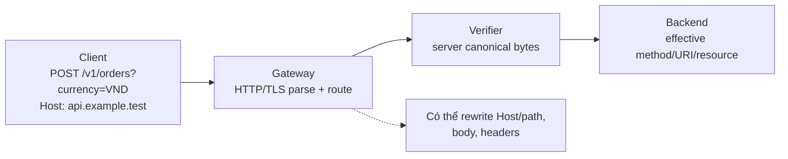

# Tạo canonical server khi xác minh HTTP request bằng HMAC

## Mục tiêu học tập

Sau bài học, bạn có thể:

- Giải thích **server-side canonicalization**: verifier **tự dựng lại thông điệp đã ký** từ HTTP request thực nhận, thay vì tin một chuỗi canonical do client khai báo.
- Chỉ rõ dữ liệu lấy từ đâu tại từng **trust boundary**: HTTP method, raw request-target (path/query), Host hoặc `:authority`, signed headers, timestamp/nonce, key ID và raw body bytes.
- Định nghĩa hợp đồng byte-level có phiên bản: thứ tự dòng, LF, UTF-8, header name/value normalization, dấu cách, absent/empty/duplicate fields và SHA-256 body.
- Viết Java 17+ dùng `MessageDigest`, `javax.crypto.Mac`, `SecretKeySpec` và `MessageDigest.isEqual` để tạo canonical bytes phía server, tra đúng secret và xác minh tag HMAC-SHA256.
- Phát hiện các lỗi do API gateway/reverse proxy đổi Host, rewrite URI, decode percent-encoding, gộp header hoặc serialize lại body.
- Kết hợp xác minh HMAC với **timestamp/nonce chống replay**, key rotation và **authorization theo principal, resource**.
- Tạo test vectors và ma trận kiểm thử chứng minh **client ký đúng những bytes mà server dựng lại và backend thực thi**.

**Bối cảnh:** Bài thuộc chương **Xác minh request** của module `SECURITY_AUTHENTICATION_HMAC_REQUEST_AUTHENTICATION`. Module thiết kế xác thực HTTP request bằng HMAC với shared secret và canonical request chứa method, URI, header hoặc body theo hợp đồng; người học xác minh chữ ký, chống replay bằng timestamp/nonce, luân chuyển khóa, kiểm thử proxy/gateway và phân biệt xác thực với phân quyền. Chủ đề trực tiếp ở đây là **tạo canonical server** — bước trung tâm để server tính lại HMAC trên cùng dữ liệu đã được client ký.

> Các header `X-*` và hợp đồng `hmac-canonical-v1` dưới đây là **giao thức minh họa**. Không phải một chuẩn HMAC được các dịch vụ tự động hỗ trợ; hệ thống thực phải công bố hợp đồng và thử tương thích giữa client, gateway và verifier.

## 1. “Tạo canonical server” nghĩa là gì?

Trong HMAC request authentication, client tính một **MAC tag** trên chuỗi bytes được tạo từ HTTP request. Phía server phải **tái dựng cùng thông điệp** từ request đã đến server và secret đã provision:

```text
Client:
  clientCanonicalBytes = canonicalize(outgoing HTTP request)
  sentTag = HMAC-SHA256(clientSecret, clientCanonicalBytes)

Server:
  serverCanonicalBytes = canonicalize(incoming HTTP request)
  expectedTag = HMAC-SHA256(storedSecret, serverCanonicalBytes)
  accept only if expectedTag == decoded(sentTag)
```

Điều kiện thiết yếu là:

```text
canonical bytes phía client == canonical bytes phía verifier
```

Nếu dữ liệu không trùng, tag thường sẽ khác. Nếu server tạo canonical từ **những trường khác với trường backend dùng để xử lý**, HMAC có thể đúng nhưng lại **xác thực sai hành động hoặc sai tài nguyên**. Vấn đề không chỉ là khớp một chuỗi ký; đó là khớp **ngữ nghĩa được thực thi**.

### Không được tin chuỗi canonical do client tự gửi

Sai lầm điển hình:

```http
POST /v1/orders HTTP/1.1
X-Canonical-Request: POST\n/v1/orders\n...
X-Signature: <tag>
```

Rồi server tính HMAC trực tiếp trên `X-Canonical-Request` do client gửi. Nếu backend thực thi một method, path, header hoặc body **khác** các giá trị trong chuỗi client tự khai, server có thể xác minh tag đúng với **một thông điệp khác request thực thi**.

**Nguyên tắc:** client được quyền gửi **signature và metadata cần thiết để chọn key**, nhưng server **phải tự lấy signed fields từ HTTP request thực nhận tại điểm xác minh tin cậy**. Có thể dùng request snapshot đã đóng băng hoặc metadata do gateway đáng tin tạo, chứ không coi một chuỗi “canonical” tự khai là sự thật.

| Khái niệm | Ai tạo? | Vai trò |
|---|---|---|
| Canonical request phía client | Client hợp lệ trước khi gửi | Chuỗi bytes client dùng để tạo HMAC |
| Canonical request phía server | Verifier từ dữ liệu đã nhận | Chuỗi bytes dùng để tính lại HMAC |
| Received signature | Client gửi trong header theo hợp đồng | Tag cần so; chưa đáng tin trước verify |
| Shared secret | Provision an toàn tới client/verifier | Khóa HMAC, **không nằm trong request** |
| Authenticated principal | Verifier tạo sau khi HMAC đúng | Danh tính dùng cho bước authorization |
| Backend operation | Router/handler thực thi sau các kiểm tra | Phải khớp method, resource và signed semantics đã verify |

## 2. Dữ liệu phải lấy ở đâu để dựng canonical server?

Không nên bắt đầu từ một chuỗi `request.toString()` hoặc `URI.toString()` rồi đoán các trường. Hãy lập **bản đồ nguồn dữ liệu (provenance)**.

| Thành phần | Nguồn tin cậy cần dùng | Lỗi thường gặp |
|---|---|---|
| HTTP method | Method **thực sự được router thực thi** tại điểm xác minh, sau chính sách method override | Client ký `POST` nhưng backend chạy `PUT` qua `X-HTTP-Method-Override` |
| Path và query | **Raw request-target** theo hợp đồng, hoặc bản gốc được ingress đã kiểm tra và chuyển an toàn | Ký `/public/v1/orders`, verifier thấy `/v1/orders` sau rewrite |
| Host / authority | Host HTTP/1.1 hay `:authority` HTTP/2 đã được ingress parse, validate và gắn với route được phép | Dùng `Host` nội bộ hoặc `X-Forwarded-Host` do client giả |
| Content-Type | Giá trị header **đã qua kiểm tra cardinality/grammar** và thực sự quyết định parser của handler | Verifier ký JSON nhưng backend parse form |
| Client ID, key ID | Header xác thực có format/length bound; **untrusted** tới khi MAC đúng | Tra khóa toàn cục bằng key ID hoặc coi client ID là principal sớm |
| Timestamp, nonce | Header có format nghiêm ngặt, sau đó được đưa vào canonical | Không ký nonce; attacker đổi nonce để qua replay store |
| Idempotency-Key | Giá trị header nghiệp vụ đã chốt và được ký nếu backend dùng | Người trung gian sửa idempotency key, gây lặp tác vụ |
| Body | **Representation body bytes** ở đúng điểm sau HTTP framing, trước biến đổi không thuộc hợp đồng | Parse JSON rồi serialize lại, đổi whitespace/charset/compression |
| Signature | Một header `X-Signature` theo format được quy định | Trùng header, gộp bằng dấu phẩy, hoặc decode Base64 lỏng lẻo |

**Đặc biệt:** HTTP/1.1 có request-target với các dạng khác nhau (origin-form, absolute-form trong những ngữ cảnh proxy); HTTP/2 sử dụng `:path`, `:method`, `:authority`. HTTP adapter phải chuyển chúng thành cùng một **representation có hợp đồng**, không giả định mọi API request đều có raw URI sẵn.

### Ranh giới HTTP framing và body bytes

Với `Transfer-Encoding: chunked`, các byte biểu diễn độ dài chunk **không phải bytes của representation body** được ứng dụng nhận sau khi HTTP parser loại framing. Nếu hợp đồng ký digest trên representation body, client và server phải băm **cùng dãy bytes sau xử lý framing**. Với `Content-Encoding: gzip`, bytes representation nén **khác** bytes sau giải nén — cần quy định rõ chấp nhận/không chấp nhận content encoding và thời điểm lấy body.

Không cho phép các hop diễn giải khác nhau các header `Content-Length`/`Transfer-Encoding` hay request boundaries; đây là nguy cơ request smuggling, không thể chữa chỉ bằng HMAC.

## 3. Hợp đồng canonical server phải có phiên bản và quy tắc byte-level

Để học và test chính xác, ta định nghĩa hợp đồng `hmac-canonical-v1` cho Orders API, sử dụng **HMAC-SHA256**. Tính chất của profile cố ý hạn chế để loại bỏ nhập nhằng.

### 3.1. Các trường đã ký

| Thứ tự | Dòng canonical | Quy tắc |
|---|---|---|
| 1 | `hmac-canonical-v1` | Version/domain separation, đúng literal |
| 2 | `POST` | Method chính xác, không method override |
| 3 | `/v1/orders?currency=VND` | Raw target được allowlist: `/v1/orders` hoặc `?currency=VND`/`?currency=USD` |
| 4 | `host:api.example.test` | Public authority đã được ingress kiểm tra; không port trong profile |
| 5 | `content-type:application/json` | Một giá trị duy nhất; không charset/biến thể trong profile |
| 6 | `idempotency-key:order-20261128-01` | Giá trị header do client cung cấp, được ký |
| 7 | `x-client-id:partner-17` | Client ID tự khai, được ký |
| 8 | `x-key-id:k2` | Phiên bản key thuộc client/env, được ký |
| 9 | `x-timestamp:<unix-seconds>` | Timestamp dạng số thập phân chuẩn, được ký |
| 10 | `x-nonce:<base64url-nonce>` | Nonce 16 byte ngẫu nhiên, được ký |
| 11 | `body-sha256:<base64url-digest>` | SHA-256 trên **exact raw body bytes**, encode Base64URL không padding |

**Ý nghĩa của dòng version:** phiên bản hợp đồng được ghim tại endpoint trong server; không phải client gửi `alg=none` hay một tên giao thức tùy ý rồi ép verifier dùng. Nếu sau này thay cách canonical hóa header, URL hay body, hãy sử dụng phiên bản mới và áp dụng version negotiation/allowlist an toàn, tránh downgrade.

### 3.2. Quy tắc bytes

- Các dòng được nối bởi **một byte LF** (`0x0A`), **không có LF cuối**.
- Các dòng chỉ gồm ASCII theo grammar của bài nên encode UTF-8 tạo bytes xác định; không thêm UTF-8 BOM.
- Header names canonical là **chữ thường cố định**, giá trị được giữ nguyên đúng format đã parse và validate; **không tự trim, lowercase hay sort** giá trị nếu hợp đồng chưa quy định.
- `X-Signature` **không nằm trong thông điệp được ký**; nếu đưa chính tag vào thông điệp ký sẽ tạo vòng lặp. Scheme và thuật toán đã ràng buộc bằng dòng `hmac-canonical-v1`.
- Server **tự tính** SHA-256 của raw body bytes; không tin `X-Body-Digest` do client gửi rồi bỏ qua body thật.
- Trường nào quyết định hành động/tài nguyên/quyền phải được **ký** hoặc ràng buộc bằng context được bảo vệ; đừng để backend âm thầm dùng một query/header ngoài hợp đồng.
- Không cho phép `Content-Encoding` trong profile minh họa; nếu API dùng nén, phải định nghĩa profile khác xử lý bytes trước/sau nén và kiểm thử từ client tới backend.
- Không dùng `System.lineSeparator()`, vì Windows CRLF khác LF.

Ví dụ phần dữ liệu canonical:

```text
hmac-canonical-v1
POST
/v1/orders?currency=VND
host:api.example.test
content-type:application/json
idempotency-key:order-20261128-01
x-client-id:partner-17
x-key-id:k2
x-timestamp:<unix-seconds>
x-nonce:<nonce-22-char-base64url>
body-sha256:<sha256-body-base64url>
```

Các mục `<...>` là placeholder; request thực phải thay chúng bằng giá trị hợp lệ.

## 4. Server phải phân biệt raw HTTP data với dữ liệu đã normalize

### 4.1. Path và query

Các request-target sau **khác nhau ở mức wire**:

```text
/v1/orders?currency=VND
/v1/orders?currency=USD
/v1/orders?currency=VND&
/v1/orders?currency=VND&currency=USD
/v1/%6Frders?currency=VND
/v1/orders?currency=%56ND
```

Nếu server tự decode/encode URI, sort query hoặc bỏ parameter rỗng/trùng, nó có thể ký một chuỗi khác client, hoặc tệ hơn là **ký chuỗi A nhưng handler thực thi request-target B**.

Hợp đồng `hmac-canonical-v1` của ví dụ chỉ chấp nhận:

```text
/v1/orders
/v1/orders?currency=VND
/v1/orders?currency=USD
```

Nó **từ chối** percent-encoding, query trùng, query có dấu `&` thừa, query order tùy ý, encoded slash và dot-segment. Đây là **profile học tập**; một API production cần nhiều query parameter sẽ phải có hợp đồng canonicalization mở rộng về encoding, sorting, duplicate, empty vs absent và path normalization.

### 4.2. Host và `:authority`

HTTP/1.1 dùng `Host`, HTTP/2/HTTP/3 dùng `:authority` để mang authority. Gateway có thể rewrite:

```text
Client public:  Host: api.example.test
Upstream:       Host: orders.internal.svc
```

Nếu server verifier lấy Host nội bộ vào canonical trong khi client ký Host public, tag sẽ fail. Nếu server **hard-code** public Host mà không kiểm tra request thực sự đã route tới public authority đó, signature có thể được chấp nhận sai đích.

**Giải pháp:** ingress kiểm tra authority public theo allowlist, reject Host thiếu/trùng, conflict `Host` và `:authority` theo policy, rồi chuyển **authority đã xác nhận** qua context/hop tin cậy tới verifier; hoặc verify trực tiếp tại edge trước rewrite.

`X-Forwarded-Host` và `Forwarded` từ Internet **không đáng tin mặc định**. Proxy được ủy quyền phải xóa/ghi đè header tự khai trước khi sử dụng. Sau xác minh, backend không được route sang audience khác với authority được ký.

### 4.3. Header values và whitespace

HTTP header name không phân biệt hoa/thường. Nhưng các **giá trị** có thể phân biệt case (`keyId=k2` khác `K2`) và whitespace có ý nghĩa tùy trường.

- `X-Key-Id: k2` và `x-key-id: k2` là cùng tên header, nhưng có hai occurrence → reject duplicate.
- `X-Client-Id: partner-17` được ký đúng literal `partner-17`, không tự lowercase nếu hệ thống đã cấp ID phân biệt case.
- OWS (*optional whitespace*) ở hai mép field value có thể được HTTP parser xử lý. Phải định nghĩa adapter lấy **giá trị đã parse theo quy tắc thống nhất**, không tự trim tùy ý ở một hop rồi hash raw bytes ở hop khác.
- Không nhận ký tự CR/LF/control, header bị gộp, `,` ngoài format hoặc giá trị quá dài trong signed header.
- `Content-Type` phải cùng media type/charset thực sự được handler dùng. Nếu header bị đổi hoặc backend chọn parser khác, HMAC trên body bytes chưa đủ ràng buộc ý nghĩa.

**Đề xuất an toàn cho ví dụ:** chỉ chấp nhận grammar ASCII cố định cho client/key ID, timestamp, nonce, idempotency key; Host và Content-Type là các literal allowlist. Điều này giảm nhu cầu normalize giá trị có ngữ nghĩa phức tạp.

## 5. Canonical server và body: hash bytes, không hash object

HTTP body chứa dữ liệu nghiệp vụ; server dễ vô tình làm mất nguyên trạng bytes khi framework parse sớm.

Xét hai body JSON:

```json
{"orderId":"O-42","amount":120000}
```

và:

```json
{ "amount": 120000, "orderId": "O-42" }
```

Parser JSON có thể cho những object tương đương, nhưng **raw body bytes khác nhau**. Nếu hợp đồng ký raw-body SHA-256, HMAC phải khác. Đừng serialize lại từ `Map`/DTO và dùng chuỗi JSON “chuẩn” do thư viện ngẫu nhiên sinh ra để xác minh.

### Một vòng đời body được kiểm soát

1. HTTP ingress parse đúng framing và giới hạn kích thước body, kể cả khi client gửi theo chunked transfer.
2. Verifier đọc **exact representation body bytes** mà hợp đồng định nghĩa (ở ví dụ: không `Content-Encoding`).
3. Tính `SHA-256(rawBody)` rồi dùng digest làm một dòng trong canonical string.
4. Chỉ sau khi HMAC đúng và replay check thành công mới cho backend tạo side effect.
5. Handler parse **chính bytes đã được xác minh** và kiểm tra schema, tenant/resource, idempotency và authorization. Không để middleware đổi body giữa các bước.

Với file upload lớn, có thể **stream SHA-256**, nhưng vẫn phải bảo đảm handler sử dụng đúng bytes và verifier không cho nghiệp vụ thực thi trước khi kiểm tra xong; cần giới hạn kích thước/thời gian/part count và cơ chế buffer/spool an toàn.

### Vắng body, body rỗng và body dạng text `null`

- **Không có representation body** và **body có 0 byte** có thể được API coi tương đương hoặc khác nhau theo hợp đồng. Với hash raw bytes, dãy byte rỗng có một SHA-256 xác định.
- Body chứa literal text `null` có **4 byte ASCII**, nên hash khác body 0 byte.
- Body chứa newline duy nhất có **1 byte LF**, khác body rỗng.
- Trong profile `POST /v1/orders` minh họa, yêu cầu body JSON **không rỗng** và size giới hạn; nếu endpoint khác cho body rỗng, vẫn phải định nghĩa rõ cách băm và nghiệp vụ.

## 6. Pipeline xác minh: server tạo canonical ở bước nào?

```mermaid
sequenceDiagram
    autonumber
    participant C as Client
    participant G as Gateway / Ingress
    participant V as HMAC Verifier
    participant K as Secret Store
    participant N as Shared Nonce Store
    participant B as Backend
    C->>C: Serialize raw body một lần; chốt method/target/headers
    C->>C: Tạo canonical v1 và HMAC tag
    C->>G: HTTPS POST + metadata + X-Signature
    G->>G: HTTP parsing, header/body limits, authority/route
    G->>V: Frozen request snapshot qua trust boundary
    V->>V: Format: method, raw target, headers, signature
    V->>V: Timestamp window (untrusted until MAC is verified)
    V->>K: Lookup(env, clientId, keyId, audience)
    K-->>V: Key record, owner, status, secret reference
    V->>V: SHA256(raw body); dựng canonical bytes từ snapshot
    V->>V: HMAC-SHA256 bằng key đúng và so tag bytes
    alt Key không hợp lệ hoặc MAC sai
        V-->>G: Reject authentication
        G-->>C: Error
    else HMAC hợp lệ
        V->>N: Atomic insert-if-absent(principal, nonce)
        alt Nonce trùng hoặc store lỗi
            V-->>G: Reject replay / fail closed
            G-->>C: Error
        else Nonce mới
            N-->>V: Reserved
            V->>B: Principal + verified request snapshot
            B->>B: Authorization theo tenant/resource/action
            B->>B: Idempotency + transaction + validation
            B-->>G: Business response
            G-->>C: HTTPS response
        end
    end
```

**Lưu ý trình tự:** format validation và kiểm tra timestamp quá hạn có thể chạy trước khi tính HMAC để tiết kiệm tải. Nhưng timestamp do client tự khai **chỉ được chứng thực khi tag khớp**. Nonce chỉ được **claim sau khi MAC hợp lệ**, nếu không attacker có thể chiếm nonce bằng request ký giả.

Một số hệ thống chọn định nghĩa nonce scope là `(environment, audience, principal, nonce)`, các hệ thống khác dùng `(clientId, nonce)`. Hợp đồng phải rõ và tránh cho phép replay khi đổi key ID/phiên bản mà vẫn là cùng một lệnh đã ký. Kho nonce phải được chia sẻ giữa các replica và thao tác claim phải **nguyên tử**.

## 7. Java 17+: tự dựng canonical từ request snapshot đáng tin

Ví dụ dưới đây minh họa **server-side canonical builder**, format validation, HMAC verification và một vị trí cho nonce store. HTTP adapter có trách nhiệm tạo `RequestSnapshot` từ **HTTP request thực nhận đã qua kiểm tra header cardinality, authority và framing**. Key lookup được biểu diễn bằng interface có scope.

### 7.1. Mã Java tự chứa

```java
import java.nio.charset.StandardCharsets;
import java.security.GeneralSecurityException;
import java.security.MessageDigest;
import java.security.SecureRandom;
import java.time.Clock;
import java.util.Base64;
import java.util.Optional;
import java.util.Set;
import java.util.concurrent.ConcurrentHashMap;
import java.util.regex.Pattern;
import javax.crypto.Mac;
import javax.crypto.spec.SecretKeySpec;

public final class ServerCanonicalV1 {
    private static final String CONTRACT = "hmac-canonical-v1";
    private static final String HOST = "api.example.test";
    private static final String CONTENT_TYPE = "application/json";
    private static final String AUDIENCE = "orders-api";
    private static final long CLOCK_SKEW_SECONDS = 300;
    private static final long NONCE_TTL_SECONDS = 601;

    private static final Pattern TARGET = Pattern.compile(
            "/v1/orders(?:\\?currency=(?:VND|USD))?");
    private static final Pattern ID = Pattern.compile(
            "[A-Za-z0-9][A-Za-z0-9._-]{0,63}");
    private static final Pattern TS = Pattern.compile(
            "[1-9][0-9]{0,11}");
    private static final Pattern NONCE = Pattern.compile(
            "[A-Za-z0-9_-]{22}");
    private static final Pattern SIGNATURE = Pattern.compile(
            "[A-Za-z0-9_-]{43}");
    private static final Base64.Encoder B64 =
            Base64.getUrlEncoder().withoutPadding();

    private ServerCanonicalV1() {}

    // Snapshot do HTTP adapter TIN CẬY tạo từ request thực nhận.
    // Defensive copy ngăn caller thay rawBody sau khi snapshot được tạo.
    public record RequestSnapshot(
            String method,
            String rawTarget,
            String publicAuthority,
            String contentType,
            String idempotencyKey,
            String clientId,
            String keyId,
            String timestamp,
            String nonce,
            byte[] rawBody) {

        public RequestSnapshot {
            if (rawBody == null) {
                throw new IllegalArgumentException("Missing body");
            }
            rawBody = rawBody.clone();
        }

        @Override
        public byte[] rawBody() {
            return rawBody.clone();
        }
    }

    public record KeyRecord(
            String environment,
            String clientId,
            String keyId,
            String audience,
            String principal,
            boolean mayVerify,
            byte[] secret) {}

    public interface KeyStore {
        Optional<KeyRecord> find(
                String environment, String clientId,
                String keyId, String audience);
    }

    // Triển khai production phải hỗ trợ atomic claim + TTL, dùng chung replica.
    public interface NonceStore {
        boolean claim(String scope, String nonce, long ttlSeconds);
    }

    // Decode Base64URL không padding, re-encode để reject pad bits sai.
    private static byte[] decodeCanonical(
            String text, Pattern grammar, int expectedBytes) {
        if (text == null || !grammar.matcher(text).matches()) {
            throw new IllegalArgumentException("Invalid Base64URL format");
        }
        final byte[] bytes;
        try {
            bytes = Base64.getUrlDecoder().decode(text);
        } catch (IllegalArgumentException malformed) {
            throw new IllegalArgumentException("Bad Base64URL");
        }
        if (bytes.length != expectedBytes ||
                !B64.encodeToString(bytes).equals(text)) {
            throw new IllegalArgumentException("Noncanonical Base64URL");
        }
        return bytes;
    }

    // Strict checks trước khi đưa bất kỳ metadata nào vào HMAC.
    private static void validate(RequestSnapshot r) {
        if (r == null ||
                !"POST".equals(r.method()) ||
                r.rawTarget() == null ||
                !TARGET.matcher(r.rawTarget()).matches() ||
                !HOST.equals(r.publicAuthority()) ||
                !CONTENT_TYPE.equals(r.contentType()) ||
                r.idempotencyKey() == null ||
                !ID.matcher(r.idempotencyKey()).matches() ||
                r.clientId() == null ||
                !ID.matcher(r.clientId()).matches() ||
                r.keyId() == null ||
                !ID.matcher(r.keyId()).matches() ||
                r.timestamp() == null ||
                !TS.matcher(r.timestamp()).matches() ||
                r.rawBody().length == 0 ||
                r.rawBody().length > 16 * 1024) {
            throw new IllegalArgumentException("Invalid signed fields");
        }
        decodeCanonical(r.nonce(), NONCE, 16);
    }

    // SERVER dựng từ request snapshot; không nhận canonical do client gửi.
    public static byte[] buildCanonicalBytes(RequestSnapshot r)
            throws GeneralSecurityException {
        validate(r);

        byte[] bodyDigest = MessageDigest.getInstance("SHA-256")
                .digest(r.rawBody());
        String canonical = String.join("\n",
                CONTRACT,
                "POST",
                r.rawTarget(),
                "host:" + r.publicAuthority(),
                "content-type:" + r.contentType(),
                "idempotency-key:" + r.idempotencyKey(),
                "x-client-id:" + r.clientId(),
                "x-key-id:" + r.keyId(),
                "x-timestamp:" + r.timestamp(),
                "x-nonce:" + r.nonce(),
                "body-sha256:" + B64.encodeToString(bodyDigest));
        return canonical.getBytes(StandardCharsets.UTF_8);
    }

    private static byte[] computeTag(
            byte[] secret, RequestSnapshot r)
            throws GeneralSecurityException {
        Mac mac = Mac.getInstance("HmacSHA256"); // Một Mac cho mỗi lần gọi.
        mac.init(new SecretKeySpec(secret, "HmacSHA256"));
        return mac.doFinal(buildCanonicalBytes(r));
    }

    // Chỉ để mô phỏng CLIENT/test vector; server chỉ VERIFY.
    public static String signForTest(byte[] secret, RequestSnapshot r)
            throws GeneralSecurityException {
        return B64.encodeToString(computeTag(secret, r));
    }

    // Trả principal chỉ SAU HMAC và replay check thành công.
    public static Optional<String> verify(
            RequestSnapshot received, String signature,
            String serverEnvironment, Clock clock,
            KeyStore keyStore, NonceStore nonceStore)
            throws GeneralSecurityException {
        final byte[] supplied;
        try {
            validate(received);
            supplied = decodeCanonical(signature, SIGNATURE, 32);
        } catch (IllegalArgumentException malformed) {
            return Optional.empty();
        }

        long timestamp;
        try {
            timestamp = Long.parseLong(received.timestamp());
        } catch (NumberFormatException invalidTime) {
            return Optional.empty();
        }
        long now = clock.instant().getEpochSecond();
        if (timestamp < now - CLOCK_SKEW_SECONDS ||
                timestamp > now + CLOCK_SKEW_SECONDS) {
            return Optional.empty();
        }

        // env và audience do SERVER cấu hình, không nhận từ client.
        Optional<KeyRecord> candidate = keyStore.find(
                serverEnvironment, received.clientId(),
                received.keyId(), AUDIENCE);
        if (candidate.isEmpty()) {
            return Optional.empty();
        }
        KeyRecord key = candidate.get();
        if (!key.mayVerify() ||
                !serverEnvironment.equals(key.environment()) ||
                !received.clientId().equals(key.clientId()) ||
                !received.keyId().equals(key.keyId()) ||
                !AUDIENCE.equals(key.audience()) ||
                key.principal() == null ||
                key.secret() == null || key.secret().length < 16) {
            return Optional.empty();
        }

        byte[] expected = computeTag(key.secret(), received);
        if (!MessageDigest.isEqual(expected, supplied)) {
            return Optional.empty();
        }

        // Sau HMAC mới được ghi nonce; scope không dựa trên keyId.
        String nonceScope = serverEnvironment + "|" + AUDIENCE +
                "|" + key.clientId();
        boolean fresh = nonceStore.claim(
                nonceScope, received.nonce(), NONCE_TTL_SECONDS);
        if (!fresh) {
            return Optional.empty();
        }

        return Optional.of(key.principal()); // Authn, chưa phải authz.
    }

    public static void main(String[] args)
            throws GeneralSecurityException {
        byte[] secret = new byte[32];
        new SecureRandom().nextBytes(secret);
        byte[] nonceBytes = new byte[16];
        new SecureRandom().nextBytes(nonceBytes);

        Clock clock = Clock.systemUTC();
        RequestSnapshot request = new RequestSnapshot(
                "POST", "/v1/orders?currency=VND", HOST, CONTENT_TYPE,
                "order-20261128-01", "partner-17", "k2",
                Long.toString(clock.instant().getEpochSecond()),
                B64.encodeToString(nonceBytes),
                "{\"orderId\":\"O-42\",\"amount\":120000}"
                        .getBytes(StandardCharsets.UTF_8));
        String signature = signForTest(secret, request);

        KeyStore keys = (env, client, kid, audience) -> {
            if (!"production".equals(env) ||
                    !"partner-17".equals(client) ||
                    !"k2".equals(kid) ||
                    !AUDIENCE.equals(audience)) return Optional.empty();
            return Optional.of(new KeyRecord(
                    env, client, kid, audience, "partner-17",
                    true, secret));
        };

        // In-memory fixture CHỈ dùng test; không có TTL hoặc shared state.
        Set<String> claimed = ConcurrentHashMap.newKeySet();
        NonceStore nonceStore = (scope, nonce, ttl) ->
                claimed.add(scope + "|" + nonce);

        if (!"partner-17".equals(verify(
                request, signature, "production", clock, keys, nonceStore)
                .orElse(null))) {
            throw new AssertionError("Valid request rejected");
        }

        // Gửi lại cùng request/tag/nonce: HMAC còn đúng, nonce bị chặn.
        if (verify(request, signature, "production", clock,
                keys, nonceStore).isPresent()) {
            throw new AssertionError("Replay accepted");
        }

        // Thay query sau khi ký: dữ liệu nghiệp vụ đổi, HMAC không khớp.
        RequestSnapshot modified = new RequestSnapshot(
                request.method(), "/v1/orders?currency=USD",
                request.publicAuthority(), request.contentType(),
                request.idempotencyKey(), request.clientId(),
                request.keyId(), request.timestamp(), request.nonce(),
                request.rawBody());
        if (verify(modified, signature, "production", clock,
                keys, nonceStore).isPresent()) {
            throw new AssertionError("Tampered query accepted");
        }
        System.out.println("Server canonicalization HMAC: PASS");
    }
}
```

### 7.2. Những bảo đảm và giới hạn của mã

- `RequestSnapshot` chụp body bytes tại thời điểm tạo (defensive copy). Điều này giúp tránh code Java khác sửa nội dung body đã được hash; **không thay thế** bảo vệ trust boundary hoặc byte stream ở gateway.
- `buildCanonicalBytes()` là **server-side canonical builder**: cố định protocol version, method, target, host, signed headers, body hash, LF và UTF-8. Nó chỉ nhận dữ liệu từ snapshot, không lấy chuỗi canonical client gửi.
- `decodeCanonical()` giới hạn signature HMAC-SHA256 Base64URL không padding (**43 ký tự**, decode **32 byte**) và nonce (**22 ký tự**, decode **16 byte**), kiểm tra encoding canonical bằng decode → re-encode.
- `KeyStore` phải tra theo **environment + clientId + keyId + audience**. `keyId` là thông tin định danh, không phải secret; trạng thái revoked phải khiến verifier từ chối dù HMAC đúng.
- `MessageDigest.isEqual()` so tag bytes; việc dùng hàm so tag phù hợp không khiến toàn bộ endpoint trở thành constant-time tuyệt đối, do parser, lookup và lỗi I/O vẫn có nhánh thời gian khác nhau.
- `NonceStore.claim()` là interface để thể hiện **atomic insert-if-absent + TTL**. Implementation dùng `ConcurrentHashMap.newKeySet()` trong `main()` **chỉ là test**, không có TTL và không chia sẻ giữa replica; không dùng nó để bảo vệ production.
- `verify()` trả principal **chỉ sau** kiểm tra HMAC và nonce; nó **không** kiểm tra quyền truy cập đơn hàng, tenant, inventory hoặc role.

### 7.3. Điều bắt buộc ở HTTP adapter production

`ServerCanonicalV1` không tự parse raw network bytes. Khi triển khai với Servlet, Spring, Netty hoặc gateway, adapter phải:

1. Đọc method, request-target, Host/`:authority` theo giao thức và định nghĩa cùng **effective request** mà backend sẽ xử lý.
2. Chặn header trùng/nhập nhằng trước khi chuyển thành một giá trị `String`; đặc biệt `Host`, `Content-Type`, `X-Client-Id`, `X-Key-Id`, `X-Timestamp`, `X-Nonce`, `Idempotency-Key` và `X-Signature`.
3. Reject header sai ký tự/size, method override, raw URI ngoài allowlist và `Content-Encoding` ngoài hợp đồng. Xử lý framing/`Content-Length`/`Transfer-Encoding` một cách nhất quán tại edge.
4. Giới hạn byte count và thời gian đọc body, lấy **raw body bytes** tại điểm đã thống nhất, rồi tạo snapshot.
5. Không thay URI/header/body giữa verify và handler. Nếu gateway chuyển tiếp principal hoặc snapshot, bảo vệ hop nội bộ và ngăn caller tự giả mạo các header `X-Authenticated-*`.
6. Tra key đúng scope; kiểm tra trạng thái/thu hồi key; dùng kho nonce chia sẻ, nguyên tử và TTL; authz kiểm tra theo principal/resource.

**Thiết kế chặt hơn** có thể loại toàn bộ header nghiệp vụ ngoài allowlist, hoặc đưa những header có ảnh hưởng vào signed headers và nâng version. Không được để backend dùng một header ngoài HMAC để đổi currency, warehouse, tenant hay quyền.

## 8. Canonical server qua proxy/gateway: điều kiện nào phải bất biến?



Các **bất biến quan trọng**:

```text
method client đã ký        == method backend thực thi
request-target client ký   == target được canonicalize theo hợp đồng
public authority client ký == public audience verifier dùng
body bytes client ký       == representation handler được phép parse
signed header semantics    == semantics backend thực thi
```

Dấu `==` mang nghĩa trùng **theo hợp đồng canonicalization đã công bố**; trong profile hẹp của bài chúng trùng chính xác về ký tự/bytes. Qua proxy, Host nội bộ có thể khác Host công khai, nhưng **authority công khai đã xác minh** vẫn phải gắn với service đích.

### Bốn lỗi vận hành phổ biến

**A. Host rewrite:** client ký `host:api.example.test` nhưng verifier sau proxy đọc `host:orders.internal.svc`. Chữ ký fail nếu hai phía không thống nhất nguồn Host. Nếu resolver dùng `X-Forwarded-Host` từ client, attacker có thể giả mạo nguồn này.

**B. URI rewrite:** client ký `/public/v1/orders` nhưng upstream nhận `/v1/orders`. Một header `X-Original-URI` từ client tự khai không đủ tin cậy; gateway phải tạo context bảo vệ hoặc đặt verifier trước rewrite.

**C. Body transform:** client ký raw JSON có whitespace, proxy parse/serialize JSON hoặc giải nén body trước khi verifier hash; body digest khác. Đừng “sửa” bằng cách bỏ body khỏi chữ ký.

**D. Parser disagreement:** ingress lấy `X-Client-Id` đầu tiên, framework lấy giá trị cuối hoặc backend cho phép method override. Khi đó verifier có thể ký **một giá trị** nhưng backend thực thi **một giá trị khác**.

Giải pháp là **đặt một trust boundary rõ**, chuẩn hóa có hợp đồng, reject input ambiguous và test xuyên stack thật. Không tồn tại một câu lệnh `normalizeAllHeaders()` đủ an toàn cho mọi API.

## 9. Tại sao canonical server không phải toàn bộ quá trình xác thực?

Hãy tách các tầng kiểm tra:

| Tầng | Câu hỏi | Kết quả có thể có |
|---|---|---|
| Wire parser | Header/method/target/body có hợp lệ và được lấy đúng nguồn không? | Từ chối request nhập nhằng |
| Canonical server | Đã tái dựng **đúng message bytes** theo hợp đồng chưa? | Bytes dùng tính HMAC |
| Key lookup | Key đúng client/env/audience, còn hiệu lực? | Secret/handle được phép verify |
| HMAC verification | Expected tag khớp received tag? | Xác thực khả năng sử dụng shared secret |
| Replay policy | Timestamp/nonce được ký còn hợp lệ và nonce chưa dùng? | Cho phép request tiếp tục một lần theo policy |
| Authorization | Principal có quyền lên action/resource/tenant? | Cho phép hoặc từ chối nghiệp vụ |
| Idempotency | Retry có thực thi tác vụ trùng không? | Trả kết quả cũ hoặc xử lý theo state nghiệp vụ |

**Canonical bytes không tự chứng minh client là ai.** Một attacker có thể dựng canonical string hợp format cho bất kỳ request nào. Chỉ khi HMAC tính bằng secret được provision khớp tag nhận được, server mới có cơ sở xác thực.

**Replay khác idempotency:** một request `POST` hợp lệ có thể được gửi lại với **timestamp/nonce/tag mới**, vẫn vượt qua replay gate và có nguy cơ tạo đơn trùng. Cần một `Idempotency-Key` đã ký, gắn với principal và nội dung thao tác, được kiểm soát atomically trong nghiệp vụ. Không coi `nonce` là cơ chế thay thế mặc định cho idempotency.

### Key rotation và phạm vi quyền

Khi client chuyển từ `k1` sang `k2`:

- Cả `x-key-id` và `x-client-id` nằm trong canonical bytes, nên attacker không thể tùy ý đổi metadata này rồi dùng tag cũ.
- Key store kiểm tra trạng thái `ACTIVE`/`VERIFY_ONLY`/`REVOKED` theo chính sách; có thể tạm nhận cả hai key trong khoảng overlap hữu hạn.
- Sau thu hồi `k1`, verifier phải từ chối nó trên mọi replica kể cả khi cache còn phiên bản cũ.
- Không thử mọi secret của nhiều tenant đến khi có MAC khớp; lookup phải theo client/env/audience.
- Nếu shared secret bị lộ, attacker có thể tạo **tag mới cho canonical bytes mới** với nonce mới. Phải thu hồi/luân chuyển key; nonce store không chống được key compromise.

Một client có HMAC đúng ở `orders-api` vẫn không tự có quyền tạo đơn cho tenant khác. **Authorization** lấy principal từ bản ghi key đã verify và quyết định dựa trên resource/action/tenant thực tế.

## 10. So sánh canonical bytes để gỡ lỗi mà không lộ secret

Khi client báo “signature mismatch”, đừng bắt đầu bằng cách hạ cấp kiểm tra HMAC hoặc tắt body signing. Hãy kiểm tra theo thứ tự có thể quan sát:

1. **Version:** client và verifier có cùng hợp đồng `hmac-canonical-v1`, cùng thuật toán, cùng tag encoding?
2. **Input provenance:** server có nhận method/URI/Host/body/headers đúng nguồn mà client đã ký?
3. **Canonical lines:** thứ tự có đúng, dùng LF hay CRLF, có LF cuối không?
4. **Text encoding:** có UTF-8 BOM, Unicode normalization, default charset hoặc whitespace không thuộc hợp đồng?
5. **Raw body:** khác newline, thứ tự JSON field, charset, content encoding, streaming body read?
6. **Metadata:** ID, key ID, timestamp/nonce, idempotency key có bị gateway đổi/trùng header?
7. **HMAC:** key bytes đúng version và scope, provider dùng `HmacSHA256`, signature Base64URL đúng 32-byte tag?
8. **Replay:** HMAC đã khớp nhưng bị từ chối do nonce trùng/timestamp quá hạn?
9. **Authorization:** request đã xác thực nhưng bị từ chối vì tenant/resource?

Ở **môi trường test có dữ liệu không nhạy cảm**, hai bên có thể tính SHA-256 của **canonical bytes** để so fingerprint:

```text
clientCanonicalHex = HEX(canonicalRequestBytes)
serverCanonicalHex = HEX(canonicalRequestBytes)

clientFingerprint = SHA256(clientCanonicalBytes)
serverFingerprint = SHA256(serverCanonicalBytes)

Nếu fingerprints khác -> kiểm tra trực tiếp từng byte/line ở test fixture
Nếu fingerprints trùng -> kiểm tra key bytes, tag encoding, HMAC và policy
```

Không dựa vào fingerprint như cơ chế xác thực (nó không có secret), và tránh log canonical bytes production vì có thể chứa thông tin nhạy cảm. Đặc biệt, **không bao giờ log shared secret**, cũng không dùng log error chứa toàn bộ header `Authorization` hoặc raw body của khách hàng.

### Bộ test vector nên chứa gì?

```yaml
# Ví dụ cấu trúc fixture; các giá trị <...> phải được thay trong test thật.
contract: hmac-canonical-v1
method: POST
rawTarget: /v1/orders?currency=VND
publicAuthority: api.example.test
contentType: application/json
idempotencyKey: order-20261128-01
clientId: partner-17
keyId: k2
timestamp: "<unix-seconds>"
nonce: "<22-char-base64url>"
rawBodyHex: "<exact-utf8-json-bytes-as-hex>"
canonicalHex: "<exact-canonical-utf8-bytes-as-hex>"
hmacSha256Hex: "<expected-32-byte-tag-as-hex>"
signatureBase64Url: "<43-char-tag>"
```

Client Java, client ngôn ngữ khác và verifier phải cho ra **cùng canonicalHex trước khi so tag**. Test riêng RFC 4231 có thể xác nhận primitive HMAC-SHA256 hoạt động đúng, sau đó test tích hợp xác nhận canonical request đúng; đừng nhầm hai lớp kiểm thử.

## 11. Ma trận kiểm thử tạo canonical server

| Test | Cách thử | Kỳ vọng |
|---|---|---|
| Happy path | Đúng method, raw target, public Host, headers, body, key và nonce | Canonical bytes khớp, MAC pass, principal tạo đúng |
| Method tampering | Ký `POST`, chuyển sang `PUT` hoặc dùng method override | Reject hoặc MAC mismatch; backend không thực thi method khác |
| Query tampering | `currency=VND` → `currency=USD` sau ký | MAC mismatch |
| Query không thuộc hợp đồng | Thêm duplicate, `&` cuối, percent-encoded value hoặc empty parameter | Reject format ở server canonicalizer |
| Path rewrite | Gateway bỏ prefix hay decode path | Dùng original target đáng tin theo contract hoặc reject |
| Host rewrite | Client ký public Host nhưng verifier thấy internal Host | Phải dùng public authority đã xác minh, không hard-code mù |
| Host spoof | `X-Forwarded-Host` do client tự gửi | Không ảnh hưởng canonical authority |
| HTTP/2 mismatch | `:authority` và `Host` xung đột | Reject tại HTTP adapter |
| Duplicate signed header | Hai `X-Key-Id` hoặc `Idempotency-Key` khác nhau | Reject trước canonicalization |
| Header value khác case | `keyId=k2` → `K2` | Không tự lowercase giá trị; key lookup/MAC theo hợp đồng |
| Body thay đổi | Đổi `amount` hoặc thêm whitespace/newline JSON | Body digest và MAC khác |
| Body đã parse rồi serialize lại | JSON field order bị đổi | Không dùng serialized object để verify; bảo toàn raw body |
| Body rỗng/truncated | Không có JSON/đọc thiếu body bytes | Reject theo contract/size policy |
| Content-Encoding ngoài hợp đồng | Gzip hoặc body bị giải nén trước hash | Reject hoặc dùng version có quy định khác |
| Signature sai format | Base64URL có padding, quá ngắn, noncanonical pad bits | Reject format |
| Key chéo tenant | Client ID A, key ID thuộc B hoặc staging key dùng ở production | Không tạo principal trái scope |
| Revoked key | HMAC đúng với secret đã thu hồi | Reject key state |
| Timestamp cũ/quá tương lai | Metadata đã ký nhưng ngoài window | Reject |
| Replay cùng nonce | Gửi request/tag một lần nữa | Reject sau MAC; không chạy handler lần nữa |
| Race giữa replica | Hai request cùng principal/nonce đồng thời | Atomic store cho phép tối đa một |
| Signed request vượt quyền | Principal A ký đơn hàng tenant B | Authentication có thể pass, authorization deny |
| Idempotency key bị sửa | Đổi header sau ký, giữ tag | MAC fail; nếu retry nonce mới, idempotency service ngăn tạo trùng |
| Bypass backend | Gọi service trực tiếp với `X-Authenticated-Client: admin` | Không được vượt qua verifier hoặc quyền nội bộ |

Bộ test nên chạy **unit test canonical builder**, **integration test HTTP adapter và key/nonce store**, rồi **end-to-end** từ client qua đúng CDN/proxy/gateway/backend. Tên method và URL trông đúng trong debugger **chưa đủ**; cần so bytes của request thực tế tại điểm đã định nghĩa.

## 12. Những sai lầm cần tránh

1. **Dùng canonical text do client tự gửi** thay vì dựng từ incoming request: chữ ký có thể ràng buộc một request khác request backend thực thi.
2. **Ký route template** `/v1/orders/{id}` thay vì actual request-target chứa resource ID.
3. **Bỏ query khỏi phần ký** khi backend dùng query để chọn currency, tenant, filter hay operation.
4. **Tin `X-Forwarded-Host` từ Internet** hoặc điền public host cố định mà không xác nhận route thực sự.
5. **Lấy một header value mà không phát hiện duplicate**: proxy và verifier có thể chọn first/last khác nhau.
6. **Tự chuẩn hóa header values bằng `trim()`/`toLowerCase()`** ngoài hợp đồng, nhất là client ID và key ID phân biệt case.
7. **Hash JSON object** thay vì exact raw body bytes; parser và serializer có thể đổi whitespace, Unicode, thứ tự field.
8. **Để middleware sửa request sau khi verify**: signed semantics không còn giống executed semantics.
9. **Sử dụng default charset hoặc CRLF trong canonical text** thay vì UTF-8/LF đã chốt.
10. **Không ràng buộc protocol version, key ID, nonce** trong canonical request: dễ nhầm ngữ cảnh hoặc vô hiệu hóa một phần replay policy.
11. **So signature text theo nhiều encoding tùy ý**: Base64 padded/unpadded, hex, noncanonical pad bits; nên chỉ nhận một wire format.
12. **Ghi nonce trước HMAC**: attacker có thể chiếm nonce hợp lệ bằng request ký giả.
13. **Coi signature đúng là đủ quyền hoặc đủ chống replay**: thiếu key lifecycle, nonce store và authorization.
14. **Dùng cache key cũ sau revoke** hoặc lookup secret không giới hạn client/environment/audience.

## 13. Bài tập thực hành: canonical server cho Orders API đa replica

Một API `POST /v1/orders?currency=VND` chạy sau API gateway. Client ký HMAC-SHA256 với shared secret theo `clientId`/`keyId`. Server gồm hai verifier replica, shared nonce store, key store có rotation, backend xử lý nhiều tenant.

Hãy triển khai:

1. **Đặc tả contract `hmac-canonical-v1`:** method, raw request-target, public Host, Content-Type, Idempotency-Key, client/key ID, timestamp, nonce, body SHA-256, line order, LF, UTF-8 và format Base64URL signature.
2. **HTTP adapter:** lấy đúng method/URI/Host/header/body từ HTTP parser, reject signed header trùng, method override, target ngoài profile và body ngoài size limit; tạo immutable request snapshot.
3. **Server canonical builder:** từ snapshot dựng đúng canonical bytes; **không có tham số string canonical client tự khai** trong API verifier.
4. **Key lookup và HMAC:** tra `(environment, clientId, keyId, audience)`, kiểm tra key state, tính HMAC bằng `javax.crypto.Mac`, so 32-byte tag bằng `MessageDigest.isEqual`.
5. **Replay gate:** kiểm tra timestamp, chỉ sau MAC đúng mới claim nonce bằng thao tác nguyên tử trong shared store; ghi nhận chính sách TTL bao phủ window.
6. **Authorization và idempotency:** principal chỉ được tạo từ key record đã xác minh, kiểm tra quyền trên tenant/order; gắn Idempotency-Key đã ký với principal và nội dung thao tác.
7. **Proxy tests:** thay Host public thành internal, rewrite prefix, biến đổi query, duplicate header, JSON reserialization và một request HTTP/2 có `:authority` mâu thuẫn.
8. **Negative tests:** sửa currency sau ký, thay key ID, thay body, phát lại cùng nonce tới hai replica, ký bằng revoked key, ký đúng nhưng thực hiện thao tác cross-tenant.
9. **Cross-language test vector:** tạo test fixture có rawBodyHex, canonicalHex, HMAC hex, Base64URL tag; xác nhận server và ít nhất một client cho ra cùng bytes.

**Tiêu chí hoàn thành:** Có thể chứng minh quan hệ **request client đã ký → server canonical bytes → HMAC verification → request backend thực thi**. Không có request được chấp nhận với signed semantics khác business semantics; server không tin canonical do client tự khai; key scope, nonce và authorization hoạt động độc lập, đúng thứ tự.

---

## Ghi nhớ

Trong `SECURITY_AUTHENTICATION_HMAC_REQUEST_AUTHENTICATION`, **tạo canonical server** là quá trình verifier **tự tái dựng chính xác những bytes đã ký** từ HTTP request thực nhận và metadata đáng tin sau ingress. Quy tắc method, raw URI, Host/authority, signed headers, timestamp/nonce, key ID, body SHA-256, LF và UTF-8 phải thống nhất qua client, proxy và backend. Sau đó server tính lại HMAC-SHA256 bằng **shared secret đúng scope**, so tag an toàn, chặn replay bằng nonce store nguyên tử và thực hiện **authorization** theo principal, resource — **không bao giờ coi canonical đúng hoặc chữ ký đúng là quyền truy cập tự động**.
