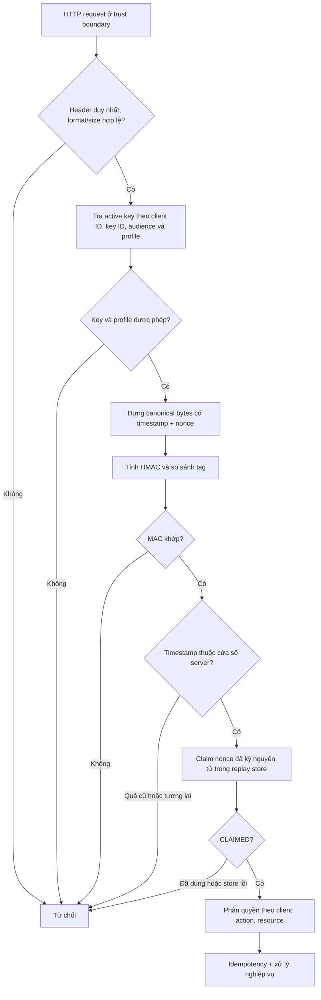

# Kiểm tra timestamp khi xác minh HTTP request bằng HMAC

> **Chương:** Xác minh request  
> **Bài học:** Kiểm tra timestamp — xác định một HTTP request đã ký có còn trong khoảng thời gian chấp nhận hay không, trước khi xử lý nghiệp vụ.  
> **Phạm vi:** Xác thực HTTP request bằng HMAC với shared secret và canonical request chứa method, URI, các header hoặc body theo hợp đồng ký. Bài học phối hợp timestamp với nonce chống replay, quản lý key rotation, kiểm thử proxy/gateway và phân biệt xác thực với phân quyền.

## 1. Tại sao HMAC đúng vẫn phải kiểm tra timestamp?

Giả sử đối tác gửi một lệnh tạo giao dịch:

```http
POST /v1/transfers?mode=commit HTTP/1.1
Host: payments.example.test
Content-Type: application/json
X-Client-Id: billing-service
X-Key-Id: billing-2026-11
X-Timestamp: 1795800000
X-Nonce: j8_8uTVXfukT01c7vnmD-w
X-Idempotency-Key: TX-2026-0101
X-Signature: <base64url-hmac-sha256>

{"transactionId":"TX-2026-0101","amount":100000}
```

Client tính HMAC từ một chuỗi canonical chứa các thành phần HTTP đã thống nhất. Server dựng lại chính chuỗi đó, dùng shared secret thuộc client và kiểm tra MAC.

Kẻ tấn công có thể **không biết secret** nhưng vẫn ghi lại toàn bộ request đã được ký, bao gồm chữ ký, rồi gửi lại nguyên vẹn. Vì HMAC nhận đúng cùng bytes nên chữ ký cũ **vẫn khớp**. Nếu không có giới hạn thời gian và trạng thái đã sử dụng, một request cũ có thể bị phát lại rất lâu sau khi được tạo.

**Timestamp** là thời điểm client khai báo khi ký request, được server kiểm tra trong một **cửa sổ chấp nhận**. Nếu timestamp quá cũ hoặc quá xa tương lai, request phải bị từ chối, ngay cả khi HMAC tính toán đúng. Timestamp phải **nằm trong canonical bytes được HMAC bảo vệ**, nếu không attacker có thể sửa timestamp của một request cũ thành thời gian hiện tại mà giữ tag cũ.

Một hệ thống phòng replay cần ba thành phần phối hợp:

| Thành phần | Trả lời câu hỏi | Không tự làm được gì? |
| --- | --- | --- |
| **HMAC hợp lệ** | “Các bytes đã ký có đúng với shared secret không?” | Không biết request đã gửi trước đó chưa |
| **Timestamp đã ký** | “Request có nằm trong khoảng thời gian chấp nhận không?” | Không phát hiện lần gửi lại trong khoảng còn hạn |
| **Nonce đã ký + replay store** | “Cùng một nonce của client đã được dùng trong khoảng bảo vệ chưa?” | Không giới hạn vô thời hạn nếu dấu nonce được xóa mà không có timestamp |

**Mục tiêu:** kiểm tra cú pháp timestamp chính xác, xác minh nó đã được ký, so sánh với thời gian server theo chính sách quá khứ/tương lai, ngăn replay bằng nonce store, xử lý clock skew và có bộ kiểm thử biên bằng Java 17.

## 2. Timestamp cần được biểu diễn thế nào?

Có nhiều kiểu biểu diễn thời gian: HTTP Date, ISO-8601, epoch seconds, epoch milliseconds, số thực có phần thập phân hoặc chuỗi theo múi giờ. Chúng **không thể hoán đổi** nếu hợp đồng ký không định nghĩa phép chuyển.

Trong bài, chọn format đơn giản:

```text
X-Timestamp: 1795800000
```

Đó là **Unix epoch seconds**: số giây nguyên tính từ `1970-01-01T00:00:00Z`, không phụ thuộc timezone hiển thị. Timestamp ở ví dụ chỉ minh họa một giá trị, không phải thời gian hiện tại cần chấp nhận khi chạy chương trình.

### 2.1 Seconds và milliseconds khác nhau

| Biểu diễn | Ví dụ | Vấn đề |
| --- | --- | --- |
| Unix epoch seconds | `1795800000` | Profile bài học lựa chọn |
| Unix epoch milliseconds | `1795800000000` | Lớn gấp 1.000 lần; nếu server hiểu là seconds sẽ rất xa tương lai |
| ISO-8601 | `2026-11-28T02:00:00Z` | Hợp lệ nếu có profile khác; không tự trộn với epoch seconds |
| Thời gian địa phương | `2026-11-28 09:00:00` | Thiếu timezone, dễ nhập nhằng |
| Số thập phân | `1795800000.5` | Phải quy định làm tròn và độ chính xác; profile này từ chối |

**Không tự nhận dạng đơn vị bằng số chữ số rồi sửa đầu vào.** Một request `1795800000000` không được “cứu” bằng cách tự chia 1.000 khi hợp đồng chỉ nhận epoch seconds. Nếu cần hỗ trợ định dạng mới, tạo phiên bản signing profile mới hoặc một field khác được định nghĩa chặt chẽ.

### 2.2 Grammar chính xác trước khi parse

Profile minh họa giới hạn timestamp ở dạng **10–12 chữ số ASCII thập phân**, ký tự đầu tiên từ `1` đến `9`, không có dấu `+`/`-`, không có khoảng trắng, không có số 0 dẫn đầu:

```text
[1-9][0-9]{9,11}
```

Quy tắc này chỉ dành cho bài học và phù hợp với phạm vi timestamp hiện đại mà hệ thống ví dụ hỗ trợ. Với hệ thống có thời gian ngoài khoảng đó, cần đổi grammar một cách có chủ đích; không nhầm đây là quy định của mọi Unix timestamp.

Các chuỗi sau bị từ chối:

```text
+1795800000          // có dấu cộng
01795800000          // số 0 dẫn đầu
1795800000.0         // số thực
1795800000           // hợp lệ
1795800000000        // 13 chữ số, ví dụ milliseconds
1795800000           // hợp lệ khi không có whitespace
"1795800000 "        // dấu cách cuối
" 1795800000"        // dấu cách đầu
"1795800000\n"       // newline
"1795800000,179..."  // header bị gộp
```

Những dấu nháy kép trên là ký hiệu hiển thị input; bản thân giá trị header của profile không có dấu nháy. Cần từ chối duplicate `X-Timestamp` trước khi parse, không chọn tùy ý giá trị đầu hoặc cuối.

### 2.3 Parse số nguyên an toàn

Trong Java dùng `Long.parseLong` sau khi kiểm tra grammar. Không dùng `Double.parseDouble` hoặc `Float.parseFloat` cho epoch seconds; không cắt chuỗi, làm tròn hoặc cho phép số tràn miền biểu diễn.

Ví dụ:

```java
private static long parseTimestamp(String text) {
    if (text == null || !text.matches("[1-9][0-9]{9,11}")) {
        throw new IllegalArgumentException("Bad timestamp syntax");
    }

    try {
        return Long.parseLong(text);
    } catch (NumberFormatException overflow) {
        throw new IllegalArgumentException("Timestamp overflow", overflow);
    }
}
```

Với grammar có tối đa 12 chữ số, overflow của `long` không xảy ra, nhưng xử lý exception vẫn là thói quen tốt nếu thay đổi grammar hoặc tái sử dụng hàm. **Chuỗi decimal gốc** phải được đưa vào canonical request; không parse rồi format lại thành một biểu diễn khác khi hai phía đã thống nhất ký bytes của header.

## 3. Xác định cửa sổ chấp nhận

Server kiểm tra timestamp client so với **wall clock của server**, không lấy thời gian từ request, proxy header hay dữ liệu do client tự khai làm “hiện tại”.

### 3.1 Cửa sổ quá khứ và tương lai bất đối xứng

Một chính sách minh họa:

- Chấp nhận timestamp **tối đa 300 giây trong quá khứ**.
- Chấp nhận timestamp **tối đa 60 giây trong tương lai**.
- Hai ranh giới được **bao gồm**.

Gọi:

- `t` = signed timestamp dạng Unix seconds.
- `now` = epoch seconds từ đồng hồ UTC của server.
- `PAST = 300`.
- `FUTURE = 60`.

Điều kiện:

\[
now - PAST \le t \le now + FUTURE
\]

Dạng logic:

```text
if t < now - 300:
    reject TOO_OLD
else if t > now + 60:
    reject TOO_FAR_FUTURE
else:
    timestamp is in allowed window
```

**Ý nghĩa:**

- Một request ký cách đây 300 giây còn ở biên hợp lệ.
- Một request ký cách đây 301 giây phải bị từ chối.
- Timestamp đi trước server 60 giây còn hợp lệ.
- Timestamp đi trước server 61 giây phải bị từ chối.

Không cần cửa sổ đối xứng. Chọn `PAST` và `FUTURE` dựa trên độ trễ mạng, thời gian request nằm trong queue và độ chính xác đồng hồ. Cho phép timestamp quá xa tương lai kéo dài khoảng thời gian request có thể được phát lại.

### 3.2 Ví dụ số với thời gian giả lập

Giả sử `now = 1_800_000_000`:

| Timestamp đã ký | Chênh lệch | Kết quả |
| --- | --- | --- |
| `1_799_999_699` | 301 giây trước | Từ chối quá cũ |
| `1_799_999_700` | 300 giây trước | Chấp nhận ở biên thấp |
| `1_799_999_999` | 1 giây trước | Chấp nhận |
| `1_800_000_000` | Đúng hiện tại | Chấp nhận |
| `1_800_000_060` | 60 giây tương lai | Chấp nhận ở biên cao |
| `1_800_000_061` | 61 giây tương lai | Từ chối tương lai |

Dấu gạch dưới ở các giá trị trong bảng chỉ để đọc dễ hơn; **không được xuất hiện trong header timestamp**. Giá trị thực là chữ số liên tục.

### 3.3 Không dùng `Math.abs(now - t)` một cách thiếu kiểm soát

Nhiều ví dụ dùng:

```java
if (Math.abs(now - signedTimestamp) <= 300) {
    // ...
}
```

Cách này vừa áp dụng cùng một giới hạn cho hai hướng, vừa có nguy cơ tràn số trong các miền bất thường nếu không kiểm soát. Trong profile có `PAST` và `FUTURE` riêng, nên tính hai ngưỡng minh bạch.

Nếu phải tính với `long` bất kỳ, có thể dùng `Math.subtractExact` và `Math.addExact` rồi fail closed khi tràn:

```java
static boolean insideWindow(long signedAt, long now) {
    try {
        long oldest = Math.subtractExact(now, 300L);
        long newest = Math.addExact(now, 60L);
        return signedAt >= oldest && signedAt <= newest;
    } catch (ArithmeticException overflow) {
        return false;
    }
}
```

Đối với dịch vụ thông thường, `Instant.now().getEpochSecond()` nằm xa giới hạn `long`, nhưng kiểm tra rõ ràng giúp tránh các lỗi kiểm thử biên và thay đổi logic trong tương lai.

## 4. Timestamp phải được ký bên trong canonical request

Giả sử server chỉ kiểm tra MAC của method + URI + body hash, còn `X-Timestamp` nằm ngoài thông điệp đã ký:

```text
canonical = method + LF + uri + LF + bodyHash
tag = HMAC(secret, UTF8(canonical))

HTTP header X-Timestamp không được đưa vào HMAC
```

Attacker giữ nguyên method, URI, body và tag đã lấy được nhưng đổi `X-Timestamp` từ thời điểm cũ sang hiện tại. Nếu server dùng timestamp mới để kiểm tra hạn, nó có thể chấp nhận một request cũ.

**Cách đúng:** timestamp và nonce phải nằm trong canonical bytes được HMAC bảo vệ:

```text
hmac-timestamp-v1
payments-api-prod
POST
/v1/transfers?mode=commit
application/json
billing-service
billing-2026-11
1795800000
j8_8uTVXfukT01c7vnmD-w
TX-2026-0101
<sha256-hex-of-raw-json-body>
```

Đây là hợp đồng minh họa, với các quy tắc:

| Thành phần | Biểu diễn | Vì sao ký? |
| --- | --- | --- |
| Version | `hmac-timestamp-v1` | Ràng buộc quy tắc xác minh |
| Audience | `payments-api-prod` | Chống mang tag sang môi trường/đích khác |
| Method | `POST` | Ràng buộc hành động |
| Raw target | `/v1/transfers?mode=commit` | Bảo vệ path và query |
| Content-Type | `application/json` | Ràng buộc cách diễn giải body |
| Client ID | `billing-service` | Liên kết danh tính với key được phép |
| Key ID | `billing-2026-11` | Chọn đúng shared secret còn hiệu lực |
| **Timestamp** | Unix epoch seconds dưới dạng canonical decimal text | Chặn sửa thời gian sau ký |
| **Nonce** | Base64URL không padding, 16 bytes ngẫu nhiên | Ngăn đổi nonce để tránh replay |
| Idempotency key | `TX-2026-0101` | Liên kết các lần retry của một giao dịch |
| Body digest | SHA-256 hex chữ thường từ raw body bytes | Ràng buộc nội dung nghiệp vụ |

Dùng **UTF-8**, một byte LF `0x0A` giữa từng dòng và **không có LF cuối**. Signature là Base64URL không padding của tag HMAC-SHA256 đầy đủ 32 bytes, dài 43 ký tự.

```text
bodyHashHex = lower_hex(SHA256(rawBodyBytes))
canonicalBytes = UTF8(joinFieldsWithLF(
    version, audience, method, rawTarget,
    contentType, clientId, keyId, timestampText,
    nonce, idempotencyKey, bodyHashHex))
tag = HMAC_SHA256(secret, canonicalBytes)
signature = BASE64URL_NO_PADDING(tag)
```

Timestamp phải được ký dưới **đúng chuỗi canonical** client gửi ở header. Không để verifier parse timestamp rồi tự format thành một chuỗi khác trước khi kiểm tra HMAC, trừ khi chính hợp đồng ký quy định một bước canonicalize cụ thể và mọi phía dùng đúng cùng quy tắc.

Nếu các header khác như `Host`, tenant hoặc `Content-Encoding` ảnh hưởng cách request được xử lý, chúng cũng cần được ràng buộc vào chữ ký hoặc bảo vệ bởi gateway đáng tin. Hợp đồng trên không phải định dạng HTTP áp dụng cho mọi API.

## 5. Thứ tự kiểm tra ở server: format, HMAC, time, nonce, quyền

Có thể kiểm tra định dạng timestamp rất sớm để giảm tải xử lý, nhưng một giá trị do client tự khai **chưa được chứng thực** cho đến khi MAC khớp.



**Nguyên tắc bắt buộc:**

1. Không để request vượt qua nếu bất kỳ kiểm tra xác thực, thời gian, nonce hay quyền nào thất bại.
2. Không claim nonce **trước** khi HMAC hợp lệ, để attacker không thể dùng request giả làm đầy replay store.
3. Timestamp phải là một trường **đã ký**; không dùng timestamp tự khai làm identity/trust evidence trước HMAC.
4. Không bỏ qua kiểm tra timestamp chỉ vì key còn hiệu lực hoặc signature khớp.
5. Nếu replay store timeout/không xác định trạng thái, phải **fail closed**.

### 5.1 Đồng hồ dùng ở đâu?

Server lấy giờ từ nguồn wall clock đã được đồng bộ (ví dụ đồng bộ NTP theo vận hành). Java dùng `Clock.instant().getEpochSecond()` hoặc `Instant.now().getEpochSecond()`. UTC epoch seconds không phụ thuộc timezone hiển thị của JVM.

Không dùng `System.nanoTime()` hoặc bộ đếm monotonic làm timestamp Unix: `nanoTime()` chỉ phù hợp đo khoảng thời gian trong cùng process, không có mốc epoch chung.

Với kiểm thử unit, **inject `Clock`** thay vì gọi giờ thật ở nhiều nơi. Điều đó giúp test đúng các ranh giới 300/301 và 60/61 giây mà không phải ngủ/chờ hoặc phụ thuộc tốc độ máy.

### 5.2 Snapshot thời gian một lần trong mỗi lần xác minh

Nếu handler đọc `now` trước khi tính MAC rồi đọc lại sau khi claim nonce, các ranh giới có thể khác nhau giữa hai lần đọc. Nên lấy một snapshot `now` khi quyết định timestamp, dùng cùng giá trị để đánh giá cửa sổ trong một phép xác minh. Hệ thống vẫn cần bảo đảm quy trình kết thúc kịp thời và TTL/queue policy phù hợp.

Khi server xếp request vào queue rồi xử lý rất muộn, cần phân biệt **thời điểm xác thực tại ingress** với thời điểm thực thi job. Không được tự ý cho request đã quá hạn đi vào hàng đợi chưa được xác thực, hoặc dùng lại thông tin đã ký ở một bước mà trust boundary đã thay đổi.

## 6. Timestamp và nonce: thiết kế TTL chống replay chính xác

Timestamp giới hạn tuổi request, nhưng **không ngăn** replay nhiều lần ngay trong cửa sổ đó. Nonce và replay store mới quyết định request đã được dùng hay chưa.

### 6.1 Ba trạng thái claim nonce

| Kết quả | Ý nghĩa | Quyết định |
| --- | --- | --- |
| `CLAIMED` | Dấu nonce vừa được ghi thành công, chưa từng có | Cho phép tiếp tục phân quyền |
| `ALREADY_USED` | Nonce của client/audience đã tồn tại | Từ chối replay |
| `UNAVAILABLE` hoặc `UNKNOWN` | Timeout, mất kết nối, failover hoặc không xác định kết quả ghi | **Từ chối an toàn**, không xử lý nghiệp vụ |

Dấu nonce cần có tính duy nhất theo phạm vi hợp đồng, thường là **client + audience + nonce**, và một số version/context đã định. Không thêm key ID vào namespace một cách máy móc nếu client có thể dùng lại nonce khi key rotation mà policy yêu cầu chống replay xuyên hai key.

### 6.2 Tính TTL từ cửa sổ chấp nhận

Gọi:

- `P` = số giây được chấp nhận trong quá khứ.
- `F` = số giây được chấp nhận trong tương lai.
- `t` = timestamp đã ký.
- `now_claim` = giờ server ở lần claim đầu tiên.

Request hợp lệ khi:

\[
now - P \le t \le now + F.
\]

Thời điểm **muộn nhất** mà cùng timestamp còn được chấp nhận là:

\[
now_{\text{latest}} = t + P.
\]

Tại lần chấp nhận sớm nhất, `now_claim = t - F`, do đó khoảng thời gian có thể còn hợp lệ sau claim là:

\[
(t + P) - (t - F) = P + F.
\]

Với profile `P=300, F=60`:

| Mốc thời gian | Thời điểm đối với timestamp đã ký `t` |
| --- | --- |
| Lần chấp nhận sớm nhất | `t - 60 giây` |
| Timestamp do client ký | `t` |
| Lần chấp nhận muộn nhất | `t + 300 giây` |

Tổng khoảng là **360 giây**, chưa tính margin cho clock skew giữa node, độ trễ vận hành và cách làm tròn TTL. Ví dụ một cấu hình `TTL = 420 giây` có thêm 60 giây dự phòng nếu kiến trúc đã xác minh margin đó là phù hợp.

Với cửa sổ **đối xứng ±300 giây**, thời gian tối đa tương ứng là **600 giây**, không phải 300 giây. Đây là lý do không nên đặt TTL theo giá trị “quá khứ cho phép” mà bỏ qua mức chấp nhận timestamp trong tương lai.

**Hai cách chọn TTL:**

- **TTL cố định:** tối thiểu `P + F + margin` tính từ lần claim đầu tiên.
- **TTL theo timestamp:** tính từ hạn cuối `t + P` trừ `now_claim` rồi cộng margin; phải đảm bảo mọi node có clock/TTL nhất quán và tính toán chống tràn.

Không lưu dấu nonce với TTL ngắn hơn thời gian request có thể còn hợp lệ, vì request cũ có thể được chấp nhận lần nữa sau khi key hết hạn.

### 6.3 Redis claim nguyên tử

Ví dụ dùng Redis:

```redis
SET hmac-replay:v1:payments-api-prod:billing-service:<nonce> 1 NX EX 420
```

Ở đây `EX 420` **chỉ** là cấu hình minh họa cho chính sách `P=300, F=60, margin=60` và giả định kiến trúc phù hợp, không phải công thức chung.

- `NX`: ghi nếu key chưa tồn tại.
- `OK`: claim mới thành công.
- Nil: key đã có, request bị replay.
- Timeout hoặc lỗi: không biết state, phải fail closed.

Redis single-primary bảo đảm thao tác `SET NX EX` nguyên tử tại primary đó nhưng **không tự đảm bảo durability qua failover** nếu replication bất đồng bộ. Khi hai region có primary độc lập, hai claim cùng nonce có thể đều thành công trước khi đồng bộ; cần đánh giá global uniqueness và chọn lưu trữ/định tuyến phù hợp với rủi ro nghiệp vụ.

Không dùng `GET` rồi `SET` như hai thao tác rời rạc; hai request song song có thể đều quan sát “chưa có nonce”. Không dùng `HashSet` riêng trên từng API instance để chống replay production.

## 7. Java 17: xác minh HMAC, kiểm tra timestamp và phát hiện replay

Bài thực hành dưới đây dùng JDK 17 và một profile cố định để làm rõ **thứ tự xác minh**. Nó:

1. Dùng `Clock.fixed` để test chính xác thời gian.
2. Ký timestamp và nonce trong canonical request.
3. Decode signature Base64URL và so sánh tag HMAC-SHA256 bằng `MessageDigest.isEqual`.
4. Kiểm tra `PAST=300`, `FUTURE=60` sau MAC.
5. Claim nonce một lần trong store mô phỏng, từ chối retry với nonce cũ.
6. Có đường lỗi riêng cho store không sẵn sàng.

Lớp `DemoReplayStore` dùng `ConcurrentHashMap.newKeySet` **chỉ trong một JVM, không TTL và không durability**. Chương trình không truy cập Redis hoặc gửi HTTP thực. Trong production, hãy thay bằng shared atomic store và key resolver thuộc client/audience/profile.

Lưu thành `TimestampVerifierDemo.java`:

```java
import java.nio.charset.StandardCharsets;
import java.security.GeneralSecurityException;
import java.security.MessageDigest;
import java.security.SecureRandom;
import java.time.Clock;
import java.time.Instant;
import java.time.ZoneOffset;
import java.util.Base64;
import java.util.HexFormat;
import java.util.Set;
import java.util.concurrent.ConcurrentHashMap;

import javax.crypto.Mac;
import javax.crypto.spec.SecretKeySpec;

public final class TimestampVerifierDemo {
    private static final String PROFILE = "hmac-timestamp-v1";
    private static final String AUDIENCE = "payments-api-prod";
    private static final String MAC_ALGORITHM = "HmacSHA256";
    private static final long PAST_SECONDS = 300L;
    private static final long FUTURE_SECONDS = 60L;

    private TimestampVerifierDemo() {}

    enum Result {
        ACCEPTED, BAD_FORMAT, BAD_SIGNATURE,
        TOO_OLD, TOO_FAR_FUTURE,
        REPLAY, STORE_UNAVAILABLE
    }

    static final class StoreUnavailableException extends Exception {
        StoreUnavailableException(String message) {
            super(message);
        }
    }

    interface ReplayStore {
        // Atomic insert-if-absent; production phải có TTL.
        boolean claimOnce(String key, long ttlSeconds)
                throws StoreUnavailableException;
    }

    static final class DemoReplayStore implements ReplayStore {
        private final Set<String> used =
                ConcurrentHashMap.newKeySet();

        @Override
        public boolean claimOnce(String key, long ttlSeconds) {
            return used.add(key); // Demo một JVM, không TTL.
        }
    }

    public record Request(
            String timestamp,
            String nonce,
            byte[] rawBody,
            String signature) {

        public Request {
            rawBody = rawBody == null ? null : rawBody.clone();
        }

        @Override
        public byte[] rawBody() {
            return rawBody == null ? null : rawBody.clone();
        }
    }

    static String nextNonce(SecureRandom random) {
        byte[] bytes = new byte[16];
        random.nextBytes(bytes);
        return Base64.getUrlEncoder()
                .withoutPadding()
                .encodeToString(bytes);
    }

    static boolean validNonce(String nonce) {
        if (nonce == null ||
                !nonce.matches("[A-Za-z0-9_-]{22}")) {
            return false;
        }
        try {
            byte[] bytes = Base64.getUrlDecoder().decode(nonce);
            return bytes.length == 16
                    && Base64.getUrlEncoder().withoutPadding()
                            .encodeToString(bytes).equals(nonce);
        } catch (IllegalArgumentException malformed) {
            return false;
        }
    }

    static Long parseTimestamp(String timestamp) {
        if (timestamp == null ||
                !timestamp.matches("[1-9][0-9]{9,11}")) {
            return null;
        }
        try {
            return Long.parseLong(timestamp);
        } catch (NumberFormatException overflow) {
            return null;
        }
    }

    // Contract: method/target/contentType/client/key/audience
    // cố định trong demo; production dựng từ HTTP request thật.
    static byte[] canonicalBytes(Request request)
            throws GeneralSecurityException {
        if (parseTimestamp(request.timestamp()) == null
                || !validNonce(request.nonce())
                || request.rawBody() == null
                || request.rawBody().length > 1_048_576) {
            throw new IllegalArgumentException("Invalid signed fields");
        }

        String bodyHash = HexFormat.of().formatHex(
                MessageDigest.getInstance("SHA-256")
                        .digest(request.rawBody()));

        String text = String.join("\n",
                PROFILE,
                AUDIENCE,
                "POST",
                "/v1/transfers?mode=commit",
                "application/json",
                "billing-service",
                "billing-2026-11",
                request.timestamp(),
                request.nonce(),
                "TX-2026-0101",
                bodyHash);

        return text.getBytes(StandardCharsets.UTF_8);
    }

    static byte[] hmac(byte[] secret, byte[] canonical)
            throws GeneralSecurityException {
        Mac mac = Mac.getInstance(MAC_ALGORITHM);
        mac.init(new SecretKeySpec(secret, MAC_ALGORITHM));
        return mac.doFinal(canonical);
    }

    static Request signForDemo(
            byte[] secret,
            String timestamp,
            String nonce,
            byte[] body) throws GeneralSecurityException {

        Request unsigned = new Request(timestamp, nonce, body, "");
        byte[] tag = hmac(secret, canonicalBytes(unsigned));
        String signature = Base64.getUrlEncoder()
                .withoutPadding()
                .encodeToString(tag);

        return new Request(timestamp, nonce, body, signature);
    }

    static Result verifyAndClaim(
            byte[] resolvedSecret,
            Request request,
            Clock clock,
            ReplayStore store) throws GeneralSecurityException {

        if (resolvedSecret == null || resolvedSecret.length < 32
                || request == null || store == null || clock == null
                || parseTimestamp(request.timestamp()) == null
                || !validNonce(request.nonce())
                || request.rawBody() == null
                || request.rawBody().length > 1_048_576
                || request.signature() == null
                || !request.signature().matches(
                        "[A-Za-z0-9_-]{43}")) {
            return Result.BAD_FORMAT;
        }

        byte[] supplied;
        try {
            supplied = Base64.getUrlDecoder()
                    .decode(request.signature());
        } catch (IllegalArgumentException malformed) {
            return Result.BAD_FORMAT;
        }

        if (supplied.length != 32
                || !Base64.getUrlEncoder().withoutPadding()
                        .encodeToString(supplied)
                        .equals(request.signature())) {
            return Result.BAD_FORMAT;
        }

        byte[] expected = hmac(
                resolvedSecret, canonicalBytes(request));

        if (!MessageDigest.isEqual(expected, supplied)) {
            return Result.BAD_SIGNATURE;
        }

        // Đây là timestamp ĐÃ ĐƯỢC HMAC BẢO VỆ.
        long signedAt = parseTimestamp(request.timestamp());
        long now = clock.instant().getEpochSecond();

        final long oldest;
        final long newest;
        try {
            oldest = Math.subtractExact(now, PAST_SECONDS);
            newest = Math.addExact(now, FUTURE_SECONDS);
        } catch (ArithmeticException overflow) {
            return Result.BAD_FORMAT;
        }

        if (signedAt < oldest) {
            return Result.TOO_OLD;
        }
        if (signedAt > newest) {
            return Result.TOO_FAR_FUTURE;
        }

        // Không claim nonce trước khi HMAC/time hợp lệ.
        String replayKey = "hmac-replay:v1:"
                + AUDIENCE + ":billing-service:" + request.nonce();

        // TTL ví dụ = past + future + 60 seconds margin.
        long ttlSeconds = PAST_SECONDS + FUTURE_SECONDS + 60L;

        try {
            if (!store.claimOnce(replayKey, ttlSeconds)) {
                return Result.REPLAY;
            }
            return Result.ACCEPTED;
        } catch (StoreUnavailableException unavailable) {
            return Result.STORE_UNAVAILABLE;
        }
    }

    public static void main(String[] args)
            throws GeneralSecurityException {

        Clock clock = Clock.fixed(
                Instant.parse("2026-11-28T02:00:00Z"),
                ZoneOffset.UTC);
        long now = clock.instant().getEpochSecond();

        SecureRandom rng = new SecureRandom();
        byte[] testSecret = new byte[32];
        rng.nextBytes(testSecret);

        byte[] body = (
                "{\"transactionId\":\"TX-2026-0101\","
                + "\"amount\":100000}"
        ).getBytes(StandardCharsets.UTF_8);

        DemoReplayStore store = new DemoReplayStore();

        Request first = signForDemo(
                testSecret, Long.toString(now),
                nextNonce(rng), body);

        System.out.println("First: "
                + verifyAndClaim(testSecret, first, clock, store));
        System.out.println("Exact replay: "
                + verifyAndClaim(testSecret, first, clock, store));

        // Ký thật một timestamp cũ/tương lai để chỉ kiểm tra time,
        // không nhầm với lỗi MAC do thay header sau khi ký.
        Request oldRequest = signForDemo(
                testSecret, Long.toString(now - 301),
                nextNonce(rng), body);
        Request futureRequest = signForDemo(
                testSecret, Long.toString(now + 61),
                nextNonce(rng), body);
        Request oldestValid = signForDemo(
                testSecret, Long.toString(now - 300),
                nextNonce(rng), body);
        Request newestValid = signForDemo(
                testSecret, Long.toString(now + 60),
                nextNonce(rng), body);

        System.out.println("Too old: "
                + verifyAndClaim(
                        testSecret, oldRequest, clock, store));
        System.out.println("Too far future: "
                + verifyAndClaim(
                        testSecret, futureRequest, clock, store));
        System.out.println("Oldest boundary: "
                + verifyAndClaim(
                        testSecret, oldestValid, clock, store));
        System.out.println("Future boundary: "
                + verifyAndClaim(
                        testSecret, newestValid, clock, store));

        // Chỉ đổi timestamp mà giữ MAC cũ phải bị chặn bởi HMAC.
        Request changedTimestamp = new Request(
                Long.toString(now + 10),
                first.nonce(), first.rawBody(), first.signature());
        System.out.println("Tampered timestamp: "
                + verifyAndClaim(
                        testSecret, changedTimestamp, clock, store));

        ReplayStore unavailable = (key, ttl) -> {
            throw new StoreUnavailableException("timeout");
        };
        Request another = signForDemo(
                testSecret, Long.toString(now),
                nextNonce(rng), body);
        System.out.println("Replay store down: "
                + verifyAndClaim(
                        testSecret, another, clock, unavailable));
    }
}
```

Biên dịch và chạy bằng JDK 17:

```bash
javac -encoding UTF-8 TimestampVerifierDemo.java
java TimestampVerifierDemo
```

Kết quả mong đợi:

```text
First: ACCEPTED
Exact replay: REPLAY
Too old: TOO_OLD
Too far future: TOO_FAR_FUTURE
Oldest boundary: ACCEPTED
Future boundary: ACCEPTED
Tampered timestamp: BAD_SIGNATURE
Replay store down: STORE_UNAVAILABLE
```

**Giải thích:**

- **First:** request có tag hợp lệ, timestamp nằm trong cửa sổ và nonce mới.
- **Exact replay:** HMAC không đổi nhưng nonce đã được claim, nên bị từ chối.
- **Too old / Too far future:** đây là **những request được ký thật** bằng secret demo với timestamp ngoài cửa sổ, giúp phân biệt lỗi thời gian với lỗi signature.
- **Oldest/Future boundary:** minh họa chính sách biên **bao gồm** 300 giây quá khứ và 60 giây tương lai.
- **Tampered timestamp:** sửa header đã ký mà giữ signature cũ làm HMAC sai.
- **Replay store down:** dù MAC hợp lệ và timestamp tốt, hệ thống vẫn fail closed.

### 7.1 Ranh giới ví dụ và triển khai thật

Ví dụ trên là lõi kiểm tra dành cho bài học, **không phải HTTP server production**:

- Method, URI, Content-Type, client ID, key ID, audience và idempotency key được cố định để người học tập trung vào timestamp; server thật phải lấy chúng từ HTTP request tại trust boundary và kiểm tra chính xác.
- `DemoReplayStore` chỉ nhớ nonce trong một JVM, không TTL/replication/failover; restart có thể làm mất toàn bộ trạng thái.
- `resolvedSecret` do caller truyền vào để test; production cần key resolver liên kết `clientId + keyId + audience + signingProfile` và kiểm tra hạn key.
- HTTP adapter phải từ chối duplicate `X-Timestamp`, `X-Nonce`, `X-Signature` và các field ký khác, cũng như request framing/URI/header nhập nhằng.
- Raw body bytes dùng để xác minh phải là **chính bytes backend sẽ xử lý**. Nếu body JSON có duplicate keys, invalid UTF-8 hoặc sai schema, vẫn phải từ chối trước nghiệp vụ.
- Demo trả `Result.ACCEPTED` chỉ có nghĩa qua **các kiểm tra nó triển khai**. Bước phân quyền, idempotency và chính sách nghiệp vụ vẫn chưa được thực thi.
- Thời gian `Clock.fixed` giúp test lặp lại ổn định; production dùng đồng hồ server đáng tin và đồng bộ đúng.

## 8. Clock skew và vận hành nhiều máy

### 8.1 Clock skew có thể làm request hợp lệ bị từ chối

Giả sử client nhanh hơn server 45 giây. Nếu server chỉ cho tương lai 30 giây, request gửi ngay có thể bị từ chối dù HMAC hoàn toàn đúng. Ngược lại, nếu server chậm hơn thực tế, request cũ có thể còn được chấp nhận quá lâu.

Có thể chọn các biện pháp:

- Đồng bộ đồng hồ client/server thông qua cơ chế vận hành phù hợp như NTP; theo dõi drift và cảnh báo khi lệch vượt giới hạn.
- Xác định cửa sổ `PAST` và `FUTURE` theo dữ liệu latency, queue delay và clock skew thực tế, không mở quá rộng theo cảm tính.
- Cấu hình thống nhất ở các API instances, gateways và regions; một request không nên được chấp nhận tại node A nhưng bị từ chối do drift rất lớn ở node B.
- Test chính xác boundary qua `Clock.fixed` và `Clock.offset`.
- Nếu clock server mất độ tin cậy hoặc lệch nghiêm trọng, nên ngừng chấp nhận các request bảo vệ bằng thời gian theo chính sách **fail closed**, thay vì bỏ qua kiểm tra timestamp.

### 8.2 Đồng hồ wall clock có thể nhảy

Đồng hồ thực có thể điều chỉnh khi NTP đồng bộ, người vận hành sửa hệ thống hoặc máy ảo migrate. `Instant.now()` là wall-clock time và có thể đi lùi/nhảy tới; nó không phải counter monotonic.

Điều này ảnh hưởng:

- Chính sách chấp nhận timestamp trên các node.
- TTL tính theo thời gian và lúc nonce hết hạn.
- Quan sát tuổi request và phân tích replay.

`System.nanoTime()` phù hợp đo khoảng thời gian trong process nhưng không thay cho Unix timestamp trên wire. Có thể dùng monotonic clock **để đo latency** hoặc timeout nội bộ, nhưng luôn phải dùng nguồn thời gian epoch được đồng bộ để đánh giá signed timestamp.

### 8.3 Không dùng thời gian gateway do client tự khai

Ví dụ header:

```http
X-Forwarded-Timestamp: 1795800000
Date: Sat, 28 Nov 2026 02:00:00 GMT
```

Không tự coi các trường này là “thời gian server”. Header có thể do client gửi hoặc proxy sửa. Nếu gateway thật sự cấp một timestamp đáng tin, đó là **một giao thức xác thực riêng giữa gateway và backend**: gateway phải làm sạch giá trị ngoài, xác định trust boundary, có cơ chế bảo vệ hop và ràng buộc vào request. Mặc định server sử dụng clock **của chính mình** để quyết định hạn.

## 9. Timestamp và biến đổi HTTP qua proxy/gateway

Một request đã ký có thể đi qua client, CDN, gateway, reverse proxy và backend. Những thay đổi không kiểm soát có thể khiến verifier kiểm tra dữ liệu khác với client đã ký:

| Thành phần | Sai lệch thường gặp | Cách xử lý |
| --- | --- | --- |
| `X-Timestamp` | Proxy trim/gộp/nhân đôi giá trị | Kiểm tra duy nhất, grammar exact; không tự parse giá trị gộp |
| `X-Nonce` | Header bị xóa/thay hoặc duplicate | HMAC phải ký nonce; kiểm tra Base64URL và replay store |
| HTTP method | Method override hoặc HTTP/2 `:method` chuyển đổi | Ký method hiệu lực tại trust boundary đã thống nhất |
| URI/path/query | Rewrite, percent decoding, query ordering | Có canonical request hợp đồng rõ; kiểm thử cả trước/sau gateway |
| Content-Type | Client tự thêm charset parameter | Chốt signed-header semantics trước ký |
| Body bytes | JSON reformat, gzip decompression, body stream khác | Hash chính bytes theo hợp đồng và dùng cùng payload để xử lý |
| Key ID | Gateway đổi header hoặc key propagation trễ | Chọn key qua server policy, không tin ID như danh tính đã chứng thực |
| Replay store | Nhiều instance/region không chia sẻ trạng thái | Thiết kế uniqueness đúng phạm vi audience |
| Server clock | Mỗi node lệch vài chục giây | Đồng bộ và kiểm thử clock skew |
| Retried request | Proxy/client gửi lại cùng signature | Nonce store từ chối replay; retry nghiệp vụ dùng chữ ký mới theo policy |

### 9.1 Bài test qua gateway

Thiết lập môi trường thử nghiệm và một secret giả lập:

1. Ký request với timestamp hiện tại theo đồng hồ client đã đồng bộ, nonce mới, method/path/body xác định.
2. Gửi trực tiếp tới verifier và qua gateway (HTTP/1.1, HTTP/2 nếu hỗ trợ).
3. Ghi nhận *loại* lỗi và các byte canonical bằng test vector không nhạy cảm; không ghi secret production.
4. Thử gateway rewrite path, thay query, đổi Content-Type, duplicate timestamp, thêm whitespace.
5. Thử client clock nhanh/chậm 30, 60, 61, 300, 301 giây theo chính sách.
6. Phát lại nguyên request tới cùng API instance và instance khác; cả hai phải tôn trọng replay store chung.
7. Tạo lỗi store/failover, xác nhận không chạy nghiệp vụ khi claim không chắc chắn.

Đừng nhầm **MAC mismatch do canonicalization** với **timestamp expired**. Vì timestamp đã ký, khi thử request hết hạn nên **ký đúng timestamp đó** bằng secret thử nghiệm, giống ví dụ Java ở phần 7; nếu chỉ sửa header thời gian của một request đã ký sẵn, kết quả đúng phải là lỗi HMAC.

## 10. Key rotation, timestamp và phân quyền

### 10.1 Thời gian hiệu lực của key khác hạn request

Một key có thể có khoảng hiệu lực hoặc thời điểm thu hồi riêng. Timestamp request nằm trong cửa sổ **không chứng minh** key còn được phép sử dụng.

Ví dụ:

- Key `billing-2026-10` đã bị thu hồi.
- Request dùng key đó có HMAC đúng và timestamp mới.
- Server vẫn phải từ chối vì **key policy không cho phép key này**.

Ngược lại, key còn hiệu lực không làm một timestamp đã hết hạn trở nên hợp lệ. Hai chính sách cần được kiểm tra độc lập.

### 10.2 Không tự “gia hạn” request cũ khi rotation

Khi client chuyển sang key mới, request mới cần:

- Key ID phù hợp với secret mới.
- Timestamp và nonce mới.
- Chữ ký mới trên canonical bytes đúng profile.

Không thể đổi `X-Key-Id` của request cũ rồi dùng lại signature cũ: key ID đã ký, và tag được tính bằng secret khác.

Nếu trong thời gian chuyển tiếp có hai active keys, server chỉ chấp nhận các key nằm trong policy cho client/endpoint. Không thử ngẫu nhiên mọi key cho đến khi một tag khớp; không cho fallback sang profile ký yếu hoặc thuật toán khác do client tự yêu cầu.

### 10.3 Authorization và idempotency vẫn cần thiết

HMAC hợp lệ, timestamp mới và nonce chưa dùng **không có nghĩa** client được phép chuyển tiền từ tài khoản bất kỳ. Bước authorization vẫn phải kiểm tra client identity, resource ownership, tenant, action và giới hạn nghiệp vụ.

Một client có thể tạo **request mới** với nonce/timestamp/signature mới cho cùng một giao dịch. Để tránh side effect lặp, tầng nghiệp vụ cần idempotency key/transaction ID gắn với client và nội dung đã ký, cùng kho lưu kết quả hoặc transaction bền vững.

## 11. Những lỗi triển khai timestamp thường gặp

| Lỗi | Hậu quả | Khắc phục |
| --- | --- | --- |
| Timestamp không nằm trong HMAC | Attacker cập nhật thời gian để tái sử dụng tag cũ | Ký timestamp cùng nonce/method/URI/body |
| Chỉ kiểm tra HMAC | Request cũ có thể replay vô hạn | Signed timestamp + replay store |
| Chỉ kiểm tra timestamp | Phát lại nhiều lần trong cửa sổ | Atomic nonce claim |
| Epoch milliseconds bị hiểu là seconds | Request bị coi rất xa tương lai | Format/đơn vị được version hóa, parse strict |
| Parse số thực | Mất chính xác hoặc sai quy tắc làm tròn | Decimal integer exact bằng `Long.parseLong` |
| Cho phép whitespace/leading zero | Nhiều biểu diễn cùng thời điểm, parser chênh lệch | Grammar canonical chính xác |
| Dùng `Math.abs` và ngưỡng đối xứng mặc định | Mở tương lai quá rộng hoặc lỗi overflow | Hai ngưỡng riêng, tính toán an toàn |
| Dùng clock client làm “now” | Attacker tự điều khiển cửa sổ | Dùng server wall clock đáng tin |
| Server clock drift lớn | Node accept/reject không nhất quán | Đồng bộ NTP và giám sát |
| TTL nonce chỉ bằng `PAST` | Nonce bị xóa khi request vẫn còn hợp lệ | TTL ≥ `PAST + FUTURE + margin` trong thiết kế cố định |
| `GET` rồi `SET` nonce | Race, hai request cùng được chấp nhận | Insert-if-absent nguyên tử |
| Replay store lỗi thì bypass | Replay được xử lý | Fail closed |
| Namespace replay theo từng key ID vô thức | Nonce có thể tái sử dụng trong rotation | Phạm vi client/audience phù hợp |
| Gateway trộn header trùng | Verifier và backend hiểu timestamp khác nhau | Từ chối duplicate tại điểm quan sát được |
| Ghi log cả secret/signature | Lộ thông tin bảo mật | Giới hạn log và truy cập |
| HMAC đúng thì bỏ phân quyền | Client vượt quyền tài nguyên | Authorization độc lập |

### 11.1 Có nên trả mã lỗi khác nhau cho từng trạng thái?

Trong nội bộ, hệ thống có thể phân biệt `BAD_TIMESTAMP_FORMAT`, `BAD_SIGNATURE`, `TIMESTAMP_TOO_OLD`, `TIMESTAMP_TOO_FAR_FUTURE`, `REPLAY_DETECTED` hoặc `REPLAY_STORE_UNAVAILABLE` để theo dõi vận hành.

API công khai nên chọn chính sách phản hồi rõ, nhưng không tiết lộ bí mật key, MAC kỳ vọng hoặc thông tin replay store. Có thể sử dụng lỗi xác thực như `401 Unauthorized`/`400 Bad Request` tùy hợp đồng, và phản hồi lỗi khả dụng tạm thời như `503 Service Unavailable` khi store hỏng; quan trọng hơn là **không thực thi nghiệp vụ** trên bất kỳ lỗi bắt buộc nào.

## 12. Ma trận kiểm thử timestamp trong chữ ký

| Test | Input/điều kiện | Kỳ vọng |
| --- | --- | --- |
| Timestamp hiện tại | `t = now`, MAC đúng, nonce mới | Vượt time gate |
| Biên quá khứ | `t = now - 300` | Hợp lệ tại biên |
| Hết hạn | `t = now - 301` | Từ chối quá cũ |
| Biên tương lai | `t = now + 60` | Hợp lệ tại biên |
| Quá xa tương lai | `t = now + 61` | Từ chối tương lai |
| Chỉ đổi header timestamp | Giữ tag cũ | MAC không khớp |
| Ký thật timestamp cũ | HMAC khớp trên `t=now-301` | Time gate từ chối |
| Epoch milliseconds | `1795800000000` | Từ chối theo grammar |
| Leading zero | `01795800000` | Từ chối format |
| Số âm hoặc dấu cộng | `-179...`, `+179...` | Từ chối format |
| Decimal/NaN | `1795800000.5`, `NaN` | Từ chối format |
| Whitespace | `" 1795800000"` hoặc có newline | Từ chối format |
| Timestamp header duplicate | Hai `X-Timestamp` | Từ chối nhập nhằng |
| Header name khác casing | `X-Timestamp` vs `x-timestamp` | Cùng tên; duplicate nếu cùng xuất hiện |
| Client clock nhanh | Vượt `FUTURE` | Từ chối |
| Client clock chậm | Vượt `PAST` | Từ chối |
| Server clock thay đổi | NTP điều chỉnh/clock drift | Đảm bảo chính sách time window và fail closed |
| Replay cùng nonce | Gửi lại request nguyên vẹn | MAC/time có thể đúng; replay store từ chối |
| Replay đồng thời | Hai nodes nhận cùng nonce | Chỉ một claim thành công |
| Replay store timeout | Trạng thái không xác định | Không chạy nghiệp vụ |
| TTL quá ngắn | Xóa nonce khi timestamp còn hiệu lực | Test phát hiện nguy cơ replay |
| Key bị thu hồi | MAC hợp lệ nhưng key inactive | Từ chối key policy |
| Gateway rewrite | Method/target/body/header bị sửa | MAC sai hoặc request bị từ chối nhất quán |
| HTTP/2 chuyển HTTP/1.1 | Pseudo-header và request line khác dạng | Cùng canonical semantics theo profile |
| Chữ ký đúng, sai quyền | Client gọi resource không thuộc quyền | Authorization từ chối |
| Retry mới cùng nghiệp vụ | Timestamp/nonce mới, same idempotency key | Không nhân đôi side effect |

### 12.1 Golden test vectors với `Clock.fixed`

Tạo bộ vector bao gồm:

```text
profile: hmac-timestamp-v1
algorithm: HmacSHA256
test_secret_hex: <32-byte-test-secret-hex>
fixed_server_time: 2026-11-28T02:00:00Z
method: POST
raw_target: /v1/transfers?mode=commit
content_type: application/json
client_id: billing-service
key_id: billing-2026-11
timestamp: <fixed-epoch-seconds>
nonce: <fixed-base64url-test-nonce>
idempotency_key: TX-2026-0101
raw_body_utf8_hex: <exact-test-json-bytes>
body_sha256_hex: <64-lowercase-hex>
canonical_utf8_hex: <exact-bytes>
expected_hmac_hex: <64-lowercase-hex>
signature_base64url: <43-ASCII-characters>
time_gate_result: ACCEPTED / TOO_OLD / TOO_FAR_FUTURE
```

Các trường `<...>` là placeholder, không phải test vectors đã được tính. Khi tạo vector chính thức, cần điền key và bytes cố định **chỉ dùng cho test**, đối chiếu MAC bằng implementation độc lập và test cả các trường hợp timestamp hợp lệ/sai format.

### 12.2 Debug request bị từ chối

Khi nghi vấn lỗi thời gian:

1. Kiểm tra loại lỗi trước: format, key, HMAC, timestamp, nonce hay authorization.
2. Xác nhận profile yêu cầu epoch **seconds** hay **milliseconds**; kiểm tra đúng signed value trên wire.
3. So sánh epoch seconds server và giá trị client gửi; ghi mức chênh lệch đã giới hạn nếu chính sách logging cho phép.
4. Xác minh clock sync của client, gateway, backend và các vùng; đừng dựa vào timezone local để suy epoch.
5. Nếu HMAC mismatch, kiểm tra method, raw target, header duplicate, encoding body, LF/CRLF trong canonical bytes.
6. Nếu MAC đúng nhưng time gate từ chối, kiểm tra `PAST`/`FUTURE`, boundary và clock drift.
7. Nếu time gate qua nhưng nonce bị từ chối, kiểm tra replay store, TTL, concurrency và retry policy.
8. Cuối cùng, phân biệt authorization/business idempotency với lỗi xác thực.

Không log secret hoặc full signature để debug. Dùng correlation ID và test vectors không chứa dữ liệu nhạy cảm khi cần so sánh canonical bytes.

## 13. Bài tập thực hành

**Bài 1 — Cửa sổ bất đối xứng:** Cho `now=1_800_000_000`, `PAST=300` và `FUTURE=60`. Tính các timestamp được chấp nhận và bị từ chối ở `now-301`, `now-300`, `now`, `now+60`, `now+61`.

**Bài 2 — Chống sửa timestamp:** Ký một HTTP request có signed timestamp, sau đó thay header thời gian nhưng giữ MAC cũ. Giải thích vì sao phải bị từ chối ở bước HMAC trước time gate.

**Bài 3 — Ký thật request đã hết hạn:** Dùng `Clock.fixed` và secret test để tạo MAC hợp lệ cho timestamp `now-301`. Chứng minh rằng HMAC có thể đúng nhưng timestamp vẫn bị từ chối.

**Bài 4 — Parse sai đơn vị:** Thử Java client gửi epoch milliseconds 13 chữ số trong khi server nhận epoch seconds theo grammar. Giải thích vì sao không nên tự chia 1.000 hoặc fallback nhiều format.

**Bài 5 — TTL:** Với `PAST=300`, `FUTURE=60` và lần claim sớm nhất, tính số giây request còn có thể hợp lệ. Lặp lại với chính sách ±300 giây. Đề xuất TTL cùng margin được chứng minh.

**Bài 6 — Concurrency:** Mô phỏng hai API instances nhận đồng thời cùng nonce. Vì sao `GET` rồi `SET` không an toàn? Thay bằng atomic insert-if-absent trong kho chia sẻ.

**Bài 7 — Clock drift:** Dùng `Clock.offset` giả lập client/server nhanh hoặc chậm 30, 60, 61, 300 và 301 giây. Kiểm tra ranh giới và mô tả cách giám sát drift production.

**Bài 8 — Retry:** Sau mất response, client ký attempt mới với timestamp/nonce mới nhưng cùng idempotency key. Thiết kế tầng nghiệp vụ để trả cùng kết quả thay vì tạo giao dịch thứ hai.

**Bài 9 — Gateway:** Gửi request qua proxy HTTP/2 → HTTP/1.1, thay path, query, Content-Type hoặc duplicate timestamp. Tìm lỗi canonicalization trước khi kết luận đồng hồ bị lệch.

## 14. Câu hỏi tự kiểm tra

1. Vì sao một request có HMAC hợp lệ vẫn có thể bị phát lại?
2. Timestamp phải nằm ở đâu trong canonical request để attacker không sửa được thời điểm ký?
3. Unix epoch seconds và milliseconds khác nhau thế nào?
4. Tại sao profile của bài từ chối leading zero, dấu cộng và whitespace trong header timestamp?
5. Với `PAST=300` và `FUTURE=60`, hai ranh giới thời gian nào được chấp nhận?
6. Vì sao cửa sổ thời gian trong quá khứ và tương lai không bắt buộc đối xứng?
7. `Clock.instant()` và `System.nanoTime()` khác nhau khi xác minh signed timestamp ra sao?
8. Nếu chỉ thay timestamp của một request ký sẵn, lỗi HMAC hay lỗi time gate nên xảy ra trước?
9. Vì sao timestamp mới không thể thay cho nonce store?
10. Công thức tính thời gian tối đa phải nhớ nonce từ lần chấp nhận sớm nhất là gì?
11. Replay store timeout sau khi HMAC đã khớp thì server có được chạy nghiệp vụ không?
12. Key rotation có làm timestamp cũ tự hợp lệ trở lại không?
13. Proxy/gateway có thể làm sai lệch kiểm tra timestamp bằng những cách nào?
14. Timestamp, nonce và HMAC đều hợp lệ có đồng nghĩa client được phép chuyển tiền từ mọi tài khoản không?

**Ghi nhớ:** Kiểm tra timestamp nghĩa là **xác minh một giá trị thời gian đã được HMAC bảo vệ, có format và đơn vị chính xác, nằm trong cửa sổ do server quyết định**. Với profile minh họa, chấp nhận tối đa 300 giây quá khứ và 60 giây tương lai; kết hợp atomic nonce claim với TTL bao phủ tối đa `PAST + FUTURE + margin`. Server phải dựng canonical bytes từ request thật, dùng key đang active, từ chối khi MAC/time/nonce/store không đạt và vẫn thực hiện phân quyền cùng idempotency ở lớp nghiệp vụ.
