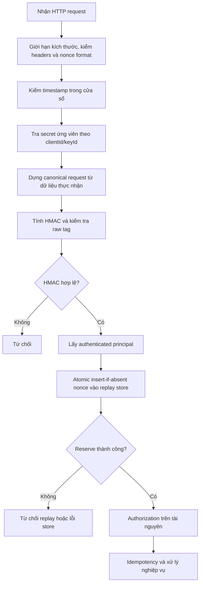
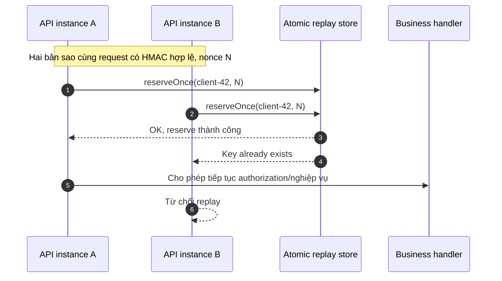

# Kiểm tra nonce

## 1. Vì sao xác minh chữ ký HMAC vẫn cần kiểm tra nonce?

Một HTTP request được ký bằng HMAC chứng minh — với điều kiện secret được bảo vệ và giao thức được thực thi đúng — rằng bên tạo chữ ký có secret hợp lệ và **những byte nằm trong hợp đồng ký** không bị thay đổi. Tuy nhiên, nếu kẻ tấn công **sao chép nguyên request đã ký**, HMAC vẫn đúng: attacker không cần biết secret để gửi lại cùng message và tag.

Ví dụ giao dịch thanh toán:

```http
POST /v1/payments?merchantId=m-42 HTTP/1.1
Host: api.example.test
Content-Type: application/json
X-Client-Id: client-42
X-Key-Id: key-demo-01
X-Timestamp: 1795856400
X-Nonce: AAAAAAAAAAAAAAAAAAAAAA
X-Signature: <base64-hmac-sha256>

{"orderId":"O-42","amount":250000,"currency":"VND"}
```

Các trường trên chỉ là **dữ liệu kiểm thử**. Timestamp cố định, nonce toàn chữ `A` và placeholder chữ ký không dùng cho production.

Nếu client ký request một lần và server nhận nó hai lần, lần thứ hai có thể có **cùng HMAC hợp lệ**. Kiểm timestamp chỉ giới hạn khoảng thời gian được chấp nhận; nó **không phân biệt lần đầu với lần phát lại bên trong cửa sổ ấy**.

**Nonce** (*number used once*) giải quyết phần “đã thấy request này chưa”: sender gửi một giá trị mới trong mỗi lần ký, đưa nó vào canonical request, còn verifier **ghi nhận nguyên tử giá trị đã chấp nhận**. Một nonce đã ghi được coi là đã sử dụng; request tiếp theo lặp nonce trong phạm vi kiểm soát bị từ chối.

Bài **“Kiểm tra nonce”** thuộc chương **Xác minh request** của mô-đun **`SECURITY_AUTHENTICATION_HMAC_REQUEST_AUTHENTICATION`**. Mô-đun hướng tới thiết kế xác thực HTTP request bằng HMAC với shared secret và canonical request bao gồm phương thức, URI, headers hoặc body theo hợp đồng; người học thực hành xác minh chữ ký, chống replay bằng timestamp/nonce, quản lý key rotation, kiểm thử proxy/gateway và phân biệt xác thực với phân quyền.

Sau bài này, bạn có thể:

- Giải thích vì sao nonce phải **được ký** và được kiểm tra **sau khi HMAC hợp lệ**.
- Thiết kế format, cách tạo và kiểm tra nonce bằng Java 17.
- Sử dụng **atomic insert-if-absent** với TTL phù hợp trên một replay store dùng chung.
- Xử lý retry, concurrency, multiple nodes, key rotation, proxy/gateway và failure của kho nonce.
- Xây dựng test vector, concurrency tests, security regression và phân biệt anti-replay với authorization/idempotency.

## 2. Phân biệt nonce, timestamp, HMAC và idempotency key

| Cơ chế | Chức năng | Không giải quyết được điều gì? |
| --- | --- | --- |
| **HMAC** | Xác thực bên nắm secret; kiểm tra toàn vẹn dữ liệu **đã ký** | Không nhớ request đã được nhận lần nào |
| **Timestamp** | Giới hạn khoảng thời gian chữ ký được chấp nhận | Không chặn request được phát lại trong cửa sổ hợp lệ |
| **Nonce** | Định danh một lần gửi; phát hiện lần dùng lại khi server có lưu trạng thái | Không bảo đảm thao tác nghiệp vụ được thực hiện đúng một lần |
| **Idempotency key** | Gom các lần thử hợp lệ thành **cùng ý định nghiệp vụ** | Không thay thế HMAC hay xác thực |
| **Authorization** | Kiểm tra principal được phép hành động trên tài nguyên nào | Không thay thế chữ ký và chống replay |

Xét ba request:

```text
Gửi lần đầu:
  Timestamp = T1
  Nonce     = N1
  Signature = HMAC(secret, canonical(T1, N1, ...))
  Idempotency-Key = PAYMENT-O42

Kẻ tấn công phát lại:
  Timestamp = T1
  Nonce     = N1
  Signature = cùng chữ ký cũ
  Idempotency-Key = PAYMENT-O42

Client retry hợp lệ:
  Timestamp = T2
  Nonce     = N2
  Signature = HMAC(secret, canonical(T2, N2, ...))
  Idempotency-Key = PAYMENT-O42
```

**Lần phát lại** có thể vẫn vượt qua timestamp và HMAC, nhưng nonce `N1` đã tồn tại trong replay store, nên bị chặn. **Lần retry hợp lệ** sử dụng nonce `N2` mới; sau khi qua anti-replay, business layer dùng idempotency key `PAYMENT-O42` để không tạo thanh toán trùng.

Điểm cần thiết kế cẩn thận: **một nonce đã được reserve không tự “được hoàn lại” khi nghiệp vụ thất bại**. Retry phải có nonce và chữ ký mới. Lần gửi lại có thể bị anti-replay từ chối ngay cả khi business chưa chạy, vì server không thể suy từ request cũ rằng kết quả trước đó an toàn để thực hiện lại.

## 3. Nonce cần có những thuộc tính nào?

Một nonce trong hệ thống HMAC server-to-server nên có:

1. **Mới cho mỗi lần ký request**: không cố ý tái sử dụng giữa các endpoint hoặc request khác nhau của cùng client.
2. **Xác suất trùng rất thấp**: đủ không gian giá trị và nguồn ngẫu nhiên mật mã.
3. **Format chính xác**: client và server nhất trí encoding, độ dài và case.
4. **Được ràng buộc với HMAC**: nonce là dữ liệu ký; không được sửa nonce trong một request cũ mà giữ signature.
5. **Phạm vi chống trùng rõ ràng**: thường theo **authenticated principal/client**, không chỉ theo key ID.
6. **Kho giữ trạng thái dùng chung đủ nhất quán**: nhiều node cùng nhận một nonce không được cùng chấp nhận nó.
7. **Thời gian lưu đủ dài**: nonce không được biến mất khi timestamp tương ứng còn có thể được chấp nhận.

Nonce **không nhất thiết cần bí mật**: nó được gửi qua request header, và server có thể quan sát nó. Khó đoán và khó trùng vẫn có lợi, nhưng **nguồn xác thực thực sự là HMAC**; không được dùng một nonce ngẫu nhiên làm bằng chứng sở hữu secret.

### 3.1. Nên dùng bao nhiêu bit?

Trong hợp đồng minh họa, sender tạo **16 byte từ CSPRNG**, tức **128 bit ngẫu nhiên**, rồi mã hóa bằng **Base64URL không padding**:

```text
16 bytes ngẫu nhiên
        |
        v
Base64URL without padding
        |
        v
22 ký tự ASCII
```

Không gian 128 bit làm xác suất trùng ngẫu nhiên rất thấp với số lượng request thực tế của phần lớn API. Xác suất trùng theo hiệu ứng *birthday bound* tăng theo bình phương số nonce đã tạo, nên cần tính toán theo tải thực tế nếu hệ thống có quy mô đặc biệt lớn. **Không thể thay yêu cầu atomic replay store** chỉ bằng “128 bit gần như không trùng”: nonce có thể bị **cố ý phát lại y nguyên**.

Không tạo nonce bằng cách chỉ lấy `System.currentTimeMillis()`, một biến đếm cục bộ dễ reset, `Math.random()` hoặc chuỗi cố định. Timestamp và nonce là **hai trường độc lập**.

### 3.2. Tránh tự ghép nhiều thành phần không cần thiết

Một thiết kế như `nonce = timestamp + ":" + clientId` có thể trùng khi hai request được ký trong cùng thời điểm, lại làm lộ quy tắc sinh và không giải quyết concurrency. Có thể kết hợp một bộ đếm bền vững với giá trị ngẫu nhiên trong một giao thức riêng, nhưng cần thiết kế và kiểm thử **phạm vi duy nhất**. Với ví dụ Java, 16 byte `SecureRandom` là lựa chọn đơn giản, dễ tích hợp.

## 4. Quy định format nonce chính tắc

Hợp đồng **HMAC-SHA256-V1** trong bài chọn:

| Thuộc tính | Quy tắc |
| --- | --- |
| Raw nonce | Chính xác **16 byte** do CSPRNG tạo |
| Header | `X-Nonce`, đúng **một** giá trị |
| Encoding | Base64URL, **không padding** |
| Độ dài | Chính xác **22 ký tự ASCII** |
| Alphabet | `A-Z a-z 0-9 - _` |
| Dấu `=` | **Không có** |
| Newline/tab/space | Không được phép |
| Canonical form | Decode thành 16 byte, encode lại URL no-padding phải **bằng hệt** chuỗi nhận |
| Ràng buộc chữ ký | Dòng `x-nonce:<nonce>` nằm trong canonical request |
| Replay scope | Theo **principal đã xác thực**, không theo header chưa xác thực tùy ý |

Ví dụ nonce của **16 byte toàn số 0**:

```text
Raw bytes (hex):
00000000000000000000000000000000

Base64URL no-padding:
AAAAAAAAAAAAAAAAAAAAAA
```

Đây chỉ là **test vector về encoding**, **không phải nonce tốt cho production**. Không sử dụng chuỗi toàn `A` để ký request thật.

### 4.1. Vì sao cần kiểm tra encoding chính tắc?

Một số decoder Base64 có thể chấp nhận những chuỗi không được canonical hóa, chẳng hạn giá trị với *pad bits* không chuẩn hoặc thiếu/thừa padding trong một số chế độ. Hai chuỗi khác nhau có thể tạo cùng byte sau decode, trong khi tầng lưu nonce theo text và tầng khác lại lưu theo byte.

Để tránh mâu thuẫn:

1. Kiểm tra **đúng 22 ký tự** và alphabet Base64URL.
2. Decode thành raw bytes; yêu cầu **đúng 16 byte**.
3. Encode lại bằng `Base64.getUrlEncoder().withoutPadding()`.
4. So kết quả encode lại với chuỗi nhận vào.
5. Từ chối input không chính tắc **trước khi HMAC và replay store**.

Không tự “sửa” chuỗi nonce bằng `trim`, `replace`, thêm dấu `=` hoặc chuyển sang Basic Base64 khi giao thức đã chọn URL no-padding.

### 4.2. Header trùng là lỗi input

Ví dụ:

```http
X-Nonce: AAAAAAAAAAAAAAAAAAAAAA
x-nonce: BBBBBBBBBBBBBBBBBBBBBB
```

Hai header có cùng tên HTTP theo quy tắc **case-insensitive**. Nếu gateway lấy giá trị đầu, verifier lấy giá trị cuối hoặc một thư viện gộp chúng, các tầng sẽ không thống nhất request nào được xác thực.

Hợp đồng mẫu yêu cầu **chính xác một header nonce**. Ứng dụng cần từ chối duplicate ở ranh giới còn thấy đủ dữ liệu; nếu HTTP framework đã gộp trước khi ứng dụng đọc, cấu hình gateway/HTTP server chống duplicate tại ingress.

## 5. Nonce phải xuất hiện trong canonical request được ký

Một lỗi thiết kế nguy hiểm là chỉ kiểm tra nonce trong header nhưng **không đưa nonce vào dữ liệu HMAC**.

Giả sử request được ký bằng:

```text
HMAC(secret, method || path || timestamp || bodyHash)
```

Attacker sao chép request cũ rồi chỉ đổi `X-Nonce` thành giá trị khác. Vì chữ ký **không phụ thuộc nonce**, HMAC vẫn khớp và replay store có thể xem đó là một request chưa từng gặp.

Đúng hơn:

```text
canonical = version
          + method
          + public path
          + raw query
          + signed headers including x-nonce
          + body hash

signature = HMAC-SHA-256(secret, UTF8(canonical))
```

**Nonce cần được ký ở phía sender, rồi server dùng chính nonce nhận được để dựng canonical request**. Không để server tự sinh nonce khác khi xác minh. Không để nonce nằm trong `X-Signature` cùng một biểu diễn tự do mà hợp đồng không chỉ định cách parse.

### 5.1. Test vector HMAC có nonce

Để có dữ liệu tự kiểm, xét một request mẫu cố định:

```http
POST /v1/payments?merchantId=m-42 HTTP/1.1
Content-Type: application/json
X-Client-Id: client-42
X-Key-Id: key-demo-01
X-Timestamp: 1795856400
X-Nonce: AAAAAAAAAAAAAAAAAAAAAA
X-Signature: <signature-from-vector>

{"orderId":"O-42","amount":250000,"currency":"VND"}
```

Body **đúng 51 byte UTF-8**, không có LF cuối. `SHA-256(bodyBytes)` ở dạng hex lowercase:

```text
ea646bb8b1903a83256034142a633e90ffad35b3a40bb4c5f0e8f1eb4f4f27f9
```

Canonical request gồm **10 dòng**, nối bằng **LF**, **không có LF cuối**:

```text
HMAC-SHA256-V1
POST
/v1/payments
merchantId=m-42
content-type:application/json
x-client-id:client-42
x-key-id:key-demo-01
x-timestamp:1795856400
x-nonce:AAAAAAAAAAAAAAAAAAAAAA
ea646bb8b1903a83256034142a633e90ffad35b3a40bb4c5f0e8f1eb4f4f27f9
```

Secret **chỉ dành cho thử nghiệm**, gồm 32 byte ASCII:

```text
0123456789abcdef0123456789abcdef
```

HMAC-SHA-256 đầy đủ **32 byte**, Base64 Basic có padding:

```text
GMGNFyHLvQHRH53KE9+jTILR1qc0HauQJiX06bXm1n0=
```

**Lưu ý quan trọng:** test vector này có nonce/timestamp cố định và secret công khai, nên **không dùng làm request thật**. Nó dành để so byte canonical, HMAC, cách encode. Để kiểm anti-replay, cần cố định **đồng hồ server bằng `Clock.fixed(...)`** và dùng một replay store giả có tính nguyên tử trong test.

### 5.2. Nếu chỉ đổi nonce thì sao?

Giữ nguyên method, path, query, timestamp, body và secret nhưng đổi `x-nonce`:

```text
x-nonce:AAAAAAAAAAAAAAAAAAAAAA
          |
          v
x-nonce:AAAAAAAAAAAAAAAAAAAAAQ
```

Canonical request **khác byte**. Một request dùng nonce mới phải tính **HMAC mới**. Chỉ thay header nonce và tái sử dụng `X-Signature` cũ sẽ thất bại ở bước xác minh HMAC **trước khi vào replay store**.

## 6. Thứ tự xác minh: HMAC trước khi ghi nonce

Không nên kiểm replay bằng cách “đọc nonce, lưu nonce, rồi mới kiểm chữ ký”. Điều này mở đường cho attacker không biết secret gửi input giả và **chiếm nonce** của một client, khiến request hợp lệ bị từ chối.

Luồng khuyến nghị:



Một số kiểm tra **format** và **timestamp** có thể làm trước HMAC để giảm tải, nhưng **không được coi client ID/key ID là principal đáng tin hoặc ghi nonce trước khi HMAC khớp**. Tầng nhận request cần chống các trường hợp input mơ hồ, ví dụ nhiều `X-Nonce` hoặc hai `X-Timestamp`.

**Một nonce được chấp nhận** nghĩa là server đã xác thực HMAC và thao tác reserve nguyên tử thành công, **không đồng nghĩa** giao dịch nghiệp vụ đã thành công. Với thanh toán, xử lý retry và idempotency phải giải quyết sự khác biệt này.

### 6.1. Có nên kiểm authorization trước khi reserve nonce?

Với một yêu cầu có HMAC hợp lệ, hệ thống có thể kiểm một số **chính sách thuần túy** trước khi reserve để tránh lưu nonce cho request không được phép. Tuy nhiên, phải có **thứ tự nhất quán** và không để bất kỳ tác dụng phụ nào xảy ra trước bước chống replay. Trong hợp đồng minh họa, ta chọn:

```text
HMAC hợp lệ -> reserve nonce nguyên tử -> authorization -> nghiệp vụ
```

Ưu điểm là cùng một request đã ký không thể được thử lại nhiều lần chỉ vì bước authorization thay đổi. Nhược điểm là nonce cũng bị tiêu thụ khi authorization thất bại. Đây là **lựa chọn policy**, không phải bảo đảm giao thức HTTP bắt buộc mọi hệ thống dùng cùng thứ tự.

## 7. Replay store và khóa chống trùng phải được thiết kế như thế nào?

Replay store là một cơ chế **có trạng thái**, dùng để ghi nhận nonce đã sử dụng. Một `Set` trong bộ nhớ của **một** API instance không phù hợp khi nhiều máy xử lý request song song.

Ví dụ yêu cầu hai instance:

```text
Request R có HMAC hợp lệ, nonce N

                    +--> API instance A --> Replay store
Client/attacker ----|
                    +--> API instance B --> Replay store

Yêu cầu: nhiều nhất MỘT instance reserve được N.
```

API cần một thao tác **kiểm tra + ghi** nguyên tử (*atomic insert-if-absent*). Hai bước riêng:

```text
if (!exists(key)) {
    put(key);
    accept();
}
```

**không an toàn** trong môi trường đồng thời: hai thread hoặc hai node có thể cùng đọc “chưa tồn tại” rồi cùng chấp nhận.

### 7.1. Định nghĩa replay key

Với chính sách **nonce duy nhất trên mỗi client đã xác thực**:

```text
replayKey = "hmac-replay:v1:"
          + authenticatedPrincipalId
          + ":"
          + nonce
```

Điểm quan trọng:

- `authenticatedPrincipalId` phải đến từ **key resolver sau HMAC hợp lệ**, không chỉ tin `X-Client-Id` tự khai.
- Phải phân tách thành phần rõ ràng, chuẩn hóa ID và giới hạn độ dài để không tạo **key collisions** do ghép chuỗi mơ hồ.
- Nếu principal ID được lưu dưới dạng chuỗi có dấu phân cách, cần encode/hash ID trước khi dùng làm store key.
- **Không cần thêm key ID** vào replay key nếu chính sách nonce duy nhất trên mọi phiên bản secret của cùng client. Khi rotation, client có thể đổi `key-old` sang `key-new`; nonce cũ vẫn phải bị phát hiện.
- Có thể hash một phần key trước khi lưu để giảm dữ liệu nhạy cảm trong hệ thống lưu trữ/log, nhưng phải bảo đảm mapping ổn định.

**Không phải lúc nào cũng nên dùng nonce toàn hệ thống**. Hai client độc lập có thể vô tình sinh cùng nonce; scope theo principal cho phép chúng hoạt động mà không cản nhau.

### 7.2. Redis có thể cung cấp primitive gì?

Một mẫu nguyên tử khi dùng Redis là:

```redis
SET hmac-replay:v1:client-42:AAAAAAAAAAAAAAAAAAAAAA 1 NX EX 420
```

Diễn giải:

- `NX`: chỉ ghi nếu key **chưa có**.
- `EX 420`: tự hết hạn sau **420 giây**; đây là ví dụ cần điều chỉnh theo timestamp policy.
- Kết quả ghi thành công: lần đầu reserve nonce.
- Không ghi được vì key đã tồn tại: request dùng lại nonce và bị từ chối.

**Cảnh báo vận hành:** một câu lệnh Redis nguyên tử trên một primary **không tự bảo đảm không mất replay records trong mọi trường hợp replication/failover**. Hệ thống nhiều vùng, replica bất đồng bộ hoặc backup/restore có thể khiến nonce đã ghi biến mất. Đối với API nhạy cảm, phải đánh giá tính nhất quán, durability, chiến lược failover, khả năng chịu partition và SLA của kho nonce.

Nếu replay store timeout hoặc unavailable, không tự động chuyển sang chế độ **“cho qua vì HMAC đã đúng”**. Thường cần **fail closed** cho thao tác nhạy cảm, trả lỗi có thể retry bằng một request **ký mới**.

## 8. TTL của nonce phải bao trùm cửa sổ timestamp

Nếu nonce biến mất trong khi timestamp vẫn được chấp nhận, bản sao request cũ có thể được dùng lại.

Giả sử chính sách thời gian:

\[
\text{serverNow} - 300 \le \text{signedTimestamp} \le \text{serverNow} + 60
\]

Tức request có thể cũ tối đa **300 giây**, hoặc có timestamp tương lai tối đa **60 giây**. Hãy xét trường hợp một request có timestamp **ở tương lai đúng 60 giây** tại thời điểm được chấp nhận:

```text
Tại lúc reserve:
  serverNow      = 1000
  signedTimestamp = 1060
  maxFutureSkew   = 60
  maxPastAge      = 300

Cùng timestamp có thể được chấp nhận đến:
  serverNow = signedTimestamp + 300 = 1360

Khoảng thời gian còn lại:
  1360 - 1000 = 360 giây
```

Nếu TTL chỉ là **300 giây tính từ lúc reserve**, nonce có thể hết hạn ở `now=1300` nhưng timestamp còn hợp lệ cho đến `1360`. Replay sau khi nonce bị xóa có thể được chấp nhận lại.

Một cách thiết kế:

```text
replayDeadline = signedTimestamp + maxPastAgeSeconds
remaining      = replayDeadline - serverNow
ttl            = max(1, remaining + consistencyAndClockMarginSeconds)
```

Trong ví dụ đơn giản, có thể chọn TTL cố định **420 giây** = 300 past + 60 future + 60 margin. Tuy nhiên **60 giây margin chỉ là giả định vận hành**, không tự bảo đảm an toàn cho cluster có clock offset lớn hơn, time jumps hoặc độ trễ chưa được kiểm soát.

### 8.1. Tại sao không chỉ dùng `timestamp + window` mà bỏ qua skew giữa các node?

Một node có thể có đồng hồ **nhanh**, node khác **chậm**. Request đầu tiên được node nhanh chấp nhận, sau đó bản sao đến node chậm, nơi timestamp có thể còn hợp lệ lâu hơn. Replay store dùng chung phải giữ nonce đến khi **không node hợp lệ nào** còn chấp nhận timestamp tương ứng.

Cần định nghĩa **clock-skew bound thực tế**, giám sát đồng bộ NTP/clock và có margin thích hợp. Không thể chữa một hệ thống có đồng hồ tùy ý bằng cách chọn TTL cố định rồi coi luôn an toàn.

### 8.2. Không dùng độ dài nonce để suy TTL

Nonce 128 bit chỉ mô tả **độ lớn không gian giá trị**. Nó không quyết định bao nhiêu giây request còn hợp lệ. TTL của nonce phải được suy ra từ **timestamp acceptance policy và clock/cluster assumptions**, không phải từ việc nonce dài 16 byte hay 22 ký tự.

## 9. Java 17: tạo và kiểm nonce Base64URL chính tắc

Utility sau có hai trách nhiệm rõ ràng: **tạo nonce mới** từ `SecureRandom` và **kiểm tra cú pháp/encoding chính tắc** của nonce nhận vào.

```java
import java.security.SecureRandom;
import java.util.Base64;
import java.util.Objects;
import java.util.regex.Pattern;

public final class NonceCodecV1 {
    private static final int RAW_BYTES = 16;
    private static final int TEXT_CHARS = 22;
    private static final Pattern ALPHABET =
            Pattern.compile("[A-Za-z0-9_-]{22}");
    private static final SecureRandom RANDOM = new SecureRandom();

    private NonceCodecV1() {}

    public static String fresh() {
        byte[] raw = new byte[RAW_BYTES];
        RANDOM.nextBytes(raw);
        return Base64.getUrlEncoder()
                .withoutPadding()
                .encodeToString(raw);
    }

    public static boolean isCanonical(String nonce) {
        if (nonce == null
                || nonce.length() != TEXT_CHARS
                || !ALPHABET.matcher(nonce).matches()) {
            return false;
        }

        final byte[] raw;
        try {
            raw = Base64.getUrlDecoder().decode(nonce);
        } catch (IllegalArgumentException invalid) {
            return false;
        }
        if (raw.length != RAW_BYTES) {
            return false;
        }

        // Phát hiện chuỗi Base64URL có pad bits không chính tắc.
        String canonical = Base64.getUrlEncoder()
                .withoutPadding()
                .encodeToString(raw);
        return canonical.equals(nonce);
    }
}
```

Ví dụ sender:

```java
String nonce = NonceCodecV1.fresh();
String timestamp = Long.toString(
        java.time.Instant.now().getEpochSecond());

// Gắn cả hai vào canonical request TRƯỚC khi tạo HMAC.
```

**Lưu ý:**

- `SecureRandom` dùng chung như một nguồn tạo số ngẫu nhiên mật mã; ở ứng dụng thực tế cần chú ý cấu hình CSPRNG và khả năng khởi tạo của nền tảng.
- Không gọi `fresh()` mỗi khi xây dựng **lại** canonical request ở cùng một lần ký. Tạo nonce **một lần**, lưu trong request object và gửi đúng giá trị đã ký.
- `isCanonical` chỉ kiểm **format**, không kiểm uniqueness hay việc nonce đã từng được dùng.
- Nonce `AAAAAAAAAAAAAAAAAAAAAA` (16 byte zero) vẫn **hợp lệ về encoding** nhưng là **giá trị test không phù hợp production**. Không thể chứng minh entropy của client từ một chuỗi nonce đơn lẻ.
- Một server không thể dựa vào `isCanonical` để xác thực client. HMAC phải được xác minh độc lập.

## 10. Java 17: verifier xác minh HMAC rồi reserve nonce

Ví dụ dưới đây tập trung vào **vị trí kiểm nonce trong pipeline**. Để code đủ rõ, hợp đồng `HMAC-SHA256-V1` giả định **endpoint cố định** `POST /v1/payments?merchantId=m-42`, Content-Type `application/json` và các signed headers của mục 5. Một triển khai dùng nhiều route phải có **canonicalization tổng quát theo contract** và kiểm soát HTTP parsing.

### 10.1. Mô hình request và hai interface hạ tầng

```java
import java.util.Objects;

public final class ReplayContractsV1 {
    private ReplayContractsV1() {}

    public record SignedParts(
            String method,
            String publicPath,
            String rawQuery,
            String contentType,
            String clientId,
            String keyId,
            String timestampSeconds,
            String nonce,
            byte[] bodyBytes) {

        public SignedParts {
            Objects.requireNonNull(bodyBytes, "bodyBytes");
            bodyBytes = bodyBytes.clone();
        }

        @Override
        public byte[] bodyBytes() {
            return bodyBytes.clone();
        }
    }

    // Key chỉ được trả về nếu đang còn hiệu lực cho đúng client.
    public record ActiveKey(String principalId, byte[] secret) {
        public ActiveKey {
            Objects.requireNonNull(principalId, "principalId");
            Objects.requireNonNull(secret, "secret");
            if (secret.length == 0) {
                throw new IllegalArgumentException("Empty secret");
            }
            secret = secret.clone();
        }

        @Override
        public byte[] secret() {
            return secret.clone();
        }
    }

    @FunctionalInterface
    public interface KeyResolver {
        ActiveKey resolveActive(String clientId, String keyId);
    }

    @FunctionalInterface
    public interface ReplayStore {
        // TRUE khi key chưa có và đã ghi mới nguyên tử.
        // Store lỗi phải ném exception / từ chối, không trả TRUE.
        boolean reserveOnce(
                String authenticatedPrincipalId,
                String nonce,
                long ttlSeconds);
    }
}
```

**Đây là abstraction cho ứng dụng**, không phải thư viện Redis đã được cài sẵn. `KeyResolver` phải đảm bảo `principalId` thực sự gắn với client và secret còn hiệu lực; không suy principal chỉ từ `X-Client-Id` chưa được xác thực. `ReplayStore` phải triển khai atomic insert-if-absent ở kho dùng chung.

### 10.2. Logic xác minh và ghi nhận nonce

```java
import java.nio.charset.StandardCharsets;
import java.security.GeneralSecurityException;
import java.security.MessageDigest;
import java.time.Clock;
import java.time.Instant;
import java.util.Base64;
import java.util.HexFormat;
import java.util.Objects;
import javax.crypto.Mac;
import javax.crypto.spec.SecretKeySpec;

public final class HmacReplayVerifierV1 {
    private static final long MAX_PAST_SECONDS = 300;
    private static final long MAX_FUTURE_SECONDS = 60;
    private static final long REPLAY_TTL_SECONDS = 420;

    private HmacReplayVerifierV1() {}

    public static boolean verify(
            ReplayContractsV1.SignedParts r,
            String signatureHeader,
            Clock clock,
            ReplayContractsV1.KeyResolver keys,
            ReplayContractsV1.ReplayStore replay)
            throws GeneralSecurityException {

        Objects.requireNonNull(r, "request");
        Objects.requireNonNull(clock, "clock");
        Objects.requireNonNull(keys, "keys");
        Objects.requireNonNull(replay, "replay");

        // HTTP adapter phải từ chối duplicate signed headers,
        // content coding ngoài hợp đồng và body quá lớn trước đây.
        if (!"POST".equals(r.method())
                || !"/v1/payments".equals(r.publicPath())
                || !"merchantId=m-42".equals(r.rawQuery())
                || !"application/json".equals(r.contentType())
                || !validId(r.clientId())
                || !validId(r.keyId())
                || !NonceCodecV1.isCanonical(r.nonce())) {
            return false;
        }

        if (r.timestampSeconds() == null
                || !r.timestampSeconds()
                        .matches("0|[1-9][0-9]{0,11}")) {
            return false;
        }
        long ts = Long.parseLong(r.timestampSeconds());
        long now = Instant.now(clock).getEpochSecond();
        if (ts < now - MAX_PAST_SECONDS
                || ts > now + MAX_FUTURE_SECONDS) {
            return false;
        }

        // clientId và keyId chỉ là input tra secret ứng viên.
        ReplayContractsV1.ActiveKey active =
                keys.resolveActive(r.clientId(), r.keyId());
        if (active == null) {
            return false;
        }

        if (signatureHeader == null
                || signatureHeader.length() != 44) {
            return false;
        }
        final byte[] received;
        try {
            received = Base64.getDecoder().decode(signatureHeader);
        } catch (IllegalArgumentException badEncoding) {
            return false;
        }
        if (received.length != 32
                || !Base64.getEncoder()
                        .encodeToString(received)
                        .equals(signatureHeader)) {
            return false;
        }

        String bodyHash = HexFormat.of().formatHex(
                MessageDigest.getInstance("SHA-256")
                        .digest(r.bodyBytes()));

        String canonical = String.join("\n",
                "HMAC-SHA256-V1",
                r.method(),
                r.publicPath(),
                r.rawQuery(),
                "content-type:" + r.contentType(),
                "x-client-id:" + r.clientId(),
                "x-key-id:" + r.keyId(),
                "x-timestamp:" + r.timestampSeconds(),
                "x-nonce:" + r.nonce(),
                bodyHash);

        Mac mac = Mac.getInstance("HmacSHA256");
        mac.init(new SecretKeySpec(active.secret(), "HmacSHA256"));
        byte[] expected = mac.doFinal(
                canonical.getBytes(StandardCharsets.UTF_8));

        if (!MessageDigest.isEqual(expected, received)) {
            return false;
        }

        // Chỉ sau HMAC đúng mới được ghi nonce!
        // TTL=420 là giả định ví dụ; phải kiểm với skew cluster.
        return replay.reserveOnce(
                active.principalId(), r.nonce(), REPLAY_TTL_SECONDS);
    }

    private static boolean validId(String id) {
        return id != null && id.matches("[A-Za-z0-9._-]{1,80}");
    }
}
```

Đoạn code trên minh họa **logic xác minh HMAC + anti-replay**, không bao gồm việc đọc HTTP request, body buffering, authorization hoặc chuyển principal sang tầng tiếp theo. Chỉ trả `true` khi HMAC **và** lần reserve nonce đều thành công.

**Giới hạn có chủ đích:**

- Endpoint và canonical path/query đang **cố định**. Không dùng class này để xác thực bất kỳ URI khác nếu chưa thiết kế lại hợp đồng.
- `bodyBytes` phải lấy từ **raw body thực nhận**, không serialize lại JSON object.
- Header duplicate, malformed HTTP, các quy tắc proxy và content coding phải được xử lý ở **HTTP adapter/gateway trước**.
- Replay store phải **fail closed** khi unavailable; không bắt exception rồi coi như reserve thành công.
- `ActiveKey` chỉ chứa secret của client/key ID **đang được chấp nhận**. Thu hồi hoặc rotation phải được key resolver cưỡng chế.
- Sau khi `verify(...)` trả `true`, tầng gọi phải thiết lập principal được resolver xác nhận và **kiểm tra authorization**. Giá trị boolean trong ví dụ không phải một access-control decision.
- Cửa sổ `300/60` và TTL `420` là chính sách minh họa; cần ràng buộc rõ với clock skew và failure mode thực tế của deployment.

### 10.3. Lỗi quan trọng: không được lấy nonce làm một phần của khóa secret

Secret resolver không được chọn secret chỉ theo nonce, hay coi nonce khó đoán như một credential. `X-Client-Id` + `X-Key-Id` chỉ cung cấp **khóa tra ứng viên**, HMAC mới xác thực sở hữu secret. Replay store chỉ bắt đầu có ý nghĩa sau bước xác thực đó.

## 11. Redis replay store: triển khai nguyên tử, kiểm soát failure

Một triển khai Redis của interface `ReplayStore` có thể dùng **một câu lệnh `SET ... NX EX`**:

```text
function reserveOnce(principalId, nonce, ttlSeconds):
    replayKey = makeSafeReplayKey(principalId, nonce)
    result = redis.SET(replayKey, "1", NX, EX=ttlSeconds)
    if result == OK:
        return true

    if result means key already exists:
        return false

    if Redis unavailable, timeout, or result ambiguous:
        fail closed; do not return true
```

Một ví dụ command giả lập:

```redis
SET hmac-replay:v1:client-42:AAAAAAAAAAAAAAAAAAAAAA 1 NX EX 420
```

Lệnh không dùng `GET` rồi `SET` riêng rẽ, vì hai node có thể cùng thấy key chưa tồn tại. Không dùng biến static `Set` theo từng JVM trong hệ thống load-balanced: request được gửi đến node khác sẽ bỏ qua bộ nhớ cục bộ.

### 11.1. Kết quả timeout là mơ hồ

Giả sử Redis đã **ghi nonce** nhưng phản hồi mạng bị mất. Verifier thấy timeout và không biết reserve thành công hay thất bại. Cách an toàn cho một request có side effect là **không chấp nhận nó**. Sender có thể retry bằng **nonce mới và chữ ký mới** theo idempotency key của cùng ý định.

Không nên tự làm:

```text
try:
    reserveOnce(...)
catch timeout:
    return true  // SAI: fail open
```

Nếu Redis failover làm mất bản ghi đã có, yêu cầu có chữ ký cũ có thể được chấp nhận lại. Cần chọn kiến trúc **durability/replication/fencing/consistency** theo mức nhạy cảm nghiệp vụ, test failover, và hiểu rõ mức bảo đảm thật của hệ thống. **Atomic trên một node không tự đồng nghĩa với exactly-once toàn hệ thống**.

### 11.2. Tối ưu nhưng không được mất trạng thái

Mỗi request HMAC hợp lệ tiêu thụ một replay record trong TTL. Ví dụ một client gửi nhiều request/giây, số record sống đồng thời có thể lớn. Hệ thống phải:

- Ước lượng **số key tối đa** theo lưu lượng × TTL × số principal.
- Giới hạn kích thước nonce, client ID, request và rate theo client/IP phù hợp.
- Đặt quota và giám sát dung lượng/tỷ lệ eviction của replay store.
- Không cấu hình eviction làm xóa record **sớm hơn TTL** trong khi request vẫn có thể được xác minh.
- Bảo vệ replay store bằng mạng nội bộ, authentication và quyền truy cập tối thiểu.
- Không dùng một cache “best-effort” có thể tự xóa nonce tùy áp lực bộ nhớ rồi vẫn cho request đi tiếp.

Nếu hết dung lượng, nên **từ chối an toàn** và điều tra capacity thay vì âm thầm bỏ qua anti-replay.

## 12. Concurrency, nhiều node và multi-region

Replay protection cần được kiểm thử ở **đúng kiến trúc triển khai**.



**Yêu cầu:** nhiều nhất một verifier được phép tiếp tục sau `reserveOnce` đối với cùng replay key trong một cửa sổ hợp lệ. Kiểm thử phải chạy **đồng thời**, không chỉ gửi hai request tuần tự.

### 12.1. Kiểm tra qua các instance

Với load balancer:

1. Gửi một request ký hợp lệ đến instance A; nó reserve nonce.
2. Gửi **nguyên request** đến instance B.
3. B phải từ chối replay dù chưa từng xử lý request ấy.
4. Lặp lại qua restart, failover và những tuyến mạng thực tế mà hệ thống hỗ trợ.

Nếu mỗi instance giữ `HashSet` riêng, test sẽ chứng minh lỗ hổng ngay khi request chuyển node.

### 12.2. Multi-region có hai kho eventual-consistency

Nếu region A và region B dùng hai kho nonce bất đồng bộ, hai bản replay có thể đến **gần như đồng thời** trước khi bản ghi từ A được sao chép sang B. Mỗi kho có thể tự cho phép insert. **Đồng bộ “eventually” là chưa đủ** để bảo đảm chặn replay tức thời toàn cục.

Các lựa chọn thiết kế tùy yêu cầu:

- Dùng một kho có **linearizable/strongly consistent conditional insert** trong phạm vi cần bảo vệ.
- Phân tuyến **cố định một principal về một vùng chủ sở hữu** với cơ chế failover giữ được fencing/consistency.
- Giảm phạm vi bảo đảm được công bố, nếu nghiệp vụ không yêu cầu strict anti-replay toàn cục, nhưng không quảng bá điều kiện yếu thành “exactly once”.
- Kết hợp **idempotency có tính bền vững** và cơ chế chống trùng ở business layer cho thao tác có side effect.

Đặt nonce store ở mọi node mà không có chiến lược consistency **không** giải quyết được replay xuyên vùng.

## 13. Retry, timeout, idempotency và “exactly once”

Một request có HMAC hợp lệ có thể thất bại ở nhiều thời điểm:

```text
A. HMAC sai
B. HMAC đúng nhưng reserve nonce thất bại
C. Reserve nonce thành công nhưng authorization thất bại
D. Reserve nonce thành công, nghiệp vụ chưa chạy, server crash
E. Nghiệp vụ đã chạy, response bị mất trên mạng
```

Trong các tình huống C–E, **nonce có thể đã được tiêu thụ**. Sender gửi lại nguyên request cũ sẽ bị coi là replay. Cách retry phù hợp là sinh **timestamp mới, nonce mới và signature mới**, giữ **idempotency key** của cùng ý định nghiệp vụ.

```mermaid
sequenceDiagram
    autonumber
    participant C as Sender
    participant V as HMAC verifier
    participant R as Replay store
    participant I as Idempotency/business store
    C->>V: POST (T1,N1,S1) + Idempotency-Key PAY-O42
    V->>R: Reserve (principal,N1)
    R-->>V: First use
    V->>I: Xử lý PAY-O42
    Note over C,I: Response bị mất, sender timeout
    C->>C: Sinh T2,N2 và ký S2 mới
    C->>V: POST (T2,N2,S2) + cùng PAY-O42
    V->>R: Reserve (principal,N2)
    R-->>V: First use
    V->>I: Tra idempotency key PAY-O42
    I-->>C: Trả kết quả cũ; không tạo giao dịch mới
```

**Không được coi nonce store là cơ chế exactly-once nghiệp vụ.** Nó chặn một lần gửi có nonce đã được reserve, nhưng không biết nghiệp vụ có commit hay chưa. Một idempotency store cần liên kết principal, thao tác, request intent và trạng thái xử lý, dùng transaction/constraint phù hợp với business database.

### 13.1. Nên ký Idempotency-Key hay không?

Nếu `Idempotency-Key` có thể thay đổi cách server xử lý thanh toán, nó là **trường ảnh hưởng ngữ nghĩa request**. Hợp đồng ký nên bao gồm nó hoặc ràng buộc bằng cách khác đủ tin cậy. Nếu không, một kẻ trung gian có thể sửa idempotency key mà HMAC vẫn hợp lệ, gây hành vi khác với ý định đã được ký.

### 13.2. Request bị đánh cắp trước lần gửi đầu

Nonce store bảo vệ khỏi **lần sử dụng thứ hai**, nhưng nếu attacker có được request đã ký và gửi **trước khi request hợp lệ đến server**, bản sao của attacker có thể **thắng cuộc đua reserve**. Anti-replay không bảo đảm chỉ sender ban đầu mới có thể dùng **bản ghi đầu tiên** của một chữ ký bị lộ.

Cần dùng **HTTPS/TLS**, giữ kín log và trace, tránh truyền request có chữ ký qua kênh không an toàn, áp dụng authorization, transaction constraints và idempotency. Nonce không thay thế cơ chế bảo mật đường truyền.

## 14. Key rotation: phạm vi nonce nên gắn với principal

Khi client xoay khóa:

```text
client-42:
  key-A (cũ, có thể còn hiệu lực trong giai đoạn chuyển tiếp)
  key-B (mới, đang hoạt động)
```

Nếu replay key là `(clientId, keyId, nonce)`, cùng nonce `N` có thể được chấp nhận với key A, rồi lại được chấp nhận với key B (nếu request được ký lại tương ứng). Với chính sách “nonce **một lần trên mỗi client**”, đây là hành vi không mong muốn.

Nên dùng:

```text
replayKey = (authenticatedPrincipalId, nonce)
```

Như vậy, một nonce đã dùng không được tái sử dụng chỉ vì key ID đổi. Tuy nhiên, key resolver phải định danh đúng **cùng một principal** cho các key được phép trong giai đoạn rotation.

### 14.1. HMAC đúng nhưng key bị thu hồi

Một request ký bằng secret bị thu hồi **không được chấp nhận** dù timestamp còn hạn và nonce chưa dùng. Key resolver phải kiểm tra hiệu lực theo policy hiện tại. **Nonce không khôi phục hiệu lực secret**; nó là lớp chống replay sau khi key đã được công nhận.

### 14.2. Nếu secret bị lộ, nonce store có giúp chặn giả mạo không?

Không. Attacker biết secret có thể tạo request hoàn toàn mới với **nonce mới và HMAC mới**. Replay store sẽ xem nonce đó chưa từng sử dụng và cho qua bước anti-replay. Biện pháp cần thiết là **thu hồi/xoay key bị lộ**, điều tra phạm vi ảnh hưởng, giảm quyền nếu cần, và áp dụng authorization.

## 15. Gateway, HTTP headers và ranh giới tin cậy

Nonce là một thành phần của **canonical request**, nên phải được bảo toàn khi đi qua hạ tầng:

```text
Sender
  -> CDN/WAF
  -> Reverse proxy
  -> API gateway
  -> HMAC verifier
  -> Replay store
  -> Authorization
  -> Business handler
```

Các tình huống đáng chú ý:

| Tình huống | Rủi ro | Cách xử lý |
| --- | --- | --- |
| Gateway tự tạo `X-Nonce` sau khi client ký | HMAC không khớp; nonce không được sender ký | Nonce phải do sender tạo trước bước ký |
| Gateway đổi case tên header | Thường không ảnh hưởng nếu canonicalize tên đúng | Tên header lowercase trong canonical contract |
| Gateway sửa giá trị nonce | HMAC sai | Không sửa signed header |
| Duplicate `X-Nonce` | Verifier/router chọn giá trị khác nhau | Từ chối duplicate ở ingress |
| Proxy gộp nonce headers | Mất thông tin về số giá trị gốc | Từ chối ambiguity trước khi merge |
| Proxy rewrite method/path/body | HMAC sai hoặc verifier xác thực nhầm dữ liệu | Xác minh ở điểm thấy public original request |
| Gateway và backend cùng reserve nonce | Backend coi request hợp lệ thành replay | Chỉ **một điểm** chịu trách nhiệm reserve, hoặc có hop-specific contract |
| Mỗi node dùng store riêng | Replay qua load balancer | Kho dùng chung/nhất quán |
| Replay TTL quá ngắn | Nonce biến mất khi timestamp còn hợp lệ | TTL theo window + skew margin |
| CORS preflight `OPTIONS` | Trình duyệt không gửi HMAC nghiệp vụ trong preflight | Xử lý preflight theo CORS policy, không coi đó là signed payment |
| Key rotation tại gateway/backend không đồng bộ | Cùng request được đánh giá key khác nhau | Đồng bộ key policy và nơi xác minh |

### 15.1. Khi gateway xác minh trước backend

Một phương án phổ biến là **gateway kiểm HMAC + timestamp + nonce**, rồi chuyển **authenticated principal** qua kênh nội bộ được bảo vệ. Backend **không tin** `X-Authenticated-Client` do Internet gửi trực tiếp; gateway phải xóa/ghi đè mọi header nhận diện giả mạo trước khi chuyển.

Trong phương án này, backend không nên **reserve cùng nonce** lần nữa trong cùng replay scope, vì gateway đã tiêu thụ nonce. Backend thực hiện authorization và nghiệp vụ dựa trên principal/tài nguyên đáng tin.

Phương án khác là backend xác minh trực tiếp; khi đó gateway phải bảo toàn signed method, URI, headers và body, đồng thời **không tự sửa nonce** hay nhập nhằng dữ liệu từ `X-Original-URI` do client tự khai.

### 15.2. TLS vẫn cần thiết

HMAC bảo vệ **tính toàn vẹn của những phần được ký** và bên nắm secret, không mã hóa nội dung HTTP. TLS giúp giữ bí mật request và giảm nguy cơ attacker đánh cắp một bản có thể phát lại. Replay store không thể bù hoàn toàn cho kết nối không an toàn hoặc log chứa toàn bộ request cùng chữ ký còn hiệu lực.

## 16. Kiểm thử nonce: unit, concurrency và end-to-end

Cần test **nhiều lớp khác nhau**. Không chỉ viết một test gọi `sign` rồi `verify` bởi cả hai có thể cùng mắc lỗi canonicalization hoặc cùng dùng một replay store giả thiếu atomicity.

### 16.1. Unit tests cho format và encoding

```java
import static org.junit.jupiter.api.Assertions.*;
import java.util.Base64;
import org.junit.jupiter.api.Test;

class NonceCodecV1Test {

    @Test
    void generatesCanonical128BitNonce() {
        String nonce = NonceCodecV1.fresh();

        assertEquals(22, nonce.length());
        assertTrue(NonceCodecV1.isCanonical(nonce));

        byte[] raw = Base64.getUrlDecoder().decode(nonce);
        assertEquals(16, raw.length);
    }

    @Test
    void rejectsMalformedAndNoncanonicalValues() {
        String[] invalid = {
                "", "short", "AAAAAAAAAAAAAAAAAAAAAA=",
                "AAAAAAAAAAAAAAAAAAAAAA ",
                "AAAAAAAAAAAAAAAAAAAAA+",
                "AAAAAAAAAAAAAAAAAAAAA/",
                "AAAAAAAAAAAAAAAAAAAAA\n"
        };

        for (String nonce : invalid) {
            assertFalse(NonceCodecV1.isCanonical(nonce),
                    "Should reject: " + nonce);
        }
    }

    @Test
    void zeroBytesAreValidEncodingButNotProductionRandomness() {
        assertTrue(NonceCodecV1.isCanonical(
                "AAAAAAAAAAAAAAAAAAAAAA"));
    }
}
```

Test này kiểm **format**. Một nonce toàn `A` được xem là hợp lệ về Base64URL no-padding, nhưng test không chứng minh sender đã dùng CSPRNG. Chất lượng nguồn ngẫu nhiên cần được đảm bảo qua **thiết kế và cấu hình**, không thể suy đầy đủ từ một giá trị quan sát.

### 16.2. Test HMAC ràng buộc nonce, dùng golden vector

```java
import static org.junit.jupiter.api.Assertions.*;
import java.nio.charset.StandardCharsets;
import java.security.MessageDigest;
import java.time.Clock;
import java.time.Instant;
import java.time.ZoneOffset;
import java.util.Base64;
import java.util.concurrent.ConcurrentHashMap;
import org.junit.jupiter.api.Test;

class HmacReplayVerifierV1Test {
    private static final byte[] SECRET = (
            "0123456789abcdef0123456789abcdef"
    ).getBytes(StandardCharsets.US_ASCII);

    private static final String SIGNATURE =
            "GMGNFyHLvQHRH53KE9+jTILR1qc0HauQJiX06bXm1n0=";

    private static final Clock FIXED = Clock.fixed(
            Instant.ofEpochSecond(1795856400L),
            ZoneOffset.UTC);

    private ReplayContractsV1.SignedParts parts(String nonce) {
        return new ReplayContractsV1.SignedParts(
                "POST",
                "/v1/payments",
                "merchantId=m-42",
                "application/json",
                "client-42",
                "key-demo-01",
                "1795856400",
                nonce,
                ("{\"orderId\":\"O-42\",\"amount\":250000,"
                    + "\"currency\":\"VND\"}")
                        .getBytes(StandardCharsets.UTF_8));
    }

    @Test
    void acceptsOnceAndRejectsExactReplay() throws Exception {
        var seen = new ConcurrentHashMap<String, Boolean>();

        ReplayContractsV1.KeyResolver keys =
                (client, keyId) -> new ReplayContractsV1.ActiveKey(
                        client, SECRET);

        // Fake store: putIfAbsent nguyên tử nhưng KHÔNG có TTL,
        // chỉ dùng cho unit test.
        ReplayContractsV1.ReplayStore store =
                (principal, nonce, ttl) ->
                        seen.putIfAbsent(
                            principal + "|" + nonce, true) == null;

        var request = parts("AAAAAAAAAAAAAAAAAAAAAA");
        assertTrue(HmacReplayVerifierV1.verify(
                request, SIGNATURE, FIXED, keys, store));

        assertFalse(HmacReplayVerifierV1.verify(
                request, SIGNATURE, FIXED, keys, store));
    }

    @Test
    void tamperedNonceDoesNotReachReplayStore() throws Exception {
        var reserveCalls = new java.util.concurrent.atomic.AtomicInteger();
        ReplayContractsV1.ReplayStore store =
                (principal, nonce, ttl) -> {
                    reserveCalls.incrementAndGet();
                    return true;
                };

        ReplayContractsV1.KeyResolver keys =
                (client, keyId) -> new ReplayContractsV1.ActiveKey(
                        client, SECRET);

        // Nonce mới vẫn là Base64URL canonical, khác 1 byte.
        var changed = parts("AAAAAAAAAAAAAAAAAAAAAQ");
        assertTrue(NonceCodecV1.isCanonical(changed.nonce()));
        assertFalse(HmacReplayVerifierV1.verify(
                changed, SIGNATURE, FIXED, keys, store));

        assertEquals(0, reserveCalls.get(),
                "Invalid signature must not reserve nonce");
    }
}
```

**Đây là các ví dụ JUnit 5**, chưa chạy build hoặc test tự động trong STEP 4. `KeyResolver` và `ReplayStore` ở đây là **test doubles**: chúng đơn giản hóa việc xác minh thứ tự. Production phải tra key đang hoạt động, từ chối key bị thu hồi, triển khai TTL và trạng thái lưu trữ thật.

### 16.3. Concurrency test cho atomic reserve

Một unit test của replay store có thể chạy nhiều tác vụ đồng thời với **cùng principal và nonce**:

```java
import static org.junit.jupiter.api.Assertions.*;
import java.util.concurrent.*;
import java.util.concurrent.atomic.AtomicInteger;
import org.junit.jupiter.api.Test;

class AtomicReplayStoreTest {

    @Test
    void atMostOneReservationWins() throws Exception {
        // Trong test giả, ConcurrentHashMap cung cấp putIfAbsent
        // nguyên tử trong cùng một JVM. Không dùng nó làm store
        // production cho nhiều instance!
        ConcurrentMap<String, Boolean> seen =
                new ConcurrentHashMap<>();
        ReplayContractsV1.ReplayStore store =
                (principal, nonce, ttl) ->
                        seen.putIfAbsent(
                                principal + ":" + nonce, true) == null;

        int contenders = 32;
        ExecutorService pool = Executors.newFixedThreadPool(contenders);
        CountDownLatch start = new CountDownLatch(1);
        AtomicInteger accepted = new AtomicInteger();
        try {
            var futures = new java.util.ArrayList<Future<?>>();
            for (int i = 0; i < contenders; i++) {
                futures.add(pool.submit(() -> {
                    start.await();
                    if (store.reserveOnce(
                            "client-42",
                            "AAAAAAAAAAAAAAAAAAAAAA",
                            420)) {
                        accepted.incrementAndGet();
                    }
                    return null;
                }));
            }
            start.countDown();
            for (Future<?> task : futures) {
                task.get();
            }
            assertEquals(1, accepted.get());
        } finally {
            pool.shutdownNow();
        }
    }
}
```

Test concurrency in-memory chỉ chứng minh fake store hoạt động trong **một process**. Cần thêm integration test với kho nonce thật: nhiều JVM/containers/regions đồng thời reserve cùng replay key, kiểm thử timeout, restart, failover, eviction và clock skew.

### 16.4. Ma trận kiểm thử bảo mật

| Tình huống | Kỳ vọng |
| --- | --- |
| Nonce mới, timestamp hợp lệ, HMAC đúng | Reserve thành công và tiếp tục authorization |
| HMAC sai, nonce mới | **Không ghi nonce**, từ chối |
| Nonce đã dùng, HMAC vẫn đúng | Từ chối replay |
| Sửa nonce nhưng giữ signature cũ | HMAC không khớp |
| Nonce sai alphabet/độ dài/padding | Từ chối trước reserve |
| Nonce có Base64URL pad bits không canonical | Từ chối qua decode/re-encode |
| Trùng `X-Nonce` hoặc `X-Timestamp` | Từ chối input mơ hồ |
| Nonce trùng giữa hai request cùng client khác endpoint | Từ chối nếu scope là principal toàn client |
| Nonce trùng giữa hai client khác nhau | Được xét độc lập theo principal |
| Nonce trùng sau key rotation cùng client | Từ chối nếu scope không theo key ID |
| Timestamp quá hạn hoặc quá xa tương lai | Từ chối; không reserve |
| Timestamp tương lai sát biên cho phép | TTL đủ bao trùm thời gian còn hợp lệ |
| TTL hết trước timestamp | **Test phát hiện lỗi**, sửa cấu hình |
| Đồng thời 32 request cùng nonce | Nhiều nhất một reserve thành công |
| Replay qua hai node cùng cluster | Bản sau bị từ chối |
| Replay qua multi-region | Đánh giá tính nhất quán thật; không chấp nhận hai bản |
| Redis timeout sau khi có thể ghi | Fail closed; không tự coi thành công |
| Redis failover mất record | Test phát hiện; cần chính sách durability phù hợp |
| Body/path/header đã ký bị sửa | HMAC sai, không reserve |
| HMAC đúng nhưng key đã bị thu hồi | Key resolver từ chối |
| HMAC đúng, nonce mới, client sai merchant | Authorization từ chối |
| Client retry với nonce mới và cùng idempotency key | Anti-replay cho phép; nghiệp vụ không thực hiện trùng |
| CORS preflight OPTIONS | Không áp dụng nonce của request nghiệp vụ; CORS policy xử lý riêng |

### 16.5. Test TTL không được dựa hoàn toàn vào `Thread.sleep`

Một test chờ 420 giây để thấy nonce hết hạn là chậm và dễ không ổn định. Nên dùng một replay store test có **đồng hồ ảo/injectable clock**, hoặc integration test với TTL nhỏ phù hợp môi trường thử nghiệm, đồng thời test riêng **hàm tính TTL** theo `signedTimestamp` và `serverNow`.

Với production backend, test thời gian của verifier bằng `Clock.fixed(...)` để kiểm biên `now-300` và `now+60` mà không phụ thuộc ngày chạy test.

## 17. Vận hành, giám sát và giới hạn nguồn lực

Replay store là thành phần **trên đường đi đồng bộ của xác thực**, nên nó ảnh hưởng cả bảo mật lẫn availability.

Các chỉ số đáng theo dõi:

- Tỷ lệ `nonce_reserve_success`, `nonce_replay_rejected` và `nonce_store_error`.
- Latency của thao tác reserve, timeout và retry đến store.
- Dung lượng store, số key đang sống, memory pressure/eviction.
- Độ lệch clock giữa các API node, tỷ lệ timestamp quá cũ/tương lai.
- Tỷ lệ request bị từ chối vì nonce encoding sai, header duplicate hoặc key không hợp lệ.
- Lưu lượng bất thường theo client/principal và tỷ lệ retry sau timeout.

**Không log raw secret hoặc toàn bộ signed request** để debug trong production. Một bản sao còn HMAC và timestamp hiệu lực có thể bị đánh cắp rồi dùng để tranh reserve nonce. Nonce không phải secret, nhưng logging nó kết hợp với toàn bộ request và signature có thể tăng rủi ro.

Khi trả lỗi, tránh công khai dữ liệu nội bộ của key resolver, trạng thái secret hoặc replay store. Hệ thống có thể dùng một thông báo chung cho request không hợp lệ, kèm request ID để điều tra trong logs được kiểm soát. Tùy API, một replay có thể trả lỗi xác thực hoặc mã xung đột; **status code cụ thể là hợp đồng sản phẩm**, không phải một thuộc tính của HMAC.

## 18. Các lỗi thiết kế thường gặp

| Lỗi | Hậu quả | Cách khắc phục |
| --- | --- | --- |
| Chỉ có timestamp, không có nonce | Replay trong cửa sổ hợp lệ | Ký nonce và dùng replay store |
| Có nonce header nhưng không ký | Attacker thay nonce giữ HMAC cũ | Đưa nonce vào canonical request |
| Lưu nonce trước kiểm HMAC | Input giả chiếm nonce hợp lệ | Reserve sau khi HMAC đúng |
| `GET` trước rồi `SET` | Race condition nhiều node | Atomic insert-if-absent |
| Nonce store theo từng JVM | Replay qua load balancer | Store dùng chung đủ nhất quán |
| TTL chỉ bằng maxPastAge, bỏ future skew | Record hết hạn khi timestamp còn valid | TTL tính theo remaining window + margin |
| Gắn replay key với key ID | Reuse nonce qua rotation | Scope theo authenticated principal |
| Store lỗi thì cho request qua | Bỏ qua anti-replay | Fail closed |
| Header duplicate không bị phát hiện | Verifier và downstream chọn nonce khác | Từ chối duplicate tại ingress |
| Không giới hạn độ dài nonce | Tăng memory/CPU trước xác thực | Format chặt và request limits |
| Nonce lấy từ `System.currentTimeMillis()` | Dễ trùng khi concurrency, quy tắc đoán được | CSPRNG đủ bit |
| Retry y nguyên signed request | Bị chặn replay dù client đang retry | Timestamp, nonce, signature mới |
| Mỗi retry dùng idempotency key mới | Có thể tạo nhiều giao dịch | Giữ idempotency key của cùng intent |
| Dùng nonce thay authorization | Client hợp lệ vượt quyền tenant | Phân quyền trên principal + tài nguyên |
| Double verification với cùng store | Backend tự coi request đã xác minh ở gateway là replay | Chỉ một điểm reserve hoặc hop-specific scope |
| Multi-region eventual consistency | Hai bản sao cùng được chấp nhận | Chọn cơ chế consistency phù hợp |
| Replay store tự eviction key sớm | Bản sao được chấp nhận lại | Bảo đảm TTL/durability và quota |

## 19. Bài tập thực hành

Một API thanh toán `POST /v1/payments` dùng HMAC-SHA-256, timestamp Unix seconds, nonce 128 bit Base64URL không padding và nhiều API instances cùng xử lý request. Cửa sổ thời gian chấp nhận là **300 giây quá khứ, 60 giây tương lai**.

Hãy phân tích:

1. Vì sao HMAC và timestamp đều hợp lệ nhưng request vẫn có thể là replay?
2. Nonce 16 byte tạo thành bao nhiêu ký tự Base64URL không padding? Format có đủ để chứng minh nonce được tạo bằng CSPRNG không?
3. Vì sao client phải thêm nonce vào canonical request **trước khi** gọi `Mac.doFinal`?
4. Nếu attacker thay nonce nhưng giữ signature cũ, bước nào từ chối?
5. Server có nên reserve nonce trước khi kiểm HMAC để “chặn spam” không? Giải thích.
6. Hai node cùng chạy `if (!exists) put`. Vì sao cả hai có thể cho request đi qua?
7. Nếu dùng Redis, primitive `SET key value NX EX ttl` giúp giải quyết phần nào của vấn đề? Nó có tự bảo đảm không mất record khi failover không?
8. Với `maxPastAge=300`, `maxFutureSkew=60`, tại sao TTL chỉ 300 giây có thể chưa đủ?
9. Nonce key nên gắn với client ID chưa xác thực, key ID hay **principal sau xác thực**? Vì sao?
10. Khi secret chuyển từ key A sang B, có nên cho cùng nonce được dùng lại trên cùng client không?
11. Server reserve nonce thành công rồi crash trước khi gửi response. Client nên retry thế nào để không làm lặp thanh toán?
12. Một replay store theo vùng có replication bất đồng bộ liệu có đủ để chống hai bản request đến đồng thời ở hai region?
13. Nếu attacker có được signed request và gửi trước client, nonce store có luôn ngăn attacker không? Cần những lớp bảo vệ nào khác?
14. Một request có HMAC đúng và nonce mới nhưng chỉ được quyền với merchant `m-42` lại gọi `m-99`. Server phải phản ứng thế nào?
15. Viết test đa luồng chứng minh **32 lời gọi cùng nonce** chỉ một lời gọi reserve thành công.
16. Liệt kê các lỗi proxy/gateway có thể làm nonce header và canonical request không thống nhất.

**Gợi ý đáp án:** (1) HMAC không lưu lịch sử, timestamp chỉ giới hạn thời gian; (2) 22 ký tự, không chứng minh entropy; (3) để nonce được HMAC bảo vệ; (4) HMAC mismatch; (5) không, tránh chiếm nonce bằng request giả; (6) check và put tách rời tạo race; (7) atomic insert-if-absent + TTL, chưa giải quyết mọi sự cố replication; (8) timestamp tương lai có thể còn hợp lệ đến 360 giây sau lúc reserve; (9) principal đã xác thực, với scope thống nhất; (10) không nếu nonce duy nhất theo client; (11) timestamp/nonce/signature mới, giữ idempotency key; (12) không bảo đảm strict replay protection; (13) không, cần TLS và bảo vệ signed request/secret; (14) authorization từ chối; (15) dùng concurrency test/integration test như mục 16; (16) duplicate headers, rewrite, header value transformation, hai điểm reserve cùng một store.

## 20. Tổng kết

**Kiểm tra nonce là bước bắt buộc khi muốn ngăn một request HMAC hợp lệ bị phát lại trong thời gian timestamp còn hiệu lực.** Với hợp đồng minh họa, sender tạo **16 byte ngẫu nhiên mật mã** và gửi **Base64URL không padding 22 ký tự**, đồng thời **ký giá trị nonce trong canonical request**. Server kiểm cú pháp, timestamp và HMAC trước, rồi dùng **atomic insert-if-absent** để chấp nhận nonce đúng một lần trong replay scope của principal đã xác thực.

Cơ chế này chỉ đáng tin khi replay store có **tính nhất quán phù hợp, TTL bao trùm toàn bộ timestamp window, chính sách fail closed**, và khi gateway/backend cùng tuân theo điểm xác minh đã chọn. Cần kiểm thử concurrency, multi-node/multi-region, clock skew, key rotation, malformed headers, retry và store failure.

Cuối cùng, **nonce không thay thế authorization hay idempotency**: một request có nonce mới vẫn có thể thiếu quyền; một retry hợp lệ có nonce mới vẫn có thể thực thi cùng nghiệp vụ nếu thiếu cơ chế chống trùng business. Đối với hệ thống thanh toán và API nhạy cảm, an toàn đến từ việc phối hợp **HMAC + timestamp + nonce store + TLS + key management + authorization + idempotency**, không phải từ bất kỳ trường header đơn lẻ nào.

