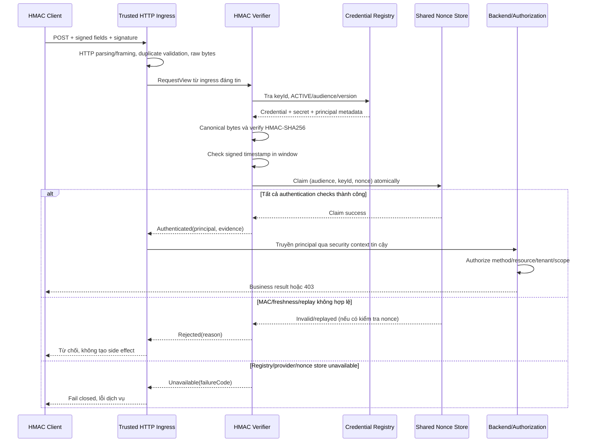

# Tạo authentication result khi xác minh HTTP request bằng HMAC

Trong một hệ thống xác thực HTTP request bằng HMAC, phép so sánh `MessageDigest.isEqual(expectedTag, suppliedTag)` trả về một giá trị boolean. Nhưng **boolean đó chưa phải kết quả xác thực đầy đủ**: request có thể có MAC đúng nhưng timestamp đã quá hạn, nonce đã dùng, credential bị thu hồi, sai audience hoặc HTTP gateway chuyển request tới tài nguyên không đúng như dữ liệu đã ký.

**Tạo authentication result** là bước chuyển một quy trình xác minh nhiều điều kiện thành **kết quả bảo mật có kiểu dữ liệu rõ ràng**, chỉ phát hành danh tính đáng tin cậy khi tất cả điều kiện authentication đều đạt. Kết quả này sau đó được chuyển cho các lớp phân quyền, xử lý nghiệp vụ, audit và HTTP response mapping mà không làm lộ shared secret hay MAC.

Bài thuộc chương **Xác minh request**, module `SECURITY_AUTHENTICATION_HMAC_REQUEST_AUTHENTICATION`. Phạm vi module là thiết kế xác thực HTTP bằng **HMAC với shared secret**, canonical request có method, URI, header hoặc body theo hợp đồng ký; xác minh signature, chống replay bằng timestamp/nonce, quản lý key rotation, kiểm thử proxy/gateway và **phân biệt authentication với authorization**. Bài này tập trung vào đầu ra của verifier, thời điểm tạo principal và cách bảo đảm kết quả đó không bị tin sai ở các tầng phía sau.

## 1. Mục tiêu học tập

Sau bài, bạn có thể:

1. Giải thích vì sao `MAC_VALID = true` chưa đủ để trả `Authenticated` cho một HTTP request.
2. Thiết kế mô hình `AuthenticationResult` có nhánh **Authenticated**, **Rejected** và **Unavailable** (lỗi hạ tầng, không được coi là xác thực thành công).
3. Xác định điều kiện **tạo principal**: đúng credential ACTIVE, đúng audience/policy, canonical request, full HMAC, timestamp hợp lệ và **claim nonce nguyên tử**.
4. Phân biệt dữ liệu **chưa tin cậy** từ header `X-Key-Id` với metadata đáng tin cậy từ credential registry đã được xác minh.
5. Đưa authentication result vào filter/gateway và security context nội bộ, không tin header danh tính do client tự cung cấp.
6. Viết ví dụ Java 17 có kết quả kiểu `sealed interface`, HMAC-SHA256, nonce store in-memory để thử nghiệm các trường hợp success, replay, tamper, expired, missing credential và store unavailable.
7. Phân biệt ánh xạ lỗi xác thực với **403 authorization**, lỗi nghiệp vụ và lỗi vận hành; kiểm thử tính nhất quán qua proxy/gateway.

## 2. Authentication result là gì?

Một **authentication result** là kết luận có cấu trúc từ một bộ xác minh request cụ thể, không phải bản copy của request và cũng không phải “danh tính” do client tự khai.

Ví dụ ở mức khái niệm:

```text
authenticate(httpRequest, credentialRegistry, nonceStore, clock)
    ├── Authenticated(principal, credentialRef, scheme, verifiedAt)
    ├── Rejected(reasonCode)
    └── Unavailable(serviceFailureCode)
```

Ý nghĩa của ba nhánh:

| Nhánh | Khi nào tạo? | Có principal đáng tin? | Tầng tiếp theo |
| --- | --- | --- | --- |
| **Authenticated** | Credential ACTIVE/đúng audience; signature đúng trên canonical bytes; timestamp mới; nonce được claim thành công; policy xác thực đạt. | **Có**, dựng từ registry đã được xác minh. | Tiếp tục **authorization**, validation và nghiệp vụ. |
| **Rejected** | Request sai định dạng, key ID không hợp lệ, signature sai, timestamp quá hạn hoặc nonce trùng. | **Không**. | Từ chối; không có side effect nghiệp vụ. |
| **Unavailable** | Không thể hoàn tất xác thực do hỏng secret manager/provider/nonce store hoặc phụ thuộc tin cậy khác. | **Không**. | **Fail closed**, báo lỗi dịch vụ và cảnh báo vận hành. |

**Lựa chọn thiết kế của bài:** chia kết quả thành ba nhánh để phân biệt **“đã kiểm tra và không đạt”** với **“không thể kiểm tra”**. Hệ thống khác có thể dùng tên lớp hoặc trạng thái khác, nhưng phải giữ bất biến: **không có đường lỗi nào mặc nhiên trở thành authenticated**.

### Vì sao không trả mỗi `boolean`?

```java
boolean valid = verifyHmac(request);
if (valid) {
    processBusiness(request); // SAI nếu bỏ freshness, nonce và authz
}
```

Cách viết này dễ khiến caller hiểu `valid` là “được phép thực thi”. Trong khi đó, `verifyHmac` có thể chỉ xác nhận một MAC dạng byte, chưa biết khóa còn hiệu lực, nonce đã dùng, hoặc client có quyền gọi endpoint. Một object `Authenticated` chỉ xuất hiện **sau khi đủ các bước xác thực** làm ranh giới tin cậy rõ hơn; lớp phân quyền vẫn phải độc lập.

## 3. Chuỗi điều kiện trước khi tạo `Authenticated`

Giả sử API có endpoint `POST /v1/orders`, giao thức `HMAC-SHA256-V1`. Một quy trình an toàn đi qua các cổng kiểm tra:

| Cổng | Kiểm tra bắt buộc | Nếu không đạt |
| --- | --- | --- |
| **1. HTTP ingress** | Framing hợp lệ; một giá trị cho header ký và signature; method/raw target/body theo hợp đồng; giới hạn kích thước; không có ambiguity. | `Rejected`, không đưa request lỗi vào business logic. |
| **2. Credential** | `X-Key-Id` tồn tại trong registry; key ACTIVE, chưa revoke/expire; đúng audience, protocol version và client. | `Rejected`; không gắn principal. |
| **3. Canonical request** | Server **tự dựng** UTF-8 bytes từ method, raw URI/query, signed headers, SHA-256(raw body), timestamp, nonce và audience. | `Rejected` nếu dữ liệu không thể canonicalize theo hợp đồng. |
| **4. MAC** | Decode signature strict, 32 byte HMAC-SHA256 đầy đủ; tính expected MAC bằng **đúng secret** và so bytes an toàn. | `Rejected`; không tiêu thụ nonce của chữ ký sai. |
| **5. Freshness** | Timestamp UTC được ký, thuộc cửa sổ thời gian cho phép; nonce có định dạng hợp lệ. | `Rejected` vì quá hạn hoặc không mới. |
| **6. Replay** | Claim `(audience, keyId, nonce)` **nguyên tử** trong kho dùng chung trước side effect. | `Rejected` nếu đã dùng; `Unavailable` nếu kho không hoạt động. |
| **7. Publish result** | Lấy `clientId`, `tenantId` và metadata tin cậy từ registry; tạo `Authenticated` không chứa secret. | Chỉ thực hiện khi **tất cả sáu cổng trước đều đạt**. |
| **8. Authorization** | Principal có quyền đối với **method + resource + tenant + field/scope** thực sự xử lý? | `403` hoặc lỗi phân quyền; **không** làm authentication result thành “chưa xác thực”. |

Việc xác minh MAC **trước khi claim nonce** giảm khả năng kẻ không biết secret gây tiêu hao nonce hợp lệ hoặc làm đầy kho nonce bằng request giả. Tuy vậy hệ thống còn cần rate limit, quota, giới hạn body và bảo vệ registry khỏi request số lượng lớn.

### Trạng thái từng giai đoạn không phải kết quả cuối

```text
signatureFormatOk   = true
credentialExists    = true
macMatches          = true
timestampFresh      = false
nonceClaimed        = false

AuthenticationResult = Rejected(EXPIRED_REQUEST)
```

Ngay cả khi MAC đúng, **đừng trả Authenticated** trước khi freshness và nonce claim được hoàn tất. Nếu nonce store ngừng hoạt động, kết quả đúng là **Unavailable**, không phải `Authenticated` với một cờ `replayCheckSkipped=true`.

## 4. Principal được tạo từ nguồn tin cậy nào?

Request có thể chứa:

```http
X-Key-Id: partner-a-202611
X-Client-Id: admin
X-Tenant-Id: tenant-root
X-Authenticated-Client: root-user
```

Tất cả đều là **dữ liệu đến từ bên ngoài** tại thời điểm mới nhận. `X-Key-Id` được dùng làm **khóa tra cứu credential**, nhưng **chưa xác thực danh tính**. Những header như `X-Client-Id`, `X-Tenant-Id` và `X-Authenticated-Client` không trở nên đáng tin chỉ vì client gửi cùng một HMAC.

Registry đáng tin cậy có thể chứa:

```text
keyId:       partner-a-202611
clientId:    partner-a
tenantId:    tenant-42
audience:    orders-api-prod
scheme:      HMAC-SHA256-V1
status:      ACTIVE
secret:      <managed by secret manager>
scopes:      [orders:read, orders:create]
```

Sau khi request vượt qua mọi cổng authentication, verifier mới tạo:

```text
Authenticated(
  principal = {
    clientId = "partner-a",
    tenantId = "tenant-42",
    scopes = ["orders:read", "orders:create"]
  },
  credentialId = "partner-a-202611",
  scheme = "HMAC-SHA256-V1",
  verifiedAt = 2026-11-28T02:00:10Z
)
```

Secret, raw MAC, chữ ký wire, raw body hoặc toàn bộ canonical string **không phải field của principal**. Đối với audit, có thể giữ một mã request nội bộ, mốc thời gian và phiên bản giao thức; không cần lan truyền dữ liệu mật mã nhạy cảm tới từng controller.

### Phân biệt `clientId`, `keyId` và `tenantId`

| Field | Ý nghĩa | Độ tin cậy |
| --- | --- | --- |
| `keyId` nhận từ request | Lời khai credential được dùng để tra cứu. | **Chưa tin** cho đến khi xác thực. |
| `clientId` từ credential registry | Định danh ứng dụng đối tác, do hệ thống cấp. | Chỉ publish sau khi HMAC/freshness/replay đạt. |
| `tenantId` từ registry hoặc mapping tin cậy | Tenant gắn với client/credential. | Không lấy trực tiếp từ header tùy ý. |
| `scopes` / entitlements | Quyền **có thể** được cấp cho client, được registry khai báo. | Đầu vào cho **authorization**, không phải quyết định cho phép từng request. |
| `credentialId` sau authentication | Tham chiếu credential đã xác minh, hỗ trợ audit/rotation. | Không chứa secret. |
| `signature` | Bằng chứng MAC gửi qua header. | Không đưa vào principal/session context. |

**Không đồng nhất authenticated principal với quyền truy cập.** Một client được xác thực với scope `orders:read` có thể không được thực hiện `POST /v1/orders`. Quyết định đó thuộc authorization, dựa trên scope, tenant, method, resource và trạng thái nghiệp vụ.

## 5. Hợp đồng HMAC phải được đóng băng trước khi kết luận

Để tránh verifier và client dựng hai chuỗi ký khác nhau, bài chọn **hợp đồng minh họa** `HMAC-SHA256-V1`:

| Phần dữ liệu | Quy tắc |
| --- | --- |
| Signature algorithm | `HmacSHA256`, full tag 32 byte, không nhận tag cắt ngắn. |
| Signature wire format | `X-Signature: v1=<Base64 chuẩn có padding của 32 byte>`. |
| Audience | Chính xác `orders-api-prod` ở canonical line thứ hai. |
| Method | Chính xác `POST`, phân biệt hoa/thường. |
| Target | Origin-form raw target `/v1/orders?channel=partner`, không decode/reorder query. |
| Content-Type | Duy nhất, chính xác `application/json`; tên header canonical lowercase. |
| Content-Encoding | V1 không chấp nhận field này hoặc nén body. |
| Key ID | Duy nhất, thuộc allowlist ký tự; được đưa vào canonical string. |
| Timestamp | `YYYY-MM-DDTHH:mm:ssZ`, kiểm tra freshness ±300 giây. |
| Nonce | 16 byte ngẫu nhiên biểu diễn Base64URL **không padding**; được ký, sử dụng một lần. |
| Body | SHA-256 của **raw content bytes** sau HTTP transfer framing, trước JSON parser, hex chữ thường. |
| Canonical encoding | UTF-8, LF giữa các dòng, **không LF cuối**. |

HTTP request:

```http
POST /v1/orders?channel=partner HTTP/1.1
Host: api.example.test
Content-Type: application/json
X-Key-Id: partner-a-202611
X-Timestamp: 2026-11-28T02:00:00Z
X-Nonce: Zq8DxKtUokcwPGNj3d_yvQ
X-Signature: v1=<BASE64_FULL_HMAC_SHA256>

{"sku":"BK-42","quantity":2}
```

Canonical string:

```text
HMAC-SHA256-V1
orders-api-prod
POST
/v1/orders?channel=partner
content-type:application/json
x-key-id:partner-a-202611
x-timestamp:2026-11-28T02:00:00Z
x-nonce:Zq8DxKtUokcwPGNj3d_yvQ
sha256:<LOWERCASE_HEX_SHA256_OF_RAW_BODY>
```

Các chuỗi `<...>` là placeholder, **không phải** digest/chữ ký thực. Bên gửi tính:

\[
\begin{aligned}
D &= \operatorname{SHA256}(\mathrm{rawBodyBytes}),\\
C &= \operatorname{UTF8}(\mathrm{canonicalString\ with\ hex}(D)),\\
T &= \operatorname{HMAC}_{\mathrm{SHA256}}(K,C),\\
S &= \texttt{v1=} \Vert \operatorname{Base64}_{\mathrm{padded}}(T).
\end{aligned}
\]

Bên nhận **tự dựng** `C` từ HTTP request thực nhận, không tin một header `X-Canonical-Request` do client khai. Header signature **không** nằm trong dữ liệu ký. `X-Key-Id`, timestamp, nonce và media type **có** nằm trong dữ liệu ký, vì chúng ảnh hưởng đến nhận diện, replay và parser.

### Tại sao phải ràng buộc target và audience?

Nếu chỉ ký body, request có thể bị chuyển từ `POST /v1/orders` thành một hành động khác mà tầng mật mã không phát hiện. Nếu dùng cùng secret tại nhiều API và không ràng buộc audience, chữ ký có thể bị phát lại ở nơi có ý nghĩa nghiệp vụ khác. Vì vậy verifier phải biết **endpoint/môi trường chính xác đang được xác thực**, chứ không tự chọn audience do client tùy ý gửi.

## 6. Luồng tạo authentication result trong gateway/filter



**Lưu ý:** Sơ đồ nhóm các nhánh để dễ đọc; khi HMAC không hợp lệ, verifier **không gọi nonce store**. Với request bị replay, nonce store trả lỗi claim nhưng MAC vẫn có thể hợp lệ. Với backend trả 403, authentication result trước đó vẫn có thể là `Authenticated` — chính **authorization** đã từ chối.

### Ai có trách nhiệm gì?

| Thành phần | Trách nhiệm | Không nên làm |
| --- | --- | --- |
| HTTP ingress | Parse/framing an toàn, chặn header trùng, giới hạn body, chọn raw target, kiểm soát rewrite. | Tin `X-Original-URI`/principal header do client tự khai. |
| HMAC verifier | Chọn đúng policy, canonical bytes, so MAC, timestamp, nonce và tạo result. | Quyết định mọi quyền nghiệp vụ chỉ bằng MAC. |
| Credential registry | Quản lý key ID, secret, ACTIVE/REVOKED, audience, client/tenant metadata. | Để client tự khai `clientId` thay mapping. |
| Nonce store | Claim nguyên tử, lưu tới khi timestamp hết thời gian chấp nhận. | Dùng một set riêng cho mỗi instance mà tin đã chống replay toàn cụm. |
| Security context adapter | Chỉ nhận result `Authenticated`, truyền principal qua ranh giới tin cậy. | Tạo principal từ `X-Key-Id` trước khi verify. |
| Authorization/business | Kiểm tra scope, tenant, resource, field và điều kiện nghiệp vụ. | Coi `Authenticated` là được phép thực hiện mọi hành động. |

## 7. Java 17: mô hình kết quả xác thực có kiểu dữ liệu

Ta dùng **sealed interface** của Java 17 để thể hiện ba kết quả. Đây là ví dụ **tự chạy**, không phụ thuộc Spring, Servlet hay thư viện ngoài. Nó dùng:

- `Mac.getInstance("HmacSHA256")` với secret 32 byte giả cho test, full 32-byte tag.
- `Base64` chuẩn có padding cho signature và Base64URL không padding cho nonce.
- `MessageDigest.isEqual` để so raw MAC bytes.
- `Clock.fixed` để kiểm thử timestamp có tính lặp lại.
- Kho nonce in-memory có `synchronized claim` cho một JVM demo; **không dùng thay distributed nonce store** trong production.
- `Authenticated` chỉ được tạo **sau** MAC, freshness và nonce claim đều thành công.
- Các nhánh `Rejected` và `Unavailable` không chứa principal.

Lưu file `AuthenticationResultHmacDemo.java` và chạy với Java 17. Các field giả/test không được sao chép làm credential sản xuất.

```java
import java.nio.charset.StandardCharsets;
import java.security.GeneralSecurityException;
import java.security.MessageDigest;
import java.time.Clock;
import java.time.Instant;
import java.time.ZoneOffset;
import java.time.format.DateTimeParseException;
import java.util.Arrays;
import java.util.Base64;
import java.util.HashMap;
import java.util.HexFormat;
import java.util.Map;
import java.util.Set;
import javax.crypto.Mac;
import javax.crypto.spec.SecretKeySpec;

public final class AuthenticationResultHmacDemo {
    private static final String SCHEME = "HMAC-SHA256-V1";
    private static final String AUDIENCE = "orders-api-prod";
    private static final String TARGET = "/v1/orders?channel=partner";
    private static final String TYPE = "application/json";
    private static final String PREFIX = "v1=";
    private static final long WINDOW_SECONDS = 300;
    private static final long NONCE_GRACE_SECONDS = 30;

    private AuthenticationResultHmacDemo() {}

    public sealed interface AuthenticationResult
            permits Authenticated, Rejected, Unavailable {}

    public record Principal(
            String clientId, String tenantId, Set<String> scopes) {
        public Principal {
            scopes = Set.copyOf(scopes);
        }
    }

    public record Authenticated(
            Principal principal, String credentialId,
            String scheme, Instant verifiedAt)
            implements AuthenticationResult {}

    public enum RejectCode {
        BAD_REQUEST, INVALID_CREDENTIAL, INVALID_SIGNATURE,
        EXPIRED_REQUEST, NONCE_REPLAY
    }

    public record Rejected(RejectCode reason)
            implements AuthenticationResult {}

    public enum FailureCode {
        CRYPTO_PROVIDER, NONCE_STORAGE
    }

    public record Unavailable(FailureCode reason)
            implements AuthenticationResult {}

    // Secret được giữ trong registry, không đi vào Principal hoặc result.
    public record Credential(
            String clientId, String tenantId, String audience,
            boolean active, byte[] secret, Set<String> scopes) {
        public Credential {
            secret = secret.clone();
            scopes = Set.copyOf(scopes);
        }
        @Override
        public byte[] secret() {
            return secret.clone();
        }
    }

    public record SignedRequest(
            String method, String rawTarget, String contentType,
            boolean contentEncodingPresent, String keyId,
            String timestamp, String nonce, byte[] rawBody,
            String signature) {
        public SignedRequest {
            if (rawBody != null) {
                rawBody = rawBody.clone();
            }
        }
        @Override
        public byte[] rawBody() {
            return rawBody == null ? null : rawBody.clone();
        }
    }

    public interface NonceStore {
        boolean claim(String key, Instant expiresAt, Instant now)
                throws NonceStoreUnavailableException;
    }

    public static final class NonceStoreUnavailableException
            extends Exception {}

    public static final class LocalNonceStore implements NonceStore {
        private final Map<String, Instant> expiries = new HashMap<>();

        // Chỉ nguyên tử bên trong một JVM. Production dùng DB/Redis
        // insert-if-absent nguyên tử với TTL trên kho dùng chung.
        @Override
        public synchronized boolean claim(
                String key, Instant expiresAt, Instant now) {
            if (!expiresAt.isAfter(now)) {
                return false;
            }
            expiries.entrySet().removeIf(
                    entry -> !entry.getValue().isAfter(now));
            if (expiries.containsKey(key)) {
                return false;
            }
            expiries.put(key, expiresAt);
            return true;
        }
    }

    private static boolean validShape(SignedRequest r) {
        if (r == null
                || !"POST".equals(r.method())
                || !TARGET.equals(r.rawTarget())
                || !TYPE.equals(r.contentType())
                || r.contentEncodingPresent()
                || r.keyId() == null
                || !r.keyId().matches("[A-Za-z0-9_-]{1,80}")
                || r.timestamp() == null
                || !r.timestamp().matches(
                    "[0-9]{4}-[0-9]{2}-[0-9]{2}T"
                    + "[0-9]{2}:[0-9]{2}:[0-9]{2}Z")
                || r.nonce() == null
                || r.rawBody() == null
                || r.rawBody().length > 8192) {
            return false;
        }
        try {
            byte[] nonce = Base64.getUrlDecoder().decode(r.nonce());
            return nonce.length == 16
                    && Base64.getUrlEncoder().withoutPadding()
                            .encodeToString(nonce).equals(r.nonce());
        } catch (IllegalArgumentException invalidNonce) {
            return false;
        }
    }

    private static byte[] canonicalBytes(SignedRequest r)
            throws GeneralSecurityException {
        String hash = HexFormat.of().formatHex(
                MessageDigest.getInstance("SHA-256").digest(r.rawBody()));
        String canonical = String.join("\n",
                SCHEME, AUDIENCE, r.method(), r.rawTarget(),
                "content-type:" + r.contentType(),
                "x-key-id:" + r.keyId(),
                "x-timestamp:" + r.timestamp(),
                "x-nonce:" + r.nonce(),
                "sha256:" + hash);
        return canonical.getBytes(StandardCharsets.UTF_8);
    }

    private static byte[] hmac(byte[] secret, byte[] bytes)
            throws GeneralSecurityException {
        // Key length là policy provisioning của ví dụ.
        if (secret == null || secret.length < 32) {
            throw new GeneralSecurityException("Invalid HMAC credential");
        }
        Mac mac = Mac.getInstance("HmacSHA256");
        mac.init(new SecretKeySpec(secret, "HmacSHA256"));
        return mac.doFinal(bytes);
    }

    private static byte[] decodeSignature(String header) {
        if (header == null || header.length() != 47
                || !header.startsWith(PREFIX)) {
            return null;
        }
        String encoded = header.substring(PREFIX.length());
        if (!encoded.matches("[A-Za-z0-9+/]{43}=")) {
            return null;
        }
        try {
            byte[] supplied = Base64.getDecoder().decode(encoded);
            return supplied.length == 32
                    && Base64.getEncoder().encodeToString(supplied)
                            .equals(encoded)
                    ? supplied : null;
        } catch (IllegalArgumentException malformed) {
            return null;
        }
    }

    // Trả Principal CHỈ sau khi MAC, freshness và nonce đều đạt.
    public static AuthenticationResult authenticate(
            SignedRequest r, Map<String, Credential> registry,
            NonceStore nonceStore, Clock clock) {
        if (!validShape(r)) {
            return new Rejected(RejectCode.BAD_REQUEST);
        }

        Credential credential = registry.get(r.keyId());
        if (credential == null || !credential.active()
                || !AUDIENCE.equals(credential.audience())) {
            return new Rejected(RejectCode.INVALID_CREDENTIAL);
        }

        byte[] supplied = decodeSignature(r.signature());
        if (supplied == null) {
            return new Rejected(RejectCode.INVALID_SIGNATURE);
        }

        try {
            byte[] expected = hmac(
                    credential.secret(), canonicalBytes(r));
            if (!MessageDigest.isEqual(expected, supplied)) {
                return new Rejected(RejectCode.INVALID_SIGNATURE);
            }
        } catch (GeneralSecurityException providerFailure) {
            return new Unavailable(FailureCode.CRYPTO_PROVIDER);
        }

        Instant requestTime;
        try {
            requestTime = Instant.parse(r.timestamp());
        } catch (DateTimeParseException badTimestamp) {
            return new Rejected(RejectCode.BAD_REQUEST);
        }
        Instant now = clock.instant();
        if (requestTime.isBefore(now.minusSeconds(WINDOW_SECONDS))
                || requestTime.isAfter(now.plusSeconds(WINDOW_SECONDS))) {
            return new Rejected(RejectCode.EXPIRED_REQUEST);
        }

        // Giữ nonce tới sau lúc timestamp không còn được chấp nhận.
        Instant expiresAt = requestTime.plusSeconds(
                WINDOW_SECONDS + NONCE_GRACE_SECONDS);
        try {
            String nonceKey = AUDIENCE + ":" + r.keyId() + ":" + r.nonce();
            if (!nonceStore.claim(nonceKey, expiresAt, now)) {
                return new Rejected(RejectCode.NONCE_REPLAY);
            }
        } catch (NonceStoreUnavailableException storeFailure) {
            return new Unavailable(FailureCode.NONCE_STORAGE);
        }

        Principal principal = new Principal(
                credential.clientId(), credential.tenantId(),
                credential.scopes());
        return new Authenticated(principal, r.keyId(), SCHEME, now);
    }

    // Client test tạo chữ ký trên cùng các trường sẽ gửi.
    public static SignedRequest signForTest(
            byte[] secret, String timestamp, String nonce, byte[] body)
            throws GeneralSecurityException {
        SignedRequest unsigned = new SignedRequest(
                "POST", TARGET, TYPE, false,
                "partner-a-202611", timestamp, nonce, body, null);
        String signature = PREFIX + Base64.getEncoder().encodeToString(
                hmac(secret, canonicalBytes(unsigned)));
        return new SignedRequest(
                unsigned.method(), unsigned.rawTarget(),
                unsigned.contentType(), false, unsigned.keyId(),
                timestamp, nonce, body, signature);
    }

    public static void main(String[] args) throws Exception {
        byte[] key = new byte[32];  // Secret giả CHỈ dành cho test.
        Arrays.fill(key, (byte) 0x5a);
        Map<String, Credential> registry = Map.of(
                "partner-a-202611",
                new Credential("partner-a", "tenant-42",
                        AUDIENCE, true, key, Set.of("orders:read")));
        Clock clock = Clock.fixed(
                Instant.parse("2026-11-28T02:00:30Z"), ZoneOffset.UTC);
        LocalNonceStore nonceStore = new LocalNonceStore();
        byte[] body = "{\"sku\":\"BK-42\",\"quantity\":2}"
                .getBytes(StandardCharsets.UTF_8);

        SignedRequest original = signForTest(
                key, "2026-11-28T02:00:00Z",
                "Zq8DxKtUokcwPGNj3d_yvQ", body);
        AuthenticationResult first = authenticate(
                original, registry, nonceStore, clock);
        if (!(first instanceof Authenticated)) {
            throw new AssertionError("Valid request not authenticated");
        }
        Authenticated success = (Authenticated) first;
        if (!"partner-a".equals(success.principal().clientId())) {
            throw new AssertionError("Wrong trusted principal");
        }

        // Cùng nonce và chữ ký: MAC vẫn đúng nhưng phải bị chặn replay.
        AuthenticationResult replay = authenticate(
                original, registry, nonceStore, clock);
        if (!(replay instanceof Rejected reject)
                || reject.reason() != RejectCode.NONCE_REPLAY) {
            throw new AssertionError("Replay was not rejected");
        }

        // Cùng chữ ký nhưng body đã đổi: từ chối MAC, không claim nonce.
        SignedRequest tampered = new SignedRequest(
                original.method(), original.rawTarget(),
                original.contentType(), false, original.keyId(),
                original.timestamp(), original.nonce(),
                "{\"sku\":\"BK-42\",\"quantity\":3}"
                    .getBytes(StandardCharsets.UTF_8),
                original.signature());
        AuthenticationResult altered = authenticate(
                tampered, registry, new LocalNonceStore(), clock);
        if (!(altered instanceof Rejected invalid)
                || invalid.reason() != RejectCode.INVALID_SIGNATURE) {
            throw new AssertionError("Modified body accepted");
        }

        // Chữ ký hợp lệ trên timestamp cũ vẫn phải bị từ chối.
        SignedRequest stale = signForTest(
                key, "2026-11-28T01:54:00Z",
                "5gsAL91CkDQI84aZlgfSBg", body);
        AuthenticationResult old = authenticate(
                stale, registry, new LocalNonceStore(), clock);
        if (!(old instanceof Rejected expired)
                || expired.reason() != RejectCode.EXPIRED_REQUEST) {
            throw new AssertionError("Expired request accepted");
        }

        // Store không sẵn sàng: không bao giờ cấp principal.
        SignedRequest fresh = signForTest(
                key, "2026-11-28T02:00:00Z",
                "AvWX9nvJrt_I43yOBt4AFg", body);
        NonceStore unavailable = (nonceKey, expiry, now) -> {
            throw new NonceStoreUnavailableException();
        };
        if (!(authenticate(fresh, registry, unavailable, clock)
                instanceof Unavailable)) {
            throw new AssertionError("Store failure authenticated a request");
        }

        // Authentication đạt nhưng scopes chỉ có orders:read.
        // Phân quyền bên dưới KHÔNG được coi là đã thành công.
        if (success.principal().scopes().contains("orders:create")) {
            throw new AssertionError("Unexpected order creation permission");
        }
        System.out.println(
                "Authenticated / Rejected / Unavailable checks passed.");
    }
}
```

### Giải thích thiết kế Java

- **`sealed interface AuthenticationResult`** giới hạn các trạng thái được trả về. Caller có thể dùng pattern matching `instanceof` để xử lý từng nhánh.
- **`Authenticated`** chứa `Principal` bất biến theo cách sử dụng và tham chiếu credential đã xác minh, **không** chứa secret, raw signature hay body.
- **`Rejected`** chứa mã nguyên nhân nội bộ có kiểm soát. Server có thể gom các nguyên nhân này thành phản hồi `401` chung, tránh giúp người ngoài dò credential.
- **`Unavailable`** thể hiện “không thể xác minh vì hạ tầng”. Tuyệt đối không chuyển nhánh này thành `Authenticated` hoặc bỏ qua nonce store.
- **`Credential.secret()`** và `SignedRequest.rawBody()` trả bản sao để hạn chế mutation mảng. Production còn phải quản lý vòng đời secret và vùng nhớ phù hợp.
- **`LocalNonceStore.claim`** được `synchronized` nên hai thread trong **cùng JVM demo** không cùng claim một nonce thành công. Cụm nhiều node cần thao tác nguyên tử trong kho dùng chung.
- **`Clock.fixed`** giúp test timestamp deterministic, không phụ thuộc giờ chạy thực tế. Production dùng đồng hồ hệ thống được đồng bộ và có policy cho lệch giờ.
- **Claim nonce diễn ra sau MAC và freshness**, trước khi tạo `Principal`; request có chữ ký sai không được phép “chiếm trước” nonce hợp lệ.
- Scope `orders:read` trong test chứng minh **authentication pass nhưng authorization cho `POST` tạo đơn vẫn không pass**.

**Giới hạn:** Đây là bài mẫu lõi xác thực, chưa xây HTTP parser, servlet filter, credential secret manager, log/audit pipeline, rate limiting hay router thật. `Map<String, Credential>` là registry giả và không mô phỏng lỗi registry; hệ thống production phải coi registry không khả dụng là **Unavailable**. Code không tự chứng minh entropy nonce của client, không xử lý raw request-target ambiguity hoặc duplicate header trên wire; những điều đó phải do ingress và hợp đồng HTTP bảo đảm.

## 8. Publish result vào security context an toàn

Sau khi verifier trả `Authenticated`, tầng tích hợp (gateway/filter) thường cần cho backend biết principal. Nhưng **không nên** biến mọi header `X-Authenticated-Client` thành một danh tính được tin.

Ví dụ ở mức pseudocode Java:

```java
AuthenticationResult result = verifier.authenticate(
        requestView, credentialRegistry, nonceStore, clock);

if (result instanceof Authenticated success) {
    // Chỉ dùng principal đã được verifier tạo, không đọc clientId
    // từ header do client tự gửi.
    TrustedRequestContext context =
            trustedContext.withPrincipal(success.principal());

    // Bước tiếp theo riêng biệt:
    authorizationService.assertAllowed(
            context.principal(),
            requestView.actualMethod(),
            resolvedResource,
            requiredScope);
    businessHandler.handle(context);
} else if (result instanceof Rejected rejected) {
    sendAuthenticationFailure();  // Không gửi reason nhạy cảm ra ngoài.
} else if (result instanceof Unavailable unavailable) {
    sendServiceUnavailable();      // Fail closed, cảnh báo vận hành.
}
```

Đây là **mảnh kiến trúc**, không phải class compile độc lập: `verifier`, `TrustedRequestContext`, `authorizationService` và các method là interface do ứng dụng triển khai. Chỉ sử dụng nó sau khi HTTP adapter đã xây `requestView` từ nguồn đáng tin.

### Gateway → backend

Nếu gateway xác minh HMAC rồi chuyển kết quả đến backend, cần bảo vệ ranh giới giữa hai tầng:

1. **Xóa trước** mọi header nội bộ do client Internet gửi, đặc biệt `X-Authenticated-Client`, `X-Auth-Scopes`, `X-Original-URI`.
2. **Tạo principal mới** từ `Authenticated` và truyền qua channel nội bộ đã xác thực/bảo vệ, ví dụ mTLS hoặc một assertion nội bộ có chữ ký và thời hạn ngắn.
3. **Ràng buộc assertion** với audience backend, request identity và method/resource/route đã được xác minh; tránh tình huống backend sử dụng assertion cho request khác.
4. **Đảm bảo effective route** mà backend thực thi thống nhất với method/raw URI đã được ký và được gateway kiểm tra.
5. Không cho bypass gateway để client gọi backend trực tiếp với các header giả; áp network policy và service authentication phù hợp.

Truyền `clientId` qua một header nội bộ **không tự biến header đó thành trusted**. Mức tin cậy đến từ việc gateway **đã xác thực**, xóa spoofed input và dùng kênh chỉ backend chấp nhận từ thực thể đáng tin.

## 9. Mã lỗi nội bộ, phản hồi HTTP và audit

Authentication result hữu ích vì giúp caller **quyết định phản hồi và audit một cách có kiểm soát**, không trộn lý do từ mật mã, hạ tầng và phân quyền.

| Result / tình huống | Internal code gợi ý | HTTP response theo contract |
| --- | --- | --- |
| Signature/header sai định dạng | `BAD_REQUEST` hoặc `INVALID_SIGNATURE` | `400` hoặc `401` tùy giao thức; không tiết lộ chi tiết parser. |
| Key ID không tồn tại, revoked, sai audience | `INVALID_CREDENTIAL` | Thường `401` chung, tránh enumeration. |
| HMAC đầy đủ sai | `INVALID_SIGNATURE` | `401 Unauthorized`. |
| Timestamp ngoài cửa sổ | `EXPIRED_REQUEST` | `401` hoặc mã authentication/freshness theo API. |
| Nonce đã được claim | `NONCE_REPLAY` | `401` hoặc mã lỗi replay theo API contract. |
| Nonce store lỗi | `NONCE_STORAGE` | **`503`/5xx**, fail closed; cảnh báo vận hành. |
| JCA provider/secret manager lỗi | `CRYPTO_PROVIDER` | **5xx**, không nói client ký sai. |
| Authenticated nhưng thiếu scope/tenant/resource permission | Không phải `Rejected` authentication | `403 Forbidden` hoặc policy che resource. |
| Authenticated và authorized nhưng body nghiệp vụ sai | Không phải lỗi authentication | `400`/`409`/`422` theo contract. |
| Authenticated và authorized, nghiệp vụ thành công | `Authenticated` (security) + business success | `200`/`201`/`204` phù hợp nghiệp vụ. |

**Lưu ý HTTP:** Nếu sử dụng `401` theo đúng HTTP authentication semantics, server cần có challenge `WWW-Authenticate` phù hợp scheme được API định nghĩa. Với HMAC tự thiết kế qua `X-Signature`, cần công bố cách challenge và status trong API contract, không tự cho rằng mọi hệ thống dùng `401` giống hệt nhau.

### Không công khai nguyên nhân quá chi tiết

Đối với bên ngoài, nhiều lỗi có thể dùng cùng thông điệp tổng quát như:

```json
{"error":"request_authentication_failed"}
```

Trong telemetry nội bộ có thể ghi `requestId`, `credentialId` đã được lọc, `schemeVersion`, `failureCategory`, kết quả claim nonce, thời gian xử lý và server instance. Không log **shared secret, full signature, raw body có PII hoặc canonical string chứa dữ liệu nhạy cảm**. Ngay cả digest body cũng có thể giúp liên kết dữ liệu; cần chính sách logging rõ ràng.

**Quan sát điều kiện hạ tầng:** Một loạt kết quả `Unavailable(NONCE_STORAGE)` là tín hiệu hệ thống chống replay bị lỗi, khác hẳn một đợt `Rejected(INVALID_SIGNATURE)` do client SDK bị lệch canonicalization. Phân tách chúng giúp alert đúng mà không nới lỏng bảo mật để giảm tỷ lệ lỗi.

## 10. Replay: result chỉ thành công sau claim nguyên tử

Giả sử client gửi request với timestamp `2026-11-28T02:00:00Z`, nonce `N` và MAC đúng. Tại thời điểm `02:00:10Z`, server có thể chấp nhận. Nếu cùng request được phát lại lúc `02:00:20Z`, MAC vẫn đúng — nhưng nonce `N` đã claim, nên result phải là:

```text
Rejected(NONCE_REPLAY)
```

Nếu hai request đến **hai gateway khác nhau** đồng thời, một `HashSet` riêng trong mỗi JVM không đủ. Nonce store production phải có **atomic insert-if-absent** với key chứa audience/key ID/nonce, TTL và tính nhất quán phù hợp. Tối đa một request có thể claim thành công cho cùng key.

### Nonce TTL có liên quan timestamp

Với cửa sổ thời gian `±300` giây, một timestamp ở **tương lai 300 giây** có thể được chấp nhận ngay, rồi còn hợp lệ cho đến khi đồng hồ server đi thêm gần **600 giây** kể từ lần nhận sớm. Nếu lưu nonce chỉ 300 giây kể từ lúc claim, cùng request có thể được gửi lại khi entry đã hết nhưng timestamp vẫn hợp lệ.

Quy tắc minh họa:

```text
nonceExpiresAt = signedTimestamp + allowedPastWindow + safetyMargin
```

Khi claim, store phải giữ key tới thời điểm này hoặc lâu hơn theo policy. Đặt TTL theo **mốc hết hiệu lực của timestamp**, không theo một số giây từ lần nhận đầu nếu nó ngắn hơn thời gian còn chấp nhận request. Ví dụ Java dùng 300 giây + 30 giây biên an toàn; với cluster, cần cân nhắc clock skew, TTL semantics và đồng bộ thời gian thật.

### Xử lý lỗi sau khi claim nonce

Nếu authentication thành công và nonce đã claim nhưng authorization trả `403` hoặc business validation trả `422`, nonce **đã dùng**. Không giải phóng nonce vì “chưa tạo đơn”: việc cho tái sử dụng cùng request còn có thể tạo replay hoặc race. Client phải tạo timestamp/nonce/signature mới nếu cần gửi yêu cầu khác.

Ngược lại, HMAC sai nên bị từ chối **trước khi claim**, tránh cho kẻ không có secret tiêu hao nonce của request hợp lệ.

## 11. Rotation và cập nhật credential metadata trong authentication result

Trong giai đoạn key rotation, nhiều key ID có thể ánh xạ đến **cùng một client**:

| Credential ID | Client principal | Secret | Trạng thái |
| --- | --- | --- | --- |
| `partner-a-202611` | `partner-a` | Secret A | ACTIVE trong overlap. |
| `partner-a-202702` | `partner-a` | Secret B | ACTIVE mới. |
| `partner-a-202608` | `partner-a` | Đã thu hồi | REVOKED. |

Verifier phải chọn **đúng một credential** theo `X-Key-Id`, dùng secret của ID đó và kiểm tra ACTIVE/audience/expiry. Không thử mọi secret đến khi MAC khớp. Khi request hợp lệ, result có thể mang **credentialId thực sự được sử dụng** để audit, nhưng business principal vẫn là `partner-a`.

Nếu A bị thu hồi ngay trước request, kết quả phải là `Rejected(INVALID_CREDENTIAL)` dù request từng ký đúng. Nếu registry/cache lỗi không biết A có còn active, phải **fail closed** theo chính sách, có thể trả `Unavailable` thay vì chấp nhận vì cache cũ.

### Metadata của principal có thể thay đổi

Scope, tenant assignment và trạng thái client có thể bị cập nhật. Kết quả xác thực thể hiện dữ liệu registry tại **mốc tin cậy được xác minh** theo cache/consistency policy. Tầng authorization vẫn có thể cần tra cứu trạng thái quyền mới nhất khi xử lý tác vụ nhạy cảm, thay vì tin một danh sách scope cũ quá lâu.

Nếu giao thức đổi từ HMAC-SHA256 sang HMAC-SHA512 hoặc thay canonicalization, đó là **protocol version change**, không chỉ là key rotation. Result nên lưu scheme/version đã xác minh; không chấp nhận downgrade dựa trên algorithm do client tự chọn.

## 12. Tránh tạo authentication result từ dữ liệu sai tầng

| Sai lầm | Hậu quả | Cách đúng |
| --- | --- | --- |
| Tạo principal ngay khi đọc `X-Key-Id`. | Header chưa xác thực có thể mạo danh client. | Chỉ lookup credential để verify; publish principal sau tất cả checks. |
| Xem Base64 decode thành công là authenticated. | Tag 32 byte bất kỳ có thể decode được. | Tính expected HMAC và so raw bytes, rồi freshness/nonce. |
| Chỉ so MAC mà bỏ timestamp và nonce. | Request hợp lệ bị phát lại. | Claim nonce nguyên tử trước khi trả `Authenticated`. |
| Nếu nonce store lỗi thì bỏ qua kiểm tra. | Mất replay protection nhưng vẫn phát hành principal. | Trả `Unavailable`, fail closed. |
| Từ chối MAC sai nhưng đã claim nonce trước đó. | Kẻ ngoài có thể tiêu hao nonce của request hợp lệ. | Chỉ claim sau khi MAC/freshness đạt. |
| Tin `X-Authenticated-Client` từ mạng ngoài. | Client giả principal nội bộ. | Ingress xóa header rồi truyền principal qua kênh bảo vệ. |
| Dùng `Authenticated` để bỏ authorization. | Client đọc có thể được ghi/xóa mọi dữ liệu. | Authorize principal + resource/tenant/method/scope riêng. |
| Ký raw target ở edge nhưng backend route đến resource khác. | MAC đúng cho một path nhưng handler thực hiện path khác. | Đồng nhất route/effective resource và policy tại gateway/backend. |
| Đưa shared secret hoặc full signature vào result. | Rò rỉ credential qua log/tracing/context. | Result chỉ chứa principal và evidence tối thiểu. |
| Nuốt lỗi provider/registry thành “HMAC sai”. | Không phát hiện sự cố hạ tầng, debug sai nguyên nhân. | Phân biệt `Rejected` và `Unavailable`. |

## 13. Kiểm thử authentication result tại ranh giới verifier

Nên kiểm tra **kết quả kiểu dữ liệu**, **thứ tự các bước** và **việc không gây side effect** ở từng tình huống.

| Test case | Result mong đợi | Điều cần xác nhận thêm |
| --- | --- | --- |
| Request đầy đủ, key ACTIVE, HMAC đúng, timestamp mới, nonce chưa dùng. | **Authenticated** | Principal từ registry, không từ header client. |
| Giữ nguyên signature nhưng thay một byte body. | `Rejected(INVALID_SIGNATURE)` | **Nonce chưa bị claim**. |
| Đổi `POST` thành `PUT`. | `Rejected(BAD_REQUEST)` hoặc invalid signature theo policy. | Backend không xử lý PUT. |
| Đổi raw URI/query sau khi ký. | `Rejected` | Không dùng URI do client tự khai để “sửa” signature. |
| Key ID không tồn tại hoặc revoked. | `Rejected(INVALID_CREDENTIAL)` | Không lộ trạng thái registry trong response. |
| Secret đúng nhưng timestamp cũ quá cửa sổ. | `Rejected(EXPIRED_REQUEST)` | Không claim nonce, không tạo principal. |
| MAC đúng và nonce đã được dùng. | `Rejected(NONCE_REPLAY)` | Không thực thi nghiệp vụ lần hai. |
| Hai request cùng nonce đến hai instance đồng thời. | Tối đa một **Authenticated** | Atomicity của **distributed** nonce store. |
| Nonce store lỗi. | `Unavailable(NONCE_STORAGE)` | Không fallback sang in-memory/skip check. |
| Provider/HSM/secret manager lỗi. | `Unavailable` | Không biến lỗi máy chủ thành “client ký sai”. |
| Header `X-Key-Id` hoặc `X-Signature` bị trùng khác case. | `Rejected(BAD_REQUEST)` | Chặn ở HTTP ingress trước khi merge. |
| Base64 đúng nhưng MAC sai. | `Rejected(INVALID_SIGNATURE)` | Format pass không được tạo principal. |
| Base64 thiếu padding hoặc sai variant. | `Rejected(INVALID_SIGNATURE)` | Không thử decoder khác. |
| Key mới và cũ đều ACTIVE trong rotation. | Authenticated nếu dùng đúng cặp key ID–secret. | Result chứa credentialId đã dùng, cùng principal khi hợp lệ. |
| Credential revoke giữa các lần gọi. | Lần sau bị từ chối theo policy registry. | Kiểm tra cache/consistency và phân phối revoke. |
| Authenticated với scope chỉ `orders:read`, request `POST` tạo đơn. | **Authenticated**, rồi **403 authorization** | Không biến 403 thành MAC mismatch. |
| Gateway xác minh rồi backend nhận route/tenant khác. | Từ chối ở trust/routing policy | Không sử dụng principal của request A cho resource B. |
| Một request được gửi lại sau khi business trả 422. | `Rejected(NONCE_REPLAY)` nếu nonce cũ. | Client phải tạo request mới để sửa lỗi. |

### Test vector nên lưu gì?

Với một request mẫu **không nhạy cảm**, lưu:

- `keyId`, credential status và principal registry giả.
- Method/raw target, header có ký, raw body bytes, SHA-256(body).
- Canonical UTF-8 bytes, raw HMAC-SHA256 32 byte dạng hex, Base64 signature.
- Timestamp, nonce, thời điểm đồng hồ giả và kết quả claim.
- **Result expected**: nhánh loại nào, principal nào (nếu thành công), internal failure code (nếu thất bại).
- **HTTP mapping** và authorization outcome độc lập.

Test vector giúp phát hiện lỗi giữa các SDK Java, Node.js, Go hoặc các gateway khác nhau. Chỉ test `Mac.doFinal` mà không dựng **AuthenticationResult** sẽ bỏ sót các đường sai ở lớp security context và replay.

## 14. Bài tập tự kiểm tra

### Bài 1 — Boolean nào đủ để cấp principal?

Một verifier trả `true` khi `MessageDigest.isEqual(expected, supplied)`, sau đó filter ngay lập tức tạo `Principal("partner-a")`. Đúng hay sai?

**Gợi ý đáp án:** Chưa đủ. Cần kiểm tra credential ACTIVE, audience/version, timestamp trong cửa sổ, nonce claim nguyên tử và ranh giới HTTP. Principal phải lấy từ registry sau khi các điều kiện authentication đạt; authorization vẫn làm riêng.

### Bài 2 — Nonce store bị mất kết nối

HMAC và timestamp đều hợp lệ nhưng Redis lưu nonce không hoạt động. Một developer muốn trả `Authenticated` kèm cờ `replayNotChecked=true` để tránh gián đoạn dịch vụ.

**Gợi ý đáp án:** Không an toàn nếu endpoint yêu cầu chống replay. Trả `Unavailable(NONCE_STORAGE)` và fail closed. Không thực hiện side effect; cảnh báo vận hành và có kế hoạch khôi phục store.

### Bài 3 — Key ID chưa xác minh

Request gửi `X-Key-Id: admin-2026` và `X-Client-Id: root`, nhưng signature sai. Có thể đặt `clientId=root` vào security context để controller tự kiểm tra sau không?

**Gợi ý đáp án:** Không. Cả hai header đều chưa đáng tin; không có authentication result thành công, nên không có principal để controller sử dụng. Dùng `Rejected` và ngừng xử lý nghiệp vụ.

### Bài 4 — Đã authenticated nhưng thiếu quyền

Một request `PATCH /v1/orders/42` có HMAC đúng, nonce mới và credential ACTIVE. Scope client chỉ có `orders:read`. Kết quả authentication là gì và HTTP response cuối cùng là gì?

**Gợi ý đáp án:** Authentication có thể là `Authenticated`; sau đó authorization từ chối cập nhật, thường `403`. Không gọi tình huống này là “HMAC sai”, và không mở lại nonce đã claim.

### Bài 5 — Key rotation và audit

Cả key A và B đều ACTIVE, cùng ánh xạ đến client `partner-a`. Request ký bằng B hợp lệ. Trong result nên ghi `clientId` nào, `credentialId` nào?

**Gợi ý đáp án:** `clientId=partner-a` từ registry và `credentialId` của **key B** đã được dùng. Không ghi secret B hoặc signature vào principal. Điều này giúp audit và thu hồi đúng credential.

### Bài 6 — Gateway chuyển URI

Edge xác minh HMAC cho `POST /public/v1/orders`, còn backend thực thi `POST /v1/orders` sau khi strip prefix. Có thể giữ principal từ edge không?

**Gợi ý đáp án:** Có thể **nếu** rewrite là mapping nội bộ tin cậy, nhất quán, không thể đổi sang resource ngoài phạm vi đã xác minh, backend chỉ nhận principal qua kênh bảo vệ và vẫn thực hiện authorization trên resource thực. Không thể đơn giản tin một header `X-Original-URI` do client gửi.

### Bài 7 — Nonce được claim rồi nghiệp vụ lỗi

Server trả `422` sau khi HMAC đúng và nonce đã claim. Client sửa body rồi gửi lại cùng nonce và signature cũ. Có được chấp nhận không?

**Gợi ý đáp án:** Không. Body đã đổi nên MAC cũ sai; nonce cũ cũng đã được dùng. Client tạo timestamp/nonce mới, ký lại request với body đã sửa và gửi theo retry/validation policy.

## 15. Checklist triển khai và tổng kết

Trước khi đưa authentication result vào hệ thống production:

- [ ] Mỗi request có **một protocol version, audience và canonicalization contract** rõ ràng cho method/URI/signed headers/body.
- [ ] HTTP ingress từ chối framing nhập nhằng, duplicate header bảo mật, raw path/query không hợp lệ và body vượt giới hạn.
- [ ] `keyId` chỉ là lời khai để lookup credential; registry kiểm tra ACTIVE/revoke/expiry/audience và chọn **đúng một secret**.
- [ ] Header signature được decode theo encoding chính xác, full tag; HMAC so với expected bytes bằng API an toàn.
- [ ] Timestamp/nonce đều là dữ liệu đã ký; timestamp nằm trong cửa sổ và nonce được claim **nguyên tử** trong store dùng chung.
- [ ] Chỉ tạo **`Authenticated` sau khi toàn bộ authentication gate đã thành công**, không tạo principal từ header chưa xác minh.
- [ ] `Rejected` và `Unavailable` tuyệt đối **không** có principal hoặc đường đi tiếp tục vào business handler.
- [ ] Store/provider/registry lỗi phải **fail closed**; log/metric phân biệt invalid input với infrastructure outage.
- [ ] Authentication result chỉ mang metadata tối thiểu: principal đáng tin, credential reference, scheme, thời điểm xác minh; không mang secret/MAC/body.
- [ ] Gateway/filter truyền principal qua security context hoặc kênh nội bộ được xác thực; chặn header spoofing và backend bypass.
- [ ] Effective method, route, resource ID/tenant tại backend phải nhất quán với request đã được xác minh.
- [ ] Authorization được thực hiện **sau** authentication cho từng method/resource/tenant/scope và điều kiện nghiệp vụ.
- [ ] Key rotation và revoke có chính sách cache/consistency; result ghi đúng credentialId đã xác minh mà không lộ secret.
- [ ] Test success, tamper, expired, replay, concurrent claims, provider/store unavailable, gateway rewrite và authenticated-but-forbidden.
- [ ] Không log secret, full signature production hoặc canonical bytes có PII; phân loại lỗi nội bộ nhưng giữ phản hồi ngoài an toàn.

**Kết luận:** **Authentication result không phải một boolean “HMAC đúng”**. Đó là kết quả bảo mật được phát hành **chỉ sau** khi credential hợp lệ, canonical request nhất quán, MAC đúng, timestamp mới và nonce đã claim nguyên tử. Thiết kế tách **Authenticated**, **Rejected** và **Unavailable** giúp filter, gateway và backend xử lý rõ ràng theo *fail closed*, không mạo nhận principal khi phụ thuộc lỗi. Kể cả sau khi `Authenticated` được tạo, **phân quyền cho hành động và tài nguyên vẫn là quyết định độc lập**.
