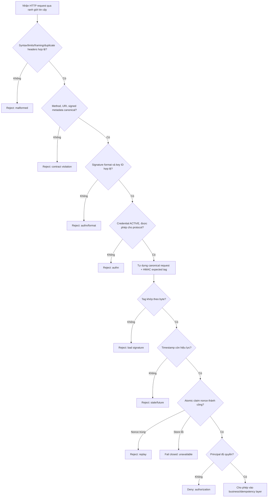
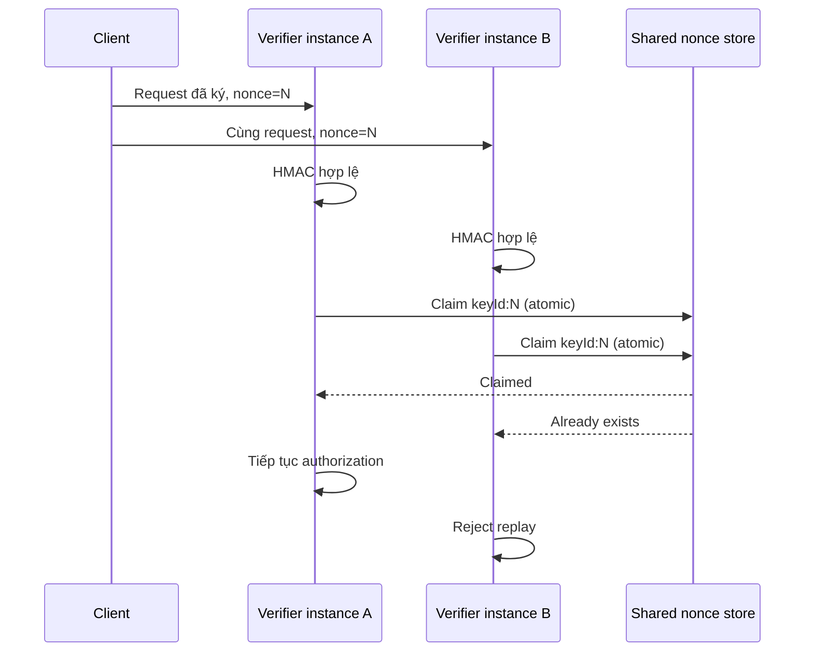
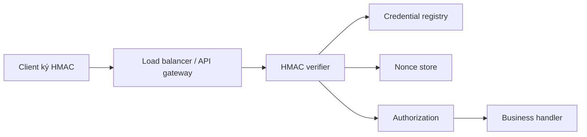

# Từ chối request sai: thiết kế fail-closed cho bộ xác minh HTTP HMAC

> **Chương:** Xác minh request  
> **Bài học:** Từ chối request sai  
> **Phạm vi:** Xác thực HTTP request bằng **HMAC** với shared secret và canonical request chứa method, URI, signed headers và/hoặc body. Trọng tâm là **khi nào, tại sao và bằng cách nào server phải từ chối** request thiếu dữ liệu, sai chữ ký, sai canonicalization, hết hạn, bị replay hoặc dùng credential không hợp lệ — đồng thời phân biệt **authentication** với **authorization**, vận hành qua gateway/proxy và kiểm thử bằng Java 17+.

## 1. “Từ chối request sai” là một đặc tính bảo mật, không chỉ là mã HTTP lỗi

Một client có thể gửi:

```http
POST /v1/payments?orderId=42&currency=VND HTTP/1.1
Host: api.example.test
Content-Type: application/json
X-Key-Id: merchant-42-k2
X-Timestamp: 1795800000
X-Nonce: 8b3d47ad5a6e4c97a0cf3183c95da0e1
X-Signature: v1=<BASE64URL_HMAC_TAG>

{"amount":100000}
```

Để chấp nhận request này, server không được chỉ kiểm rằng có `X-Signature`. Nó phải chứng minh:

1. Request được parse **không nhập nhằng**, với method, URI, headers và body thuộc hợp đồng được hỗ trợ.
2. `X-Key-Id` ánh xạ tới **credential được phép sử dụng** trong registry phía server.
3. Chữ ký có **định dạng được chấp nhận**, được giải mã thành đúng số byte tag.
4. Server **tự dựng lại** canonical request từ dữ liệu thực nhận tại điểm xác minh.
5. HMAC tính bằng **đúng secret** trên **đúng bytesToSign** khớp với tag nhận được.
6. Timestamp nằm trong cửa sổ thời gian cho phép, nonce chưa được dùng và việc đánh dấu nonce là **nguyên tử**.
7. Principal được xác thực thực sự **có quyền** thực hiện hành động trên tenant/tài nguyên đích.

Nếu một điều kiện cần thiết không thỏa mãn, hệ thống phải **từ chối ở lớp phù hợp** và **không thực thi tác động nghiệp vụ**.

**Fail closed** nghĩa là khi không thể xác minh đầy đủ, kết quả mặc định là **không cho phép**. Đặc biệt, mất kho khóa, lỗi HMAC provider, gateway làm mất signature hay nonce store không truy cập được **không** phải lý do để cho request đi qua.

### Mục tiêu của bài

Sau khi học, bạn sẽ xác định được:

- Những nhóm request sai cần **reject** và nhóm nào có thể **authenticate đúng nhưng bị deny authorization**.
- Thứ tự kiểm tra hợp lý: parse → credential → canonical/HMAC → freshness → atomic nonce → authorization.
- Cách reject header trùng, URI/query mơ hồ, body bị sửa, Base64URL không canonical, tag sai, key bị revoke và replay.
- Cách tránh vô tình rò rỉ key existence, secret hoặc trạng thái nội bộ qua response/log.
- Cách viết test Java 17+, negative tests và tích hợp thực tế qua load balancer, proxy/gateway.

## 2. Phân loại “request sai”: không gom tất cả thành “HMAC sai”

| Nhóm | Ví dụ | Quyết định |
| --- | --- | --- |
| **Malformed request** | Thiếu header bắt buộc, duplicate `X-Signature`, CR/LF injection, URI không canonical, body vượt quota. | Reject trước hoặc trong parse theo hợp đồng; không xử lý nghiệp vụ. |
| **Malformed signature** | Prefix sai, Base64URL có padding ngoài hợp đồng, độ dài tag sai. | Reject; không thử codec/algorithm thay thế. |
| **Unknown credential** | `X-Key-Id` không tồn tại, thuộc môi trường khác. | Authentication failure; không dùng secret do client cung cấp. |
| **Disabled/revoked/expired credential** | Key từng hợp lệ nhưng đã bị thu hồi. | Authentication failure dù HMAC với secret cũ có thể đúng. |
| **Bad signature** | HMAC của server khác tag nhận được. | Authentication failure; không claim nonce, không xử lý. |
| **Stale/future timestamp** | Timestamp ngoài freshness window hoặc không đúng đơn vị. | Reject theo freshness policy. |
| **Replay** | Request HMAC đúng nhưng `(keyId, nonce)` đã được claim. | Reject replay; không thực thi tác động lần nữa. |
| **Verification infrastructure unavailable** | Secret store, JCA provider, shared nonce store gặp lỗi. | **Fail closed**; lỗi vận hành, không được cho phép. |
| **Authenticated but unauthorized** | Merchant A ký đúng POST vào tài nguyên của merchant B. | **Authorization deny**, không được coi là lỗi thuật toán HMAC. |
| **Business/idempotency conflict** | Hai retry với nonce mới, cùng idempotency key nhưng payload khác. | Reject theo chính sách idempotency/nghiệp vụ, sau xác thực. |

**Sai cú pháp**, **sai chữ ký**, **hết hạn**, **replay**, **thiếu quyền** và **lỗi hạ tầng** không phải cùng một nguyên nhân. Có thể trả thông báo bên ngoài khá chung để hạn chế dò thông tin, nhưng bên trong phải phân loại đủ để test, cảnh báo và điều tra.

## 3. Threat model: attacker có thể thay đổi những gì?

Trong mô hình shared-secret HMAC:

- Attacker không có secret nhưng có thể **gửi request giả**, sửa method/path/query/headers/body, copy chữ ký và thay metadata ngoài phần được ký.
- Attacker có thể **phát lại nguyên request** đã quan sát được nếu lấy được bản request/tag phù hợp.
- Attacker có thể lợi dụng cách parse khác nhau giữa **gateway → verifier → business handler**: một tầng đọc tham số đầu tiên, tầng khác đọc tham số cuối; một tầng decode `%2F`, tầng khác giữ nguyên.
- Attacker có thể thử **duplicate headers**, signature sai định dạng, timestamp thật lớn, body quá lớn hoặc số lượng request lớn để gây DoS.
- Client **đã có secret hợp lệ** vẫn có thể gửi request vượt quyền; HMAC không thay authorization.
- Nếu secret bị lộ, attacker có thể tạo HMAC hợp lệ; lúc đó cần **revoke/rotate**, không hy vọng canonicalization tự cứu.

**Ranh giới bảo vệ:** HMAC bảo vệ **chính xác những byte nằm trong signing input** và quyền sử dụng secret. Mọi trường ảnh hưởng routing, principal/tenant, parser, hành động và payload phải được ký **hoặc** được một lớp đáng tin khác cố định với bằng chứng và giới hạn rõ ràng.

### Những phản ví dụ đáng kiểm

**Đổi body nhưng giữ tag:**

```text
Client ký: {"amount":100000}
Attacker gửi: {"amount":900000}
```

Nếu SHA-256 của raw body nằm trong canonical request được HMAC bao phủ, tag cũ phải sai.

**Giữ tag nhưng đổi endpoint:**

```text
POST /v1/payments?orderId=42
POST /v1/refunds?orderId=42
```

Nếu method/path/query được ký đúng, tag của request đầu không được chấp nhận cho request thứ hai.

**Parameter pollution:**

```text
?to=alice&to=bob
```

Nếu verifier ký `to=alice` nhưng handler dùng `to=bob`, HMAC có thể đúng với **một nội dung khác** điều ứng dụng thực thi. Reject duplicate hoặc dùng **cùng parser/multimap đã kiểm** end-to-end.

## 4. Hợp đồng minh họa `VERIFY-REJECT-V1`

Để minh họa cụ thể các lý do reject và viết test tái lập, ta tạo một **custom signing contract** rất hẹp cho endpoint thanh toán thử nghiệm.

**Lưu ý:** Đây là hợp đồng **nội bộ minh họa**, không phải một chuẩn HMAC HTTP phổ quát và không tự tương thích với **RFC 9421 HTTP Message Signatures**.

### 4.1. Phạm vi hợp lệ

| Thành phần | Quy tắc của `VERIFY-REJECT-V1` |
| --- | --- |
| Method | **Đúng `POST`**; không tự `toUpperCase()` vì method theo HTTP là case-sensitive. |
| Scheme và authority | HTTPS tới `api.example.test`; authority cố định cho môi trường thử. Endpoint thật có đa host phải ký/kiểm host và port theo hợp đồng. |
| Path | `/v1/payments`, không alias, encoded slash, dot segment hoặc rewrite không được tin cậy. |
| Canonical query | `currency=VND&orderId=42`, hai key bắt buộc, không duplicate; parser production phải xác minh raw query và encoding. |
| Content-Type | Chính xác `application/json`; từ chối thiếu/trùng/giá trị ngoài strict policy. |
| Idempotency-Key | Bắt buộc; một giá trị, trong tập ký; chỉ chứa ký tự `A-Z a-z 0-9 . _ -` với giới hạn độ dài. |
| Key ID | Một `X-Key-Id` theo grammar giới hạn; ánh xạ tới đúng credential trong registry. |
| Timestamp | `X-Timestamp` là epoch **seconds** dạng số thập phân, độ dài 10–11 chữ số, được ký. |
| Nonce | `X-Nonce` là **32 ký tự hex chữ thường** (16 byte CSPRNG) và được ký. |
| Body | SHA-256 của **raw body bytes** đúng tại điểm xác minh, giới hạn body **64 KiB** trong ví dụ. |
| HTTP headers | Tên so case-insensitive; ví dụ từ chối **mọi header lặp** ở adapter để đơn giản hóa. Hợp đồng rộng hơn có thể cho phép một số list-valued headers với parser đúng. |
| Signature | `X-Signature: v1=<43 ký tự Base64URL không padding>`; full HMAC-SHA256 tag 32 byte. |
| Freshness | `signedTimestamp` trong khoảng **±300 giây** so với đồng hồ server. |
| Replay key | `(keyId, nonce)`, claim **nguyên tử** sau khi chữ ký đúng. |
| Credential | Đúng key ID, ACTIVE, chưa hết hạn/chưa bị revoke, đúng tenant/môi trường. |
| Authorization | Kiểm riêng theo principal của credential và tài nguyên/hành động. |

**Một số giới hạn là chính sách dạy học, không phải bắt buộc của HTTP:** ví dụ chỉ chấp nhận một query cố định, từ chối mọi header lặp và chỉ nhận `application/json`. Các API thật cần mở rộng contract nhưng **không được giảm tính nhất quán giữa verifier và backend**.

### 4.2. Canonical request được ký

Ví dụ:

```http
POST /v1/payments?currency=VND&orderId=42 HTTP/1.1
Host: api.example.test
Content-Type: application/json
Idempotency-Key: payment-42
X-Key-Id: merchant-test-k1
X-Timestamp: 1795800000
X-Nonce: 8b3d47ad5a6e4c97a0cf3183c95da0e1
X-Signature: v1=<BASE64URL_TAG>

{"amount":100000}
```

Các dòng canonical:

```text
POST
api.example.test
/v1/payments
currency=VND&orderId=42
content-type:application/json
idempotency-key:payment-42
x-key-id:merchant-test-k1
x-nonce:8b3d47ad5a6e4c97a0cf3183c95da0e1
x-timestamp:1795800000
content-type;idempotency-key;x-key-id;x-nonce;x-timestamp
<SHA256_OF_EXACT_RAW_BODY_BYTES_AS_LOWERCASE_HEX>
```

`<...>` là placeholder, **không** phải digest tính sẵn. Dòng cuối phải là **64 ký tự hex chữ thường** của đúng byte `{"amount":100000}`, không có newline cuối. Các dòng nối bằng **LF** (`\n`); **không có LF cuối toàn chuỗi**.

```text
canonicalRequest = joinLF(fields above)

bytesToSign =
    UTF8("HMAC-SHA256/VERIFY-REJECT-V1\n" + canonicalRequest)

tagBytes =
    HMAC-SHA256(secretBytes, bytesToSign)

X-Signature =
    "v1=" + Base64URLWithoutPadding(tagBytes)
```

Tên `X-Signature` và tag đầu ra **không** nằm trong input của chính HMAC, tránh vòng phụ thuộc. Ngược lại, **key ID, timestamp, nonce và idempotency key** đều được ràng buộc bằng chữ ký.

## 5. Thứ tự kiểm tra: từ chối sớm nhưng không tạo đường bypass

Đây là pipeline minh họa:



**Không có một thứ tự duy nhất phù hợp mọi mô hình.** Có thể kiểm timestamp grammar và freshness **trước** khi tính HMAC nhằm giảm tải, miễn là response ngoài không tạo oracle nguy hiểm và **tuyệt đối không claim nonce trước khi HMAC hợp lệ**. Bộ xác minh ví dụ bên dưới kiểm grammar trước, **HMAC trước freshness** rồi claim nonce, để phân biệt rõ các bước.

### Những điểm không được đảo lộn

- **Không chuyển request cho business handler trước khi hoàn thành authentication/authorization.**
- **Không ghi nonce vào kho trước khi chứng minh chữ ký đúng**: attacker có thể gửi tag giả với nonce của client thật và làm “chiếm” nonce (DoS logic).
- **Không dùng key ID do client tự khai làm principal** trước khi HMAC và credential policy hoàn tất.
- **Không chọn secret bằng cách thử mọi khóa** cho tới khi tag khớp; phải tra key ID theo registry đáng tin.
- **Không chấp nhận request khi nonce store/secret store không sẵn sàng** chỉ vì HMAC ở một bước khác đúng.
- **Không tin canonical string do client gửi**, bởi server phải dựng lại từ request thực nhận.
- **Không dùng một parser cho xác minh và parser khác cho nghiệp vụ** nếu chúng có thể hiểu khác method/path/query/Content-Type/body.

## 6. Từ chối request malformed trước khi tính HMAC

### 6.1. Method và URI mơ hồ

Một verifier không nên tiếp tục nếu:

- Method không thuộc allowlist hoặc dùng token khác case (`post` thay `POST`).
- Path/URI chứa encoded slash `%2F`, dot segments `..`, repeated slash, percent-encoding malformed hoặc double-decoding ngoài hợp đồng.
- Query có duplicate key `?role=user&role=admin` nhưng API chỉ cho một value.
- Query thiếu `=` hoặc có parameter rỗng mà backend/parser khác diễn giải không nhất quán.
- Host/authority đã bị thay hoặc không thuộc môi trường/tenant được phép.

**Không sửa bằng cách normalize vô điều kiện.** Ví dụ tự decode `%2F` thành `/` trước khi ký có thể khiến verifier ký một route còn router xử lý một route khác.

### 6.2. Header thiếu, trùng, sai grammar

```http
X-Key-Id: merchant-test-k1
x-key-id: merchant-other-k2
```

Hai dòng trên là **cùng một header name** theo HTTP (case-insensitive). Tầng xác minh không được lấy giá trị đầu trong khi framework nghiệp vụ lấy giá trị cuối.

Tương tự:

```http
X-Signature: v1=<tagA>
X-Signature: v1=<tagB>
```

Với các trường an ninh một giá trị, cách xử lý dễ kiểm chứng là **reject duplicate**, không chọn ngầm hoặc gộp bằng dấu phẩy. Đối với Content-Type, một số proxy có thể chuyển nhiều field thành một chuỗi mơ hồ; phải phát hiện và từ chối trước khi mất thông tin.

**Kiểm cần có:** header names/values có CR/LF, control characters, noncanonical whitespace, giới hạn kích thước, Unicode ngoài grammar, list-valued parsing và số lần xuất hiện.

**Quan trọng:** Nhiều HTTP framework chỉ cung cấp `getFirst(name)`, vốn **không chứng minh** rằng request gốc không có header lặp. Adapter hoặc gateway đáng tin phải kiểm occurrences trước khi chọn value. Nếu intermediary đã gộp và mất thông tin, cần kiểm tại **ingress trước điểm gộp**.

### 6.3. Body không được đọc đầy đủ hoặc vượt giới hạn

Server phải từ chối hoặc hủy xác minh khi:

- Body vượt quota hoặc tốc độ gửi quá chậm vượt timeout.
- Stream bị cắt giữa chừng, decode lỗi, nội dung khác `Content-Encoding` được ký.
- Body JSON không hợp lệ hoặc schema không thỏa hợp đồng nghiệp vụ.
- `Content-Type` bị đổi khiến parser thực thi sai so với metadata đã ký.
- Request được xác minh trên body bytes A nhưng handler dùng body bytes B do middleware tự sửa.

Với raw-body binding, hash `SHA-256` phải tính trên **đúng bytes** tại điểm xác minh, không gọi `toString()` trên JSON object rồi tính hash. HTTP transfer chunk framing không phải nội dung cần hash; content-coding như gzip phải được quy định **hash trước hay sau giải nén**.

## 7. Từ chối signature sai encoding trước khi so tag

HMAC-SHA256 tạo **32 raw bytes**; custom contract ví dụ truyền:

```text
X-Signature: v1=<43 ký tự Base64URL, không padding>
```

Các trường hợp phải reject:

| Đầu vào | Vì sao reject? |
| --- | --- |
| Không có `X-Signature` | Thiếu bằng chứng xác thực. |
| `v2=...` khi chỉ hỗ trợ v1 | Protocol/version không được phép. |
| `V1=...` | Prefix khác exact grammar. |
| Base64 chuẩn chứa `+` hoặc `/` | Khác bảng chữ Base64URL đã quy định. |
| Có dấu `=` padding ở cuối | Khác hợp đồng no-padding. |
| Ít hoặc nhiều hơn 43 ký tự tag | Không đúng kích thước full tag. |
| Decode ra khác 32 byte | Không đúng raw HMAC-SHA256 tag length. |
| Noncanonical pad bits | Có thể nhiều text cùng decode ra một dãy byte. |
| Chứa tab, CR/LF, khoảng trắng hoặc dấu phẩy | Không đúng grammar, có nguy cơ header ambiguity/injection. |
| Hai signature headers | Không có một giá trị duy nhất đáng tin để xác minh. |

**Chỉ regex chưa đủ:** với 32 byte raw tag, ký tự Base64URL cuối có pad bits ngầm. Sau khi decode, nên **re-encode bằng Base64URL không padding** và yêu cầu trùng **chính xác** text gốc.

```java
// Pseudocode các bước trong parser signature:
requireExactlyOne("X-Signature");
requireMatches("v1=[A-Za-z0-9_-]{43}");
byte[] supplied = Base64.getUrlDecoder().decode(encoded);
require(supplied.length == 32);
require(encoded.equals(
    Base64.getUrlEncoder().withoutPadding().encodeToString(supplied)));
```

**Không dùng `new String(tagBytes)`** để so chữ ký: tag là dữ liệu nhị phân, không phải UTF-8. Server nên decode thành `byte[]` rồi so với `expectedTag` qua `MessageDigest.isEqual(expected, supplied)`. Không tự thử hex, Base64 padded và Base64URL trong cùng v1 “cho tới khi cái nào khớp”.

## 8. Credential sai: key ID không phải bằng chứng danh tính

Request có thể khai:

```http
X-Key-Id: merchant-test-k1
```

Dòng đó chỉ là một **identifier do caller gửi**. Server cần tra `keyId` trong credential registry đáng tin để lấy:

- Secret bytes hoặc HSM/key handle **đúng** cho client.
- Principal/tenant thực của credential.
- Trạng thái `ACTIVE`, `REVOKED`, `DISABLED`, `EXPIRED`.
- Thời hạn `notBefore` / `notAfter` và môi trường/staging/production.
- Signing protocol/algorithm/version được credential và endpoint cho phép.

**Reject** nếu key không tồn tại, key bị thu hồi, sai môi trường hoặc không có quyền dùng protocol version hiện tại. **Không nhận shared secret từ HTTP request** để kiểm; attacker sẽ tự chọn secret rồi ký mọi thứ.

### Không thử tất cả khóa

Sai:

```text
for every old/new secret in database:
    if HMAC(secret, request) == tag:
        accept
```

Cách này có thể làm key đã revoke hoặc thuộc tenant khác được sử dụng sai, che giấu lỗi key ID và khó audit.

Đúng: validate key ID → tra **một credential xác định** → kiểm trạng thái → tính HMAC → gán principal **sau khi xác minh thành công**.

### Key rotation

Khi client chuyển `merchant-42-k2` sang `merchant-42-k3`:

- Trong overlap được **chính sách cho phép**, mỗi request vẫn gắn với **một key ID và một secret**.
- Key k2 hết hạn/revoked phải bị reject kể cả khi HMAC với k2 có thể tính đúng.
- Thay key không nhất thiết thay signature encoding/canonical contract v1.
- Java `Mac.reset()` **không đổi key**; dùng `Mac.init(newKey)` hoặc `Mac` mới.

Phía HTTP response có thể sử dụng một lỗi authentication chung cho unknown/revoked/bad signature, không phơi bày trạng thái registry cho người chưa được xác thực.

## 9. Từ chối HMAC không khớp và bảo vệ khỏi timing leak

Server phải tự dựng lại:

```text
canonicalRequest = canonicalize(
    receivedMethod,
    receivedAuthority,
    receivedPath,
    receivedQuery,
    receivedSignedHeaders,
    SHA256(receivedRawBodyBytes)
)

bytesToSign =
    UTF8("HMAC-SHA256/VERIFY-REJECT-V1\n" + canonicalRequest)

expected = HMAC-SHA256(selectedSecret, bytesToSign)

if (!MessageDigest.isEqual(expected, suppliedTag)) {
    rejectAuthentication();
}
```

Những nguyên nhân phổ biến khiến tag khác:

- Client ký `POST`, server thấy `GET`.
- Client ký raw path có prefix, gateway rewrite trước verifier.
- Client/server sort query khác nhau hoặc mất duplicate key.
- Tên header canonical khác/giá trị `Content-Type` bị thay.
- Client ký JSON trước serialize; body thực thêm newline hoặc đổi field order.
- Client băm gzip bytes, server băm bytes đã giải nén.
- Client dùng UTF-8 nhưng server dùng charset khác hoặc CRLF thay LF.
- Key ID đúng text nhưng secret byte không đúng (ví dụ quên decode Base64 của secret).
- HMAC tag bị cắt hoặc signature encoding không đúng hợp đồng.

`MessageDigest.isEqual` giúp tránh so sánh byte bằng một vòng lặp tự viết dừng ngay ở byte khác. Tuy vậy, **không tuyên bố toàn bộ HTTP endpoint là constant-time**: parser, lookup, freshness và lỗi hạ tầng vẫn có thể bộc lộ khác biệt thời gian. Nên dùng response bên ngoài thống nhất khi thích hợp, giới hạn tốc độ và giám sát nỗ lực brute-force.

**Không dùng so sánh chuỗi `expectedBase64Url.equals(receivedText)` để thay thế quá trình decode/kiểm canonical.** Hợp đồng cần chốt một biểu diễn text duy nhất rồi so **raw tag bytes**.

## 10. Timestamp sai và nonce lặp: HMAC khớp vẫn phải reject

### 10.1. Timestamp

`X-Timestamp` phải:

- Có cú pháp rõ: ví dụ epoch seconds dạng số thập phân ASCII không dấu.
- Được đưa vào signed headers để attacker **không thể thay** mà giữ nguyên tag.
- Nằm trong freshness window tại thời điểm server xác minh.
- Không bị nhầm milliseconds với seconds; không nhận `NaN`, dấu cộng/trừ, khoảng trắng, overflow hay chuỗi cực dài.
- Dùng đồng hồ server đáng tin và có giám sát clock skew.

Ví dụ policy:

```text
abs(serverNowSeconds - signedTimestampSeconds) <= 300
```

**Chỉ diễn đạt như trên cho dễ hiểu**. Trong code cần chú ý overflow nếu xử lý kiểu số không giới hạn; dùng grammar có giới hạn và so sánh khoảng an toàn.

Với timestamp quá cũ hoặc quá xa tương lai, server **reject** ngay cả khi HMAC đúng. Không tự kéo timestamp về thời gian hiện tại để chấp nhận.

### 10.2. Nonce dùng một lần

`X-Nonce` phải được **ký**, có entropy đủ cao (ví dụ 16 byte CSPRNG cho hệ thống yêu cầu nonce ngẫu nhiên) và được kiểm chưa từng sử dụng **trong phạm vi credential phù hợp**.

Đừng làm:

```java
// Sai: hai request đồng thời có thể cùng thấy false.
if (!cache.contains(nonce)) {
    cache.put(nonce, true);
    accept();
}
```

Thay bằng một thao tác **atomic insert-if-absent** trong kho dùng chung các instance, ví dụ một transaction/conditional insert hoặc Redis `SET key value NX EX ...` với TTL được tính đúng.

**Chỉ claim nonce sau khi HMAC hợp lệ.** Nếu attacker có thể dùng tag sai để ghi nonce, họ có thể tiêu thụ nonce thật của client mà không có secret.

### 10.3. TTL nonce bao lâu là đủ?

Với cửa sổ chấp nhận đối xứng `±300 giây`, một timestamp `T` có thể được chấp nhận trong khoảng:

```text
serverNow ∈ [T - 300, T + 300]
```

Nếu nonce được claim ở thời điểm sớm nhất `T-300`, thời gian còn lại tới hết hiệu lực timestamp là gần **600 giây**, không phải 300 giây.

Cách đơn giản là lưu nonce tới thời điểm ít nhất:

```text
expiresAt = signedTimestamp + allowedFutureSkew + safetyMargin
```

với policy phù hợp, thời gian server và chiến lược cleanup rõ ràng. Không đặt TTL cố định ngắn hơn khoảng chấp nhận còn lại khi timestamp được gửi sớm. Với nhiều vùng/instance, cần kiểm đồng hồ và chính sách nhất quán.

### 10.4. Lỗi nonce store

Nếu kho nonce dùng chung bị mất kết nối:

- **Không** cho qua vì chữ ký đúng.
- **Không** fallback về một cache trong memory của riêng instance nếu như thế làm mất bảo đảm chống replay đa instance.
- Có thể phản hồi một lỗi dịch vụ tạm thời (ví dụ 503) theo chính sách, nhưng **request không được thực thi**.

## 11. Java 17+: verifier fail-closed và các ca reject có thể chạy độc lập

Ví dụ sau minh họa bộ verifier **có phạm vi chủ ý giới hạn** cho `VERIFY-REJECT-V1`. Nó dùng JDK 17, không thêm thư viện ngoài.

Đặc điểm:

1. **HTTP adapter giả lập** giữ mọi lần xuất hiện của header bằng `List<Field>` thay vì `Map<String,String>` đã mất duplicate.
2. Validate input bounds, method/authority/path/query và signed metadata.
3. Parse Base64URL **strict**, kiểm tag đúng 32 byte và canonical re-encode.
4. Registry chọn đúng secret và principal; key không tồn tại/inactive bị reject.
5. Server tự tạo canonical request, HMAC và so raw tag bytes.
6. Timestamp được kiểm trong ±300 giây bằng `Clock` có thể cố định cho test.
7. Claim nonce **atomic** qua `ConcurrentHashMap.compute` (chỉ để minh họa trên **một process**).
8. Phân biệt `BAD_REQUEST`, `UNAUTHENTICATED`, `STALE`, `REPLAY`, `FORBIDDEN` và `UNAVAILABLE`.
9. Test cả request hợp lệ, replay, body bị sửa, duplicate signature, timestamp quá hạn, revoked key, thiếu quyền và nonce store lỗi.

**Giới hạn:** Bộ mã **không** phải một Spring Filter, servlet filter hoặc gateway production. Nó giả định ingress đã cung cấp raw body và đúng header occurrences; route/query/header được cố tình giới hạn cho fixture. `ConcurrentHashMap` không thay được Redis/DB chung nhiều instance; bản demo cũng không tự xóa nonce hết hạn.

```java
import java.nio.charset.StandardCharsets;
import java.security.GeneralSecurityException;
import java.security.MessageDigest;
import java.time.Clock;
import java.time.Instant;
import java.time.ZoneOffset;
import java.util.ArrayList;
import java.util.Arrays;
import java.util.Base64;
import java.util.HashMap;
import java.util.HexFormat;
import java.util.List;
import java.util.Locale;
import java.util.Map;
import java.util.Objects;
import java.util.concurrent.ConcurrentHashMap;
import java.util.concurrent.atomic.AtomicBoolean;
import java.util.function.Predicate;
import javax.crypto.Mac;
import javax.crypto.spec.SecretKeySpec;

public final class RejectInvalidHmacRequestDemo {
    private static final HexFormat HEX = HexFormat.of();
    private static final long SKEW_SECONDS = 300L;
    private static final String PREFIX =
            "HMAC-SHA256/VERIFY-REJECT-V1\n";
    private static final String SIGNED_NAMES =
            "content-type;idempotency-key;x-key-id;x-nonce;x-timestamp";

    private RejectInvalidHmacRequestDemo() {}

    record Field(String name, String value) {}

    // Snapshot giữ bản sao body. Trên HTTP thật phải giới hạn bytes
    // TRƯỚC khi buffering toàn bộ request.
    record Request(String method, String authority,
                   String rawPath, String rawQuery,
                   List<Field> fields, byte[] rawBody) {
        Request {
            Objects.requireNonNull(method);
            Objects.requireNonNull(authority);
            Objects.requireNonNull(rawPath);
            Objects.requireNonNull(rawQuery);
            fields = List.copyOf(fields);
            rawBody = rawBody.clone();
        }

        @Override
        public byte[] rawBody() {
            return rawBody.clone();
        }
    }

    record Credential(String principal, byte[] secret, boolean active) {
        Credential {
            Objects.requireNonNull(principal);
            secret = secret.clone();
        }

        @Override
        public byte[] secret() {
            return secret.clone();
        }
    }

    enum Decision {
        ACCEPT,
        BAD_REQUEST,
        UNAUTHENTICATED,
        STALE,
        REPLAY,
        FORBIDDEN,
        UNAVAILABLE
    }

    record Outcome(Decision decision, String principal) {}

    static final class BadInput extends RuntimeException {}

    interface NonceStore {
        boolean claim(String key, long expiresAt, long now);
    }

    // CHỈ DÙNG CHO TEST TRÊN MỘT JVM. Production cần shared store
    // + atomic claim + TTL cleanup trên toàn bộ instances.
    static final class LocalNonceStore implements NonceStore {
        private final ConcurrentHashMap<String, Long> seen =
                new ConcurrentHashMap<>();

        @Override
        public boolean claim(String key, long expiresAt, long now) {
            if (expiresAt <= now) return false;
            AtomicBoolean acquired = new AtomicBoolean(false);
            seen.compute(key, (k, previousExpiry) -> {
                if (previousExpiry == null || previousExpiry <= now) {
                    acquired.set(true);
                    return expiresAt;
                }
                return previousExpiry;
            });
            return acquired.get();
        }
    }

    // Một adapter thực phải phát hiện duplicates trước khi gateway hoặc
    // HTTP framework làm mất thông tin về số lần xuất hiện.
    private static Map<String, String> singleHeaders(List<Field> fields) {
        if (fields == null || fields.size() > 32) throw new BadInput();
        Map<String, String> result = new HashMap<>();
        for (Field field : fields) {
            if (field == null || field.name() == null
                    || field.value() == null
                    || !field.name().matches("[A-Za-z0-9-]{1,64}")
                    || field.value().length() > 256
                    || !field.value().equals(field.value().strip())) {
                throw new BadInput();
            }
            for (int i = 0; i < field.value().length(); i++) {
                char c = field.value().charAt(i);
                if (c < 0x20 || c == 0x7F) throw new BadInput();
            }
            String lower = field.name().toLowerCase(Locale.ROOT);
            if (result.putIfAbsent(lower, field.value()) != null) {
                throw new BadInput(); // Reject duplicate field names.
            }
        }
        return result;
    }

    private static String required(
            Map<String, String> fields, String name) {
        String value = fields.get(name);
        if (value == null || value.isEmpty()) throw new BadInput();
        return value;
    }

    private static void validate(
            Request r, Map<String, String> h) {
        if (!"POST".equals(r.method())
                || !"api.example.test".equals(r.authority())
                || !"/v1/payments".equals(r.rawPath())
                || !"currency=VND&orderId=42".equals(r.rawQuery())
                || r.rawBody().length > 64 * 1024) {
            throw new BadInput();
        }
        if (!"application/json".equals(required(h, "content-type"))
                || !required(h, "idempotency-key")
                        .matches("[A-Za-z0-9._-]{1,64}")
                || !required(h, "x-key-id")
                        .matches("[A-Za-z0-9._-]{1,64}")
                || !required(h, "x-timestamp")
                        .matches("[0-9]{10,11}")
                || !required(h, "x-nonce")
                        .matches("[0-9a-f]{32}")) {
            throw new BadInput();
        }
    }

    private static byte[] decodeTag(String wireValue) {
        if (!wireValue.matches("v1=[A-Za-z0-9_-]{43}")) {
            throw new BadInput();
        }
        String encoded = wireValue.substring(3);
        final byte[] tag;
        try {
            tag = Base64.getUrlDecoder().decode(encoded);
        } catch (IllegalArgumentException invalid) {
            throw new BadInput();
        }
        if (tag.length != 32
                || !encoded.equals(Base64.getUrlEncoder()
                        .withoutPadding().encodeToString(tag))) {
            throw new BadInput();
        }
        return tag;
    }

    private static String canonical(
            Request request, Map<String, String> h)
            throws GeneralSecurityException {
        String bodyHash = HEX.formatHex(MessageDigest
                .getInstance("SHA-256")
                .digest(request.rawBody()));
        return String.join("\n",
                "POST",
                "api.example.test",
                request.rawPath(),
                request.rawQuery(),
                "content-type:" + required(h, "content-type"),
                "idempotency-key:" + required(h, "idempotency-key"),
                "x-key-id:" + required(h, "x-key-id"),
                "x-nonce:" + required(h, "x-nonce"),
                "x-timestamp:" + required(h, "x-timestamp"),
                SIGNED_NAMES,
                bodyHash);
    }

    private static byte[] hmacSha256(byte[] secret, byte[] signedBytes)
            throws GeneralSecurityException {
        Mac mac = Mac.getInstance("HmacSHA256");
        mac.init(new SecretKeySpec(secret, "HmacSHA256"));
        return mac.doFinal(signedBytes);
    }

    private static byte[] expectedTag(
            Request request, Map<String, String> h, byte[] secret)
            throws GeneralSecurityException {
        byte[] signingBytes = (PREFIX + canonical(request, h))
                .getBytes(StandardCharsets.UTF_8);
        return hmacSha256(secret, signingBytes);
    }

    public static Outcome verify(
            Request request,
            Map<String, Credential> credentials,
            NonceStore nonceStore,
            Clock clock,
            Predicate<String> authorization) {
        try {
            Map<String, String> h = singleHeaders(request.fields());
            validate(request, h);
            byte[] suppliedTag = decodeTag(required(h, "x-signature"));
            String keyId = required(h, "x-key-id");

            Credential credential = credentials.get(keyId);
            if (credential == null || !credential.active()) {
                return new Outcome(Decision.UNAUTHENTICATED, null);
            }

            byte[] expected = expectedTag(
                    request, h, credential.secret());
            if (!MessageDigest.isEqual(expected, suppliedTag)) {
                return new Outcome(Decision.UNAUTHENTICATED, null);
            }

            long signedAt = Long.parseLong(
                    required(h, "x-timestamp"));
            long now = clock.instant().getEpochSecond();
            if (signedAt < now - SKEW_SECONDS
                    || signedAt > now + SKEW_SECONDS) {
                return new Outcome(Decision.STALE, null);
            }

            // Chỉ claim nonce SAU khi tag hợp lệ và timestamp đạt.
            // Buffer 60 giây ngoài cửa sổ +300 để giảm lỗi clock skew.
            long expiresAt = signedAt + SKEW_SECONDS + 60L;
            if (!nonceStore.claim(
                    keyId + ":" + required(h, "x-nonce"),
                    expiresAt, now)) {
                return new Outcome(Decision.REPLAY, null);
            }

            // Principal lấy từ credential đã được xác minh,
            // không lấy từ query/body do client tự khai.
            if (!authorization.test(credential.principal())) {
                return new Outcome(Decision.FORBIDDEN, null);
            }
            return new Outcome(Decision.ACCEPT,
                    credential.principal());
        } catch (BadInput invalid) {
            return new Outcome(Decision.BAD_REQUEST, null);
        } catch (GeneralSecurityException unavailable) {
            // HMAC provider/configuration fault: fail closed.
            return new Outcome(Decision.UNAVAILABLE, null);
        } catch (RuntimeException unavailable) {
            // Kho nonce/credential hoặc lỗi hạ tầng bất ngờ:
            // không được fallback về accept.
            return new Outcome(Decision.UNAVAILABLE, null);
        }
    }

    private static Request addSignature(
            Request unsigned, byte[] testKey)
            throws GeneralSecurityException {
        Map<String, String> h = singleHeaders(unsigned.fields());
        validate(unsigned, h);
        byte[] tag = expectedTag(unsigned, h, testKey);
        String wire = "v1=" + Base64.getUrlEncoder()
                .withoutPadding().encodeToString(tag);

        List<Field> withTag = new ArrayList<>(unsigned.fields());
        withTag.add(new Field("X-Signature", wire));
        return new Request(unsigned.method(), unsigned.authority(),
                unsigned.rawPath(), unsigned.rawQuery(),
                withTag, unsigned.rawBody());
    }

    private static Request withBody(Request r, byte[] body) {
        return new Request(r.method(), r.authority(),
                r.rawPath(), r.rawQuery(), r.fields(), body);
    }

    private static Request withField(
            Request r, String name, String replacement) {
        List<Field> changed = new ArrayList<>();
        for (Field old : r.fields()) {
            changed.add(old.name().equalsIgnoreCase(name)
                    ? new Field(old.name(), replacement)
                    : old);
        }
        return new Request(r.method(), r.authority(),
                r.rawPath(), r.rawQuery(),
                changed, r.rawBody());
    }

    private static void expect(
            Decision actual, Decision expected) {
        if (actual != expected) {
            throw new AssertionError(
                    "Expected " + expected + ", got " + actual);
        }
    }

    public static void main(String[] args) throws Exception {
        byte[] secret = HEX.parseHex(
                "000102030405060708090a0b0c0d0e0f"
              + "101112131415161718191a1b1c1d1e1f");
        String keyId = "merchant-test-k1";
        Map<String, Credential> registry = Map.of(
                keyId, new Credential("merchant-test", secret, true));
        Clock fixed = Clock.fixed(
                Instant.ofEpochSecond(1795800000L), ZoneOffset.UTC);

        Request unsigned = new Request(
                "POST", "api.example.test",
                "/v1/payments", "currency=VND&orderId=42",
                List.of(
                        new Field("Content-Type", "application/json"),
                        new Field("Idempotency-Key", "payment-42"),
                        new Field("X-Key-Id", keyId),
                        new Field("X-Timestamp", "1795800000"),
                        new Field("X-Nonce",
                                "8b3d47ad5a6e4c97a0cf3183c95da0e1")
                ),
                "{\"amount\":100000}".getBytes(StandardCharsets.UTF_8)
        );
        Request valid = addSignature(unsigned, secret);
        LocalNonceStore store = new LocalNonceStore();

        expect(verify(valid, registry, store, fixed, p -> true)
                .decision(), Decision.ACCEPT);

        // Same valid tag + same nonce: replay MUST be rejected.
        expect(verify(valid, registry, store, fixed, p -> true)
                .decision(), Decision.REPLAY);

        // Body changed with old tag: bad signature, not replay.
        Request badBody = withBody(valid,
                "{\"amount\":900000}"
                    .getBytes(StandardCharsets.UTF_8));
        expect(verify(badBody, registry, store, fixed, p -> true)
                .decision(), Decision.UNAUTHENTICATED);

        // Duplicate header (case-insensitive) is malformed.
        List<Field> repeated = new ArrayList<>(valid.fields());
        repeated.add(new Field("x-signature",
                singleHeaders(valid.fields()).get("x-signature")));
        Request duplicate = new Request(valid.method(),
                valid.authority(), valid.rawPath(), valid.rawQuery(),
                repeated, valid.rawBody());
        expect(verify(duplicate, registry, store, fixed, p -> true)
                .decision(), Decision.BAD_REQUEST);

        // Unsupported signature version must not downgrade.
        Request version2 = withField(valid, "X-Signature",
                "v2=" + singleHeaders(valid.fields())
                        .get("x-signature").substring(3));
        expect(verify(version2, registry, store, fixed, p -> true)
                .decision(), Decision.BAD_REQUEST);

        // Old timestamp but otherwise correctly signed.
        Request oldUnsigned = withField(
                unsigned, "X-Timestamp", "1795799600");
        Request oldSigned = addSignature(oldUnsigned, secret);
        expect(verify(oldSigned, registry, new LocalNonceStore(),
                    fixed, p -> true)
                .decision(), Decision.STALE);

        // Same tag under revoked credential: reject.
        Map<String, Credential> revoked = Map.of(
                keyId, new Credential("merchant-test", secret, false));
        expect(verify(valid, revoked, new LocalNonceStore(),
                    fixed, p -> true)
                .decision(), Decision.UNAUTHENTICATED);

        // Authn succeeds, but authorization can still deny.
        expect(verify(valid, registry, new LocalNonceStore(),
                    fixed, p -> false)
                .decision(), Decision.FORBIDDEN);

        // Replay store unavailable: never silently accept.
        NonceStore brokenStore = (k, expiry, now) -> {
            throw new IllegalStateException("Test store unavailable");
        };
        expect(verify(valid, registry, brokenStore, fixed, p -> true)
                .decision(), Decision.UNAVAILABLE);

        System.out.println("PASS: HMAC reject decisions verified");
    }
}
```

Chạy khi có Java 17+ (đoạn mã giả định lưu đúng class name):

```bash
javac RejectInvalidHmacRequestDemo.java
java RejectInvalidHmacRequestDemo
```

**Điều ví dụ có và chưa có:**

- Có **rule-based rejection**, HMAC byte comparison, signature strict parser, credential ACTIVE check, freshness, replay claim và authorization hook.
- Không có HTTP server thật, proxy thật, TLS handling, raw HTTP field parser, multi-tenant scope, secret manager, DB/Redis nonce store, JSON schema validator hoặc idempotency transaction.
- `LocalNonceStore` chỉ đảm bảo atomic trong **một JVM** và lưu mapping cho tới khi chương trình kết thúc; production phải có TTL cleanup và thao tác claim nguyên tử giữa mọi instance.
- `Request` clone body để hạn chế sửa byte sau khi capture; code vẫn giả định HTTP adapter đưa đúng raw body bytes và field occurrences.
- `credentials` truyền vào test là một map; production phải dùng registry tin cậy và **xử lý lỗi registry fail closed**, không coi map trống do lỗi kết nối là “unknown key” rồi kết luận sai tình trạng hệ thống.
- `authorization` là hook minh họa. Kiểm quyền thật cần principal, action, resource/tenant và điều kiện nghiệp vụ; không chỉ một predicate trên tên principal.
- Không nhận hay kiểm `Content-Encoding` trong ví dụ vì endpoint chỉ hỗ trợ JSON không nén; ingress phải reject content coding ngoài hợp đồng **trước** khi biến đổi body, nếu không có thể xác minh sai representation.

**Điểm cần nhớ khi triển khai thực:** Hàm `verify` có catch `RuntimeException` để minh họa fail-closed. Production cần phân loại/ghi log nguyên nhân nội bộ có kiểm soát và **không che giấu lỗi lập trình hoặc tạo response success**; không chuyển các lỗi runtime thành credential-invalid chỉ để “mọi thứ là 401”.

## 12. Test đa instance: replay chỉ là một phần của quy trình

Kiểm thử nonce store cần xác minh **tính nguyên tử** và phạm vi chia sẻ:



Không được kiểm nonce như hai bước riêng `get → put`. Nếu cùng nonce tới hai node và cả hai thấy “chưa tồn tại”, cả hai có thể chấp nhận.

**Thực tế production:** Có thể dùng Redis/DB với atomic conditional write và TTL thích hợp. Cần kiểm failure modes: timeout lúc claim, partition mạng, replica lag, key expiry, rollback, failover; không dựa vào cache eventual-consistent để quyết định một lần duy nhất.

### Retry POST không đồng nghĩa replay hợp lệ

Một POST thanh toán đã được xử lý nhưng response thất lạc có thể được client thử lại bằng:

- **Nonce/timestamp/chữ ký mới**.
- **Cùng Idempotency-Key** đã ký, cùng fingerprint nghiệp vụ.
- Business idempotency store nguyên tử trả kết quả đã thực hiện hoặc trạng thái tương ứng, **không tạo thanh toán lần hai**.

Nếu client tái sử dụng **nguyên request cũ**, replay control phải từ chối. Nếu client tạo **request mới với nonce mới** nhưng cùng hành động, HMAC/replay có thể cho qua; **idempotency** mới là lớp tránh tác động lặp.

## 13. Từ chối sai ở gateway và proxy: kiểm ranh giới tin cậy

Một request hợp lệ có thể đi qua nhiều hop:



Những thay đổi cần test:

| Tình huống | Nguy cơ | Kết quả an toàn |
| --- | --- | --- |
| Gateway xóa `X-Signature` | Server không còn bằng chứng. | Reject, không “trusted internal bypass” mặc định. |
| Gateway gộp duplicate auth headers | Verifier mất thông tin, handler có thể chọn giá trị khác. | Reject tại ingress có raw occurrences. |
| Gateway rewrite `/public/v1/payments` → `/v1/payments` | Canonical path client/server khác. | Chốt điểm verify trước rewrite hoặc logical path tin cậy theo hợp đồng. |
| Proxy đổi `Host` hoặc `:authority` | Request có thể đổi service/tenant. | Ký/cố định authority đáng tin; reject mismatch. |
| Proxy sort query, decode `%2F` hoặc xử lý duplicate | URI verifier ký có thể khác URI router thực thi. | Reject ambiguity, kiểm cùng ngữ nghĩa end-to-end. |
| Client chèn `X-Original-URI` hoặc `X-Authenticated-Client` | Backend có thể tin metadata giả. | Gateway strip/overwrite ở trust boundary, bảo vệ kênh nội bộ. |
| Proxy tự giải nén/re-encode body | SHA-256 raw body khác hoặc backend dùng payload khác. | Verify đúng điểm ký hoặc fail closed; không bỏ body digest. |
| HTTP/1.1 ↔ HTTP/2 | Header name, request target, transfer framing khác hình thức. | Ký **semantic components đã canonicalize**, không ký raw framing. |
| Server cho gọi thẳng backend bỏ gateway | Bypass HMAC/authorization. | Chặn bằng network ACL và authentication nội bộ. |
| Verifier lỗi và gateway “fallback allow” | Mất lớp authentication. | Không cho request chưa xác minh đi tiếp. |

### Hai kiến trúc hợp lệ với điều kiện khác nhau

**Gateway xác minh trước khi rewrite:** gateway có dữ liệu cần ký, xác thực HMAC và thiết lập principal trên kênh nội bộ đáng tin; backend không được bị truy cập trực tiếp từ Internet. Việc chuyển danh tính phải được bảo vệ (mTLS, trusted service boundary hoặc cơ chế tương đương).

**Service xác minh sau gateway:** gateway phải bảo toàn phần request được ký hoặc chuyển **biểu diễn request gốc đã xác thực nguồn** theo hợp đồng. Service **không tin** `X-Forwarded-*`, `X-Original-URI` hoặc `X-Authenticated-Client` nếu chúng có thể đến từ client.

**Không sửa mismatch bằng cách bỏ method, path, query, headers hoặc body ra khỏi chữ ký** khi chúng ảnh hưởng quyền và nghiệp vụ.

## 14. HTTP status, error body và chống lộ thông tin

Một quyết định nội bộ không phải lúc nào cũng cần ánh xạ một-một sang mã HTTP công khai. Ví dụ chính sách:

| Điều kiện | Quyết định nội bộ | HTTP response có thể áp dụng |
| --- | --- | --- |
| Request framing/field cú pháp sai, duplicate header, body vượt giới hạn. | `BAD_REQUEST` / `PAYLOAD_TOO_LARGE` | **400**, **413** hoặc lỗi 4xx phù hợp. |
| Thiếu/sai signature, key không hợp lệ, HMAC không khớp. | `UNAUTHENTICATED` | Thường **401** theo hợp đồng API. |
| Timestamp quá hạn hoặc nonce bị reuse. | `STALE` / `REPLAY` | Có thể dùng **401**/lỗi auth chung để tránh tiết lộ chi tiết; chọn nhất quán. |
| Credential có tag đúng nhưng principal không được phép. | `FORBIDDEN` | Thường **403**. |
| Idempotency key trùng nhưng payload nghiệp vụ khác. | `IDEMPOTENCY_CONFLICT` | Có thể **409** theo hợp đồng. |
| Rate limit/throttling. | `RATE_LIMITED` | **429** và chính sách retry phù hợp. |
| Secret store/nonce store/provider không khả dụng. | `UNAVAILABLE` | **503** hoặc lỗi dịch vụ phù hợp, **không cho phép**. |

**Lưu ý về 401:** HTTP `401 Unauthorized` liên quan đến cơ chế challenge/`WWW-Authenticate` theo HTTP authentication framework. Với một custom HMAC scheme, API cần định nghĩa rõ cách tương tác với challenge hoặc chọn response theo kiến trúc/gateway; **không giả định mọi `X-Signature` scheme mặc nhiên tuân thủ một chuẩn HTTP authentication challenge**.

Một response ngoài nên tránh tiết lộ chi tiết:

```json
{
  "error": "request_not_authenticated",
  "requestId": "req-test-0142"
}
```

Đây là JSON response **minh họa**, không phải response schema bắt buộc.

Không trả cho attacker thông tin như:

- “Key `merchant-42-k2` có tồn tại và sẽ hết hạn ngày mai.”
- “Chữ ký đúng trừ ba byte cuối.”
- Secret, bytesToSign đầy đủ, raw body thanh toán hoặc tag thật.
- Nội dung từ credential registry, nonce store hoặc hệ thống phân quyền.

**Logging nội bộ:** phân loại `malformed`, `bad_signature`, `unknown_or_inactive_key`, `stale`, `replay`, `forbidden`, `upstream_unavailable` với correlation ID và metadata giảm nhạy cảm. Phân quyền truy cập log, masking auth headers và chính sách retention cũng là kiểm soát bảo mật.

## 15. Ma trận kiểm thử request bị từ chối

Nên chạy test ở ba cấp: **unit verifier**, **HTTP integration** và **end-to-end qua gateway/proxy thật**. Những ca có body/query bất thường cần được gửi qua môi trường **được phép**, không dùng credential production.

| # | Ca kiểm thử | Quyết định/kết quả mong đợi |
| --- | --- | --- |
| 1 | POST hợp lệ, credential ACTIVE, tag đúng, nonce mới, principal đủ quyền. | Accept tới business handler. |
| 2 | Không có `X-Signature`. | Reject, không tạo thao tác. |
| 3 | Hai `X-Signature`, kể cả khác case tên field. | Reject duplicate. |
| 4 | Hai `X-Key-Id` khác nhau. | Reject duplicate, không chọn first/last. |
| 5 | Header chứa CR/LF hoặc ký tự control ngoài contract. | Reject syntax/header injection. |
| 6 | Signature có prefix `v2=` chưa hỗ trợ. | Reject version, không fallback. |
| 7 | Signature Base64 chuẩn có `+` hoặc `/`. | Reject encoding không đúng Base64URL. |
| 8 | Signature thêm `=` padding. | Reject no-padding grammar. |
| 9 | Signature thiếu/thừa một ký tự. | Reject độ dài. |
| 10 | Signature noncanonical pad bits nhưng decoder khoan dung có thể nhận. | Reject bằng canonical re-encode. |
| 11 | HMAC tag thay một ký tự, vẫn đúng Base64URL. | Reject authentication. |
| 12 | Key ID không tồn tại. | Reject authentication, không tiết lộ key existence. |
| 13 | Key ID thuộc tenant hoặc môi trường khác. | Reject credential policy. |
| 14 | Key đã revoked/expired/disabled. | Reject dù HMAC với secret cũ có thể đúng. |
| 15 | Dùng secret B với key ID A. | Reject HMAC/key mismatch. |
| 16 | Secret là UTF-8 text của chuỗi Base64 chưa decode. | Tag khác golden fixture, reject. |
| 17 | Client dùng thuật toán khác HmacSHA256. | Reject, không downgrade. |
| 18 | Client gửi method `GET` nhưng dùng tag của `POST`. | Reject vì method nằm trong ký. |
| 19 | Client gửi method `post` khác exact allowlist. | Reject unsupported method. |
| 20 | Thay path `/v1/payments` thành `/v1/refunds`. | Reject contract/signature. |
| 21 | Đổi query `orderId=42` thành `orderId=99`. | Reject signature. |
| 22 | Query `orderId=42&orderId=99`. | Reject duplicate/ambiguity. |
| 23 | Query có `%2F`, `%252F` hoặc encoding mơ hồ ngoài contract. | Reject canonicalization. |
| 24 | Thay `Content-Type` từ JSON sang form. | Reject policy/signature. |
| 25 | Body JSON đổi `amount` nhưng giữ tag. | Reject HMAC. |
| 26 | Body thêm space, LF, CRLF hoặc BOM. | Reject raw-body mismatch. |
| 27 | JSON cùng ý nghĩa nhưng khác field order, giữ tag cũ. | Reject raw-body mismatch. |
| 28 | Body stream bị cắt, vượt quota hoặc decode lỗi. | Reject, không thực thi body thiếu. |
| 29 | Request không có body nhưng digest được ký cho body khác. | Reject. |
| 30 | Timestamp tính bằng milliseconds. | Reject grammar/freshness. |
| 31 | Timestamp không phải số hoặc overflow. | Reject syntax. |
| 32 | Timestamp quá cũ 1 giây so với window. | Reject freshness dù tag đúng. |
| 33 | Timestamp quá xa tương lai. | Reject freshness dù tag đúng. |
| 34 | Timestamp bị thay nhưng tag không tính lại. | Reject HMAC. |
| 35 | Nonce bị thay nhưng tag không tính lại. | Reject HMAC. |
| 36 | Request HMAC đúng nhưng nonce trùng. | Reject replay. |
| 37 | Hai verifier instance claim cùng nonce đồng thời. | Chỉ một claim thành công. |
| 38 | Kho nonce lỗi hoặc không phản hồi. | Fail closed, không bypass replay protection. |
| 39 | Secret store/HMAC provider lỗi. | Fail closed, không “accept unsigned”. |
| 40 | Gateway xóa signature hoặc thay signed header. | Reject, không fallback. |
| 41 | Gateway rewrite host/path/query trước verifier. | Chỉ verify dữ liệu đúng contract; mismatch fail closed. |
| 42 | Proxy reserialize JSON hoặc giải nén body. | Detect body mismatch/điểm verify không tương thích. |
| 43 | Client gửi `X-Authenticated-Client` giả. | Header bị strip/overwrite, không quyết định principal. |
| 44 | Truy cập thẳng backend bỏ qua gateway. | Bị chặn qua network/auth nội bộ. |
| 45 | Client A ký đúng request tới tài nguyên B. | Authentication có thể pass; authorization deny. |
| 46 | Retry POST bằng nonce mới, cùng idempotency key/body. | Không tạo tác động nghiệp vụ hai lần. |
| 47 | Retry với cùng idempotency key nhưng body khác. | Idempotency conflict theo contract. |
| 48 | Tốc độ request giả rất cao. | Rate limit/size bound bảo vệ tài nguyên, không bypass auth. |
| 49 | Replay nonce sát ranh giới TTL cuối freshness window. | Vẫn bị reject nếu nonce đã claim và request còn valid. |
| 50 | HTTP/1.1 chuyển HTTP/2 qua gateway. | Canonical semantic data bảo toàn; request hợp lệ pass, request sai vẫn reject. |

### Cách xây assertions hữu ích

Đừng chỉ assert response là 401. Cần kiểm:

- **Không có side effect**: DB không ghi thanh toán, không phát event, không gửi message.
- **Không claim nonce** khi tag sai; nonce chỉ được claim sau khi signature và freshness hợp lệ.
- **Không bypass** nếu secret store/nonce store lỗi.
- **Không gán principal** trước khi credential và chữ ký được kiểm.
- **Không rò rỉ secret** qua log/error.
- **Không vô tình chuyển authn fail thành authz allow** khi middleware xử lý exception.
- **Không chấp nhận request đã dùng** trên một node khác trong cụm.

## 16. Troubleshooting: vì sao server từ chối một request “trông đúng”?

Khi client báo “tôi đã ký bằng HMAC-SHA256 mà vẫn bị 401”, hãy so sánh **fixture không nhạy cảm** và chẩn đoán theo thứ tự:

```text
01. API signing protocol version/algorithm policy
02. Credential keyId -> secret bytes đúng, trạng thái credential
03. Method trên wire và method mà handler thực thi
04. Authority/host trước và sau gateway
05. Raw path, encoded path, dot segments, prefix rewrite
06. Raw query, duplicate semantics, canonical query
07. Danh sách signed header names và tất cả field occurrences
08. Content-Type, Idempotency-Key, Timestamp, Nonce
09. Raw body length/bytes, SHA-256 body digest
10. JSON serialization, Content-Encoding, proxy transformations
11. Canonical request bytes: UTF-8, LF, không trailing LF
12. String-to-sign prefix/version và bytes
13. Raw HMAC-SHA256 expected/provided tags, đúng 32 bytes
14. Base64URL grammar, padding/pad bits, X-Signature field
15. Freshness window, server clock, nonce atomic store/TTL
16. Authenticated principal, resource/tenant và authorization
17. Idempotency key/body fingerprint nếu là POST retry
```

**Diễn giải kết quả:**

| Quan sát | Nghi vấn đầu tiên |
| --- | --- |
| SHA-256/HMAC known-answer test sai | JCA algorithm/provider, secret bytes, code crypto. |
| Raw HMAC tag từ client và server khác | Secret hoặc **bytesToSign** không trùng. |
| Raw tags trùng nhưng server reject | Credential status, timestamp, nonce, encoding/parser policy hoặc authorization. |
| Gọi trực tiếp pass nhưng qua gateway fail | URI/header/body rewrite, trusted-header configuration hoặc điểm xác minh. |
| HMAC pass nhưng POST thực thi hai lần | Replay/nonce store, retry/idempotency hoặc transaction concurrency. |
| Request đúng tag nhưng ghi sai tenant | Authorization và parser/routing differential; không phải “HMAC đã cấp quyền”. |

**Không chữa lỗi bằng cách giảm phần dữ liệu được ký**, tắt nonce check hoặc cho phép mọi key. Cần sửa canonicalization, nguồn byte, hợp đồng, trust boundary hoặc chính sách credential.

## 17. Thực hành thiết kế cơ chế từ chối request sai

### Bài tập A: phân biệt nguyên nhân từ chối

Một API thanh toán nhận bốn request:

1. `X-Signature` sai ký tự nhưng timestamp/nonce đúng.
2. Chữ ký đúng, timestamp cũ hơn window 10 giây.
3. Chữ ký đúng, timestamp còn hạn, nonce đã claim.
4. Chữ ký đúng, nonce mới, nhưng merchant A POST đến tài nguyên của merchant B.

**Yêu cầu:** nêu lớp từ chối, việc có claim nonce hay không và khả năng có side effect. **Kết quả mong đợi:** (1) authentication reject, **không claim**; (2) stale reject, **không claim**; (3) replay reject; (4) authorization deny, không thực thi nghiệp vụ. Việc nonce đã claim trước hay sau authorization phải theo chính sách cụ thể; trong demo nonce được claim trước authorization.

### Bài tập B: kiểm concurrency với hai node

Thực hiện hai HTTP POST **cùng key ID, timestamp, nonce và HMAC hợp lệ** qua hai instance đồng thời.

**Tiêu chí đạt:** chỉ một request claim nonce thành công; nếu một request fail ở authorization, không request nào được thực thi ngoài quyền. Dùng shared atomic store chứ không dùng `ConcurrentHashMap` riêng mỗi node.

### Bài tập C: kiểm gateway và parser differential

Gửi request giả lập có duplicate query `?to=alice&to=bob`, encoded slash và duplicate `X-Key-Id`. So sánh dữ liệu verifier ký với route/parameter mà business parser sử dụng.

**Tiêu chí đạt:** không có request mơ hồ được chấp nhận; ingress/verifier và backend có cùng diễn giải dữ liệu đã xác minh; không tin header original-URI hoặc principal do client tự khai.

## 18. Câu hỏi tự kiểm tra

**Câu 1.** Vì sao request có header `X-Signature` chưa được coi là authenticated?

*Đáp án:* Header chỉ là giá trị caller cung cấp. Server phải strict-parse, chọn secret từ registry, dựng lại signing input và kiểm HMAC cùng trạng thái credential, freshness và replay.

**Câu 2.** Có nên claim nonce trước khi tính HMAC để tiết kiệm CPU không?

*Đáp án:* Không. Attacker có thể gửi tag giả với nonce của người dùng hợp lệ, làm nonce bị chiếm dù chưa có bằng chứng xác thực.

**Câu 3.** Nếu client gửi hai `X-Key-Id` khác nhau, server nên lấy giá trị đầu hay cuối?

*Đáp án:* Với contract một giá trị, **reject duplicate**. Chọn đầu/cuối có thể khác hành vi của proxy/framework và tạo credential confusion.

**Câu 4.** HMAC đúng trên body nhưng thay `Content-Type` có nguy hiểm không?

*Đáp án:* Có nếu backend chọn parser theo Content-Type. Header ảnh hưởng cách hiểu body phải được ký hoặc cố định đáng tin; raw body digest không tự ràng buộc parser metadata.

**Câu 5.** Vì sao lỗi secret store không phải lý do cho request đi qua?

*Đáp án:* Vì server không có khả năng chứng minh caller sở hữu credential. Fail closed là từ chối hoặc trả lỗi tạm thời, không bỏ authentication.

**Câu 6.** Nếu nonce TTL 300 giây và freshness window ±300 giây, có luôn đủ không?

*Đáp án:* Không. Timestamp tương lai có thể hợp lệ gần 600 giây tính từ lần nhận sớm nhất. TTL cần bao phủ toàn bộ khoảng còn có thể được chấp nhận, kèm margin hợp lý.

**Câu 7.** `MessageDigest.isEqual` có giúp endpoint HTTP hoàn toàn constant-time không?

*Đáp án:* Không. Nó là cơ chế so raw tags giúp giảm rò rỉ timing ở phép so sánh; lookup, parse, authorization và network vẫn có thể tạo khác biệt thời gian.

**Câu 8.** Key bị revoke nhưng chữ ký HMAC vẫn đúng với secret cũ: chấp nhận không?

*Đáp án:* Không. Credential status là điều kiện độc lập với tính đúng toán học của HMAC.

**Câu 9.** Request có HMAC hợp lệ của merchant A đến tài nguyên merchant B nên xử lý thế nào?

*Đáp án:* Authentication có thể thành công, nhưng authorization phải kiểm principal A với tài nguyên B và **từ chối nếu thiếu quyền**.

**Câu 10.** Nếu gateway rewrite path làm chữ ký không khớp, có nên bỏ path khỏi canonical request?

*Đáp án:* Không. Phải thống nhất điểm xác minh hoặc canonical logical path trên ranh giới tin cậy; bỏ path làm giảm khả năng ràng buộc chữ ký với tài nguyên/endpoint.

**Câu 11.** Nếu chữ ký sai mà server trả `UNAVAILABLE`, điều đó có nghĩa request đã được authenticated không?

*Đáp án:* Không. `UNAVAILABLE` là lỗi khả năng xác minh và vẫn phải **fail closed**, không gán principal hoặc thực thi nghiệp vụ.

**Câu 12.** HMAC hợp lệ và nonce mới có bảo đảm POST không tạo thanh toán trùng không?

*Đáp án:* Không. Anti-replay chặn dùng lại request cũ; retry với nonce mới cần **idempotency store/transaction policy** để ngăn tác động nghiệp vụ trùng.

---

## Tài liệu tham khảo

- [RFC 2104 – HMAC: Keyed-Hashing for Message Authentication](https://www.rfc-editor.org/rfc/rfc2104): HMAC và tính chất của MAC có khóa.
- [RFC 4231 – Test Vectors for HMAC-SHA-224/256/384/512](https://www.rfc-editor.org/rfc/rfc4231): test vectors độc lập cho HMAC-SHA256.
- [RFC 3986 – URI Generic Syntax](https://www.rfc-editor.org/rfc/rfc3986): path, query và percent-encoding.
- [RFC 4648 – The Base16, Base32, and Base64 Data Encodings](https://www.rfc-editor.org/rfc/rfc4648): Base64URL, padding và canonical encoding.
- [RFC 9110 – HTTP Semantics](https://www.rfc-editor.org/rfc/rfc9110): semantics method, fields, status codes và authentication.
- [RFC 9112 – HTTP/1.1](https://www.rfc-editor.org/rfc/rfc9112): HTTP message framing và request parsing.
- [RFC 9421 – HTTP Message Signatures](https://www.rfc-editor.org/rfc/rfc9421): chuẩn signature base và covered components; khác custom `VERIFY-REJECT-V1` trong bài.
- [RFC 9530 – Digest Fields](https://www.rfc-editor.org/rfc/rfc9530): digest của HTTP content và representation.
- [Oracle Java SE 17 – `javax.crypto.Mac`](https://docs.oracle.com/en/java/javase/17/docs/api/java.base/javax/crypto/Mac.html): API HMAC.
- [Oracle Java SE 17 – `MessageDigest.isEqual`](https://docs.oracle.com/en/java/javase/17/docs/api/java.base/java/security/MessageDigest.html): so sánh tag byte.
- [Oracle Java SE 17 – `Base64`](https://docs.oracle.com/en/java/javase/17/docs/api/java.base/java/util/Base64.html): strict signature codec.
- [Oracle Java SE 17 – `ConcurrentHashMap`](https://docs.oracle.com/en/java/javase/17/docs/api/java.base/java/util/concurrent/ConcurrentHashMap.html): ví dụ atomic `compute` trong một JVM, không thay shared store production.

**Ghi nhớ:** Một bộ xác minh HMAC an toàn phải **từ chối mọi request không thể xác minh đầy đủ**: dữ liệu HTTP mơ hồ, signature sai format/byte, credential bị revoke, canonical request/HMAC không khớp, timestamp ngoài cửa sổ, nonce đã dùng hoặc hạ tầng xác minh không khả dụng. **Không claim nonce trước khi HMAC đúng, không cho phép khi verification lỗi và không nhầm authentication với authorization**. Sau khi tag khớp vẫn phải kiểm replay, phân quyền và idempotency; qua proxy/gateway, dữ liệu mà verifier ký phải là **cùng request mà backend thực thi**.
