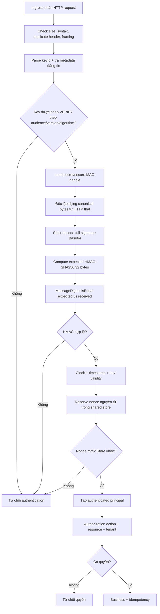

# So sánh constant-time khi xác minh chữ ký HMAC của HTTP request

## 1. Một HMAC đúng vẫn có thể bị kiểm tra theo cách không an toàn

Trong module `SECURITY_AUTHENTICATION_HMAC_REQUEST_AUTHENTICATION`, HTTP client tạo chữ ký bằng **shared secret** và **canonical request**. Canonical request có thể chứa method, raw URI/query, những header đã ký, timestamp, nonce và SHA-256 của raw body. Server phải tạo lại cùng các byte, dùng secret tương ứng với key ID để tính HMAC và kiểm tra chữ ký; sau đó kiểm tra replay rồi mới tạo principal phục vụ **authorization**.

Nhiều người đã chọn đúng `HmacSHA256`, tạo nonce ngẫu nhiên và canonicalize request chính xác, nhưng cuối pipeline lại kiểm tra chữ ký bằng phép so sánh **dừng ngay ở ký tự hoặc byte đầu tiên không khớp**:

```java
// Ví dụ KHÔNG an toàn khi dùng để kiểm tra MAC nhạy cảm:
static boolean insecureEquals(byte[] expected, byte[] received) {
    if (expected.length != received.length) return false;
    for (int i = 0; i < expected.length; i++) {
        if (expected[i] != received[i]) {
            return false; // thời gian có thể phụ thuộc vị trí byte sai
        }
    }
    return true;
}
```

Nếu ứng dụng phản hồi sớm hơn khi byte đầu sai và muộn hơn khi nhiều byte đầu đúng, thời gian chạy có thể trở thành **timing side channel**. Trong một môi trường có đủ lần thử, độ phân giải và khả năng đo, attacker có thể dùng chênh lệch đó để suy đoán dần các byte của tag kỳ vọng. Đây là một dạng **timing oracle**: ứng dụng làm lộ một ít thông tin về bí mật qua **thời gian phản hồi**, không qua nội dung trả về.

**So sánh constant-time** nhằm loại bỏ nhánh phụ thuộc **nội dung MAC bí mật** ở bước so sánh: thay vì dừng khi gặp byte sai, dùng primitive được thiết kế để xem xét toàn bộ các byte của tag có kích thước đã biết, không để **vị trí byte khác nhau** quyết định công việc thực hiện.

Đối với Java 17+, lựa chọn thực tế là:

```java
boolean valid = java.security.MessageDigest.isEqual(
        expectedMacBytes, receivedMacBytes);
```

Nhưng chỉ gọi `MessageDigest.isEqual` **chưa đủ** để biến toàn bộ HTTP endpoint thành “constant-time”. Còn phải quan tâm kích thước tag, Base64, canonical request, lookup key, cache, lỗi hạ tầng, chống replay và đặc biệt là không đánh đồng **authentication** với **authorization**.

> **Nguyên tắc:** So sánh **raw MAC bytes** bằng primitive phù hợp, với thuật toán và kích thước tag **do server ghim**, không so chuỗi Base64/hex bằng API so chuỗi thông thường. Không tự viết hàm “constant-time” nếu thư viện mật mã đã cung cấp primitive phù hợp.

Bài **“So sánh constant-time”** thuộc chương **“Constant-time comparison”** giải thích threat model, giới hạn bảo đảm của so sánh constant-time, triển khai Java 17, các lỗi input và test bảo mật cho HMAC request authentication.

### Mục tiêu học tập

Sau bài này, bạn có thể:

1. Giải thích vì sao `String.equals`, `Arrays.equals` hoặc vòng lặp `return false` sớm **không nên** là phép kiểm tra HMAC nhạy cảm.
2. Phân biệt **constant-time của phép so tag** với thời gian tổng thể của server, request parsing và key lookup.
3. Decode chữ ký Base64 theo hợp đồng, yêu cầu **full-length HMAC tag**, rồi so **byte** theo API Java 17 phù hợp.
4. Hiểu ý nghĩa thứ tự tham số `MessageDigest.isEqual(expected, supplied)` và các nhánh xử lý độ dài/format.
5. Thiết kế một verifier **fail-closed**, chọn secret/algorithm/canonical version qua metadata phía server, không dùng fallback.
6. Kiểm thử MAC sai ở byte đầu/giữa/cuối; không dùng các bài đo thời gian thiếu kiểm soát để “chứng nhận” an toàn.
7. Kết hợp đúng HMAC với timestamp/nonce, key rotation, proxy/gateway, authorization và idempotency.

## 2. Threat model: attacker biết gì và quan sát được gì?

Giả sử client đối tác sở hữu secret; attacker **không** có secret nhưng có thể gửi request HTTP tới API và quan sát:

- HTTP status code và response body;
- thời gian phản hồi, có thể gồm network jitter;
- thay đổi giữa một request có signature sai ngay byte đầu, sai ở byte sau hoặc sai đúng byte cuối;
- đôi khi header/trace/debug khác nhau giữa các loại lỗi;
- khả năng gọi API nhiều lần dưới một key ID công khai hoặc đã thu thập được.

HMAC-SHA256 tạo **32 byte** tag. Về mật mã, việc đoán **toàn bộ** tag hợp lệ mà không có secret là không khả thi ở mức bảo mật thiết kế thông thường. Nhưng nếu một API so byte từ trái sang phải rồi dừng tại vị trí sai đầu tiên, **số byte prefix đúng** có thể ảnh hưởng thời gian. Kẻ tấn công có thể tìm cách tận dụng tín hiệu đó qua nhiều truy vấn và phân tích thống kê.

### 2.1 Vì sao “mạng có độ trễ thất thường” không phải cơ chế bảo vệ?

Trong môi trường Internet thực tế, network jitter, cache, GC, scheduler, TLS và load balancer có thể che khuất sự chênh lệch rất nhỏ. Điều đó **làm việc khai thác khó hơn**, nhưng không tạo bảo đảm an toàn vì:

- Attacker có thể thực hiện **nhiều phép đo** và giảm nhiễu bằng thống kê.
- Trong mạng nội bộ, trên cùng host hoặc giữa các service, độ trễ có thể ổn định hơn.
- Một thay đổi runtime/JIT/CPU hoặc bản triển khai khác có thể làm chênh lệch rõ hơn.
- Độ trễ không chỉ đến từ vòng lặp; cách gửi response, việc parse lỗi, cache và retry có thể làm lộ tín hiệu khác.

Không nên dựa vào giả định “không ai đo được vài nanosecond qua mạng” để quyết định dùng phép so sánh có thời gian phụ thuộc bí mật. Hãy dùng primitive chuẩn và đồng thời giới hạn số lần thử.

### 2.2 Ranh giới chính xác của bài toán

Có nhiều điều khác nhau đều có thể gây timing differences:

| Nguồn khác biệt thời gian | Có phụ thuộc vào thông tin bí mật không? | Cách xử lý |
| --- | --- | --- |
| So MAC bằng vòng lặp thoát ở byte sai đầu | Có thể phụ thuộc **prefix MAC đúng** | Dùng primitive so sánh timing-safe cho **hai full raw tags**. |
| Signature Base64 sai cú pháp, quá dài, thiếu padding | Dựa vào **input attacker biết/điều khiển** | Reject sớm để chặn dữ liệu hỏng và DoS; không coi đây là so bí mật. |
| Key ID không tồn tại trong registry | Có thể làm lộ **sự tồn tại key ID** nếu response khác hoặc timing khác | Chuẩn hóa lỗi công khai, giới hạn tra cứu, đánh giá chống enumeration. |
| Key bị REVOKED/EXPIRED | Là metadata có thể nhạy cảm về trạng thái | Chính sách key và thông báo lỗi generic; cache/invalidation. |
| Canonical request chứa body lớn | Thời gian hash phụ thuộc **byte count** | Giới hạn kích thước, streaming, quota; không cố làm mọi request có thời gian bằng nhau. |
| Timestamp ngoài cửa sổ | Thời gian xử lý có thể thay đổi theo nhánh kiểm tra | Chỉ dùng preflight để reject, tránh vô tình lộ key/identity; chống replay sau MAC. |
| Authorization từ chối tenant/resource | Có thể có thời gian truy vấn DB khác | Đây là giai đoạn **sau authentication**, cần đánh giá side channel và BOLA/IDOR riêng. |

**Không có yêu cầu tất cả request HTTP có đúng một latency.** Mục tiêu trọng tâm của constant-time comparison là không để **nội dung tag kỳ vọng** làm thời gian so sánh thay đổi có thể khai thác.

### 2.3 So sánh constant-time không thay thế bảo vệ từ đầu đến cuối

Một request HMAC có thể pass nhưng vẫn:

- bị **replay** nếu server không kiểm tra nonce/timestamp;
- do client hợp lệ tự ký để truy cập **tenant không có quyền**;
- bị proxy sửa URI/header/body nhưng verifier và router diễn giải khác nhau;
- dùng key đã bị revoke nếu cache metadata stale;
- gây nghiệp vụ trùng nếu client ký lại một retry bằng nonce mới mà không có idempotency.

Vì vậy cần đặt primitive so MAC trong một verifier có các kiểm soát hoàn chỉnh, thay vì xem nó là “giải pháp bảo mật duy nhất”.

## 3. Constant-time nghĩa là gì trong ngữ cảnh tag HMAC?

Ở mức khái niệm, phép so timing-safe nên thực hiện một lượng công việc **không phụ thuộc vào byte sai đầu tiên**. Với hai tag có cùng độ dài cố định, ta không muốn:

```text
expected:  A1 B2 C3 D4 E5 ... (32 bytes)
supplied1: FF B2 C3 D4 E5 ...  -> trả về ngay byte 0
supplied2: A1 B2 C3 D4 FF ...  -> chạy qua nhiều byte hơn
supplied3: A1 B2 C3 D4 E5 ...  -> chạy hết
```

Một dạng thuật toán trực quan là:

```text
diff = 0
for i from 0 to TAG_LENGTH-1:
    diff |= expected[i] XOR supplied[i]
return diff == 0
```

Dạng minh họa này cho thấy vì sao **không return sớm theo byte sai**. Nhưng **không nên tự chép thành primitive production** rồi gọi nó là constant-time tuyệt đối, vì JIT/optimizer/CPU, cách xử lý độ dài, kiểu dữ liệu và những nhánh xung quanh có thể thay đổi đặc tính thời gian.

### 3.1 Công việc cố định theo tag length, không theo nội dung tag

Kích thước full tag là **thông số công khai của protocol**. Với HMAC-SHA256 full tag, expected MAC là 32 byte. Một verifier hợp đồng cố định có thể:

1. Từ chối signature transport có độ dài/ký tự sai.
2. Strict-decode Base64.
3. Từ chối tag không đủ 32 byte.
4. Tính expected HMAC-SHA256 bằng secret của key ID đã được phép verify.
5. Dùng primitive so sánh timing-safe cho **hai tag 32 byte**.

Các bước 1–3 có nhánh phụ thuộc **định dạng input do attacker gửi**, không phải prefix HMAC bí mật. Điều cần tránh là sau khi có hai mảng tag 32 byte, phép so tự rút ngắn khi byte đầu tiên khác.

**Lưu ý:** Nếu giao thức chủ động cho phép MAC truncation, ví dụ tag 16 byte, việc cắt/chọn số byte phải được đặc tả thành **một phiên bản protocol riêng**, phân tích giới hạn bảo mật và không được tự chấp nhận “bất cứ prefix nào khớp” chỉ vì nó được gửi dưới dạng Base64 ngắn hơn.

### 3.2 Không so Base64 hoặc hex strings trực tiếp

Ví dụ cách làm nên tránh:

```java
String expectedBase64 = Base64.getEncoder()
        .encodeToString(expectedMac);
return expectedBase64.equals(receivedSignature);
```

`String.equals` có thể thoát sớm hoặc dùng các tối ưu không cam kết timing-safe khi so thông tin mật mã. `Arrays.equals(byte[], byte[])` cũng không được chọn thay một primitive chuyên dụng chỉ vì nó tiện. Chữ ký HMAC được gửi ở dạng text để vận chuyển, nhưng phép kiểm tra mật mã nên là:

```text
receivedSignatureText  --strict Base64 decode--> receivedMacBytes
canonicalRequestBytes  --HMAC with trusted key--> expectedMacBytes
expectedMacBytes --timing-safe bytes comparison--> receivedMacBytes
```

So text có thể còn tạo nhập nhằng giữa các biểu diễn Base64 có padding, Base64URL và các biến thể không canonical. Hãy yêu cầu một dạng **duy nhất** theo contract.

## 4. Java 17: `MessageDigest.isEqual` thực sự bảo đảm điều gì?

JDK cung cấp:

```java
boolean isMatch = java.security.MessageDigest.isEqual(
        expectedMac, suppliedMac);
```

Trong Java 17, API này được dùng cho phép so digest/MAC. Tài liệu API mô tả hành vi so sánh mà thời gian xử lý **không phụ thuộc vào nội dung các byte** của hai mảng, với các điều kiện về kích thước/đầu vào mà implementation công bố. Đối với mảng expected tag có kích thước cố định, đây là lựa chọn chuẩn được ưu tiên thay vòng lặp tự viết.

### 4.1 Đúng thứ tự tham số: expected trước, supplied sau

```java
byte[] expected = hmacSha256(secretKey, canonicalBytes); // 32 bytes
byte[] supplied = decodeAndValidateSignature(signatureHeader); // 32 bytes

boolean ok = MessageDigest.isEqual(expected, supplied);
```

Một chi tiết kỹ thuật đáng chú ý của tài liệu JDK 17: thời gian tính toán được mô tả theo **độ dài tham số thứ nhất** (tên tham số trong API là `digesta`), không theo nội dung hai mảng. Vì vậy:

- Đặt **expected MAC** do thuật toán server quyết định ở đối số thứ nhất.
- Với HMAC-SHA256 full tag, expected luôn **32 byte**.
- Kiểm tra supplied tag có đúng **32 byte** theo hợp đồng trước khi so.
- Không đảo tùy ý khi một phương án cho phép attacker chọn độ dài đối số thứ nhất.

Điều này **không cho phép tuyên bố latency của cả server request là constant-time**, vì việc parse Base64, tìm key, hash body, xử lý nonce và gọi database vẫn mất thời gian khác nhau.

### 4.2 Các trường hợp null và độ dài khác nhau

Không thiết kế verifier dựa vào việc các mảng `null` hoặc độ dài sai cũng được so “constant-time” một cách bí mật. Bước validate transport nên bảo đảm:

```text
expectedMac.length == 32
receivedMac.length == 32
expectedMac != null
receivedMac != null
```

Nếu header signature thiếu, sai encoding hoặc dài quá giới hạn, từ chối **trước** khi tính/so MAC theo chính sách. Đây là kiểm tra **cấu trúc công khai** của protocol. Không chấp nhận chữ ký bị truncate hoặc thêm byte rồi chỉ so prefix 32 byte mà bỏ qua phần còn lại.

### 4.3 “Không phụ thuộc nội dung” không đồng nghĩa bằng nhau ở CPU cycle

Ngay cả khi dùng primitive timing-safe, thời gian phản hồi đo được có thể dao động do:

- JVM warmup/JIT, GC, scheduling, CPU frequency/turbo và nền hệ điều hành;
- độ dài body, cache trạng thái key, HMAC provider và đường I/O;
- việc phân nhánh theo lỗi format hay key lookup trước phép so;
- việc tạo response hoặc xử lý quota sau phép so.

Thực hành tốt là sử dụng API được tài liệu JDK hỗ trợ và **kiểm thử/chứng minh toàn bộ thiết kế ở đúng runtime/protocol**, không tự tin rằng một vài phép đo microbenchmark không có khác biệt đã tạo ra chứng minh mật mã. Thử nghiệm timing là công cụ phát hiện bất thường, **không phải bằng chứng tuyệt đối rằng mọi đường thực thi đều constant-time**.

## 5. Chốt hợp đồng HMAC trước khi thực hiện phép so

Bài dùng một giao thức minh họa tên `HMAC-REQUEST/COMPARE-V1`. Đây không phải chuẩn HMAC tự động dùng cho mọi API; mục tiêu là cho thấy nơi phép so constant-time nằm trong một contract rõ byte-level.

### 5.1 Request mẫu

```http
POST /v1/payments?order=o-71 HTTP/1.1
Host: payments.example.test
Content-Type: application/json
X-HMAC-Key-Id: merchant-42:k7
X-HMAC-Timestamp: 1795838400
X-HMAC-Nonce: 4b55f5b2e2fd42fb9dca65b8e6c1d902
X-HMAC-Signature: <full-32-byte-HMAC-SHA256-as-padded-Base64>

{"amountMinor":125000,"currency":"VND"}
```

Thời gian và signature ở đây là **minh họa**, phải thay bằng giá trị hiện hành và HMAC được tính thực tế. Body không tự bao gồm dấu newline cuối code block; client/server cần đồng ý về **raw body bytes thực sự gửi**.

### 5.2 Hợp đồng COMPARE-V1

| Thành phần | Quy tắc minh họa |
| --- | --- |
| Algorithm | `HmacSHA256` / label canonical `HMAC-SHA256`, không chọn từ client. |
| Key | `X-HMAC-Key-Id` tra exact record trong registry server; record ghim secret, version, audience, trạng thái và principal. |
| Method | HTTP method thực tế `POST`, không cho method override. |
| URI | **Raw origin-form request target** giữ `/v1/payments?order=o-71`, không rewrite/normalize ngoài contract. |
| Audience | `payments-api/prod` từ metadata server; không mặc định tin `Host` hoặc `X-Forwarded-Host`. |
| Content-Type | Header singleton, giá trị canonical chính xác `application/json`, cùng semantics parse body. |
| Timestamp | `X-HMAC-Timestamp`, Unix epoch **seconds**, decimal canonical, được ký. |
| Nonce | `X-HMAC-Nonce`, 16 byte ngẫu nhiên thành 32 hex lowercase, được ký. |
| Body digest | SHA-256 **raw body bytes sau HTTP framing**, trước content transform; 64 hex lowercase. Demo cấm `Content-Encoding`. |
| Canonical bytes | UTF-8, **10 dòng** nối bằng LF `0x0A`, không có LF cuối. |
| Signature | **Full 32-byte tag**, Base64 chuẩn có padding, 44 ký tự, một `X-HMAC-Signature`. |
| Comparison | Decode tag đúng format/length, so `MessageDigest.isEqual(expected, received)`; không so Base64 bằng `String.equals`. |
| Replay | Timestamp/nonce được ký; server kiểm tra time window và reserve nonce nguyên tử sau HMAC. |
| Authorization | Principal từ metadata key đã xác minh; kiểm tra action, tenant/resource riêng. |

### 5.3 Canonical request gồm đúng 10 dòng

```text
HMAC-REQUEST/COMPARE-V1
HMAC-SHA256
POST
/v1/payments?order=o-71
audience:payments-api/prod
content-type:application/json
x-hmac-key-id:merchant-42:k7
x-hmac-timestamp:1795838400
x-hmac-nonce:4b55f5b2e2fd42fb9dca65b8e6c1d902
body-sha256:<lowercase-hex-sha256-of-raw-body>
```

Dòng cuối phải thay placeholder bằng SHA-256 thực sự của body JSON, **không** giữ các ký tự `<...>` trong canonical bytes. Nếu body rỗng (và endpoint cho phép), SHA-256 là:

```text
e3b0c44298fc1c149afbf4c8996fb92427ae41e4649b934ca495991b7852b855
```

Phép tính ký và verify:

```text
bodyDigestHex  = lowercaseHex(SHA256(rawBodyBytes))
canonicalBytes = UTF8(joinWithLF(10_lines_no_final_LF))
expectedMac    = HMAC_SHA256(secretBytes, canonicalBytes)  // 32 bytes
suppliedMac    = strictBase64Decode(signatureHeader)       // must be 32 bytes
accepted       = timingSafeEqual(expectedMac, suppliedMac)
```

Nếu client ký query đã sort còn server ký raw target giữ thứ tự, MAC sẽ khác. **Không được “thử cách canonical khác” rồi chấp nhận MAC khớp**, vì như vậy làm chính sách xác thực nhập nhằng hoặc cho phép downgrade sang format bỏ trường nhạy cảm.

## 6. Xác minh signature transport trước khi so MAC

Một nguồn lỗi khác là bỏ kiểm tra format của header chữ ký. Hãy coi signature text là input không tin cậy, **không** phải dữ liệu mật mã đã được chuẩn hóa.

### 6.1 Chọn một encoding duy nhất

Với `COMPARE-V1`:

- Algorithm **HMAC-SHA256 full tag**, nhận đúng **32 byte MAC**.
- Encoding **Base64 chuẩn RFC 4648**, alphabet gồm chữ/số, `+`, `/`, dấu `=` padding.
- 32 byte Base64 padded tạo **44 ký tự**, ký tự cuối là `=`.
- **Không** tự chấp nhận hex, Base64URL, whitespace, thiếu padding hoặc truncated tag.
- Header `X-HMAC-Signature` phải xuất hiện **đúng một lần**, không comma-join hai chữ ký.

Ví dụ signature header không hợp lệ:

| Header / lỗi | Nguyên nhân |
| --- | --- |
| Thiếu `X-HMAC-Signature` | Không có tag để verify. |
| `X-HMAC-Signature: abc` | Không đủ độ dài 44 ký tự. |
| Base64 decode thành 16 byte | Hợp đồng không cho truncated HMAC. |
| Base64URL có `-` hoặc `_` | Sai alphabet của COMPARE-V1. |
| Có whitespace cuối hoặc newline | Không đúng encoding canonical, không tự trim nếu contract không cho. |
| Hai signature headers | Ambiguity/duplicate; phải reject ở HTTP adapter trước khi chọn giá trị. |
| Chuỗi Base64 có nhiều dạng biểu diễn cùng bytes | Phải bắt buộc **một biểu diễn canonical** (decode rồi re-encode phải giống). |

### 6.2 Vì sao decode rồi encode lại có thể hữu ích?

Một số decoder Base64 chấp nhận nhiều dạng biểu diễn tương đương hoặc trường hợp padding khác nhau. Nếu protocol yêu cầu một dạng duy nhất, sau khi decode ta có thể kiểm tra:

```java
byte[] decoded = Base64.getDecoder().decode(signatureText);
boolean canonicalBase64 =
        Base64.getEncoder().encodeToString(decoded)
                .equals(signatureText);
```

Ở đây `String.equals` được dùng để **kiểm tra tính canonical của chính encoding mà attacker gửi**, **không** so với MAC kỳ vọng bí mật. Do đó nó **không là phép kiểm tra MAC** và không làm lộ prefix của `expectedMacBytes`. Sau đó, phải dùng `MessageDigest.isEqual` để so **raw MAC bytes**.

Lưu ý phân biệt hai việc:

```text
String.equals(reEncode(attackerInput), attackerInput)
  -> validation của input công khai, không kiểm tra MAC bí mật.

String.equals(base64(expectedSecretMac), attackerInput)
  -> so giá trị MAC bí mật qua chuỗi, KHÔNG nên làm.
```

### 6.3 Giới hạn header để tránh DoS

Một attacker có thể gửi header chữ ký hàng megabyte để buộc server allocate/parse. Đặt giới hạn kích thước **ở HTTP ingress** và ngay trong verifier. Với full HMAC-SHA256 padded Base64, chỉ cần nhận đúng 44 ký tự; lỗi format có thể bị từ chối sớm. Không cấp nhiều tài nguyên để “làm thời gian phản hồi đồng đều” cho input đã sai cấu trúc.

## 7. Java 17+: verifier kiểm tra tag bằng primitive timing-safe

Đây là lớp Java dùng **JCA chuẩn** cho hợp đồng HMAC-SHA256 full tag. Nó nhận `canonicalBytes` đã được **server tự dựng**, key bí mật đã được lấy qua **metadata server đáng tin**, và `signatureText` nhận từ HTTP header duy nhất.

### 7.1 Lớp `HmacTagComparisonV1`

```java
import java.security.GeneralSecurityException;
import java.security.MessageDigest;
import java.util.Arrays;
import java.util.Base64;
import java.util.Objects;
import javax.crypto.Mac;
import javax.crypto.SecretKey;

public final class HmacTagComparisonV1 {
    private static final int TAG_BYTES = 32;
    private static final int PADDED_BASE64_CHARS = 44;

    private HmacTagComparisonV1() {}

    /**
     * Trả true chỉ khi header là HMAC-SHA256 full tag, Base64 chuẩn có
     * padding, và MAC khớp expected computed từ canonicalBytes.
     *
     * Caller phải:
     * - kiểm tra key đang được phép verify theo policy phía server;
     * - lấy canonicalBytes từ HTTP request thật, không do client cung cấp;
     * - kiểm tra signature header xuất hiện chính xác một lần;
     * - hoàn thành timestamp/nonce + authorization ở bước sau.
     */
    public static boolean verify(
            SecretKey trustedKey,
            byte[] canonicalBytes,
            String signatureText) {

        Objects.requireNonNull(trustedKey, "trustedKey");
        Objects.requireNonNull(canonicalBytes, "canonicalBytes");

        // Format công khai của COMPARE-V1, không phụ thuộc MAC bí mật.
        if (signatureText == null
                || signatureText.length() != PADDED_BASE64_CHARS) {
            return false;
        }

        final byte[] received;
        try {
            received = Base64.getDecoder().decode(signatureText);
        } catch (IllegalArgumentException malformed) {
            return false;
        }

        if (received.length != TAG_BYTES) {
            Arrays.fill(received, (byte) 0);
            return false;
        }

        // Chỉ kiểm tra encoding của input attacker, KHÔNG so MAC secret.
        if (!Base64.getEncoder().encodeToString(received)
                .equals(signatureText)) {
            Arrays.fill(received, (byte) 0);
            return false;
        }

        final byte[] expected;
        try {
            Mac mac = Mac.getInstance("HmacSHA256");
            mac.init(trustedKey);
            expected = mac.doFinal(canonicalBytes);
        } catch (GeneralSecurityException cryptoError) {
            Arrays.fill(received, (byte) 0);
            // Đây là lỗi provider/key hạ tầng, không phải "signature sai".
            throw new IllegalStateException(
                    "HMAC provider/key unavailable", cryptoError);
        }

        try {
            if (expected.length != TAG_BYTES) {
                // Guard against misconfigured/unexpected provider.
                throw new IllegalStateException(
                        "Unexpected HMAC-SHA256 tag length");
            }

            // expected đứng trước, kích thước cố định 32 byte.
            return MessageDigest.isEqual(expected, received);
        } finally {
            // Best-effort cleanup của các mảng tạm do hàm sở hữu.
            // JCA/JVM có thể còn bản sao nội bộ; không đảm bảo zeroization.
            Arrays.fill(expected, (byte) 0);
            Arrays.fill(received, (byte) 0);
        }
    }
}
```

**Giải thích từng lựa chọn:**

1. **Tag length là policy của server:** `TAG_BYTES=32` và 44 ký tự Base64 được ghim. Không đọc `X-HMAC-Algorithm` do client gửi để chọn SHA-1, SHA-512 hoặc độ dài tùy ý.
2. **Reject malformed public input sớm:** Chuỗi không đúng length/encoding không được tham gia phép so MAC. Chi phí của bước này có thể phụ thuộc vào input do attacker kiểm soát; điều đó **khác** với rò rỉ prefix của expected secret MAC.
3. **Tính MAC sau khi format hợp lệ:** Một request không cần thiết không bắt verifier gọi JCA. Điều này giảm DoS; bảo vệ key enumeration là vấn đề riêng của metadata lookup/error policy.
4. **So raw bytes bằng API chuyên dụng:** `MessageDigest.isEqual(expected, received)` không dừng theo vị trí sai như vòng lặp ngây thơ. Expected được đặt trước và có 32 byte.
5. **Không swallow lỗi crypto thành “tag sai”:** Provider/key misconfiguration cần metric/alert và fail-closed. Bề ngoài vẫn nên tránh tiết lộ secret/key metadata chi tiết.
6. **Cleanup best effort:** Xóa expected/received arrays sau dùng. `SecretKey` được quản lý theo vòng đời key provider, không tự xóa secret dùng chung từ registry trong hàm verify.
7. **Hàm này chỉ kiểm tra MAC:** Không tự kiểm tra time window, nonce atomic store, key status, tenant hay idempotency. Những bước đó cần thành phần xác thực khác.

### 7.2 So sánh hai chữ ký khác nhau

Một trường hợp dễ nhầm:

```java
boolean sameSignatureBytes = MessageDigest.isEqual(
        Base64.getDecoder().decode(sigA),
        Base64.getDecoder().decode(sigB));
```

Điều này **chỉ** kiểm tra hai chữ ký có giống nhau, **không** chứng minh chúng là HMAC đúng cho HTTP request. Phải có expected MAC **do server tính từ canonical request thực tế và key đúng**. Việc so giữa hai header client gửi không có giá trị authentication.

### 7.3 Cần dùng cùng một secret và cùng canonical bytes

```java
// Pseudocode: KeyPolicy là metadata server, không đến từ client.
KeyPolicy policy = keyRegistry.findExact(keyId);
if (policy == null || !policy.canVerify()
        || !"COMPARE-V1".equals(policy.canonicalVersion())
        || !"HmacSHA256".equals(policy.algorithm())
        || !"payments-api/prod".equals(policy.audience())) {
    rejectUnauthenticated();
    return;
}

SecretKey trusted = secretProvider.loadKey(policy.secretRef());
byte[] canonical = canonicalizer.buildFromTrustedHttpRequest(
        rawRequest, policy); // 10 dòng COMPARE-V1 thực tế

boolean signatureOK = HmacTagComparisonV1.verify(
        trusted, canonical, rawRequest.oneHeader("X-HMAC-Signature"));
if (!signatureOK) {
    rejectUnauthenticated();
    return;
}
```

`KeyPolicy`, `rawRequest`, `secretProvider` và `canonicalizer` chỉ là các abstraction minh họa; không phải lớp JDK. Một verifier production phải xử lý riêng outage của registry/secret provider và key revocation. Tránh xây `secretRef` từ key ID do client khai bằng phép nối chuỗi hoặc tải secret mặc định khi lookup thất bại.

## 8. Thử với known vector HMAC-SHA256 độc lập

Để tách lỗi JCA/mac computation khỏi lỗi canonical request, dùng một known vector đơn giản của RFC 4231 (test case 1):

```text
Key:         20 bytes 0x0b          (secret CHỈ CHO TEST)
Data:        ASCII("Hi There")
Algorithm:   HMAC-SHA256
Expected tag (hex, 32 bytes):
b0344c61d8db38535ca8afceaf0bf12b881dc200c9833da726e9376c2e32cff7
```

Đây là test vector **cho thuật toán HMAC**, **không phải** một request COMPARE-V1 hoàn chỉnh. Trong ví dụ này key chỉ dài 20 byte vì RFC có fixture như vậy; khóa production nên được sinh ngẫu nhiên với entropy đáp ứng policy, thường là 32 byte cho HMAC-SHA256.

### 8.1 Java test byte đầu, byte giữa và byte cuối

```java
import java.nio.charset.StandardCharsets;
import java.security.MessageDigest;
import java.util.Arrays;
import java.util.Base64;
import java.util.HexFormat;
import javax.crypto.Mac;
import javax.crypto.spec.SecretKeySpec;

byte[] testSecret = new byte[20];
Arrays.fill(testSecret, (byte) 0x0b);

Mac mac = Mac.getInstance("HmacSHA256");
mac.init(new SecretKeySpec(testSecret, "HmacSHA256"));

byte[] actual = mac.doFinal(
        "Hi There".getBytes(StandardCharsets.US_ASCII));

byte[] expected = HexFormat.of().parseHex(
        "b0344c61d8db38535ca8afceaf0bf12"
      + "b881dc200c9833da726e9376c2e32cff7");

if (actual.length != 32
        || !MessageDigest.isEqual(expected, actual)) {
    throw new AssertionError("HMAC-SHA256 test vector mismatch");
}

byte[] differentFirst = actual.clone();
differentFirst[0] ^= 0x01;

byte[] differentMiddle = actual.clone();
differentMiddle[15] ^= 0x01;

byte[] differentLast = actual.clone();
differentLast[31] ^= 0x01;

if (MessageDigest.isEqual(expected, differentFirst)
        || MessageDigest.isEqual(expected, differentMiddle)
        || MessageDigest.isEqual(expected, differentLast)) {
    throw new AssertionError("Modified tag was accepted");
}

byte[] truncated = Arrays.copyOf(actual, 16);
if (MessageDigest.isEqual(expected, truncated)) {
    throw new AssertionError("Truncated tag was accepted");
}

String padded = Base64.getEncoder().encodeToString(actual);
if (padded.length() != 44 || !padded.endsWith("=")) {
    throw new AssertionError("Unexpected Base64 for full tag");
}

Arrays.fill(testSecret, (byte) 0);
Arrays.fill(actual, (byte) 0);
Arrays.fill(expected, (byte) 0);
Arrays.fill(differentFirst, (byte) 0);
Arrays.fill(differentMiddle, (byte) 0);
Arrays.fill(differentLast, (byte) 0);
Arrays.fill(truncated, (byte) 0);
```

**Phạm vi kết quả:** Các phép assert chỉ xác nhận “đúng tag được chấp nhận, tag sửa bị từ chối”, **không** chứng minh timing-safe bằng cách đo thời gian. Tính timing-safe phải đến từ lựa chọn primitive phù hợp, thiết kế đường verify và đánh giá runtime khi cần, không từ một test trả về boolean.

### 8.2 Test đúng toàn request phải đi xa hơn

Để xác nhận HMAC HTTP request end-to-end, cần một fixture khác gồm:

- HTTP method, raw origin-form target, signed header values, raw body bytes;
- body digest SHA-256 hex và canonical request **đúng 10 dòng**;
- key ID và secret **test-only** đã cấp, algorithm/canonical version/audience;
- expected raw HMAC-SHA256 bytes và Base64 string cụ thể;
- timestamp/nonce có clock cố định và metadata key đang active.

Đừng dùng cùng một canonicalizer ở client và server rồi gọi đó là kiểm thử interoperability: **hai phía có thể cùng sai hợp đồng**. Hãy đối chiếu với một golden vector độc lập từ ngôn ngữ/thư viện khác.

## 9. Những cách so sánh sai hoặc thiếu bảo đảm

| Cách làm | Đánh giá | Vì sao |
| --- | --- | --- |
| `expectedString.equals(receivedString)` | **Không dùng để so secret MAC** | Không có hợp đồng timing-safe cho string comparison. |
| `Arrays.equals(expected, received)` | **Không chọn thay primitive crypto** | Có thể dừng/tối ưu theo mismatch; không phải API cam kết tính chất mong muốn. |
| Vòng `if (a[i] != b[i]) return false` | **Không dùng** | Công việc phụ thuộc vị trí byte sai đầu tiên. |
| So hex char-by-char | **Không dùng** | Vẫn có timing oracle theo prefix và dễ bị lỗi case/encoding. |
| `MessageDigest.isEqual(expected, received)` | **Khuyến nghị trên Java 17+** | Primitive dùng cho digest/MAC, với expected length cố định. |
| `String.equals(reEncode(received), received)` | **Có thể dùng để validate input encoding** | Cả hai giá trị từ input công khai; **không** phải phép so secret MAC. |
| So 16 byte đầu của HMAC-SHA256 vì client gửi thiếu | **Không dùng với COMPARE-V1** | Truncation phải là protocol có chủ đích và kiểm tra độ dài riêng. |
| `return true` khi key store lỗi để “giữ availability” | **Nghiêm cấm** | Bypass authentication, không liên quan đến constant-time. |
| Thêm `Thread.sleep(random)` vào mọi request | **Không coi là giải pháp** | Không sửa nhánh phụ thuộc secret, gây DoS/latency và khó vận hành. |
| Try verify nhiều secret/canonical variant | **Không dùng** | Tạo đường downgrade, timing khác theo vị trí key đúng và sai policy. |

### 9.1 Vì sao không tự viết XOR loop rồi dán nhãn constant-time?

Mẫu XOR/OR trên từng byte là một cách giải thích trực quan và xuất hiện trong một số implementation đã được đánh giá. Nhưng với Java application thông thường:

- Compiler/JIT có thể thay đổi code; bạn không có cam kết chỉ vì source code trông “không branch”.
- Xử lý `null`/length/byte array bounds cũng tham gia thời gian chạy.
- Provider/hardware/JDK version có thể có đặc tính riêng.
- Nếu developer sửa code thêm điều kiện thoát sớm “để tối ưu” sẽ tạo regression khó thấy.
- Tự viết primitive tăng gánh nặng review, thay vì dựa vào API standard đã được duy trì.

Hãy dùng `MessageDigest.isEqual` phù hợp với JDK sử dụng. Nếu yêu cầu side-channel assurance rất cao, cần threat model, review provider, môi trường chạy và kiểm định chuyên sâu; không nên tuyên bố Java web endpoint có thời gian hằng tuyệt đối.

### 9.2 Không so `HMAC(secret, request)` với một hash không khóa

`SHA256(rawBodyBytes)` trong canonical request là **digest không khóa**, giúp đưa body lớn vào một dòng ký. Nó **không thay thế** MAC:

```text
bodyDigest = SHA256(rawBodyBytes)                    // 32 bytes, unkeyed
canonical  = build(method, URI, headers, bodyDigest)
expected   = HMAC_SHA256(sharedSecretBytes, canonical) // 32 bytes, keyed
```

Không được lấy `bodyDigest` so với chữ ký client rồi tuyên bố request đã xác thực. Phải tính **HMAC trên canonical** với đúng secret.

## 10. Đặt constant-time comparison vào luồng verify an toàn

Phép so MAC nằm gần giữa pipeline, không phải bước đầu hay bước cuối.



### 10.1 HTTP input có thể bị thay đổi bởi proxy/gateway

Một client có thể ký:

```text
POST
/v1/payments?order=a%2Fb
content-type:application/json
```

Nhưng gateway biến `%2F` thành `/`, sắp xếp lại query, gộp duplicate headers, thêm Content-Type parameter hoặc reserialize JSON. Khi backend tự dựng canonical, expected HMAC khác. **Không giải quyết bằng cách so MAC “thoáng hơn” hoặc thử nhiều canonical variant**.

Cách xử lý:

- Xác minh tại điểm ingress có **raw target/body** đúng hợp đồng, trước các bước rewrite; hoặc
- Bảo toàn raw signed data qua kênh nội bộ tin cậy đến điểm verify;
- Kiểm thử HTTP/1.1, HTTP/2 (`:path`, `:authority`), gzip, chunked body và signed headers thực tế.

`Content-Length`/`Transfer-Encoding` mô tả HTTP framing và có thể thay đổi qua proxy; body digest phải tính trên **application bytes đã quy ước**, nhưng ingress vẫn phải reject framing ambiguity/request smuggling. Nếu dùng `Content-Encoding`, phải xác định digest trước hay sau giải nén và đưa semantics đó vào phiên bản ký; COMPARE-V1 cấm để đơn giản.

### 10.2 Key ID không tự làm request authenticated

Server tra `X-HMAC-Key-Id` để tìm metadata, nhưng key ID chỉ là **selector do client khai**. Một attacker có thể gửi một key ID tồn tại mà không biết secret. `MessageDigest.isEqual` trả false cho MAC sai; chỉ khi tag đúng và key đang được phép verify, timestamp/nonce đạt thì principal mới được tạo.

Nếu key bị revoke sau khi request bắt đầu hoặc trong lúc đọc body lớn, server phải **recheck key status/revision** tại thời điểm chấp nhận. **Đừng dùng timestamp client khai để “quay về” trạng thái key trước revocation**.

### 10.3 Timestamp và nonce bảo vệ chống replay

Ngay cả với HMAC tag được so constant-time, một request cũ **đã từng có tag hợp lệ** vẫn có thể bị gửi lại trong cửa sổ thời gian. Timestamp và nonce phải nằm **trong canonical bytes đã ký**; server:

1. Kiểm tra epoch seconds theo clock đáng tin cậy, ví dụ policy quá khứ tối đa 300 giây, cho phép tương lai tối đa 30 giây.
2. Chỉ sau HMAC pass mới thực hiện reserve nonce nguyên tử, tránh ghi nonce theo dữ liệu chưa xác thực.
3. Dùng kho nonce **chung giữa replica** và scope phù hợp (`key ID` hoặc `principal + audience` theo chính sách replay/key rotation).
4. Đặt TTL đủ phủ toàn bộ khoảng timestamp còn được chấp nhận. Với policy quá khứ 300 giây và tương lai 30 giây, lifetime từ lần chấp nhận sớm nhất đến hết hợp lệ có thể dài **330 giây**; thêm dự phòng clock skew/độ trễ.
5. **Fail-closed** nếu clock không đáng tin hoặc nonce store lỗi; không được bỏ qua anti-replay vì MAC đúng.

Ví dụ thao tác atomic:

```redis
SET hmac:nonce:merchant-42:k7:4b55f5b2e2fd42fb9dca65b8e6c1d902 1 NX EX 360
```

`360` giây là **minh họa** với dự phòng nhỏ, không phải TTL chuẩn cho mọi hệ thống. Nếu dùng cửa sổ timestamp ±300 giây, lifetime có thể lên tới 600 giây, do đó TTL phải chọn lớn hơn tương ứng.

### 10.4 Authorization là bước độc lập

Client `merchant-42` biết secret hợp lệ có thể **tự ký** request `POST /v1/tenants/t-99/payments`. MAC có thể đúng, timestamp/nonce mới, nhưng key `merchant-42` chỉ được phép tạo thanh toán cho `tenant=t-42`. Sau authentication, server phải kiểm tra quyền **trên chính tài nguyên mà controller/DB thực sự xử lý**; không chỉ dựa vào header tenant do client khai, và không coi chữ ký đúng là một grant.

Một endpoint có thể trả `401` cho lỗi authentication và `403` hoặc `404` cho authorization theo policy. Không nên cho attacker **chưa xác thực** biết chi tiết tenant tồn tại/quyền từ những lỗi riêng biệt.

### 10.5 Idempotency khác nonce

Nonce chặn việc gửi lại **cùng signed attempt**, không chặn client tạo hai request mới với nonce khác nhau nhưng cùng ý định thanh toán. Idempotency cần key/record nghiệp vụ gắn với principal, operation, payload và kết quả; header `Idempotency-Key` nếu ảnh hưởng nghiệp vụ phải được **ký hoặc ràng buộc server-side** rõ ràng. Không để một header chưa ký thay đổi cách thực thi sau khi HMAC đã pass.

## 11. Timing ngoài phép so: lỗi khác nhau, cache và hạ tầng

### 11.1 Key lookup có thể trở thành enumeration oracle

Một endpoint trả ngay `404 key not found` khi key ID không tồn tại, nhưng chạy HMAC rồi trả `401 invalid signature` khi key tồn tại có thể giúp attacker đoán danh sách key ID có giá trị qua **response hoặc timing**, dù `MessageDigest.isEqual` hoạt động đúng.

Giải pháp thực tế là:

- Trả **thông báo xác thực chung** cho key không tồn tại, revoked, sai audience và MAC sai trong trường hợp cần tránh enumeration;
- Đo và giới hạn số request theo nguồn, endpoint và các chiều có cardinality được kiểm soát;
- Dùng registry lookup với độ trễ/caching được đánh giá và không tiết lộ secret/ref;
- Đánh giá nhu cầu **dummy MAC work** cho key không tồn tại nếu threat model yêu cầu che thời gian lookup, nhưng phải tính chi phí DoS và **không** coi dummy key là credential;
- Giữ lỗi hạ tầng thực sự (**vault/KMS outage**) riêng trong monitoring và fail-closed, có thể trả `503` theo chính sách vận hành mà không tiết lộ key status.

Không có yêu cầu “mỗi đường lỗi phải tốn đúng số microsecond”. Mục tiêu là giảm **thông tin nhạy cảm có thể suy ra** và không làm suy yếu authentication; uniform status/response có thể cần thêm kiểm soát timing tùy hệ thống.

### 11.2 Cache key và rotation

Một key có thể chuyển trạng thái:

```text
ACTIVE -> VERIFY_ONLY (có hạn) -> REVOKED / EXPIRED
```

Khi rotate từ `merchant-42:k6` sang `merchant-42:k7`, server tra **đúng key ID** nhận được; không thử lần lượt key cũ và mới để tìm tag khớp. Key metadata xác định **một thuật toán, một canonical version, một audience, một secret**. Nếu key cũ bị revoke, timestamp “trước lúc revoke” không tạo ngoại lệ.

Cache secret/metadata giúp giảm độ trễ nhưng phải có TTL, invalidation và revocation propagation SLO. Nếu một replica vẫn chấp nhận key bị thu hồi do cache stale, phép so constant-time **không sửa được** lỗi đó.

### 11.3 Body lớn và request chưa xác thực

Với HMAC trên SHA-256 của **toàn body**, server chưa thể tính expected tag cho tới khi đã nhận đủ body bytes. Với upload lớn, cần:

- Giới hạn bytes, thời gian upload và số request đồng thời;
- Hash incremental, spool cách ly nếu controller cần đọc lại body;
- Không thực hiện side effect trước khi MAC/timestamp/nonce/authorization hợp lệ;
- Bảo vệ spool tránh TOCTOU giữa lúc hash và lúc downstream đọc;
- Kiểm tra lại timestamp/key status ở thời điểm verify nếu upload kéo dài.

Thời gian hash body phụ thuộc **body size**, không cần hay có khả năng “constant-time” theo mọi kích thước upload. Điều cần là không để phần **so MAC bí mật** lộ prefix.

### 11.4 Những điều không nên làm chỉ để “giấu timing”

- Không thêm `Thread.sleep` ngẫu nhiên như giải pháp thay primitive mật mã.
- Không bỏ qua kiểm tra size để xử lý hết một body khổng lồ “cho đồng thời gian”.
- Không thử tất cả secret/canonical versions để đạt response đồng đều; điều đó có thể bypass key policy.
- Không trả `true` khi vault/nonce store không hoạt động.
- Không tự tạo “hàm CT” từ `String.equals` hay XOR loop rồi bỏ qua JIT/runtime.
- Không ghi expected HMAC/tag hoặc secret vào log để debug thời gian.

## 12. Kiểm thử so sánh constant-time mà không tự đánh lừa mình

Có **ba loại kiểm thử** khác nhau:

1. **Functional correctness:** tag đúng → pass; tag sai mọi vị trí → fail; encoding/length sai → reject.
2. **Protocol/security integration:** parser, key metadata, replay store, gateway và authorization vận hành đúng; không có fallback/side effect.
3. **Timing/side-channel evaluation:** kiểm tra hành vi trên đúng JDK/runtime/hardware/threat model khi yêu cầu cao; không coi chênh lệch trong vài lần đo là kết luận, cũng không coi kết quả không chênh lệch là chứng minh tuyệt đối.

### 12.1 Unit test chức năng

Một bộ test tối thiểu nên bao gồm:

- Tag expected/supplied giống nhau;
- Tag khác đúng byte đầu tiên;
- Tag khác ở vị trí giữa;
- Tag khác đúng byte cuối;
- Tag là 16 byte truncated, 31 byte và 33 byte;
- Header Base64 sai, thiếu, thừa padding, Base64URL khác alphabet;
- Null/empty signature;
- Expected tag do key khác tính ra;
- Canonical bytes khác một byte;
- HMAC provider exception.

**Kỳ vọng chung:** Chỉ full tag chuẩn, đúng với expected MAC mới pass. Không suy diễn tính chất timing từ kết quả boolean.

### 12.2 Cẩn trọng với microbenchmark timing

Một thử nghiệm so sánh “sai byte đầu vs sai byte cuối” có thể dùng để phát hiện regression rõ ràng, nhưng rất dễ sai lệch do JIT, branch prediction, thread scheduling, GC, CPU frequency, object allocation hoặc network noise.

Nếu đánh giá chuyên sâu, cần:

- Xác định **threat model**: attacker đo từ Internet, nội bộ, cùng host hay có khả năng lấy nhiều mẫu?
- So **tag cùng độ dài**, thay đổi **chỉ nội dung**, không thay đổi query/body/key lookup.
- Warmup và kiểm soát JDK version/JIT/CPU, kết quả thống kê với nhiều mẫu và biên tin cậy;
- Không loại bỏ data point tùy tiện, không kết luận “an toàn” chỉ từ một giá trị p-value;
- Đánh giá toàn bộ đường verifier chứ không chỉ primitive khi threat model cần;
- Dùng công cụ/phương pháp đánh giá side channel chuyên dụng và review crypto nếu yêu cầu đảm bảo cao.

Một constant-time primitive đã được tài liệu hỗ trợ **không thể thay thế hoàn toàn review hệ thống**, nhưng nên là điểm xuất phát thay vì tự chế comparator.

### 12.3 Golden vectors bảo vệ canonical bytes trước khi đến phép so

Một lần xác minh HMAC sai chưa chắc do `MessageDigest.isEqual`. Có thể client/server đã tính **hai expected MAC khác nhau** vì:

- HTTP/2 gateway đổi `:path` hoặc percent-encoding;
- signed header case/OWS/duplicate khác nhau;
- query sort, dấu `+` và `%20` khác;
- body JSON serializer thay whitespace/newline;
- timestamp milliseconds thay seconds;
- secret Base64 chưa decode hoặc chọn nhầm key version.

Golden vector phải có **raw request**, canonical request text/bytes, digest, secret test-only, expected HMAC bytes và Base64. So byte từng bước để tách lỗi **canonicalization** khỏi lỗi **tag comparison**.

## 13. Ma trận kiểm thử chi tiết

| Case | Tình huống | Kỳ vọng |
| --- | --- | --- |
| C01 | Expected và received cùng 32 byte HMAC-SHA256 hợp lệ. | `MessageDigest.isEqual` trả true. |
| C02 | Sửa byte đầu tiên của received tag, giữ length 32. | Trả false; không so kiểu thoát sớm theo prefix. |
| C03 | Sửa byte 15, giữ length 32. | Trả false. |
| C04 | Sửa byte cuối cùng, giữ length 32. | Trả false. |
| C05 | Nhận tag 31, 33 hoặc 16 byte. | Reject theo hợp đồng full tag trước phép so. |
| C06 | Chữ ký Base64 thiếu padding hoặc sai alphabet. | Reject nếu khác biểu diễn COMPARE-V1. |
| C07 | Hai chuỗi Base64 khác biểu diễn nhưng decode thành cùng bytes. | Chỉ biểu diễn canonical padded được chấp nhận. |
| C08 | Signature là hex text thay vì Base64. | Reject transport format. |
| C09 | Header signature không có hoặc empty. | Reject, không gọi compare với null. |
| C10 | Hai `X-HMAC-Signature` khác case trong request. | Ingress reject duplicate; không lấy first/last-wins. |
| C11 | Client và server cùng method/URI/header/body, key đúng. | Expected MAC bytes trùng golden vector, verify pass. |
| C12 | Đổi một byte raw body sau khi ký. | Body SHA-256 khác, HMAC false. |
| C13 | Đổi `%2F` thành `/` trong raw URI. | Canonical bytes khác; reject/mismatch theo contract. |
| C14 | Đảo thứ tự raw query sau ký. | HMAC mismatch với COMPARE-V1 raw-target contract. |
| C15 | Thay `Content-Type` từ JSON sang form sau ký. | Reject hoặc MAC mismatch; body parser không dùng format khác. |
| C16 | Timestamp đã ký bị sửa. | MAC mismatch; không dùng giá trị sửa để nới cửa sổ. |
| C17 | Nonce đã ký bị sửa. | MAC mismatch, không né replay. |
| C18 | Key ID bị đổi nhưng signature của key cũ giữ nguyên. | Policy/key selection hoặc MAC từ chối. |
| C19 | Server bị yêu cầu `HmacSHA1` từ header client. | Không downgrade; policy chỉ cho `HmacSHA256`. |
| C20 | Key bị REVOKED/EXPIRED, MAC vẫn đúng với secret cũ. | Authentication fail theo trạng thái hiện tại. |
| C21 | Key đang VERIFY_ONLY trong thời hạn migration. | Có thể verify đúng key/version theo policy; không fallback. |
| C22 | Key lookup không tồn tại; API trả lỗi khác quá rõ. | Kiểm thử chống key enumeration và error normalization. |
| C23 | Secret store hoặc KMS trả lỗi. | Fail-closed, không thay bằng default secret. |
| C24 | Canonical bytes sai một LF hoặc có CRLF. | HMAC khác; golden vector chỉ ra lỗi encoding. |
| C25 | Client gửi Base64 của SHA256(body) thay Base64 của HMAC. | MAC false; digest không thay HMAC. |
| C26 | Same signed request gửi lại trong cửa sổ timestamp. | Atomic nonce store chặn replay. |
| C27 | Nonce được reserve trên hai replica cùng lúc. | Chỉ một reserve thành công. |
| C28 | Kho nonce không sẵn sàng, MAC đúng. | Fail-closed; không thực thi nghiệp vụ. |
| C29 | Clock không đáng tin, MAC đúng. | Fail-closed hoặc tạm ngừng authentication theo policy. |
| C30 | HMAC đúng nhưng principal không có quyền tenant/resource đích. | Authentication pass, authorization từ chối. |
| C31 | Hai attempt mới có nonce khác nhau nhưng cùng payment intent. | Idempotency nghiệp vụ ngăn side effect trùng. |
| C32 | HTTP/2-to-HTTP/1.1 gateway rewrite `:path`/header/body. | Verify đúng raw source hợp đồng hoặc reject mismatch. |
| C33 | Java và Go/Node cùng HMAC test vector độc lập. | Raw 32-byte MAC và canonical bytes khớp byte-for-byte. |
| C34 | Java `String.equals` dùng để so Base64 secret MAC. | Static review phát hiện pattern sai và thay bằng byte compare. |
| C35 | Tự viết byte loop có `return false` ở mismatch. | Review/test bảo mật chặn comparator phụ thuộc prefix. |
| C36 | Bật random sleep để che timing mà giữ comparator cũ. | Không coi là fix; phải đổi primitive đúng. |
| C37 | Request body lớn/slowloris gửi signature không hợp lệ. | Quota/timeouts, hash/spool có giới hạn, không side effect. |
| C38 | Cache key metadata stale sau revocation. | Không được verify vượt revocation freshness SLO. |
| C39 | Client cố đưa canonical text tự chọn với tag đúng của text đó. | Server dựng lại từ HTTP thật; không xác thực request khác. |
| C40 | Đo timing sơ sài với vài request sai byte đầu/cuối. | Không kết luận constant-time chỉ từ mẫu đo nhỏ; đánh giá theo threat model. |

### 13.1 Kịch bản integration nên xác minh cả side effect

Một API thanh toán không chỉ cần trả `401` khi tag sai. Integration test phải xác nhận:

- Không có payment mới, không phát event và không trả dữ liệu tài khoản khi HMAC sai.
- Không có side effect khi nonce trùng, key revoked hoặc principal thiếu quyền.
- API không để proxy/HTTP framework parse khác signed target và resource mà controller thực thi.
- Các lỗi xác thực không tiết lộ secret, MAC kỳ vọng hay thông tin chi tiết về key ID cho caller.
- Các request hợp lệ được xử lý đúng principal; idempotency ngăn trùng ý định nghiệp vụ sau retry.

## 14. Vận hành, đo lường và giám sát rò rỉ

Một verifier nên ghi **thống kê có kiểm soát**, không ghi bí mật:

| Tín hiệu | Mục đích | Lưu ý |
| --- | --- | --- |
| `hmac_invalid_signature_total` | Phát hiện lỗi ký/có thể bị dò chữ ký | Tránh label theo raw signature/keyId không giới hạn. |
| `hmac_signature_format_rejected` | Phân biệt sai Base64/length với MAC mismatch trong metric nội bộ | Không đưa chi tiết expected MAC ra response. |
| `hmac_key_lookup_failed` | Phát hiện key ID không tồn tại hoặc quá hạn | Đánh giá lộ key enumeration khi response khác. |
| `hmac_secret_backend_unavailable` | Theo dõi Vault/KMS outage | Fail-closed; không tự dùng secret mặc định. |
| `hmac_canonical_mismatch` | Theo dõi lỗi URI/header/body qua gateway | Tránh log raw sensitive canonical bytes. |
| `hmac_nonce_replay` | Theo dõi replay attempts | Dùng namespace/TTL và rate limit phù hợp. |
| `hmac_timestamp_out_of_window` | Theo dõi client clock skew hoặc replay | Không tự nới cửa sổ không có policy. |
| `hmac_authorization_denied` | Theo dõi truy cập resource ngoài grant | Tách authentication và authorization. |
| `hmac_verify_latency` | Quan sát latency tổng thể và regression | Độ trễ end-to-end không phải bằng chứng constant-time. |

**Không log** shared secret, expected MAC bytes, received full signature hoặc raw canonical request chứa PII/token. Nếu cần debug tích hợp, dùng **test-only fixtures** và logging đã redacted trong môi trường kiểm soát. Với production, có thể ghi correlation ID, algorithm/version, nhóm lỗi, độ dài body, key status category sau lọc dữ liệu.

Khi phát hiện số lượng lỗi chữ ký tăng bất thường:

1. Kiểm tra thay đổi SDK/client, canonical version, key rotation và metadata cache;
2. Đối chiếu raw HTTP method/target/header/body **ở điểm verify** với golden vector đã công bố;
3. Kiểm tra Base64 padding/full tag length và thông số HMAC;
4. Kiểm tra gateway/HTTP2 rewrite, compression, timestamp/nonce failures;
5. Kiểm tra rate-limiting, key lookup enumeration và nguồn request bất thường;
6. Không “sửa tạm” bằng cách bỏ so HMAC, chỉ so prefix hoặc fallback nhiều secret.

## 15. Bài tập tình huống: bảo mật HMAC bị phá ngay ở phép so cuối

**Đề bài:** Một API Java dùng HMAC-SHA256 để xác thực `POST /v1/payments`. Client ký đúng method, raw target, `Content-Type`, key ID, timestamp, nonce và raw body digest. Server tính expected MAC nhưng dùng:

```java
static boolean checkMac(byte[] expected, byte[] supplied) {
    for (int i = 0; i < supplied.length; i++) {
        if (expected[i] != supplied[i]) {
            return false;
        }
    }
    return true;
}
```

Đồng thời server cho phép chữ ký **16 byte đầu** thay vì 32 byte full tag, và API trả response khác nhau cho `unknown_key`, `revoked_key` và `bad_signature`. Team dự định thêm `Thread.sleep(10)` vào nhánh lỗi để “che hết timing”. Sau đó họ bật một gateway mới chuyển đổi `%2F` thành slash, dẫn tới nhiều signature mismatch. Khi ký đúng, client còn có thể tạo payment cho tenant khác nếu backend không phân quyền.

**Phân tích:**

1. **Lỗi so prefix:** Vòng lặp phụ thuộc `supplied.length`, không yêu cầu đủ 32 byte và return sớm khi byte khác. Nếu `supplied.length == 0`, vòng lặp không chạy và trả `true` — một lỗi xác thực nghiêm trọng **ngay cả khi không khai thác timing**. Với input trên 32 byte có thể gây lỗi index. Phải kiểm tra strict full tag length.
2. **Lỗi timing:** Thời gian chạy phụ thuộc vị trí byte sai; không dùng comparator này để so MAC. Thay bằng `MessageDigest.isEqual(expectedMac32, receivedMac32)` sau strict decoding/length validation.
3. **Lỗi truncation ngoài contract:** Không cho attacker tùy chọn 0–32 byte tag. Chỉ chấp nhận 32-byte HMAC-SHA256 full tag trong COMPARE-V1; nếu có version truncation riêng phải thiết kế cẩn thận.
4. **Key enumeration:** Các mã lỗi khác nhau có thể tiết lộ key tồn tại/trạng thái. Dùng lỗi authentication công khai được chuẩn hóa và rate limit, giữ phân loại cụ thể trong telemetry bảo vệ.
5. **Sleep không sửa vấn đề:** Delay cố định/ngẫu nhiên không biến vòng so phụ thuộc prefix thành một primitive timing-safe; còn tăng tài nguyên bị chiếm.
6. **Gateway rewrite:** `%2F` và `/` là raw target khác nhau. Không thử nhiều canonical variant; bảo toàn raw target hoặc xác minh tại ingress và giữ routing/resource semantics nhất quán.
7. **Anti-replay:** Sau khi MAC đúng phải kiểm tra timestamp/nonce đã ký, reserve nonce nguyên tử và fail-closed nếu store lỗi.
8. **Authorization:** Client có secret hợp lệ vẫn có thể tự ký request mới vào `tenant=t-99`. Server phải kiểm tra principal có quyền trên đúng tài nguyên backend sử dụng, không coi tag đúng là quyền toàn hệ thống.
9. **Kiểm thử sửa lỗi:** Tag đúng/khác byte đầu/giữa/cuối; tag length 0/16/31/32/33; Base64 canonical; duplicate signature; key unknown/revoked; gateway rewrite; nonce replay; cross-tenant authorization và không có side effect khi bị reject.

### Câu hỏi tự kiểm tra

1. Constant-time comparison giảm loại rò rỉ thông tin nào khi so HMAC?
2. Vì sao `String.equals(base64(expected), received)` không phải lựa chọn tốt để kiểm tra MAC?
3. Vì sao `String.equals(reencode(received), received)` vẫn có thể dùng để kiểm tra **encoding công khai**?
4. HMAC-SHA256 full tag có bao nhiêu byte? Base64 padded dài bao nhiêu ký tự?
5. Vì sao phải xác nhận tag length trước khi gọi `MessageDigest.isEqual`?
6. Trong Java 17, vì sao đặt `expected` làm đối số thứ nhất có ích?
7. Tại sao bài unit test trả về boolean không chứng minh hàm so sánh timing-safe?
8. Key ID không tồn tại và signature sai có thể lộ thông tin gì nếu server trả lỗi khác nhau?
9. Vì sao “thêm random sleep” không sửa được comparator return sớm?
10. Khi gateway rewrite raw URI/query, so MAC timing-safe có thể làm chữ ký khớp lại không?
11. Khi secret bị revoke, timestamp trước thời điểm revoke có được cho phép verify không?
12. Vì sao timestamp/nonce phải được ký và vì sao cần kho nonce dùng chung?
13. Khác nhau giữa nonce chống replay và idempotency nghiệp vụ là gì?
14. HMAC đúng có đồng nghĩa principal có quyền thao tác tenant/resource được yêu cầu không?
15. Bạn sẽ viết test nào để phát hiện vòng lặp so chỉ xem `supplied.length` rồi trả true với mảng rỗng?
16. Những điểm nào phải kiểm tra khi Java verifier chạy sau HTTP/2 gateway so với HTTP/1.1?

**Ghi nhớ:** **So sánh constant-time** là bước cuối của **kiểm tra MAC bằng byte**: strict-decode signature theo hợp đồng, yêu cầu tag length cố định, server tự tính expected HMAC với đúng secret/canonical bytes, rồi dùng `MessageDigest.isEqual(expected, received)`. Điều đó giúp tránh timing leak theo prefix tag nhưng **không** biến toàn bộ HTTP request thành thời gian hằng. Một hệ thống HMAC an toàn còn phải ghim key/algorithm/version, chống replay bằng timestamp/nonce, quản lý key rotation, kiểm thử proxy/gateway và thực hiện **authorization độc lập** sau authentication.

