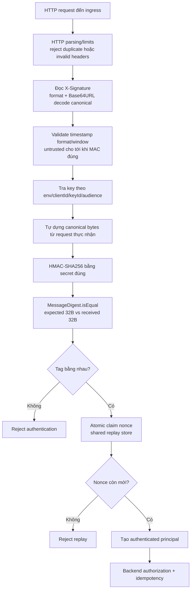

# MessageDigest.isEqual trong Constant-time comparison khi xác minh HMAC request

## Mục tiêu học tập

Sau bài học, bạn có thể:

- Giải thích **timing side-channel** ở bước so sánh chữ ký và vì sao không nên dùng phép so khớp dừng ngay tại byte sai đầu tiên.
- Sử dụng đúng phương thức tĩnh **`MessageDigest.isEqual(byte[], byte[])`** của Java để so sánh **HMAC tag nhị phân** thay vì so chuỗi chữ ký được encode.
- Phân biệt giới hạn của **constant-time comparison** với tuyên bố không chính xác rằng **toàn bộ HTTP authentication endpoint chạy constant time**.
- Xây dựng trình tự **kiểm tra format → decode Base64URL canonical → xác minh độ dài tag → tính HMAC trên canonical request server → `MessageDigest.isEqual`**.
- Nhận biết lý do phải yêu cầu **full-length HMAC-SHA256 tag 32 byte**, tránh chấp nhận chữ ký bị cắt ngắn hoặc đổi encoding ngoài hợp đồng.
- Viết Java 17+ tính/xác minh HMAC, tra key đúng client/môi trường, kiểm tra timestamp/nonce, tạo principal sau xác minh và giữ **authorization** độc lập.
- Thiết kế các ca kiểm thử đầu/cuối tag sai, length mismatch, Base64URL noncanonical, replay, key rotation, proxy rewrite và khác biệt giữa verifier/backend.

**Bối cảnh:** Bài thuộc chương **Constant-time comparison** của module `SECURITY_AUTHENTICATION_HMAC_REQUEST_AUTHENTICATION`. Module nghiên cứu xác thực HTTP request bằng **shared secret**, **canonical request** bao gồm method, URI, header/body theo hợp đồng ký; đồng thời xác minh HMAC, chống replay bằng timestamp/nonce, quản lý key rotation, kiểm thử proxy/gateway và phân biệt xác thực với phân quyền. Chủ đề trực tiếp của bài là **`MessageDigest.isEqual`** ở bước so sánh HMAC tag — một bước quan trọng nhưng không thể thay thế những kiểm soát còn lại.

> Hợp đồng `hmac-ct-v1`, tên header và endpoint trong bài là **ví dụ tự định nghĩa**, không phải một chuẩn HTTP authentication phổ quát.

## 1. Vì sao so sánh chữ ký có thể làm lộ thông tin thời gian?

Server nhận một HTTP request kèm chữ ký HMAC do client cung cấp. Sau khi dựng canonical request và tính lại HMAC từ shared secret, server cần quyết định:

```text
expectedTag = HMAC-SHA256(secretKey, canonicalRequestBytes)
receivedTag = Base64URL_Decode(X-Signature)

authenticated = (expectedTag == receivedTag)
```

Dấu `==` ở đây có nghĩa **hai dãy byte có giá trị bằng nhau**, không phải toán tử `==` của Java dành cho `byte[]`. Nếu hàm so sánh **trả về ngay khi gặp byte đầu tiên khác nhau**, thời gian thực thi có thể phụ thuộc vào độ dài **tiền tố đúng** giữa hai dãy.

Ví dụ một phép so sánh naïve:

```java
// KHÔNG dùng để xác minh chữ ký bí mật.
static boolean earlyExitEqual(byte[] expected, byte[] supplied) {
    if (expected.length != supplied.length) return false;
    for (int i = 0; i < expected.length; i++) {
        if (expected[i] != supplied[i]) {
            return false; // Dừng tại byte sai đầu tiên.
        }
    }
    return true;
}
```

Với hai tag cùng 32 byte:

```text
Trường hợp A: sai ngay byte thứ 1  -> vòng lặp chạy rất ít
Trường hợp B: sai byte thứ 31      -> vòng lặp chạy nhiều hơn
Trường hợp C: khớp toàn bộ 32 byte -> vòng lặp duyệt hết
```

Nếu attacker có khả năng gửi nhiều request đo thời gian và giảm được nhiễu, sự khác nhau phụ thuộc vào prefix có thể cung cấp **tín hiệu phụ**. Khả năng khai thác trong một API HMAC cụ thể phụ thuộc vào hệ thống, độ nhiễu mạng, rate limits, số lần thử và nhiều yếu tố khác; **không** nên kết luận chỉ một hàm so sánh sớm là đủ để attacker khôi phục một HMAC tag hoàn chỉnh. Tuy vậy, tránh nhánh so sánh phụ thuộc vào vị trí byte sai là một biện pháp phòng thủ rẻ và đúng hướng.

### Timing side-channel không phải “giải mã HMAC”

HMAC-SHA256 vẫn là MAC dựa trên secret: kẻ quan sát không thể **giải mã tag** để lấy secret. Rủi ro ở đây là **bước triển khai so sánh** có thể tiết lộ thông tin về tag dự kiến hoặc tạo ra những khác biệt quan sát được. Khả năng chống giả mạo về mặt mật mã không làm mọi chi tiết triển khai tự động an toàn trước side-channel.

## 2. `MessageDigest.isEqual` là gì?

JDK cung cấp phương thức tĩnh:

```java
public static boolean MessageDigest.isEqual(
        byte[] digesta,
        byte[] digestb)
```

Nó nhận **hai mảng byte** và trả `true` khi hai dãy có cùng nội dung, ngược lại trả `false`. Mặc dù nằm trong lớp `MessageDigest`, phương thức này **không tính SHA-256** và **không tự xác minh HMAC**; nó chỉ thực hiện phép so sánh các byte đã có.

Dùng trong verifier:

```java
byte[] expected = mac.doFinal(canonicalRequestBytes);
byte[] received = Base64.getUrlDecoder().decode(signatureText);

boolean valid = MessageDigest.isEqual(expected, received);
```

**Trong HTTP authentication, ví dụ trên chưa đủ:** phải kiểm tra `signatureText` đúng grammar, byte count, canonical Base64URL, lookup đúng key và xử lý replay/authorization. Chỉ sau khi các điều kiện cần thiết được xác nhận, kết quả so tag mới có ý nghĩa.

### Lý do chọn API này

`MessageDigest.isEqual` là primitive so sánh byte có sẵn trong JDK, được thiết kế thích hợp cho trường hợp cần hạn chế rò rỉ nội dung qua thời gian khi so giá trị digest/tag. Nó **tránh việc người viết tự chế vòng lặp so sánh**, vốn dễ xuất hiện `return false` giữa chừng hoặc bị tối ưu hóa ngoài dự định.

Một vài điểm cần hiểu đúng:

- Với HMAC-SHA256 đầy đủ, **`expected` phải dài cố định 32 byte**. `received` cũng phải được yêu cầu đúng 32 byte trước khi so.
- Thời gian của toàn bộ phương thức và pipeline **không nhất thiết độc lập với độ dài, giá trị `null`, lỗi format hoặc các nhánh xử lý khác**. Vì vậy không thể gọi toàn bộ endpoint là “constant-time” chỉ vì dùng API này.
- Hành vi chi tiết ở mức bytecode/JIT/provider phụ thuộc phiên bản runtime; không viết một cam kết đo lường tuyệt đối kiểu “mỗi request mất đúng N nanosecond”.
- Chỉ dùng `MessageDigest.isEqual` cho **kết quả byte[]**, không dùng cho `String` hoặc so khóa bằng cách tự chuyển qua text.

### So sánh các cách phổ biến trong Java

| Cách so | Ví dụ | Có phù hợp để so HMAC tag? |
|---|---|---|
| Toán tử `==` cho mảng | `expected == received` | **Không**; so tham chiếu object, không so nội dung |
| `Arrays.equals(byte[], byte[])` | `Arrays.equals(a, b)` | Không phải API nên dựa vào để đạt thuộc tính chống timing leakage cho MAC |
| `String.equals` | `hexA.equals(hexB)` | Không phải primitive so MAC; còn có rủi ro encoding/format |
| Tự duyệt rồi `return false` ngay | `if (a[i] != b[i]) return false` | **Không**; thời gian phụ thuộc vị trí sai |
| Tự XOR tất cả byte | `diff |= a[i] ^ b[i]` | Có thể tránh early exit nhưng dễ xử lý length/null sai, khó bảo đảm tối ưu hóa/JIT |
| **`MessageDigest.isEqual`** | `MessageDigest.isEqual(expected, received)` | **Nên dùng** sau khi validate format và chiều dài |
| API thư viện chuyên biệt | Primitive compare constant-time đã kiểm chứng | Cũng có thể dùng nếu hệ sinh thái cung cấp và tài liệu rõ |

**Không lấy `MessageDigest.isEqual` làm lý do để bỏ kiểm tra độ dài.** Bản thân một số trường hợp length mismatch/null có thể được xử lý khác nhau; trong giao thức này độ dài HMAC tag là **thông tin công khai, cố định**, nên validate length trước rồi so hai mảng 32 byte.

## 3. So sánh **tag bytes** hay so chuỗi chữ ký?

HMAC-SHA256 trả về **32 byte nhị phân**. Một HTTP header nên mang chúng dưới dạng text ASCII, ví dụ **Base64URL không padding**.

```text
Client:
    rawTag (32 bytes)
         |
         v
    Base64URL without padding
         |
         v
    X-Signature: <43 ASCII characters>

Server:
    X-Signature text
         |
         v
    Parse grammar + Base64URL decode + canonical check
         |
         v
    receivedTag (32 bytes)
         |
         v
    MessageDigest.isEqual(expectedTag, receivedTag)
```

Với 32 byte HMAC-SHA256:

| Representation | Độ dài | Ví dụ đặc tính |
|---|---:|---|
| Raw HMAC tag | **32 byte** | Bytes tùy ý, không phải text UTF-8 |
| Hex lowercase | 64 ký tự | `0-9a-f` |
| Base64 có padding | 44 ký tự | Có thể có `+`, `/`, dấu `=` |
| **Base64URL không padding** | **43 ký tự** | Chỉ `A-Z`, `a-z`, `0-9`, `-`, `_` |

Mỗi hợp đồng phải chọn **một wire format**. Trong bài, `hmac-ct-v1` quy định Base64URL không padding; hex, Base64 padded và URL-encoded tag **không được tự chấp nhận** như format thay thế.

### Vì sao không so trực tiếp chuỗi?

`String.equals` không có mục tiêu bảo mật dành cho so sánh MAC. Ngoài ra, một decoder Base64URL dễ dãi có thể chấp nhận **nhiều chuỗi** biểu diễn **cùng byte[]**, dẫn tới tình trạng cách định danh/ghi log/cache/tái phát hiện request không nhất quán.

Do đó verifier cần:

1. Chặn chuỗi sai alphabet/chiều dài.
2. Decode Base64URL để lấy raw tag.
3. Yêu cầu raw tag đúng **32 byte**.
4. **Re-encode** raw tag bằng Base64URL không padding, yêu cầu chuỗi re-encode **bằng đúng chuỗi nhận**.
5. Tính expected HMAC bằng key thích hợp.
6. Dùng **`MessageDigest.isEqual(expectedTag, receivedTag)`**.

Việc dùng `String.equals` ở bước **re-encode format** là chấp nhận được: đó là phép so sánh **biểu diễn public do client tự gửi**, không phải so một giá trị secret-derived expected MAC. Sau bước parse, chỉ dùng phép so bytes cho MAC.

## 4. Decode Base64URL **canonical** và kiểm tra chiều dài

Chỉ dùng regex `[A-Za-z0-9_-]{43}` là **chưa đủ** để chứng minh một chuỗi là cách encode canonical của 32 byte.

### Noncanonical pad bits

Một nhóm 32 byte toàn `0x00` có Base64URL không padding là **43 chữ `A`**. Vì byte count không chia hết cho 3, ký tự Base64URL cuối chỉ mang một phần bit dữ liệu; các bit còn lại phải là 0 theo quy tắc mã hóa canonical.

Một decoder cho phép pad bits khác 0 có thể decode:

```text
"AAAAAAAAAAAAAAAAAAAAAAAAAAAAAAAAAAAAAAAAAAA"  // 43 chữ A
"AAAAAAAAAAAAAAAAAAAAAAAAAAAAAAAAAAAAAAAAAAB"  // 42 chữ A + B
```

thành cùng 32 byte. Chuỗi thứ hai **không canonical**. Sau khi decode, encode lại và đối chiếu `String.equals` sẽ từ chối biến thể. Các chuỗi trong ví dụ **không được coi là chữ ký hợp lệ** của request nào chỉ vì có đúng format.

### Parser Java tối thiểu, dùng riêng cho tag

```java
import java.util.Base64;
import java.util.regex.Pattern;

final class HmacTagFormat {
    private static final Pattern SIGNATURE =
            Pattern.compile("[A-Za-z0-9_-]{43}");
    private static final Base64.Encoder ENCODER =
            Base64.getUrlEncoder().withoutPadding();

    static byte[] decode(String value) {
        if (value == null || !SIGNATURE.matcher(value).matches()) {
            throw new IllegalArgumentException("Invalid signature format");
        }

        final byte[] tag;
        try {
            tag = Base64.getUrlDecoder().decode(value);
        } catch (IllegalArgumentException invalidEncoding) {
            throw new IllegalArgumentException("Invalid Base64URL");
        }

        if (tag.length != 32 ||
                !ENCODER.encodeToString(tag).equals(value)) {
            throw new IllegalArgumentException("Noncanonical HMAC tag");
        }
        return tag;
    }
}
```

Hàm trả **`byte[]`**, chưa kiểm tra tag có đúng với request không. Trường `X-Signature` cũng phải được đảm bảo **chỉ xuất hiện một lần** ở HTTP adapter. Nếu proxy gộp thành hai chuỗi ngăn bằng dấu phẩy, hoặc nhận cả `X-Signature` và `x-signature`, phải từ chối thay vì chọn first/last value.

### Vì sao phải yêu cầu đủ 32 byte?

Một verifier nguy hiểm có thể chấp nhận:

```java
// SAI: vô tình chấp nhận chữ ký 1 byte, 2 byte, ... nếu prefix khớp.
boolean acceptsPrefix(byte[] expected, byte[] received) {
    for (int i = 0; i < received.length; i++) {
        if (expected[i] != received[i]) return false;
    }
    return true;
}
```

Nếu cho tag 1 byte, xác suất **đoán tag đó** là khoảng `1/256` cho mỗi thử trong mô hình lý tưởng, quá yếu. Với full tag HMAC-SHA256 32 byte, tấn công đoán ngẫu nhiên một tag là không khả thi khi key còn bí mật và triển khai đúng. Tuy nhiên, không nên lấy con số xác suất để bỏ rate limiting và threat model.

**Quy định bài này:** luôn yêu cầu **full-length 32-byte HMAC-SHA256**, không chấp nhận tag bị cắt ngắn. Một protocol cố ý dùng tag truncated phải định nghĩa **độ dài cố định** đủ mạnh và quy tắc so sánh rõ ràng; không bao giờ để client tự chọn độ dài được verifier chấp nhận.

## 5. `MessageDigest.isEqual` ở vị trí nào trong pipeline xác minh?

Constant-time comparison chỉ là **bước gần cuối của authentication**, không phải điểm bắt đầu.



Tại mọi nhánh:

- **Format sai**: có thể reject sớm, không cần tính HMAC. Điều này làm tổng thời gian của request format sai khác request đúng format; đó không phải mâu thuẫn với mục tiêu hạn chế rò rỉ *nội dung expected HMAC tag* ở bước compare.
- **Key không tồn tại/đã revoke**: không được cho qua vì tag trông hợp lệ. Trả lỗi công khai chung, không tiết lộ chi tiết giúp dò tài khoản/khóa.
- **HMAC sai**: từ chối trước khi claim nonce hoặc tạo principal.
- **Nonce trùng**: HMAC có thể đúng, nhưng request vẫn phải bị chặn chống replay.
- **Principal có quyền hay không**: do backend quyết định sau authentication, không phải do kết quả `isEqual`.
- **Proxy rewrite**: nếu method/URI/Host/body mà verifier ký khác với backend thực thi, dùng `isEqual` đúng cách **vẫn không giải quyết lỗ hổng sai canonical context**.

### Bảo mật không chỉ nằm ở so sánh

Một API có thể thực hiện `MessageDigest.isEqual` chính xác nhưng vẫn không an toàn nếu:

- Ký body mà bỏ method/URI/resource hoặc header điều kiện.
- Tra secret bằng `keyId` không kiểm tra client/environment, gây cross-tenant key confusion.
- Dùng `X-Forwarded-Host` từ client để dựng authority.
- Không ký timestamp/nonce hoặc không có shared nonce store.
- Chấp nhận key đã bị thu hồi hoặc thiếu authorization.
- Kiểm tra signature bằng tag 4 byte do client tự cung cấp, hoặc parse header trùng không nhất quán.

Vì vậy, **constant-time compare là một lớp phòng vệ cụ thể, không phải “một dòng code bảo mật toàn endpoint”.**

## 6. Xây dựng canonical request để tag so có ý nghĩa

HMAC tag chỉ xác thực những bytes mà client/server đưa vào phép tính. Hợp đồng mẫu `hmac-ct-v1` dùng endpoint tạo đơn:

```http
POST /v1/orders HTTP/1.1
Host: api.example.test
Content-Type: application/json
Idempotency-Key: order-2026-001
X-Client-Id: partner-17
X-Key-Id: k2
X-Timestamp: <unix-seconds>
X-Nonce: <base64url-nonce-128-bit>
X-Signature: <base64url-hmac-sha256>

{"orderId":"O-42","amount":120000}
```

Các chuỗi `<...>` là **placeholder**, không phải signature có thể gửi thật. Body được giả định không có newline cuối.

| Vị trí | Dòng canonical | Lý do |
|---|---|---|
| 1 | `hmac-ct-v1` | Ràng buộc version và ngữ cảnh sử dụng |
| 2 | `POST` | Ngăn tái sử dụng chữ ký sang method khác |
| 3 | `/v1/orders` | Ràng buộc target URI; không chấp nhận query trong profile |
| 4 | `host:api.example.test` | Ràng buộc public authority đã được ingress xác minh |
| 5 | `content-type:application/json` | Ràng buộc cách diễn giải body |
| 6 | `idempotency-key:order-2026-001` | Không cho sửa key khử trùng lặp mà giữ tag |
| 7 | `x-client-id:partner-17` | Ràng buộc client claim vào HMAC |
| 8 | `x-key-id:k2` | Ràng buộc phiên bản secret |
| 9 | `x-timestamp:<unix-seconds>` | Chống sửa thời gian của request |
| 10 | `x-nonce:<base64url-nonce>` | Chống sửa nonce trước replay gate |
| 11 | `body-sha256:<base64url-digest>` | Gắn tag với SHA-256 của **raw body bytes** |

**Quy tắc byte-level:** nối các dòng bằng LF (`0x0A`) **không có LF cuối**, encode UTF-8 không BOM, HMAC-SHA256 trên bytes đó rồi Base64URL-encode tag 32 byte không padding. Không đưa chính `X-Signature` vào canonical string để tránh tự tham chiếu.

```text
hmac-ct-v1
POST
/v1/orders
host:api.example.test
content-type:application/json
idempotency-key:order-2026-001
x-client-id:partner-17
x-key-id:k2
x-timestamp:<unix-seconds>
x-nonce:<base64url-nonce>
body-sha256:<base64url-sha256-raw-body>
```

**Điểm cần giữ:** server tự tạo các dòng này từ **request thực nhận** và metadata do ingress đáng tin xác lập, không dùng một chuỗi canonical do client gửi. Nếu backend dùng query hoặc signed header nghiệp vụ khác, phải đưa vào phiên bản hợp đồng ký hoặc reject ngoài allowlist.

## 7. Java 17+: verifier có `MessageDigest.isEqual` đúng vị trí

Ví dụ đầy đủ dưới đây giới hạn profile để người học nhìn rõ thứ tự **format → scoped key → canonical bytes → HMAC → byte compare → replay → principal**.

Lưu ý `NonceStore` và `KeyStore` là interface; ví dụ `main` dùng in-memory fixture để kiểm tra đường đi cốt lõi, **không dùng in-memory nonce set cho production đa replica**.

```java
import java.nio.charset.StandardCharsets;
import java.security.GeneralSecurityException;
import java.security.MessageDigest;
import java.security.SecureRandom;
import java.time.Clock;
import java.util.Base64;
import java.util.Optional;
import java.util.Set;
import java.util.concurrent.ConcurrentHashMap;
import java.util.regex.Pattern;
import javax.crypto.Mac;
import javax.crypto.spec.SecretKeySpec;

public final class HmacConstantTimeVerifier {
    private static final String VERSION = "hmac-ct-v1";
    private static final String HOST = "api.example.test";
    private static final String TARGET = "/v1/orders";
    private static final String AUDIENCE = "orders-api";
    private static final int MAX_BODY = 16 * 1024;
    private static final long SKEW = 300;
    private static final long NONCE_TTL = 601;

    private static final Pattern ID =
            Pattern.compile("[A-Za-z0-9][A-Za-z0-9._-]{0,63}");
    private static final Pattern TIMESTAMP =
            Pattern.compile("[1-9][0-9]{0,11}");
    private static final Pattern NONCE =
            Pattern.compile("[A-Za-z0-9_-]{22}");
    private static final Pattern SIGNATURE =
            Pattern.compile("[A-Za-z0-9_-]{43}");
    private static final Base64.Encoder B64 =
            Base64.getUrlEncoder().withoutPadding();

    private HmacConstantTimeVerifier() {}

    // HTTP adapter phải đã loại header trùng và lấy đúng
    // public Host/raw body; copy body để tránh sửa sau snapshot.
    public record RequestSnapshot(
            String method, String rawTarget, String publicHost,
            String contentType, String idempotencyKey,
            String clientId, String keyId,
            String timestamp, String nonce, byte[] body) {
        public RequestSnapshot {
            if (body == null) {
                throw new IllegalArgumentException("Missing body");
            }
            body = body.clone();
        }

        @Override
        public byte[] body() {
            return body.clone();
        }
    }

    public record KeyRecord(
            String environment, String clientId, String keyId,
            String audience, String principal, boolean mayVerify,
            byte[] secret) {
        public KeyRecord {
            if (secret == null) {
                throw new IllegalArgumentException("Missing secret");
            }
            secret = secret.clone();
        }

        @Override
        public byte[] secret() {
            return secret.clone();
        }
    }

    public interface KeyStore {
        Optional<KeyRecord> find(
                String environment, String clientId,
                String keyId, String audience);
    }

    // Production: atomic insert-if-absent + TTL, shared across replicas.
    public interface NonceStore {
        boolean claim(String scope, String nonce, long ttlSeconds);
    }

    private static byte[] decodeCanonicalBase64Url(
            String text, Pattern grammar, int exactBytes) {
        if (text == null || !grammar.matcher(text).matches()) {
            throw new IllegalArgumentException("Invalid encoding grammar");
        }
        final byte[] bytes;
        try {
            bytes = Base64.getUrlDecoder().decode(text);
        } catch (IllegalArgumentException malformed) {
            throw new IllegalArgumentException("Bad Base64URL value");
        }
        if (bytes.length != exactBytes ||
                !B64.encodeToString(bytes).equals(text)) {
            throw new IllegalArgumentException("Noncanonical encoding");
        }
        return bytes;
    }

    private static void validateSignedFields(RequestSnapshot r) {
        if (r == null ||
                !"POST".equals(r.method()) ||
                !TARGET.equals(r.rawTarget()) ||
                !HOST.equals(r.publicHost()) ||
                !"application/json".equals(r.contentType()) ||
                r.idempotencyKey() == null ||
                !ID.matcher(r.idempotencyKey()).matches() ||
                r.clientId() == null ||
                !ID.matcher(r.clientId()).matches() ||
                r.keyId() == null ||
                !ID.matcher(r.keyId()).matches() ||
                r.timestamp() == null ||
                !TIMESTAMP.matcher(r.timestamp()).matches() ||
                r.body().length == 0 ||
                r.body().length > MAX_BODY) {
            throw new IllegalArgumentException("Invalid signed request");
        }
        decodeCanonicalBase64Url(r.nonce(), NONCE, 16);
    }

    public static byte[] canonicalBytes(RequestSnapshot r)
            throws GeneralSecurityException {
        validateSignedFields(r);
        byte[] digest = MessageDigest.getInstance("SHA-256")
                .digest(r.body());

        String canonical = String.join("\n",
                VERSION,
                "POST",
                TARGET,
                "host:" + r.publicHost(),
                "content-type:" + r.contentType(),
                "idempotency-key:" + r.idempotencyKey(),
                "x-client-id:" + r.clientId(),
                "x-key-id:" + r.keyId(),
                "x-timestamp:" + r.timestamp(),
                "x-nonce:" + r.nonce(),
                "body-sha256:" + B64.encodeToString(digest));

        return canonical.getBytes(StandardCharsets.UTF_8);
    }

    private static byte[] expectedTag(
            byte[] secret, RequestSnapshot r)
            throws GeneralSecurityException {
        Mac mac = Mac.getInstance("HmacSHA256");
        mac.init(new SecretKeySpec(secret, "HmacSHA256"));
        return mac.doFinal(canonicalBytes(r)); // 32 byte.
    }

    // Chỉ dùng để tạo fixture client/test, không gọi để ký hộ
    // một request chưa xác thực ở verifier production.
    public static String signForTest(byte[] secret, RequestSnapshot r)
            throws GeneralSecurityException {
        return B64.encodeToString(expectedTag(secret, r));
    }

    public static Optional<String> authenticate(
            RequestSnapshot received, String encodedSignature,
            String serverEnvironment, Clock clock,
            KeyStore keyStore, NonceStore nonceStore)
            throws GeneralSecurityException {

        final byte[] suppliedTag;
        try {
            validateSignedFields(received);
            suppliedTag = decodeCanonicalBase64Url(
                    encodedSignature, SIGNATURE, 32);
        } catch (IllegalArgumentException invalidFormat) {
            return Optional.empty();
        }

        final long timestamp;
        try {
            timestamp = Long.parseLong(received.timestamp());
        } catch (NumberFormatException invalidTimestamp) {
            return Optional.empty();
        }

        long now = clock.instant().getEpochSecond();
        if (timestamp < now - SKEW || timestamp > now + SKEW) {
            return Optional.empty();
        }

        // Server quyết định environment/audience; header client chỉ
        // cung cấp scope lookup chưa đáng tin.
        Optional<KeyRecord> candidate = keyStore.find(
                serverEnvironment, received.clientId(),
                received.keyId(), AUDIENCE);
        if (candidate.isEmpty()) {
            return Optional.empty();
        }
        KeyRecord key = candidate.get();
        if (!key.mayVerify() ||
                !serverEnvironment.equals(key.environment()) ||
                !AUDIENCE.equals(key.audience()) ||
                !received.clientId().equals(key.clientId()) ||
                !received.keyId().equals(key.keyId()) ||
                key.principal() == null) {
            return Optional.empty();
        }

        // Phần so sánh HMAC: chỉ chạy với tag cùng length 32 byte.
        byte[] expected = expectedTag(key.secret(), received);
        if (!MessageDigest.isEqual(expected, suppliedTag)) {
            return Optional.empty();
        }

        // Không để attacker chiếm nonce bằng một signature giả.
        String replayScope = serverEnvironment + "|" + AUDIENCE +
                "|" + key.clientId();
        if (!nonceStore.claim(replayScope, received.nonce(), NONCE_TTL)) {
            return Optional.empty();
        }

        // Tới đây mới có thể tạo principal authenticated;
        // backend CÒN phải làm authorization riêng.
        return Optional.of(key.principal());
    }

    public static void main(String[] args)
            throws GeneralSecurityException {
        byte[] secret = new byte[32];
        new SecureRandom().nextBytes(secret); // Demo provisioning.
        byte[] nonceBytes = new byte[16];
        new SecureRandom().nextBytes(nonceBytes);

        Clock clock = Clock.systemUTC();
        RequestSnapshot request = new RequestSnapshot(
                "POST", TARGET, HOST, "application/json",
                "order-2026-001", "partner-17", "k2",
                Long.toString(clock.instant().getEpochSecond()),
                B64.encodeToString(nonceBytes),
                "{\"orderId\":\"O-42\",\"amount\":120000}"
                        .getBytes(StandardCharsets.UTF_8));

        KeyStore store = (env, clientId, keyId, audience) ->
                "production".equals(env) &&
                "partner-17".equals(clientId) &&
                "k2".equals(keyId) &&
                AUDIENCE.equals(audience)
                ? Optional.of(new KeyRecord(
                        env, clientId, keyId, audience,
                        "partner-17", true, secret))
                : Optional.empty();

        // Fixture in-memory có tính nguyên tử trong 1 process,
        // nhưng KHÔNG có TTL và KHÔNG dùng chung qua replicas.
        Set<String> seen = ConcurrentHashMap.newKeySet();
        NonceStore nonces = (scope, nonce, ttlSeconds) ->
                seen.add(scope + "|" + nonce);

        String signature = signForTest(secret, request);
        if (!"partner-17".equals(authenticate(
                request, signature, "production", clock, store, nonces)
                .orElse(null))) {
            throw new AssertionError("Valid HMAC rejected");
        }

        // Tag hợp lệ về HMAC vẫn bị chặn nếu phát lại nonce.
        if (authenticate(request, signature, "production",
                clock, store, nonces).isPresent()) {
            throw new AssertionError("Replay accepted");
        }

        RequestSnapshot modified = new RequestSnapshot(
                request.method(), request.rawTarget(),
                request.publicHost(), request.contentType(),
                request.idempotencyKey(), request.clientId(),
                request.keyId(), request.timestamp(), request.nonce(),
                "{\"orderId\":\"O-42\",\"amount\":999999}"
                        .getBytes(StandardCharsets.UTF_8));

        if (authenticate(modified, signature, "production",
                clock, store, nonces).isPresent()) {
            throw new AssertionError("Modified body accepted");
        }

        System.out.println("Constant-time HMAC comparison: PASS");
    }
}
```

### Vì sao đoạn mã cố định length trước khi so?

- `SIGNATURE` chỉ nhận 43 ký tự trong alphabet Base64URL không padding.
- `decodeCanonicalBase64Url` buộc decode ra **32 byte**, encode lại phải bằng chính text đã nhận.
- `HmacSHA256` tạo **expectedTag dài 32 byte**.
- `MessageDigest.isEqual(expected, suppliedTag)` chỉ xử lý trường hợp **hai tag có chiều dài cố định**, không bao giờ chấp nhận prefix 1–31 byte.

Như vậy bài toán so sánh được đưa về **một cặp dãy byte dài cố định**. Dạng sai format bị loại trước — độ dài/tag alphabet là thông tin công khai; **không cần** dành tài nguyên HMAC cho mọi chuỗi rác.

### Những điều mã không tự bảo đảm

Lớp `HmacConstantTimeVerifier` không parse HTTP network bytes. `RequestSnapshot` do HTTP adapter tạo phải phản ánh request thực nhận **sau khi đã từ chối duplicate headers, Host mâu thuẫn, method override và parser ambiguity**. Class cũng không triển khai kho nonce phân tán, key revocation propagation, rate limiting, mTLS nội bộ, idempotency nghiệp vụ hay authorization. `KeyRecord` clone secret để giảm nguy cơ sửa ngoài ý muốn trong ví dụ, nhưng vẫn không thay thế secret manager/KMS và chính sách quản lý raw key trong production.

Không suy diễn rằng `MessageDigest.isEqual` làm **key lookup**, **Base64 decoding** hay **HTTP response timing** thành constant-time. Nếu một ứng dụng có threat model yêu cầu chống phân biệt key existence/tenant hoặc timing chi tiết hơn, cần đánh giá **toàn pipeline** và dùng các biện pháp bổ sung thích hợp.

## 8. So sánh đúng nhưng canonical request sai vẫn nguy hiểm

Ví dụ client ký:

```text
POST
/v1/orders?tenant=A
body-sha256:<digest>
```

nhưng verifier lại tính HMAC trên `POST /v1/orders` và bỏ query `tenant`. Nếu backend sử dụng `tenant=A` hoặc `tenant=B` để chọn nơi tạo đơn, attacker có thể thay query mà **`MessageDigest.isEqual` vẫn trả `true`** vì **hai expected/supplied tag vẫn tương ứng canonical message không chứa trường bị sửa**.

Một ví dụ khác: gateway xác minh `Host: api.example.test` nhưng backend route theo `X-Forwarded-Host` do client tự gửi. Kết quả so tag đúng **không chứng minh** backend đã dùng đúng đích được bảo vệ.

### Các bất biến cần chứng minh

```text
Method mà verifier ký       == method backend thực thi
Request target verifier ký == resource/route được backend xử lý
Public Host verifier ký    == public audience gateway đã xác nhận
Signed headers verifier ký == semantics backend sử dụng
Raw body verifier hash     == representation handler parse
Client/key ID verified     == owner của key record tạo principal
```

Dấu `==` là sự phù hợp **theo hợp đồng canonicalization**, không nhất thiết byte-for-byte qua các hop đã rewrite hợp lệ. Phải có một định nghĩa rõ về dữ liệu trước/sau rewrite và một đường truyền thông tin tin cậy. Nếu hạ tầng không chứng minh được sự tương ứng, **fail closed**.

### Những tình huống cần kiểm tra ở proxy/gateway

| Tình huống | Rủi ro ngoài phép so tag | Biện pháp |
|---|---|---|
| Proxy rewrite path/prefix | Verifier và backend dùng URI khác | Verify trước rewrite hoặc original target đáng tin |
| `Host` công khai → internal Host | Canonical host mismatch | Trusted public authority context |
| `X-Forwarded-Host` do client tự khai | Dùng host sai, route sai | Strip/overwrite tại trusted proxy |
| Duplicate `X-Signature` | Parser chọn first/last khác nhau | Reject tại ingress |
| HTTP/2 `:authority` khác `Host` | Routing/canonical khác nghĩa | Reject conflict theo policy |
| Body JSON bị reserialize | SHA-256 raw bytes khác | Chốt exact body bytes và signed Content-Type |
| Encoded slash/percent decoding | Router nhận resource khác | URI grammar rõ, reject ambiguity |
| `Content-Length`/`Transfer-Encoding` nhập nhằng | HTTP request smuggling | HTTP framing policy nhất quán tại edge |
| Header `Idempotency-Key` không được ký | Có thể thay key sau ký | Đưa trường nghiệp vụ vào canonical |
| Backend tin `X-Authenticated-Principal` tự khai | Bypass authentication | Ghi đè header nội bộ và bảo vệ hop |

Đây là lý do bài kiểm thử chỉ gọi `isEqual` với hai mảng trong unit test **không chứng minh** ứng dụng HTTP được bảo vệ đủ.

## 9. Timing leak ở **toàn hệ thống**: ranh giới của “constant time”

Giả sử endpoint có các nhánh:

```text
Nếu format signature sai        -> reject sau 0 bước HMAC
Nếu key ID không tồn tại        -> reject sau key lookup
Nếu key ID tồn tại, tag sai      -> tính HMAC rồi reject
Nếu tag đúng, nonce cũ          -> tính HMAC, truy vấn nonce rồi reject
Nếu tag đúng, nonce mới         -> đi vào backend authorization
```

Thời gian phản hồi có thể khác nhau đáng kể giữa các nhánh, **dù so tag bằng `MessageDigest.isEqual`**. Điều này không đồng nghĩa phương thức so sánh sai; nó chỉ xác nhận mục tiêu của phương thức hẹp hơn **hằng thời gian end-to-end**.

Những biện pháp hệ thống cần cân nhắc:

1. **Một lỗi authentication công khai chung** cho key không tồn tại, MAC sai hoặc revoked key khi việc phân biệt sẽ giúp enumeration. Không tiết lộ prefix HMAC, key metadata hay giá trị secret.
2. **Giới hạn tốc độ và số lần thử** theo client/nguồn/tenant phù hợp, chống brute force, dò key và lạm dụng CPU của HMAC parser.
3. **Cache/key lookup có kiểm soát**: tránh nhánh trả thông tin nhạy cảm hoặc độ lệch nghiêm trọng tùy key existence khi threat model yêu cầu giảm enumeration. Không tự xem một dummy key là phép chứng minh “mọi nhánh constant-time”.
4. **Giới hạn kích thước input** trước HMAC: body, headers, query và signature không được kích hoạt phân bổ CPU/RAM vô hạn.
5. **Không trả thời gian chi tiết** hoặc log ra dữ liệu bí mật. Metrics cần được tổng hợp và lọc; log không chứa raw secret hoặc body riêng tư.
6. **Đánh giá JDK/provider/runtime thực tế** cho yêu cầu side-channel cao, vì GC/JIT/scheduler/CPU cache và mạng đều tạo sai khác và nhiễu.
7. **TLS và network trust boundaries**: bảo vệ credential/metadata khi truyền; HMAC không thay thế TLS, cũng không giúp sửa HTTP request smuggling.
8. **Không dùng “sleep cố định” như giải pháp duy nhất**: thêm độ trễ có thể bị nhiễu, làm hại throughput và không xóa được khác biệt ở mọi nhánh. Phải sửa nguồn gây rò rỉ và áp dụng bảo vệ nhiều lớp.

**Kết luận kỹ thuật:** `MessageDigest.isEqual` là lựa chọn API phù hợp cho việc **so tag bytes**, nhưng một tuyên bố “thời gian của mọi request hoàn toàn không phụ thuộc dữ liệu bí mật” đòi hỏi phân tích và đo kiểm rộng hơn nhiều.

## 10. Kiểm thử chức năng quan trọng hơn benchmark timing đơn lẻ

Một cách làm sai là chạy vài trăm phép đo rồi khẳng định hàm so sánh “chắc chắn constant-time” do hai thời gian trung bình gần nhau. Timing microbenchmark trên JVM chịu tác động của JIT warm-up, garbage collection, CPU scaling, scheduler, noise và data cache; kiểm thử black-box không dễ chứng minh thuộc tính constant-time.

Hãy phân chia ba lớp kiểm thử:

### 10.1. Unit test đúng/sai về nội dung

```java
import java.security.MessageDigest;
import java.util.Arrays;

byte[] expected = new byte[32];
byte[] identical = expected.clone();

byte[] wrongFirst = expected.clone();
wrongFirst[0] = 1;
byte[] wrongLast = expected.clone();
wrongLast[31] = 1;
byte[] truncated = Arrays.copyOf(expected, 31);

assert MessageDigest.isEqual(expected, identical);
assert !MessageDigest.isEqual(expected, wrongFirst);
assert !MessageDigest.isEqual(expected, wrongLast);
assert !MessageDigest.isEqual(expected, truncated);
```

Đoạn mã xác minh **semantics equality**, không chứng minh timing. Một số test runner không bật assertions trừ khi dùng `-ea`; hãy dùng assertion methods của framework kiểm thử ở sản phẩm thật.

### 10.2. Format test trước khi so HMAC

Kiểm tra:

- 43 ký tự Base64URL không padding được decode thành 32 byte.
- Chuỗi 44 ký tự có `=`, Base64 thường chứa `+`/`/`, hex 64 ký tự bị từ chối theo contract.
- Chuỗi decode ra 31 hoặc 33 byte bị từ chối, không chạy phép so như chữ ký rút gọn.
- Chuỗi noncanonical pad bits (`42 chữ A + B` trong ví dụ trước) bị loại sau re-encode.
- Header `X-Signature` thiếu/trùng, có CR/LF, whitespace đầu/cuối, giá trị bị gộp bị từ chối tại parser/ingress.
- Khi format sai, hệ thống không được gọi một đường fallback dùng `String.equals`, `Arrays.equals` hoặc truncate expected tag.

### 10.3. Integration test của HTTP verification

Gửi HTTP request thật qua gateway/verifier/backend để xác minh rằng chữ ký chỉ được chấp nhận **khi tag khớp toàn bộ và toàn bộ signed semantics đúng**. Test key rotation, timestamp, nonce, đường đi từ HTTP/1.1 tới HTTP/2, proxy rewrite và authorization. Benchmark timing chỉ là **một hoạt động đánh giá bổ sung** theo threat model, không thay những test chức năng này.

## 11. Replay, key rotation, idempotency và authorization vẫn là các bước riêng

### Timestamp và nonce

Một HMAC tag có thể được so `MessageDigest.isEqual` thành công mỗi lần người ta gửi lại **nguyên request đã ký**. Nếu không có replay policy, cùng request có thể được chấp nhận nhiều lần.

- `X-Timestamp` và `X-Nonce` phải nằm trong canonical request đã HMAC bảo vệ.
- Server kiểm tra timestamp trong cửa sổ đã định nghĩa (ví dụ ±300 giây) với đồng hồ được đồng bộ.
- Chỉ **sau HMAC hợp lệ**, ghi nonce vào shared nonce store bằng **atomic insert-if-absent** theo scope principal/client, không phải kiểm tra rồi ghi ở hai bước tách biệt.
- TTL đủ bao phủ toàn bộ khoảng thời gian một request với timestamp được ký còn có thể hợp lệ.
- Endpoint nhạy cảm nên **fail closed** khi nonce store không khả dụng.
- Dùng một request mới với nonce khác là một hành động mới theo replay policy; đó **không** thay thế idempotency nghiệp vụ.

### Key rotation

Giả sử client chuyển từ `k1` sang `k2`:

- Bản ghi khóa gắn với **clientId, keyId, environment, audience, state**.
- Verifier chỉ tính expected HMAC bằng **secret của key đã tra đúng scope**, không thử mọi secret trong hệ thống.
- Trong giai đoạn overlap hữu hạn, có thể xác minh tag của cả `k1` và `k2` theo trạng thái được phép.
- Khi `k1` bị thu hồi, request sử dụng nó phải bị từ chối trên mọi replica, dù tag đúng.
- Không dùng `MessageDigest.isEqual` để “quyết định nên chọn key nào” bằng cách thử mọi key rồi nhận key có tag khớp.

**Key bị lộ:** attacker có thể tính **tag mới** đúng cho request mới. Constant-time comparison và nonce store không khắc phục được key compromise; cần thu hồi/rotation và hạn chế phạm vi khóa.

### Authentication khác authorization

Giả sử một client hợp lệ có key của `partner-17` ký request nhắm đơn hàng của `partner-42`. `MessageDigest.isEqual` có thể trả `true` vì chính client ấy đã tạo tag đúng, nhưng backend **vẫn phải từ chối** khi principal không có quyền trên tài nguyên đích.

Chữ ký chỉ góp phần chứng minh **khả năng dùng secret đúng scope và integrity của signed fields**. Nó không là “quyền admin”, không thay object-level authorization, input validation, idempotency hay transaction.

## 12. Ma trận kiểm thử `MessageDigest.isEqual` trong HMAC verifier

| Tình huống | Input/thao tác | Kết quả kỳ vọng |
|---|---|---|
| Hai tag 32 byte giống nhau | `expected` và `received` có cùng bytes | `isEqual` trả `true` |
| Sai byte đầu | Sửa byte 0 của tag | `false` |
| Sai byte cuối | Sửa byte 31 của tag | `false` |
| Sai byte giữa | Sửa byte 15 của tag | `false` |
| Tag dài 31 byte | Chữ ký bị truncate | Reject **trước** compare theo protocol |
| Tag dài 33 byte | Tag vượt length | Reject format |
| Signature có padding | Base64URL 44 ký tự có `=` | Reject |
| Hex tag | Hex 64 ký tự thay cho Base64URL 43 ký tự | Reject theo contract |
| Noncanonical pad bits | Decode cùng bytes nhưng re-encode khác | Reject format |
| Tag ngẫu nhiên đúng format | 43 ký tự, decode 32 byte nhưng HMAC không khớp | Reject authentication |
| Signature trùng header | Hai `X-Signature` kể cả khác chữ hoa/thường | Reject ở HTTP parser |
| Sai method | Ký `POST` rồi gửi `PUT` | Reject hoặc HMAC mismatch |
| Sai target | Đổi URI/resource sau ký | Reject hoặc HMAC mismatch |
| Header bị sửa | Đổi `X-Client-Id`, `X-Key-Id`, `Idempotency-Key` | Key lookup fail hoặc HMAC mismatch |
| Body đổi một byte | Đổi JSON body trong khi giữ tag cũ | HMAC mismatch |
| Public Host khác | Gateway route sang authority không được ký | Reject hoặc mismatch |
| Key của client khác | Claim client B nhưng tag tính bằng secret A | Reject; không tạo principal B |
| Key bị revoked | HMAC đúng với secret cũ | Reject theo key state |
| Replay tuần tự | Gửi lại cùng timestamp/nonce/tag | Một request qua gate, lần sau bị chặn |
| Replay giữa replica | Hai request cùng nonce đồng thời | Tối đa một request được claim |
| Timestamp quá hạn | Tag đúng nhưng thời gian ngoài window | Reject |
| Header forwarding giả | Client tự đặt `X-Forwarded-Host` | Không ảnh hưởng nguồn authority tin cậy |
| HTTP parser bất đồng | Duplicate header/encoded path gây diễn giải khác | Reject trước khi có thể thực thi sai context |
| MAC đúng, sai tenant | Client được xác thực nhưng đích ngoài quyền | Authn pass, authz deny |
| Retry với nonce mới | Tạo lại POST cùng Idempotency-Key đã ký | Idempotency backend tránh tác vụ trùng |

### Các bất biến cần assert

1. **Format:** verifier chỉ nhận một cách encode HMAC-SHA256 đầy đủ (32 bytes → 43 Base64URL chars).
2. **Cryptographic:** expected tag được tính bằng HMAC-SHA256 trên **canonical bytes server tự dựng**, với **secret tra theo đúng scope**.
3. **Comparison:** không dùng phép so early-exit/prefix; dùng `MessageDigest.isEqual` trên raw tag bytes.
4. **Replay:** HMAC đúng **không** tự cho phép một nonce đã được claim.
5. **Execution:** request mà backend thực thi phải tương ứng với signed semantics mà verifier xác thực.
6. **Authorization:** principal đã verify chỉ được thực hiện thao tác mà backend cho phép.

## 13. Bài tập thực hành: bảo vệ verifier tạo đơn

Hệ thống `orders-api` nhận `POST /v1/orders` qua HTTPS và API gateway. Các đối tác được cấp shared secret HMAC-SHA256 theo `clientId` và `keyId`; verifier có ba replica; nonce store dùng chung; backend xử lý nhiều tenant.

**Bài tập 1 — Sửa phép so sai.** Bắt đầu với một verifier sử dụng `Arrays.equals` hoặc vòng lặp dừng sớm. Đổi sang `MessageDigest.isEqual` sau khi giải mã Base64URL, bắt buộc full-length tag. Giải thích vì sao `String.equals` trên chuỗi Base64URL không phải lựa chọn mục tiêu cho compare MAC.

**Bài tập 2 — Parser nghiêm ngặt.** Định nghĩa `X-Signature` duy nhất với regex `[A-Za-z0-9_-]{43}`, decode 32 byte và re-encode canonical. Viết negative tests cho padded signature, hex tag, 42 chữ `A` + `B`, duplicate header, tag bị cắt ngắn.

**Bài tập 3 — Ký đúng request.** Thiết kế `hmac-ct-v1` gồm protocol version, method, raw target, public Host, Content-Type, Idempotency-Key, client/key ID, timestamp/nonce và SHA-256 raw body. Chốt LF/UTF-8 và không có LF cuối.

**Bài tập 4 — Tích hợp key store.** Dùng `(env, clientId, keyId, audience)` tra một khóa được phép verify, không thử toàn bộ keys; chuyển sang principal từ key record **sau khi tag khớp**.

**Bài tập 5 — Replay và rotation.** Gửi lại đúng request đã ký tới hai replica; chứng minh atomic nonce claim chỉ cho phép một. Rotate từ `k1` sang `k2`, vô hiệu hóa `k1` và đảm bảo không replica nào tiếp tục chấp nhận key đã revoke.

**Bài tập 6 — End-to-end qua proxy.** Thử Host rewrite, query bị đổi, duplicate header, JSON reserialization và HTTP/2 `:authority` khác `Host`; chứng minh server chỉ so tag của **canonical request đúng với tài nguyên backend thực thi**.

**Bài tập 7 — Authorization/idempotency.** Client A ký hợp lệ request tới tài nguyên B; backend phải deny. Client retry POST với nonce mới nhưng cùng Idempotency-Key đã ký; backend không tạo đơn trùng.

**Tiêu chí hoàn thành:** có thể chứng minh **parser format → expected HMAC đúng scope → `MessageDigest.isEqual` với 32-byte tag → nonce gate → principal → authorization**. Người học cũng phải trình bày được **giới hạn**: một phép so MAC hạn chế timing leak **không chứng minh toàn endpoint constant-time hoặc hoàn chỉnh về bảo mật**.

---

## Ghi nhớ

Trong module `SECURITY_AUTHENTICATION_HMAC_REQUEST_AUTHENTICATION`, phương thức **`MessageDigest.isEqual(expectedTag, receivedTag)`** là lựa chọn Java phù hợp để so sánh **hai HMAC tag nhị phân dài cố định**, thay cho so sánh dừng sớm hoặc so text. Với HMAC-SHA256, hãy kiểm tra **Base64URL không padding canonical**, decode thành **đủ 32 byte**, tính expected tag từ **canonical request phía server** và **secret đúng client/môi trường**, rồi mới so bytes. Dù phép so đúng, request vẫn phải qua **timestamp/nonce chống replay**, **key rotation**, kiểm thử proxy/gateway và **authorization theo tài nguyên**. `MessageDigest.isEqual` bảo vệ **bước compare**, không tự bảo vệ toàn bộ hệ thống HTTP.
