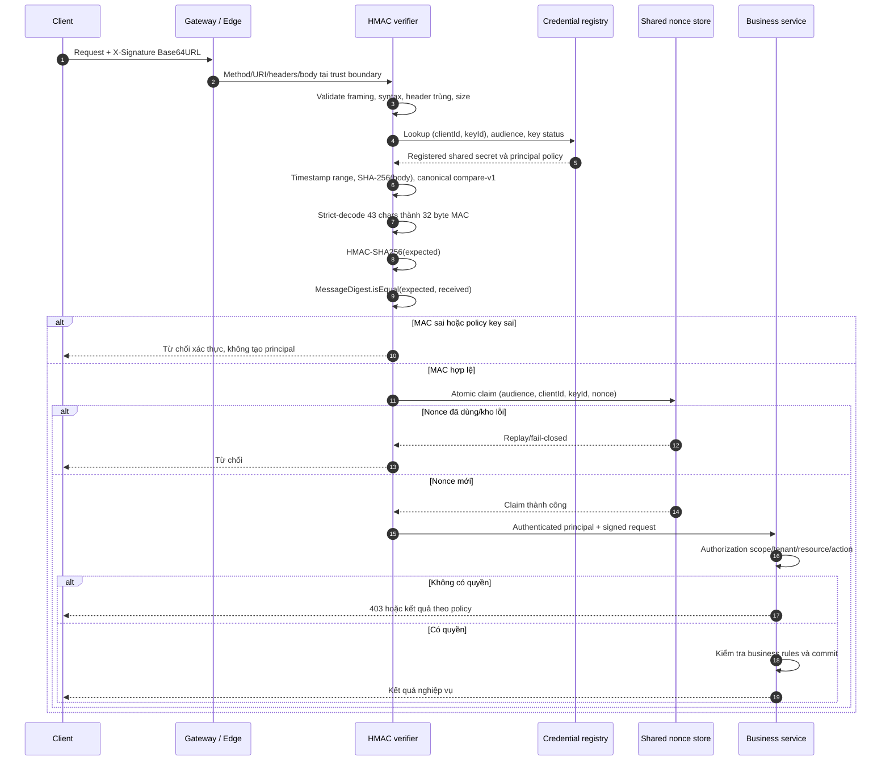

# Không dùng `equals` tùy tiện khi so sánh chữ ký HMAC

## Mục tiêu học tập

Trong chương **Constant-time comparison**, chủ đề **Không dùng equals tùy tiện** giải thích vì sao bước cuối của **xác minh chữ ký HMAC** không nên dùng những phép so sánh thông thường có thể dừng sớm tùy dữ liệu, và cách thực hiện đối chiếu MAC một cách phù hợp trong Java.

Bài thuộc module `SECURITY_AUTHENTICATION_HMAC_REQUEST_AUTHENTICATION`, nơi người học thiết kế xác thực HTTP request bằng **HMAC với shared secret** và **canonical request** có phương thức, URI, header hoặc body theo hợp đồng ký. Ngoài xác minh chữ ký, hệ thống phải chống replay bằng timestamp/nonce, quản lý key rotation, kiểm thử qua proxy/gateway và phân biệt **authentication** với **authorization**.

Học xong bài, bạn có thể:

- Mô tả **timing side channel** và giải thích vấn đề khi so sánh byte MAC bằng các hàm có thể dừng ở khác biệt đầu tiên.
- Phân biệt `==`, `String.equals`, `Arrays.equals`, `Arrays.mismatch`, `Objects.equals` và `MessageDigest.isEqual` khi dùng cho dữ liệu nhạy cảm.
- Giải mã chữ ký Base64URL thành **raw MAC bytes**, kiểm tra độ dài/canonical encoding rồi đối chiếu với MAC server tự tính bằng `MessageDigest.isEqual(expected, received)`.
- Phân biệt **so sánh tương đối không phụ thuộc nội dung MAC** với tuyên bố quá mức rằng **toàn bộ verifier HTTP là constant-time**.
- Viết Java 17 tạo và xác minh HMAC-SHA256, kiểm thử chữ ký đúng/sai, sửa byte đầu/cuối, sai độ dài và encoding không hợp lệ.
- Tích hợp so sánh MAC với canonicalization, kiểm tra timestamp/nonce, credential registry/key rotation, proxy/gateway và authorization.

## 1. Tại sao phép so sánh cuối cùng quan trọng?

Khi HTTP client ký một request:

```text
canonicalRequestBytes = UTF8(canonical(method, rawTarget, headers,
                                       bodyHash, timestamp, nonce, ...))
expectedMac = HMAC-SHA256(sharedSecretBytes, canonicalRequestBytes)
```

HMAC-SHA256 trả về **32 byte nhị phân**. Client thường chuyển 32 byte thành **43 ký tự Base64URL không padding** để gửi trong header `X-Signature`. Server đọc header, giải mã nó thành `receivedMac`, tự tính `expectedMac` từ request thực nhận và khóa trong registry, rồi quyết định:

```text
acceptAuthentication = secureCompare(expectedMac, receivedMac)
```

Nếu phép so sánh kiểm tra từ trái qua phải và **dừng ngay khi thấy byte khác**, thời gian xử lý có thể phụ thuộc vào **số byte đầu giống nhau** giữa chữ ký do client gửi và MAC mà server kỳ vọng.

Ví dụ một phép so sánh tự viết không phù hợp:

```java
static boolean unsafeCompare(byte[] expected, byte[] received) {
    if (expected.length != received.length) {
        return false;
    }
    for (int i = 0; i < expected.length; i++) {
        if (expected[i] != received[i]) {
            return false; // Dừng tại byte sai đầu tiên.
        }
    }
    return true;
}
```

Hai chuỗi cùng độ dài nhưng sai tại vị trí khác nhau có thể đi qua **số bước kiểm tra khác nhau**. Nếu một kẻ tấn công đo được thời gian phản hồi với độ chính xác đủ cao và lặp lại đủ nhiều phép thử trong một hệ thống có điều kiện thuận lợi, sự khác biệt có thể thành **tín hiệu phụ** về dữ liệu mà server đang so sánh.

Đây là một dạng **timing side-channel**: thông tin bị lộ không qua nội dung response mà qua thời gian thực hiện. Mức độ khai thác thực tế chịu ảnh hưởng của độ nhiễu mạng, JIT, CPU cache, scheduling, rate limit, trình tự kiểm tra và cấu trúc giao thức. Không nên khẳng định rằng mọi API dùng `equals` sẽ chắc chắn bị khai thác từ xa, nhưng cũng **không nên tự mở rủi ro** bằng cách dùng phép so sánh dừng sớm ở bước xác minh MAC.

### 1.1. Trực quan hóa so sánh dừng sớm

```text
expected: [A1 B2 C3 D4  E5 F6 ...] (MAC server tự tính)
guess A : [00 00 00 00  00 00 ...] -> sai byte 0 -> dừng
guess B : [A1 00 00 00  00 00 ...] -> sai byte 1 -> dừng
guess C : [A1 B2 00 00  00 00 ...] -> sai byte 2 -> dừng
```

Các giá trị hex là **minh họa**, không phải test vector HMAC thực. Nguy cơ nằm ở việc vị trí byte sai được phản ánh qua **số lượng công việc** mà bộ so sánh thực hiện. Một hàm so sánh phù hợp cố gắng làm cho tiến trình xử lý không phụ thuộc vào **nội dung byte**, trong phạm vi và giả định được tài liệu API nêu rõ.

### 1.2. Constant-time có nghĩa gì trong thực hành?

Trong mật mã ứng dụng, cụm từ **constant-time comparison** thường được dùng với nghĩa thực dụng: phép so sánh dữ liệu bí mật có độ dài cố định phải không quyết định dừng sớm hay số vòng lặp dựa trên **vị trí byte khác nhau**.

Không nên hiểu nó là một lời hứa rằng mọi phép so sánh sẽ mất **chính xác cùng số nanosecond** bất kể máy, JDK, JIT, hệ điều hành hay điều kiện tải. Tên “constant-time” diễn tả **thuộc tính mong muốn về luồng điều khiển/phụ thuộc dữ liệu nhạy cảm**, chứ không phải chứng chỉ tuyệt đối cho cả dịch vụ HTTP.

## 2. Những phép so sánh Java: dùng sai ở đâu?

| Cách so sánh | Dùng cho đối chiếu HMAC được không? | Lý do |
| --- | --- | --- |
| `expected == received` với `byte[]` | **Không** | So sánh **cùng tham chiếu mảng**, không so nội dung. |
| `expected.equals(received)` với `byte[]` | **Không** | Mảng kế thừa `Object.equals`, nên cũng là so sánh tham chiếu. |
| `Arrays.equals(expected, received)` | **Không nên** | So sánh nội dung, nhưng API **không cam kết** thuộc tính timing phù hợp với kiểm tra MAC và có thể dừng khi sai. |
| `Arrays.mismatch(expected, received)` | **Không** | Mục đích là tìm vị trí khác biệt, không phải so sánh MAC an toàn. |
| `String.equals` trên chuỗi Base64/hex | **Không nên** | So sánh chuỗi thông thường không có hợp đồng timing-safe; còn bỏ qua bước kiểm tra/giải mã MAC bytes. |
| `Objects.equals(a, b)` | **Không** | Gọi `equals` thích hợp của đối tượng, không tự bổ sung timing protection. |
| `String.compareTo` hoặc so sánh lexicographic | **Không** | Mục tiêu là so sánh thứ tự, không phải đối chiếu MAC. |
| `MessageDigest.isEqual(expectedMac, receivedMac)` với `byte[]` | **Nên dùng** | API JDK có thuộc tính tính toán phù hợp cho so sánh digest/MAC theo mô tả của JDK; so sánh **nội dung byte**. |

Câu “không dùng equals tùy tiện” **không có nghĩa cấm mọi `equals` trong ứng dụng**. `"POST".equals(method)`, so sánh key ID public, route name hoặc giá trị enum vẫn là thao tác bình thường trong parsing/business logic. Điểm cần bảo vệ là **so sánh những giá trị xác thực bí mật hoặc giá trị dẫn xuất mật mã mà tương quan timing có thể tạo side channel**, đặc biệt MAC và authentication token.

### 2.1. `==` và `byte[].equals`: một lỗi logic, không chỉ timing

```java
byte[] a = {1, 2, 3};
byte[] b = {1, 2, 3};

System.out.println(a == b);              // false
System.out.println(a.equals(b));          // false
System.out.println(java.util.Arrays.equals(a, b)); // true
```

Hai mảng có **cùng bytes** nhưng là **hai object khác nhau**. Dùng `a == b` để xác minh chữ ký có thể từ chối mọi MAC hợp lệ được decode từ request. Dù `Arrays.equals` cho kết quả nội dung đúng, nó không phải lựa chọn an toàn thích hợp để đối chiếu MAC vì vấn đề timing.

### 2.2. `String.equals` trên chữ ký Base64URL không phải lời giải

Một số code ký request:

```java
String expectedText = Base64.getUrlEncoder()
        .withoutPadding().encodeToString(expectedMac);
return expectedText.equals(headerSignature);
```

Điều này có thể trả kết quả logic đúng với một biểu diễn text được kiểm soát, **nhưng không đáp ứng khuyến nghị so sánh MAC trong một bộ xác thực**. Thêm vào đó, nếu không validate format:

- Có thể có nhiều biểu diễn Base64 khác nhau decode thành cùng bytes nếu decoder quá thoáng.
- Chữ ký trong header có thể bị thêm padding `=`, thay Base64 chuẩn thành Base64URL hoặc thêm whitespace.
- `String` của raw MAC nhị phân (`new String(macBytes, UTF_8)`) không bảo toàn byte tùy ý.
- Kiểm tra “bằng nhau về chuỗi” và “MAC bytes bằng nhau” là hai hoạt động khác nhau; hợp đồng phải định nghĩa rõ chuỗi hợp lệ.

Cách nhất quán là **kiểm tra và strict-decode header chữ ký**, sau đó đối chiếu **byte MAC**.

### 2.3. `Arrays.equals` vẫn hữu dụng ở nơi không nhạy cảm

Không phải mọi phép so sánh byte[] đều đòi hỏi constant-time. Ví dụ kiểm tra magic bytes của file, so sánh một cấu trúc test fixture công khai hoặc đối chiếu buffer thường có thể dùng `Arrays.equals`.

Đừng biến yêu cầu mật mã thành quy tắc mù quáng “toàn bộ dự án không được dùng `equals`”. Hãy phân loại **dữ liệu nào là bí mật hoặc liên quan đến kiểm tra tính xác thực** và chọn primitive phù hợp tại **ranh giới bảo mật**.

## 3. Sử dụng `MessageDigest.isEqual` đúng vai trò

Java cung cấp:

```java
import java.security.MessageDigest;

boolean valid = MessageDigest.isEqual(expectedMacBytes, receivedMacBytes);
```

Với JDK 17, tài liệu API mô tả phép tính kiểm tra tất cả byte của mảng thứ nhất `digesta` và thời gian tính toán phụ thuộc vào **độ dài của mảng thứ nhất**, không phụ thuộc vào **nội dung của hai mảng**, trong phạm vi mô tả của phương thức. Hãy đưa **MAC cố định server tự tính** vào đối số thứ nhất để có độ dài dự kiến cố định (32 byte với HMAC-SHA256).

Các điểm cần hiểu chính xác:

1. **`MessageDigest.isEqual` so sánh byte[]**; trước đó phải decode `X-Signature` và xác định độ dài hợp lệ.
2. MAC HMAC-SHA256 có độ dài **32 byte**; Base64URL không padding biểu diễn thành **43 ký tự ASCII**. Không so sánh 43 byte UTF-8 của header với MAC 32 byte.
3. **Độ dài và null** là các điều kiện đầu vào. Validator thường từ chối chuỗi ngoài schema **trước** khi tính MAC. Độ dài chữ ký kỳ vọng vốn công khai theo thuật toán; cần phân biệt việc rò **metadata công khai** với rò **byte MAC bí mật**.
4. Tên API không chứng minh toàn bộ đường đi request là constant-time: key lookup, kiểm tra timestamp, base64 decode, nonce store, authorization và database **có thể có nhánh/độ trễ khác nhau**.
5. Với dữ liệu nhạy cảm khác như password, không dùng `MessageDigest.isEqual` như một giải pháp thay **password hashing có salt và cost** (Argon2id/bcrypt/PBKDF2 theo chính sách); cách lưu/so sánh password là bài toán khác.

### 3.1. Luồng an toàn tối thiểu

```text
receivedSignatureText (HTTP header)
            |
            v
[Chỉ một header; kiểm tra syntax/alphabet/độ dài]
            |
            v
[Base64URL decode: đúng 32 byte, canonical re-encode]
            |
            v
receivedMacBytes (32 bytes)
            |
            v
expectedMacBytes = HMAC-SHA256(serverKey, canonicalActualRequest)
            |
            v
MessageDigest.isEqual(expectedMacBytes, receivedMacBytes)
            |
            v
Boolean MAC đúng/sai (sau đó còn replay/authz)
```

### 3.2. Tại sao cần strict Base64URL trước khi so sánh?

Giả sử hợp đồng công bố `X-Signature` phải chứa **đúng 43 ký tự** trong alphabet `[A-Za-z0-9_-]`, không padding. Quy trình kiểm tra:

```text
1. Header tồn tại đúng một lần; không chứa CR/LF.
2. Chuỗi khớp ^[A-Za-z0-9_-]{43}$.
3. Base64URL-decode; kết quả phải đúng 32 byte.
4. Re-encode Base64URL không padding; kết quả phải trùng text nhận được.
5. So sánh expected MAC bytes với decoded bytes bằng MessageDigest.isEqual.
```

Bước re-encode loại các **biểu diễn noncanonical**, bao gồm trường hợp decoder quá mềm chấp nhận **pad bits** sai ở ký tự cuối. Với 32 byte, ký tự thứ 43 chứa 2 pad bits phải có giá trị 0 theo RFC 4648. Không sửa text trái hợp đồng rồi cho phép request; hãy từ chối.

**Vì sao không dùng `Base64.getMimeDecoder()`?** Hợp đồng header này không cho phép MIME-style line breaks hoặc ký tự ngoài alphabet. Chọn `Base64.getUrlDecoder()` cùng validator chặt, không dùng decoder cố ý bỏ qua ký tự không liên quan.

## 4. HMAC-SHA256 và phạm vi mà phép so sánh bảo vệ

Hãy đặt phép so sánh vào đúng hệ thống:

```text
HTTP request
   |
   v
method + raw target + signed header + exact body bytes
   |
   v
canonicalRequestBytes  <----- timestamp + nonce + clientId + keyId
   |
   v
HMAC-SHA256(secret from registry) -> expected 32 MAC bytes
   |
   +------ strict decode(X-Signature) -> received 32 MAC bytes
   |
   v
MessageDigest.isEqual(expected, received)
   |
   v
timestamp freshness + nonce replay claim + authenticated principal
   |
   v
authorization theo scope/tenant/resource/action
   |
   v
business operation
```

Một phép so sánh đúng **không tự bảo vệ những dữ liệu đã bị bỏ khỏi canonical request**. Ví dụ:

- Nếu ký raw method `POST` nhưng gateway dùng method override để thực hiện `DELETE`, MAC vẫn có thể khớp với **method trước override**; hệ thống phải kiểm soát thao tác thực tế.
- Nếu query `?tenant=a&tenant=b` bị verifier và backend parse khác nhau, MAC hợp lệ cho raw query **không chứng minh tenant cuối cùng đúng**.
- Nếu server hash **JSON đã serialize lại** thay vì exact HTTP body bytes, HMAC có thể khác client; so sánh an toàn không chữa mismatch canonicalization.
- Nếu một client có secret nhưng **không có quyền** ghi tài nguyên, `isEqual` có thể trả `true`, nhưng authorization phải trả `403`.
- Nếu attacker **replay nguyên request hợp lệ**, MAC có thể khớp y nguyên; timestamp và nonce store mới nhận diện phát lại.

### 4.1. Phép so sánh không sửa được lỗi mật mã khác

Không lấy output của `SHA-256(body)` rồi so với `X-Signature` để gọi đó là xác thực HMAC. SHA-256 không khóa. Không dùng hash tự chế, byte secret quá yếu hoặc so sánh một prefix HMAC bị cắt tùy tiện chỉ vì muốn tối ưu.

Ví dụ sai:

```java
// Không dùng: rút chữ ký xuống chỉ vài byte để so sánh.
return MessageDigest.isEqual(
        Arrays.copyOf(expectedMac, 4),
        Arrays.copyOf(receivedMac, 4));
```

Dù cách so sánh là constant-time ở 4 byte, hệ thống đã **giảm đáng kể độ khó giả mạo MAC** (chỉ còn 32 bit). Hợp đồng ví dụ yêu cầu **toàn bộ 32 byte** HMAC-SHA256. Nếu giao thức thật dùng truncated MAC, độ dài/trade-off phải được thiết kế và phân tích riêng, không tự rút ngắn ở verifier.

## 5. Hợp đồng xác minh MAC `compare-v1`

Không tồn tại một canonical request HMAC thống nhất cho mọi HTTP API. Ví dụ **`compare-v1`** sau đây là hợp đồng giáo dục, phục vụ riêng bài **Không dùng equals tùy tiện**.

Request minh họa:

```http
POST /v1/transfers?tenant=merchant-42 HTTP/1.1
Host: payments.example.test
Content-Type: application/json
X-Client-Id: transfer-worker-prod
X-Key-Id: key-2026-11
X-Timestamp: 1795800000
X-Nonce: BVLOV3evw9S3Zewpz5JgYQ
X-Content-SHA256: <body-sha256-base64url>
X-Signature: <hmac-sha256-base64url>

{"amount":120000,"currency":"VND"}
```

Các chuỗi `<...>` chỉ là placeholder, **không** phải chữ ký hay hash thật; timestamp cố định chỉ minh họa và phải được thay bằng thời gian hiện tại khi gửi request.

### 5.1. Canonical request 11 dòng

```text
HMAC-SHA256
compare-v1
payments-api-prod
transfer-worker-prod
key-2026-11
POST
/v1/transfers?tenant=merchant-42
application/json
<body-sha256-base64url>
1795800000
BVLOV3evw9S3Zewpz5JgYQ
```

| Dòng | Trường | Quy tắc |
| --- | --- | --- |
| 1 | `HMAC-SHA256` | Nhãn thuật toán trong hợp đồng; Java dùng `Mac.getInstance("HmacSHA256")`. |
| 2 | `compare-v1` | Phiên bản contract cố định, không tự fallback theo signature. |
| 3 | `payments-api-prod` | Audience từ cấu hình đáng tin, được ràng buộc với key trong registry. |
| 4 | `transfer-worker-prod` | Client ID do request khai, được ký, chưa tin trước xác minh. |
| 5 | `key-2026-11` | Key ID được ký, tra đúng cặp `(clientId, keyId)`. |
| 6 | `POST` | Method chính xác; không cho method override ở endpoint này. |
| 7 | Raw target | `/v1/transfers?tenant=[A-Za-z0-9_-]{1,64}`; không rewrite ngoài hợp đồng. |
| 8 | `application/json` | Content-Type exact; header trùng bị từ chối. |
| 9 | Body hash | Base64URL không padding của SHA-256 trên exact body bytes. |
| 10 | Timestamp | Unix epoch tính bằng giây, được MAC bảo vệ. |
| 11 | Nonce | Base64URL không padding của 16 byte CSPRNG. |

Canonical string có **UTF-8**, nối bằng đúng một LF (`\n`), **không có LF cuối**. Các trường text cấm CR/LF hoặc cú pháp mơ hồ; server lấy chúng từ **request thực nhận tại ranh giới đã định**, không tin client gửi kèm chuỗi canonical đã ghép.

```text
bodyHashText = Base64URL_NoPadding(SHA256(exactBodyBytes))
canonicalText = join(LF, 11 fields)
expectedMacBytes = HMAC_SHA256(serverSecretBytes, UTF8(canonicalText))

receivedMacBytes = StrictBase64URLDecode(X-Signature)
isMacValid = MessageDigest.isEqual(expectedMacBytes, receivedMacBytes)
```

Định dạng chữ ký: **32 byte MAC**, truyền dưới dạng **43 ký tự Base64URL không padding**. Validator phải kiểm tra đúng toàn bộ độ dài, alphabet, canonical encoding và duplicate header. `X-Signature` không nằm trong chính canonical input.

### 5.2. Quy tắc đầu vào trước bước so sánh

1. HTTP parser phải từ chối framing/header không hợp lệ; mỗi header dùng trong chữ ký chỉ có một giá trị.
2. Chỉ chấp nhận `POST /v1/transfers?tenant={id}` theo grammar đã công bố; không tự sắp query hoặc decode nhiều lần.
3. `Content-Type` chính xác `application/json`; `Content-Encoding` chỉ được vắng mặt hoặc `identity` theo hợp đồng minh họa.
4. Hash exact body bytes (giới hạn ví dụ 1 MiB); nếu có header `X-Content-SHA256`, kiểm tra nó đúng digest do server tự tính.
5. `clientId`/`keyId` thuộc allowlist ID; registry kiểm tra key có thuộc client và audience `payments-api-prod`, còn hạn và chưa thu hồi.
6. `timestamp` dạng epoch giây, `nonce` là 16 byte random được Base64URL; cả hai nằm trong HMAC và được dùng để chặn replay.
7. Decode `X-Signature` strict thành **32 byte**, tính expected HMAC với **secret đăng ký**, đối chiếu bằng `MessageDigest.isEqual`.
8. Không tạo authenticated principal, gọi service nghiệp vụ hay cho phép side effect **trước khi** authentication/replay và authorization đạt.

**Ghi nhớ:** Reject request có chữ ký sai format sớm **không phải lỗi timing secret-prefix** khi format/độ dài là các điều kiện công khai đã công bố. Tuy vậy cần giới hạn kích thước đầu vào và giảm các oracle khác nếu response/thời gian bộc lộ thông tin credential nội bộ.

## 6. Java 17: ký và xác minh HMAC mà không dùng `equals` tùy tiện

Ví dụ sau dùng **Java 17+**, không cần framework hoặc thư viện ngoài JDK. Chương trình tạo request, tính HMAC-SHA256, mã hóa Base64URL và minh họa các kiểm tra:

- Chữ ký hợp lệ → `true`.
- Chữ ký bị đổi **byte đầu** hoặc **byte cuối** → `false`, đều được đối chiếu bằng `MessageDigest.isEqual`.
- Chữ ký có padding, sai độ dài hoặc noncanonical pad bits → bị từ chối **trước khi** so sánh MAC.
- Đổi method, URI hoặc body sau khi ký → từ chối.
- Không chấp nhận client ID/key ID khác credential mô phỏng đã đăng ký.

**Phạm vi demo:** Mô phỏng dữ liệu HTTP request đã được tách thành các trường Java và một registry chỉ có một client/key; chưa có hệ thống nonce phân tán, state key rotation, kiểm tra timestamp freshness, header duplicate, authorization hay gateway thật. Những phần còn thiếu được trình bày sau code.

### 6.1. Mã nguồn hoàn chỉnh

```java
import java.nio.charset.StandardCharsets;
import java.security.GeneralSecurityException;
import java.security.MessageDigest;
import java.security.SecureRandom;
import java.time.Instant;
import java.util.Arrays;
import java.util.Base64;
import java.util.Objects;
import java.util.regex.Pattern;
import javax.crypto.Mac;
import javax.crypto.spec.SecretKeySpec;

public final class ConstantTimeHmacDemo {
    private static final String AUDIENCE = "payments-api-prod";
    private static final String CLIENT_ID = "transfer-worker-prod";
    private static final String KEY_ID = "key-2026-11";
    private static final String ALGORITHM = "HmacSHA256";

    private static final Pattern RAW_TARGET = Pattern.compile(
            "/v1/transfers\\?tenant=[A-Za-z0-9_-]{1,64}");
    private static final Pattern IDENTIFIER = Pattern.compile(
            "[A-Za-z0-9_-]{1,64}");
    private static final Pattern TIMESTAMP = Pattern.compile(
            "[1-9][0-9]{0,18}");

    private static final Base64.Encoder B64 =
            Base64.getUrlEncoder().withoutPadding();
    private static final Base64.Decoder B64_DECODER =
            Base64.getUrlDecoder();
    private static final String B64_ALPHABET =
            "ABCDEFGHIJKLMNOPQRSTUVWXYZ"
          + "abcdefghijklmnopqrstuvwxyz0123456789-_";

    private ConstantTimeHmacDemo() {}

    record RequestData(
            String method, String rawTarget, String contentType,
            byte[] body, String clientId, String keyId,
            String timestamp, String nonce) {
        RequestData {
            body = Objects.requireNonNull(body, "body").clone();
        }

        @Override public byte[] body() {
            return body.clone();
        }
    }

    record SignedHeaders(String bodyHash, String signature) {}

    static byte[] strictDecodeBase64Url(
            String text, int chars, int expectedBytes) {
        if (text == null || text.length() != chars
                || !text.matches("[A-Za-z0-9_-]+")) {
            throw new IllegalArgumentException("Invalid Base64URL syntax");
        }
        byte[] decoded = B64_DECODER.decode(text);
        if (decoded.length != expectedBytes
                || !B64.encodeToString(decoded).equals(text)) {
            throw new IllegalArgumentException("Noncanonical Base64URL");
        }
        return decoded;
    }

    static void validate(RequestData r) {
        if (r == null
                || !"POST".equals(r.method())
                || !"application/json".equals(r.contentType())) {
            throw new IllegalArgumentException("Method/Content-Type");
        }
        if (r.rawTarget() == null
                || !RAW_TARGET.matcher(r.rawTarget()).matches()) {
            throw new IllegalArgumentException("Raw request-target");
        }
        if (r.clientId() == null
                || !IDENTIFIER.matcher(r.clientId()).matches()
                || r.keyId() == null
                || !IDENTIFIER.matcher(r.keyId()).matches()) {
            throw new IllegalArgumentException("Client/key identifier");
        }
        if (r.body().length > 1024 * 1024) {
            throw new IllegalArgumentException("Body too large");
        }
        if (r.timestamp() == null
                || !TIMESTAMP.matcher(r.timestamp()).matches()) {
            throw new IllegalArgumentException("Timestamp format");
        }
        strictDecodeBase64Url(r.nonce(), 22, 16);
    }

    static byte[] sha256(byte[] bytes)
            throws GeneralSecurityException {
        return MessageDigest.getInstance("SHA-256").digest(bytes);
    }

    static String canonical(RequestData r, String bodyHashText) {
        validate(r);
        // Body hash do signer/verifier tự tính trên exact payload bytes.
        return String.join("\n",
                "HMAC-SHA256",
                "compare-v1",
                AUDIENCE,
                r.clientId(),
                r.keyId(),
                r.method(),
                r.rawTarget(),
                r.contentType(),
                bodyHashText,
                r.timestamp(),
                r.nonce());
        // 11 dòng UTF-8, LF, không LF cuối.
    }

    static byte[] computeMac(byte[] rawSecret, String canonical)
            throws GeneralSecurityException {
        Mac mac = Mac.getInstance(ALGORITHM);
        mac.init(new SecretKeySpec(rawSecret, ALGORITHM));
        return mac.doFinal(canonical.getBytes(StandardCharsets.UTF_8));
    }

    static SignedHeaders sign(RequestData request, byte[] secret)
            throws GeneralSecurityException {
        byte[] digest = sha256(request.body());
        String bodyHashText = B64.encodeToString(digest);
        byte[] mac = computeMac(secret, canonical(request, bodyHashText));
        return new SignedHeaders(
                bodyHashText,
                B64.encodeToString(mac));
    }

    static boolean verifyMac(RequestData request, SignedHeaders h,
                             byte[] registeredSecret)
            throws GeneralSecurityException {
        if (h == null || registeredSecret == null) {
            return false;
        }
        try {
            validate(request);

            // Mock registry: credential phải thuộc đúng client/key.
            if (!CLIENT_ID.equals(request.clientId())
                    || !KEY_ID.equals(request.keyId())) {
                return false;
            }

            // Header digest công khai được strict-decode và tính lại.
            byte[] actualBodyDigest = sha256(request.body());
            byte[] declaredDigest =
                    strictDecodeBase64Url(h.bodyHash(), 43, 32);
            if (!MessageDigest.isEqual(actualBodyDigest, declaredDigest)) {
                return false;
            }
            String bodyHashText = B64.encodeToString(actualBodyDigest);

            // Lấy MAC byte từ Base64URL, không so sánh String.
            byte[] receivedMac =
                    strictDecodeBase64Url(h.signature(), 43, 32);
            byte[] expectedMac = computeMac(
                    registeredSecret, canonical(request, bodyHashText));

            // Đối số đầu có độ dài MAC cố định 32 bytes.
            return MessageDigest.isEqual(expectedMac, receivedMac);
        } catch (IllegalArgumentException ex) {
            // Lỗi grammar/encoding: từ chối thay vì tự "sửa" input.
            return false;
        }
    }

    static RequestData withMethod(RequestData r, String method) {
        return new RequestData(
                method, r.rawTarget(), r.contentType(), r.body(),
                r.clientId(), r.keyId(), r.timestamp(), r.nonce());
    }

    static RequestData withTarget(RequestData r, String target) {
        return new RequestData(
                r.method(), target, r.contentType(), r.body(),
                r.clientId(), r.keyId(), r.timestamp(), r.nonce());
    }

    static SignedHeaders withSignature(SignedHeaders h, String signature) {
        return new SignedHeaders(h.bodyHash(), signature);
    }

    static String nonCanonicalLastChar(String text) {
        // 32 bytes -> 43 Base64URL chars. 2 pad bits ở char cuối.
        int last = text.length() - 1;
        int index = B64_ALPHABET.indexOf(text.charAt(last));
        if (index < 0 || (index & 3) != 0) {
            throw new IllegalArgumentException("Expected canonical base64");
        }
        // Giữ 4 bit dữ liệu, đổi một pad bit từ 0 thành 1.
        char changed = B64_ALPHABET.charAt(index | 1);
        return text.substring(0, last) + changed;
    }

    public static void main(String[] args)
            throws GeneralSecurityException {
        SecureRandom random = new SecureRandom();
        byte[] secret = new byte[32];
        random.nextBytes(secret);

        byte[] nonceBytes = new byte[16];
        random.nextBytes(nonceBytes);
        byte[] body = "{\"amount\":120000,\"currency\":\"VND\"}"
                .getBytes(StandardCharsets.UTF_8);
        RequestData r = new RequestData(
                "POST", "/v1/transfers?tenant=merchant-42",
                "application/json", body,
                CLIENT_ID, KEY_ID,
                Long.toString(Instant.now().getEpochSecond()),
                B64.encodeToString(nonceBytes));

        SignedHeaders signed = sign(r, secret);
        System.out.println("Valid signature: "
                + verifyMac(r, signed, secret));

        byte[] originalMac =
                strictDecodeBase64Url(signed.signature(), 43, 32);

        byte[] wrongFirst = originalMac.clone();
        wrongFirst[0] ^= 0x01;
        System.out.println("First byte changed accepted: "
                + verifyMac(r,
                    withSignature(signed, B64.encodeToString(wrongFirst)),
                    secret));

        byte[] wrongLast = originalMac.clone();
        wrongLast[31] ^= 0x01;
        System.out.println("Last byte changed accepted: "
                + verifyMac(r,
                    withSignature(signed, B64.encodeToString(wrongLast)),
                    secret));

        System.out.println("Padded Base64URL accepted: "
                + verifyMac(r,
                    withSignature(signed, signed.signature() + "="),
                    secret));

        System.out.println("Noncanonical pad bits accepted: "
                + verifyMac(r,
                    withSignature(signed,
                        nonCanonicalLastChar(signed.signature())),
                    secret));

        System.out.println("Changed method accepted: "
                + verifyMac(withMethod(r, "DELETE"), signed, secret));
        System.out.println("Changed URI accepted: "
                + verifyMac(withTarget(r,
                    "/v1/transfers?tenant=merchant-99"), signed, secret));

        byte[] changedBody = r.body();
        changedBody[0] ^= 0x01;
        RequestData altered = new RequestData(
                r.method(), r.rawTarget(), r.contentType(), changedBody,
                r.clientId(), r.keyId(), r.timestamp(), r.nonce());
        System.out.println("Changed body accepted: "
                + verifyMac(altered, signed, secret));

        Arrays.fill(secret, (byte) 0);
        Arrays.fill(originalMac, (byte) 0);
        Arrays.fill(wrongFirst, (byte) 0);
        Arrays.fill(wrongLast, (byte) 0);
        Arrays.fill(changedBody, (byte) 0);
        Arrays.fill(body, (byte) 0);
    }
}
```

Kết quả kỳ vọng:

```text
Valid signature: true
First byte changed accepted: false
Last byte changed accepted: false
Padded Base64URL accepted: false
Noncanonical pad bits accepted: false
Changed method accepted: false
Changed URI accepted: false
Changed body accepted: false
```

Giá trị nonce, secret và chữ ký được tạo bằng `SecureRandom` nên mỗi lần chạy có bytes khác nhau. Với hai mutation “sai byte đầu” và “sai byte cuối”, **kết quả boolean** đều phải là `false`; chương trình **không khẳng định** thời gian thực thi được đo trên máy tính là bằng nhau tuyệt đối.

### 6.2. Vì sao ví dụ dùng cả `equals` và `isEqual`?

Trong đoạn code:

```java
// So sánh những định danh/cú pháp PUBLIC có thể dùng equals:
"POST".equals(r.method())
CLIENT_ID.equals(r.clientId())
KEY_ID.equals(r.keyId())

// So sánh chuỗi để kiểm tra canonical Base64URL representation:
B64.encodeToString(decoded).equals(text)

// MAC bytes: dùng API so sánh digest phù hợp, không dùng Arrays.equals:
MessageDigest.isEqual(expectedMac, receivedMac)
```

Đây là **lựa chọn có chủ đích**. Định danh public và chuẩn biểu diễn text được xử lý ở lớp parsing, còn `expectedMac` là dữ liệu dẫn xuất từ secret. `String.equals` trong kiểm tra **canonical Base64URL representation** không thay thế phép so sánh MAC và không được dùng làm quyết định “MAC đúng”.

### 6.3. Vì sao không chuyển MAC thành hex rồi so sánh `String.equals`?

`HexFormat` cho phép hiển thị MAC 32 byte bằng 64 ký tự hex. Đây là định dạng hợp lệ **nếu API thật công bố dùng hex**, nhưng verifier vẫn nên:

1. Kiểm tra text hợp đồng (chẳng hạn lowercase hex chính xác 64 ký tự).
2. Decode thành raw 32 byte.
3. Tự tính expected 32 byte bằng `Mac`.
4. Dùng `MessageDigest.isEqual(expected, received)`.

Không dùng phép so sánh lexicographic hoặc chuỗi text để thay kiểm tra byte MAC chỉ vì nhìn dễ đọc hơn.

### 6.4. Những gì demo chưa bảo vệ

`verifyMac` thực hiện validation và so sánh chữ ký trên một `RequestData` trong bộ nhớ, nhưng **chưa**:

- Đọc header từ HTTP parser và phát hiện header `X-Signature` trùng lặp.
- Kiểm tra `Content-Encoding`, framing hoặc route rewrite ở proxy/gateway.
- Tra trạng thái key/audience/scope từ registry production, xử lý rotation.
- Kiểm tra timestamp thực sự còn trong cửa sổ, nonce đã dùng hay chưa.
- Chạy authorization theo scope, tenant, object và action thực tế.

Khi triển khai thật, lớp nhận HTTP phải đảm bảo những bất biến đó. **Một phép so sánh constant-time không tự biến toàn bộ verifier thành một hệ thống xác thực an toàn.**

## 7. Giới hạn thực tế của bảo vệ chống timing attack

### 7.1. Constant-time comparison không đồng nghĩa constant-time response

Một API có thể dùng `MessageDigest.isEqual` chính xác nhưng thời gian tổng thể vẫn thay đổi vì:

- Signature sai format bị reject trước khi tính HMAC.
- Client ID/key ID không tồn tại làm registry trả về nhanh hơn so với một key tồn tại.
- Timestamp quá hạn làm request dừng trước bước đọc/hashing body.
- Body càng dài thì thời gian SHA-256/HMAC và I/O càng nhiều.
- Nonce trùng hoặc chưa dùng dẫn tới hai đường đi khác nhau ở kho Redis/database.
- Authorization dùng database hoặc cache tạo khác biệt thời gian theo tình trạng resource.
- JIT compilation, garbage collection, OS scheduling và mạng tạo nhiễu quan sát.

Vì vậy, phát biểu đúng là: **bước đối chiếu raw MAC bytes được thực hiện bằng primitive phù hợp về timing**, trong khi toàn bộ đường đi vẫn cần được đánh giá **side-channel và thông tin lỗi** theo threat model. Không tuyên bố “HTTP authentication hoàn toàn constant-time” chỉ vì dùng một API.

### 7.2. Các khác biệt sớm nào chấp nhận được?

Không phải mọi nhánh sớm là lỗ hổng:

| Nhánh | Giá trị bị kiểm tra | Góc nhìn bảo mật |
| --- | --- | --- |
| Header thiếu/sai 43 ký tự | Format được công bố công khai | Reject sớm được, vẫn cần giới hạn tải và lỗi thống nhất. |
| Nonce không phải 16 byte sau decode | Format public | Reject theo contract, không cần tính MAC với dữ liệu sai định dạng. |
| Body vượt giới hạn 1 MiB | Kích thước request public/quan sát được | Reject sớm để bảo vệ tài nguyên. |
| Method ngoài allowlist | Semantics công khai | Reject theo route policy. |
| Key ID không tồn tại | **Trạng thái registry có thể nhạy cảm** | Nên cân nhắc oracle định danh qua timing/status, rate limit và error policy. |
| So sánh byte MAC sai ở vị trí 0/31 | Dữ liệu dẫn xuất từ **secret** | Không dùng routine dừng sớm; dùng `MessageDigest.isEqual`. |
| Authorization không đủ quyền | Principal/resource/policy | Không thể giả định constant-time; tránh lộ tài nguyên ngoài quyền. |

Có những trường public nhưng khi được kết hợp với trạng thái nội bộ vẫn có thể tạo **oracle**. Ví dụ một response cho biết key ID tồn tại có thể hỗ trợ enumeration dù byte MAC được so sánh an toàn. Cần xem xét mức độ nhạy cảm của thông tin và giao diện trả lỗi.

### 7.3. Không tự viết “constant-time” bằng vòng lặp mà không đánh giá

Đôi khi thấy đoạn code như:

```java
int diff = 0;
for (int i = 0; i < expected.length; i++) {
    diff |= expected[i] ^ received[i];
}
return diff == 0;
```

Nó tránh `return` bên trong vòng lặp, nhưng **chưa đủ** để khẳng định constant-time trong mọi môi trường:

- Nếu hai mảng khác độ dài, truy cập có thể ném exception hoặc phải có nhánh.
- Compiler/JIT và tối ưu hóa runtime có thể thay đổi cách thực thi; code tự viết thiếu hợp đồng/mức kiểm chứng của primitive chuẩn.
- Có thể vô tình bỏ qua phần cuối, chỉ so sánh prefix hoặc viết lỗi khi đổi thuật toán/độ dài MAC.

**Ưu tiên API thư viện chuẩn được thiết kế cho mục đích này** thay vì tự chứng minh vòng lặp bitwise. Đọc tài liệu đúng phiên bản JDK đang chạy và kiểm thử các đường đi input hợp lệ/không hợp lệ.

### 7.4. Có nên cố đo bằng `System.nanoTime()`?

Một microbenchmark tự chạy `System.nanoTime()` với vài nghìn lần lặp **không chứng minh** một hàm là constant-time hoặc exploitable:

- JVM khởi động, warmup, JIT, GC, CPU frequency, branch prediction và OS noise ảnh hưởng kết quả.
- Phép đo local trên một phiên bản JDK không đại diện mọi deployment.
- Đo end-to-end qua mạng còn chịu latency, load balancing, TLS và retry.
- Compiler có thể tối ưu phép thử nếu kết quả bị bỏ hoặc fixture không được thiết kế phù hợp.

Nếu cần nghiên cứu side channel, dùng phương pháp kiểm thử/benchmark phù hợp trong môi trường có kiểm soát, chuyên gia review và threat model rõ ràng. Trong bài này, **đối chiếu hợp đồng API** và test chức năng bảo vệ MAC là ưu tiên; không dùng biểu đồ thời gian nhiễu làm “bằng chứng” an toàn.

## 8. Luồng xác minh HMAC production: so sánh MAC là một bước giữa nhiều bước

Đối với dịch vụ nhận `POST /v1/transfers?tenant=merchant-42`, một luồng kiểm tra có thể như sau:



### 8.1. Đừng tin canonical string do client đưa sẵn

Một anti-pattern:

```java
// KHÔNG NÊN: chỉ MAC trên chuỗi do client tự gửi.
String receivedCanonical = header("X-Canonical-Request");
byte[] expected = hmac(serverSecret, receivedCanonical);
return MessageDigest.isEqual(expected, receivedMac);
```

Nếu server không đối chiếu các trường trong `receivedCanonical` với **method/URI/header/body thực nhận**, client có thể ký một chuỗi hợp lệ về mật mã nhưng **không phản ánh request thực thi**.

Server phải tự xây canonical theo contract và lấy data ở đúng trust boundary. HMAC đúng không tự sửa sự khác biệt giữa request được ký và request sau gateway rewrite/route normalization.

### 8.2. Chống replay phải độc lập với `MessageDigest.isEqual`

Ngay cả khi:

```text
MessageDigest.isEqual(expectedMac, receivedMac) == true
```

một request cũ còn hiệu lực có thể được gửi lại **y nguyên**. HMAC không có trí nhớ. Để chống replay, hệ thống cần:

- **Timestamp được ký** (ví dụ Unix epoch giây) và được kiểm tra còn trong cửa sổ, minh họa `±300 giây`.
- **Nonce được ký**, 16 byte ngẫu nhiên được mã hóa Base64URL không padding trong hợp đồng mẫu.
- Sau khi MAC đúng, **claim nonce một lần** theo `(audience, clientId, keyId, nonce)` bằng thao tác ghi-if-absent **nguyên tử** trong kho dùng chung giữa nhiều instance.
- Nếu nonce store bị lỗi hoặc nonce đã được claim, từ chối theo chính sách; không tự bỏ qua replay protection.
- TTL nonce bao phủ toàn bộ khoảng thời gian request có thể được replay. Với cửa sổ `±300 giây`, ví dụ TTL khoảng **610 giây tính từ lúc claim** có biên cho trường hợp request được nhận rất sớm trong cửa sổ.

Lưu ý **idempotency nghiệp vụ** là cơ chế khác: request mới với nonce/chữ ký mới nhưng cùng transfer có thể vẫn gây giao dịch lặp. Nếu API yêu cầu tránh double payment, cần Idempotency-Key được ký và cơ chế lưu kết quả/transaction phù hợp.

### 8.3. Kiểm tra quyền trên tài nguyên thực, không chỉ chữ ký

Giả sử registry xác nhận credential của `transfer-worker-prod`, nhưng principal chỉ được chuyển tiền cho `merchant-42`. Nếu client nắm secret hợp lệ tự ký request cho `merchant-99`:

- `MessageDigest.isEqual` **có thể trả true**: request thực sự do client hợp lệ ký.
- **Authorization phải trả false**: principal không được phép thao tác trên tenant đó.
- Không để gateway xác minh HMAC trên path A nhưng backend sau rewrite thực thi path B; quyền phải được kiểm tra trên **effective resource/action**.

Phép so sánh MAC constant-time không thay thế xác thực danh tính từ registry, kiểm tra scope, phân quyền theo object/tenant, validation nghiệp vụ hay transaction/idempotency.

## 9. Key rotation, nhiều client và lựa chọn khóa

Một API M2M thường có nhiều client và mỗi client có thể đồng thời có key cũ/mới trong khoảng rotation.

### 9.1. Tra khóa theo metadata được ký

```text
HTTP header:
  X-Client-Id = transfer-worker-prod
  X-Key-Id    = key-2026-11

Registry:
  (transfer-worker-prod, key-2026-11)
     -> audience=payments-api-prod
     -> algorithm=HmacSHA256
     -> status=ACTIVE
     -> secretBytes=[bytes giữ an toàn]
```

Server sử dụng cặp định danh **chưa đáng tin** để định vị một bản ghi có giới hạn. Chỉ sau khi kiểm tra key status, audience và HMAC đúng mới tạo authenticated principal. `keyId` là **chỉ dẫn tra key**, không phải shared secret và không tự chứng minh danh tính.

### 9.2. Vì sao không nên “thử tất cả key đến khi MAC khớp”?

Anti-pattern:

```text
for each registeredSecret in everyClientKey:
    if MessageDigest.isEqual(
         HMAC(registeredSecret, canonical), receivedMac):
        accept as that client
```

Dù phép so sánh MAC có thuộc tính timing phù hợp, kiến trúc “thử mọi key” gây:

- Chi phí tính HMAC và độ trễ có thể phụ thuộc **vị trí key khớp**.
- Tăng nguy cơ oracle về tập key/client và mở rộng bề mặt DoS.
- Dễ bỏ sót kiểm tra key revoked/expired, audience và contract khi thử khóa dự phòng.
- Nhập nhằng danh tính nếu dùng một shared secret cho nhiều client mà không có chính sách rõ ràng.

Nên **định vị key từ `(clientId, keyId)`** cùng audience/contract, kiểm tra trạng thái rồi xác minh đúng key đó. Nếu một đặc tả khác yêu cầu thử một tập credential hạn chế, phải có thiết kế/threat model riêng; không tự thêm fallback chỉ để chữ ký “qua được”.

### 9.3. Trong thời gian key rotation

| Trạng thái key | Tác động đến bước so sánh |
| --- | --- |
| `ACTIVE` | Cho phép verify bằng secret được đăng ký và so sánh raw MAC. |
| `RETIRING` | Có thể cho phép trong thời gian overlap hữu hạn theo policy, sau đó ngừng chấp nhận. |
| `REVOKED` | Từ chối **dù raw MAC toán học có thể khớp** nếu dùng secret cũ. |
| Key ID chưa tồn tại | Không tạo principal; phản hồi được thiết kế để tránh tiết lộ thông tin registry không cần thiết. |
| Client/contract/audience không khớp | Từ chối theo policy; không tự thử secret khác. |

**Key rotation không phải đổi cách so sánh MAC.** Khi algorithm vẫn là HMAC-SHA256, MAC vẫn 32 byte và `MessageDigest.isEqual` vẫn phù hợp. Mỗi key mới phải có secret được sinh **độc lập, đủ entropy** và được provision an toàn; đổi tên key ID hoặc encode lại secret cũ không thực hiện rotation thực chất.

### 9.4. Xem xét key enumeration timing

Nếu đường đi key ID **tồn tại** mất nhiều thời gian hơn nhiều so với key ID **không tồn tại**, bên ngoài có thể quan sát được một chênh lệch, ngay cả khi MAC được so sánh an toàn. Tùy threat model, có thể:

- Trả lỗi xác thực công khai nhất quán, không công bố “key này tồn tại nhưng MAC sai”.
- Giới hạn tốc độ, kích thước đầu vào và số phép tính HMAC có thể bị kích hoạt.
- Dùng registry/cache có chính sách truy cập và timeout phù hợp.
- Đánh giá việc đồng nhất thời gian các đường đi **khi thực sự cần**, tránh tự chế cơ chế delay dễ gây DoS hoặc vẫn để lộ biến thiên.

Không có một giải pháp “sleep cố định 100 ms” phổ quát cho timing oracle; latency mạng, backend, queue và các nhánh khác vẫn có thể tạo tín hiệu, trong khi sleep có thể giảm thông lượng.

## 10. Gateway, API framework và các lỗi dễ bị che khuất

### 10.1. Proxy rewrite không phải lỗi của `MessageDigest.isEqual`

Ví dụ:

```text
Client ký:
POST /external/v1/transfers?tenant=merchant-42

Gateway chuyển:
POST /internal/v1/transfers?tenant=merchant-42
```

Nếu backend lấy raw target **sau rewrite** để dựng canonical, nó tính expected MAC khác, nên `isEqual` trả false. **Không chữa bằng cách đổi sang `String.equals`, bỏ ký URI hoặc thử nhiều canonical string**.

Có hai mô hình kiến trúc:

1. **Verify tại gateway trước rewrite**, rồi truyền authenticated principal và operation đã được ràng buộc tới backend qua kênh nội bộ có bảo vệ, xóa header principal do internet tự khai.
2. **Verify tại backend bằng dữ liệu gốc đáng tin**, được gateway bảo toàn hoặc chuyển qua metadata nội bộ chống giả mạo, ràng buộc với đúng request. Không tin `X-Original-URI` do client ngoài gửi.

### 10.2. Những biến đổi khác làm expected MAC khác

| Thao tác | Trường bị ảnh hưởng | Điều cần kiểm tra |
| --- | --- | --- |
| Sắp lại query | Raw target | Contract ký raw query hay parsed canonical query? |
| Decode `%2F` hoặc dot segment | Path | Gateway và backend có hiểu cùng effective resource? |
| Method override | HTTP method | MAC bảo vệ method sẽ được handler thực thi chứ? |
| Thêm `charset=UTF-8` | Content-Type | Header ký bị biến đổi trước verifier? |
| JSON parse rồi serialize lại | Exact body bytes | Body hash còn giống bytes mà client ký? |
| Thay chunk framing nhưng giữ payload | HTTP transfer framing | Không được đưa chunk size vào SHA-256 body nếu contract ký content bytes. |
| Giải nén gzip trước verify | Body/Content-Encoding | Chọn ranh giới ký đúng; không âm thầm transform. |
| Trùng `X-Signature` | Header parsing | Reject; không chọn một header tùy ý. |
| Dùng Base64 chuẩn thay Base64URL | Signature encoding | Strict decode theo contract, không fallback. |

Bộ xác minh phải xây **đúng một canonical representation** theo phiên bản contract và **so sánh đúng raw MAC bytes**. Mismatch do parser/gateway phải được sửa ở trust boundary/contract, không phải bằng cách làm lỏng phép kiểm tra.

### 10.3. Sai format và sai MAC không nhất thiết cùng status nội bộ

Hệ thống có thể phân biệt:

- `INVALID_SIGNATURE_FORMAT`: không đúng Base64URL canonical.
- `INVALID_CANONICAL_REQUEST`: method/URI/header/body trái contract.
- `INVALID_MAC`: format hợp lệ nhưng raw MAC không khớp.
- `EXPIRED_TIMESTAMP` / `REPLAYED_NONCE`: HMAC có thể đúng nhưng request không đạt freshness.
- `REVOKED_KEY`: credential không hợp lệ.
- `FORBIDDEN_RESOURCE`: xác thực hợp lệ nhưng thiếu quyền.

Việc ghi mã lỗi **trong telemetry nội bộ** có thể rất hữu ích. Nhưng response công khai cần theo API contract, tránh lộ thông tin key tồn tại, vị trí byte sai hoặc thông tin về resource ngoài quyền. Không log shared secret, raw body nhạy cảm, expected MAC hoặc các giá trị có thể bị lạm dụng để replay. Có thể dùng correlation ID và hash/chỉ số tổng hợp phù hợp để debug.

## 11. Ma trận kiểm thử: đúng/sai và các tình huống nhạy cảm

Hãy kiểm tra cả **phép so sánh** và **toàn bộ luồng xác thực**.

| Test case | Input | Kỳ vọng |
| --- | --- | --- |
| MAC hợp lệ | Exact 32 bytes HMAC → Base64URL 43 ký tự | Strict decode thành 32 byte; `MessageDigest.isEqual` trả true. |
| Sai byte đầu | Thay `receivedMac[0]` | False, không trả vị trí byte sai. |
| Sai byte cuối | Thay `receivedMac[31]` | False, không trả vị trí byte sai. |
| Hai mảng khác object, cùng byte | `a.clone()` so với `a` | `==` false, `MessageDigest.isEqual` true. |
| Chữ ký sai độ dài | 42 hoặc 44 ký tự | Reject theo contract trước MAC. |
| Base64URL có padding | Thêm `=` | Reject dù decode mềm có thể thành cùng bytes. |
| Chữ ký hex | 64 ký tự hex | Reject nếu contract chỉ dùng Base64URL. |
| Alphabet Base64 chuẩn | `+` hoặc `/` | Reject, không tự đổi alphabet rồi chấp nhận. |
| Pad bits noncanonical | Ký tự Base64URL cuối sai pad bits | Strict decode/re-encode phát hiện, reject. |
| Chữ ký có whitespace giữa chuỗi | Thêm space/tab/CRLF | Reject theo contract; không strip tùy ý. |
| Header `X-Signature` trùng | Hai giá trị khác nhau | Reject trước khi quyết định dùng giá trị nào. |
| Body hash sai | Body thay sau khi ký | HMAC/body check fail; không thực hiện nghiệp vụ. |
| Method đổi sau khi ký | POST → DELETE | Fail do method/grammar/canonical khác. |
| Raw URI đổi | tenant khác hoặc query reorder | HMAC fail hoặc query bị reject. |
| Key ID đổi | Chữ ký cũ nhưng `X-Key-Id` mới | Reject/verify fail; không fallback key. |
| Key revoked | MAC toán học đúng với key cũ | Reject theo credential policy. |
| Timestamp cũ | Hết cửa sổ `±300 giây` | Reject dù MAC đúng. |
| Replay request | Lặp nonce và MAC đúng | Atomic nonce store từ chối. |
| Hai node cùng nonce | Request đồng thời trên hai instance | Tối đa một claim nonce thành công. |
| Client hợp lệ nhưng thiếu quyền | Tenant ngoài scope | MAC có thể đúng, **authorization từ chối**. |
| Gateway rewrite target | Client và backend dựng canonical khác nhau | Chặn mismatch hoặc verify đúng điểm; không bỏ ký URI. |
| Gateway sửa Content-Type/body | Byte được ký thay đổi | Reject hoặc sửa biến đổi ở trust boundary. |
| Key ID không tồn tại | Metadata lookup thất bại | Không tiết lộ chi tiết registry; rate limit theo policy. |
| Nhiều SDK | Java/Go/Node dùng cùng test vector | MAC bytes và Base64URL phải khớp, không phụ thuộc charset/default line ending. |

### 11.1. Test vector HMAC độc lập

Trước khi kiểm tra HTTP canonical request, hãy xác minh HMAC-SHA256 bằng một test vector công khai, chẳng hạn **RFC 4231 test case 1**:

```text
Key: 20 bytes, mỗi byte là 0x0b
Message ASCII: "Hi There"

Expected HMAC-SHA256 hex:
b0344c61d8db38535ca8afceaf0bf12b881dc200c9833da726e9376c2e32cff7
```

Java minh họa:

```java
byte[] testKey = new byte[20];
java.util.Arrays.fill(testKey, (byte) 0x0b);

Mac mac = Mac.getInstance("HmacSHA256");
mac.init(new SecretKeySpec(testKey, "HmacSHA256"));
byte[] actual = mac.doFinal(
        "Hi There".getBytes(StandardCharsets.US_ASCII));

byte[] expected = java.util.HexFormat.of().parseHex(
        "b0344c61d8db38535ca8afceaf0bf12b881dc200c9833da726e9376c2e32cff7");

System.out.println(MessageDigest.isEqual(expected, actual)); // true
```

Đây là ví dụ **bên trong `main` hoặc một method có imports tương ứng**, không phải một file Java hoàn chỉnh độc lập. Test vector kiểm chứng HMAC algorithm và so sánh raw bytes, **chưa** kiểm chứng HTTP canonical request, key registry, timestamp, nonce hoặc authorization.

### 11.2. Test vector canonical request cho nhiều SDK

Ngoài vector HMAC cơ bản, cung cấp một fixture dùng **secret giả**, chứa:

1. Method và raw path/query, Content-Type, exact body bytes (hex/Base64) và body SHA-256.
2. Client ID, key ID, audience, timestamp, nonce, contract version.
3. Canonical request **11 dòng UTF-8**, LF không LF cuối, cùng byte sequence đã mã hóa hex.
4. Raw MAC 32 byte, signature Base64URL không padding 43 ký tự.
5. Các mutation: khác byte đầu/cuối, sai pad bits, khác URI/body, key revoked, nonce replay và tenant ngoài quyền.

Không kiểm tra độ an toàn timing bằng cách so vài số nanosecond ở laptop. Kiểm thử chức năng cần bảo đảm **reject/accept đúng trường hợp**; đánh giá timing phải có kế hoạch và phương pháp riêng.

## 12. Bài thực hành

Xây dựng một verifier Java 17 cho `POST /v1/transfers?tenant={tenantId}` với HMAC-SHA256.

1. **Thiết kế hợp đồng `compare-v1`:** 11 dòng canonical, UTF-8, LF không LF cuối, method/raw target/Content-Type/body hash/timestamp/nonce/clientId/keyId/audience đều được ký.
2. **Cấp secret:** `SecureRandom` sinh 32 byte raw secret, gán vào credential `(clientId, keyId)` trong registry thử nghiệm; không đưa secret vào HTTP header.
3. **Viết signer:** SHA-256 exact body, HMAC-SHA256 canonical bytes, Base64URL không padding raw MAC. Lưu test vector để so nhiều SDK.
4. **Viết strict decoder:** chỉ nhận 43 ký tự `[A-Za-z0-9_-]`, decode đúng 32 byte, re-encode để kiểm tra canonical pad bits.
5. **Viết verifier:** tự đọc method/URI/header/body thực nhận, tra secret từ registry; tính `expectedMac` rồi dùng `MessageDigest.isEqual(expectedMac, receivedMac)` thay vì `String.equals` hoặc `Arrays.equals`.
6. **Thử lỗi object equality:** tạo `byte[] cloned = expected.clone()`, so `expected == cloned` và `MessageDigest.isEqual(expected, cloned)` để thấy khác biệt.
7. **Thử mutation:** đổi byte MAC đầu và cuối, sửa Content-Type/body/URI, thêm padding, tạo noncanonical Base64URL; xác nhận tất cả đều bị từ chối theo đúng tầng.
8. **Thêm timestamp và nonce store:** `±300 giây`, nonce 16 byte, atomic claim có TTL đủ bao phủ cửa sổ. Gửi lại request y nguyên và thử nonce trùng ở hai node.
9. **Thêm key rotation:** key mới có secret mới, overlap hữu hạn; key revoked bị từ chối dù MAC đúng với secret cũ. Không thử nhiều key/algorithm để tìm chữ ký khớp.
10. **Kiểm thử gateway:** bật path rewrite, query normalization hoặc body transform; chứng minh lỗi nằm ở canonical bytes/trust boundary, không phải ở `isEqual`.
11. **Phân quyền:** client có MAC đúng nhưng không được quyền thao tác tenant khác phải bị chặn **sau authentication**.
12. **Review timing và lỗi:** phân biệt kiểm tra format công khai với dữ liệu MAC nhạy cảm; không đưa expected MAC, secret hay raw body nhạy cảm vào log công khai.

**Câu hỏi tự đánh giá:**

- Vì sao `a.equals(b)` với hai `byte[]` không giống `Arrays.equals(a, b)`?
- Vì sao `Arrays.equals` có thể cho kết quả nội dung đúng nhưng không phải primitive so sánh MAC được khuyến nghị?
- Tại sao nên đưa `expectedMac` có độ dài cố định vào đối số thứ nhất của `MessageDigest.isEqual`?
- Vì sao chữ ký Base64URL 43 ký tự phải được giải mã thành MAC 32 byte trước khi so sánh?
- Có thể reject một signature sai độ dài trước khi tính HMAC không? Khi nào nhánh sớm trở thành oracle nhạy cảm?
- Một request MAC đúng có bảo đảm không bị replay hoặc client có quyền tenant không?
- Nếu gateway sửa URI và MAC không khớp, thay `MessageDigest.isEqual` bằng một phép so sánh khác có giải quyết đúng vấn đề không?
- Vì sao không thể kết luận toàn bộ HTTP endpoint là constant-time chỉ từ một lệnh `isEqual`?
- Việc dùng HMAC key cũ đã bị revoke có thể hợp lệ về mặt toán học nhưng vẫn bị server từ chối vì sao?

## 13. Tài liệu tham khảo

- **Java SE 17 — `java.security.MessageDigest.isEqual(byte[], byte[])`:** mô tả so sánh digest và thuộc tính thời gian của phép tính; cần đối chiếu đúng phiên bản JDK chạy trong production.
- **Java SE API — `java.util.Arrays`, `java.util.Objects`, `java.lang.String`:** ngữ nghĩa các phép so sánh thông thường và giới hạn của chúng trong ngữ cảnh đối chiếu MAC.
- **Java SE API — `javax.crypto.Mac`, `javax.crypto.spec.SecretKeySpec`, `java.util.Base64`:** HMAC-SHA256, raw secret và encode/decode chữ ký.
- **RFC 2104 — HMAC: Keyed-Hashing for Message Authentication:** nền tảng mật mã của HMAC.
- **RFC 4231 — Identifiers and Test Vectors for HMAC-SHA Algorithms:** test vector HMAC-SHA256 dùng đối chiếu liên SDK.
- **RFC 4648 — The Base16, Base32, and Base64 Data Encodings:** Base64URL, độ dài/padding và canonical pad bits.
- **RFC 9110 — HTTP Semantics:** phương thức, request URI, HTTP fields và ý nghĩa thông điệp.

**Kết luận:** Với HMAC request authentication, **đừng dùng `equals` tùy tiện ở bước đối chiếu chữ ký**. Hãy chọn một hợp đồng canonical request xác định, strict-decode signature thành **raw MAC bytes**, tự tính expected HMAC bằng secret đã đăng ký rồi sử dụng **`MessageDigest.isEqual(expectedMac, receivedMac)`**. Cần hiểu đúng phạm vi bảo vệ: phép so sánh phù hợp về timing chỉ bảo vệ **một mắt xích**. Gateway, canonicalization, nonce replay, key rotation, authorization và business logic vẫn phải được kiểm tra độc lập để việc xác thực HTTP request thực sự an toàn.


