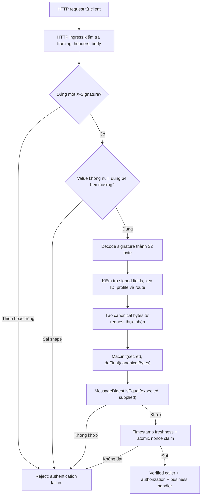
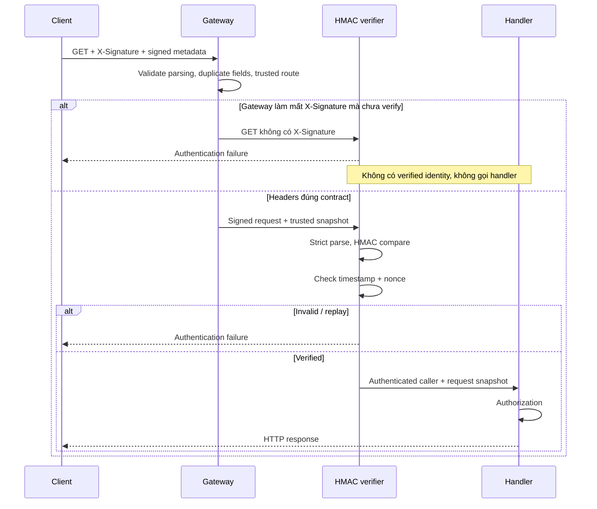

# Xử lý signature null khi so sánh HMAC theo hướng constant-time

## 1. Vì sao `signature == null` là một vấn đề bảo mật?

Khi server xác thực HTTP request bằng HMAC, nó nhận một chữ ký do client gửi, tự tính **expected MAC** từ shared secret và canonical request, sau đó so sánh hai dãy byte. Trường hợp thường bị bỏ qua là **chữ ký không có mặt**: HTTP adapter không tìm thấy `X-Signature`, trả về `null` hoặc một đối tượng chưa được khởi tạo.

Với chữ ký thiếu, server không có bằng chứng xác thực. **Kết quả đúng là từ chối request**, không dùng secret mặc định, không bỏ qua bước so sánh và không biến lỗi `NullPointerException` thành thành công. Nhưng việc từ chối thế nào cũng quan trọng: code cần tránh so sánh chuỗi MAC bằng phép so sánh dừng ở ký tự sai đầu tiên.

Bài **Xử lý signature null** thuộc chương **Constant-time comparison** của module `SECURITY_AUTHENTICATION_HMAC_REQUEST_AUTHENTICATION`. Phạm vi module là thiết kế xác thực HTTP request bằng **HMAC với shared secret** và **canonical request** ký method, URI, header hoặc body theo hợp đồng; kiểm tra chữ ký, chống replay bằng timestamp/nonce, quản lý key rotation, kiểm thử proxy/gateway và phân biệt **authentication** với **authorization**. Bài tập trung vào **đường đi của chữ ký đầu vào, null handling và so sánh MAC**, chứ không coi kiểm tra timing là biện pháp thay thế các lớp bảo vệ còn lại.

### Ví dụ lỗi phổ biến

```java
String submitted = request.getHeader("X-Signature");

// Sai: có thể ném NullPointerException nếu header không có.
if (submitted.equals(expectedSignatureHex)) {
    allowRequest();
}
```

Một cách viết khác còn nguy hiểm hơn:

```java
// SAI: dùng điều kiện OR có thể bỏ qua xác thực khi thiếu chữ ký.
if (submitted == null || submitted.equals(expectedSignatureHex)) {
    allowRequest();
}
```

Không được để `null` có nghĩa là “không cần ký”, trừ khi endpoint được thiết kế **công khai** và đi theo một luồng policy khác hoàn toàn, trước khi HMAC verifier được gọi. Trong một endpoint yêu cầu HMAC, thiếu chữ ký luôn là **authentication failure**.

## 2. Phân biệt null, empty, chuỗi `"null"` và chữ ký sai

Một hệ thống nhận HTTP header nên phân biệt chính xác:

| Trạng thái | Ví dụ HTTP / Java | Cách xử lý đúng |
| --- | --- | --- |
| **Header vắng mặt** | Không có `X-Signature`; `getHeader` có thể trả `null`. | Từ chối vì thiếu credential; không so sánh MAC. |
| **Field value null** | `new Header("X-Signature", null)` từ adapter chưa kiểm soát. | Từ chối vì input không hợp lệ; `null` không phải MAC. |
| **Field rỗng** | `X-Signature:` → `""` sau parser. | Từ chối; không chấp nhận MAC độ dài 0. |
| **Chỉ có OWS** | `X-Signature:   ` → rỗng sau xử lý SP/HTAB. | Từ chối theo grammar. |
| **Chuỗi chữ `null`** | `X-Signature: null`. | Từ chối; bốn ký tự ASCII không phải null của Java và không phải hex MAC 64 ký tự. |
| **Literal `"null"`** | `X-Signature: "null"`. | Từ chối; profile không cho quote bao MAC. |
| **Sai độ dài** | 63 hoặc 65 hex characters. | Từ chối trước khi decode hoặc trước phép so sánh. |
| **Sai encoding** | Base64, uppercase hex, ký tự `g`, tab ở giữa. | Từ chối theo hợp đồng encoding, không tự fallback. |
| **Đủ 64 hex nhưng sai MAC** | 64 chữ `0` hoặc MAC của body khác. | Decode thành 32 byte rồi **so sánh constant-time** với expected MAC. |
| **Header xuất hiện hai lần** | Hai `X-Signature` khác case hoặc cùng giá trị. | Từ chối duplicate; không chọn đầu/cuối. |
| **Hợp lệ** | Đúng một `X-Signature` dạng 64 lowercase hex, MAC khớp. | Còn phải kiểm tra timestamp, nonce, key policy và authorization. |

Trong Java, `String.valueOf((Object) null)` tạo **chuỗi `"null"`**. Không dùng chuyển đổi này để “sửa” signature thiếu:

```java
String signature = String.valueOf(request.getHeader("X-Signature"));
// Nếu header thiếu, signature = "null" chứ không còn null.
```

Với JSON request hoặc message broker, `null` có thể là giá trị dữ liệu hợp lệ; nhưng **HMAC signature trong HTTP header của profile này là một chuỗi byte-encoded bắt buộc**, không phải JSON `null`. Nếu hệ thống hỗ trợ thêm một đường truyền authentication khác, nó phải có **hợp đồng riêng**, không tự coi `null` là mã báo “bỏ qua”.

### Cẩn thận với `getHeader` và `firstValue`

`request.getHeader("X-Signature")` có thể trả `null` khi thiếu field; một API khác trả `Optional.empty()`. Cả hai mới cho biết **trạng thái quan sát tại tầng đó**, không chứng minh request chưa từng có hai field lines cùng tên ở client.

Ví dụ:

```http
X-Signature: 0123...
x-signature: 4567...
```

HTTP field name **không phân biệt hoa/thường**; đó là **header lặp**. Proxy/framework có thể lấy dòng đầu, lấy dòng cuối, nối hai value bằng dấu phẩy hoặc từ chối. Nếu HMAC verifier chọn một chữ ký, còn tầng khác sử dụng chữ ký khác, tính nhất quán bị phá vỡ. Do đó **đếm field lines theo tên case-insensitive trước khi canonicalization** hoặc thực hiện kiểm tra ở ingress còn nhìn được field lines.

## 3. Constant-time comparison bảo vệ điều gì và không bảo vệ điều gì?

Phép so sánh MAC không nên **dừng tại byte đầu tiên khác nhau**. Nếu thời gian thực thi phụ thuộc vào **độ dài tiền tố khớp**, kẻ tấn công trong một số mô hình quan sát timing có thể thu được tín hiệu về các byte MAC.

Một dạng code không nên dùng:

```java
// Không có cam kết constant-time; trả về có thể phụ thuộc vị trí byte sai.
boolean equal = submittedHex.equals(expectedHex);

// Arrays.equals cũng không phải API cam kết constant-time cho MAC.
boolean equalBytes = java.util.Arrays.equals(submitted, expected);
```

Trong Java 17+, dùng **`MessageDigest.isEqual(byte[] expected, byte[] received)`** sau khi đã kiểm tra rằng cả hai **không null và có cùng độ dài MAC cố định**:

```java
import java.security.MessageDigest;

boolean authentic = MessageDigest.isEqual(expectedMacBytes, receivedMacBytes);
```

Theo hợp đồng trong bài, `HmacSHA256` tạo **32 byte**. Input hợp lệ là **64 ký tự hex thường** rồi decode thành **đúng 32 byte**. So sánh trên byte arrays tránh phụ thuộc vào chữ hoa/thường của text và tránh đối chiếu một biểu diễn chuỗi chưa được chuẩn hóa.

**Phạm vi của cam kết timing:** `MessageDigest.isEqual` trên JDK hiện đại được thiết kế để kiểm tra các byte của digest thứ nhất mà không dừng ở byte khớp/sai đầu tiên; thời gian tính toán có thể phụ thuộc vào **độ dài mảng thứ nhất**. Do đó ta luôn đặt **expected MAC 32 byte** ở vị trí đối số thứ nhất, sau khi kiểm tra received MAC có đúng 32 byte. Không nên phát biểu rằng **toàn bộ request verification** luôn có thời gian hằng số: parse header, tra khóa, kiểm tra version, body hash, HMAC, storage và phản hồi mạng vẫn có các nhánh xử lý.

### Từ chối signature null sớm có phá “constant-time” không?

**Không cần** cố tạo một mảng MAC giả để so sánh khi signature không tồn tại. Null/missing, sai độ dài và sai encoding là **đặc điểm công khai, do người gửi kiểm soát**. Chúng có thể bị từ chối sớm mà không làm lộ byte nào của expected MAC. Phép so sánh constant-time quan trọng nhất khi kẻ tấn công cung cấp **MAC đúng định dạng, đúng độ dài** nhưng sai **giá trị bí mật**.

```java
if (submittedHex == null) return false;        // Input thiếu: fail closed.
if (!submittedHex.matches("[0-9a-f]{64}")) {
    return false;                               // Input sai shape: fail closed.
}
byte[] submitted = java.util.HexFormat.of().parseHex(submittedHex);
byte[] expected = computeHmacSha256(secret, canonicalBytes);
return java.security.MessageDigest.isEqual(expected, submitted);
```

**Không vì muốn constant-time mà bỏ validation.** Đoạn code nên kiểm tra null, missing/duplicate, encoding và độ dài **trước khi decode**, rồi so sánh **hai mảng MAC đầy đủ độ dài cố định**. Nếu yêu cầu threat model nghiêm ngặt hơn (ví dụ che giấu sự tồn tại của key ID), phải đánh giá **timing toàn pipeline**, phản hồi lỗi và quan sát mạng bằng thiết kế riêng; một lời gọi `isEqual` không tự giải quyết key enumeration hay side channels khác.

## 4. Luồng xử lý signature null: fail closed nhưng không gây lỗi hệ thống

Đối với một endpoint **bắt buộc HMAC authentication**, có thể chia việc xác minh thành các giai đoạn:



Trong sơ đồ, việc từ chối chữ ký thiếu/trùng/không đúng định dạng xảy ra **trước khi tính HMAC**; đây là lựa chọn có chủ đích. Chỉ khi hai MAC byte arrays **đúng độ dài** mới dùng phép so sánh constant-time.

### Vì sao không bắt `NullPointerException` rồi coi là sai chữ ký?

Một `try/catch` bao quanh toàn bộ verifier với `catch (Exception ex) { return true; }` là lỗi nghiêm trọng. Nhưng kể cả `catch (NullPointerException ex) { return false; }` cũng không phải cách thiết kế tốt:

- Có thể che mất bug null ở **credential store, canonical request hoặc body snapshot**, không chỉ ở signature.
- Trộn lỗi input không hợp lệ với lỗi lập trình, khiến thiếu observability.
- Khó bảo đảm nonce store không được cập nhật hoặc handler không có side effect trước khi exception xảy ra.

**Kiểm tra null trực tiếp tại ranh giới**, dùng kiểu dữ liệu rõ ràng (`Optional`, một kết quả parse hoặc một ngoại lệ validation chuyên biệt) và trả về kết quả từ chối an toàn. Các phụ thuộc bảo mật gặp lỗi phải **fail closed**, đồng thời báo lỗi vận hành theo chính sách dịch vụ. Không chuyển lỗi store/provider thành request thành công.

### Sơ đồ ba lớp: HTTP input, MAC verification, business authorization

| Lớp | Câu hỏi | Ví dụ kết quả |
| --- | --- | --- |
| HTTP parser / header validation | Có một chữ ký đúng cú pháp hay không? | `X-Signature` thiếu → reject; không cần MAC compare. |
| HMAC authentication | Chữ ký đúng với secret và canonical request thực nhận? | MAC 32 byte sai → constant-time compare trả `false`. |
| Authorization | Caller đã xác thực có quyền trên account/tài nguyên này? | HMAC đúng nhưng caller không có quyền xem account → `403` hoặc chính sách che giấu tài nguyên. |

## 5. Hợp đồng minh họa HMAC-COMPARE-V1: chữ ký phải hiện diện đúng một lần

Để thấy null handling trong toàn bộ request, bài chọn một endpoint đọc thông tin số dư:

```http
GET /v1/accounts/A123/balance?currency=VND HTTP/1.1
Host: api.example.test
Accept: application/json
X-Key-Id: client-a-2026-11
X-Signature-Version: hmac-compare-v1
X-Timestamp: 2026-11-28T02:05:00Z
X-Nonce: wJ0Npw6W_Q7tWbX8Fkp0SgABCdef0123
X-Signature: <64 lowercase hex characters>
```

**Đây là signature profile tự định nghĩa nhằm giảng dạy**, không phải một định dạng HMAC chung được HTTP hoặc mọi gateway mặc định hỗ trợ.

### Quy tắc của `hmac-compare-v1`

1. **Method, target, audience:** chỉ cho phép `GET /v1/accounts/A123/balance?currency=VND` với audience `https://api.example.test`. Audience đến từ **routing cấu hình tin cậy**, không chỉ dựa vào `Host` hoặc `X-Forwarded-Host` do caller khai báo. Trong hệ thống thật, account ID do route xác định và quyền đọc được kiểm tra riêng.
2. **GET không body:** payload phải rỗng; canonical dùng `SHA-256(empty)` với lowercase hex, không bỏ dòng digest. HTTP adapter không cho GET mang body/Content-Encoding trái hợp đồng.
3. **Signed field lines:** `Accept`, `X-Key-Id`, `X-Signature-Version`, `X-Timestamp`, `X-Nonce` phải có **đúng một dòng**. HTTP field names là case-insensitive; header value tuân grammar được công bố.
4. **Signature carrier:** `X-Signature` cũng phải có **chính xác một field line**, được decode thành 32 byte từ **64 chữ hex thường**. Null, thiếu, empty, duplicate, `"null"`, `"NULL"`, hex hoa, Base64 hoặc sai độ dài đều bị từ chối.
5. **Key/profile:** `X-Key-Id` là **định danh công khai**, không phải secret. Server tra đúng secret ở credential store và kiểm tra credential active, audience, route, allowed version. Profile chọn cố định `HmacSHA256`, không cho client truyền thuật toán tùy ý.
6. **Replay:** timestamp UTC ISO-8601 đến giây và nonce base64url không padding của 24 byte ngẫu nhiên, cả hai phải **được ký**. Server kiểm tra freshness (ví dụ ±5 phút) và claim nonce atomically trên kho chung.
7. **Canonical encoding:** các dòng nối bằng `LF` (`0A`), toàn message mã hóa UTF-8 và **không có LF cuối**. Header names được ghi chữ thường. MAC = HMAC-SHA256 trên canonical bytes, **full 32 byte**, không truncate.

Canonical request:

```text
HMAC-COMPARE-V1
GET
https://api.example.test
/v1/accounts/A123/balance?currency=VND
accept:application/json
x-key-id:client-a-2026-11
x-signature-version:hmac-compare-v1
x-timestamp:2026-11-28T02:05:00Z
x-nonce:wJ0Npw6W_Q7tWbX8Fkp0SgABCdef0123
e3b0c44298fc1c149afbf4c8996fb92427ae41e4649b934ca495991b7852b855
```

**`X-Signature` không nằm trong canonical message** vì MAC là **kết quả** của phép ký. Nhưng việc không ký chính signature **không** có nghĩa trường này là optional: HTTP request vẫn bắt buộc có **đúng một** signature để xác thực.

### Nhận diện null trước khi so sánh, nhưng không thay nội dung được ký

Server tính lại từ request:

```text
expectedMacBytes = HMAC-SHA256(serverSecret, UTF8(canonicalRequest))
submittedText    = HTTP header X-Signature, đúng 1 field line
submittedBytes   = strictLowercaseHexDecode(submittedText), 32 byte
valid            = MessageDigest.isEqual(expectedMacBytes, submittedBytes)
```

Nếu `submittedText == null`, không tạo `submittedBytes`; trả authentication failure. **Không** thay `null` bằng digest SHA-256(empty), mảng 32 byte zero, chữ ký “mặc định” hay HMAC của chuỗi rỗng rồi coi đó là chữ ký hợp lệ. Cũng không gọi `MessageDigest.isEqual(null, null)`: dù một API so sánh có thể coi hai tham chiếu null giống nhau, **null không phải một MAC đã xác minh**.

Một request có đúng một `X-Signature` nhưng chữ ký của **method, query hoặc body khác** vẫn phải bị từ chối. So sánh đúng MAC bytes sẽ giúp phát hiện integrity violation, nhưng cần giữ cho **canonicalization của client, gateway, server và business handler** nhất quán.

## 6. Ví dụ Java 17+: kiểm tra null và xác minh HMAC an toàn

Đoạn code tiếp theo là **một class Java 17 độc lập** với các chức năng:

- Giữ **từng HTTP field line** trong `List<Header>` để nhận biết thiếu/trùng header theo tên không phân biệt case.
- Không dereference `null` từ signature; không chấp nhận chuỗi rỗng, `"null"`, chữ ký không phải **64 lowercase hex**.
- Không để client quyết định thuật toán: server dùng `Mac.getInstance("HmacSHA256")` và secret đúng key ID/version đã được cấp quyền.
- Tạo canonical request từ **method/URI/header/body thực nhận**, tính lại MAC và so sánh `MessageDigest.isEqual(expected, supplied)`.
- Chỉ sau MAC đúng mới claim nonce; sau khi xác thực vẫn phải có **authorization** ở handler.

**Giới hạn được xác định rõ:** `Request` trong code mô phỏng snapshot mà một **HTTP adapter đáng tin cậy** cung cấp. Adapter thực phải kiểm tra HTTP framing, `Host`/`:authority`, signed header duplicates **trước khi framework hợp nhất**, canonical target, Content-Encoding và các field có thể làm thay đổi semantics. Demo chọn **một endpoint GET không body** để giữ phần code tập trung vào signature null; nó không phải HTTP parser tổng quát. `NonceStore` trong `main` chỉ dùng bộ nhớ để quan sát replay, không TTL hay đồng bộ liên máy.

```java
import java.nio.charset.StandardCharsets;
import java.security.GeneralSecurityException;
import java.security.MessageDigest;
import java.security.SecureRandom;
import java.time.Clock;
import java.time.Duration;
import java.time.Instant;
import java.time.format.DateTimeParseException;
import java.time.temporal.ChronoUnit;
import java.util.ArrayList;
import java.util.Base64;
import java.util.HashMap;
import java.util.HexFormat;
import java.util.List;
import java.util.Locale;
import java.util.Map;
import java.util.Set;
import java.util.concurrent.ConcurrentHashMap;
import javax.crypto.Mac;
import javax.crypto.spec.SecretKeySpec;

public final class NullSignatureVerifierDemo {
    private static final String VERSION = "hmac-compare-v1";
    private static final String ORIGIN = "https://api.example.test";
    private static final String TARGET =
            "/v1/accounts/A123/balance?currency=VND";
    private static final HexFormat HEX = HexFormat.of();
    private static final Duration MAX_SKEW = Duration.ofMinutes(5);
    private static final Duration NONCE_TTL = Duration.ofMinutes(11);
    private static final Set<String> REQUIRED = Set.of(
            "accept", "x-key-id", "x-signature-version",
            "x-timestamp", "x-nonce", "x-signature");

    public record Header(String name, String value) {}

    // Giữ nguyên các field lines; body snapshot được defensive-copy.
    public record Request(
            String method, String rawTarget, String trustedOrigin,
            List<Header> headers, byte[] body) {
        public Request {
            headers = headers == null ? null : List.copyOf(headers);
            body = body == null ? null : body.clone();
        }
        @Override public byte[] body() {
            return body == null ? null : body.clone();
        }
    }

    public record Credential(
            String keyId, byte[] secret, boolean active,
            String audience, Set<String> allowedVersions,
            Set<String> allowedTargets) {
        public Credential {
            secret = secret == null ? null : secret.clone();
        }
        @Override public byte[] secret() {
            return secret == null ? null : secret.clone();
        }
    }

    public interface CredentialStore {
        Credential find(String keyId);
    }

    public interface NonceStore {
        // Production: atomic insert-if-absent, shared store và TTL.
        boolean claim(String keyId, String nonce, Duration ttl);
    }

    private static String stripOws(String value) {
        if (value == null) {
            throw new IllegalArgumentException("Null field value");
        }
        int begin = 0, end = value.length();
        while (begin < end &&
                (value.charAt(begin) == ' '
                        || value.charAt(begin) == '\t')) begin++;
        while (end > begin &&
                (value.charAt(end - 1) == ' '
                        || value.charAt(end - 1) == '\t')) end--;
        return value.substring(begin, end);
    }

    // Không dùng getHeader/firstValue vì có thể che mất duplicate.
    public static Map<String, String> readRequiredHeaders(
            List<Header> rawLines) {
        if (rawLines == null) {
            throw new IllegalArgumentException("Headers unavailable");
        }
        Map<String, String> found = new HashMap<>();
        for (Header line : rawLines) {
            if (line == null || line.name() == null
                    || !line.name().matches("[A-Za-z0-9-]{1,128}")
                    || line.value() == null) {
                throw new IllegalArgumentException("Malformed header line");
            }
            for (int i = 0; i < line.value().length(); i++) {
                char c = line.value().charAt(i);
                // Demo chỉ dùng ASCII; cấm CR/LF/control và obs-text.
                if ((c < 0x20 && c != '\t') || c > 0x7E) {
                    throw new IllegalArgumentException("Unsafe header");
                }
            }
            String name = line.name().toLowerCase(Locale.ROOT);
            if ("content-encoding".equals(name)) {
                throw new IllegalArgumentException("Unexpected encoding");
            }
            if (REQUIRED.contains(name)) {
                String value = stripOws(line.value());
                // putIfAbsent không che duplicate: value không null.
                if (found.putIfAbsent(name, value) != null) {
                    throw new IllegalArgumentException(
                            "Duplicate signed header: " + name);
                }
            }
        }
        if (!found.keySet().equals(REQUIRED)) {
            throw new IllegalArgumentException(
                    "Missing required signed header");
        }
        return Map.copyOf(found);
    }

    private static byte[] canonicalBytes(
            Request request, Map<String, String> fields)
            throws GeneralSecurityException {
        String emptyBodyDigest = HEX.formatHex(
                MessageDigest.getInstance("SHA-256")
                        .digest(request.body()));
        String message = String.join("\n",
                "HMAC-COMPARE-V1",
                request.method(),
                ORIGIN,
                request.rawTarget(),
                "accept:" + fields.get("accept"),
                "x-key-id:" + fields.get("x-key-id"),
                "x-signature-version:"
                        + fields.get("x-signature-version"),
                "x-timestamp:" + fields.get("x-timestamp"),
                "x-nonce:" + fields.get("x-nonce"),
                emptyBodyDigest);
        return message.getBytes(StandardCharsets.UTF_8);
    }

    private static byte[] macSha256(byte[] secret, byte[] canonical)
            throws GeneralSecurityException {
        Mac mac = Mac.getInstance("HmacSHA256");
        mac.init(new SecretKeySpec(secret, "HmacSHA256"));
        return mac.doFinal(canonical);
    }

    public static boolean verify(
            Request request, CredentialStore credentials,
            NonceStore nonces, Clock clock)
            throws GeneralSecurityException {
        if (request == null || credentials == null || nonces == null
                || clock == null || request.method() == null
                || request.rawTarget() == null
                || request.trustedOrigin() == null
                || request.body() == null) {
            return false;
        }

        if (!"GET".equals(request.method())
                || !TARGET.equals(request.rawTarget())
                || !ORIGIN.equals(request.trustedOrigin())
                || request.body().length != 0) {
            return false;
        }

        final Map<String, String> fields;
        try {
            fields = readRequiredHeaders(request.headers());
        } catch (IllegalArgumentException ex) {
            // Thiếu/trùng/null header: fail closed, không có NPE.
            return false;
        }

        String signatureHex = fields.get("x-signature");
        // Explicit null check dù parser đã yêu cầu đủ header.
        if (signatureHex == null
                || !signatureHex.matches("[0-9a-f]{64}")) {
            return false; // empty, "null", Base64, uppercase, wrong length.
        }
        byte[] receivedMac = HEX.parseHex(signatureHex); // 32 byte.

        String keyId = fields.get("x-key-id");
        String version = fields.get("x-signature-version");
        String timestampText = fields.get("x-timestamp");
        String nonce = fields.get("x-nonce");
        if (!"application/json".equals(fields.get("accept"))
                || !keyId.matches("[A-Za-z0-9._-]{1,128}")
                || !VERSION.equals(version)
                || !nonce.matches("[A-Za-z0-9_-]{32}")) {
            return false;
        }

        // Nonce là base64url unpadded của đúng 24 byte ngẫu nhiên.
        try {
            byte[] nonceBytes = Base64.getUrlDecoder().decode(nonce);
            if (nonceBytes.length != 24
                    || !Base64.getUrlEncoder().withoutPadding()
                            .encodeToString(nonceBytes).equals(nonce)) {
                return false;
            }
        } catch (IllegalArgumentException invalid) {
            return false;
        }

        Instant issuedAt;
        try {
            issuedAt = Instant.parse(timestampText);
        } catch (DateTimeParseException invalid) {
            return false;
        }
        if (issuedAt.getNano() != 0
                || !issuedAt.toString().equals(timestampText)
                || Duration.between(clock.instant(), issuedAt)
                        .abs().compareTo(MAX_SKEW) > 0) {
            return false;
        }

        Credential key = credentials.find(keyId);
        if (key == null || !key.active() || !keyId.equals(key.keyId())
                || !ORIGIN.equals(key.audience())
                || key.allowedVersions() == null
                || !key.allowedVersions().contains(VERSION)
                || key.allowedTargets() == null
                || !key.allowedTargets().contains(TARGET)) {
            return false;
        }
        byte[] secret = key.secret();
        if (secret == null || secret.length < 32) {
            return false; // Key policy của demo.
        }

        byte[] expectedMac = macSha256(
                secret, canonicalBytes(request, fields));
        if (expectedMac.length != 32 || receivedMac.length != 32) {
            return false;
        }
        // Expected có chiều dài cố định và đứng ở đối số thứ nhất.
        if (!MessageDigest.isEqual(expectedMac, receivedMac)) {
            return false;
        }

        // Chỉ claim nonce sau MAC hợp lệ, không có side effect trước đó.
        return nonces.claim(keyId, nonce, NONCE_TTL);
        // Sau true: authorization resource A123 vẫn là bước bắt buộc.
    }

    private static Request signForDemo(
            byte[] secret, Instant now, SecureRandom random)
            throws GeneralSecurityException {
        byte[] nonceBytes = new byte[24];
        random.nextBytes(nonceBytes);
        String nonce = Base64.getUrlEncoder().withoutPadding()
                .encodeToString(nonceBytes);
        String timestamp = now.truncatedTo(ChronoUnit.SECONDS).toString();
        String keyId = "client-a-2026-11";
        List<Header> lines = new ArrayList<>(List.of(
                new Header("Accept", "application/json"),
                new Header("X-Key-Id", keyId),
                new Header("X-Signature-Version", VERSION),
                new Header("X-Timestamp", timestamp),
                new Header("X-Nonce", nonce)));

        Request draft = new Request(
                "GET", TARGET, ORIGIN, lines, new byte[0]);
        Map<String, String> signedFields = Map.of(
                "accept", "application/json",
                "x-key-id", keyId,
                "x-signature-version", VERSION,
                "x-timestamp", timestamp,
                "x-nonce", nonce);
        byte[] signature = macSha256(
                secret, canonicalBytes(draft, signedFields));
        lines.add(new Header("X-Signature", HEX.formatHex(signature)));
        return new Request("GET", TARGET, ORIGIN, lines, new byte[0]);
    }

    // Để thử trường hợp signature bị thiếu, null hoặc sai định dạng.
    private static Request replaceSignature(
            Request original, boolean omit, String newValue) {
        List<Header> updated = new ArrayList<>();
        for (Header h : original.headers()) {
            if (!"X-Signature".equalsIgnoreCase(h.name())) {
                updated.add(h);
            }
        }
        if (!omit) updated.add(new Header("X-Signature", newValue));
        return new Request(original.method(), original.rawTarget(),
                original.trustedOrigin(), updated, original.body());
    }

    public static void main(String[] args) throws Exception {
        SecureRandom rng = new SecureRandom();
        byte[] secret = new byte[32]; // Secret thử nghiệm, không log.
        rng.nextBytes(secret);
        Credential key = new Credential(
                "client-a-2026-11", secret, true, ORIGIN,
                Set.of(VERSION), Set.of(TARGET));
        CredentialStore credentials = id ->
                key.keyId().equals(id) ? key : null;

        // In-memory demo: atomic trong một JVM, KHÔNG có TTL/distribution.
        Set<String> used = ConcurrentHashMap.newKeySet();
        NonceStore nonces = (id, nonce, ttl) ->
                used.add(id + ":" + nonce);
        Clock clock = Clock.systemUTC();
        Request good = signForDemo(secret, clock.instant(), rng);

        // Các request invalid không được claim nonce.
        System.out.println("Missing: " + verify(
                replaceSignature(good, true, null),
                credentials, nonces, clock)); // false
        System.out.println("Null: " + verify(
                replaceSignature(good, false, null),
                credentials, nonces, clock)); // false
        System.out.println("Empty: " + verify(
                replaceSignature(good, false, ""),
                credentials, nonces, clock)); // false
        System.out.println("Literal null: " + verify(
                replaceSignature(good, false, "null"),
                credentials, nonces, clock)); // false
        System.out.println("Wrong MAC: " + verify(
                replaceSignature(good, false, "0".repeat(64)),
                credentials, nonces, clock)); // false

        System.out.println("Good request: " + verify(
                good, credentials, nonces, clock)); // true
        System.out.println("Replay: " + verify(
                good, credentials, nonces, clock)); // false

        // Hai X-Signature (khác case) phải bị từ chối.
        List<Header> duplicated = new ArrayList<>(good.headers());
        duplicated.add(new Header("x-signature", "0".repeat(64)));
        Request duplicateRequest = new Request(
                good.method(), good.rawTarget(), good.trustedOrigin(),
                duplicated, good.body());
        System.out.println("Duplicate: " + verify(
                duplicateRequest, credentials, nonces, clock)); // false
    }
}
```

### Phân tích điều kiện xử lý signature null trong code

| Bước | Code / ý nghĩa | Kết quả nếu thiếu chữ ký |
| --- | --- | --- |
| Thu thập field lines | `readRequiredHeaders(request.headers())` | Thiếu `x-signature` làm tập required không đủ → từ chối. |
| Kiểm tra giá trị null | `line.value() == null` | Từ chối, không gọi `trim`/regex trên null. |
| Kiểm tra duplicate | `found.putIfAbsent(name, value) != null` | Hai `X-Signature` đều bị từ chối, kể cả cùng value. |
| Lấy signature | `fields.get("x-signature")` | Kiểm tra lại null theo phòng vệ nhiều tầng. |
| Kiểm tra encoding | `[0-9a-f]{64}` | `""`, `"null"`, upper hex, Base64, MAC sai độ dài đều bị chặn. |
| Decode bytes | `HEX.parseHex(signatureHex)` | Chỉ chạy khi signature có định dạng hợp lệ. |
| Tạo expected MAC | `Mac.init(secret)`, `doFinal(canonicalBytes)` | Chỉ chạy với credential hợp lệ và body/route policy đúng. |
| So sánh MAC | `MessageDigest.isEqual(expectedMac, receivedMac)` | Chỉ chạy với hai dãy MAC 32 byte; không dừng theo byte sai đầu tiên. |
| Replay | `nonces.claim(keyId, nonce, NONCE_TTL)` | Không chạy nếu thiếu/sai signature, hạn chế chiếm nonce bởi request giả. |

**Đọc kỹ điều kiện null và duplicate:** Java `Map.putIfAbsent` có ngữ nghĩa riêng nếu value cũ là `null`; vì thế `readRequiredHeaders` **cấm null value trước khi thêm vào map**. Nếu bỏ kiểm tra này, một key có value null có thể bị `putIfAbsent` thay thế mà không được tính là duplicate. Đây là lý do phải xác định rõ các bất biến của parser và chỉ dùng `Map<String,String>` **sau khi đã kiểm tra các field lines gốc**.

### Cách xử lý lỗi an toàn ở ứng dụng

Trong ví dụ, `verify` trả `false` cho request thiếu chữ ký, trùng, sai cú pháp hoặc MAC sai. Một dịch vụ thật nên phân loại lỗi nội bộ để vận hành, nhưng phản hồi bên ngoài cần **không tiết lộ secret, expected MAC hoặc chi tiết key enumeration**. Lỗi từ `CredentialStore`, `NonceStore` hoặc JCA provider **không được** biến thành `true`; tầng gọi phải fail closed, thường phản hồi lỗi dịch vụ theo policy.

Code mô phỏng không triển khai toàn bộ HTTP parsing/authorization. Nó cũng không chạy benchmark timing: **đầu ra chỉ chứng minh tính đúng chức năng** của xử lý null, strict encoding và phép so sánh MAC. Đánh giá timing phải thực hiện với threat model, môi trường triển khai và phương pháp đo đáng tin cậy, không dựa vào một lần in nanosecond.

## 7. Những anti-pattern liên quan signature null và constant-time

### Anti-pattern A: so sánh `String.equals` hoặc `Arrays.equals`

```java
// Không có cam kết timing phù hợp để kiểm tra MAC bí mật.
return submittedSignatureHex.equals(expectedSignatureHex);
```

Ngoài nguy cơ `NullPointerException`, cách này còn trộn **mã hóa text** với **bản chất dãy byte** của MAC. Ví dụ lowercase/uppercase hex có thể mô tả cùng bytes nhưng là những chuỗi khác nhau; profile demo cố ý chỉ cho lowercase và kiểm tra rõ ràng. Đối với MAC đúng độ dài, parse hex rồi dùng `MessageDigest.isEqual(expectedBytes, submittedBytes)`.

### Anti-pattern B: đổi null thành MAC hợp lệ “mặc định”

```java
// SAI: bỏ qua sự thiếu vắng bằng cách thay bằng expected signature.
String provided = rawSignature == null
        ? expectedSignatureHex : rawSignature;
return provided.equals(expectedSignatureHex);
```

Đoạn code trên khiến signature null **được xác thực thành công**. Không bao giờ dùng expected MAC làm giá trị mặc định cho dữ liệu do client không gửi.

### Anti-pattern C: thay null bằng 32 byte zero rồi vẫn cho qua

```java
// Không cần dựng MAC giả chỉ để xử lý null.
byte[] received = rawSignature == null
        ? new byte[32] : HEX.parseHex(rawSignature);
```

Điều này **không tự tạo bypass** nếu phía sau vẫn so sánh đúng, nhưng không có lợi ích cần thiết với profile này, dễ che lỗi nhập liệu và có thể tạo hiểu lầm rằng “constant-time trên null” là mục tiêu. Cách rõ ràng hơn: **reject null sớm**; chỉ so sánh constant-time với 32 byte MAC có định dạng hợp lệ.

Trong một số threat model rất chuyên biệt, hệ thống có thể dùng **dummy work/dummy keys** để làm đồng đều hơn xử lý key không tồn tại. Đó là bài toán side-channel **toàn pipeline**, không nên thêm chỉ vì signature null. Dummy work không được biến request thành hợp lệ, không được cấp identity hoặc claim nonce và không nên được quảng bá là bảo đảm thời gian hoàn toàn hằng số.

### Anti-pattern D: chỉ kiểm tra null trước phép `parseHex`

```java
if (signature != null) {
    byte[] bytes = HEX.parseHex(signature); // Vẫn có thể throw!
    ...
}
```

Đầu vào có thể là `""`, `"null"`, `"hello"`, hex lẻ ký tự hoặc chứa chữ ngoài `[0-9a-f]`. Hãy kiểm tra **đúng độ dài và alphabet** trước. Nếu profile hỗ trợ Base64, cũng cần một decoder strict và quy tắc padding/canonical encoding riêng, không tùy tiện “thử hex, rồi Base64”.

### Anti-pattern E: bỏ qua null khi request có nhiều phương thức authentication

```java
// Nguy hiểm khi fallback thiếu quy tắc và scope:
if (hmacSignature == null) {
    return verifySomeOtherUntrustedHeader(request);
}
```

Nếu endpoint bắt buộc HMAC, thiếu `X-Signature` phải thất bại. Nếu cùng endpoint được thiết kế chấp nhận cả HMAC và Bearer token, cần một **authentication policy rõ ràng** về scheme, thứ tự, scope, duplicate credentials và chống downgrade. Không dùng null như “cờ chọn thuật toán yếu hơn”.

### Anti-pattern F: trả log quá chi tiết

```text
WARN HMAC failed: supplied=null,
expected=91e4...,
secret=base64:...
```

Không ghi expected HMAC, shared secret hoặc body nhạy cảm vào log. Ngay cả supplied signature cũng không nên log đầy đủ: attacker có thể replay chữ ký trong thời gian hợp lệ, hoặc log được chia sẻ ra ngoài. Nên log **loại lỗi** như `MISSING_SIGNATURE`, `BAD_SIGNATURE_FORMAT`, `MAC_MISMATCH`, `REPLAY` cùng request ID, route và signature version đã được lọc/giới hạn, theo chính sách bảo mật và lưu vết.

## 8. Trường hợp chữ ký biến mất trên đường đi qua proxy/gateway

Một signature `null` không nhất thiết do client **cố tình bỏ header**. Tại backend, chữ ký cũng có thể vắng mặt vì:

- Reverse proxy hoặc API gateway **strip header `X-Signature`** theo cấu hình allowlist.
- Service mesh hoặc middleware đã đổi tên header, chuyển `X-Signature` vào một `Authorization` field khác, hoặc loại header bắt đầu bằng `X-`.
- Client dùng `Authorization: HMAC ...` nhưng backend chỉ tìm `X-Signature` (hoặc ngược lại).
- Code chỉ tìm key `"X-Signature"` trong `Map` phân biệt hoa/thường, trong khi HTTP/2 thường truyền tên field chữ thường.
- Framework nhận hai header trùng và parser từ chối; một lớp trước đã loại/gộp header, backend không còn biết chính xác tình trạng ban đầu.
- Browser/WebSocket/gateway hoặc SDK tái tạo request sau redirect mà không giữ header ở origin mới — một số trường hợp bỏ header là **đúng về bảo mật** để không rò credentials.

Điều cần làm khi lỗi xảy ra:

1. **Không bypass HMAC khi backend thấy signature null.** Việc một gateway cấu hình sai không thể là lý do để chấp nhận request không có credential.
2. Định nghĩa **điểm chịu trách nhiệm xác minh**: gateway verify trước khi strip header, hoặc backend verify trên các header/body/URI còn nguyên theo hợp đồng.
3. Nếu gateway verify, backend chỉ tin identity/scope/route do **gateway đã xác thực** truyền qua kênh bảo vệ; strip header tự khai như `X-Verified-Client` từ Internet, chặn bypass trực tiếp.
4. Nếu backend verify, gateway phải **bảo toàn chữ ký**, signed headers, raw request target và body snapshot theo contract. Không tin `X-Original-URI` do client tự đưa vào.
5. Kiểm thử cùng request qua **HTTP/1.1 và HTTP/2**, đúng ingress, CDN, service mesh và backend; xác minh số lượng header ở từng hop trong **môi trường test**.



### Cache GET cũng có thể vượt qua điểm xác minh

GET thường có khả năng cache. Nếu CDN trả một response nhạy cảm từ cache **trước khi đưa request tới HMAC verifier**, việc `X-Signature` có null tại backend không còn là điều quyết định: **backend không hề nhận request**. Với dữ liệu số dư hoặc tài liệu riêng tư, nên cấu hình **không cache chung**, cân nhắc `Cache-Control: no-store`, kiểm thử cache key/authorization scope và bảo đảm enforcement point thích hợp ở trước cache hit.

## 9. Timing side channels ngoài phép so sánh MAC

Constant-time comparison là **một phòng tuyến có phạm vi hẹp**. Những nhánh thời gian khác vẫn có thể quan sát:

| Giai đoạn | Có thể làm khác thời gian? | Điều cần kiểm soát |
| --- | --- | --- |
| Parse `X-Signature` null/empty/64 hex. | Có, vì request thiếu không cần decode/HMAC. | Thường chấp nhận được: tình trạng có/missing và độ dài là dữ liệu công khai. |
| Kiểm tra key ID tồn tại. | Có, store lookup cho missing key khác active key. | Hạn chế enumeration qua lỗi/response, rate limit; đánh giá threat model nếu cần giảm timing. |
| Lookup secret/KMS hoặc key rotation. | Có, phụ thuộc network/cache/status. | Không tiết lộ secret, không fallback unsafe, fail closed. |
| Canonicalization body/URI/header. | Có, thời gian phụ thuộc độ dài dữ liệu và parser. | Định nghĩa contract, giới hạn kích thước, không tạo parser ambiguity. |
| `MessageDigest.isEqual` với MAC 32 byte. | Thiết kế tránh dừng theo nội dung byte sai đầu tiên. | Dùng **expected 32 byte** làm đối số thứ nhất và decoded MAC 32 byte làm đối số hai. |
| Kiểm tra nonce store. | Có, nonce mới/đã dùng có thể có đường đi khác. | Atomic claim, TTL, rate limiting; không claim khi MAC sai. |
| Authorization và business logic. | Có, quyền và resource có thể xử lý khác nhau. | Chỉ chạy sau authentication; có policy về việc che giấu resource/identity. |

**Đừng kiểm thử constant-time bằng cách chạy một vòng `System.nanoTime()` rồi kết luận “an toàn”.** JIT, GC, CPU frequency, scheduler, mạng, branch predictor và cache tạo nhiễu lớn; kiểm thử timing phải có thống kê, threat model và quy trình phù hợp. Với bài này, kiểm thử chức năng **null/format/length/duplicate/MAC mismatch** cùng kiểm tra cách dùng API đúng là mục tiêu trước tiên.

### Cân nhắc thông báo lỗi HTTP

- **Thiếu hoặc chữ ký HMAC sai:** thường là authentication failure, có thể trả `401 Unauthorized` theo contract của API. Nếu dùng `401`, xử lý `WWW-Authenticate` theo authentication scheme/challenge đã thiết kế, không tự bịa một header challenge không tương thích.
- **Request HTTP malformed hoặc header framing bất thường:** ingress có thể trả `400 Bad Request` trước authentication.
- **HMAC hợp lệ nhưng caller không có quyền đọc tài khoản:** `403 Forbidden` hoặc chính sách che giấu resource phù hợp.
- **Secret store hoặc nonce store không khả dụng:** báo lỗi vận hành phù hợp, nhưng **không cho request qua**.

Không nên cố đạt “mọi lỗi có thời gian bằng nhau” bằng cách bỏ qua kiểm tra cú pháp/khóa hoặc cho tất cả request đi đến business handler. Mục tiêu là **không làm lộ dữ liệu bí mật trong so sánh MAC**, đồng thời không cung cấp thông tin nhạy cảm về credential và vẫn từ chối mọi request không được xác thực.

## 10. Ma trận kiểm thử signature null và constant-time comparison

Một bộ **golden fixtures** nên có key bytes **chỉ dành cho test**, method, raw target, signed headers (gồm số lượng field lines), body bytes, canonical UTF-8 bytes, expected MAC 32 byte/64 lowercase hex, input signature và verdict. Khi so sánh `null`/malformed cần có cả **kiểm thử parser/HTTP adapter** và **kiểm thử HMAC verifier** để không bỏ qua header đã bị proxy gộp.

| Trường hợp | Kết quả mong đợi |
| --- | --- |
| Đúng một signature hợp lệ, key active, timestamp mới, nonce chưa dùng, đúng route. | MAC PASS, replay PASS, tiếp tục authorization. |
| Không có `X-Signature` trong request. | **Từ chối**; không parseHex, không claim nonce, không xử lý nghiệp vụ. |
| HTTP adapter tạo `Header("X-Signature", null)`. | **Từ chối**; không ném NPE từ `matches`/`trim` ra tới handler. |
| `X-Signature:` value rỗng. | Từ chối vì sai độ dài. |
| `X-Signature:   ` chỉ có SP/HTAB. | Sau xử lý OWS thành rỗng; từ chối. |
| `X-Signature: null` hoặc `"null"`. | Từ chối: literal text không phải MAC. |
| `X-Signature` chứa 63 hoặc 65 hex characters. | Từ chối vì độ dài không đúng 64. |
| `X-Signature` có ký tự `G`, dấu `+`, `/`, dấu `=` hoặc không phải hex. | Từ chối; không thử Base64 fallback. |
| Signature 64 hex **viết hoa**. | Từ chối vì profile chỉ nhận lowercase hex. |
| Signature 64 chữ số `0`. | **Parser PASS**, nhưng thường **MAC FAIL** tại `MessageDigest.isEqual`. |
| MAC 32 byte sai ngay byte đầu. | Từ chối khi so sánh MAC. |
| MAC 32 byte chỉ sai byte cuối. | Từ chối khi so sánh MAC; không dùng phép so sánh dừng ở byte sai. |
| Hai `X-Signature` cùng giá trị nhưng tên `X-Signature` và `x-signature`. | Từ chối duplicate, không chọn first/last. |
| Hai `X-Signature` khác nhau; một đúng, một sai. | Từ chối duplicate, **không thử giá trị còn lại**. |
| Proxy gộp hai signatures thành `sigA,sigB`. | Từ chối do format không canonical; sửa kiểm tra ở ingress. |
| Chỉ thay chữ ký, không thay signed fields. | MAC sai; key/nonce không được claim bởi request MAC sai. |
| Thay path, `currency=VND`, `Accept` hoặc key ID nhưng giữ chữ ký. | Canonical khác hoặc route/credential policy từ chối. |
| Thay signature version mà giữ MAC cũ. | Từ chối, không downgrade sang HMAC yếu hơn. |
| Key ID không tồn tại hoặc đã revoke. | Từ chối, không quét key khác để tìm MAC khớp. |
| Timestamp ngoài khoảng ±5 phút. | Từ chối dù signature có thể khớp. |
| Gửi lại nguyên request có MAC đúng với nonce đã claim. | MAC có thể đúng, **replay FAIL**. |
| Nonce store/credential store lỗi. | **Fail closed**; không trả verified identity. |
| MAC và nonce hợp lệ nhưng caller không có quyền xem `A123`. | Authentication PASS; authorization FAIL. |
| Gateway strip `X-Signature` trước backend verify. | Backend từ chối; phát hiện lỗi cấu hình trong integration test. |
| CDN trả cached balance response trước auth. | Phát hiện **bypass auth/cache policy**; không coi việc backend verifier có code đúng là đủ. |

### Test đối chiếu giá trị MAC theo byte, không theo thời gian

Trong unit test, nếu có expected MAC 32 byte, hãy sửa **một byte đầu** và **một byte cuối** của bản sao:

```java
import java.security.MessageDigest;
import java.util.Arrays;

byte[] expected = new byte[32]; // Fixture thật có expected HMAC.
byte[] wrongFirst = expected.clone();
byte[] wrongLast = expected.clone();
wrongFirst[0] ^= 0x01;
wrongLast[31] ^= 0x01;

assert !MessageDigest.isEqual(expected, wrongFirst);
assert !MessageDigest.isEqual(expected, wrongLast);
assert MessageDigest.isEqual(expected, expected.clone());
```

Các assertion trên chỉ chứng minh **chức năng so sánh** đúng; chúng **không chứng minh** thời gian thực thi hoàn toàn hằng số. Trên hệ thống thật, input expected MAC phải đến từ `HmacSHA256` và secret được cấp phát phù hợp, không phải mảng zero như test đối chiếu đơn giản này.

### Bài tập thực hành

1. Chạy `NullSignatureVerifierDemo`. Ghi nhận output của sáu trường hợp **Missing**, **Null**, **Empty**, **Literal null**, **Wrong MAC** và **Good request**; giải thích vì sao chỉ trường hợp cuối được claim nonce.
2. Sửa code thử nghiệm để dùng `String.valueOf((Object) null)` làm signature. Chứng minh chuỗi `"null"` **không biến thành signature hợp lệ**.
3. Thay một `X-Signature` bằng hai field lines có tên khác case, một MAC đúng và một MAC sai. Kiểm tra `readRequiredHeaders` từ chối trước khi chọn bất kỳ MAC nào.
4. Tạo test fixture có một MAC 32 byte chính xác. Thay byte đầu và byte cuối ở hai bản sao rồi kiểm tra `MessageDigest.isEqual` đều trả `false`.
5. Thử sai độ dài 63/65 ký tự hex và một chuỗi Base64. Giải thích vì sao profile từ chối trước khi parse, thay vì tự đoán encoding.
6. Gửi lại đúng request đã xác thực lần hai. Quan sát chữ ký vẫn **đúng HMAC** nhưng `NonceStore.claim` từ chối replay. Sau đó tạo nonce/timestamp mới và ký lại theo contract.
7. Cho backend thiếu `X-Signature` vì gateway đã strip header; xác định điểm xác minh cần đặt ở đâu, và đề xuất một cách truyền verified identity qua kênh tin cậy nếu verify tại gateway.
8. Cho caller có HMAC hợp lệ nhưng yêu cầu tài khoản thuộc tenant khác. Chứng minh bước **authorization** từ chối dù `MessageDigest.isEqual` trả `true`.
9. Xem xét một codebase dùng `Arrays.equals` hay `String.equals` để so MAC. Thay bằng strict decode và `MessageDigest.isEqual`; mô tả vì sao không thể kết luận “mọi đường xử lý constant-time” chỉ từ việc thay một hàm.

## 11. Checklist triển khai xử lý signature null

- [ ] Endpoint yêu cầu HMAC phải **fail closed** khi signature thiếu/null/empty; không có default signature, anonymous fallback hoặc bypass.
- [ ] Có **một header carrier được công bố** (`X-Signature` hoặc format `Authorization` cụ thể); không trộn các format không được định nghĩa.
- [ ] Tại ingress còn thấy raw field lines, kiểm tra **đúng một signature header theo tên case-insensitive**; reject duplicate kể cả value giống nhau.
- [ ] Kiểm tra null **trước khi** trim, regex, decode hoặc so sánh; phân biệt null Java với literal `"null"`.
- [ ] Quy định rõ signature encoding/độ dài: ví dụ **64 lowercase hex → đúng 32 byte** cho HmacSHA256.
- [ ] Từ chối Base64, hex hoa, ký tự ngoài alphabet, độ dài khác profile; không tự fallback encoding hoặc thuật toán.
- [ ] Tính expected MAC từ **secret tin cậy** và canonical method, target, audience, signed headers, body digest; không tin expected MAC/header do client tự khai.
- [ ] Dùng `MessageDigest.isEqual(expectedMac32, receivedMac32)` trên **hai byte arrays đúng độ dài**, không so sánh chuỗi MAC bằng `equals`.
- [ ] Không coi phép so sánh constant-time là cam kết cho **toàn bộ request verification**; đánh giá timing/key enumeration theo threat model riêng.
- [ ] Key ID, signature version, route, tenant, revocation và key rotation được kiểm tra; không fallback algorithm hoặc thử hàng loạt key để “cứu” chữ ký sai.
- [ ] Timestamp/nonce nằm trong canonical và được kiểm tra freshness, **atomic nonce claim** trên storage dùng chung có TTL.
- [ ] Không claim nonce hoặc gọi business handler khi signature null/malformed/MAC sai; lỗi store/provider phải fail closed.
- [ ] Proxy/gateway giữ signature đúng contract hoặc verify trước khi strip, bảo vệ verified identity, chặn forwarding headers giả mạo.
- [ ] Có negative tests qua HTTP/1.1, HTTP/2, gateway, cache, duplicate headers và canonical URL/body transformations.
- [ ] Không log secret, expected MAC, full supplied MAC hay body nhạy cảm; phản hồi authentication/authorization phù hợp.
- [ ] Sau HMAC vẫn phải **authorization theo tài nguyên**, business validation và dùng HTTPS/TLS để xác minh server.

**Điểm cần nhớ:** Với **signature null**, hành động an toàn là **từ chối request trước khi decode hoặc so sánh**. Constant-time comparison **không đòi hỏi** phải xử lý null bằng một MAC giả; nó quan trọng khi đối chiếu **hai MAC hợp lệ về hình thức, cùng độ dài** để không lộ vị trí byte sai. Một verifier HMAC đúng phải kết hợp strict header parsing, `MessageDigest.isEqual`, secret/key policy, canonical request, timestamp/nonce, kiểm soát gateway và **authorization** — không coi một hàm so sánh là toàn bộ cơ chế xác thực.
