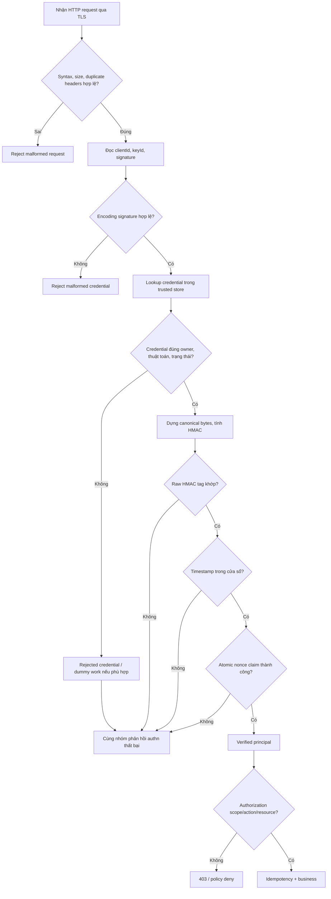
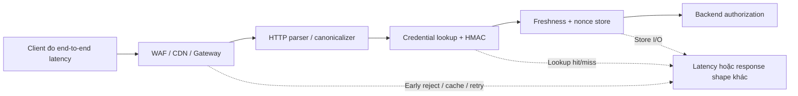

# Timing trong error

## 1. Một chữ ký sai có thể tiết lộ điều gì ngoài mã lỗi?

Trong hệ thống HTTP authentication bằng HMAC, client ký **canonical request** từ HTTP method, URI, selected headers và body/hash body bằng **shared secret**. Server dùng secret tương ứng để tính lại HMAC, so tag rồi kiểm tra timestamp, nonce và phân quyền. Khi request thất bại, server có thể trả cùng `401 Unauthorized` nhưng **thời gian xử lý** vẫn khác tùy lý do.

Ví dụ quan sát được từ bên ngoài:

```text
Request A: key ID không tồn tại        -> lookup miss -> trả 401
Request B: key ID hợp lệ, HMAC sai     -> lookup hit -> HMAC -> trả 401
Request C: key ID bị thu hồi          -> lookup hit -> policy reject -> 401
Request D: HMAC đúng, nonce đã dùng    -> HMAC -> shared nonce store -> 401
```

Nếu các nhánh có độ trễ khác nhau **ổn định và đủ lớn**, một caller có thể phân biệt trạng thái nội bộ dù response body giống nhau. Đó là **timing side channel qua error path**. Trong chương *Constant-time comparison*, bài **Timing trong error** tập trung vào vấn đề này, không chỉ vào lệnh so sánh hai byte array.

Bài thuộc module `SECURITY_AUTHENTICATION_HMAC_REQUEST_AUTHENTICATION`. Phạm vi module là xác thực request HMAC với shared secret và canonical method/URI/headers/body, chống replay bằng timestamp/nonce, key rotation, thử nghiệm proxy/gateway và phân biệt **authentication** với **authorization**. Timing trong error xuất hiện tại **mọi ranh giới** vừa nêu.

Sau bài, bạn có thể:

- Giải thích vì sao **constant-time MAC comparison** là cần thiết nhưng **chưa đủ** để loại toàn bộ timing leak.
- Phân biệt lỗi parse/format, credential lookup, key state, MAC mismatch, timestamp, nonce, authorization và outage.
- Thiết kế phản hồi lỗi không vô tình tạo oracle tiết lộ key ID, client tồn tại, secret, tình trạng revocation hoặc tài nguyên.
- Biết **khi nào cần cân bằng một phần công việc** giữa những nhánh lỗi, khi nào không nên cố làm toàn bộ request cùng thời gian.
- Viết Java 17 sử dụng `MessageDigest.isEqual` với **raw tag bytes**, lookup credential scoped đúng client/key ID, và dummy HMAC work ở nhánh thích hợp.
- Kiểm thử golden vector, error behavior, proxy/gateway, replay/rotation và đo timing có phương pháp.

**Ý chính:** không có một lời gọi API nào biến toàn bộ HTTP authentication thành “constant-time”. Mục tiêu thực tế là **giảm sự khác biệt có thể tiết lộ bí mật**, chốt một security boundary đáng tin và không tạo lối đi bỏ qua xác thực.

## 2. Timing side channel là gì trong HTTP error?

### 2.1. Dữ liệu attacker nhìn thấy

Một caller điều khiển các phần của HTTP request và có thể quan sát:

- Mã HTTP, body, headers, `Content-Length`, thời điểm response và thời gian từ khi gửi đến khi nhận.
- Những khác biệt giữa request qua gateway/CDN và request đi trực tiếp đến service nếu mạng cho phép.
- Phân phối thời gian khi gửi nhiều request có kiểm soát, không chỉ một lần đo.
- Có hoặc không có retry, rate limiting, cache hit, redirect hoặc WAF challenge.

Caller **không nhất thiết** biết mã lỗi nội bộ như `UNKNOWN_KEY` hoặc `INVALID_HMAC`. Tuy nhiên latency có thể gợi ý server đã chạy đến nhánh nào.

Một ví dụ sai:

```java
Credential c = store.find(clientId, keyId);
if (c == null) {
    return unauthorized();       // Không chạy HMAC.
}
byte[] expected = computeHmac(c.secret(), canonical);
if (!Arrays.equals(expected, receivedTag)) {
    return unauthorized();       // HMAC được tính và so.
}
```

Hai response đều `401`, nhưng công việc khác nhau. Chỉ riêng điều này **chưa chứng minh** có lỗ hổng timing khai thác được từ Internet: nhiễu mạng, backend store, cache và tải hệ thống có thể che sự khác biệt. Tuy vậy, đây là một **điểm cần đánh giá và kiểm thử**, nhất là khi endpoint có tốc độ cao, latency ổn định hoặc attacker có thể lấy nhiều mẫu.

### 2.2. Timing oracle là cách nhìn đúng

Trong mật mã, một *oracle* là hành vi có thể quan sát cho phép suy ra điều gì đó từ input. Với request authentication, các ví dụ cần chú ý:

| Thứ có thể bị suy đoán | Nguồn khác biệt |
| --- | --- |
| Key ID/client ID có tồn tại không | Lookup miss nhanh hơn lookup hit + HMAC |
| Key đã bị thu hồi hay chưa | Revocation branch trả ngay, key active chạy MAC |
| Tag khớp bao nhiêu byte đầu | So sánh dừng tại byte không khớp đầu tiên |
| Timestamp/nonce có được chấp nhận không | Chỉ request qua HMAC mới chạm tới nonce store |
| Resource có tồn tại không | Router trả `404`/`403` với latency khác trước/đằng sau authn |
| Gateway hay backend từ chối | Response headers/caching/processing time khác nhau |

Không phải mọi thông tin trong bảng đều có cùng độ nhạy. Ví dụ principal đã xác thực **có thể được phép biết** giao dịch của mình đã bị replay; trong khi caller chưa xác thực **không nên phân biệt** một key thuộc khách hàng khác có tồn tại hay đã bị thu hồi.

### 2.3. “Constant-time” là thuộc tính có phạm vi

Có ít nhất bốn mức khác nhau:

1. **So sánh MAC không phụ thuộc nội dung tag** khi hai tag có độ dài cố định. Đây là mức có thể kiểm soát trong primitive so sánh.
2. **Các bước xử lý mật mã được cân bằng tương đối** giữa một số nhánh lỗi, chẳng hạn unknown key và key tồn tại nhưng HMAC sai.
3. **Giao thức phản hồi khó phân biệt** giữa các lỗi authentication nhạy cảm: không đưa lý do chi tiết cho caller, giữ response shape nhất quán.
4. **Toàn bộ latency request giống nhau** bất kể route, network, database, cache, nonce store và quyền. Mức 4 **không thực tế** và không phải cam kết mặc định.

Đừng viết “API đã constant-time vì dùng `MessageDigest.isEqual`”. Đó chỉ là một thành phần. Ngược lại, không cần cố làm mọi yêu cầu `400`, `401`, `403` và `503` trông như nhau nếu việc đó gây hại cho khả năng vận hành hoặc phá ngữ nghĩa HTTP.

## 3. Bản đồ đường đi lỗi trong HMAC verifier



Đường đi lỗi là một phần của **bề mặt quan sát được**. Khi thiết kế, cần trả lời:

- Request nào bị từ chối **trước khi** tính HMAC?
- Với key ID không tồn tại, server có thực hiện cùng primitive MAC như trường hợp HMAC sai không?
- Key `REVOKED` còn được phép thử MAC không? Nếu cân bằng bằng dummy work, có ràng buộc fail-closed không?
- Lỗi từ DB/KMS/nonce store có bị ghi nhầm thành “invalid signature” không?
- Người gọi không được xác thực có thể nhận khác biệt về sự tồn tại của tài nguyên qua `404`/`403` hay không?
- Gateway và service có trả shape lỗi khác nhau làm lộ điểm chặn không?

Những quyết định này cần dựa trên **threat model** và đo đạc thực tế, không chỉ cảm giác latency.

### 3.1. Các lớp lỗi thường gặp

| Nhóm | Ví dụ | Có thể xử lý sớm? | Điều phải giữ |
| --- | --- | --- | --- |
| HTTP syntax / kích thước | CRLF injection, header quá lớn, duplicate signed header | **Có** tại parser/ingress | Không xử lý nghiệp vụ; không được “sửa để qua” |
| Signature format | Base64url sai alphabet, thiếu padding policy, length ≠ 43 | Có thể reject sớm | Không chấp nhận tag mơ hồ/noncanonical |
| Unknown key/client | ID đúng schema nhưng không có credential | Cần cân nhắc dummy MAC | Không tiết lộ key existence |
| Revoked/expired key | ID tồn tại nhưng không được sử dụng | Cần phản hồi authn đồng nhất | Không cho key cũ xác thực |
| HMAC sai | Tag đúng format nhưng không khớp | Compare raw bytes | Không leak vị trí byte khác |
| Timestamp sai / nonce lặp | MAC hợp lệ nhưng request cũ | Reject freshness/replay | Không claim nonce trước HMAC |
| Scope/owner sai | Principal hợp lệ nhưng thiếu quyền | Authorization riêng | Không lẫn `401` và `403` tùy ý |
| Credential/crypto/nonce outage | Store hoặc JCA provider không hoạt động | Fail-closed | Không giả vờ xác thực thành công |

**Không đặt yêu cầu “phải equal-time” lên mọi dòng trong bảng.** Ví dụ đầu vào có 10 MB header nên bị cắt bởi limit trước khi làm MAC; cố chạy dummy HMAC cho mọi request sai định dạng có thể biến một API an toàn thành mục tiêu DoS tốn CPU.

## 4. Vì sao `Arrays.equals` và so chuỗi dễ trở thành lỗi?

### 4.1. So sánh dừng sớm

Với hai raw tag:

```text
expected = [a0, b1, c2, d3, ... 32 bytes]
received = [00, b1, c2, d3, ... 32 bytes]
           ^ khác ngay đầu

received = [a0, b1, c2, 00, ... 32 bytes]
                       ^ khác muộn hơn
```

Một phép so sánh thông thường có thể dừng tại vị trí đầu tiên sai; lượng công việc vì thế có thể phụ thuộc vào **prefix trùng**. Nếu attacker có oracle timing đủ chính xác, đây là sự phụ thuộc không cần thiết vào dữ liệu nhạy cảm.

Không dùng:

```java
// Không dùng như MAC verification primitive có bảo đảm timing.
if (Arrays.equals(expectedTag, receivedTag)) { ... }

// Không dùng equals trên text signature làm phép xác thực MAC.
if (expectedBase64url.equals(receivedSignature)) { ... }
```

Cả hai có thể cho kết quả logic đúng, nhưng **không phải lựa chọn chuẩn để giảm timing leak của MAC comparison**.

### 4.2. Dùng `MessageDigest.isEqual` cho raw tag bytes

Trong Java 17:

```java
byte[] expected = mac.doFinal(canonicalBytes);
byte[] received = strictDecodeBase64url(signatureText);

boolean authenticated = MessageDigest.isEqual(expected, received);
```

`MessageDigest.isEqual` được JDK cung cấp để so sánh các digest/tag bytes mà không dựa vào vị trí byte sai theo cách so sánh dừng sớm thông thường. Với **hai mảng byte có cùng độ dài cố định**, đây là lựa chọn thích hợp hơn `Arrays.equals` cho kiểm tra HMAC.

Cần lưu ý:

- Bài dùng **full HMAC-SHA256 32 byte**, không tự cắt tag. Kiểm tra raw length sau decode.
- `MessageDigest.isEqual` **không che được** thời gian credential lookup, dựng canonical request, I/O, parser và nonce store.
- Nếu một bên dài 16 byte, một bên 32 byte, **format đã sai contract**; reject, không cắt phần dư rồi so prefix.
- Không tự viết một hàm “XOR tất cả byte” nếu thư viện runtime đã có API được kiểm chứng; compiler/JIT và cấu trúc input có thể tạo hành vi khó dự đoán.
- So sánh **byte tag**, không phải text Base64url sau `lowercase` hoặc các phép biến đổi không thuộc hợp đồng.

### 4.3. Kiểm tra Base64url trước khi so MAC

Với HMAC-SHA256:

```text
Raw HMAC tag: 32 bytes
Wire encoding: Base64url no-padding
Wire length: 43 ASCII characters
Alphabet: [A-Za-z0-9_-]
```

Một decoder có thể giải mã alias text về cùng raw bytes nếu **các bit padding cuối không canonical**. Hợp đồng nên kiểm tra alphabet/length, decode thành đúng 32 byte, sau đó **encode lại và so chính xác text** để loại noncanonical forms.

Kiểm tra representation này có thể trả lỗi nhanh hơn MAC mismatch. Đó là quyết định **format validation**, không phải bằng chứng toàn endpoint constant-time. Nếu cần giảm oracle timing giữa credential-malformed và credential-invalid, phải thiết kế bổ sung nhưng **không được đánh đổi tính chặt chẽ của parser**.

## 5. Thiết kế error response: nhất quán ở mức nào?

### 5.1. Bên ngoài: ít thông tin nhạy cảm

Thay vì trả chi tiết:

```json
{"code":"KEY_EXISTS_BUT_REVOKED","keyId":"key-2026-b"}
```

có thể trả phản hồi authn tổng quát:

```http
HTTP/1.1 401 Unauthorized
Content-Type: application/problem+json
Cache-Control: no-store

{"title":"Authentication failed","status":401}
```

Cùng một dạng phản hồi có thể dùng cho **key không tồn tại, key revoked, HMAC sai hoặc credential không đúng owner**, khi threat model yêu cầu không cho caller phân biệt. Đối với custom HMAC scheme, header `WWW-Authenticate` (nếu cần theo HTTP authentication semantics) phải theo schema nhất quán; không dùng giá trị khác để lộ key state.

**Không cần xóa mọi ngữ nghĩa:** một request đã xác thực nhưng thiếu scope cần được phân biệt với một request chưa xác thực để client xử lý `403 Forbidden`; lỗi hạ tầng nên có phản hồi dịch vụ phù hợp, không giả thành credential sai mãi mãi.

### 5.2. Không chỉ status và body

Các dấu hiệu phụ có thể làm response phân biệt được:

- `Content-Length`, loại `Content-Type`, `WWW-Authenticate`, `Cache-Control`.
- Header khác như `Retry-After`, `Server-Timing`, `X-Backend-Node` hoặc correlation ID với format khác.
- Có/không có response body, JSON field khác, redirect hoặc cookie.
- HTTP/2 status/stream handling, connection reuse, TLS handshake và gateway retry behavior.
- Cache hit/miss khác nhau giữa unknown key và known key.

Không nhất thiết **giấu mọi header vận hành**. Cần đánh giá từng field theo thông tin nó có thể tiết lộ cho caller chưa xác thực và áp dụng chính sách nhất quán cho **nhóm lỗi nhạy cảm**.

### 5.3. Bên trong: phân loại lỗi để điều tra

Error taxonomy nội bộ có thể gồm:

```text
MALFORMED_HTTP_REQUEST
DUPLICATE_SIGNED_HEADER
INVALID_SIGNATURE_ENCODING
UNKNOWN_CREDENTIAL
CREDENTIAL_REVOKED
CREDENTIAL_NOT_YET_VALID
INVALID_HMAC
TIMESTAMP_OUT_OF_WINDOW
NONCE_REPLAY
AUTHORIZATION_DENIED
CREDENTIAL_STORE_UNAVAILABLE
CRYPTO_PROVIDER_UNAVAILABLE
NONCE_STORE_UNAVAILABLE
```

Nhưng không gửi những mã này thẳng ra ngoài nếu chúng giúp enumerate credential. Log/metrics nội bộ cần giới hạn quyền truy cập, redaction và không ghi shared secret hoặc toàn bộ request nhạy cảm. Không nên tạo label metrics chứa key ID/người dùng tùy ý dẫn tới **high-cardinality** và rò rỉ.

## 6. Giảm timing leak từ credential lookup bằng công việc thay thế

### 6.1. Vấn đề unknown key trả quá sớm

Một verifier có thể viết:

```java
Optional<Credential> c = store.find(clientId, keyId);
if (c.isEmpty()) return unauthorized();

byte[] expected = hmac(c.get().secret(), canonicalBytes);
return MessageDigest.isEqual(expected, receivedTag)
    ? authenticated()
    : unauthorized();
```

Nhánh `unknown` không chạy HMAC; nhánh `known-but-bad-tag` có chạy HMAC. Đây là khác biệt có thể đo được trong một số môi trường.

Một chiến lược phòng vệ **có điều kiện**: với request **đúng cú pháp và đúng giới hạn**, nếu credential không tồn tại hoặc không được phép dùng, thực hiện **một phép HMAC tương đương trên cùng canonical bytes** với **dummy key do server quản lý**, rồi **vẫn từ chối**. Điều này giảm chênh lệch do primitive MAC, nhưng không làm đồng đều thời gian DB/KMS, cache hay nonce store.

### 6.2. Mô hình pseudocode

```text
validate syntax + limits
decode signature -> 32 raw bytes
candidate = credentialStore.find(environment, clientId, keyId)
eligible = candidate exists && owner matches && ACTIVE && correct algorithm
keyForComputation = eligible ? candidate.secret : serverConfiguredDummySecret

expectedTag = HMAC_SHA256(keyForComputation, canonicalBytes)
tagMatches = constantTimeEqual(expectedTag, receivedTag)

if !eligible || !tagMatches:
    return SAME_PUBLIC_AUTHN_ERROR

check signed timestamp
atomic claim signed nonce
create verified principal from trusted candidate
authorize action/resource separately
```

Các ràng buộc quan trọng:

- Dummy key là **secret do server cấu hình**, không lấy từ request. Không sử dụng key của một client khác làm dummy key.
- **Không bao giờ trả authenticated** khi `eligible == false`, ngay cả nếu `tagMatches` tình cờ là true.
- Đừng tạo credential giả rồi coi nó có owner/scopes thật.
- Lỗi credential store/KMS không được tự động trở thành lookup miss; outage là lỗi hệ thống và **fail-closed**.
- Không chạy dummy work cho mọi input malformed/oversized; áp giới hạn ở parser trước để chống resource exhaustion.
- Không claim nonce với request HMAC chưa được xác thực. Dummy work **không** làm request unknown-key được quyền chạm vào replay state.
- Cân nhắc overhead CPU và latency khi số request sai lớn. **Rate limit, bot protection, caching an toàn và monitoring** vẫn cần thiết.
- Đừng hứa “constant-time endpoint”: DB lookup hit/miss, cache/KMS, JIT/GC và network vẫn có thể khác.

**Có thể không dùng dummy HMAC** nếu threat model cho thấy lợi ích không đáng so với DoS cost, ví dụ hệ thống đã có một lớp credential auth bảo vệ key lookup hoặc rate limit rất chặt. Điều cần làm là **đánh giá/ghi nhận rủi ro**, không biến dummy work thành quy tắc tuyệt đối.

### 6.3. Vì sao không thêm `Thread.sleep` ngẫu nhiên?

Ví dụ sai:

```java
if (credentialMissing) {
    Thread.sleep(50); // “che timing” bằng một delay cố định.
}
return unauthorized();
```

Delay cố định không đảm bảo thời gian bằng nhau khi store cache miss hoặc queue thay đổi. Jitter ngẫu nhiên chỉ làm tăng nhiễu; nếu attacker lấy đủ mẫu, tín hiệu thống kê vẫn có thể tồn tại. Sleep còn giữ tài nguyên xử lý, tạo latency xấu và dễ bị abuse.

Nếu sản phẩm có chiến lược response pacing, đó phải là cơ chế **được đo đạc, rate-limited và vận hành rõ ràng**, không thay thế constant-time tag comparison, credential policy hay parser validation.

## 7. Golden vector: định vị lỗi MAC trước khi đo timing

Trước khi so thời gian hai nhánh lỗi, phải biết implementation **tính đúng HMAC**. Nếu canonical request, secret hoặc tag decoding sai, mọi phép đo timing sẽ khó diễn giải.

Bài dùng hợp đồng minh họa **HTTP-HMAC-ERROR-TIMING-V1**, không phải một chuẩn bắt buộc.

### 7.1. Request và canonical bytes

```http
POST /v1/charges?currency=VND HTTP/1.1
Host: api.example.test
Content-Type: application/json
X-Client-Id: merchant-42
X-Key-Id: key-2026-b
X-Timestamp: 1790000000
X-Nonce: S0meR4ndomNonce_9
X-Signature: <base64url-hmac>

{"chargeId":"ch-501","amount":250000}
```

Hợp đồng học tập quy định:

- Method `POST`, raw path `/v1/charges`, raw query `currency=VND` và external authority `api.example.test` được kiểm tra ở đúng ingress boundary.
- Signed headers có content-type, client ID, key ID, timestamp và nonce. Tên field lowercase, value theo schema; từ chối duplicate và CR/LF.
- Body hash SHA-256 của **chính xác UTF-8 bytes** từ JSON fixture, không kèm newline cuối, trước khi middleware tự reserialize.
- 11 dòng canonical text, nối bằng **LF `0x0A`**, không thêm LF cuối; UTF-8 encoding.
- HMAC-SHA256 full tag 32 bytes; `X-Signature` là Base64url **no-padding 43 ký tự**. Không đưa chính signature header vào input.

Canonical request:

```text
HTTP-HMAC-ERROR-TIMING-V1
POST
/v1/charges
currency=VND
authority:api.example.test
content-type:application/json
x-client-id:merchant-42
x-key-id:key-2026-b
x-timestamp:1790000000
x-nonce:S0meR4ndomNonce_9
01de6745ede59f38d6d98bbe28e6938fd680f96a3780b23fee2388c4c311eb52
```

### 7.2. Expected output tính độc lập

Secret test công khai (32 bytes từ `00` đến `1f`):

```text
Test secret hex:
000102030405060708090a0b0c0d0e0f101112131415161718191a1b1c1d1e1f

Body SHA-256 hex:
01de6745ede59f38d6d98bbe28e6938fd680f96a3780b23fee2388c4c311eb52

Canonical input: 11 lines, 270 UTF-8 bytes

Raw HMAC-SHA256 hex:
d67121dc3ce72b431a9060be4165e521ebe944d4656ca90542611aa9b775d26f

Base64url no padding (43 characters):
1nEh3DznK0MakGC-QWXlIevpRNRlbKkFQmEaqbd10m8
```

Kết quả đã được tính bằng primitive SHA-256/HMAC-SHA256 độc lập với lớp Java minh họa ở dưới. Một test tốt kiểm tra **body digest**, **canonical bytes** và **raw MAC** trước khi quan tâm latency.

Timestamp `1790000000` cố định để golden test tái lập; **không bảo đảm request còn hợp lệ theo cửa sổ thời gian hiện tại**. Để kiểm thử authentication end-to-end, phải dùng injected test clock hoặc sinh timestamp/nonce mới rồi ký lại toàn bộ request.

## 8. Java 17: error path giảm thông tin nhạy cảm

Ví dụ sau dùng `MessageDigest.isEqual` trên raw MAC tag và **dummy HMAC computation** khi credential vắng mặt hoặc không đủ điều kiện. Nó **không hứa constant-time end-to-end**, không thay HTTP parser và không xử lý toàn bộ rủi ro cache/KMS.

### 8.1. Bản ghi và pipeline xác minh

```java
import java.nio.charset.StandardCharsets;
import java.security.GeneralSecurityException;
import java.security.MessageDigest;
import java.util.Base64;
import java.util.HexFormat;
import java.util.Optional;
import javax.crypto.Mac;
import javax.crypto.spec.SecretKeySpec;

public final class ErrorTimingVerifierV1 {
    private static final String VERSION = "HTTP-HMAC-ERROR-TIMING-V1";
    private static final String HMAC_ALGORITHM = "HmacSHA256";
    private static final long TIME_WINDOW = 300L;

    // HTTP adapter phải giữ đủ occurrences và reject duplicate/CRLF
    // trước khi tạo Request. Không lấy authority từ X-Forwarded-Host lạ.
    public record Request(
        String method, String rawPath, String rawQuery,
        String trustedAuthority, String contentType,
        String clientId, String keyId, String timestamp,
        String nonce, byte[] exactBodyBytes
    ) {}

    // Server quản lý credential: không bao giờ đọc secret từ request.
    public record Credential(
        String clientId, String keyId, String environment,
        String algorithm, boolean active, byte[] secret
    ) {}

    public record VerifiedPrincipal(String clientId) {}

    public interface CredentialStore {
        Optional<Credential> find(
            String environment, String clientId, String keyId);
    }

    public interface NonceStore {
        // True chỉ khi claim mới thành công; thao tác atomic/shared.
        boolean claim(
            String clientId, String nonce, long expiresAtEpochSeconds);
    }

    private ErrorTimingVerifierV1() {}

    private static void validate(Request r) {
        if (r == null || r.exactBodyBytes() == null
                || r.exactBodyBytes().length > 1_048_576
                || !"POST".equals(r.method())
                || !"/v1/charges".equals(r.rawPath())
                || !"currency=VND".equals(r.rawQuery())
                || !"api.example.test".equals(r.trustedAuthority())
                || !"application/json".equals(r.contentType())
                || r.clientId() == null
                || !r.clientId().matches("[A-Za-z0-9._-]{1,64}")
                || r.keyId() == null
                || !r.keyId().matches("[A-Za-z0-9._-]{1,64}")
                || r.timestamp() == null
                || !r.timestamp().matches("[1-9][0-9]{0,18}")
                || r.nonce() == null
                || !r.nonce().matches("[A-Za-z0-9_-]{16,64}")) {
            throw new IllegalArgumentException(
                "Malformed or unsupported signed request");
        }
        try {
            Long.parseLong(r.timestamp());
        } catch (NumberFormatException bad) {
            throw new IllegalArgumentException("Timestamp out of range", bad);
        }
    }

    public static byte[] canonicalBytes(Request r)
            throws GeneralSecurityException {
        validate(r);
        String bodyHash = HexFormat.of().formatHex(
            MessageDigest.getInstance("SHA-256")
                .digest(r.exactBodyBytes())
        );
        String text = String.join("\n",
            VERSION,
            r.method(),
            r.rawPath(),
            r.rawQuery(),
            "authority:" + r.trustedAuthority(),
            "content-type:" + r.contentType(),
            "x-client-id:" + r.clientId(),
            "x-key-id:" + r.keyId(),
            "x-timestamp:" + r.timestamp(),
            "x-nonce:" + r.nonce(),
            bodyHash
        );
        return text.getBytes(StandardCharsets.UTF_8);
    }

    public static byte[] strictDecodeTag(String signature) {
        if (signature == null
                || !signature.matches("[A-Za-z0-9_-]{43}")) {
            throw new IllegalArgumentException("Bad signature format");
        }
        final byte[] raw;
        try {
            raw = Base64.getUrlDecoder().decode(signature);
        } catch (IllegalArgumentException malformed) {
            throw new IllegalArgumentException("Invalid Base64url", malformed);
        }
        if (raw.length != 32
                || !Base64.getUrlEncoder().withoutPadding()
                    .encodeToString(raw).equals(signature)) {
            throw new IllegalArgumentException("Noncanonical signature");
        }
        return raw;
    }

    private static byte[] computeHmac(byte[] key, byte[] data)
            throws GeneralSecurityException {
        if (key == null || key.length < 32) {
            throw new IllegalStateException(
                "Missing/invalid server HMAC key configuration");
        }
        Mac mac = Mac.getInstance(HMAC_ALGORITHM);
        mac.init(new SecretKeySpec(key, HMAC_ALGORITHM));
        return mac.doFinal(data);
    }

    // environment và dummyKey do server cấp, không nhận từ HTTP.
    // store / nonceStore phải fail-closed khi backend unavailable.
    public static Optional<VerifiedPrincipal> verify(
            Request request, String receivedSignature,
            String environment, CredentialStore store,
            NonceStore nonceStore, byte[] dummyKey,
            long nowEpochSeconds
    ) throws GeneralSecurityException {
        // Lỗi cấu trúc có thể reject sớm tại ingress; đừng ép
        // mọi malformed request chạy cùng workload với HMAC.
        byte[] input = canonicalBytes(request);
        byte[] receivedTag = strictDecodeTag(receivedSignature);

        // clientId/keyId chỉ là selector CHƯA xác thực.
        Optional<Credential> candidate = store.find(
            environment, request.clientId(), request.keyId());
        Credential c = candidate.orElse(null);
        boolean eligible =
            c != null
            && c.active()
            && environment.equals(c.environment())
            && request.clientId().equals(c.clientId())
            && request.keyId().equals(c.keyId())
            && HMAC_ALGORITHM.equals(c.algorithm());

        // Với credential ineligible: làm dummy MAC computation
        // cùng số byte canonical input; TUYỆT ĐỐI không cấp principal.
        byte[] key = eligible ? c.secret() : dummyKey;
        byte[] expectedTag = computeHmac(key, input);
        boolean macMatches =
            MessageDigest.isEqual(expectedTag, receivedTag);

        if (!eligible || !macMatches) {
            return Optional.empty(); // Cùng nhóm lỗi authn public.
        }

        long ts = Long.parseLong(request.timestamp());
        if (ts < nowEpochSeconds - TIME_WINDOW
                || ts > nowEpochSeconds + TIME_WINDOW) {
            return Optional.empty();
        }

        // Claim nonce SAU HMAC; shared atomic store có TTL đủ.
        if (!nonceStore.claim(
                c.clientId(), request.nonce(),
                ts + TIME_WINDOW + 1)) {
            return Optional.empty();
        }

        return Optional.of(new VerifiedPrincipal(c.clientId()));
    }

    // Chỉ dùng để kiểm tra golden fixture; không vận chuyển secret.
    public static String signForTest(Request r, byte[] testSecret)
            throws GeneralSecurityException {
        byte[] tag = computeHmac(testSecret, canonicalBytes(r));
        return Base64.getUrlEncoder().withoutPadding()
            .encodeToString(tag);
    }
}
```

### 8.2. Điều gì giảm timing leak, điều gì chưa?

**Có giảm:**

- Trường hợp key đúng schema nhưng **unknown/revoked** vẫn đi qua một phép HMAC-SHA256 có kích thước input tương đương, thay vì trả ngay trước phép MAC.
- Với tag 32 byte hợp lệ về format, phép so dùng `MessageDigest.isEqual`, không so theo prefix bằng `Arrays.equals` hay `String.equals`.
- Phản hồi authentication có thể gom một nhóm lỗi public đồng nhất sau khi verifier trả empty.

**Không cam kết:**

- `CredentialStore.find` có thể khác latency giữa cache hit/miss hoặc KMS có/không có key. Dummy MAC **không** xóa được dấu hiệu đó.
- Lỗi request malformed hoặc signature encoding sai bị reject trước MAC. Đây là quyết định parser/DoS hợp lý; không tự tuyên bố mọi lỗi đều cùng thời gian.
- Timestamp sai/nonce lặp chỉ được kiểm tra **sau MAC khớp**; nhánh này vẫn có thể khác nhánh HMAC sai.
- Runtime JIT/GC, thread scheduling, CPU throttling, TLS và gateway retry có thể thay đổi timing.
- `Credential.active()` là boolean đơn giản phục vụ lab; production cần trạng thái rotation, expiry, revocation và propagation giữa replicas.
- `NonceStore.claim` là interface; implement thực phải nguyên tử và fail-closed, không check–then–insert hai bước rời.
- `verify` giả định HTTP adapter đã phát hiện **duplicate signature/signed headers**, content coding và framing; class nhận các field đã parse nên tự nó không thể chứng minh request trên wire hợp lệ.

**Không dùng dummy computation để “hợp thức hóa” credential sai.** Khi candidate không eligible, kết quả luôn là authentication failure, dù tag toán học trùng với dummy HMAC.

### 8.3. Golden vector Java 17

```java
import java.nio.charset.StandardCharsets;
import java.util.HexFormat;

byte[] secret = HexFormat.of().parseHex(
    "000102030405060708090a0b0c0d0e0f"
  + "101112131415161718191a1b1c1d1e1f"
);

var fixture = new ErrorTimingVerifierV1.Request(
    "POST",
    "/v1/charges",
    "currency=VND",
    "api.example.test",
    "application/json",
    "merchant-42",
    "key-2026-b",
    "1790000000",
    "S0meR4ndomNonce_9",
    "{\"chargeId\":\"ch-501\",\"amount\":250000}"
        .getBytes(StandardCharsets.UTF_8)
);

byte[] canonical = ErrorTimingVerifierV1.canonicalBytes(fixture);
if (canonical.length != 270) {
    throw new AssertionError("Golden canonical length changed");
}
String expectedTag =
    "1nEh3DznK0MakGC-QWXlIevpRNRlbKkFQmEaqbd10m8";
if (!expectedTag.equals(
        ErrorTimingVerifierV1.signForTest(fixture, secret))) {
    throw new AssertionError("Golden tag mismatch");
}
// Tập trung kiểm thử canonical bytes và HMAC.
// Test timing/replay sẽ dùng injected clock, store giả và request mới.
```

Đây chỉ là golden test, **không** là minh chứng “đo thời gian hằng số”. Test runtime timing phải là **một bài thử độc lập** với thiết kế đo/kiểm soát nhiễu thích hợp.

## 9. Đo timing có ý nghĩa mà không tự tạo kết luận sai

### 9.1. Không dùng một lần `System.nanoTime()` để tuyên bố an toàn

Ví dụ:

```java
long start = System.nanoTime();
boolean ok = MessageDigest.isEqual(expected, received);
long elapsed = System.nanoTime() - start;
System.out.println(elapsed);
```

Đoạn code đo **một lần** có thể bao gồm JIT compilation, scheduling, cache miss và nhiễu hệ điều hành. Kết quả không chứng minh chức năng constant-time hoặc có/không có timing side channel exploitable. Đặc biệt với API từ xa, network variance có thể lớn hơn thời gian vài phép toán byte.

### 9.2. Cách thiết kế thử nghiệm phòng vệ

Một phép kiểm tra tương đối nghiêm túc:

1. **Xác định mục đích:** so unknown key với known-key/bad-MAC để tìm chênh lệch do credential lookup, hay so MAC sai byte đầu/cuối để kiểm tra primitive comparison? Không trộn các câu hỏi.
2. **Giữ input có cùng kích thước:** method, URI, body length, số headers và signature format. Chỉ đổi một yếu tố mục tiêu.
3. **Dùng dữ liệu test**, không gửi secret production. Có các fixture: unknown key, revoked key, active/bad MAC, active/good MAC/bad timestamp, replay, authenticated/forbidden.
4. **Warm up runtime**, dùng seed test tái lập, đảo thứ tự các lớp request và lặp nhiều lần để giảm thiên lệch do thứ tự.
5. **Đo tại nhiều điểm:** ở unit level trước/sau `computeHmac`, ở gateway latency toàn HTTP, và ở service store/replay latency có telemetry phân loại.
6. **Xem phân phối**, không chỉ average. Báo p50/p95/p99 hoặc biểu đồ mật độ, số mẫu, độ tin cậy/khoảng biến động, trạng thái CPU/JIT/GC/cache.
7. **Thử cả các cấu hình vận hành:** cache hit/miss, hai replica, network hop và tải có kiểm soát.
8. **Tái kiểm chứng** sau thay đổi để tránh kết luận từ một lần đo ngẫu nhiên. Nếu thấy chênh lệch, kiểm tra lại trên môi trường cô lập và xác minh root cause.
9. **Không coi phép đo pass** là bảo đảm cryptographic constant-time. Kết luận chỉ áp dụng cho code path, runtime và môi trường đã thử.

### 9.3. Mẫu bảng ghi kết quả

| Group | Điều kiện | Assertion về chức năng | Ghi nhận latency |
| --- | --- | --- | --- |
| G1 | Unknown key, signature đúng format | `401` generic, không cấp principal | p50/p95/p99 + số mẫu |
| G2 | Active key, HMAC sai | Cùng nhóm public authn response | So với G1 |
| G3 | Revoked key, tag đúng theo secret cũ | Reject ở mọi replica | So với G1/G2 |
| G4 | MAC đúng, timestamp quá hạn | Reject freshness | So riêng với G2 |
| G5 | MAC đúng, nonce lặp | Reject replay | So riêng với G4 |
| G6 | Authn pass, thiếu scope | `403` hoặc deny theo policy | Không ép giống `401` |
| G7 | Credential store unavailable | Fail-closed, có vận hành alert | Không giả định giống lookup miss |

Trước khi thực hiện, định nghĩa **ngưỡng chấp nhận dựa trên threat model** (độ nhạy thông tin, khả năng lấy mẫu của caller, network, SLA và capacity). Không lấy ngưỡng tuyệt đối kiểu “hai request chênh dưới 1 ns là an toàn”.

### 9.4. Kết quả thống kê không đồng nghĩa kết luận exploitability

Một chênh lệch có ý nghĩa thống kê không nhất thiết dễ khai thác từ xa; ngược lại, phép đo có nhiễu lớn không chứng minh không có leak. Cần xem **khả năng attacker điều khiển input, số mẫu lấy được, rate limiting, độ ổn định của môi trường** và thông tin có thể suy ra.

Nếu sản phẩm chịu rủi ro timing leakage cao (ví dụ xác thực khóa cho hạ tầng multi-tenant có giá trị lớn), cân nhắc security review chuyên biệt và các phương pháp kiểm thử side-channel được cộng đồng chuyên môn đánh giá, thay vì tự viết benchmark đơn giản.

## 10. Proxy/gateway có thể làm lộ error timing dù Java compare đúng



Những nguồn khác biệt có thể không nằm trong Java:

| Tầng | Đường đi lỗi khác nhau | Biện pháp |
| --- | --- | --- |
| WAF/CDN | Chặn header malformed ở edge, trả HTML khác JSON backend | Phân loại theo loại lỗi; không leak credential state |
| Gateway | Unknown key xử lý ở edge, known key forward đến service | Chốt trust boundary, tránh oracle không chủ đích |
| Reverse proxy | Retry backend trên `503` hoặc timeout | Không để retry gây khác biệt có thể suy từ auth state |
| HTTP parser | Duplicate header bị reject trước verifier | **Đúng** khi input malformed; không “cân bằng” bằng chấp nhận ambiguity |
| Credential cache | Unknown key negative cache, active key KMS read | Đo hit/miss, hạn chế metadata leak, rate limiting |
| Nonce store | Chỉ chạm Redis sau MAC đúng | Đúng thứ tự chống DoS/replay; tránh public error quá chi tiết |
| Load balancer | Route sang region/instance khác theo header | Bảo đảm policy nhất quán, không tin forwarded data giả |
| Backend | `403` gọi resource DB, `401` không | Khác semantics, kiểm soát enumeration nếu resource nhạy cảm |

Một gateway có thể rewrite method/URI/authority/body **sau** HMAC verification; khi đó tag bảo vệ request khác request được xử lý. Đây là **lỗi tính toàn vẹn dữ liệu** độc lập với timing. Gateway phải xác minh ở điểm trước rewrite hoặc truyền original representation và verified principal qua kênh nội bộ **có xác thực nguồn**.

HTTP/2 và HTTP/3 sử dụng field names lowercase và framing khác HTTP/1.1. Test phải kiểm tra canonical components và duplicate handling chứ không ký raw HTTP/1.1 request framing. Không tin `X-Verified-Client` hay `X-Original-URI` do caller bên ngoài gửi.

## 11. Replay, key rotation và quyền: error timing không thay kiểm soát nghiệp vụ

### 11.1. Replay protection sau HMAC

HMAC đúng chưa bảo đảm request còn mới. Server phải kiểm tra `X-Timestamp` trong cửa sổ (ví dụ ±300 giây) và claim `X-Nonce` **nguyên tử** trong kho dùng chung. Claim nonce **sau** HMAC hợp lệ để attacker không có secret không thể chiếm nonce của client khác.

Nếu request bị replay, HMAC tính lại vẫn đúng, nhưng nonce đã dùng. Đường đi timing có thể khác một request sai HMAC vì đã chạm nonce store; điều đó không có nghĩa nên bỏ kiểm tra nonce để “cân bằng”. **Tính chống replay quan trọng hơn che mọi khác biệt thời gian**.

Khi nonce store lỗi hoặc không thể claim với độ tin cậy cần thiết, endpoint nhạy cảm phải **fail-closed**. Không biến lỗi backend thành cho qua request.

### 11.2. Key rotation và revocation

`X-Key-Id` được đưa vào canonical request và giúp chọn credential theo `(environment,clientId,keyId)`. Trong rotation, có thể có giai đoạn chấp nhận key cũ/mới có thời hạn; client phải chọn **đúng key ID**, server không thử mọi secret cho đến khi tag khớp.

Khi secret bị lộ, thu hồi key cũ trên mọi verifier/cache. Tag HMAC bằng secret cũ **vẫn có thể đúng về toán học**; trạng thái `REVOKED` phải khiến request không được xác thực. Không đổi algorithm hoặc bỏ kiểm tra revocation chỉ để giảm timing của một error path.

### 11.3. Authorization là bước tách biệt

Một request của `merchant-42` có HMAC, timestamp, nonce hợp lệ vẫn có thể yêu cầu đọc hoặc tạo giao dịch cho `merchant-73`. Server cần kiểm tra **verified principal, scope/action và resource ownership**, trả `403` hoặc chính sách che giấu resource phù hợp.

Đừng cố làm `403` của principal đã xác thực có cùng latency với `401` của caller chưa xác thực theo mọi hoàn cảnh. Mục tiêu là không để **bên không được phép** suy ra tài nguyên/credential nhạy cảm; phân loại authn và authz vẫn phải đúng.

## 12. Bộ test thực hành “Timing trong error”

Cần kết hợp **unit**, **golden**, **functional error-path**, **measurement** và **HTTP integration**. Mỗi ca nên xác định chính xác **kết quả bắt buộc** và **đại lượng timing cần quan sát**, tránh viết “phải bằng nhau từng nanosecond”.

### 12.1. Primitive và canonicalization

| Test | Input | Kỳ vọng |
| --- | --- | --- |
| C01 | Golden canonical fixture `HTTP-HMAC-ERROR-TIMING-V1` | 11 dòng, 270 UTF-8 bytes |
| C02 | Exact JSON body fixture | SHA-256 khớp `01de6745...11eb52` |
| C03 | Test secret `00..1f`, canonical bytes | Raw HMAC `d67121dc...75d26f` |
| C04 | Base64url tag expected | `1nEh3DznK0MakGC-QWXlIevpRNRlbKkFQmEaqbd10m8` |
| C05 | So raw 32-byte tag đúng | `MessageDigest.isEqual` trả true |
| C06 | So tag sai ở byte đầu | Trả false; không dùng compare early-exit tự viết |
| C07 | So tag sai ở byte cuối | Trả false; cùng primitive comparison |
| C08 | Signature 42 hoặc 44 ký tự | Reject format, không nhận truncated tag |
| C09 | Signature có `+`, `/`, `=` hoặc whitespace | Reject Base64url V1 |
| C10 | Base64url alias noncanonical | Reject bằng re-encode validation |
| C11 | Đổi method/path/query/body giữ tag | HMAC mismatch hoặc validation reject |
| C12 | Đổi key ID/client ID sau ký | Credential reject hoặc HMAC mismatch |

### 12.2. Lỗi authentication và phản hồi public

| Test | Đường đi lỗi | Kỳ vọng bắt buộc |
| --- | --- | --- |
| E01 | Unknown key ID đúng schema | Authn reject, không tiết lộ key existence |
| E02 | Key đúng owner nhưng raw HMAC sai | Authn reject, response public cùng nhóm với E01 |
| E03 | Key `REVOKED` | Reject dù tag toán học đúng |
| E04 | Key thuộc tenant khác | Không dùng secret khác owner |
| E05 | Key ID sai schema | Reject trước lookup; không giả vờ phải constant-time mọi input |
| E06 | Header `X-Signature` duplicate | Reject tại parser/ingress |
| E07 | Header có CR/LF/obs-fold | Reject; không trim để pass |
| E08 | Key thuật toán không được hỗ trợ | Không fallback HMAC-SHA1; fail-closed |
| E09 | CredentialStore unavailable | Fail-closed, internal outage code |
| E10 | Invalid HMAC đúng Base64url format | Không claim nonce, không cấp principal |
| E11 | HMAC đúng nhưng timestamp cũ | Reject freshness |
| E12 | HMAC đúng nhưng nonce đã dùng | Reject replay |
| E13 | Hai instance cùng nonce | Tối đa một atomic claim thành công |
| E14 | NonceStore unavailable | Fail-closed; không cấp principal |
| E15 | Authn thành công nhưng thiếu permission | Authz deny `403`/policy, không coi là MAC error |
| E16 | Backend role header do caller tự khai | Không cấp role/admin |
| E17 | Provider JCA lỗi hoặc secret record thiếu | Fail-closed, alert/readiness |
| E18 | Unknown key và bad MAC cùng `401` nhưng response header/body khác | Regression test phát hiện information disclosure |

### 12.3. Measurement và infrastructure

| Test | Điều kiện đo | Điều cần quan sát |
| --- | --- | --- |
| M01 | Active bad-MAC vs unknown key | p50/p95/p99 và confidence, không so một lần |
| M02 | Active bad-MAC vs revoked key | Latency/response shape, metadata leak |
| M03 | MAC sai byte đầu vs byte cuối | Không có dependency do custom early-exit compare |
| M04 | Format malformed vs tag đúng format | Đường parser được phép khác; giới hạn CPU |
| M05 | Cache hit vs miss | Đánh giá chênh lệch store latency |
| M06 | Có/không dummy HMAC trong môi trường cô lập | Hiểu overhead và mức giảm chênh lệch |
| M07 | Gateway/HTTP2 vs backend direct (môi trường test) | Kiểm tra trust boundary, policy drift |
| M08 | Hai replica/region | Latency khác nhau nhưng revocation/replay policy đồng nhất |
| M09 | CPU load, warmup, JIT/GC | Không kết luận từ một phân phối nhiễu |
| M10 | Rate limiting với nhiều credential guesses | Phát hiện và hạn chế abuse mà không leak key existence |
| M11 | Error response headers/body size theo authn class | Kiểm tra không lộ trạng thái key |
| M12 | Request quá lớn hoặc duplicate signed fields | Early reject bảo vệ DoS; không bắt làm dummy work |

### 12.4. Đừng dựa vào test round-trip trong một class

Nếu `sign` và `verify` cùng sai canonical header parsing, test round-trip có thể vẫn xanh. Cần golden vector **độc lập** và integration test với gateway/SDK khác stack. Test timing phải được xem là **bổ sung**, không thay việc kiểm tra correctness của MAC/nonce/key state/authorization.

## 13. Tình huống thực tế và phân tích

### A. “Hai response đều 401 nên không lộ thông tin”

Unknown key được trả ngay sau database miss, known key/bad MAC được tính HMAC rồi trả `401` cùng JSON.

**Phân tích:** Mã và body giống nhau **chưa đủ**. Timing, cache và header phụ vẫn có thể khác. Đánh giá threat model, đo phân phối ở môi trường kiểm soát, cân nhắc dummy HMAC cho input hợp lệ và rate limiting; không hứa toàn endpoint constant-time.

### B. “Dùng MessageDigest.isEqual là an toàn hoàn toàn”

Nhóm sửa `Arrays.equals` thành `MessageDigest.isEqual` và tuyên bố toàn bộ hệ thống không có timing attack.

**Phân tích:** Phép so tag tốt hơn, nhưng lookup hit/miss, revoked branch, HTTP parser, freshness, nonce store và authorization vẫn có thể tiết lộ khác biệt. Cần kiểm thử toàn pipeline, response shape và gateway.

### C. “Cho mọi request sleep 100 ms”

Một gateway muốn ngăn timing leak bằng `Thread.sleep(100)` cho mọi lỗi.

**Phân tích:** Delay cố định không xóa chênh lệch nền từ DB/cache; jitter còn có thể lấy trung bình bằng nhiều request. Sleep gây resource exhaustion khi bị spam. Phải sửa nguyên nhân rò thông tin và có rate limiting; pacing chỉ là biện pháp phụ được đo đạc.

### D. “Key revoked chạy HMAC dummy có thể pass?”

Một verifier dùng dummy key cho mọi credential revoked, tính HMAC rồi vô tình chỉ kiểm tra `tagMatches` trước khi cấp principal.

**Phân tích:** **Nghiêm trọng.** Điều kiện xác thực phải luôn bao gồm `eligible && tagMatches` và trạng thái khóa. Dummy work chỉ để giảm một phần khác biệt timing, **không bao giờ** được xem là credential hợp lệ.

### E. “HMAC đúng nhưng thời gian phản hồi khác vì nonce”

Một client có secret hợp lệ nhận `401` khi replay; bad HMAC được trả nhanh hơn do không chạm nonce store.

**Phân tích:** Thứ tự là đúng: **không claim nonce trước MAC**. Đừng đảo lại chỉ để thời gian bằng nhau vì sẽ tạo DoS. Cân nhắc generic error nếu cần, nhưng giữ anti-replay và nguyên tử giữa các instance.

### F. “Gateway sửa request sau khi xác minh”

Gateway verify HMAC đúng trên `POST /public/v1/charges`, sau đó sửa thành path nội bộ khác; backend sử dụng header không được ký để quyết định owner. Response timing có vẻ đồng đều.

**Phân tích:** Không có leak timing nào bảo đảm dữ liệu được ký đúng. Phải bảo vệ **semantic binding** giữa request verified và request executed; hạn chế rewrite, truyền trusted principal và kiểm tra authorization riêng.

### G. “Secret bị lộ, giảm timing có cứu được không?”

Kẻ có shared secret bị lộ tạo request mới với timestamp/nonce mới và tag đúng. Server đã sử dụng `MessageDigest.isEqual`, dummy HMAC và response error chung.

**Phân tích:** Không. Timing mitigation không ngăn **credential compromise**. Cần thu hồi key, phân phối revocation nhanh, cấp secret mới và điều tra hoạt động bất thường. Key rotation/revocation là lớp kiểm soát riêng.

## 14. Checklist đánh giá Timing trong error

- [ ] Threat model chỉ rõ attacker có thể quan sát latency/response ở boundary nào, với tần suất và độ nhạy thông tin gì.
- [ ] Full HMAC-SHA256 tag 32 byte được decode nghiêm ngặt từ Base64url 43 ký tự; từ chối malformed/noncanonical/truncated input.
- [ ] So **raw MAC bytes bằng `MessageDigest.isEqual`**, không dùng text comparison hoặc early-exit compare cho tag.
- [ ] Không tuyên bố toàn endpoint constant-time chỉ vì so tag được làm an toàn hơn.
- [ ] Credential lookup theo đúng environment/client/key ID; kiểm tra owner, algorithm, hiệu lực và trạng thái `REVOKED`.
- [ ] Lỗi unknown key, revoked key và invalid MAC có public response **không tiết lộ** key existence hoặc lifecycle theo threat model.
- [ ] Đánh giá dummy HMAC cho credential không hợp lệ trên **bounded valid input**; không dùng dummy key để tạo principal.
- [ ] Không thêm sleep/jitter tùy tiện thay cho parser limits, MAC comparison và credential policy.
- [ ] HTTP parser chặn duplicate, CRLF, obs-fold, malformed signed fields trước khi gộp; không cân bằng thời gian bằng việc chấp nhận dữ liệu sai.
- [ ] Timestamp/nonce nằm trong canonical input, kiểm tra freshness và atomic claim nonce **sau HMAC hợp lệ**.
- [ ] Nonce store/KMS/provider outage **fail-closed**, có alert và loại lỗi nội bộ riêng, không bị diễn giải thành authn success.
- [ ] Gateway/proxy/HTTP2 và backend có thống nhất canonical method, URI, authority, headers và body digest.
- [ ] Principal đến từ credential đã verify, không từ forwarded role/identity header của caller; authorization riêng theo scope/action/resource.
- [ ] Test golden canonical bytes/HMAC, unit compare, error response shape, đo p50/p95/p99 và chênh lệch cache/replica.
- [ ] Rate limit credential guessing, giảm high-cardinality metrics và redact secret/signature trong telemetry.
- [ ] Rotation và revocation đồng nhất ở mọi verifier; không thử mọi key hoặc fallback crypto để “cứu” request sai.
- [ ] Trước release, ghi rõ **mức giảm timing risk đã đạt** và **rủi ro còn lại**; không tuyên bố timing side channel đã bị loại bỏ tuyệt đối.

**Kết luận:** *Timing trong error* là rủi ro thông tin phát sinh khi các nhánh lỗi của HMAC verifier tiêu thụ tài nguyên và phản hồi khác nhau. Một thiết kế tốt dùng **constant-time raw MAC comparison**, giới hạn parser, lookup credential tin cậy, error response không tiết lộ trạng thái khóa, và **cân bằng công việc có chọn lọc** ở những nhánh rủi ro cao. Dù vậy, tính mới của timestamp/nonce, thu hồi khóa, tính toàn vẹn request qua gateway và **authorization độc lập** vẫn là điều kiện bắt buộc; không thể thay chúng bằng bất kỳ thủ thuật timing nào.

