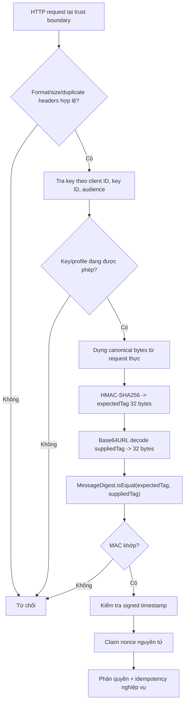
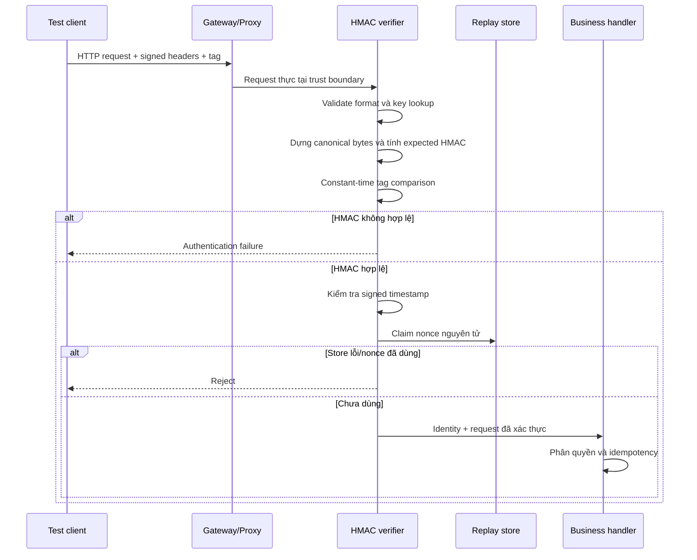

# Kiểm thử thời gian khi so sánh chữ ký HMAC

> **Chương:** Constant-time comparison  
> **Bài học:** Kiểm thử thời gian (*timing tests*) để phát hiện việc so sánh MAC/tag làm lộ thông tin qua thời lượng xử lý.  
> **Ngữ cảnh:** Xác thực HTTP request bằng HMAC với shared secret và canonical request chứa method, URI, signed headers và body. Nội dung kết nối so sánh chữ ký với kiểm tra timestamp/nonce chống replay, quản lý key rotation, proxy/gateway và phân quyền.

## 1. Vì sao cần kiểm thử thời gian?

Một client gọi API được bảo vệ bằng HMAC:

```http
POST /v1/payments?mode=commit HTTP/1.1
Host: payments.example.test
Content-Type: application/json
X-Client-Id: billing-service
X-Key-Id: key-2026-11
X-Timestamp: 1795800000
X-Nonce: 0M3HqYN8L0z2jcuTd-Aeaw
X-Signature: <base64url-hmac-sha256>

{"transactionId":"T-101","amount":100000}
```

Server dựng lại canonical request từ HTTP request thật, chọn shared secret hợp lệ rồi tính:

```text
expectedTag = HMAC_SHA256(sharedSecret, canonicalRequestBytes)
receivedTag = BASE64URL_DECODE(X-Signature)
acceptedMac = secureCompare(expectedTag, receivedTag)
```

Giả sử triển khai so sánh tag bằng một vòng lặp **dừng ngay khi gặp byte sai đầu tiên**:

```java
// VÍ DỤ KHÔNG NÊN DÙNG để kiểm tra MAC:
static boolean earlyExitEquals(byte[] expected, byte[] supplied) {
    if (expected.length != supplied.length) return false;
    for (int i = 0; i < expected.length; i++) {
        if (expected[i] != supplied[i]) return false;
    }
    return true;
}
```

Nếu hai tag sai ở byte đầu, hàm chỉ cần một lần so sánh byte. Nếu các byte đầu giống nhau và chỉ sai ở byte cuối, hàm có thể duyệt gần như toàn bộ tag. Tùy compiler, CPU và môi trường chạy, sự khác biệt này có thể ảnh hưởng thời gian quan sát được.

Đó là một dạng **timing side channel**: thời gian thực thi có liên hệ với vị trí byte đầu tiên không khớp. Trong một số mô hình đe dọa và điều kiện đo thuận lợi, sự khác biệt có thể góp phần tạo *timing oracle*, làm yếu tính bảo mật của phép kiểm tra MAC.

Mục tiêu của bài học không phải đo một con số “nhanh nhất”, mà là:

1. Phân biệt **đúng chức năng** với **không rò rỉ thông tin qua vị trí byte sai**.
2. Chọn primitive so sánh MAC phù hợp trong Java 17.
3. Tổ chức thử nghiệm *sai ở đầu / giữa / cuối* theo phương pháp đo có kiểm soát.
4. Biết giới hạn của `System.nanoTime()`, benchmark vi mô và phép kiểm định thống kê.
5. Kiểm tra cả pipeline HMAC thực tế, không chỉ một hàm so sánh độc lập.
6. Không nhầm so sánh an toàn với chống replay, key rotation hoặc phân quyền.

**Lưu ý:** Kết quả chạy nhanh/chậm trên một laptop **không chứng minh** một chương trình “constant-time” về mặt mật mã. Kiểm thử thời gian là một lớp kiểm tra bổ sung cho code review, sử dụng API phù hợp, phân tích đường thực thi và kiểm thử ở môi trường mục tiêu.

## 2. Phạm vi của “constant-time” là gì?

Trong bối cảnh so sánh HMAC, “constant-time comparison” thường có nghĩa là **công việc so sánh không phụ thuộc vào nội dung bí mật hay vị trí byte khác nhau**, khi các đầu vào có độ dài cố định theo giao thức.

Nó **không có nghĩa** mỗi request HTTP sẽ có chính xác cùng thời lượng tính bằng nano giây. Tốc độ CPU, JIT, garbage collector, lịch chạy luồng, cache, tải mạng và I/O đều tạo dao động.

### 2.1 Ba khái niệm cần phân biệt

| Khái niệm | Câu hỏi cần trả lời | Công cụ/thực hành |
| --- | --- | --- |
| **Functionally correct** | Tag đúng được chấp nhận; tag sai bị từ chối? | Unit test, golden vectors |
| **Content-independent comparison** | Thời gian so sánh có phụ thuộc byte sai đầu/giữa/cuối không? | Primitive phù hợp, code review, timing experiments |
| **End-to-end timing behavior** | Verifier có lộ thông tin qua toàn bộ luồng xử lý không? | Integration test, phân tích key lookup, canonicalization, MAC, nonce, I/O |

Một hàm có thể **đúng chức năng nhưng không an toàn về timing**. Ngược lại, một hàm so sánh có chi phí ít phụ thuộc dữ liệu **không cứu được** quy trình ký sai canonical bytes hoặc bỏ qua nonce.

### 2.2 Nội dung nhạy cảm và dữ liệu có thể công khai

Trong phép tính HMAC:

- **Shared secret** là bí mật và không được lộ.
- **Expected MAC** được server tính từ secret và canonical bytes đã dựng lại.
- **Supplied MAC** là tag do client gửi, attacker có thể điều khiển khi gửi request giả.
- **Chiều dài tag** thường là thuộc tính công khai của signing profile. Ví dụ HMAC-SHA256 tag đầy đủ dài **32 bytes**.
- **Kết quả chấp nhận/từ chối** vốn có thể được quan sát từ HTTP status. Mục tiêu của so sánh ít rò rỉ là không cung cấp thêm tín hiệu liên quan đến **các byte đầu của expected MAC**.

Điều ta cần tránh là kiểu khác biệt:

```text
Tag sai ngay byte 0   -> trả false sớm
Tag sai tại byte 31   -> thực hiện nhiều phép so sánh hơn
```

Đây là một quan hệ mà attacker có thể tìm cách suy luận khi có nhiều lần đo đủ chất lượng.

### 2.3 Giữ cố định độ dài trong phạm vi kiểm thử

Hai tag HMAC-SHA256 đầy đủ luôn dài 32 bytes. Vì vậy, để kiểm thử rò rỉ theo **vị trí sai**, hãy dùng các candidate:

- Đều dài 32 bytes.
- Đều là **tag không hợp lệ**.
- Chỉ khác nhau ở vị trí đầu, giữa hoặc cuối.
- Đều đi qua cùng profile, key, canonical request và code path.

Đừng so sánh một candidate 1 byte với một candidate 32 bytes rồi kết luận hàm không constant-time. Giao thức có quyền **từ chối sai độ dài trước so sánh** vì format/độ dài tag không phải bí mật.

Điều cần đặc biệt chú ý là **tính chất vị trí byte sai không được làm thay đổi thời lượng so sánh một cách có hệ thống**.

## 3. So sánh tag trong Java 17

### 3.1 Tránh vòng lặp dừng sớm

Một lỗi điển hình:

```java
for (int i = 0; i < expected.length; i++) {
    if (expected[i] != supplied[i]) {
        return false; // Early exit theo vị trí byte không khớp.
    }
}
return true;
```

Vòng lặp có nhánh phụ thuộc dữ liệu tại mỗi byte và số vòng lặp phụ thuộc vị trí byte đầu tiên khác. Với phép xác minh MAC, không nên tự viết kiểu so sánh này.

### 3.2 Vì sao không mặc định dùng `String.equals`?

Trong nhiều API, tag được gửi dạng Base64URL:

```text
X-Signature: E... (43 ký tự Base64URL không padding)
```

Không nên kiểm tra bằng:

```java
// Tránh so chuỗi biểu diễn MAC như phép so sánh bảo mật:
return expectedBase64Url.equals(suppliedBase64Url);
```

`String.equals` được thiết kế cho so sánh text thông thường; không nên mặc định nó có cam kết thời gian không phụ thuộc nội dung. Ngoài ra, xử lý padding, alphabet, Unicode hoặc nhiều biểu diễn Base64 có thể khiến logic format phân nhánh.

Cách tổ chức tốt hơn là:

1. Kiểm tra header chữ ký có đúng một giá trị và đúng profile.
2. Giới hạn **độ dài text** trước khi decode để tránh đầu vào khổng lồ.
3. Kiểm tra định dạng Base64URL không padding, decode thành bytes.
4. Kiểm tra kết quả dài đúng 32 bytes và biểu diễn canonical.
5. Tính expected HMAC thành bytes từ request thật.
6. So sánh **hai mảng tag bytes** bằng primitive phù hợp.

### 3.3 Dùng `MessageDigest.isEqual`

Java/JCA có phương thức:

```java
import java.security.MessageDigest;

// expectedTag là HMAC-SHA256 32 bytes do server tính.
boolean matched = MessageDigest.isEqual(expectedTag, suppliedTag);
```

Trên các phiên bản JDK hiện đại, phương thức này được thiết kế để tránh quyết định kết quả dựa trên vị trí byte sai theo kiểu early exit; tài liệu JDK mô tả chi phí so sánh gắn với độ dài của đối số digest thứ nhất hơn là nội dung bytes. Để giới hạn đường đi một cách rõ ràng, đặt **expected tag có độ dài cố định làm đối số thứ nhất** và validate supplied tag có đúng độ dài của profile.

**Không suy rộng:** Việc sử dụng `MessageDigest.isEqual` **không** phải bảo đảm mọi lệnh máy, JIT, CPU hoặc toàn bộ HTTP handler có thời gian tuyệt đối giống nhau. Bảo đảm hệ thống còn phụ thuộc phiên bản/runtime và tất cả thao tác trước/sau phép so sánh.

### 3.4 Không tự viết “constant time” rồi coi là đủ

Có thể thấy công thức XOR/OR:

```java
// Dành cho thảo luận; ưu tiên primitive thư viện phù hợp.
static boolean accumulatorEquals(byte[] a, byte[] b) {
    if (a.length != b.length) return false;
    int diff = 0;
    for (int i = 0; i < a.length; i++) {
        diff |= a[i] ^ b[i];
    }
    return diff == 0;
}
```

Về ý tưởng, hàm không dừng ở vị trí sai đầu tiên. Nhưng source code Java không cho phép khẳng định chắc chắn machine code cuối cùng không có tối ưu hóa hay khác biệt vi kiến trúc. Không tự sáng tạo primitive bảo mật khi Java đã có API phù hợp.

Cũng cần chú ý nhánh `if (a.length != b.length)`: đây là **khác biệt theo độ dài công khai**, không phải theo vị trí byte bí mật. Với MAC profile, quy tắc tốt là chặn sai độ dài trước khi gọi phép so sánh tag.

## 4. Đừng bỏ qua decode, format và key lookup

Một verifier thường làm nhiều việc trước khi gọi `MessageDigest.isEqual`:



Thứ tự decode/tag trước hoặc sau tính MAC có thể được chọn khác trong một implementation; quan trọng là **mọi bước bắt buộc đều được thực hiện trước nghiệp vụ**, và các nhánh dựa vào dữ liệu bí mật không tạo oracle ngoài ý muốn.

Các dạng timing khác cũng cần xem xét:

| Bước | Nguyên nhân thời gian khác nhau | Cần phân biệt |
| --- | --- | --- |
| Format/độ dài signature | Text thiếu, padding sai, Base64URL invalid | Thông tin định dạng công khai; vẫn phải giới hạn tài nguyên |
| Key lookup | Client/key ID tồn tại hay không, cache hit/miss, vault latency | Có thể làm lộ thông tin account/key enumeration tùy threat model |
| Canonicalization | URI/header/body dài hoặc phức tạp | Thời gian phụ thuộc kích thước request công khai, nhưng cần chống DoS |
| HMAC | Payload bytes khác độ dài | HMAC có chi phí theo kích thước đầu vào; profile phải giới hạn |
| Tag comparison | Candidate sai ở đầu/giữa/cuối | **Mục tiêu trực tiếp của bài này** |
| Timestamp gate | Quá cũ hoặc quá xa tương lai | Thường xảy ra sau MAC; phân tích việc tiết lộ trạng thái |
| Nonce store | Cache hit, miss, timeout, network | Dễ gây chênh lệch lớn, chưa chắc là rò rỉ MAC byte |
| Authorization | Resource được/không được phép | Không thuộc constant-time MAC; cần chống enumeration theo chính sách |

Không nhất thiết mọi đường lỗi HTTP đều phải mất cùng thời gian. Ví dụ request thiếu header chữ ký có thể bị từ chối sớm. Tuy nhiên, không được để **vị trí byte khớp của tag do attacker cung cấp** ảnh hưởng đường thực thi của bước so sánh.

### 4.1 Vì sao format check không làm hỏng mục tiêu của phép so sánh?

Hợp đồng HMAC-SHA256 dùng Base64URL không padding cho tag 32 bytes:

```text
Supplied header text: 43 ký tự ASCII [A-Za-z0-9_-]
Decoded bytes: đúng 32 bytes
```

Client gửi chuỗi 3 ký tự có thể bị từ chối ngay. Vị trí byte sai trong expected MAC không liên quan đến việc chuỗi có đúng length hay alphabet. Đó là thông tin có thể quan sát và được đặc tả bởi giao thức.

**Phép đo timing nội dung** phải so sánh các candidate **đã qua cùng format validation**, không trộn đầu vào malformed với đầu vào sai MAC hợp lệ về cú pháp.

### 4.2 Tránh thử nhiều key hoặc nhiều cách decode

Một implementation như sau rất khó phân tích timing và có thể tạo downgrade:

```text
for each availableKey:
    for each canonicalizationVariant:
        for each signatureEncoding:
            if HMAC(...) matches:
                accept
```

Số vòng lặp có thể phụ thuộc key đang được phép, thứ tự key/variant, rồi thời lượng khác nhau. Quan trọng hơn, nó phá tính minh bạch của signing policy.

Phải chọn đúng `clientId + keyId + audience + signingProfile` theo policy, từ chối key hết hạn/thu hồi, chỉ chấp nhận một format tag đã định và tính MAC trên một canonicalization được phép. Key rotation có thể chấp nhận hai key ID riêng trong một giai đoạn, **không có nghĩa** thử tất cả secret cho mỗi request.

## 5. Thiết kế bài kiểm thử timing đúng câu hỏi

**Câu hỏi thử nghiệm:** Với cùng expected tag 32 bytes, phép so sánh sai ở byte 0 có nhanh hơn một cách có hệ thống so với sai ở byte 31 không?

Ta cần giữ các yếu tố còn lại gần như không đổi.

### 5.1 Bộ dữ liệu kiểm thử

Tạo ngẫu nhiên một expected tag 32 bytes rồi ba candidate:

```text
expected = [32 bytes]

firstMismatch:
  copy expected, XOR 1 bit ở index 0

middleMismatch:
  copy expected, XOR 1 bit ở index 15

lastMismatch:
  copy expected, XOR 1 bit ở index 31
```

Mỗi candidate **cùng độ dài** và sai đúng một byte. Việc XOR một bit là cách tạo dữ liệu thử nghiệm đơn giản; không sử dụng một key production hoặc HMAC của request thật để xây bài benchmark.

Lưu ý candidate **không phải một signature hợp lệ** trong nghĩa “MAC khớp”, nhưng chúng hợp lệ **về độ dài byte** để kiểm tra phép so sánh.

### 5.2 Các nhóm cần so sánh

| Nhóm | Comparator | Candidate | Kỳ vọng về logic | Mục đích |
| --- | --- | --- | --- | --- |
| A | Early exit | Sai byte 0 | `false` | Mẫu có khả năng lộ thời gian |
| B | Early exit | Sai byte 31 | `false` | So với A để thấy chi phí đi qua nhiều byte |
| C | `MessageDigest.isEqual` | Sai byte 0 | `false` | Đường so sánh bảo mật |
| D | `MessageDigest.isEqual` | Sai byte 31 | `false` | So với C để xem phụ thuộc vị trí sai |
| E | Cả hai | Tag đúng | `true` | Kiểm thử chức năng; không phải nhóm timing oracle chính |
| F | Cả hai | Sai length | `false` | Kiểm thử format; không trộn vào A–D |

Khi chỉ cần đo rò rỉ theo nội dung, **A với B** và **C với D** là hai cặp quan trọng. Không nên so thời gian “valid MAC” với “invalid MAC” để kết luận rằng phép so sánh sai: request hợp lệ có thể tiếp tục qua nonce store và handler, tất nhiên mất thời gian khác request bị từ chối.

### 5.3 Những biến số cần kiểm soát

- **Warm-up:** Cho JIT tối ưu code trước khi thu thập số liệu.
- **Cùng input length:** Mọi expected/probe trong A–D dài 32 bytes.
- **Độ dài batch:** Không đo mỗi phép so sánh chỉ bằng một lần `nanoTime()`; overhead clock có thể lớn hơn phần cần quan sát.
- **Interleaving:** Không đo tất cả mẫu A trước rồi tới B, vì nhiệt độ CPU hoặc JIT có thể thay đổi theo thời gian.
- **Random hóa thứ tự:** Xáo trộn nhóm mỗi vòng nhưng dùng seed có thể tái lập.
- **Không có I/O trong vòng đo:** Không log từng phép so sánh.
- **Kiểm soát garbage collection:** Không phân bổ nhiều object trong hot loop; xem GC log/JFR nếu phân tích sâu.
- **Độc lập phiên chạy:** Lặp lại trên nhiều JVM processes, nhiều thời điểm và môi trường mục tiêu.
- **Đảm bảo kết quả được dùng:** Không cho compiler dễ loại bỏ cả đoạn đo vì kết quả không có tác dụng.
- **Không tiết lộ secret:** Dữ liệu đo là tag giả lập, không lấy shared secret production.

**Kết luận quan trọng:** Những bước này cải thiện chất lượng thử nghiệm, nhưng vẫn **không biến một microbenchmark tự viết thành chứng minh constant-time**.

## 6. Java 17: thí nghiệm đo sai byte đầu/cuối

Đây là chương trình Java 17 hoàn chỉnh, dùng duy nhất JDK. Nó cố tình đặt cạnh nhau một comparator dừng sớm và `MessageDigest.isEqual`.

Chương trình:

1. Sinh expected tag thử nghiệm 32 bytes từ `SecureRandom`.
2. Tạo candidate sai byte đầu, giữa và cuối.
3. Kiểm tra logic trả về trước khi đo.
4. Warm-up cả hai comparator.
5. Đo theo batch với `System.nanoTime()`, thay đổi thứ tự nhóm qua các vòng.
6. Báo median nanoseconds/call; **không gắn nhãn PASS/FAIL bảo mật dựa trên một ngưỡng thời gian tùy ý**.

Lưu thành `TimingComparisonLab.java`:

```java
import java.security.MessageDigest;
import java.security.SecureRandom;
import java.util.ArrayList;
import java.util.Collections;
import java.util.LinkedHashMap;
import java.util.List;
import java.util.Map;
import java.util.Random;

public final class TimingComparisonLab {
    private static final int TAG_BYTES = 32;
    private static final int WARMUP_ROUNDS = 8;
    private static final int MEASURE_ROUNDS = 31;
    private static final int WARMUP_CALLS = 20_000;
    private static final int CALLS_PER_BATCH = 40_000;

    // Giữ kết quả có thể quan sát được để hạn chế dead-code elimination.
    // Điều này không loại bỏ hết mọi tối ưu hóa của JIT.
    private static volatile int blackhole;

    private TimingComparisonLab() {}

    @FunctionalInterface
    interface ByteComparator {
        boolean equal(byte[] expected, byte[] supplied);
    }

    record Probe(
            String name,
            ByteComparator comparator,
            byte[] supplied) {}

    // VÍ DỤ KHÔNG AN TOÀN để kiểm tra HMAC.
    static boolean earlyExitEquals(byte[] expected, byte[] supplied) {
        if (expected.length != supplied.length) {
            return false;
        }
        for (int i = 0; i < expected.length; i++) {
            if (expected[i] != supplied[i]) {
                return false; // Số vòng lặp phụ thuộc vị trí mismatch.
            }
        }
        return true;
    }

    static boolean recommendedEquals(
            byte[] expected, byte[] supplied) {
        return MessageDigest.isEqual(expected, supplied);
    }

    static byte[] changeOneBit(byte[] source, int index) {
        byte[] changed = source.clone();
        changed[index] ^= 1;
        return changed;
    }

    static void checkBehavior(
            byte[] expected, byte[] first, byte[] last) {
        if (!earlyExitEquals(expected, expected)
                || !recommendedEquals(expected, expected)
                || earlyExitEquals(expected, first)
                || earlyExitEquals(expected, last)
                || recommendedEquals(expected, first)
                || recommendedEquals(expected, last)) {
            throw new AssertionError("Incorrect comparator results");
        }
    }

    // Cùng phép đo cho hai comparator và hai vị trí mismatch.
    // Đo cả overhead gọi hàm; không phải đo chính xác từng lệnh máy.
    static double measureNsPerCall(
            ByteComparator comparator,
            byte[] expected,
            byte[] supplied,
            int iterations) {

        int accepted = 0;
        long started = System.nanoTime();

        for (int i = 0; i < iterations; i++) {
            if (comparator.equal(expected, supplied)) {
                accepted++;
            }
        }

        long elapsed = System.nanoTime() - started;
        blackhole ^= accepted + supplied[0];
        return (double) elapsed / iterations;
    }

    static double median(List<Double> values) {
        List<Double> sorted = new ArrayList<>(values);
        Collections.sort(sorted);
        int middle = sorted.size() / 2;
        if (sorted.size() % 2 == 1) {
            return sorted.get(middle);
        }
        return (sorted.get(middle - 1)
                + sorted.get(middle)) / 2.0;
    }

    public static void main(String[] args) {
        byte[] expected = new byte[TAG_BYTES];
        new SecureRandom().nextBytes(expected);

        byte[] first = changeOneBit(expected, 0);
        byte[] middle = changeOneBit(expected, 15);
        byte[] last = changeOneBit(expected, 31);

        checkBehavior(expected, first, last);
        if (recommendedEquals(expected, middle)) {
            throw new AssertionError("Middle mismatch accepted");
        }
        System.out.println("Comparator behavior: PASS");

        List<Probe> probes = List.of(
                new Probe(
                        "early-first",
                        TimingComparisonLab::earlyExitEquals,
                        first),
                new Probe(
                        "early-middle",
                        TimingComparisonLab::earlyExitEquals,
                        middle),
                new Probe(
                        "early-last",
                        TimingComparisonLab::earlyExitEquals,
                        last),
                new Probe(
                        "digest-first",
                        TimingComparisonLab::recommendedEquals,
                        first),
                new Probe(
                        "digest-middle",
                        TimingComparisonLab::recommendedEquals,
                        middle),
                new Probe(
                        "digest-last",
                        TimingComparisonLab::recommendedEquals,
                        last));

        // Warm-up để giảm ảnh hưởng biên dịch JIT ban đầu.
        for (int round = 0; round < WARMUP_ROUNDS; round++) {
            for (Probe probe : probes) {
                measureNsPerCall(
                        probe.comparator(),
                        expected,
                        probe.supplied(),
                        WARMUP_CALLS);
            }
        }

        Map<String, List<Double>> samples = new LinkedHashMap<>();
        for (Probe probe : probes) {
            samples.put(probe.name(), new ArrayList<>());
        }

        for (int round = 0; round < MEASURE_ROUNDS; round++) {
            List<Probe> shuffled = new ArrayList<>(probes);
            // Random ở đây chỉ đảo thứ tự nhóm của phép thử.
            // Không dùng nó để sinh secret hoặc nonce.
            Collections.shuffle(
                    shuffled, new Random(2026L + round));

            for (Probe probe : shuffled) {
                double ns = measureNsPerCall(
                        probe.comparator(),
                        expected,
                        probe.supplied(),
                        CALLS_PER_BATCH);
                samples.get(probe.name()).add(ns);
            }
        }

        for (Map.Entry<String, List<Double>> entry
                : samples.entrySet()) {
            System.out.printf(
                    "%-14s median = %.2f ns/op (%d rounds)%n",
                    entry.getKey(),
                    median(entry.getValue()),
                    entry.getValue().size());
        }
        System.out.println("blackhole=" + blackhole);
        System.out.println(
                "Timing numbers are observations, NOT a proof.");
    }
}
```

Chạy với JDK 17:

```bash
javac -encoding UTF-8 TimingComparisonLab.java
java TimingComparisonLab
```

Kết quả đầu tiên dự kiến:

```text
Comparator behavior: PASS
early-first    median = <phụ thuộc máy/JIT> ns/op (31 rounds)
early-middle   median = <phụ thuộc máy/JIT> ns/op (31 rounds)
early-last     median = <phụ thuộc máy/JIT> ns/op (31 rounds)
digest-first   median = <phụ thuộc máy/JIT> ns/op (31 rounds)
digest-middle  median = <phụ thuộc máy/JIT> ns/op (31 rounds)
digest-last    median = <phụ thuộc máy/JIT> ns/op (31 rounds)
blackhole=<giá trị phụ thuộc dữ liệu>
Timing numbers are observations, NOT a proof.
```

Đây là **mẫu hình đầu ra**, không phải một kết quả benchmark đã được đo. Không có số ns/op cố định đúng cho mọi CPU/JVM.

### 6.1 Diễn giải đúng

Nếu thấy:

```text
early-first < early-middle < early-last
```

trong nhiều vòng đo độc lập, đó là dấu hiệu phù hợp với cơ chế early exit: candidate sai muộn hơn đòi hỏi nhiều so sánh byte hơn.

Với `MessageDigest.isEqual`, kỳ vọng không tồn tại **cùng quan hệ tăng đều theo vị trí byte đầu tiên sai** trong nhóm candidate 32 bytes. Tuy vậy, giá trị trung bình hoặc median vẫn có thể chênh lệch do noise, JIT, đo một nhóm ít mẫu, hiệu ứng CPU hoặc trình biên dịch.

**Không được kết luận “đã constant-time” vì ba median bằng nhau**, và cũng không vội kết luận có lỗ hổng nếu một lần đo cho median nhóm cuối lớn hơn nhóm đầu.

### 6.2 Hạn chế của chương trình tự viết

Bài demo cố tình không phụ thuộc thư viện benchmark ngoài JDK, nhưng cần hiểu:

- `System.nanoTime()` phù hợp đo khoảng thời gian, không đảm bảo độ phân giải thực đủ để soi từng phép so sánh byte.
- HotSpot có thể inline, tối ưu vòng lặp, loại bớt code hoặc thay đổi chiến lược biên dịch sau warm-up.
- Cùng một `byte[]` được sử dụng nhiều lần làm cache behavior khác so với request HTTP thật.
- Callback, cập nhật biến `blackhole` và overhead vòng lặp góp vào phép đo.
- Nhiệt độ CPU, thay đổi tần số, GC, thread scheduling và hoạt động của hệ điều hành có thể lấn át tín hiệu.
- Số phép đo không đại diện cho mọi JVM version, CPU architecture hoặc deployment configuration.
- Việc ghép nhiều lời gọi vào batch cải thiện tín hiệu nhưng không giúp độc lập hoàn toàn các mẫu.

Để benchmark hiệu năng nghiêm túc hơn, có thể dùng **JMH** với warm-up, fork, state và blackhole đúng cách. Tuy nhiên JMH vẫn là công cụ đo hiệu năng; **không tự chứng nhận** tính constant-time của primitive mật mã.

## 7. Phân tích thống kê: có tín hiệu phụ thuộc dữ liệu không?

Thay vì nhìn một con số, hãy xem **phân phối thời gian** của các nhóm thử nghiệm độc lập.

### 7.1 So sánh median, spread và phân phối

Ví dụ giả định:

| Comparator | Sai byte đầu | Sai byte cuối | Kết luận tạm thời |
| --- | ---: | ---: | --- |
| Early exit | 3 ns/op | 16 ns/op | Có dấu hiệu tương quan với vị trí sai |
| `MessageDigest.isEqual` | 15 ns/op | 15,3 ns/op | Chưa thấy khác biệt rõ trong phép đo này |

**Các giá trị trong bảng là minh họa giả định**, không phải số đo trên máy thật hay cam kết về tốc độ JDK.

Không chỉ báo một giá trị trung bình. Nên lưu median, các phân vị như p10/p90, độ phân tán và kết quả theo từng vòng/fork. Những thống kê này giúp tìm outlier và giai đoạn môi trường thay đổi.

### 7.2 Ý tưởng Welch's t-test / dudect-style testing

Một hướng kiểm thử rò rỉ thời gian là tạo **hai lớp input bí mật giả lập**, rồi đo xem hai phân phối thời gian có khác nhau một cách hệ thống không. Có thể dùng thống kê Welch:

\[
t = \frac{\bar{x}_A - \bar{x}_B}{
\sqrt{\frac{s_A^2}{n_A} + \frac{s_B^2}{n_B}}
}.
\]

Trong đó:

- \(\bar{x}_A\) và \(\bar{x}_B\) là trung bình thời gian của hai nhóm.
- \(s_A^2\), \(s_B^2\) là phương sai mẫu.
- \(n_A\), \(n_B\) là số mẫu độc lập tương ứng.

Một trị tuyệt đối lớn **có thể** cho thấy hai nhóm khác nhau, nhưng **không tự chứng minh khai thác được**, cũng không loại trừ rò rỉ khi trị nhỏ. Cần xem độc lập mẫu, multiple comparisons, môi trường, công suất thống kê và mô hình đe dọa.

Phép thử kiểu *dudect* thường tìm phụ thuộc thời gian vào các lớp dữ liệu đầu vào; có thể hữu ích trong audit mật mã. Tuy nhiên, **trong Java/JIT**, bài test cần được thiết kế với trạng thái runtime được kiểm soát; việc copy một ngưỡng thống kê từ ví dụ khác không bảo đảm phát hiện đúng.

### 7.3 Vì sao mẫu đo phải xen kẽ?

Không nên thu thập:

```text
A A A A A ... (1 triệu lần)
B B B B B ... (1 triệu lần)
```

rồi so số trung bình, vì CPU có thể tăng/giảm tần số hoặc GC xảy ra giữa hai giai đoạn.

Tốt hơn:

```text
A B B A A B B A ...
```

với thứ tự được random hóa, dữ liệu cố định và số vòng đủ để thấy phân phối. Ghi lại JVM/CPU/version/config, số vòng, tình trạng GC và raw measurement results trong môi trường thử nghiệm có quyền truy cập.

### 7.4 Negative result không phải chứng minh an toàn

“Không tìm thấy rò rỉ timing” có thể vì:

- Không có rò rỉ thực sự.
- Tín hiệu quá nhỏ so với noise.
- Chọn sai nhóm input.
- JIT đã tối ưu code theo một đường khác so với production.
- Không chạy đủ mẫu.
- Môi trường local khác runtime production.
- Thực tế rò rỉ xuất hiện ở **key lookup, format validation, replay store** thay vì phép so sánh.

Vì vậy, kết quả kiểm thử phải được diễn đạt là **“chưa phát hiện timing dependency trong cấu hình đo này”**, không phải “chứng minh constant-time tuyệt đối”.

## 8. Đặt phép so sánh an toàn trong verifier HTTP thật

Để người học không dừng ở microbenchmark, ta minh họa lõi xác minh HMAC-SHA256 trong Java 17.

Hợp đồng ký minh họa:

| Trường | Ví dụ | Ràng buộc |
| --- | --- | --- |
| Version | `request-hmac-v1` | Có trong canonical bytes |
| Audience | `payments-api-prod` | Từ server policy |
| Method | `POST` | Method thật tại điểm xác minh |
| Raw target | `/v1/payments?mode=commit` | Cùng biểu diễn với backend |
| Content-Type | `application/json` | Không chấp nhận biến thể chưa quy định |
| Client ID | `billing-service` | Tra key phù hợp |
| Key ID | `key-2026-11` | Key còn hiệu lực |
| Timestamp | Unix epoch seconds | Được ký và kiểm tra sau MAC |
| Nonce | Base64URL của 16 bytes | Được ký và claim một lần |
| Body digest | SHA-256 hex của raw body bytes | Không parse/serialize JSON lại trước khi hash |

Canonical request nối các trường bằng LF (byte `0x0A`), UTF-8, không có LF cuối:

```text
request-hmac-v1
payments-api-prod
POST
/v1/payments?mode=commit
application/json
billing-service
key-2026-11
<unix-epoch-seconds>
<base64url-nonce>
<sha256-hex-of-raw-json-body>
```

Signature:

```text
expected = HMAC_SHA256(secret, canonicalBytes)
received = BASE64URL_NO_PADDING_DECODE(signatureHeader)
macValid = MessageDigest.isEqual(expected, received)
```

**Nguyên tắc bắt buộc:** `received` chỉ được lấy từ header chữ ký duy nhất, được kiểm tra định dạng; `canonicalBytes` phải dựng từ **request mà backend thực sự xử lý**, không từ một chuỗi canonical do client gửi riêng.

### 8.1 Java 17: code verifier có kiểm tra tag, time và nonce

Đoạn dưới đây là ví dụ độc lập với một replay store giả lập trong JVM để tập trung vào **vị trí của phép so sánh** trong pipeline. Nó tạo chữ ký cho dữ liệu thử nghiệm, thử thay đổi byte đầu/cuối của tag và phân biệt lỗi format, MAC, replay.

Lưu thành `HmacConstantTimeDemo.java`:

```java
import java.nio.charset.StandardCharsets;
import java.security.GeneralSecurityException;
import java.security.MessageDigest;
import java.security.SecureRandom;
import java.time.Clock;
import java.time.Instant;
import java.time.ZoneOffset;
import java.util.Base64;
import java.util.HexFormat;
import java.util.Set;
import java.util.concurrent.ConcurrentHashMap;

import javax.crypto.Mac;
import javax.crypto.spec.SecretKeySpec;

public final class HmacConstantTimeDemo {
    private static final String PROFILE = "request-hmac-v1";
    private static final String AUDIENCE = "payments-api-prod";
    private static final String ALGORITHM = "HmacSHA256";
    private static final long MAX_PAST_SECONDS = 300L;
    private static final long MAX_FUTURE_SECONDS = 60L;

    private HmacConstantTimeDemo() {}

    enum Result {
        ACCEPTED, BAD_FORMAT, BAD_SIGNATURE,
        TOO_OLD, TOO_FAR_FUTURE, REPLAY, STORE_UNAVAILABLE
    }

    static class StoreUnavailableException extends Exception {
        StoreUnavailableException(String reason) {
            super(reason);
        }
    }

    interface ReplayStore {
        boolean claimOnce(String key, long ttlSeconds)
                throws StoreUnavailableException;
    }

    // Chỉ dùng trong ví dụ đơn JVM, không có TTL/durability.
    static final class InMemoryStore implements ReplayStore {
        private final Set<String> used =
                ConcurrentHashMap.newKeySet();

        @Override
        public boolean claimOnce(String key, long ttlSeconds) {
            return used.add(key);
        }
    }

    public record Request(
            String method,
            String rawTarget,
            String contentType,
            String clientId,
            String keyId,
            String timestamp,
            String nonce,
            byte[] body,
            String signature) {

        public Request {
            body = body == null ? null : body.clone();
        }

        @Override
        public byte[] body() {
            return body == null ? null : body.clone();
        }
    }

    private static boolean validNonce(String nonce) {
        if (nonce == null ||
                !nonce.matches("[A-Za-z0-9_-]{22}")) {
            return false;
        }
        try {
            byte[] value = Base64.getUrlDecoder().decode(nonce);
            return value.length == 16
                    && Base64.getUrlEncoder().withoutPadding()
                            .encodeToString(value).equals(nonce);
        } catch (IllegalArgumentException malformed) {
            return false;
        }
    }

    private static boolean validRequest(Request r) {
        return r != null
                && "POST".equals(r.method())
                && "/v1/payments?mode=commit".equals(r.rawTarget())
                && "application/json".equals(r.contentType())
                && "billing-service".equals(r.clientId())
                && "key-2026-11".equals(r.keyId())
                && r.timestamp() != null
                && r.timestamp().matches("[1-9][0-9]{9,11}")
                && validNonce(r.nonce())
                && r.body() != null
                && r.body().length <= 1_048_576;
    }

    private static byte[] canonicalBytes(Request r)
            throws GeneralSecurityException {

        if (!validRequest(r)) {
            throw new IllegalArgumentException("Invalid signed request");
        }
        String digestHex = HexFormat.of().formatHex(
                MessageDigest.getInstance("SHA-256").digest(r.body()));

        String canonical = String.join("\n",
                PROFILE,
                AUDIENCE,
                r.method(),
                r.rawTarget(),
                r.contentType(),
                r.clientId(),
                r.keyId(),
                r.timestamp(),
                r.nonce(),
                digestHex);

        return canonical.getBytes(StandardCharsets.UTF_8);
    }

    private static byte[] mac(byte[] secret, byte[] bytes)
            throws GeneralSecurityException {
        Mac mac = Mac.getInstance(ALGORITHM);
        mac.init(new SecretKeySpec(secret, ALGORITHM));
        return mac.doFinal(bytes);
    }

    private static String signForDemo(
            byte[] secret, Request request)
            throws GeneralSecurityException {
        return Base64.getUrlEncoder().withoutPadding()
                .encodeToString(mac(secret, canonicalBytes(request)));
    }

    private static Result verify(
            byte[] resolvedSecret,
            Request request,
            Clock clock,
            ReplayStore store)
            throws GeneralSecurityException {

        if (resolvedSecret == null || resolvedSecret.length < 32
                || clock == null || store == null
                || !validRequest(request)
                || request.signature() == null
                || !request.signature()
                        .matches("[A-Za-z0-9_-]{43}")) {
            return Result.BAD_FORMAT;
        }

        final byte[] provided;
        try {
            provided = Base64.getUrlDecoder()
                    .decode(request.signature());
        } catch (IllegalArgumentException malformed) {
            return Result.BAD_FORMAT;
        }
        if (provided.length != 32
                || !Base64.getUrlEncoder().withoutPadding()
                        .encodeToString(provided)
                        .equals(request.signature())) {
            return Result.BAD_FORMAT;
        }

        // expected là tag 32 bytes CỐ ĐỊNH từ server.
        byte[] expected = mac(resolvedSecret, canonicalBytes(request));

        // Không so String hoặc dừng ngay khi sai byte đầu.
        if (!MessageDigest.isEqual(expected, provided)) {
            return Result.BAD_SIGNATURE;
        }

        long signedAt;
        try {
            signedAt = Long.parseLong(request.timestamp());
        } catch (NumberFormatException invalid) {
            return Result.BAD_FORMAT;
        }

        long now = clock.instant().getEpochSecond();
        if (signedAt < now - MAX_PAST_SECONDS) {
            return Result.TOO_OLD;
        }
        if (signedAt > now + MAX_FUTURE_SECONDS) {
            return Result.TOO_FAR_FUTURE;
        }

        // Nonce được claim CHỈ SAU KHI MAC và timestamp hợp lệ.
        String replayKey = AUDIENCE + ":" + request.clientId()
                + ":" + request.nonce();

        try {
            // 300 + 60 + 60 margin, minh họa không phải TTL chung.
            boolean claimed = store.claimOnce(replayKey, 420L);
            return claimed ? Result.ACCEPTED : Result.REPLAY;
        } catch (StoreUnavailableException unavailable) {
            return Result.STORE_UNAVAILABLE;
        }
    }

    private static String newNonce(SecureRandom rng) {
        byte[] bytes = new byte[16];
        rng.nextBytes(bytes);
        return Base64.getUrlEncoder()
                .withoutPadding().encodeToString(bytes);
    }

    private static Request withSignature(Request r, String signature) {
        return new Request(
                r.method(), r.rawTarget(), r.contentType(),
                r.clientId(), r.keyId(), r.timestamp(),
                r.nonce(), r.body(), signature);
    }

    private static String alterTagByte(String signature, int index) {
        byte[] decoded = Base64.getUrlDecoder().decode(signature);
        decoded[index] ^= 1;
        return Base64.getUrlEncoder()
                .withoutPadding().encodeToString(decoded);
    }

    public static void main(String[] args)
            throws GeneralSecurityException {

        SecureRandom rng = new SecureRandom();
        byte[] demoSecret = new byte[32];
        rng.nextBytes(demoSecret);

        Clock clock = Clock.fixed(
                Instant.parse("2026-11-28T02:00:00Z"),
                ZoneOffset.UTC);
        String timestamp = Long.toString(
                clock.instant().getEpochSecond());

        byte[] body = (
                "{\"transactionId\":\"T-101\","
                + "\"amount\":100000}"
        ).getBytes(StandardCharsets.UTF_8);

        Request unsigned = new Request(
                "POST", "/v1/payments?mode=commit",
                "application/json", "billing-service",
                "key-2026-11", timestamp, newNonce(rng), body, "");

        String validSignature =
                signForDemo(demoSecret, unsigned);
        Request valid =
                withSignature(unsigned, validSignature);

        // Dùng store mới cho mỗi nhóm ngoại trừ replay nguyên request.
        ReplayStore store = new InMemoryStore();

        System.out.println("First: "
                + verify(demoSecret, valid, clock, store));
        System.out.println("Replay: "
                + verify(demoSecret, valid, clock, store));

        Request badFirst = withSignature(valid,
                alterTagByte(validSignature, 0));
        Request badLast = withSignature(valid,
                alterTagByte(validSignature, 31));

        System.out.println("Bad first byte: "
                + verify(demoSecret, badFirst, clock, store));
        System.out.println("Bad last byte: "
                + verify(demoSecret, badLast, clock, store));
        System.out.println("Bad format: "
                + verify(demoSecret,
                        withSignature(valid, "abc"), clock, store));

        Request expiredUnsigned = new Request(
                valid.method(), valid.rawTarget(),
                valid.contentType(), valid.clientId(), valid.keyId(),
                Long.toString(
                        clock.instant().getEpochSecond() - 301),
                newNonce(rng), valid.body(), "");
        Request expired = withSignature(
                expiredUnsigned,
                signForDemo(demoSecret, expiredUnsigned));

        System.out.println("Expired with valid MAC: "
                + verify(demoSecret, expired, clock, store));

        ReplayStore unavailable = (key, ttl) -> {
            throw new StoreUnavailableException("timeout");
        };
        Request freshUnsigned = new Request(
                valid.method(), valid.rawTarget(),
                valid.contentType(), valid.clientId(), valid.keyId(),
                timestamp, newNonce(rng), valid.body(), "");
        Request fresh = withSignature(
                freshUnsigned,
                signForDemo(demoSecret, freshUnsigned));

        System.out.println("Store unavailable: "
                + verify(demoSecret, fresh, clock, unavailable));
    }
}
```

Chạy bằng JDK 17:

```bash
javac -encoding UTF-8 HmacConstantTimeDemo.java
java HmacConstantTimeDemo
```

Kết quả về mặt **trạng thái** dự kiến:

```text
First: ACCEPTED
Replay: REPLAY
Bad first byte: BAD_SIGNATURE
Bad last byte: BAD_SIGNATURE
Bad format: BAD_FORMAT
Expired with valid MAC: TOO_OLD
Store unavailable: STORE_UNAVAILABLE
```

**Điểm rút ra:**

- Tag sai tại byte 0 và byte 31 đều bị từ chối ở bước MAC, nhưng demo trạng thái **không tự chứng minh** thời gian hai trường hợp là giống nhau.
- Request phát lại có MAC hợp lệ; nonce store mới chặn lần tiếp theo.
- Request được ký thật với timestamp đã cũ vẫn bị time gate từ chối.
- Replay store không sẵn sàng dẫn đến từ chối, không phải bypass vì MAC đã đúng.
- `MessageDigest.isEqual(expected, provided)` nằm tại điểm quyết định của phép so sánh tag; chuỗi Base64URL chỉ dùng để truyền tải.
- `InMemoryStore` là bản minh họa không TTL, không chia sẻ cluster, không bền vững và **không đủ cho production**.

### 8.2 Giới hạn của ví dụ HTTP verifier

Ví dụ cố định method, raw target, Content-Type, client ID, key ID và audience để tập trung vào timing của MAC. Trong server thật, các giá trị này phải được **đọc từ HTTP request tại trust boundary** và kiểm tra theo chính sách; không được tin một object `Request` do client tự gửi.

Cũng cần:

- Từ chối duplicate signed headers, CR/LF bất hợp lệ và request framing nhập nhằng.
- Đảm bảo raw body bytes được hash chính là bytes backend xử lý, không parse rồi serialize lại JSON trước khi ký.
- Ánh xạ client ID + key ID + audience + signing profile tới **secret đang active**, không hardcode như demo.
- Kiểm tra timestamp bằng arithmetic phù hợp, bao gồm bảo vệ overflow khi chính sách/nguồn dữ liệu thay đổi.
- Replay store nguyên tử và nhất quán theo phạm vi client/audience; fail closed khi không chắc kết quả.
- Phân quyền và idempotency nghiệp vụ sau xác thực.
- Giới hạn resource và logging để ngăn DoS/lộ dữ liệu.

## 9. Đo ở lớp so sánh và ở HTTP endpoint khác nhau thế nào?

Đây là phân biệt quan trọng trong **kiểm thử thời gian**.

### 9.1 Microbenchmark: cô lập phép so sánh

Ở mức hàm, chúng ta đã biết:

- Mảng expected và candidate cùng dài 32 bytes.
- Không có HTTP stack hay network.
- Không có key manager, JSON parser, Redis hoặc database.
- Hai candidate sai ở những vị trí khác nhau được đo lặp lại.

Phép thử này giúp phát hiện một số kiểu dữ liệu ảnh hưởng chi phí **ngay trong comparator**. Nó **không** đánh giá toàn bộ verifier.

### 9.2 Integration test: đường đi của request đã ký

Một request HMAC thật gồm:



Để kiểm thử timing của **tag sai ở byte đầu/cuối** ở lớp endpoint, phải giữ:

- Cùng HTTP method, URI, headers và body.
- Cùng active key ID, client ID, signing profile.
- Cùng timestamp/nonce có format hợp lệ (đường MAC sai sẽ từ chối trước khi claim).
- Cùng chiều dài signature text và decoded bytes; cả hai đều qua Base64URL validation.
- Cùng gateway route, backend instance và điều kiện tải nếu có thể.
- Cùng loại response cho hai nhóm MAC sai, tránh lẫn tín hiệu do lỗi format.

Không so một request đúng toàn bộ với một request sai chữ ký rồi gọi chênh lệch đó là “timing leak của compare”. Request đúng tiếp tục qua timestamp/nonce, authorization, database; nó **phải** có đường đi khác.

### 9.3 Độ nhiễu ở mạng thường lớn hơn phép so sánh

Thời lượng so sánh 32 bytes trong một process có thể rất nhỏ, trong khi round-trip HTTP chịu ảnh hưởng:

- DNS, TLS handshake hoặc connection reuse.
- HTTP/2 multiplexing, connection queue và thread scheduling.
- CDN/gateway/load balancer, retry và rate limiting.
- Redis latency, logging, instrumentation và GC.
- Network jitter và lưu lượng nền.

Do đó, phép thử end-to-end khó chứng minh nguyên nhân ở comparator nếu không có phân tích/code review tương ứng. Có thể ưu tiên đo tại staging với tracing nội bộ đã kiểm soát trước khi đánh giá tác động remotely observable.

**Chỉ thực hiện các phép thử trên hệ thống được phép kiểm thử.** Dùng dữ liệu, secret và tài khoản thử nghiệm; không tạo lượng traffic gây quá tải production chỉ để tìm tín hiệu rất nhỏ.

## 10. Kiểm thử timing theo lớp và môi trường

Một quy trình hợp lý:

| Cấp kiểm thử | Mục tiêu | Công cụ/gợi ý | Giới hạn |
| --- | --- | --- | --- |
| Unit correctness | Tag đúng/sai, decode lỗi, wrong length | Java test/`main` | Không đo rò rỉ |
| Comparator timing | Sai byte 0/15/31, cùng 32 bytes | `nanoTime` batches, JMH | Không mô tả cả HTTP handler |
| Statistical leakage check | Hai nhóm input phân phối khác? | Welch-style analysis | Không tự chứng minh khai thác được |
| Integration in-process | Key lookup + canonical + HMAC | Test service trong cùng JVM | Bị ảnh hưởng bởi runtime |
| Gateway integration | HTTP/1.1, HTTP/2, proxy rewrite | Test environment có proxy thực | Network noise lớn |
| Operational review | JIT, runtime version, rate limits, key rotation, logging | Review cấu hình và code | Không thay thế thử nghiệm bảo mật |

### 10.1 Không đặt ngưỡng PASS/FAIL tùy ý

Một rule như sau không đủ cơ sở:

```text
if abs(medianFirst - medianLast) < 5ns:
    secure = true
```

Ngưỡng `5 ns` không tự tương ứng với an toàn của ứng dụng. Cùng thuật toán chạy trên CPU khác hoặc JVM có các tối ưu hóa khác có thể tạo median khác. Phải kết hợp phân tích định tính:

- Có early return theo byte sai không?
- Có primitive thư viện được khuyến nghị không?
- Chiều dài tag và format có cố định không?
- Có đường riêng dựa trên phần prefix MAC đã khớp không?
- Key lookup và canonicalization có xử lý theo policy minh bạch không?
- Có rò rỉ khác trong response code/body/log không?

### 10.2 JMH và chuyện phiên bản JDK

Nếu dùng JMH, hãy cân nhắc:

- Fork JVM độc lập; kết quả một JVM sau warm-up có thể không đại diện các JVM khác.
- Setup expected/probe bằng runtime data, tránh compiler constant folding.
- State được thiết kế để không tạo allocation trong hot path.
- `Blackhole` của JMH để giúp tiêu thụ kết quả.
- Measurement mode, warm-up, sampling và JVM flags được ghi lại.
- Chạy trên đúng dòng JDK/CPU mà production dùng.
- Không kết luận “constant time” từ benchmark throughput/average latency.

JDK hoặc JIT có thể thay đổi implementation của các API ở các phiên bản. Hãy coi đây là lý do **ưu tiên primitive thư viện được bảo trì và kiểm thử lại trên runtime triển khai**, không phải lý do quay lại tự viết vòng lặp XOR và phỏng đoán machine code.

## 11. Kiểm thử âm tính và positive controls

Một phép kiểm thử timing có giá trị cần **positive control** — một implementation được biết là có khả năng lộ thông tin — để xác nhận hệ đo đủ nhạy trong môi trường đang dùng.

Trong bài này:

- **Positive control:** `earlyExitEquals`, cố tình return ngay khi sai.
- **Implementation cần kiểm tra:** `MessageDigest.isEqual` trên tag cố định 32 bytes.
- **Input classes:** Sai byte đầu và sai byte cuối, cùng độ dài.
- **Correctness guard:** Cả hai trả `false` cho mismatch, `true` cho tag bằng nhau.

Nếu hệ đo không nhìn thấy khác biệt rõ với positive control khi chạy lặp lại, đó là dấu hiệu **độ nhạy của phép đo có thể chưa đủ**; không thể dùng kết quả đó để nói implementation còn lại an toàn.

Ngược lại, nếu positive control cho thấy rõ early-exit effect, bạn có cơ sở mạnh hơn để tiếp tục phân tích implementation cần kiểm tra, nhưng **vẫn không có chứng minh tuyệt đối** rằng mọi rò rỉ đều bị loại bỏ.

### 11.1 Cần tránh tự tạo khác biệt giả

Một số lỗi thiết kế phép đo:

- Mẫu A là tag 32 bytes, mẫu B là tag 31 bytes.
- Mẫu A có header chữ ký hợp lệ, mẫu B là Base64 sai.
- Mẫu A dùng active key cache hit, mẫu B dùng unknown key.
- Mẫu A có timestamp đang hợp lệ, mẫu B có timestamp hết hạn.
- Mẫu A được xử lý qua gateway 1, mẫu B qua gateway 2.
- Mẫu A trả 401, mẫu B trả 400 cùng logic khác nhau.
- Mẫu A có body vài byte, mẫu B có JSON lớn hàng MB.
- Mẫu A được đo lúc JVM mới khởi động, mẫu B sau khi JIT warm-up.

Những nhóm đó khác nhau quá nhiều biến, nên kết quả không thể quy cho **vị trí byte MAC sai**.

## 12. Liên hệ với replay protection, timestamp và key rotation

Phép so sánh MAC an toàn là **một mắt xích**, không thay thế các yêu cầu còn lại của xác thực HMAC.

### 12.1 Timestamp và nonce

Ngay cả khi `MessageDigest.isEqual` trả `true` cho một request, tag đúng chỉ cho biết canonical bytes khớp với secret. Nếu attacker phát lại nguyên request, tag vẫn có thể khớp.

Server phải:

1. Xác minh timestamp và nonce **đã được ký**.
2. Kiểm tra timestamp trong cửa sổ server cho phép, ví dụ 300 giây quá khứ và 60 giây tương lai.
3. Claim nonce một lần trong shared replay store bằng insert-if-absent nguyên tử.
4. Lưu dấu nonce đủ lâu để ngăn replay trong toàn bộ khoảng timestamp còn hợp lệ.
5. Fail closed nếu store timeout hoặc kết quả claim không chắc chắn.

Với cửa sổ `PAST=300` và `FUTURE=60`, khoảng tối đa từ lần claim sớm nhất đến hạn cuối là `PAST + FUTURE = 360 giây`; TTL cố định nên cộng margin phù hợp. Ví dụ `420 giây` chỉ đúng khi giả định vận hành và biên clock đã được kiểm chứng.

Một store mô phỏng trong JVM không phù hợp nhiều instance. Redis `SET key value NX EX ttl` là ví dụ atomic claim trên một primary, nhưng durability/multi-region failover vẫn cần được đánh giá.

### 12.2 Key rotation

Khi rotate shared secret:

- Client gửi đúng key ID gắn với secret đang dùng.
- Server chọn secret bằng policy cho client, audience và signing profile.
- Key bị thu hồi/hết hiệu lực phải bị từ chối.
- Không thử nhiều key cho đến khi một HMAC khớp.
- Nonce vẫn cần được chặn xuyên khoảng key rotation theo phạm vi replay đã định, không mặc định tách namespace theo key ID.

Việc dùng constant-time tag comparison **không ngăn** attacker có key bị lộ tạo request mới. Cần key revocation, quyền hạn tối thiểu, TLS, phát hiện bất thường và kiểm soát secrets.

### 12.3 Xác thực không phải phân quyền

Một request HMAC hợp lệ có thể yêu cầu:

```http
DELETE /v1/accounts/another-tenant/resource HTTP/1.1
X-Client-Id: billing-service
X-Signature: <valid-HMAC-for-signed-request>
```

Nếu secret hợp lệ cho client đó, MAC có thể đúng. Nhưng backend vẫn phải kiểm tra client có quyền DELETE resource của tenant này hay không.

Constant-time comparison không liên quan trực tiếp đến quyết định authorization, và cũng không bảo đảm **idempotency** khi client ký nhiều request mới có nonce khác nhau cho cùng hành động.

## 13. Ma trận kiểm thử tổng hợp

### 13.1 Kiểm thử so sánh byte

| Ca kiểm thử | Input | Kỳ vọng chức năng | Mục đích timing |
| --- | --- | --- | --- |
| Tag đúng | Expected và supplied cùng 32 bytes | `true` | Đối chứng logic |
| Sai byte đầu | Candidate sai ở index 0 | `false` | Nhóm timing A |
| Sai byte giữa | Candidate sai ở index 15 | `false` | Nhóm timing trung gian |
| Sai byte cuối | Candidate sai ở index 31 | `false` | Nhóm timing B |
| Một bit sai | XOR một bit tại mỗi vị trí | `false` | Giữ số lỗi tương đương |
| Sai độ dài | 31 hoặc 33 bytes | `false` | Format test riêng |
| Chuỗi rỗng | Signature thiếu | Từ chối | Không trộn với timing A/B |
| Base64URL không hợp lệ | Ký tự ngoài alphabet | Từ chối | Không trộn với timing A/B |
| Padding không cho phép | Thêm `=` | Từ chối | Đúng format profile |
| Tag uppercase/lowercase sai | Sửa text Base64URL | Không nhận nếu tag bytes khác | Không normalize text tùy tiện |
| Cùng MAC, khác encoding format | Hex thay Base64URL | Từ chối | Không tự đoán encoding |
| Compare via `String.equals` | So hai chuỗi Base64URL | Không dùng làm primitive MAC security | Code review |
| Early-exit comparator | Sai byte 0 vs byte 31 | Cùng false nhưng có thể lệch thời gian | Positive control |
| `MessageDigest.isEqual` | Sai byte 0 vs byte 31 | Cùng false | Không nên có early-exit theo vị trí |

### 13.2 Kiểm thử HTTP verifier

| Trường hợp | Kỳ vọng |
| --- | --- |
| Method, path/query, headers, body và key đúng | MAC hợp lệ; tiếp tục anti-replay và quyền |
| Đổi URI hoặc HTTP method, giữ tag cũ | MAC sai |
| Thay body amount, giữ tag cũ | MAC sai |
| Header signature trùng khác casing | Từ chối |
| HTTP/2 chuyển sang HTTP/1.1 qua gateway | Cùng canonical semantics, hoặc từ chối rõ |
| Proxy reformat JSON sau khi client ký raw body | MAC mismatch |
| Key ID không thuộc client | Từ chối theo key policy |
| Key đã thu hồi trong rotation | Từ chối |
| Tag sai byte đầu/cuối với cùng format | Cùng trạng thái lỗi MAC; xem xét timing độc lập |
| Signed timestamp quá cũ | Từ chối time gate |
| Signed timestamp quá xa tương lai | Từ chối time gate |
| Nonce đã claim | Từ chối replay |
| Nonce claim đồng thời trên hai instances | Chỉ một request được claim |
| Replay store timeout | Fail closed |
| MAC hợp lệ nhưng thiếu quyền | Authorization từ chối |
| Retry cùng idempotency key và nonce mới | Không tạo side effect lặp |

## 14. Ghi log và phản hồi lỗi: có thể tạo kênh phụ khác

Dù comparator đúng, HTTP response cũng có thể làm lộ thông tin khi code xử lý theo tiền tố chữ ký đã khớp:

```java
// Không thiết kế các nhánh phản hồi theo byte đầu của tag.
if (expectedTag[0] == suppliedTag[0]) {
    return "almost correct";
}
return "incorrect";
```

Rõ ràng đây là lỗi bảo mật, ngay cả khi phép kiểm tra cuối cùng dùng `MessageDigest.isEqual`.

Một lỗi tinh vi hơn là log hoặc trace nội bộ mỗi khi “đã khớp N bytes”. Việc ghi log này có thể tác động thời gian phản hồi và rò rỉ thông tin qua số lượng/độ dài log.

**Khuyến nghị vận hành:**

- Không log shared secret, expected MAC, raw bytes của tag hay “matching prefix length”.
- Không phản hồi thông tin về byte nào khớp.
- Tránh đưa MAC hoặc canonical request nhạy cảm vào tracing không có kiểm soát.
- Gộp các lỗi chữ ký sai thành một loại lỗi xác thực phù hợp; vẫn có thể giữ thông tin nội bộ cần thiết nhưng không tiết lộ bí mật.
- Thêm rate limiting, authentication boundary, TLS và giám sát lạm dụng; đây là phòng thủ bổ sung, **không thay thế** phép so sánh bảo mật.
- Nếu khóa không tồn tại, có thể cần chính sách tránh enumeration khác biệt timing đáng kể; giải pháp cụ thể phụ thuộc hệ thống và threat model.

## 15. Quy trình review một implementation thực tế

Khi review code Java/Spring/Servlet của bộ xác minh HMAC, hãy đi theo trình tự:

1. **Hợp đồng ký:** xác nhận MAC algorithm, version, tag length/encoding, canonical bytes và signed fields.
2. **HTTP parsing:** method/path/header/body lấy tại trust boundary nào? Có duplicate header hoặc proxy rewrite không?
3. **Key lookup:** key được chọn duy nhất theo client ID + key ID + audience + profile? Có trạng thái active/revoked không?
4. **Format tag:** decode Base64URL đúng một kiểu, giới hạn input length và reject malformed.
5. **Expected MAC:** dùng `Mac.getInstance("HmacSHA256")`, `Mac.init(secretKey)` và bytes canonical do server tạo.
6. **Compare:** expected 32 bytes là đối số thứ nhất; supplied đã kiểm tra 32 bytes; dùng `MessageDigest.isEqual`.
7. **Không rẽ nhánh theo prefix:** tránh manual early exit, `String.equals` hoặc log prefix.
8. **Timing experiment:** so sai ở byte đầu/giữa/cuối; có positive control, warm-up, random order và nhiều JVM runs.
9. **Replay:** timestamp đã ký, nonce đã ký, shared atomic replay store và fail-closed.
10. **Authorization:** identity gắn với key chưa đồng nghĩa có quyền resource; kiểm tra business rights.
11. **Idempotency:** nhiều request mới có nonce khác nhau có thể cùng operation; cần transaction ID/idempotency store.
12. **Deployment:** test HTTP/1.1, HTTP/2, proxy/gateway, key rotation và runtime JDK/CPU mục tiêu.

**Đầu ra review** nên ghi rõ “đã kiểm thử loại rò rỉ nào, trên phiên bản runtime nào, với dữ liệu và môi trường nào”, thay vì chỉ đánh dấu checkbox “constant time: yes”.

## 16. Bài tập thực hành

**Bài 1 — Early-exit positive control:** Dùng `TimingComparisonLab` chạy trên JDK 17, ghi median cho `early-first`, `early-middle` và `early-last`. Lặp lại trong ít nhất vài JVM processes và giải thích những khác biệt do JIT/noise.

**Bài 2 — `MessageDigest.isEqual`:** So thời gian `digest-first`, `digest-middle` và `digest-last`. Vì sao các median gần nhau không phải chứng minh constant-time tuyệt đối? Nếu lệch, bạn cần thêm kiểm tra gì?

**Bài 3 — Test design:** Tạo một thí nghiệm sai: nhóm A là tag có độ dài 5, nhóm B dài 32. Giải thích vì sao kết quả không cho thấy rò rỉ theo vị trí byte của expected MAC. Sửa lại các biến cần kiểm soát.

**Bài 4 — JMH:** Thiết kế benchmark JMH có fork, warm-up, state và blackhole, với candidate đầu/cuối khác đúng một byte. Viết báo cáo bao gồm JVM version, CPU, GC, số vòng, phân phối và giới hạn kết luận.

**Bài 5 — Base64URL:** Viết hàm kiểm tra header HMAC-SHA256 tag đầy đủ: đúng 43 ký tự Base64URL không padding, decode 32 bytes, re-encode canonical, rồi so sánh bằng `MessageDigest.isEqual`. Test invalid character, padding, truncated tag và wrong length.

**Bài 6 — HTTP integration:** Gửi request đã ký tới một mock HMAC verifier tại môi trường thử nghiệm. Tạo hai chữ ký có decoded bytes sai ở index 0 và index 31, giữ mọi HTTP field còn lại giống nhau. Xác minh cả hai đều trả lỗi MAC và thiết kế phép đo timing được phép.

**Bài 7 — Replay:** Ký một request đúng, gửi hai lần trong cửa sổ timestamp. HMAC của lần hai vẫn đúng nhưng nonce store phải từ chối. Vì sao thời lượng xử lý hai lần không thể dùng trực tiếp để đo độ an toàn của MAC compare?

**Bài 8 — Key rotation:** Tạo hai key ID active theo giai đoạn chuyển tiếp và một key revoked. Chứng minh verifier không thử hết mọi key để tìm MAC khớp; phân tích ảnh hưởng timing của key lookup.

**Bài 9 — Đường đi gateway:** So request đi trực tiếp backend và đi qua HTTP/2 gateway với body JSON, URI rewrite và signed headers. Vì sao timing khác nhau ở hai đường đi chưa chắc do `MessageDigest.isEqual`?

## 17. Câu hỏi tự kiểm tra

1. Vòng lặp dừng ngay ở byte sai đầu tiên có thể tiết lộ thông tin gì qua thời gian?
2. “Constant-time comparison” có nghĩa mọi request HTTP luôn trả về trong cùng số nano giây không?
3. Vì sao khi đo rò rỉ theo vị trí byte sai, candidate phải có cùng độ dài 32 bytes?
4. Tại sao nên decode signature Base64URL trước khi so MAC thay vì dùng `String.equals`?
5. `MessageDigest.isEqual` giải quyết mục tiêu gì, và không bảo đảm những gì về toàn bộ hệ thống?
6. Warm-up JIT, random hóa thứ tự và đo theo batch giúp hạn chế sai lệch nào?
7. Vì sao median của hai nhóm bằng nhau chưa chứng minh không có timing leak?
8. “Positive control” trong bài là comparator nào và tại sao cần nó?
9. Welch's t-test có thể hỗ trợ phát hiện tín hiệu gì, và giới hạn suy luận ra sao?
10. Vì sao không so response time của một HMAC hợp lệ với HMAC sai để đo riêng constant-time compare?
11. Một key resolver thử nhiều secret theo thứ tự có thể tạo những rủi ro nào?
12. Nếu HMAC so sánh an toàn nhưng timestamp/nonce không được kiểm tra, có chặn replay không?
13. Nếu replay store failover làm mất dấu nonce, `MessageDigest.isEqual` có cứu được replay protection không?
14. Vì sao HMAC hợp lệ không đủ chứng minh client được phép thực hiện mọi hành động nghiệp vụ?
15. Cần kiểm thử những gì khi thay JVM version, proxy/gateway hoặc signing profile?

**Ghi nhớ:** *Kiểm thử thời gian* trong so sánh HMAC là phép kiểm tra xem **vị trí byte sai trong tag có tạo khác biệt thời lượng xử lý có hệ thống hay không**. Trong Java 17, ưu tiên `MessageDigest.isEqual(expectedTag, suppliedTag)` trên tag bytes có độ dài cố định, tránh vòng lặp early exit và so `String` biểu diễn chữ ký. Đo với nhóm sai byte đầu/cuối, warm-up, random hóa thứ tự, nhiều mẫu và positive control; hiểu rằng microbenchmark hay kiểm định thống kê chỉ cung cấp bằng chứng trong cấu hình thử nghiệm, **không chứng minh constant-time tuyệt đối**. Sau bước so MAC, server vẫn phải kiểm tra signed timestamp, claim nonce nguyên tử, thực thi key policy, xác minh canonical HTTP request qua gateway và phân quyền/idempotency nghiệp vụ.
