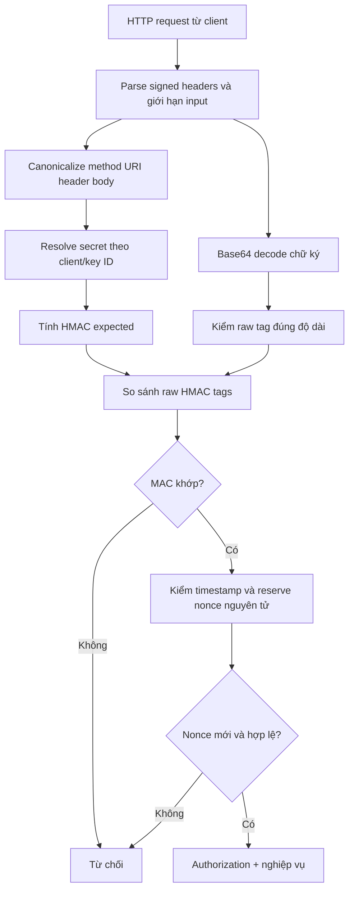

# Code review comparison

## 1. Mục tiêu: review đúng điểm so sánh chữ ký HMAC

Trong xác thực HTTP request bằng HMAC, client tạo một **canonical request** từ phương thức, URI, các header và/hoặc body, sau đó tính MAC bằng shared secret. Server xây dựng lại canonical request từ HTTP request thực nhận, tự tính MAC kỳ vọng, rồi so sánh với chữ ký do client cung cấp.

Một pull request có thể trông hợp lý:

```java
byte[] expected = hmac(secret, canonicalRequestBytes);
byte[] received = Base64.getDecoder().decode(signatureHeader);

if (Arrays.equals(expected, received)) {
    // Cho phép request tiếp tục.
}
```

Nhưng khi review phần **comparison**, cần hỏi: hàm so sánh có thể dừng ngay ở byte đầu khác nhau không? Độ dài tag có được cưỡng chế không? Hai phía đang so **byte MAC** hay **chuỗi Base64**? HMAC có được tính từ dữ liệu đáng tin cậy không? Và sau khi MAC khớp, timestamp, nonce, key rotation, authorization có bị bỏ qua không?

Trong chương **Constant-time comparison** của mô-đun **`SECURITY_AUTHENTICATION_HMAC_REQUEST_AUTHENTICATION`**, bài **Code review comparison** hướng dẫn cách đọc, đánh giá và sửa những đoạn mã so sánh liên quan đến chữ ký HMAC trong một hệ thống HTTP. Mô-đun bao quát HMAC với shared secret, canonical request gồm method/URI/header/body, xác minh chữ ký, chống replay bằng timestamp/nonce, xoay khóa, kiểm thử proxy/gateway và phân biệt xác thực với phân quyền.

**Mục tiêu sau bài học:**

- Nhận diện **early-exit comparison**, so sánh chuỗi và lỗi tag rút gọn không có hợp đồng.
- Hiểu ý nghĩa và giới hạn của `MessageDigest.isEqual(...)` trong Java.
- Review trọn luồng **Base64 → full tag → expected HMAC → compare → replay/authorization**.
- Sửa một verifier Java 17 minh họa để kiểm định dạng và so sánh raw MAC bytes.
- Viết kiểm thử cho tag sai ở đầu/giữa/cuối, sai độ dài, Base64 không chính tắc và chống replay.
- Đưa nhận xét review cụ thể, có **độ ưu tiên và bằng chứng**, thay vì chỉ nhận xét “đoạn này không constant-time”.

## 2. Timing leak là gì và review theo threat model nào?

**Timing side channel** xuất hiện khi thời gian chạy của một thao tác phụ thuộc vào thông tin mà đối thủ không nên biết. Với MAC verification, điều cần tránh là đường so sánh **dừng sớm theo vị trí byte đầu tiên không khớp**. Một kẻ tấn công có khả năng gửi nhiều chữ ký thử và đo thời gian đủ chính xác có thể khai thác những khác biệt có cấu trúc.

Ví dụ về vòng lặp dễ bị timing leak:

```java
static boolean badCompare(byte[] expected, byte[] received) {
    if (expected.length != received.length) {
        return false;
    }
    for (int i = 0; i < expected.length; i++) {
        if (expected[i] != received[i]) {
            return false; // Dừng tại vị trí khác biệt đầu tiên.
        }
    }
    return true;
}
```

Nếu candidate sai ở byte đầu, vòng lặp kiểm tra rất ít byte. Nếu trùng nhiều byte đầu, vòng lặp chạy lâu hơn. **Khả năng khai thác thực tế** phụ thuộc ứng dụng, tốc độ thử, mức jitter mạng, load, CPU/JIT và các hàng rào vận hành; không nên khẳng định mọi hàm `equals` dẫn ngay đến một cuộc tấn công thực tế. Tuy vậy, so sánh MAC bằng primitive được thiết kế để giảm rò rỉ theo nội dung là **biện pháp phòng thủ tiêu chuẩn, ít chi phí**.

### 2.1. Phạm vi mà reviewer cần quan sát



**Constant-time comparison bảo vệ một ranh giới hẹp:** phép so sánh **tag mật mã có độ dài đã cố định**. Nó **không bảo đảm toàn bộ request handler có thời gian giống nhau**. Parser, key resolver, database, signature decoding, replay store và authorization có nhánh với thời gian khác nhau.

Trong code review, hãy kết luận chính xác:

- “Phép so sánh MAC có thể thoát sớm theo vị trí sai, cần thay bằng primitive so sánh phù hợp.”
- Không kết luận “toàn bộ endpoint constant-time” chỉ vì đã dùng một hàm so sánh an toàn hơn.
- Cũng không đánh đồng timing leak với **replay**, **request canonicalization** hoặc **authorization bypass** — đây là những nhóm lỗi khác nhưng phải cùng được review.

## 3. Kiểm tra so sánh **byte MAC**, không so text đại diện

Đầu ra thực của `Mac.doFinal(...)` là **dãy byte**. `Base64` hoặc `hex` chỉ là encoding khi vận chuyển.

```text
canonicalRequestBytes --HMAC(secret)--> expectedTag: byte[32]
signatureHeader --Base64 decode------> suppliedTag: byte[32]
                                          |
                                 byte-wise MAC comparison
```

**Mẫu cần cảnh báo:**

```java
String expectedBase64 = Base64.getEncoder()
        .encodeToString(hmac(secret, canonicalBytes));

return expectedBase64.equals(signatureHeader); // BAD
```

`String.equals` là thao tác equality tổng quát, **không phải một hợp đồng so sánh thời gian ổn định đối với dữ liệu mật mã**. Một tối ưu hóa hợp lệ của `equals` có thể dừng sớm khi thấy ký tự khác, hoặc rẽ nhánh dựa vào biểu diễn nội bộ.

**Mẫu nên dùng:**

```java
byte[] expectedTag = hmac(secret, canonicalBytes);
byte[] suppliedTag = Base64.getDecoder().decode(signatureHeader);

// Phải kiểm suppliedTag có đúng 32 byte trước đoạn này.
boolean valid = MessageDigest.isEqual(expectedTag, suppliedTag);
```

Trong Java, `java.security.MessageDigest.isEqual` được thiết kế để so sánh digest bytes theo cách giảm phụ thuộc thời gian vào **nội dung** của các byte. Với Java 17 và **expectedTag có độ dài cố định**, đây là primitive tiêu chuẩn phù hợp hơn `Arrays.equals` hoặc vòng lặp tự viết.

**Giới hạn:** API không biến mọi xử lý quanh nó thành constant-time, và hành vi thực tế còn phụ thuộc JDK/provider/VM/CPU. Review vẫn phải kiểm tra **độ dài**, **định dạng**, **đường đi tới compare** và **các nhánh xử lý secret**.

## 4. Bảng anti-pattern cần tìm trong code review

| Dấu hiệu | Vì sao cần sửa? | Hướng review |
| --- | --- | --- |
| `Arrays.equals(expected, received)` cho MAC | Không hứa hẹn constant-time theo nội dung | Dùng `MessageDigest.isEqual` trên tag đúng độ dài |
| `expectedBase64.equals(header)` | So text, không phải raw MAC; không có hợp đồng chống early exit | Decode strict, kiểm format và so bytes |
| `expectedHex.equalsIgnoreCase(header)` | Vừa chấp nhận nhiều encoding, vừa so chuỗi | Cố định encoding; decode hex strict, so bytes |
| `for ... if (a[i] != b[i]) return false` | Thoát theo vị trí sai đầu tiên | Dùng JDK primitive được khuyến nghị |
| `Arrays.mismatch(expected, received) == -1` | Trả về vị trí sai đầu tiên, không phù hợp cho MAC | Không dùng cho secrets |
| `String.compareTo(...) == 0` | So sánh có thể phụ thuộc prefix | Không dùng cho MAC |
| `Objects.equals(expectedString, receivedString)` | Ủy nhiệm cho equality không dành cho MAC | So raw tags |
| `expected == received` cho `byte[]` | So **identity** của mảng, không so nội dung | So raw bytes theo API đúng |
| `Arrays.copyOf(expected, received.length)` | Cho phép attacker chọn độ dài tag cần so sánh | Server cố định full tag 32 byte |
| `expected[0] == received[0]` | Chỉ xác minh một byte | Kiểm toàn bộ tag theo hợp đồng |
| Chỉ `Base64.getDecoder().decode(header)` | Decode được không có nghĩa chữ ký đúng hoặc format chính tắc | Kiểm length, re-encode, HMAC |
| `try { ... } catch { return true; }` | Fail-open khi lỗi crypto/decoder/store | Từ chối an toàn |
| So hash SHA-256(body) thay vì HMAC | Digest không có secret, ai cũng tạo được | HMAC trên canonical request gồm body hash |
| So nonce/timestamp như thay cho MAC | Nonce/time không chứng minh bên gửi nắm secret | Xác minh HMAC trước khi tin principal/ghi nonce |

**Lưu ý:** các hàm như `Arrays.equals` hoặc `String.equals` hoàn toàn phù hợp để so **dữ liệu công khai thông thường**, ví dụ kiểm version cấu hình. Chúng không phù hợp làm **điểm quyết định tính hợp lệ của MAC bí mật**.

## 5. Bước đầu review: xác định rõ hợp đồng chữ ký

Không nên chỉ tìm hàm comparison mà bỏ qua **protocol contract**. Reviewer cần biết server **đang kỳ vọng tag nào, dài bao nhiêu, encode thế nào**.

Trong ví dụ học tập **`HMAC-SHA256-V1`**:

| Thành phần | Hợp đồng |
| --- | --- |
| MAC algorithm | `HmacSHA256` |
| Secret | Shared secret đúng client + key ID, đang hiệu lực |
| Canonical bytes | UTF-8 của method, raw URI, selected headers, body hash theo hợp đồng |
| Tag output | HMAC-SHA-256 **đầy đủ 32 byte** |
| Wire signature | Base64 **Basic** theo RFC 4648, **có padding** |
| Độ dài text của signature | **44 ký tự ASCII**, có đúng **một dấu `=` cuối** |
| Header | `X-Signature`, **đúng một** giá trị |
| Decoder | `Base64.getDecoder()`, không fallback sang URL/MIME |
| Kiểm chính tắc | Encode lại decoded bytes bằng Basic padded; chuỗi phải bằng input |
| So MAC | `MessageDigest.isEqual(expected32Bytes, supplied32Bytes)` |
| Sau MAC | Timestamp window + nonce nguyên tử + key policy + authorization |

Với 32 byte tag, phép tính độ dài Base64:

```text
32 bytes = 10 nhóm 3 byte + 2 byte dư
         = 10 * 4 + 4 = 44 ký tự
         = 43 ký tự dữ liệu + một '='
```

**Không được để attacker chọn tag length** từ độ dài header. Nếu hệ thống hỗ trợ tag rút gọn 16 byte theo một phiên bản khác, nó phải được cấu hình **rõ** với chính sách bảo mật và độ dài cố định của phiên bản đó. Không tự thử 16, 24, 32 byte cho tới khi một trường hợp khớp.

### 5.1. Tag length và secret length là hai tham số khác nhau

Một HMAC-SHA-256 tag đầy đủ có **32 byte** dù secret dài 20, 32 hay 64 byte. Review không được viết kiểu:

```java
if (suppliedTag.length != secret.length) {
    return false; // SAI: HMAC tag length != key length.
}
```

Tag length do **algorithm và truncation policy** quyết định; key length do **key policy** quản lý. Secret production cần entropy phù hợp, nhưng không suy số byte tag từ độ dài secret.

## 6. Lỗi nghiêm trọng: so prefix theo độ dài attacker cung cấp

Xét đoạn code:

```java
byte[] expected = hmac(secret, canonical);
byte[] received = Base64.getDecoder().decode(signatureHeader);

// BAD: độ dài MAC được quyết định từ request chưa xác thực.
return MessageDigest.isEqual(
        Arrays.copyOf(expected, received.length),
        received);
```

Vấn đề này **không được cứu bằng `MessageDigest.isEqual`**. Code lấy `received.length` làm số byte HMAC phải kiểm. Nếu attacker gửi tag 1 byte, verifier chỉ kiểm 1 byte đầu; nếu tag rỗng, có thể so hai mảng rỗng và nhận `true`.

| Supplied tag length | Số bit tag bị kiểm | Hệ quả |
| --- | ---: | --- |
| 0 byte | 0 bit | Có thể chấp nhận vô điều kiện nếu code so hai mảng rỗng |
| 1 byte | 8 bit | Xác suất đoán trúng khoảng 1/256 cho mỗi thử độc lập |
| 2 byte | 16 bit | Chỉ kiểm 16 bit |
| 16 byte | 128 bit | Có thể hợp lý trong hợp đồng riêng, nhưng **không thuộc V1** |
| 32 byte | 256 bit | Đúng độ dài full HMAC-SHA-256 V1 |
| 33 byte | Không hợp lệ | Phải từ chối |

**Sửa code:**

```java
byte[] expected = hmac(secret, canonical);
byte[] received = Base64.getDecoder().decode(signatureHeader);

if (expected.length != 32 || received.length != 32) {
    return false;
}
return MessageDigest.isEqual(expected, received);
```

Ở đây kiểm độ dài **trước** so sánh là hợp lệ: input sai độ dài là một lỗi **format công khai**, và contract chỉ chấp nhận 32 byte. Reviewer không cần cố che thời gian xử lý mọi input không đúng format bằng cùng một thời lượng; hãy **giới hạn và từ chối sớm** các input sai, rồi dùng so sánh phù hợp với **tag đúng độ dài**.

### 6.1. Dấu hiệu tương tự trong Kotlin, JavaScript và thư viện khác

Nếu code dùng `substring` trên chữ ký Base64, `slice(0, userLength)` trên raw tag hoặc một helper với parameter `length=signature.length`, cần nghi ngờ **attacker-controlled truncation**. Dù ngôn ngữ có primitive timing-safe, **độ dài vẫn phải cố định theo giao thức**.

Cách review tốt: nêu **giá trị đầu vào điều khiển được**, chỉ ra **số bit thực được kiểm**, yêu cầu một **negative test cho tag 0/1/16/31/33 byte**, rồi kiểm kết quả sau sửa.

## 7. Base64 canonicalization trong review comparison

Nhiều code review chỉ tập trung vào `MessageDigest.isEqual` mà bỏ sót **cách parse signature**. Trong HTTP, header chữ ký thường là **text**, không phải `byte[]`.

Ví dụ hai biểu diễn:

```text
Padded Base64 Basic:
GMGNFyHLvQHRH53KE9+jTILR1qc0HauQJiX06bXm1n0=

Same raw tag with padding omitted:
GMGNFyHLvQHRH53KE9+jTILR1qc0HauQJiX06bXm1n0
```

Một số Base64 decoder, trong đó có những chế độ của JDK, có thể **decode cả chuỗi thiếu padding** thành cùng byte. Nhưng nếu hợp đồng yêu cầu **Base64 Basic padded 44 ký tự**, chỉ chuỗi đầu là hợp lệ.

**Reviewer cần kiểm:**

1. Header có **đúng một giá trị** và không bị proxy gộp hai `X-Signature`.
2. Có giới hạn length **trước khi decode**.
3. Đúng Base64 Basic, không dùng MIME decoder chấp nhận line breaks/ký tự ngoài alphabet.
4. Decode thành **đúng 32 byte**.
5. Encode lại bằng `Base64.getEncoder()` và so với chuỗi đầu vào để kiểm **padding, alphabet và pad bits canonical**.
6. So raw tag bằng primitive phù hợp, không so signature text như bằng chứng HMAC.

**Phân biệt hai phép so:** `canonicalBase64.equals(signatureHeader)` là so sánh **tính chính tắc của encoding đầu vào**, không phải so sánh một giá trị MAC bí mật với expected MAC. Có thể dùng `String.equals` ở bước kiểm format; phép so nhạy cảm phải là **raw expected tag với raw supplied tag**.

### 7.1. Không dùng `trim()` để “sửa” signature

Nếu code tự `trim` whitespace, đổi `+` thành dấu cách/ngược lại, bỏ `=` hoặc thử Base64URL sau khi Basic thất bại, nó đang **nới hợp đồng ký**. Hãy xác định ranh giới HTTP parser xử lý OWS đúng quy tắc rồi kiểm format **chính xác tại ranh giới**.

```java
// BAD: không tự “làm sạch” giá trị chữ ký để tránh lỗi.
String normalized = signatureHeader.trim().replace(" ", "+");
return compareWithExpected(normalized);
```

CORS/proxy, API gateway hoặc HTTP client có thể vô tình thay ký tự header. Hướng xử lý là **kiểm thử và sửa đường vận chuyển**, không tạo nhiều fallback âm thầm tại verifier.

## 8. Java 17: helper xác minh HMAC-SHA-256 đúng phạm vi

Dưới đây là một utility **cho hợp đồng full 32-byte HMAC-SHA-256, Base64 Basic padded**. Nó nhận `canonicalBytes` đã dựng ở tầng HTTP và một `secret` đã được key resolver chọn. Hàm này **không tự** kiểm timestamp, nonce, key rotation hoặc authorization.

```java
import java.security.GeneralSecurityException;
import java.security.MessageDigest;
import java.util.Base64;
import java.util.Objects;
import javax.crypto.Mac;
import javax.crypto.spec.SecretKeySpec;

public final class HmacTagComparisonV1 {
    private static final String ALGORITHM = "HmacSHA256";
    private static final int TAG_BYTES = 32;
    private static final int PADDED_B64_CHARS = 44;

    private HmacTagComparisonV1() {}

    public static byte[] calculate(
            byte[] secret, byte[] canonicalBytes)
            throws GeneralSecurityException {

        Objects.requireNonNull(secret, "secret");
        Objects.requireNonNull(canonicalBytes, "canonicalBytes");
        if (secret.length == 0) {
            throw new IllegalArgumentException("Missing secret");
        }

        // Không chia sẻ Mac mutable giữa các request.
        Mac mac = Mac.getInstance(ALGORITHM);
        mac.init(new SecretKeySpec(secret, ALGORITHM));

        byte[] fullTag = mac.doFinal(canonicalBytes);
        if (fullTag.length != TAG_BYTES) {
            throw new GeneralSecurityException(
                    "Unexpected HMAC-SHA-256 tag length");
        }
        return fullTag;
    }

    public static String sign(
            byte[] secret, byte[] canonicalBytes)
            throws GeneralSecurityException {
        return Base64.getEncoder().encodeToString(
                calculate(secret, canonicalBytes));
    }

    public static boolean verify(
            byte[] secret, byte[] canonicalBytes,
            String signatureHeader)
            throws GeneralSecurityException {

        Objects.requireNonNull(secret, "secret");
        Objects.requireNonNull(canonicalBytes, "canonicalBytes");

        // 32 byte HMAC -> 44 ký tự Base64 Basic padded.
        if (signatureHeader == null
                || signatureHeader.length() != PADDED_B64_CHARS) {
            return false;
        }

        final byte[] supplied;
        try {
            supplied = Base64.getDecoder().decode(signatureHeader);
        } catch (IllegalArgumentException invalidBase64) {
            return false;
        }
        if (supplied.length != TAG_BYTES) {
            return false;
        }

        // Canonical Base64 guard: đúng alphabet, '=' và pad bits.
        if (!Base64.getEncoder().encodeToString(supplied)
                .equals(signatureHeader)) {
            return false;
        }

        byte[] expected = calculate(secret, canonicalBytes);

        // Chỉ hai raw tags có cùng độ dài 32 byte mới được so.
        return MessageDigest.isEqual(expected, supplied);
    }
}
```

### 8.1. Tại sao code dùng nhiều nhánh `return false`?

Đó là các **kiểm tra cú pháp công khai**: null, độ dài, Base64 lỗi, tag không đủ 32 byte. Những nhánh này **không dựa vào số byte prefix của expected MAC trùng với attacker input**.

Khi candidate có **đúng 32 byte**, phần quyết định bí mật dùng `MessageDigest.isEqual`. Đây là mục tiêu chính của **constant-time MAC comparison**, không phải cố biến cả request handler gồm parsing, key lookup và I/O thành một thao tác có thời gian cố định tuyệt đối.

### 8.2. Vì sao không tự viết hàm XOR thay cho JDK?

Một helper tự viết thường thấy:

```java
static boolean manualCompare(byte[] a, byte[] b) {
    if (a.length != b.length) return false;

    int diff = 0;
    for (int i = 0; i < a.length; i++) {
        diff |= a[i] ^ b[i];
    }
    return diff == 0;
}
```

Về mặt mã nguồn, vòng lặp không chủ đích dừng khi gặp mismatch. Tuy nhiên, reviewer không nên **tự khẳng định** compiler/JIT/hardware luôn bảo toàn đặc tính timing mình mong muốn. Trong Java thông thường, nên ưu tiên **primitive được JDK thiết kế và duy trì cho digest comparison** thay vì mã thủ công. Khi dùng thư viện crypto đã qua review, xem xét hợp đồng API cụ thể, kể cả quy tắc length.

### 8.3. Điều utility chưa làm

`HmacTagComparisonV1.verify` chỉ kiểm MAC trên **canonicalBytes do caller đưa vào**. Nó **không** chứng minh caller canonicalize đúng method, raw path/query, header, body hoặc xử lý proxy rewrite; nó **không** tra secret đang còn hiệu lực; và nó **không** ghi nonce.

Vì vậy code review chỉ chấp nhận utility này khi **tầng gọi** đã có hợp đồng rõ, xác minh MAC trước replay-store write, và tiếp tục authorization sau khi xác thực.

## 9. Review đường đi đầy đủ từ HTTP request đến compare

Một ví dụ tầng HTTP có thể dùng những bước sau (pseudocode nhằm nhấn mạnh trách nhiệm, không phải đoạn compile độc lập):

```java
// Pseudocode: HTTP adapter phải làm rõ raw request target
// và signed headers trước khi gọi HmacTagComparisonV1.

rejectDuplicateHeaders(
        "X-Client-Id", "X-Key-Id", "X-Timestamp",
        "X-Nonce", "X-Signature");

validateRequestSizeLimits();
validateContentEncodingAndBodyPolicy();

String clientId = readSingleHeader("X-Client-Id");
String keyId = readSingleHeader("X-Key-Id");
String timestamp = readSingleHeader("X-Timestamp");
String nonce = readSingleHeader("X-Nonce");
String signature = readSingleHeader("X-Signature");

if (!isAllowedTimestampSyntax(timestamp)
        || !timestampWithinWindow(timestamp, serverClock)
        || !isCanonicalNonce(nonce)) {
    rejectRequest();
}

ActiveKey active = keyResolver.resolveActive(clientId, keyId);
if (active == null) {
    rejectRequest();
}

// Phải tính trên method/URI/headers và body bytes thực nhận;
// không tin X-Original-URI hoặc Content-Hash do Internet khai.
byte[] canonicalBytes = buildCanonicalFromActualHttpRequest();

boolean valid = HmacTagComparisonV1.verify(
        active.secret(), canonicalBytes, signature);

if (!valid) {
    rejectRequest();
}

// Chỉ sau HMAC hợp lệ mới dùng principal đã xác thực để
// ghi nonce bằng atomic insert-if-absent.
if (!replayStore.reserveOnce(active.principalId(), nonce)) {
    rejectRequest();
}

authorize(active.principalId(), actualRoutedResource);
executeBusinessOperationWithIdempotency();
```

**Điểm review quan trọng:** một helper so MAC tốt vẫn có thể bị sử dụng sai nếu `canonicalBytes` được dựng từ **client-provided hash** thay vì `SHA-256(body bytes thực nhận)`, hoặc từ `URI.getPath()` đã decode khác dữ liệu sender ký. Chữ ký **chỉ bảo vệ những trường có mặt trong canonical request**.

### 9.1. Header duplicate và HTTP/2/HTTP/1.1

Tên header HTTP không phân biệt hoa/thường, nên `X-Signature` và `x-signature` là cùng tên. Một proxy có thể merge duplicate, nhưng một verifier khác lại chọn giá trị đầu hoặc cuối.

Review phải xác nhận:

- Signature header **đúng một giá trị** ở ranh giới còn nhìn thấy raw headers.
- Các signed headers `X-Client-Id`, `X-Key-Id`, `X-Timestamp`, `X-Nonce` cũng không mơ hồ.
- Gateway không tự biến đổi value, ký tự `+`, `/`, `=` hoặc header whitespace ngoài contract.
- Canonicalization dựa trên **method/public URI/body** đúng ranh giới khi HTTP/2 được chuyển tiếp thành HTTP/1.1.

Chỉ chọn một header ngẫu nhiên rồi so MAC đúng **không đủ** nếu tầng khác sử dụng header còn lại để phân quyền hoặc định tuyến.

## 10. Code review theo mức độ nghiêm trọng: bốn thay đổi minh họa

### 10.1. Tình huống A — so Base64 bằng `String.equals`

**Code trước:**

```java
String expected = Base64.getEncoder().encodeToString(
        calculateHmac(secret, canonicalBytes));

return expected.equals(signatureHeader);
```

**Nhận xét reviewer:** “`expected` là chữ ký mật mã. `String.equals` không có hợp đồng chống early exit theo nội dung tag. Đề nghị decode signature dưới đúng Base64 contract, kiểm độ dài 32 byte rồi dùng `MessageDigest.isEqual` trên raw MAC tags. Thêm test sai ở byte đầu/giữa/cuối.”

**Ưu tiên:** vấn đề timing hardening. Mức độ exploit thực tế phụ thuộc threat model và môi trường đo, nhưng sửa nhỏ và nên thực hiện.

### 10.2. Tình huống B — chấp nhận tag theo độ dài client

**Code trước:**

```java
byte[] received = Base64.getDecoder().decode(signatureHeader);
byte[] expected = calculateHmac(secret, canonicalBytes);

return MessageDigest.isEqual(
        Arrays.copyOf(expected, received.length),
        received);
```

**Nhận xét reviewer:** “Độ dài tag do attacker điều khiển. Có thể thử tag 0 byte hoặc prefix 1 byte. Hợp đồng V1 yêu cầu **đúng 32 byte**. Từ chối mọi tag rút gọn trước khi so; bổ sung negative tests cho 0, 1, 16, 31 và 33 byte.”

**Ưu tiên:** **nghiêm trọng**, vì đây là lỗi **xác thực thiếu bit**, không chỉ timing.

### 10.3. Tình huống C — chữ ký được so đúng nhưng hash body do client cung cấp

**Code trước:**

```java
String bodyHash = request.getHeader("X-Content-SHA256");
String canonical = method + "\n" + uri + "\n" + bodyHash;

return verifyHmac(secret, canonical, signatureHeader);
```

**Nhận xét reviewer:** “Verifier đang ký lại hash **do client khai báo**, chưa chứng minh hash đó tương ứng với body thực nhận. Yêu cầu tự tính SHA-256 trên raw body bytes, so với header nếu giao thức dùng header ấy, rồi dựng canonical từ digest đã xác minh. Kiểm content coding và gateway transform.”

**Ưu tiên:** **nghiêm trọng về tính toàn vẹn nội dung**, nhất là khi downstream thực thi body mà verifier không ràng buộc.

### 10.4. Tình huống D — so MAC đúng nhưng ghi nonce trước khi verify

**Code trước:**

```java
if (!replayStore.reserveOnce(clientId, nonce)) {
    return false;
}

return MessageDigest.isEqual(
        calculateHmac(secret, canonicalBytes),
        receivedTag);
```

**Nhận xét reviewer:** “Nonce và client ID trước HMAC chưa đáng tin. Request giả có thể chiếm nonce và làm request hợp lệ bị từ chối. Hãy kiểm HMAC trước, lấy authenticated principal, sau đó `reserveOnce` bằng atomic insert-if-absent. Store lỗi phải fail closed.”

**Ưu tiên:** ảnh hưởng DoS/replay control; mức độ tùy khả năng đoán nonce, quyền truy cập và policy.

### 10.5. Tình huống E — thuật toán/tag length do request quyết định

```java
String alg = request.getHeader("X-Mac-Algorithm");
int length = Integer.parseInt(
        request.getHeader("X-Tag-Length"));

Mac mac = Mac.getInstance(alg);
byte[] expected = Arrays.copyOf(
        mac.doFinal(canonicalBytes), length);
```

**Nhận xét reviewer:** “`alg` và `length` là input chưa xác thực. Không để request tự yêu cầu thuật toán yếu hơn hoặc tag ngắn hơn. Server chọn `HmacSHA256` và **32-byte full tag** từ contract version/allowlist tin cậy; mọi thay đổi protocol cần version riêng và test vector.”

**Ưu tiên:** có thể nghiêm trọng nếu mở đường giảm độ mạnh xác thực.

## 11. Constant-time comparison không tự làm toàn endpoint constant-time

Ngay cả khi `MessageDigest.isEqual` được dùng đúng, thời gian trả lời vẫn có thể khác nhau vì:

- **Key lookup:** key ID không tồn tại có thể fail trước, key tồn tại phải tính HMAC.
- **Canonicalization:** body lớn làm hash lâu hơn body rỗng; URI mơ hồ có thể bị từ chối sớm.
- **Base64 parsing:** signature sai độ dài có thể bị từ chối ngay, không cần chạy HMAC.
- **Timestamp:** request quá hạn thường bị từ chối trước compare.
- **Nonce store:** chỉ request có HMAC hợp lệ mới đi tới I/O lưu nonce.
- **Authorization:** client hợp lệ có thể bị từ chối khi thiếu scope/tenant.
- **JIT/GC/hệ điều hành:** độ trễ request mạng không chỉ phản ánh phép so tag.

Không phải mọi chênh lệch thời gian đều tiết lộ một phần của **expected MAC**. Tuy nhiên, **key existence**, principal identity, quyền riêng tư và trạng thái tài khoản có thể là dữ liệu cần bảo vệ theo threat model riêng.

### 11.1. Có cần tính dummy HMAC khi key ID không tồn tại?

Một số hệ thống muốn giảm khác biệt giữa `keyId` không tồn tại và chữ ký sai với key hợp lệ. Khi đó có thể cân nhắc **dummy-key work** với cấu hình tin cậy, tránh lộ tính tồn tại của client/key qua timing.

Nhưng đây là quyết định **threat-model và sản phẩm**:

- Không dùng dummy key để “tạo ra principal” hoặc chấp nhận request.
- Không tạo secret giả từ input do attacker cung cấp.
- Không nghĩ một nhánh dummy HMAC đã làm toàn request path constant-time.
- Cần giới hạn tốc độ, phản hồi lỗi ít tiết lộ, monitoring và review khả năng DoS.

Bài này tập trung **comparison của MAC khi đã có expected tag fixed-length**. Không nên thêm độ phức tạp dummy-key chỉ để qua một checklist hình thức.

### 11.2. Độ dài sai là public-format error, không phải MAC-prefix leak

Nếu server từ chối chuỗi 2 ký tự nhanh hơn chuỗi 44 ký tự, đó không nhất thiết là **rò rỉ nội dung HMAC**; độ dài chữ ký do client tự gửi đã là dữ liệu quan sát được.

Điều cần tránh là **hai candidate 32 byte cùng format hợp lệ** có thời gian compare thay đổi một cách hệ thống theo **số byte đầu khớp với expected MAC**. Đây mới là thuộc tính nhạy cảm mà primitive comparison được lựa chọn nhằm hạn chế.

## 12. Kiểm thử bằng golden vector độc lập

Một golden vector cho phép review chính xác ba lớp: **tính HMAC**, **encoding**, và **compare**. Có thể dùng vector HMAC-SHA-256 đã biết từ dữ liệu thử nghiệm:

```text
Key:
20 bytes, mỗi byte bằng 0x0b

Message (ASCII):
Hi There

Expected HMAC-SHA-256 (32-byte hex):
b0344c61d8db38535ca8afceaf0bf12b881dc200c9833da726e9376c2e32cff7

Expected Base64 Basic padded:
sDRMYdjbOFNcqK/OrwvxK4gdwgDJgz2nJuk3bC4yz/c=
```

Tag dài 32 byte, nên Base64 có **44 ký tự, đúng một dấu `=` cuối**. Các giá trị key/message này chỉ là **test vector công khai**; không dùng làm secret production.

### 12.1. Bộ test với JUnit 5

```java
import static org.junit.jupiter.api.Assertions.*;
import java.nio.charset.StandardCharsets;
import java.security.MessageDigest;
import java.util.Arrays;
import java.util.Base64;
import java.util.HexFormat;
import org.junit.jupiter.api.Test;

class HmacTagComparisonV1Test {
    private static final byte[] KEY = new byte[20];
    private static final byte[] MESSAGE =
            "Hi There".getBytes(StandardCharsets.US_ASCII);

    private static final String EXPECTED_B64 =
            "sDRMYdjbOFNcqK/OrwvxK4gdwgDJgz2nJuk3bC4yz/c=";

    static {
        Arrays.fill(KEY, (byte) 0x0b);
    }

    @Test
    void matchesIndependentGoldenVector() throws Exception {
        byte[] expectedRaw =
                HexFormat.of().parseHex(
                  "b0344c61d8db38535ca8afceaf0bf12b"
                + "881dc200c9833da726e9376c2e32cff7");

        assertArrayEquals(expectedRaw,
                HmacTagComparisonV1.calculate(KEY, MESSAGE));
        assertEquals(EXPECTED_B64,
                HmacTagComparisonV1.sign(KEY, MESSAGE));
        assertTrue(HmacTagComparisonV1.verify(
                KEY, MESSAGE, EXPECTED_B64));
    }

    @Test
    void mismatchesAtFirstMiddleAndLastByteFail()
            throws Exception {
        byte[] original = Base64.getDecoder().decode(EXPECTED_B64);

        for (int position : new int[] {0, 15, 31}) {
            byte[] changed = original.clone();
            changed[position] ^= 0x01;
            String candidate =
                    Base64.getEncoder().encodeToString(changed);

            assertFalse(HmacTagComparisonV1.verify(
                    KEY, MESSAGE, candidate),
                    "Changed byte at position " + position);
        }
    }

    @Test
    void rejectsMissingPaddingAndWrongAlphabet()
            throws Exception {
        assertFalse(HmacTagComparisonV1.verify(
                KEY, MESSAGE,
                EXPECTED_B64.substring(0, EXPECTED_B64.length() - 1)));

        String urlSafe = Base64.getUrlEncoder()
                .withoutPadding()
                .encodeToString(
                    Base64.getDecoder().decode(EXPECTED_B64));
        assertFalse(HmacTagComparisonV1.verify(
                KEY, MESSAGE, urlSafe));
    }

    @Test
    void rejectsTruncatedAndMalformedTags()
            throws Exception {
        byte[] raw = Base64.getDecoder().decode(EXPECTED_B64);
        for (int size : new int[] {0, 1, 16, 31, 33}) {
            byte[] supplied = Arrays.copyOf(raw, size);
            String candidate =
                    Base64.getEncoder().encodeToString(supplied);

            assertFalse(HmacTagComparisonV1.verify(
                    KEY, MESSAGE, candidate),
                    "Wrong raw tag length " + size);
        }

        assertFalse(HmacTagComparisonV1.verify(
                KEY, MESSAGE, ""));
        assertFalse(HmacTagComparisonV1.verify(
                KEY, MESSAGE, EXPECTED_B64 + "="));
    }

    @Test
    void changedCanonicalMessageFails() throws Exception {
        byte[] changed = "Hi there"
                .getBytes(StandardCharsets.US_ASCII);

        assertFalse(HmacTagComparisonV1.verify(
                KEY, changed, EXPECTED_B64));
    }
}
```

Các đoạn code yêu cầu **Java 17+** và **JUnit 5**. Theo nhiệm vụ viết tài liệu STEP 4, chúng được cung cấp như minh họa học tập; chưa chạy Gradle/test hay Content QA chuyên môn.

**Lưu ý về test timing:** những assertion trên kiểm **đúng/sai về mặt logic và format**, **không chứng minh** phép so sánh thực thi trong thời gian hằng trên CPU thực. Thuộc tính timing cần dựa vào API contract, code review, phiên bản JDK và đánh giá side-channel thích hợp.

### 12.2. Negative test cho “noncanonical pad bits”

Một decoder dễ dãi có thể chấp nhận chữ ký Base64 có **pad bits khác 0** nhưng vẫn decode thành cùng raw tag. Để bảo đảm format chính tắc, utility kiểm `re-encode equality`.

Review nên yêu cầu một test **tạo chuỗi biến thể bằng cách sửa pad bits ở ký tự dữ liệu cuối**, sao cho một decoder vẫn có thể trả raw bytes giống hệt nhưng helper `verify` **từ chối** vì chuỗi Base64 không chính tắc.

Không dùng `String.equals` của expected MAC text để “fix” lỗi này; đây là **kiểm tra định dạng Base64**, tách biệt với phép so raw MAC ở phía cuối.

## 13. Đo thời gian: phải làm gì và không nên khẳng định gì?

Một review có thể nhận được yêu cầu: “Viết unit test xác nhận constant-time.” Cần trả lời cẩn thận vì timing phụ thuộc hệ thống và dễ bị nhiễu.

**Không nên viết:**

```java
long t1 = System.nanoTime();
verify(secret, canonical, wrongAtFirstByte);
long dt1 = System.nanoTime() - t1;

long t2 = System.nanoTime();
verify(secret, canonical, wrongAtLastByte);
long dt2 = System.nanoTime() - t2;

assertEquals(dt1, dt2); // SAI: không thể đòi thời gian đo bằng nhau.
```

Một lần đo chịu ảnh hưởng của JIT warmup, GC, thread scheduling, CPU frequency scaling, cache và nhiều hoạt động khác. Kể cả 100 lần đo, kết luận “không có timing leak” vẫn không được bảo đảm.

**Quy trình có ý nghĩa hơn:**

1. Review tĩnh để xác nhận **không có early-exit theo nội dung expected MAC** ở code do nhóm kiểm soát.
2. Dùng `MessageDigest.isEqual` hoặc primitive tương đương đã được thư viện bảo mật duy trì.
3. Cưỡng chế full tag length trước compare.
4. Kiểm thử correctness với mismatch ở đầu/giữa/cuối; khẳng định đều **bị từ chối**, không khẳng định cùng nanosecond.
5. Nếu có yêu cầu đánh giá side channel mức cao, dùng benchmark/microbenchmark có phương pháp đúng (warmup, nhiều samples, thống kê, fixed CPU conditions), xét cả JVM/CPU/provider/deployment.
6. Không log secret/tag thật và không diễn giải số đo từ mạng có jitter cao như bằng chứng “hoàn toàn constant-time”.

Tài liệu này **không yêu cầu chạy benchmark**; đây là checklist hướng dẫn review.

### 13.1. Constant-time không đồng nghĩa thời gian cố định tuyệt đối

Một thuật toán so sánh có thể chạy cùng số bước theo **nội dung hai tag có độ dài cố định**, nhưng tổng thời gian vẫn biến động do môi trường. Nên diễn đạt kết quả đúng mức:

- **Đúng:** “Đã thay phép so sánh có nguy cơ early exit bằng `MessageDigest.isEqual` trên hai tag 32 byte, và có unit tests về độ dài/encoding/tampering.”
- **Không chính xác:** “Endpoint luôn đáp ứng trong đúng N microseconds.”
- **Không chính xác:** “Đã dùng `MessageDigest.isEqual` thì không còn mọi timing side channel.”

## 14. Review cả key rotation và cách chọn secret

Trong HMAC request authentication, server thường chọn secret theo `X-Client-Id` + `X-Key-Id`. Cần review thêm ngoài comparison:

- **Client ID/key ID trước HMAC chỉ là dữ liệu lookup chưa xác thực.** Không thiết lập principal dựa vào header trước khi MAC khớp.
- Resolver chỉ trả **key thuộc đúng client**, còn trong vòng đời được phép.
- **Key đã thu hồi** không được cho qua dù comparison khớp.
- Nếu có key rotation với hai key cùng hiệu lực, policy chọn đúng key theo ID; không thử mọi secret không giới hạn hoặc fallback sang key cũ đã bị thu hồi.
- Không để client tự chọn `HmacMD5`, full/tag-truncated length hoặc `Base64URL` tùy ý nếu protocol version không cho phép.
- `Mac` là object có trạng thái; không chia sẻ một instance mutable giữa nhiều request và nhiều key.
- Không log secret hoặc key material; bảo vệ cả memory handling và trace.

### 14.1. So sánh key ID với secret là hai việc khác nhau

`String.equals` cho key ID hoặc algorithm/version **là so sánh định danh/cấu hình**, không phải so expected MAC. Dù vẫn phải xem xét oracle về **sự tồn tại key** nếu đó là thông tin nhạy cảm, không nên máy móc thay mọi phép `equals` trong ứng dụng bằng `MessageDigest.isEqual`.

Review cần hỏi: **Giá trị nào đang được so?** Nó có phải một **tag mật mã mà attacker đang thử đoán** hay chỉ là input công khai được validate?

## 15. Review timestamp, nonce và phân quyền sau MAC

Một code path có comparison đúng vẫn dễ sai nếu:

```java
if (MessageDigest.isEqual(expectedTag, receivedTag)) {
    return processPayment(); // Thiếu timestamp/nonce/authz.
}
```

Đúng HMAC **không tự chống replay**. Bản sao của request đã ký có cùng expected tag và received tag. Sau comparison cần:

1. **Timestamp đã được ký** và được kiểm tra trong cửa sổ chấp nhận.
2. **Nonce được ký**, có format và entropy theo hợp đồng.
3. **Replay store dùng chung** với atomic insert-if-absent; chỉ reserve nonce **sau** khi MAC đúng.
4. TTL nonce bao trùm khoảng thời gian timestamp còn có thể được chấp nhận, kể cả future skew.
5. **Key rotation**: key của request đang còn hiệu lực theo policy.
6. **Authorization** theo principal đã xác thực và tài nguyên thực tế.
7. **Idempotency** cho các thao tác nghiệp vụ có thể retry như tạo thanh toán.

Một reviewer nên kiểm tra thứ tự thật trên **call graph**, không chỉ trong một helper:

```text
parse -> canonicalize -> compute MAC -> compare
     -> authenticated principal -> reserve nonce
     -> authorization -> business/idempotency
```

Các format checks/timestamp prechecks có thể được thực hiện sớm để tiết kiệm tài nguyên, nhưng không được **ghi nonce, xử lý nghiệp vụ hoặc cho phép quyền** dựa trên một request chưa xác minh MAC.

### 15.1. Có cần dùng constant-time để so nonce với replay key?

**Không cùng threat model.** So nonce trong replay store chủ yếu cần **tính duy nhất, atomicity, consistency và TTL**, không phải compare bí mật 256-bit của MAC. Một nonce có thể công khai; nguy cơ chính là **replay được chấp nhận hai lần**, không phải đo prefix của nonce.

Tránh đánh đồng “constant-time comparison” với việc tối ưu mọi phép so chuỗi trên hệ thống. Đặt **biện pháp đúng vào rủi ro đúng**.

## 16. Review một PR thật: thứ tự và bằng chứng cần yêu cầu

Khi nhận một PR thay đổi verification code, có thể review theo thứ tự sau.

### 16.1. Xác nhận hợp đồng trước

Yêu cầu tài liệu ghi **algorithm, tag length, Base64 variant, padding policy**, các thành phần canonical request, version, key policy, timestamp/nonce scope. Không chấp nhận mô tả “tính HMAC rồi so sánh” nếu còn thiếu các chi tiết có thể làm client/server hiểu khác nhau.

### 16.2. Tìm tất cả điểm so tag

Tìm những đoạn có `X-Signature`, `Base64.decode`, `Mac.doFinal`, `Arrays.equals`, `String.equals`, `MessageDigest.isEqual`, `compareTo` và những helper tự viết. Kiểm tra xem ứng dụng có **nhiều đường xác minh** như HTTP filter, admin endpoint, webhook hoặc batch job không.

Một đường code đã sửa `MessageDigest.isEqual` nhưng đường dự phòng vẫn dùng `String.equals` **chưa đạt yêu cầu review**.

### 16.3. Truy ngược dữ liệu đầu vào

Từ điểm `compare`, lần ngược:

- Expected tag được tính từ **secret nào**, còn hiệu lực không?
- Canonical bytes lấy từ **HTTP request thực nhận** hay từ một object đã bị parse/serialize khác?
- Có trường quan trọng nào bị loại khỏi chữ ký?
- Input Base64 có bị `trim`, `replace`, giải mã MIME hoặc chấp nhận tag ngắn không?
- Header duplicate có thể làm verifier và business dùng hai giá trị khác nhau không?
- Gateway có rewrite method/path/body hoặc xóa padding của signature không?

### 16.4. Truy xuôi kết quả compare

Sau khi MAC khớp:

- Có kiểm timestamp và nonce không?
- Có reserve nonce bằng thao tác atomic ở kho dùng chung không?
- Replay store lỗi thì có fail closed không?
- Có kiểm authorization với **authenticated principal** không?
- Có idempotency cho request có side effect không?
- Có trường hợp exception, null hoặc branch không mong muốn **đi vào đường success** không?

### 16.5. Yêu cầu bằng chứng kiểm thử

Một PR hợp lý nên có:

| Bằng chứng | Vì sao cần? |
| --- | --- |
| Golden raw HMAC vector | Phát hiện sai secret/message/algorithm |
| Base64 format tests | Phát hiện no-padding/URL alphabet/invalid pad bits |
| Tag length tests | Chặn 0/1/16/31/33-byte bypass |
| Mismatch ở đầu/giữa/cuối | Chứng minh cả ba đều bị từ chối |
| Canonicalization fixtures | Kiểm method/URI/header/body khớp từng byte |
| HTTP duplicate-header tests | Phát hiện parser/gateway mơ hồ |
| Anti-replay concurrency tests | Chặn cùng nonce qua nhiều instance |
| Key rotation tests | Đảm bảo key thu hồi không được chấp nhận |
| Authorization tests | HMAC hợp lệ không tự cấp mọi quyền |
| Error-path tests | Exception/timeout không fail open |

## 17. Checklist có thể dùng trực tiếp trong code review

Dùng checklist này để ghi chú khi duyệt PR; mỗi mục phải có bằng chứng trong code hoặc test.

- [ ] **Expected MAC** được tính bằng `HmacSHA256` từ đúng canonical bytes và secret còn hiệu lực.
- [ ] Hợp đồng chốt **full tag 32 byte**; input không được điều khiển độ dài cần kiểm.
- [ ] Chữ ký đầu vào được decode từ **Base64 Basic padded** theo đúng version.
- [ ] Header `X-Signature` và các signed headers được yêu cầu **đúng một giá trị**, không chấp nhận duplicate/merge mơ hồ.
- [ ] Base64 đầu vào có **đúng 44 ký tự**, decode thành 32 byte và pass **canonical re-encoding check**.
- [ ] Phép so quyết định HMAC là **`MessageDigest.isEqual(expected32, received32)`**, không phải `String.equals`, `Arrays.equals`, prefix check hoặc custom early-exit loop.
- [ ] Không có fallback cho tag ngắn, no-padding, thuật toán khác hoặc key đã thu hồi nếu contract không cho phép.
- [ ] `Mac` không bị chia sẻ mutable state giữa concurrent requests/key IDs.
- [ ] Canonical request bảo vệ đúng method, public URI, signed headers, timestamp, nonce và body/body hash.
- [ ] Server **tự tính body hash từ body bytes thực nhận**; không tin client-supplied digest chưa xác minh.
- [ ] Timestamp có format và cửa sổ thời gian rõ; nonce được HMAC ký và reserve **sau comparison thành công**.
- [ ] Replay store dùng **atomic insert-if-absent**, TTL đủ và fail closed khi lỗi.
- [ ] Key resolver chỉ cấp secret thuộc đúng principal/key ID còn hiệu lực.
- [ ] Authorization và idempotency thực thi sau xác thực theo tài nguyên thực sự.
- [ ] Response/log không tiết lộ secret, raw HMAC expected, detailed oracle nhạy cảm hay full signed request trong production.
- [ ] Golden vectors và negative cases đã có; không dùng timing benchmark một lần để tuyên bố “an toàn tuyệt đối”.
- [ ] Gateway/proxy không làm đổi những giá trị canonical mà sender và verifier dựa vào, hoặc có ranh giới xác minh được mô tả rõ.

**Quy trình làm việc:** reviewer nên ghi rõ **đoạn code, rủi ro, điều kiện để tái hiện, thay đổi đề nghị và test cần thêm**. Ví dụ “`Arrays.equals` trên raw HMAC, thay bằng `MessageDigest.isEqual`” có giá trị hơn một nhãn chung “crypto insecure”.

## 18. Bài tập: tìm lỗi trong sáu đoạn code

### Bài 1 — Base64 strings

```java
String expected = Base64.getEncoder().encodeToString(
        computeHmac(secret, canonicalBytes));
return expected.equals(receivedHeader);
```

Hãy xác định đối tượng so sánh và đề nghị sửa theo contract **HMAC-SHA-256 full 32 byte, Base64 Basic padded**.

### Bài 2 — Primitive tốt nhưng độ dài sai

```java
byte[] received = Base64.getDecoder().decode(header);
byte[] expected = computeHmac(secret, canonicalBytes);
return MessageDigest.isEqual(
        Arrays.copyOf(expected, received.length), received);
```

Vì sao gọi `MessageDigest.isEqual` **vẫn có thể dẫn tới bypass**? Hãy nêu ba ca test tối thiểu.

### Bài 3 — So raw bytes nhưng dùng early-exit

```java
for (int i = 0; i < 32; i++) {
    if (expected[i] != received[i]) return false;
}
return true;
```

Điều gì xảy ra khi mismatch ở byte 0, byte 15 và byte 31? Cần thay bằng primitive nào?

### Bài 4 — Bỏ qua body

```java
String suppliedDigest = request.getHeader("X-Body-SHA256");
String canonical = method + "\n" + uri + "\n" + suppliedDigest;
return verifyHmac(secret, canonical, signatureHeader);
```

Tại sao đoạn code có thể xác thực một hash do client khai báo mà **không chứng minh body thực nhận được bảo vệ**?

### Bài 5 — Comparison đúng nhưng phát lại

```java
if (!MessageDigest.isEqual(expected, received)) {
    return false;
}
return true; // Cho business xử lý ngay.
```

Phân tích rủi ro nếu cùng request được gửi hai lần trong 10 giây. Hãy đề xuất kiểm timestamp, nonce, atomic replay store và authorization.

### Bài 6 — Gateway có hai signature headers

```http
X-Signature: <valid-signature>
x-signature: <different-signature>
```

Gateway gộp hai giá trị rồi backend chọn một phần tử. Có thể kết luận “an toàn vì backend dùng `MessageDigest.isEqual`” không? Vì sao?

### Gợi ý đáp án

1. So expected Base64 String là không phù hợp cho MAC; cần decode strict, kiểm 32 byte và dùng `MessageDigest.isEqual` trên raw tags.
2. Attacker điều khiển số byte MAC được kiểm; tag 0 byte có thể dẫn tới so rỗng, tag 1 byte dễ đoán hơn nhiều, tag 16 byte không phải full V1. Test các độ dài 0, 1, 16, 31, 33.
3. Vòng lặp chạy đến vị trí mismatch rồi dừng; dùng primitive JDK cho digest comparison với tag fixed-length.
4. Server phải tự tính `SHA-256(raw body bytes)`, không tin `X-Body-SHA256` chưa đối chiếu với payload.
5. HMAC vẫn đúng cho bản sao; timestamp và **nonce đã ký** phải được kiểm, nonce reserve nguyên tử sau MAC, authorization và idempotency vẫn cần.
6. Không. Header duplicate tạo ambiguity giữa gateway, verifier và downstream; phải từ chối duplicate ở ingress trước khi chọn một giá trị.

## 19. Tổng kết

**Code review comparison trong HMAC HTTP authentication không chỉ là thay một dòng `equals`.** Trước hết phải biết **đang so expected MAC với supplied MAC**, phân biệt raw tag với Base64 text, cố định **algorithm/tag length/encoding**, và không chấp nhận tag rút gọn hoặc fallback ngoài hợp đồng.

Với **Java 17**, cách tiếp cận điển hình là: kiểm header và Base64 theo định dạng rõ ràng, decode thành **đúng 32 byte**, tính HMAC-SHA-256 từ **canonical request bytes thực nhận**, rồi dùng **`MessageDigest.isEqual`** để so **hai raw tags có độ dài cố định**. Biện pháp này giảm rủi ro so sánh thoát sớm theo **nội dung tag**, nhưng không biến toàn bộ endpoint thành constant-time tuyệt đối.

Cuối cùng, một verifier tốt vẫn phải có **timestamp và nonce chống replay, key rotation, canonical method/URI/header/body nhất quán qua proxy/gateway, fail-closed error handling và authorization độc lập**. Bằng chứng review tốt nhất là sự kết hợp **contract rõ, code không có early exit theo expected MAC, golden vectors, negative tests, integration tests và đánh giá ranh giới tin cậy** — chứ không chỉ một hàm equality có tên nghe an toàn.

