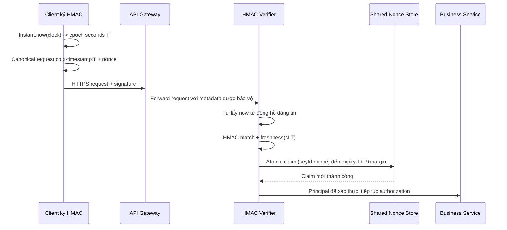

# UTC trong timestamp xác thực HMAC: ký thời điểm thống nhất, kiểm freshness đúng

> **Chương:** Timestamp  
> **Bài học:** UTC  
> **Ngữ cảnh:** Thiết kế xác thực HTTP request bằng HMAC với shared secret. Client và server dựng canonical request gồm method, URI, header hoặc body theo hợp đồng ký; timestamp hỗ trợ chống phát lại khi kết hợp nonce. Bài này giải thích vì sao cần một **mốc thời gian toàn cục**, cách biểu diễn UTC bằng Java 17+, cách kiểm cửa sổ thời gian và những lỗi thực tế qua gateway, hệ thống đa múi giờ, đồng hồ lệch và key rotation.

## 1. UTC giải quyết vấn đề gì?

Một hệ thống HMAC có thể có client ở Việt Nam, server tại châu Âu, gateway tại Mỹ và nhiều instance cùng xác minh request. Nếu mỗi máy ký hoặc kiểm timestamp bằng **giờ địa phương** (local wall-clock time) mà không kèm múi giờ, hai máy có thể hiểu **hai thời điểm khác nhau** cho cùng một chuỗi.

Ví dụ:

```text
2026-01-01 07:00:00  (giờ Việt Nam, UTC+07:00)
2026-01-01 00:00:00  (UTC)
2025-12-31 19:00:00  (New York, UTC-05:00 ở thời điểm này)
```

Ba chuỗi trên đều có thể chỉ **cùng một thời điểm**: `2026-01-01T00:00:00Z`. Chúng khác biểu diễn **giờ trên đồng hồ**, không khác thời điểm thực.

**UTC (Coordinated Universal Time)** cung cấp quy ước thời gian dùng chung giữa các hệ thống. Trong xác thực request, điều quan trọng nhất là **so sánh cùng một trục thời gian**, không phụ thuộc múi giờ hiển thị của máy client hoặc server.

Câu hỏi bảo mật không phải: “Ở máy server bây giờ là mấy giờ theo múi giờ nào?” Mà là:

> **Timestamp được ký biểu diễn thời điểm nào, và khoảng chênh lệch giữa thời điểm đó với thời điểm server nhận/xác minh request có nằm trong chính sách được phép không?**

### Các mục tiêu bài học

Sau bài này, người học có thể:

- Phân biệt **UTC**, **time zone**, **UTC offset**, `Instant` và **Unix epoch seconds**.
- Tạo timestamp độc lập múi giờ bằng Java `Instant.now(clock).getEpochSecond()`.
- Quy định **một dạng canonical timestamp** trong signing contract; không nhập nhằng giây, mili giây hoặc chuỗi ngày giờ địa phương.
- Kiểm timestamp quá cũ/quá xa tương lai, case biên và clock skew với `Clock` có thể inject.
- Ký timestamp vào HMAC; kết hợp nonce để chống phát lại thực sự.
- Thiết kế TTL replay store đúng cửa sổ thời gian và xử lý hệ thống mất đồng bộ đồng hồ.
- Kiểm thử nhiều múi giờ, DST, proxy/gateway, key rotation và phân biệt xác thực với phân quyền.

## 2. UTC, time zone, offset và `Instant` không phải một khái niệm

| Khái niệm | Ví dụ | Ý nghĩa với HTTP HMAC |
| --- | --- | --- |
| **UTC** | `2026-01-01T00:00:00Z` | Quy chiếu thời gian thống nhất để hai bên so cùng một thời điểm. |
| **UTC offset** | `+07:00`, `-05:00` | Độ lệch được ghi cùng một chuỗi ngày-giờ; không phải tên khu vực lịch sử. |
| **Time zone** | `Asia/Ho_Chi_Minh`, `America/New_York` | Tập quy tắc hiển thị lịch/ngày giờ, có thể có DST hoặc thay đổi pháp lý. |
| **LocalDateTime** | `2026-01-01T07:00:00` | **Không có offset/time zone**: một mình nó không định nghĩa đủ thời điểm toàn cục. |
| **OffsetDateTime** | `2026-01-01T07:00:00+07:00` | Ngày-giờ kèm offset, có thể đổi về `Instant`. |
| **ZonedDateTime** | `2026-01-01T07:00:00+07:00[Asia/Ho_Chi_Minh]` | Ngày-giờ có quy tắc time zone; phù hợp hiển thị/lịch. |
| **Instant** | `2026-01-01T00:00:00Z` | Một điểm trên trục thời gian; phù hợp timestamp xác thực. |
| **Unix epoch seconds** | `1767225600` | Số giây kể từ mốc epoch `1970-01-01T00:00:00Z`, độc lập time zone. |

**Ký tự `Z`** trong định dạng thời gian ISO 8601/RFC 3339 chỉ **offset bằng 0 so với UTC**. Nó không phải ký tự thần kỳ mà HMAC hiểu sẵn; đây chỉ là một cách biểu diễn timestamp.

### Cùng thời điểm, nhiều cách hiển thị

```java
import java.time.Instant;
import java.time.OffsetDateTime;
import java.time.ZoneId;
import java.time.ZoneOffset;
import java.time.ZonedDateTime;

Instant instant = Instant.parse("2026-01-01T00:00:00Z");

ZonedDateTime vietnam =
        instant.atZone(ZoneId.of("Asia/Ho_Chi_Minh"));
ZonedDateTime newYork =
        instant.atZone(ZoneId.of("America/New_York"));

System.out.println(instant);  // 2026-01-01T00:00:00Z
System.out.println(vietnam);  // 2026-01-01T07:00+07:00[Asia/Ho_Chi_Minh]
System.out.println(newYork); // 2025-12-31T19:00-05:00[America/New_York]
System.out.println(instant.getEpochSecond()); // 1767225600

OffsetDateTime offsetTime =
        OffsetDateTime.parse("2026-01-01T07:00:00+07:00");
System.out.println(offsetTime.toInstant().equals(instant)); // true
```

**Không** lấy chuỗi `LocalDateTime.now().toString()` làm timestamp HMAC nếu hợp đồng không có offset/time zone. Máy A có thể diễn giải chuỗi theo múi giờ A, máy B theo múi giờ B và coi request bị lệch nhiều giờ.

### UTC không phải “máy phải đặt time zone UTC”

Máy có thể đặt default zone là `Asia/Ho_Chi_Minh` hoặc `America/New_York` mà vẫn tạo cùng epoch seconds tại cùng một thời điểm:

```java
long signedAt = Instant.now().getEpochSecond();
```

`Instant` không lấy ý nghĩa timestamp từ `ZoneId.systemDefault()`. Do vậy **không bắt buộc đổi time zone của JVM/OS sang UTC để HMAC đúng**. Điều bắt buộc là dùng một nguồn đồng hồ đủ chính xác và chuyển về **cùng một biểu diễn thời điểm đã thỏa thuận**.

Tuy nhiên, chuẩn hóa log, monitoring và lưu trữ mốc thời gian theo UTC có ích cho vận hành, vì giảm nhầm lẫn khi đọc dấu vết đa khu vực.

## 3. Unix epoch seconds: một định dạng timestamp phù hợp với signing contract

Trong rất nhiều giao thức xác thực request tùy biến, timestamp được truyền dưới dạng **số nguyên thập phân của số giây kể từ Unix epoch**.

```text
Mốc epoch: 1970-01-01T00:00:00Z
Timestamp : 1767225600
Tương ứng : 2026-01-01T00:00:00Z
```

Ưu điểm:

- Một thời điểm cho một giá trị số nguyên, không chịu ảnh hưởng của time zone hoặc định dạng ngày tháng máy cục bộ.
- Dễ parse, kiểm độ dài và so sánh khoảng thời gian.
- Không cần chuyển `dd/MM/yyyy` hoặc giải đoán tên time zone.
- Tránh các cách biểu diễn UTC tương đương nhưng khác chuỗi trong signing input.
- Thuận tiện cho timestamp được ký nguyên văn và cho replay cache.

**Lưu ý:** Unix/POSIX time dùng quy ước đếm giây không biểu diễn leap second thành một giây đánh số riêng; Java `Instant` cung cấp API thời gian chuẩn, không nên tự tạo timestamp bằng việc parse chuỗi `23:59:60` nếu hợp đồng không quy định cách xử lý. Đối với HTTP request authentication thông thường, dùng epoch seconds nhất quán thay vì tự xử lý leap seconds.

### Seconds khác milliseconds

Đây là lỗi thực tế rất thường gặp:

```java
long epochSeconds = Instant.now().getEpochSecond();
long epochMillis = System.currentTimeMillis();
```

Cùng thời điểm trong thập niên 2020:

```text
epoch seconds      ~ 1_7xx_xxx_xxx       (10 chữ số)
epoch milliseconds ~ 1_7xx_xxx_xxx_xxx   (13 chữ số)
```

Nếu server kỳ vọng **seconds** nhưng client gửi **milliseconds**, chênh lệch không phải vài phút mà là nhiều nghìn năm. **Không tự đoán đơn vị** bằng cách “thấy số dài thì chia 1000” trong cùng phiên bản hợp đồng: cách làm đó chấp nhận nhiều dạng mơ hồ và tạo lỗi tương tác.

**Hợp đồng tốt:** quy định tường minh epoch seconds, dãy chữ số ASCII thập phân, **không dấu âm/dấu cộng, không khoảng trắng, không số thực, không leading zeros**. Ví dụ bài học cho 10–11 chữ số để minh họa giai đoạn hiện nay và một giai đoạn tương lai; API dài hạn có thể định nghĩa grammar khác nhưng không được để overflow.

## 4. Timestamp chuỗi ISO 8601/RFC 3339 có dùng được không?

Có, **nếu giao thức quy định thật chính xác**. Ví dụ:

```text
2026-01-01T00:00:00Z
2026-01-01T07:00:00+07:00
2025-12-31T19:00:00-05:00
```

Chúng có thể chỉ cùng một thời điểm. Nhưng **HMAC ký byte**, nên ba chuỗi sẽ cho **ba signing inputs khác nhau** nếu client ký nguyên văn.

Nếu muốn nhận timestamp string:

1. Chọn một định dạng duy nhất, ví dụ **UTC với `Z`**, độ chính xác tới giây, không phần thập phân.
2. Parse bằng parser nghiêm ngặt, từ chối giá trị không chuẩn hoặc có offset khác `Z` nếu hợp đồng không cho.
3. Chuẩn hóa thành **một chuỗi canonical** rồi đưa vào signing input.
4. Bảo đảm giá trị được gửi và giá trị verifier ký cùng quy tắc.
5. Kiểm trường hợp ngày/giờ không hợp lệ, leap second, fractional seconds, offset và uppercase/lowercase theo đặc tả.

Vì vậy, **không có quy tắc “timestamp HMAC bắt buộc phải là số”**. Đó là lựa chọn protocol. Bài học chọn **epoch seconds** để tránh phần lớn ambiguity của format thời gian.

### Khi nào dùng `Instant.parse`?

`Instant.parse("2026-01-01T00:00:00Z")` hữu ích cho dữ liệu test, log, lịch hoặc API được thiết kế nhận ISO time. Nó **không** thay thế parser số epoch seconds nếu contract yêu cầu `X-Timestamp: 1767225600`. Trộn hai dạng mà không có versioning tạo nhiều biểu diễn cho cùng thời điểm.

## 5. Vì sao timestamp phải được ký bằng HMAC?

Giả sử client ký request với timestamp:

```http
POST /v1/payments?orderId=42 HTTP/1.1
X-Key-Id: client-a-k1
X-Timestamp: 1767225600
X-Nonce: 64afdc80b6f94876a145087dd2e7f3f9
X-Signature: v1=<TAG>
```

Nếu timestamp **không nằm trong dữ liệu được ký**, attacker có thể thay nó bằng thời điểm hiện tại trong khi giữ tag của request cũ. Khi đó freshness check có thể bị vô hiệu hóa nếu server không ràng buộc metadata với chữ ký.

**Bất biến:** timestamp, nonce, key ID và mọi metadata ảnh hưởng quyết định chấp nhận phải được HMAC bao phủ theo hợp đồng, hoặc có một lớp bảo vệ khác được xác định rõ.

Ví dụ canonical request tối giản để diễn giải:

```text
POST
api.example.test
/v1/payments
orderId=42
content-type:application/json
x-key-id:client-a-k1
x-nonce:64afdc80b6f94876a145087dd2e7f3f9
x-timestamp:1767225600
content-type;x-key-id;x-nonce;x-timestamp
<SHA256_HEX_OF_RAW_BODY_BYTES>
```

`<SHA256_HEX_OF_RAW_BODY_BYTES>` chỉ là placeholder. Trong thực tế phải dùng digest của đúng body byte đã gửi. Prefix version, dấu xuống dòng, method/URI, header order và tag encoding là một phần của **hợp đồng ký cụ thể**, không được tự thay.

```text
bytesToSign =
    UTF8("HMAC-SHA256/UTC-TS-V1\n" + canonicalRequest)

rawTag =
    HMAC-SHA256(sharedSecretBytes, bytesToSign)

X-Signature =
    "v1=" + Base64URLNoPadding(rawTag)
```

Đổi `X-Timestamp` từ `1767225600` sang `1767225660` nhưng giữ signature cũ phải khiến **HMAC mismatch**.

**Không nhầm:** Timestamp được ký ràng buộc **thời điểm do người nắm secret khai báo**, không chứng minh một thời điểm khách quan không thể giả mạo. Client nắm shared secret có thể tự ký timestamp mới; server vẫn cần kiểm policy và quyền.

## 6. Freshness window: UTC giúp so sánh, nhưng không thay chính sách

Một verifier thường chỉ chấp nhận timestamp không quá xa so với đồng hồ server.

Đặt:

- `T`: timestamp **đã được ký**, đơn vị epoch seconds.
- `N`: thời điểm server xác minh, đơn vị epoch seconds.
- `P`: độ trễ tối đa chấp nhận trong quá khứ (past skew).
- `F`: độ lệch tương lai tối đa chấp nhận (future skew).

Điều kiện tổng quát:

\[
N - P \le T \le N + F
\]

Trong ví dụ dùng `P = F = 300` giây:

\[
|N - T| \le 300
\]

**Đây là quyết định vận hành**, không phải hằng số bắt buộc của HMAC. Cửa sổ càng rộng, request cũ càng có khả năng được thử phát lại trong thời gian dài; cửa sổ quá hẹp có thể từ chối client hợp lệ khi mạng chậm hoặc máy lệch giờ.

| Tình huống (giả sử `N = 1\,767\,225\,600`) | `T` | Chênh lệch | Kết quả với ±300 s |
| --- | ---: | ---: | --- |
| Cùng thời điểm | 1767225600 | 0 s | **Chấp nhận freshness** |
| Cũ 299 giây | 1767225301 | -299 s | **Chấp nhận freshness** |
| Cũ đúng 300 giây | 1767225300 | -300 s | **Chấp nhận nếu biên bao gồm** |
| Cũ 301 giây | 1767225299 | -301 s | **Từ chối** |
| Tương lai 300 giây | 1767225900 | +300 s | **Chấp nhận nếu biên bao gồm** |
| Tương lai 301 giây | 1767225901 | +301 s | **Từ chối** |

**Quan trọng:** “Chấp nhận freshness” **không** có nghĩa toàn request hợp lệ. HMAC, credential status, nonce uniqueness và authorization vẫn phải đạt.

### Đặt `P` và `F` riêng có lợi gì?

Không nhất thiết chấp nhận ± như nhau. Ví dụ API có thể chọn:

```text
P = 300 seconds  // cho phép độ trễ gửi, queue, network
F = 30 seconds   // hạn chế clock đi trước quá xa
```

Hợp đồng, replay TTL, tài liệu client và test fixtures phải phản ánh **hai giá trị khác nhau**. Không được ghi “±300” trong tài liệu rồi code lại dùng một khoảng khác mà không có version/policy rõ.

### Timestamp được kiểm tại thời điểm nào?

Ở HTTP server có thể có nhiều mốc:

1. Khi load balancer nhận request.
2. Khi gateway bắt đầu xử lý.
3. Khi verifier bắt đầu kiểm.
4. Sau khi tải hết body lớn.
5. Khi business handler thực thi.

Giao thức phải chọn **một điểm tin cậy** để xác định `N`. Không tin `X-Received-At` do Internet tự gửi. Nếu lấy thời gian sớm từ trusted ingress, phải bảo vệ metadata này và giải quyết request nằm trong queue lâu. Với ví dụ học tập, dùng `clock.instant()` **ngay tại verifier**.

**Không dùng `System.nanoTime()` để tạo epoch timestamp**. `nanoTime` phục vụ đo khoảng thời gian trôi qua trong một JVM, không gắn với mốc UTC epoch.

## 7. UTC không tự bảo đảm hai đồng hồ đồng bộ

Ngay cả khi client và server đều dùng UTC/`Instant`, đồng hồ vật lý của chúng vẫn có thể lệch:

- Máy client cấu hình sai giờ, đồng hồ yếu hoặc bị chỉnh tay.
- VM/container chịu thay đổi thời gian từ host.
- NTP/đồng bộ thời gian tạm mất kết nối, gây drift.
- Đồng hồ được hiệu chỉnh tiến hoặc lùi, dẫn đến request đang chờ vượt freshness window.
- Queue, latency, upload body lớn hoặc proxy thêm thời gian xử lý.
- Các verifier nodes có clock skew khác nhau; cùng request có thể pass trên node A nhưng stale trên node B.

**UTC là hệ quy chiếu, không phải dịch vụ đồng bộ đồng hồ.**

### Vận hành an toàn

1. Dùng dịch vụ đồng bộ thời gian được tổ chức cho phép (ví dụ NTP có chính sách bảo vệ nguồn thời gian), giám sát lệch giờ của host và tất cả nodes.
2. Định nghĩa error budget gồm drift, network transit và thời gian đọc/kiểm body.
3. Không giải quyết sự cố clock bằng cách **tắt freshness check**.
4. Cảnh báo khi tỷ lệ lỗi `stale_timestamp` tăng; điều tra đồng hồ, unit seconds/milliseconds, serialization và latency.
5. Kiểm server skew giữa nhiều zones và sau failover/restore máy ảo.
6. Không tin timestamp từ một header “original request time” ngoài vùng tin cậy; nếu gateway cung cấp thời gian nhận, kênh nội bộ phải bảo vệ dữ liệu.
7. Giới hạn số lượng request và body size để attacker không lợi dụng một cửa sổ lớn làm bộ nhớ nonce store phình to.

### DST (daylight saving time) không được thay đổi epoch seconds

Chuyển giờ mùa hè làm thay đổi **giờ hiển thị địa phương**, không làm một `Instant` đang có trở thành thời điểm khác. Nếu tạo timestamp bằng `LocalDateTime.now()` rồi gán time zone sau, hệ thống có thể gặp **giờ không tồn tại** hoặc **giờ lặp lại** khi DST đổi.

**Cách làm đúng:** tạo `Instant` trước, chỉ chuyển sang `ZonedDateTime` để hiển thị hoặc cho báo cáo, không dùng local calendar làm nguồn khóa xác thực.

## 8. Timestamp và nonce: hai lớp chống replay khác nhau

Timestamp giới hạn **khoảng thời gian** request có thể được chấp nhận. Nó **không tự ngăn** hai request giống hệt được gửi trong cùng khoảng.

Giả sử một request `POST` đã ký hợp lệ:

```text
keyId = client-a-k1
timestamp = 1767225600
nonce = 64afdc80b6f94876a145087dd2e7f3f9
signature = HMAC(K, canonicalRequest)
```

Attacker phát lại nguyên request sau 10 giây:

- Timestamp vẫn nằm trong freshness window.
- HMAC trên cùng bytes vẫn đúng.
- **Nonce đã dùng** phải khiến verifier từ chối nếu replay store hoạt động đúng.

| Kiểm soát | Giải quyết | Không tự giải quyết |
| --- | --- | --- |
| Signed timestamp | Giới hạn thời điểm hợp lệ. | Replay ngay trong cửa sổ. |
| Signed nonce | Ràng buộc giá trị ngẫu nhiên dùng một lần với tag. | Trùng nonce nếu không có nơi lưu. |
| Atomic shared replay store | Chỉ một lần claim `(keyId, nonce)` thành công. | Client có secret chủ động ký request mới với nonce mới. |
| Idempotency key | Hạn chế thực hiện lặp **cùng thao tác POST** sau retry hợp lệ. | Giả mạo client, HMAC hay replay nguyên request. |
| Authorization | Xác định principal có quyền với thao tác/tài nguyên. | Chữ ký có đúng hay nonce đã dùng chưa. |

**Thứ tự bảo mật:** kiểm grammar/freshness có thể làm sớm theo chính sách, nhưng **không claim nonce trước khi HMAC hợp lệ**, để tránh attacker dùng tag sai chiếm nonce thật.

## 9. TTL của nonce store và mối liên hệ với UTC timestamp

Giả sử timestamp được ký là `T`, điều kiện freshness cho phép:

\[
T \ge N - P \quad\text{và}\quad T \le N + F
\]

Viết lại theo `N` (thời điểm server):

\[
T - F \le N \le T + P
\]

Tức là **request có timestamp `T` có thể được chấp nhận từ `T-F` tới `T+P`**.

Với `P = F = 300`:

```text
Timestamp đã ký T
Thời điểm server nhận sớm nhất: T - 300
Thời điểm server nhận muộn nhất: T + 300
Tổng khoảng chấp nhận:          600 giây
```

Nếu nonce được claim ngay ở `T-300`, đặt TTL **300 giây kể từ lần claim** sẽ làm nonce hết hạn ở `T`, trong khi request vẫn hợp lệ thêm **300 giây**. Khi đó một attacker có thể phát lại request sau khi nonce hết hạn nhưng timestamp vẫn hợp lệ.

**Thiết kế tốt hơn:** lưu nonce đến ít nhất:

```text
expiresAt = signedTimestamp + pastWindowSeconds + safetyMargin
```

Trong công thức trên, `pastWindowSeconds = P` vì điều kiện muộn nhất là `N = T+P`. Với một cửa sổ tổng quát `P`/`F`, TTL tính từ thời điểm claim `N` cần bao phủ ít nhất khoảng còn lại `T+P-N`, có dự phòng hợp lý.

Ví dụ:

```text
T = 1767225600
P = F = 300
claim lúc N = T - 300
hết hạn freshness = T + 300
TTL còn cần từ claim ≈ 600 giây (+ safety margin)
```

**Chú ý:** Không được nhầm `pastWindowSeconds` với `futureWindowSeconds` khi tính hạn dùng nonce. Mốc muộn nhất `T+P` phụ thuộc **độ cũ tối đa cho phép**.

### Nhiều instance cần kho chung

Hai instance không được tự kiểm nonce bằng `HashSet` riêng; chúng có thể đều chấp nhận một bản replay. Cần **atomic insert-if-absent** trên kho có tính nhất quán phù hợp, chẳng hạn conditional insert trong DB hoặc Redis `SET ... NX` với TTL.

Kho nonce lỗi ở endpoint nhạy cảm phải **fail closed**; không bỏ replay control khi network partition.

## 10. Java 17+: ký UTC epoch seconds và kiểm freshness với `Clock`

### 10.1. Tạo timestamp sản xuất

```java
import java.security.SecureRandom;
import java.time.Clock;
import java.time.Instant;
import java.util.HexFormat;

Clock clock = Clock.systemUTC();
String timestamp = Long.toString(Instant.now(clock).getEpochSecond());

byte[] nonceBytes = new byte[16];
SecureRandom random = new SecureRandom();
random.nextBytes(nonceBytes);
String nonce = HexFormat.of().formatHex(nonceBytes);
```

Vì `Clock.systemUTC()` cho thời điểm trên cùng trục UTC, timestamp không chịu ảnh hưởng của time zone cấu hình trên JVM. Thực tế nên **inject `Clock`** vào signer/verifier thay vì gọi `Instant.now()` trực tiếp khắp nơi, để kiểm thử biên thời gian một cách quyết định.

### 10.2. Ví dụ tự chứa có HMAC và replay check

Mã bên dưới dùng **Java 17+**, chỉ thư viện chuẩn. Nó minh họa:

- Epoch seconds canonical, grammar rõ ràng, không nhận milliseconds hay ISO string tùy tiện.
- Server dựng lại canonical request rồi kiểm `HmacSHA256` trên timestamp đã ký.
- Kiểm khoảng ±300 giây bằng `Clock` inject được.
- Atomic claim nonce trong một `ConcurrentHashMap` **chỉ dùng cho test một JVM**; production cần shared store.
- Test request hợp lệ, replay, timestamp bị thay, timestamp quá cũ/quá tương lai, biên ±300, timezone khác nhau, credential bị revoke và kho nonce lỗi.
- Không cần gửi HTTP thật; phần parser method/authority/query và header occurrences được giản lược cố định theo contract.

#### Hợp đồng demo `UTC-TS-V1`

Endpoint thử chỉ chấp nhận `POST /v1/payments?orderId=42` tới `api.example.test`. Header `Content-Type` cố định là `application/json`; body được ký qua SHA-256 raw bytes. Header `X-Key-Id`, `X-Timestamp` và `X-Nonce` đều ở trong canonical input. Tag dùng `v1=` + Base64URL không padding của **32 byte HMAC-SHA256**, đúng **43 ký tự tag**.

```java
import java.nio.charset.StandardCharsets;
import java.security.GeneralSecurityException;
import java.security.MessageDigest;
import java.time.Clock;
import java.time.Instant;
import java.time.ZoneId;
import java.time.ZoneOffset;
import java.util.Base64;
import java.util.HexFormat;
import java.util.Map;
import java.util.Objects;
import java.util.concurrent.ConcurrentHashMap;
import java.util.concurrent.atomic.AtomicBoolean;
import javax.crypto.Mac;
import javax.crypto.spec.SecretKeySpec;

public final class UtcTimestampHmacDemo {
    private static final HexFormat HEX = HexFormat.of();
    private static final long PAST_SECONDS = 300L;
    private static final long FUTURE_SECONDS = 300L;
    private static final long NONCE_MARGIN_SECONDS = 30L;
    private static final String PREFIX = "HMAC-SHA256/UTC-TS-V1\n";

    private UtcTimestampHmacDemo() {}

    record Request(
            String method, String keyId, String timestamp,
            String nonce, byte[] rawBody, String signature) {
        Request {
            Objects.requireNonNull(method);
            Objects.requireNonNull(keyId);
            Objects.requireNonNull(timestamp);
            Objects.requireNonNull(nonce);
            Objects.requireNonNull(rawBody);
            Objects.requireNonNull(signature);
            rawBody = rawBody.clone();
        }
        @Override
        public byte[] rawBody() {
            return rawBody.clone();
        }
    }

    record Credential(String principal, byte[] secret, boolean active) {
        Credential {
            Objects.requireNonNull(principal);
            Objects.requireNonNull(secret);
            secret = secret.clone();
        }
        @Override
        public byte[] secret() {
            return secret.clone();
        }
    }

    enum Decision {
        ACCEPT, MALFORMED, UNAUTHENTICATED, STALE, REPLAY, UNAVAILABLE
    }

    interface NonceStore {
        // Returns true exactly once for an active (keyId, nonce).
        boolean claim(String key, long expiresAtSeconds, long nowSeconds);
    }

    // Demo một JVM: thiếu cleanup/replication; không dùng production.
    static final class LocalNonceStore implements NonceStore {
        private final ConcurrentHashMap<String, Long> seen =
                new ConcurrentHashMap<>();

        @Override
        public boolean claim(
                String key, long expiresAtSeconds, long nowSeconds) {
            if (expiresAtSeconds <= nowSeconds) return false;
            AtomicBoolean acquired = new AtomicBoolean(false);
            seen.compute(key, (ignored, previousExpiry) -> {
                if (previousExpiry == null || previousExpiry <= nowSeconds) {
                    acquired.set(true);
                    return expiresAtSeconds;
                }
                return previousExpiry;
            });
            return acquired.get();
        }
    }

    // Chọn một canonical grammar cho epoch seconds.
    // Cố ý chỉ nhận 10-11 chữ số dương, không leading zero, không dấu.
    private static long parseTimestamp(String value) {
        if (!value.matches("[1-9][0-9]{9,10}")) {
            throw new IllegalArgumentException("Noncanonical timestamp");
        }
        return Long.parseLong(value);
    }

    private static void validate(Request r) {
        if (!"POST".equals(r.method())
                || !"client-a-k1".equals(r.keyId())
                || !r.nonce().matches("[0-9a-f]{32}")
                || r.rawBody().length > 64 * 1024) {
            throw new IllegalArgumentException("Invalid request contract");
        }
        parseTimestamp(r.timestamp());
    }

    private static String canonical(Request r)
            throws GeneralSecurityException {
        validate(r);
        String bodyHash = HEX.formatHex(MessageDigest
                .getInstance("SHA-256").digest(r.rawBody()));
        // Authority, path, query, Content-Type đều cố định bằng
        // strict endpoint contract của ví dụ, không lấy từ header giả.
        return String.join("\n",
                "POST",
                "api.example.test",
                "/v1/payments",
                "orderId=42",
                "content-type:application/json",
                "x-key-id:" + r.keyId(),
                "x-nonce:" + r.nonce(),
                "x-timestamp:" + r.timestamp(),
                "content-type;x-key-id;x-nonce;x-timestamp",
                bodyHash);
    }

    private static byte[] hmac(byte[] secret, Request r)
            throws GeneralSecurityException {
        Mac mac = Mac.getInstance("HmacSHA256");
        mac.init(new SecretKeySpec(secret, "HmacSHA256"));
        String toSign = PREFIX + canonical(r);
        return mac.doFinal(toSign.getBytes(StandardCharsets.UTF_8));
    }

    private static String encodeTag(byte[] tag) {
        if (tag.length != 32) {
            throw new IllegalArgumentException("Wrong HMAC tag length");
        }
        return "v1=" + Base64.getUrlEncoder()
                .withoutPadding().encodeToString(tag);
    }

    private static byte[] decodeTag(String wire) {
        if (!wire.matches("v1=[A-Za-z0-9_-]{43}")) {
            throw new IllegalArgumentException("Bad signature grammar");
        }
        String encoded = wire.substring(3);
        byte[] tag = Base64.getUrlDecoder().decode(encoded);
        if (tag.length != 32
                || !encoded.equals(Base64.getUrlEncoder()
                    .withoutPadding().encodeToString(tag))) {
            throw new IllegalArgumentException("Noncanonical signature");
        }
        return tag;
    }

    // Chỉ để tạo test fixture: key phải đi với đúng keyId.
    static Request sign(Request r, byte[] secret)
            throws GeneralSecurityException {
        return new Request(r.method(), r.keyId(), r.timestamp(),
                r.nonce(), r.rawBody(), encodeTag(hmac(secret, r)));
    }

    static Decision verify(
            Request r, Map<String, Credential> registry,
            Clock clock, NonceStore nonceStore) {
        try {
            validate(r);
            byte[] supplied = decodeTag(r.signature());
            Credential credential = registry.get(r.keyId());
            if (credential == null || !credential.active()) {
                return Decision.UNAUTHENTICATED;
            }
            byte[] expected = hmac(credential.secret(), r);
            if (!MessageDigest.isEqual(expected, supplied)) {
                return Decision.UNAUTHENTICATED;
            }

            // Chỉ kiểm freshness SAU khi HMAC khớp trong demo này.
            long signedAt = parseTimestamp(r.timestamp());
            long now = clock.instant().getEpochSecond();
            if (signedAt < now - PAST_SECONDS
                    || signedAt > now + FUTURE_SECONDS) {
                return Decision.STALE;
            }

            // Timestamp T hợp lệ muộn nhất tại N = T + PAST.
            long expiry = signedAt
                    + PAST_SECONDS + NONCE_MARGIN_SECONDS;
            String replayKey = r.keyId() + ":" + r.nonce();

            // Claim chỉ sau signature + freshness hợp lệ.
            if (!nonceStore.claim(replayKey, expiry, now)) {
                return Decision.REPLAY;
            }
            return Decision.ACCEPT; // Authn+replay; authz còn ở tầng sau.
        } catch (IllegalArgumentException badInput) {
            return Decision.MALFORMED;
        } catch (GeneralSecurityException cryptoFailure) {
            return Decision.UNAVAILABLE; // Fail closed.
        } catch (RuntimeException infrastructureFailure) {
            return Decision.UNAVAILABLE; // Fail closed, không accept.
        }
    }

    private static void expect(Decision actual, Decision expected) {
        if (actual != expected) {
            throw new AssertionError(
                "Expected " + expected + " but got " + actual);
        }
    }

    private static Request unsigned(String timestamp) {
        return new Request(
                "POST", "client-a-k1", timestamp,
                "64afdc80b6f94876a145087dd2e7f3f9",
                "{\"amount\":100000}".getBytes(StandardCharsets.UTF_8),
                "");
    }

    public static void main(String[] args) throws Exception {
        // Public test key; tuyệt đối không dùng trong production.
        byte[] secret = HEX.parseHex(
                "000102030405060708090a0b0c0d0e0f"
              + "101112131415161718191a1b1c1d1e1f");
        Map<String, Credential> registry = Map.of(
                "client-a-k1", new Credential("client-a", secret, true));

        long fixedSeconds = 1767225600L;
        Clock fixed = Clock.fixed(
                Instant.ofEpochSecond(fixedSeconds), ZoneOffset.UTC);

        // Một thời điểm, dù hiển thị qua các vùng thời gian khác nhau.
        Clock vietnamZone = fixed.withZone(
                ZoneId.of("Asia/Ho_Chi_Minh"));
        if (!fixed.instant().equals(vietnamZone.instant())) {
            throw new AssertionError("Instant changed with time zone");
        }
        if (!"1767225600".equals(
                Long.toString(fixed.instant().getEpochSecond()))) {
            throw new AssertionError("Unexpected epoch seconds");
        }

        Request valid = sign(unsigned("1767225600"), secret);
        LocalNonceStore replay = new LocalNonceStore();
        expect(verify(valid, registry, fixed, replay), Decision.ACCEPT);
        expect(verify(valid, registry, fixed, replay), Decision.REPLAY);

        // Tên time zone không làm thay freshness calculation.
        expect(verify(valid, registry, vietnamZone,
                new LocalNonceStore()), Decision.ACCEPT);

        // Timestamp bị sửa nhưng giữ signature cũ: sai HMAC.
        Request tampered = new Request(
                valid.method(), valid.keyId(), "1767225660",
                valid.nonce(), valid.rawBody(), valid.signature());
        expect(verify(tampered, registry, fixed,
                new LocalNonceStore()), Decision.UNAUTHENTICATED);

        // Các request sau được ký lại ĐÚNG với timestamp của chúng.
        expect(verify(sign(unsigned("1767225300"), secret),
                registry, fixed, new LocalNonceStore()), Decision.ACCEPT);
        expect(verify(sign(unsigned("1767225900"), secret),
                registry, fixed, new LocalNonceStore()), Decision.ACCEPT);
        expect(verify(sign(unsigned("1767225299"), secret),
                registry, fixed, new LocalNonceStore()), Decision.STALE);
        expect(verify(sign(unsigned("1767225901"), secret),
                registry, fixed, new LocalNonceStore()), Decision.STALE);

        // Milliseconds, ISO string hoặc leading zero ngoài contract.
        expect(verify(unsigned("1767225600000"), registry,
                fixed, new LocalNonceStore()), Decision.MALFORMED);
        expect(verify(unsigned("2026-01-01T00:00:00Z"), registry,
                fixed, new LocalNonceStore()), Decision.MALFORMED);
        expect(verify(unsigned("01767225600"), registry,
                fixed, new LocalNonceStore()), Decision.MALFORMED);

        // Credential bị thu hồi: HMAC theo secret cũ vẫn không được accept.
        Map<String, Credential> revoked = Map.of(
                "client-a-k1", new Credential("client-a", secret, false));
        expect(verify(valid, revoked, fixed,
                new LocalNonceStore()), Decision.UNAUTHENTICATED);

        // Kho nonce lỗi: verifier fail closed.
        NonceStore unavailable = (key, expiry, now) -> {
            throw new IllegalStateException("Replay store unavailable");
        };
        expect(verify(valid, registry, fixed, unavailable),
                Decision.UNAVAILABLE);

        System.out.println("PASS: UTC timestamp + HMAC freshness/replay");
    }
}
```

Chạy khi bạn đã lưu đúng class name trên JDK 17+:

```bash
javac UtcTimestampHmacDemo.java
java UtcTimestampHmacDemo
```

**Các kết quả kỳ vọng:** Chương trình in `PASS: UTC timestamp + HMAC freshness/replay` nếu mọi assertion đạt. Đoạn code ở đây là ví dụ giảng dạy; việc xuất hiện trong bài **không chứng minh đã chạy kiểm thử** trên hệ thống thật.

### Những giới hạn phải hiểu

1. `Request` không chứa URI, header occurrences hay Content-Encoding động; method/authority/path/query/Content-Type được **cố định bởi hợp đồng endpoint thử nghiệm**. Một HTTP adapter thật phải kiểm đúng chúng trước khi tạo request object và **reject duplicate/malformed headers**.
2. `Map` credential là fixture. Production cần secret manager/registry, trạng thái key, môi trường, policy version, principal và kiểm authorization.
3. `LocalNonceStore` chỉ atomic trong một JVM, không giải quyết nhiều instance. Nó cũng không dọn dữ liệu hết hạn, nên không dùng production.
4. Mã không giải quyết queue/proxy transformation, nội dung JSON không hợp lệ, idempotency hoặc full body streaming. Các bước đó cần được kiểm ở service/gateway thật.
5. `Clock.fixed(...)` phục vụ test; client/server production dùng một đồng hồ hệ thống được đồng bộ và giám sát. **Không** dùng fixed timestamp và nonce cố định ngoài fixture.
6. `Decision.ACCEPT` trong ví dụ nghĩa là **vượt HMAC, freshness và replay**. Nó **không phải** phê duyệt nghiệp vụ: authorization và idempotency còn phải kiểm riêng.
7. Timestamp grammar 10–11 chữ số chỉ phục vụ một giai đoạn năm hợp đồng minh họa. Nếu hệ thống cần thời gian khác khoảng này, hãy version/đặc tả grammar, không tự suy đoán.

## 11. Test với Java `Clock`: biên ±300 giây và time zone

Test dùng `Clock.fixed` hữu ích hơn kiểm bằng `Thread.sleep`: ổn định, nhanh và không bị race với thời gian thực.

### 11.1. Test cases cơ bản

```java
Clock atEpoch = Clock.fixed(
        Instant.ofEpochSecond(1767225600L), ZoneOffset.UTC);

long now = atEpoch.instant().getEpochSecond(); // 1767225600

boolean valid =
        (1767225300L >= now - 300L)
        && (1767225300L <= now + 300L);
// true: request ở biên -300 giây (nếu policy inclusive)
```

Mỗi bài test **cần tag đúng cho timestamp đang dùng**; nếu chỉ sửa timestamp trên request cũ mà giữ signature, nó sẽ fail ở HMAC, không đến kiểm freshness.

### 11.2. Test chuyển múi giờ hiển thị

```java
Clock utc = Clock.fixed(
        Instant.parse("2026-01-01T00:00:00Z"),
        ZoneOffset.UTC);

Clock vietnam = utc.withZone(
        ZoneId.of("Asia/Ho_Chi_Minh"));

Clock newYork = utc.withZone(
        ZoneId.of("America/New_York"));

assert utc.instant().equals(vietnam.instant());
assert utc.instant().equals(newYork.instant());
assert utc.instant().getEpochSecond()
        == newYork.instant().getEpochSecond();
```

Test này xác nhận rằng đổi **zone hiển thị của Clock** không làm đổi `Instant`. Còn dùng `LocalDateTime.now(clock)` rồi parse theo zone khác sẽ không có bảo đảm tương tự.

### 11.3. Test DST

Chọn một thời điểm gần chuyển DST ở khu vực có daylight saving, tạo **hai `Instant` khác nhau**, kiểm `ZonedDateTime` có thể hiển thị cùng giờ local lặp nhưng offset khác. Việc timestamp HMAC trên epoch seconds phải vẫn phản ánh **hai thời điểm khác nhau**.

**Điểm quan trọng:** DST chỉ liên quan nếu bạn đang parse/format local time. Với `Instant.getEpochSecond()`, việc đổi DST không tự tạo “lùi thời gian” của con số epoch.

### 11.4. Test thời gian tiến và lùi

Mô phỏng đồng hồ verifier dịch:

```text
server N = T                  -> freshness pass
server N = T + 300            -> freshness pass (inclusive)
server N = T + 301            -> stale
server N = T - 300            -> freshness pass
server N = T - 301            -> future too far
```

Ngoài unit test, integration test phải kiểm clock skew thực giữa các instance. Một bug khó thấy là instance A chấp nhận request, instance B có clock lùi và nhận replay sau TTL của A; nếu replay store hết hạn quá sớm, request có thể được chấp nhận lại. Vì vậy TTL phải chốt dựa trên **chính sách window và độ lệch đồng hồ đáng tin**, không chỉ trên một giá trị số tùy ý.

## 12. Chính sách reject timestamp sai

Một bảng phân loại hữu ích cho HTTP verifier:

| Dạng đầu vào | Ví dụ | Hành vi mong đợi |
| --- | --- | --- |
| Thiếu timestamp | Không có `X-Timestamp` | Reject authentication/contract. |
| Header timestamp lặp | Hai dòng khác case tên header | Reject duplicate, không chọn first/last. |
| Local time không offset | `2026-01-01 07:00:00` | Reject theo contract epoch seconds. |
| ISO string dù có `Z` | `2026-01-01T00:00:00Z` | Reject trong `UTC-TS-V1`; chỉ dùng nếu giao thức khác cho phép. |
| Milliseconds | `1767225600000` | Reject sai đơn vị/grammar. |
| Dấu `+` hoặc `-` | `+1767225600`, `-1` | Reject noncanonical text. |
| Leading zeros | `01767225600` | Reject, không âm thầm sửa. |
| Khoảng trắng/CR/LF | ` 1767225600`, `1767225600\n` | Reject sau bước HTTP field parsing đáng tin. |
| Số thực / khoa học | `1767225600.0`, `1.767e9` | Reject, không parse `double`. |
| Chữ cái/Unicode digits | `now`, chữ số không thuộc `0-9` ASCII | Reject. |
| Chuỗi số quá dài | Hàng nghìn ký tự | Reject sớm để tránh CPU/memory abuse. |
| Epoch seconds đúng grammar nhưng quá cũ | `T < N-P` | Reject freshness dù HMAC đúng. |
| Epoch seconds đúng grammar nhưng quá xa tương lai | `T > N+F` | Reject freshness dù HMAC đúng. |
| Timestamp đổi nhưng signature giữ cũ | `T → T+60` | Reject HMAC trước hoặc trong verification. |
| Đồng hồ không tin cậy/không thể kiểm | Clock infrastructure lỗi | **Fail closed** theo chính sách. |

Nếu trong thiết kế cần chấp nhận UTC ISO string hoặc 13-digit epoch millis, hãy định nghĩa **version khác hoặc chính sách tương thích chính thức**, không tự parse mọi dạng “để tiện”.

### Lưu ý lỗi 401 hay 400?

Một timestamp không đúng grammar có thể được phân loại **request malformed** (4xx), còn timestamp quá hạn nhưng có HMAC đúng là **freshness failure** (thường lỗi xác thực 401 hoặc mã tương ứng theo hợp đồng).

**HTTP status không được quyết định bằng cách lộ thông tin có ích cho attacker.** API có thể gộp các lỗi HMAC/credential/freshness ra thông báo bên ngoài chung, nhưng log nội bộ vẫn phân loại `malformed_timestamp`, `stale_timestamp`, `future_timestamp`, `replay_nonce` và `bad_signature` để giám sát.

## 13. UTC timestamp qua proxy/gateway và service mesh



Những thay đổi của gateway cần lưu ý:

| Tình huống | Sai lệch có thể xảy ra | Cách kiểm soát |
| --- | --- | --- |
| Gateway đổi `X-Timestamp` hoặc format lại số | Thay signing input; tag cũ không khớp. | Không sửa signed header; nếu có rewrite, xác minh trước hoặc dùng contract/trust boundary được thiết kế riêng. |
| Proxy thêm header “received-at” | Client có thể spoof nếu tin mọi header. | Chỉ tin mốc nhận từ gateway đã được xác thực nguồn và được truyền bảo vệ. |
| Gateway rewrite method/URI/query | HMAC mismatch ngoài timestamp. | Bảo toàn covered components hoặc chọn điểm verify phù hợp. |
| Proxy giải nén hoặc serialize lại body | Hash body khác dù timestamp vẫn đúng. | Ký đúng representation tại điểm kiểm, không bỏ body digest. |
| Queue xử lý chậm | Timestamp có thể hết hạn trước khi verifier bắt đầu. | Định nghĩa thời điểm kiểm và latency budget; không mở vô hạn window. |
| Load balancer chọn verifier lệch clock | Cùng request lúc pass/lúc stale. | Giám sát/synchronize clocks mọi nodes. |
| HTTP/1.1 → HTTP/2 | Raw field syntax khác nhưng HTTP semantics không đổi. | Canonicalize theo hợp đồng, không ký raw network framing. |
| Gateway đã verify rồi chuyển principal | Backend có thể bị spoof nếu tin header Internet. | Strip header giả, bảo vệ kênh nội bộ và chặn bypass backend. |

**Không tin timezone của proxy để quyết định timestamp.** Nếu client ký **epoch seconds**, verifier chỉ cần so các `Instant`/giây epoch. Proxy có thể đặt default time zone nào cũng được nếu đồng hồ tuyệt đối đúng.

## 14. Key rotation, authentication và authorization vẫn tách riêng UTC

### 14.1. UTC và key rotation

Một request có thể dùng:

```http
X-Key-Id: client-a-k2
X-Timestamp: 1767225600
X-Nonce: 64afdc80b6f94876a145087dd2e7f3f9
X-Signature: v1=<HMAC_TAG>
```

Khi đổi `k2` sang `k3`:

- Client lấy secret mới, gửi đúng key ID mới rồi ký lại canonical request có timestamp/nonce mới.
- Server chọn secret **theo key ID đã validate** trong registry đáng tin, không thử mọi key để tìm chữ ký khớp.
- Key bị `REVOKED` hoặc `EXPIRED` phải bị từ chối dù thời gian request còn tươi và HMAC tính theo secret cũ vẫn đúng về toán học.
- `Mac.reset()` không thay key; phải `Mac.init(newKey)` hoặc dùng một `Mac` mới.
- Key version và format timestamp/signing contract version là các khái niệm khác nhau: đổi secret **không bắt buộc** đổi từ epoch seconds sang ISO string.

### 14.2. Timestamp đúng không chứng minh danh tính

Một attacker không có secret vẫn có thể gửi timestamp hiện tại và nonce trông hợp lệ. Chỉ sau khi **HMAC đúng trên dữ liệu đã ký và credential còn hiệu lực**, server mới có cơ sở xác thực principal.

Không gán principal từ `X-Key-Id` hoặc tenant ID trong body **trước khi** xác minh chữ ký.

### 14.3. Authentication đúng không cấp quyền

Giả sử client A ký HMAC hợp lệ trên:

```text
POST /v1/tenants/B/payments
X-Timestamp: <epoch seconds còn tươi>
Principal từ credential: tenant-A
```

Server có thể chấp nhận HMAC/freshness/nonce, nhưng phải **từ chối authorization** nếu A không có quyền tạo thanh toán cho tenant B.

Thứ tự logic:

```text
Validate HTTP + timestamp grammar
    -> Credential lookup + status
    -> Canonical request + HMAC verification
    -> Freshness window (UTC epoch seconds)
    -> Atomic nonce replay claim
    -> Authenticated principal
    -> Authorization(action, resource, tenant)
    -> Business/idempotency/transaction policy
```

## 15. Ma trận kiểm thử UTC timestamp trong HMAC API

Cần test cả **hàm thuần xử lý thời gian**, **verifier** và **HTTP end-to-end qua gateway**. Dùng test key/fixture; không dùng timestamp và nonce cố định trên API thật.

| # | Ca kiểm thử | Kết quả mong đợi |
| --- | --- | --- |
| 1 | `2026-01-01T00:00:00Z` và `2026-01-01T07:00:00+07:00`. | Chuyển về cùng `Instant` và epoch seconds. |
| 2 | Same Instant hiển thị ở New York và Việt Nam. | Giá trị epoch seconds giống nhau. |
| 3 | `Instant.now(clock)` với `Clock.systemUTC()`. | Sinh epoch seconds, không phụ thuộc `ZoneId.systemDefault()`. |
| 4 | Java `Clock.withZone(...)` khác zone nhưng cùng `Instant`. | Freshness giống nhau. |
| 5 | Dùng `LocalDateTime` thiếu offset thay cho epoch seconds. | Reject theo protocol; không tự suy múi giờ. |
| 6 | Gửi milliseconds 13 chữ số vào contract seconds. | Reject grammar. |
| 7 | Gửi ISO string có `Z` vào contract numeric epoch. | Reject grammar, dù string hợp lệ để hiển thị. |
| 8 | Gửi số có leading zero, dấu `+` hoặc khoảng trắng. | Reject noncanonical. |
| 9 | Gửi số thực/scientific notation/Unicode digits. | Reject timestamp grammar. |
| 10 | Gửi số quá dài gây overflow. | Reject sớm, không parse tùy tiện. |
| 11 | Timestamp bằng `N`, tag hợp lệ, nonce mới. | Qua freshness, tiếp tục authn/replay/authz. |
| 12 | Timestamp `N-300` với chính sách inclusive. | Qua freshness đúng biên. |
| 13 | Timestamp `N-301`. | Reject stale. |
| 14 | Timestamp `N+300` với chính sách inclusive. | Qua freshness đúng biên. |
| 15 | Timestamp `N+301`. | Reject future. |
| 16 | Freshness `P=300,F=30` không đối xứng. | Dùng đúng hai bound, không nhầm dấu. |
| 17 | Giữ tag cũ, sửa timestamp `T→T+60`. | HMAC mismatch; không đến nghiệp vụ. |
| 18 | Giữ body nhưng đổi nonce đã ký, giữ tag. | HMAC mismatch. |
| 19 | Request có tag đúng nhưng timestamp hết hạn. | Reject freshness, không claim nonce. |
| 20 | Request có tag đúng, timestamp tươi, nonce đã dùng. | Reject replay. |
| 21 | Hai instance nhận cùng nonce đồng thời. | Chỉ một claim nguyên tử thành công. |
| 22 | Nonce claim sớm tại `T-F`, replay tại gần `T+P`. | Nonce vẫn chưa được phép hết hạn; reject replay. |
| 23 | TTL chỉ 300 giây với window ±300 giây. | Test phát hiện rủi ro TTL ngắn. |
| 24 | Replay store không khả dụng. | Fail closed, không bypass. |
| 25 | Client clock đi trước 10 phút. | Server reject theo future window. |
| 26 | Client clock đi sau 10 phút. | Server reject theo past window. |
| 27 | Server lệch clock giữa hai vùng/instances. | Monitoring phát hiện; test xác định policy và yêu cầu đồng bộ. |
| 28 | Quãng thời gian DST thay đổi ở vùng có DST. | Epoch seconds vẫn phản ánh đúng trục thời gian, không nhầm local time lặp. |
| 29 | Proxy sửa `X-Timestamp` sau client ký. | HMAC mismatch. |
| 30 | Gateway thêm header nhận thời gian không tin cậy. | Verifier không dựa vào header client kiểm soát. |
| 31 | Gateway queue quá lâu khiến request vượt cửa sổ. | Reject theo điểm check đã quy định hoặc hợp đồng nhận thời gian ở ingress đáng tin. |
| 32 | HTTP/1.1 ↔ HTTP/2, header name đổi case. | Timestamp signed value không đổi, canonical semantics giữ nguyên. |
| 33 | Credential key ID A, tag dùng secret B. | Reject authentication dù timestamp tươi. |
| 34 | Key bị revoke sau rotation. | Reject credential dù HMAC/freshness có thể đúng. |
| 35 | HMAC đúng, timestamp đúng nhưng principal không đủ quyền. | Authorization deny. |
| 36 | Retry POST với nonce/timestamp/signature mới và cùng idempotency key. | Không tạo tác động nghiệp vụ trùng. |
| 37 | Retry POST với cùng idempotency key nhưng body khác. | Idempotency conflict theo hợp đồng. |
| 38 | Body thay đổi, giữ timestamp và signature. | HMAC mismatch khi body digest được ký. |
| 39 | URI/path/query thay đổi nhưng giữ timestamp và signature. | HMAC mismatch hoặc contract reject. |
| 40 | Mất đồng bộ đồng hồ sau failover/restore VM. | Không tự tắt freshness; cảnh báo/khôi phục clock, fail closed theo chính sách. |

### Test nào cần ưu tiên trước?

Nếu đang xây API thanh toán, ưu tiên theo thứ tự:

1. **Golden timestamp**: cùng epoch seconds dù JVM đổi default timezone.
2. **Biên freshness**: `N-P`, `N-P-1`, `N+F`, `N+F+1`.
3. **Signed timestamp**: thay một chữ số nhưng giữ tag cũ phải fail HMAC.
4. **Anti-replay**: cùng nonce ở hai instance chỉ được claim một lần.
5. **TTL**: nonce không hết hạn trước khi timestamp hết hiệu lực.
6. **Interop**: HTTP client, gateway, server dùng cùng epoch unit, parser và signed header.

## 16. Troubleshooting: “signature hợp lệ nhưng timestamp bị từ chối”

Điều tra theo thứ tự trên **fixture không chứa secret/thông tin nhạy cảm**:

```text
01. Giao thức timestamp đang dùng: epoch seconds hay ISO string?
02. Giá trị X-Timestamp đúng trên wire (không bị gateway thay)?
03. Client dùng Instant.now().getEpochSecond() hay millis?
04. Có parse LocalDateTime bằng default zone ở đâu không?
05. Client/server clocks có đồng bộ không? Skew đo được bao nhiêu?
06. Timestamp có được ký vào canonical request không?
07. Client và verifier có cùng UTF-8/LF/signing contract không?
08. Key ID -> secret, algorithm/version và credential status
09. Signature encoding Base64URL, đúng 32-byte tag
10. Freshness policy: P/F, inclusive/exclusive, điểm check
11. Server queue/body-read latency và HTTP gateway transforms
12. Nonce store: key scope, atomicity, TTL và expiry calculation
13. Authenticated principal, authorization và idempotency outcome
```

### Triệu chứng và hướng kiểm

| Triệu chứng | Nguyên nhân thường gặp | Hành động |
| --- | --- | --- |
| Tất cả request fail “timestamp future” | Client gửi epoch **milliseconds** hoặc client clock sai. | Kiểm độ dài chữ số, time sync và parser contract. |
| Lúc pass lúc fail khi load balanced | Clock skew các verifier nodes hoặc retry đổi path/header. | So clock drift mỗi node và canonical request. |
| Client ở múi giờ A pass, múi giờ B fail | Dùng `LocalDateTime`/default zone ở signing path. | Chuyển sang `Instant`/epoch seconds. |
| Timestamp mới nhưng tag mismatch | Timestamp được tạo **sau khi ký** hoặc bị interceptor thay. | Finalize metadata trước signer. |
| Request cũ được accept lại trong freshness window | Nonce store TTL ngắn/mỗi instance lưu riêng. | Shared atomic store, expiry `T+P+margin`. |
| Freshness đúng nhưng server trả 403 | Principal không đủ quyền. | Kiểm authorization, không thay timestamp để chữa. |
| HMAC hợp lệ nhưng POST tạo hai giao dịch | Retry dùng nonce mới mà thiếu idempotency. | Thiết kế idempotency key/fingerprint/transaction riêng. |

**Không log raw shared secret, signature đầy đủ hoặc body nhạy cảm**. Có thể log correlation ID, key ID đã giảm nhạy cảm nếu cần, timestamp age bucket, loại lỗi và clock drift của node với kiểm soát truy cập phù hợp.

## 17. Bài tập thực hành

### Bài tập A: chuyển thời gian giữa các múi giờ

Cho:

```text
2026-01-01T00:00:00Z
2026-01-01T07:00:00+07:00
2025-12-31T19:00:00-05:00
```

Dùng Java `Instant`/`OffsetDateTime` chứng minh ba thời điểm bằng nhau và trả về **epoch seconds**.

**Kết quả cần có:** `1767225600` cho cả ba. Không parse một chuỗi thiếu offset như `2026-01-01 07:00:00` rồi gán bừa time zone.

### Bài tập B: thiết kế TTL cho freshness bất đối xứng

Server dùng:

```text
past window P = 180 seconds
future window F = 30 seconds
timestamp T = 1767225600
```

Tìm khoảng `N` mà timestamp `T` hợp lệ.

**Đáp án hướng dẫn:**

```text
T - F <= N <= T + P
1767225570 <= N <= 1767225780
```

Nếu nonce được claim tại `N = T-F`, nó cần được giữ ít nhất tới `T+P`, tức **210 giây** tính từ lần claim sớm nhất, cộng margin. Không nhầm TTL bằng riêng `F=30` hay `P=180`.

### Bài tập C: kiểm một verifier qua gateway

Tạo fixture có HMAC đúng trên `POST`, raw body, key ID, timestamp/nonce. Kiểm qua HTTP trực tiếp và qua gateway:

- Signature đúng tại điểm xác minh, không sửa `X-Timestamp`.
- Gửi hai request cùng nonce đồng thời qua hai verifier instances.
- Giả lập một node lệch clock quá cửa sổ.
- Đổi URI/body nhưng giữ tag để xác nhận HMAC reject.
- Dùng credential đã revoke và principal thiếu quyền.

**Tiêu chí đạt:** Dữ liệu request được thực thi khớp dữ liệu đã xác minh; replay bị chặn toàn cụm; lỗi hạ tầng không fallback accept; authentication và authorization có assertions riêng.

## 18. Câu hỏi tự kiểm tra

**Câu 1.** UTC có phải một tên time zone địa phương giống `Asia/Ho_Chi_Minh` không?

*Đáp án:* Không. UTC là hệ quy chiếu thời gian toàn cầu; `Asia/Ho_Chi_Minh` là time zone có quy tắc hiển thị địa phương. `Instant` biểu diễn một thời điểm trên trục thời gian, độc lập zone hiển thị.

**Câu 2.** Vì sao `LocalDateTime.now()` không phù hợp để gửi trực tiếp làm HMAC timestamp giữa các máy?

*Đáp án:* Vì `LocalDateTime` không mang offset/time zone, nên cùng chuỗi có thể được diễn giải thành những thời điểm khác nhau. Dùng `Instant`/epoch seconds hoặc một ISO format có offset canonical đã được quy định.

**Câu 3.** Nếu server ở Việt Nam và client ở Mỹ, có cần cộng/trừ bảy giờ vào epoch seconds để ký không?

*Đáp án:* Không. Epoch seconds đã biểu diễn thời điểm trên cùng trục; **không thêm offset** vào số epoch.

**Câu 4.** Java nào tạo epoch seconds đúng cho request?

*Đáp án:* `Instant.now(clock).getEpochSecond()`, với `Clock` được inject và đồng bộ vận hành. `System.currentTimeMillis()` trả milliseconds, không trực tiếp phù hợp với hợp đồng dùng seconds.

**Câu 5.** Vì sao timestamp phải nằm trong signed headers?

*Đáp án:* Nếu không được HMAC bảo vệ, attacker có thể đổi timestamp request cũ thành thời gian mới mà giữ tag, làm mất hiệu lực freshness check.

**Câu 6.** Timestamp đã ký và còn trong ±300 giây có chống replay hoàn toàn không?

*Đáp án:* Không. Request cũ vẫn có HMAC đúng trong cửa sổ. Cần nonce được ký và replay store atomic dùng chung.

**Câu 7.** Tại sao nonce TTL 300 giây có thể sai với cửa sổ ±300 giây?

*Đáp án:* Request timestamp `T` có thể hợp lệ từ `T-300` tới `T+300` (600 giây). Nonce claim ở điểm sớm có thể hết hạn trong khi timestamp vẫn hợp lệ. Nên giữ tới ít nhất `T+P` kèm margin.

**Câu 8.** Nếu freshness dùng `P=180,F=30`, thời điểm nhận muộn nhất cho timestamp `T` là khi nào?

*Đáp án:* `N=T+P=T+180`; `F` quyết định thời điểm nhận sớm nhất `T-F`.

**Câu 9.** Đổi time zone trên `Clock` có làm thay đổi `Clock.instant()` khi cùng một nguồn thời điểm không?

*Đáp án:* Không. Zone ảnh hưởng cách diễn giải/hiển thị local time; `Instant` vẫn chỉ cùng thời điểm.

**Câu 10.** Credential bị revoke nhưng timestamp tươi và HMAC khớp theo secret cũ có được chấp nhận không?

*Đáp án:* Không. Trạng thái credential và key rotation policy là điều kiện xác thực riêng; key đã thu hồi phải bị reject.

**Câu 11.** Timestamp tươi và HMAC hợp lệ có chứng minh client được quyền ghi vào tenant B không?

*Đáp án:* Không. Authorization vẫn phải kiểm principal được xác thực có quyền trên tenant/resource và hành động cụ thể.

**Câu 12.** Retry POST với nonce mới có tự tránh thanh toán lặp không?

*Đáp án:* Không. Nonce mới giúp retry không bị coi là phát lại nguyên request cũ; cần `Idempotency-Key`, business fingerprint và transaction policy để tránh tác động nghiệp vụ trùng.

---

## Tài liệu tham khảo

- [RFC 3339 – Date and Time on the Internet: Timestamps](https://www.rfc-editor.org/rfc/rfc3339): cách biểu diễn ngày giờ có offset/UTC dạng Internet, nếu lựa chọn protocol timestamp chuỗi.
- [RFC 9110 – HTTP Semantics](https://www.rfc-editor.org/rfc/rfc9110): HTTP request fields và semantics.
- [RFC 9421 – HTTP Message Signatures](https://www.rfc-editor.org/rfc/rfc9421): covered components và signature parameters trong một chuẩn ký HTTP (khác hợp đồng tùy biến `UTC-TS-V1`).
- [RFC 2104 – HMAC](https://www.rfc-editor.org/rfc/rfc2104): nguyên lý MAC có khóa và tính toàn vẹn/xác thực thông điệp.
- [NIST SP 800-107 Revision 1](https://csrc.nist.gov/pubs/sp/800/107/r1/final): hướng dẫn bảo mật liên quan các ứng dụng thuật toán hash.
- [Oracle Java SE 17 – `Instant`](https://docs.oracle.com/en/java/javase/17/docs/api/java.base/java/time/Instant.html): epoch seconds và thời điểm tuyệt đối.
- [Oracle Java SE 17 – `Clock`](https://docs.oracle.com/en/java/javase/17/docs/api/java.base/java/time/Clock.html): nguồn đồng hồ inject được, `systemUTC` và `fixed`.
- [Oracle Java SE 17 – `ZonedDateTime`](https://docs.oracle.com/en/java/javase/17/docs/api/java.base/java/time/ZonedDateTime.html): hiển thị cùng thời điểm theo time zone.
- [Oracle Java SE 17 – `javax.crypto.Mac`](https://docs.oracle.com/en/java/javase/17/docs/api/java.base/javax/crypto/Mac.html): HMAC-SHA256 qua JCA.
- [Oracle Java SE 17 – `MessageDigest`](https://docs.oracle.com/en/java/javase/17/docs/api/java.base/java/security/MessageDigest.html): SHA-256 raw body bytes và so sánh tag bằng `isEqual`.

**Ghi nhớ:** **UTC và Unix epoch seconds cho client/server một cách biểu diễn cùng thời điểm độc lập múi giờ**; chúng không tự làm đồng hồ chính xác hay request an toàn. Trong HMAC request authentication, timestamp phải có **grammar và đơn vị thống nhất**, được **ký vào canonical request**, kiểm theo freshness window trên một `Clock` đáng tin và kết hợp **nonce store nguyên tử với TTL đủ bao phủ khoảng hợp lệ**. Qua proxy/gateway phải giữ đúng dữ liệu đã ký; credential rotation, kiểm HMAC, idempotency và **authorization** vẫn là các lớp kiểm soát riêng.
