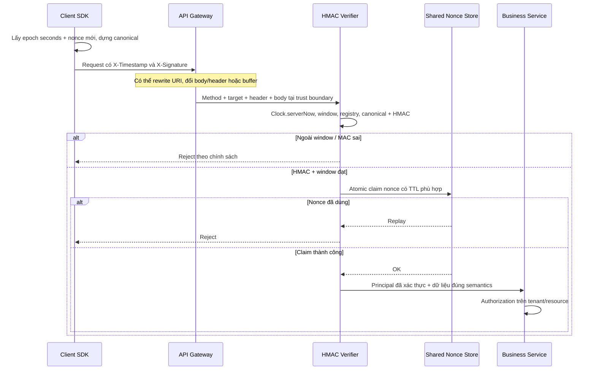

# Cửa sổ thời gian trong xác thực HTTP request bằng HMAC

## Mục tiêu học tập

Trong chương **Timestamp**, **cửa sổ thời gian** (*time window*, *freshness window*) là khoảng thời gian mà server cho phép một HTTP request đã ký được xem là **đủ mới**. Client đặt timestamp trong **canonical request** và tính HMAC với shared secret. Server xác minh HMAC, đối chiếu timestamp với đồng hồ tin cậy của mình và dùng **nonce** để phát hiện request đã được sử dụng trong khoảng còn hợp lệ.

Bài này thuộc module `SECURITY_AUTHENTICATION_HMAC_REQUEST_AUTHENTICATION`: thiết kế xác thực HTTP request bằng HMAC có **method, URI, header hoặc body** theo hợp đồng ký; kiểm tra chữ ký, chống replay bằng timestamp/nonce, quản lý key rotation, kiểm thử qua proxy/gateway và phân biệt **authentication** với **authorization**.

Sau khi học xong, bạn có thể:

- Giải thích vì sao timestamp giới hạn **thời gian có thể sử dụng** một request đã ký nhưng **không tự chặn replay** trong cửa sổ đó.
- Phân biệt thời gian server, timestamp client, **clock skew**, độ trễ mạng, Unix epoch seconds, milliseconds, thời gian UTC và timezone.
- Thiết kế cửa sổ **đối xứng** (ví dụ ±300 giây) hoặc **bất đối xứng** (ví dụ quá khứ 300 giây, tương lai 60 giây), xác định rõ biên nhận/từ chối.
- Đưa timestamp **nguyên văn theo hợp đồng** vào canonical request để không thể bị đổi mà vẫn giữ MAC đúng.
- Tính thời hạn lưu nonce phù hợp với **toàn khoảng thời gian timestamp có thể được chấp nhận**, không chỉ độ dài phía quá khứ.
- Viết Java 17 với `Clock` được tiêm vào, kiểm thử các mốc biên mà **không cần `Thread.sleep`**, và phân biệt lỗi MAC, hết cửa sổ, replay.
- Vận hành hệ thống an toàn khi clock lệch, proxy/gateway rewrite, retry/ký lại, key rotation và authorization theo tenant/tài nguyên.

## 1. Cửa sổ thời gian là gì?

Giả sử server xử lý một request ở thời điểm `now`. Request khai `X-Timestamp = t`, được ký bằng HMAC. Server áp dụng chính sách:

```text
now - allowedPastSeconds <= t <= now + allowedFutureSeconds
```

Với:

- `now`: **Unix epoch seconds** theo đồng hồ server, lấy lúc kiểm tra request.
- `t`: timestamp do client khai, nhưng chỉ được xem là đáng tin cậy khi **HMAC hợp lệ**.
- `allowedPastSeconds`: số giây tối đa cho phép request **cũ hơn** đồng hồ server.
- `allowedFutureSeconds`: số giây tối đa cho phép timestamp **đi trước** đồng hồ server.
- Dấu `<=` nghĩa là ví dụ chấp nhận **cả hai điểm biên**. API khác có thể dùng biên mở nhưng phải công bố và kiểm thử nhất quán.

Nếu một phía ký timestamp còn phía kia diễn giải khác **đơn vị** hoặc quy tắc **múi giờ**, request hợp lệ có thể bị từ chối. Nếu server bỏ kiểm tra thời gian, chữ ký bị đánh cắp có thể được gửi lại lâu hơn dự kiến. Nếu cửa sổ quá rộng, attacker có nhiều cơ hội replay; nếu quá hẹp, client có độ trễ hoặc clock lệch có thể bị từ chối nhầm.

### 1.1. Ví dụ cửa sổ bất đối xứng

Đặt thời gian server cố định:

```text
now = 1700000000      (epoch seconds, test fixture)
allowedPastSeconds   = 300
allowedFutureSeconds = 60

Khoảng chấp nhận [1699999700, 1700000060]
```

| Timestamp của request | Chênh so với server | Kết quả |
| --- | ---: | --- |
| `1699999699` | −301 giây | **Từ chối:** cũ quá 300 giây. |
| `1699999700` | −300 giây | **Chấp nhận:** đúng biên quá khứ. |
| `1699999701` | −299 giây | Chấp nhận. |
| `1700000000` | 0 giây | Chấp nhận. |
| `1700000060` | +60 giây | **Chấp nhận:** đúng biên tương lai. |
| `1700000061` | +61 giây | **Từ chối:** đi trước quá 60 giây. |

Cửa sổ này tổng cộng trải rộng **360 giây từ biên đầu tới biên cuối**, dù phía quá khứ cho phép 300 giây. Nếu chấp nhận cả hai đầu ở độ phân giải giây, có **361 giá trị timestamp nguyên** trong khoảng. Độ rộng theo thời gian và số lượng giây nguyên là hai đại lượng khác nhau; cần nói rõ khi thiết kế TTL.

### 1.2. Cửa sổ đối xứng

Chính sách thông dụng để minh họa là:

```text
abs(serverNowSeconds - signedTimestampSeconds) <= 300
```

Nó tương đương:

```text
serverNow - 300 <= signedTimestamp <= serverNow + 300
```

Cửa sổ này cho phép timestamp **đi trước tới 300 giây**, không chỉ cũ tới 300 giây. Khi chọn “±5 phút”, phải chấp nhận hệ quả về **replay horizon** và yêu cầu lưu nonce. Một lựa chọn bất đối xứng như `past=300`, `future=60` có thể giảm khả năng chấp nhận request đến từ “tương lai”, nhưng cũng tăng tỉ lệ từ chối client có clock đi nhanh.

**Không có giá trị 300 giây bắt buộc cho mọi API.** Ngân hàng, webhook, API giữa các service cùng data center hay thiết bị ngoại tuyến có thể cần chính sách khác. Giá trị phải xuất phát từ độ lệch đồng hồ đo được, latency, mô hình mối đe dọa và khả năng lưu nonce.

### 1.3. Minh họa trục thời gian

```text
                    Server now = N
                         |
       max past 300s      |        max future 60s
<------------------------|-------------->
   [N - 300]             N           [N + 60]
       |                 |               |
   BIÊN NHẬN       THỜI ĐIỂM NHẬN     BIÊN NHẬN

Nhỏ hơn N-300 => reject; lớn hơn N+60 => reject.
```

Đây là **cửa sổ chấp nhận timestamp**, không phải deadline HTTP, thời gian chờ retry, TTL business operation hay thời hạn sống của access token. Chúng là những khái niệm khác nhau cần chính sách riêng.

## 2. Unix epoch seconds, UTC, timezone và clock skew

### 2.1. Timestamp nên biểu diễn thời gian tuyệt đối

Hợp đồng ví dụ dùng **Unix epoch seconds**, tức số giây từ 1970-01-01T00:00:00Z theo thang POSIX/Unix. Trong Java:

```java
import java.time.Clock;
import java.time.Instant;

Clock clock = Clock.systemUTC();
long epochSeconds = Instant.now(clock).getEpochSecond();
String signedTimestamp = Long.toString(epochSeconds);
```

Đây là cách biểu diễn **thời điểm tuyệt đối**. Timezone của người dùng, DST hoặc cách hiển thị ngày giờ không được dùng làm phép chuyển đổi tùy ý đối với số epoch seconds.

Tránh:

```java
// SAI VỀ ĐƠN VỊ nếu server đang mong epoch seconds:
String timestamp = Long.toString(System.currentTimeMillis());

// SAI VỀ NGỮ NGHĨA nếu biến giờ địa phương thành "giờ UTC"
// mà không dùng ZoneId/Offset và hợp đồng rõ ràng:
String timestamp = java.time.LocalDateTime.now().toString();
```

`System.currentTimeMillis()` trả **milliseconds**: trong thời kỳ hiện nay thường là số 13 chữ số, trong khi epoch seconds thường khoảng 10 chữ số. Nếu backend parse millis như seconds, thời điểm sẽ cách thực tại hàng chục nghìn năm. Nếu backend chia 1000 còn client ký nguyên chuỗi millis, phải công bố đó là quy tắc **rõ ràng của hợp đồng**, không tự diễn giải “linh hoạt” khi verify.

### 2.2. UTC không đồng nghĩa không bị clock lệch

Dù client và server đều gọi `Instant.now()`, đồng hồ của chúng có thể lệch:

- Clock client nhanh hơn server 45 giây.
- Clock client chậm hơn server 90 giây.
- Server instance A và B không được đồng bộ và lệch nhau.
- Máy ảo/container được chuyển host, đồng hồ hệ điều hành bị điều chỉnh.
- Thiết bị IoT hoặc môi trường offline không thể đồng bộ NTP trong một thời gian.

**Clock skew** là sai lệch giữa các đồng hồ vật lý/logical dùng để đo thời điểm. Timezone chỉ ảnh hưởng cách trình bày giờ địa phương; đổi timezone không sửa clock skew. Một timestamp là **giây UTC tuyệt đối** vẫn có thể sai nếu clock của máy chạy nhanh/chậm.

### 2.3. Độ trễ mạng và thời gian gửi request

Giả sử:

```text
Client ký ở thời điểm thật 10:00:00Z
Network queue + TLS/gateway + body upload: 70 giây
Server nhận để verify khoảng 10:01:10Z
```

Nếu client có clock đúng, timestamp đã cũ **70 giây** khi server xác minh. Với cửa sổ quá khứ 300 giây request còn hợp lệ; với 30 giây có thể bị từ chối. Khi upload body lớn, thời điểm được tính là **khi nhận header**, **khi bắt đầu hash**, hay **khi đọc hết body** phải được API/threat model xác định. Nếu có thể giữ một request mở rất lâu, kiểm tra timestamp lúc nhận header **không đủ** để ngăn một request cũ tạo side effect nhiều giờ sau đó.

Lựa chọn triển khai có thể là: chốt `now` tại thời điểm verifier đã nhận **request đầy đủ hoặc snapshot payload hoàn chỉnh**, xác minh HMAC rồi claim nonce; áp thêm timeout tổng và deadline xử lý. Hợp đồng minh họa của bài kiểm tra tại lúc verifier xử lý **request đã được đọc đầy đủ**, tránh tạo side effect khi ký đã quá hạn trước khi commit. Các hệ thống streaming có thể chọn ranh giới khác nhưng phải có deadline tuyệt đối và không dùng timestamp-check-at-header để giữ quyền vô hạn.

### 2.4. Clock dùng cho timestamp khác đồng hồ đo khoảng thời gian

Java có hai lớp thời gian cần phân biệt:

- `Instant.now(clock)` dùng để tính **thời điểm UTC/epoch** được đưa vào HMAC và đối chiếu trên server.
- `System.nanoTime()` thường phù hợp để đo **elapsed time** và deadline/backoff trong **một tiến trình**, vì không phải epoch timestamp.

Không đặt giá trị `System.nanoTime()` vào `X-Timestamp`; nó không có epoch chung giữa client và server. Tương tự, không điều khiển retry bằng cách “tăng signed timestamp thêm 1 giây” nếu clock chưa tiến.

## 3. Vì sao phải đưa timestamp vào canonical request?

HMAC chỉ bảo vệ các byte nằm trong **thông điệp được ký**. Nếu timestamp được gửi ở header nhưng **không nằm trong canonical input**, attacker có thể thay `X-Timestamp` mà không làm đổi MAC của method/URI/body. Khi đó timestamp trở thành một trường **không được xác thực**, và cửa sổ thời gian không còn giới hạn tuổi chữ ký đúng như thiết kế.

Ví dụ dễ bị lỗi:

```text
MAC = HMAC(secret, method + "\n" + rawTarget + "\n" + bodyHash)
X-Timestamp: 1700000000          # KHÔNG có trong MAC!
```

Kẻ sở hữu một request cũ có thể thử đổi timestamp thành hiện tại rồi gửi lại. Nếu hệ thống chỉ kiểm tra chữ ký trên method/target/body, MAC **không phản ánh** timestamp đã thay đổi.

Hợp đồng đúng:

```text
canonical = join(LF, algorithm, version, audience, clientId, keyId,
                 method, rawTarget, contentType,
                 bodyHash, timestamp, nonce)
MAC = HMAC-SHA256(secret, UTF8(canonical))
```

Server phải **tự dựng canonical request từ HTTP request thực nhận**, không chỉ ký chuỗi `X-Canonical` do client cung cấp. Đổi timestamp giữ nguyên signature cũ làm expected MAC đổi và phải bị từ chối.

### 3.1. Không “sửa” timestamp trước khi ký lại ở server

Không nên tự xử lý:

```text
Nếu t ở ngoài window:
  t = now                     # tự thay timestamp client
  thử tính HMAC lại trên t
```

Hành động trên làm thay đổi giá trị **đã được client ký**. Nếu chuyển timestamp trước khi verify để “chữa” lỗi clock, client và server sẽ không còn thống nhất canonical bytes. Phải **từ chối** và để client sửa clock hoặc tạo **attempt mới với timestamp được ký lại**, theo chính sách.

### 3.2. Phân biệt timestamp header với Date và proxy headers

Một API có thể chọn `X-Timestamp`, `Date` (HTTP-date) hoặc một header custom khác. Ví dụ bài này chọn `X-Timestamp` với **epoch seconds**, không sử dụng cách parse HTTP `Date`. Hai loại có format khác nhau và không được tự coi là tương đương.

Không dùng `X-Forwarded-Date`, `X-Original-Timestamp`, `X-Request-Start` hay clock do proxy/client tự khai như một **nguồn thời gian server đáng tin** nếu hợp đồng không quy định rõ. Server cần dùng **đồng hồ của mình** khi so sánh freshness, hoặc một nguồn giờ đáng tin được đồng bộ giữa các instance. Những header từ internet có thể bị giả mạo.

## 4. Hợp đồng ký ví dụ `time-window-v1`

Không tồn tại một canonical request HMAC duy nhất cho mọi API. Để học cách áp dụng cửa sổ thời gian, bài này định nghĩa endpoint minh họa **POST tạo đơn hàng**:

```http
POST /v1/orders?tenant=merchant-42 HTTP/1.1
Host: orders.example.test
Content-Type: application/json
X-Client-Id: orders-service-prod
X-Key-Id: key-2026-11
X-Timestamp: 1700000000
X-Nonce: <base64url-of-16-random-bytes>
X-Content-SHA256: <body-sha256-base64url>
X-Signature: <hmac-sha256-base64url>

{"itemId":"sku-42","quantity":1}
```

Timestamp `1700000000` là **test fixture**, không phải giá trị còn hợp lệ ở thời điểm hiện tại. Những chuỗi trong dấu `<...>` là placeholder, phải tính từ request thực tế và secret khi gửi.

### 4.1. Canonical request 11 dòng

Các trường UTF-8 được nối bằng **chính xác một LF (`\n`)**, **không có LF cuối**:

```text
HMAC-SHA256
time-window-v1
orders-api-prod
orders-service-prod
key-2026-11
POST
/v1/orders?tenant=merchant-42
application/json
<body-sha256-base64url>
1700000000
<base64url-of-16-random-bytes>
```

| Dòng | Trường | Cách xử lý |
| --- | --- | --- |
| 1 | `HMAC-SHA256` | Nhãn thuật toán của contract; Java dùng `HmacSHA256`. |
| 2 | `time-window-v1` | Version khóa chặt cấu trúc canonical và chính sách timestamp. |
| 3 | `orders-api-prod` | Audience đến từ cấu hình đáng tin/registry, không do client tùy ý chọn. |
| 4 | Client ID | `X-Client-Id`, thuộc đúng credential, được ký. |
| 5 | Key ID | `X-Key-Id`, dùng tra đúng secret của client và được ký. |
| 6 | `POST` | Method thực tế được ký, cấm method override ngoài hợp đồng. |
| 7 | Raw target | `/v1/orders?tenant=[A-Za-z0-9_-]{1,64}`; không chuẩn hóa thêm ngoài contract. |
| 8 | `application/json` | Content-Type exact theo hợp đồng. |
| 9 | Body hash | Base64URL không padding của SHA-256 trên **exact bytes**. |
| **10** | Timestamp | **Unix epoch seconds** dạng chuỗi decimal canonical, đã được HMAC bảo vệ. |
| **11** | Nonce | **16 byte CSPRNG** biểu diễn Base64URL không padding, ký cùng request. |

Hợp đồng này dùng:

- `MAX_PAST_SECONDS = 300`, `MAX_FUTURE_SECONDS = 60`, **bao gồm điểm biên**.
- Chỉ chấp nhận `X-Timestamp` một lần, là chuỗi số thập phân không dấu, không zero đầu, không space, không `.0`, không dạng `1e9` hoặc milliseconds; giới hạn chiều dài phù hợp yêu cầu thời gian hiện hành.
- Nonce phải đúng Base64URL của 16 byte random (**22 ký tự không padding**). Chữ ký HMAC-SHA256 là **32 byte** → **43 ký tự Base64URL không padding**.
- Các trường text canonical phải đúng grammar và không chứa CR/LF. Content-Encoding của endpoint minh họa chỉ được vắng mặt hoặc là `identity`; body hash tính từ **byte content thực nhận**.
- Method, raw path/query, Content-Type, client/key ID, timestamp và nonce phải được server tự lấy từ request **tại ranh giới xác minh đáng tin**.
- Header trùng/mơ hồ, target sai grammar, body quá kích thước, encoding không cho phép phải bị từ chối. Server dùng HTTPS và có chính sách về clock sync, key status, nonce, rate limit và authorization.

### 4.2. Giá trị signed timestamp không phải hạn dùng độc lập

Timestamp chỉ trở thành điều kiện freshness khi **được HMAC xác thực** và so sánh với clock server. Một giá trị timestamp đúng trong cửa sổ nhưng MAC sai **không đủ**. Một MAC đúng nhưng timestamp nằm ngoài cửa sổ vẫn phải bị từ chối. Một MAC đúng và timestamp còn hạn **vẫn có thể là replay**, cần nonce store.

```text
AcceptedByAuthenticator =
    SupportedContract
    AND ActiveCredentialForAudience
    AND CanonicalRequestAndBodyValid
    AND HmacSignatureValid
    AND TimestampWithinWindow
    AND AtomicNonceClaimSucceeded
```

Sau đó mới đến **authorization** theo scope/tenant/resource/action và kiểm soát idempotency nghiệp vụ nếu endpoint có side effect.

## 5. Chọn ngưỡng cửa sổ một cách có căn cứ

Cửa sổ rộng làm tăng khả năng chấp nhận request có clock sai hoặc mạng chậm, nhưng cũng mở rộng **khoảng thời gian request có thể bị replay** nếu nonce protection lỗi. Cửa sổ hẹp tăng yêu cầu đồng bộ đồng hồ và giảm khả năng hoạt động khi server/network bị trễ.

| Lựa chọn | Lợi ích | Rủi ro/chi phí |
| --- | --- | --- |
| `past=30s, future=5s` | Khoảng chấp nhận ngắn. | Dễ từ chối upload chậm, mạng yếu hoặc clock lệch. |
| `past=300s, future=60s` | Dung hòa latency thực tế và sai lệch clock vừa phải. | Cần nonce TTL phủ khoảng **360s** có biên. |
| `past=300s, future=300s` | Dễ tích hợp máy có clock lệch hai chiều. | Tổng replay horizon có thể lên tới **600s**; nonce TTL tương ứng. |
| `past=900s, future=900s` | Ít false reject do clock lệch lớn. | Cửa sổ replay rất rộng, tăng tài nguyên bảo vệ và rủi ro. |

Các giá trị chỉ là **minh họa**, không phải khuyến nghị mặc định cho mọi tổ chức. Cách chọn tốt hơn là đo:

1. Phân phối `serverNow - signedTimestamp` của **request có HMAC đúng** (không lấy số liệu của request chưa xác thực làm dữ liệu clock tin cậy).
2. Độ lệch clock của từng nhóm client, proxy và server instance.
3. P95/P99/P99.9 latency giữa lúc ký và lúc verifier nhận **payload hoàn chỉnh**.
4. Số lượng retry hợp lệ, tỷ lệ request bị từ chối do quá cũ hoặc nằm trong tương lai.
5. Mức độ nhạy cảm của thao tác, số instance đồng thời, khả năng vận hành nonce store và yêu cầu lưu audit.

Từ dữ liệu trên, chọn `allowedPastSeconds`, `allowedFutureSeconds`, giới hạn upload/deadline và cơ chế cảnh báo clock skew. Nếu client liên tục lệch đồng hồ, **sửa đồng bộ thời gian** là giải pháp lâu dài; không tự tăng cửa sổ vô hạn để chữa lỗi.

### 5.1. Chính sách thời gian phải có phiên bản và cùng nghĩa ở mọi node

Khi client/SDK/server dùng những cửa sổ khác nhau, một node có thể nhận request mà node khác từ chối. Nếu thay đổi chính sách giữa các phiên bản, cần:

- Công bố rõ format và đơn vị timestamp; test vector cho biên.
- Áp dụng policy nhất quán ở gateway/verifier, có kế hoạch rollout khi thay đổi.
- Không thử nhiều biến thể diễn giải timestamp (“epoch millis hoặc seconds?”, “ISO hoặc number?”) để mong HMAC khớp.
- Không dùng timestamp do client gửi để lựa chọn một **cửa sổ tùy ý do client định nghĩa**, vì attacker có thể yêu cầu kéo dài thời hạn xác thực.

Tách biệt version của **canonicalization/format** với cấu hình độ rộng cửa sổ: thay đổi độ rộng có thể là điều chỉnh policy server, nhưng nếu thay đổi đơn vị/semantics của trường được ký thì nên có **phiên bản contract mới** và test vector tương ứng.

## 6. Timestamp và nonce: tính TTL chống replay cho đúng

### 6.1. Timestamp không có trí nhớ

Giả sử một request có timestamp còn trong cửa sổ và HMAC hợp lệ. Kẻ tấn công ghi lại **nguyên method, URI, header, body và chữ ký**, rồi phát lại sau vài giây:

```text
Attempt A (đầu tiên):
  timestamp = T
  nonce = N
  MAC = HMAC(secret, canonical(..., T, N))
  -> Timestamp hợp lệ, MAC đúng.

Attempt B (phát lại y nguyên):
  timestamp = T
  nonce = N
  MAC = MAC cũ
  -> Timestamp vẫn hợp lệ, MAC vẫn đúng.
```

Nếu server **chỉ** kiểm tra timestamp/HMAC, cả hai request có thể đi qua authentication. Timestamp giúp **giới hạn khoảng thời gian replay có thể xảy ra**, nhưng **nonce store** mới giúp biết request đã được dùng.

Để chống replay trong một hệ thống nhiều instance:

1. Client sinh nonce mới từ **CSPRNG**, ví dụ 16 byte (128 bit), ký cùng timestamp và request.
2. Server kiểm tra HMAC và cửa sổ thời gian trước khi claim nonce.
3. Ghi nonce theo một khóa có scope rõ, ví dụ `(audience, authenticatedClientId, nonce)` bằng thao tác **atomic put-if-absent** trong kho chia sẻ giữa các instance.
4. Nếu nonce đã dùng → reject; nếu kho không thể bảo đảm tính duy nhất → **fail closed** theo policy đã công bố.
5. Xóa/cho hết hạn nonce sau khi đã qua **toàn bộ replay horizon**, chứ không ngay khi lần đầu request được chấp nhận.

**Vì sao không dùng chỉ `(nonce)`?** Các client khác nhau có thể tình cờ sinh cùng nonce, làm ảnh hưởng lẫn nhau và mở nguy cơ DoS chéo. Scope theo authenticated principal và audience giúp tách tenant/service thích hợp. **Vì sao cân nhắc không đưa `keyId` vào replay key?** Khi key rotation, cùng principal có thể dùng key mới; scope theo principal giúp nonce không trở thành “dùng lại hợp lệ” chỉ vì key ID khác. Mọi quyết định scope phải nhất quán với hợp đồng security và identity registry.

### 6.2. TTL không chỉ bằng `allowedPastSeconds`

Đặt một timestamp đã ký là `t`, và cửa sổ chấp nhận theo đồng hồ server:

```text
now - P <= t <= now + F
```

Trong đó `P` = số giây cho phép **cũ** và `F` = số giây cho phép **tương lai**. Chuyển vế:

```text
t - F <= now <= t + P
```

Vì vậy **một request mang timestamp `t` có thể được chấp nhận từ thời điểm `t - F` đến `t + P`** nếu chưa bị claim nonce. Khoảng dài tối đa theo thời gian là **`P + F` giây**.

Ví dụ với `P=300` và `F=60`:

```text
t = 1700000000
Lần sớm nhất server có thể chấp nhận: 1699999940 (t-60)
Lần muộn nhất server có thể chấp nhận: 1700000300 (t+300)
Tổng chiều rộng giữa hai biên: 360 giây
```

Nếu request được **nhận và claim nonce ngay ở biên sớm nhất**, nonce phải tồn tại đủ lâu để chặn replay đến **biên muộn nhất**. Giả sử cho biên độ dự phòng 10 giây vì độ phân giải giây/độ trễ store/clock được vận hành trong giới hạn:

```text
nonceTTLSeconds >= allowedPastSeconds + allowedFutureSeconds + safetyMargin
nonceTTLSeconds >= 300 + 60 + 10 = 370 giây (ví dụ time-window-v1)
```

Với cửa sổ đối xứng ±300 giây:

```text
nonceTTLSeconds >= 300 + 300 + 10 = 610 giây (ví dụ)
```

**Sai thường gặp:** cấu hình cửa sổ `±300` nhưng TTL nonce chỉ `300s` tính từ lần claim. Nếu nonce đầu tiên được claim khi timestamp còn **đi trước server 300s**, nonce có thể hết hạn ở khoảng giữa thời gian request vẫn còn nằm trong cửa sổ; request cũ có thể bị chấp nhận lại nếu replay protection không còn ghi nhớ nó.

Số `10` chỉ là **safety margin minh họa**; cần tính thêm skew giữa verifier nodes, chính sách TTL của store, clock sync, mức tải và độ trễ queue. Nếu nhiều node có giờ khác nhau đến mức các cửa sổ không trùng, margin nhỏ không tự giải quyết được lỗi; cần **đồng bộ clock và giám sát**, không chỉ kéo dài TTL.

### 6.3. Claim phải nguyên tử và xảy ra sau HMAC

Một cách mô hình hóa:

```text
if !signatureValid: reject
if !timestampWithinWindow: reject
if !atomicClaimNonce(
    key = audience + ":" + authenticatedClient + ":" + nonce,
    ttl = 370 seconds
):
    rejectReplay
allowNextAuthorizationChecks()
```

Khi dùng Redis, một mô hình thường là **SET key value NX EX ttl** thực hiện nguyên tử (hoặc cơ chế tương đương của datastore). Không dùng hai bước `GET` rồi `SET` rời rạc, vì hai node có thể cùng nhìn thấy nonce chưa tồn tại. Cũng không claim nonce của request **MAC sai**: attacker không có secret có thể gửi nonce đoán được để chiếm slot, gây từ chối request thật.

Về thứ tự kiểm tra, có thể kiểm tra format/timestamp công khai trước HMAC để giảm CPU. Nhưng nonce **chỉ được ghi sau khi MAC hợp lệ** và key status/contract được kiểm tra. Khi tính đến nhiều key, scope theo **authenticated principal** chứ không dùng header clientId tự khai một cách mù quáng.

### 6.4. Retry hợp lệ cần timestamp/nonce/chữ ký mới

Nếu request đầu đã claim nonce rồi response bị mất, phát lại **nguyên request đã ký** sẽ bị reject dù timestamp còn trong cửa sổ. Đối với retry được API cho phép:

- Giữ cùng **logical operation**: method, raw URI, body bytes, semantic headers và **Idempotency-Key** (nếu API hỗ trợ).
- Sau khi chờ backoff/`Retry-After`, lấy **thời gian hiện tại** và nonce CSPRNG mới.
- Dựng lại canonical request, tính HMAC mới và gửi **signed attempt mới**.
- Server xử lý anti-replay theo nonce mới, nhưng dùng Idempotency-Key/transaction để tránh xử lý **cùng nghiệp vụ** hai lần.

**Timestamp không nhất thiết tăng mỗi attempt**: hai attempt được ký trong cùng một giây có thể có **cùng timestamp số nguyên**. Nonce phải mới và chữ ký phải được tính lại trên nonce đó. Đừng cố làm giả timestamp tăng khi đồng hồ thực chưa tiến; clock đúng quan trọng hơn số timestamp tăng đơn điệu.

## 7. Java 17: cửa sổ kiểm tra bằng `Clock` và HMAC-SHA256

Ví dụ Java 17 sau đây có thể lưu thành `TimestampWindowHmacDemo.java`. Nó minh họa:

- Contract `time-window-v1` với 11 dòng canonical, timestamp được ký.
- **Unix epoch seconds**; `past=300`, `future=60` và hai biên được chấp nhận.
- `Clock.fixed` để kiểm thử thời gian chính xác, không phải chờ bằng `sleep`.
- Body SHA-256 và HMAC-SHA256, so sánh raw MAC với `MessageDigest.isEqual`.
- `NonceStore` giả lập trong một tiến trình có **claim nguyên tử** và TTL 370 giây; **không** dùng như solution phân tán.
- Test replay, thay timestamp sau khi ký, milliseconds ngoài grammar và những trường hợp vượt biên.

### 7.1. Mã Java hoàn chỉnh

```java
import java.nio.charset.StandardCharsets;
import java.security.GeneralSecurityException;
import java.security.MessageDigest;
import java.security.SecureRandom;
import java.time.Clock;
import java.time.Instant;
import java.time.ZoneOffset;
import java.util.Base64;
import java.util.Objects;
import java.util.concurrent.ConcurrentHashMap;
import java.util.concurrent.ConcurrentMap;
import java.util.regex.Pattern;
import javax.crypto.Mac;
import javax.crypto.spec.SecretKeySpec;

public final class TimestampWindowHmacDemo {
    private static final long MAX_PAST = 300;
    private static final long MAX_FUTURE = 60;
    private static final long NONCE_TTL = MAX_PAST + MAX_FUTURE + 10;

    private static final String AUDIENCE = "orders-api-prod";
    private static final String CLIENT_ID = "orders-service-prod";
    private static final String KEY_ID = "key-2026-11";

    private static final Pattern TARGET = Pattern.compile(
            "/v1/orders\\?tenant=[A-Za-z0-9_-]{1,64}");
    private static final Pattern ID =
            Pattern.compile("[A-Za-z0-9_-]{1,64}");
    private static final Pattern TIMESTAMP =
            Pattern.compile("[1-9][0-9]{0,11}");
    private static final Pattern NONCE_TEXT =
            Pattern.compile("[A-Za-z0-9_-]{22}");
    private static final Pattern MAC_TEXT =
            Pattern.compile("[A-Za-z0-9_-]{43}");

    private static final Base64.Encoder B64 =
            Base64.getUrlEncoder().withoutPadding();
    private static final Base64.Decoder B64_DECODER =
            Base64.getUrlDecoder();

    private TimestampWindowHmacDemo() {}

    record RequestData(
            String method, String rawTarget, String contentType,
            byte[] body, String clientId, String keyId,
            String timestamp, String nonce) {
        RequestData {
            body = Objects.requireNonNull(body, "body").clone();
        }
        @Override public byte[] body() {
            return body.clone();
        }
    }

    record SignedHeaders(String bodyHash, String signature) {}

    enum Verdict {
        ACCEPTED,
        INVALID_INPUT,
        INVALID_CREDENTIAL,
        OUTSIDE_WINDOW,
        BAD_SIGNATURE,
        REPLAYED
    }

    // Demo có synchronized claim nguyên tử trong một JVM duy nhất.
    // Production cần datastore dùng chung (ví dụ Redis SET NX EX).
    static final class DemoNonceStore {
        private final ConcurrentMap<String, Long> expires =
                new ConcurrentHashMap<>();

        synchronized boolean claimOnce(String key, long nowSeconds,
                                       long ttlSeconds) {
            Long existing = expires.get(key);
            if (existing != null && existing > nowSeconds) {
                return false;
            }
            expires.put(key, Math.addExact(nowSeconds, ttlSeconds));
            return true;
        }
    }

    static byte[] strictDecode(String value, int textLength, int byteLength) {
        if (value == null || value.length() != textLength ||
                !value.matches("[A-Za-z0-9_-]+")) {
            throw new IllegalArgumentException("Invalid base64url format");
        }
        byte[] bytes = B64_DECODER.decode(value);
        if (bytes.length != byteLength ||
                !B64.encodeToString(bytes).equals(value)) {
            throw new IllegalArgumentException("Non-canonical base64url");
        }
        return bytes;
    }

    static void validate(RequestData r) {
        if (r == null || !"POST".equals(r.method()) ||
                !"application/json".equals(r.contentType())) {
            throw new IllegalArgumentException("Invalid method/type");
        }
        if (r.rawTarget() == null ||
                !TARGET.matcher(r.rawTarget()).matches()) {
            throw new IllegalArgumentException("Invalid raw target");
        }
        if (r.clientId() == null || !ID.matcher(r.clientId()).matches() ||
                r.keyId() == null || !ID.matcher(r.keyId()).matches()) {
            throw new IllegalArgumentException("Invalid client/key ID");
        }
        if (r.body().length > 1_048_576) {
            throw new IllegalArgumentException("Body exceeds limit");
        }
        if (r.timestamp() == null ||
                !TIMESTAMP.matcher(r.timestamp()).matches()) {
            throw new IllegalArgumentException("Invalid epoch seconds");
        }
        if (r.nonce() == null ||
                !NONCE_TEXT.matcher(r.nonce()).matches()) {
            throw new IllegalArgumentException("Invalid nonce format");
        }
        strictDecode(r.nonce(), 22, 16);
    }

    static byte[] sha256(byte[] body) throws GeneralSecurityException {
        return MessageDigest.getInstance("SHA-256").digest(body);
    }

    static String canonical(RequestData r, String bodyHash) {
        validate(r);
        return String.join("\n",
                "HMAC-SHA256", "time-window-v1", AUDIENCE,
                r.clientId(), r.keyId(), r.method(), r.rawTarget(),
                r.contentType(), bodyHash, r.timestamp(), r.nonce());
        // 11 dòng, UTF-8, LF; không LF cuối.
    }

    static byte[] computeMac(byte[] key, String canonical)
            throws GeneralSecurityException {
        Mac mac = Mac.getInstance("HmacSHA256");
        mac.init(new SecretKeySpec(key, "HmacSHA256"));
        return mac.doFinal(canonical.getBytes(StandardCharsets.UTF_8));
    }

    static SignedHeaders sign(RequestData r, byte[] key)
            throws GeneralSecurityException {
        String hash = B64.encodeToString(sha256(r.body()));
        return new SignedHeaders(hash,
                B64.encodeToString(computeMac(key, canonical(r, hash))));
    }

    static Verdict verify(RequestData r, SignedHeaders headers, byte[] key,
                          Clock serverClock, DemoNonceStore store)
            throws GeneralSecurityException {
        if (headers == null || key == null ||
                serverClock == null || store == null) {
            return Verdict.INVALID_INPUT;
        }
        try {
            validate(r);
            // Mock registry có một client và một key ACTIVE.
            if (!CLIENT_ID.equals(r.clientId()) ||
                    !KEY_ID.equals(r.keyId())) {
                return Verdict.INVALID_CREDENTIAL;
            }

            long now = Instant.now(serverClock).getEpochSecond();
            long signedTime = Long.parseLong(r.timestamp());

            // Không dùng Math.abs(now - signedTime) khi
            // input có thể dẫn tới overflow hoặc policy bất đối xứng.
            long earliest = Math.subtractExact(now, MAX_PAST);
            long latest = Math.addExact(now, MAX_FUTURE);
            if (signedTime < earliest || signedTime > latest) {
                return Verdict.OUTSIDE_WINDOW;
            }

            byte[] actualBodyHash = sha256(r.body());
            byte[] sentBodyHash = strictDecode(headers.bodyHash(), 43, 32);
            if (!MessageDigest.isEqual(actualBodyHash, sentBodyHash)) {
                return Verdict.BAD_SIGNATURE;
            }
            String hashText = B64.encodeToString(actualBodyHash);
            if (headers.signature() == null ||
                    !MAC_TEXT.matcher(headers.signature()).matches()) {
                return Verdict.INVALID_INPUT;
            }

            byte[] receivedMac = strictDecode(headers.signature(), 43, 32);
            byte[] expectedMac = computeMac(key, canonical(r, hashText));
            if (!MessageDigest.isEqual(expectedMac, receivedMac)) {
                return Verdict.BAD_SIGNATURE;
            }

            // Claim sau MAC hợp lệ, scope theo principal + audience,
            // không theo key ID để không lặp qua key rotation.
            String replayKey = AUDIENCE + "|" + r.clientId() + "|" + r.nonce();
            if (!store.claimOnce(replayKey, now, NONCE_TTL)) {
                return Verdict.REPLAYED;
            }
            return Verdict.ACCEPTED;
        } catch (IllegalArgumentException | ArithmeticException ex) {
            return Verdict.INVALID_INPUT;
        }
    }

    static String freshNonce(SecureRandom rng) {
        byte[] bytes = new byte[16];
        rng.nextBytes(bytes);
        return B64.encodeToString(bytes);
    }

    static RequestData requestAt(long epochSeconds, SecureRandom rng) {
        return new RequestData(
                "POST", "/v1/orders?tenant=merchant-42",
                "application/json",
                "{\"itemId\":\"sku-42\",\"quantity\":1}"
                        .getBytes(StandardCharsets.UTF_8),
                CLIENT_ID, KEY_ID, Long.toString(epochSeconds),
                freshNonce(rng));
    }

    static RequestData withTime(RequestData r, long newTime) {
        return new RequestData(
                r.method(), r.rawTarget(), r.contentType(),
                r.body(), r.clientId(), r.keyId(),
                Long.toString(newTime), r.nonce());
    }

    public static void main(String[] args)
            throws GeneralSecurityException {
        long fixedNow = 1_700_000_000L;
        Clock serverClock = Clock.fixed(
                Instant.ofEpochSecond(fixedNow), ZoneOffset.UTC);

        SecureRandom rng = new SecureRandom();
        byte[] secret = new byte[32];
        rng.nextBytes(secret);
        DemoNonceStore store = new DemoNonceStore();

        RequestData current = requestAt(fixedNow, rng);
        SignedHeaders currentSig = sign(current, secret);
        System.out.println("Current: " +
                verify(current, currentSig, secret, serverClock, store));
        System.out.println("Replay current: " +
                verify(current, currentSig, secret, serverClock, store));

        RequestData pastBoundary = requestAt(fixedNow - MAX_PAST, rng);
        System.out.println("Past boundary: " +
                verify(pastBoundary, sign(pastBoundary, secret),
                        secret, serverClock, store));

        RequestData tooOld = requestAt(fixedNow - MAX_PAST - 1, rng);
        System.out.println("Too old: " +
                verify(tooOld, sign(tooOld, secret),
                        secret, serverClock, store));

        RequestData futureBoundary = requestAt(fixedNow + MAX_FUTURE, rng);
        System.out.println("Future boundary: " +
                verify(futureBoundary, sign(futureBoundary, secret),
                        secret, serverClock, store));

        RequestData tooFuture = requestAt(fixedNow + MAX_FUTURE + 1, rng);
        System.out.println("Too far ahead: " +
                verify(tooFuture, sign(tooFuture, secret),
                        secret, serverClock, store));

        RequestData changedTimestamp = withTime(current, fixedNow + 1);
        System.out.println("Changed time, old MAC: " +
                verify(changedTimestamp, currentSig,
                        secret, serverClock, store));

        // Chữ ký mới và nonce mới dùng cho retry hợp lệ.
        RequestData retry = requestAt(fixedNow, rng);
        System.out.println("New signed attempt: " +
                verify(retry, sign(retry, secret),
                        secret, serverClock, store));

        java.util.Arrays.fill(secret, (byte) 0);
    }
}
```

Kết quả kỳ vọng:

```text
Current: ACCEPTED
Replay current: REPLAYED
Past boundary: ACCEPTED
Too old: OUTSIDE_WINDOW
Future boundary: ACCEPTED
Too far ahead: OUTSIDE_WINDOW
Changed time, old MAC: BAD_SIGNATURE
New signed attempt: ACCEPTED
```

### 7.2. Phân tích chi tiết code

**`Clock.fixed`** tạo một thời điểm server bất biến. Đây là ưu điểm quan trọng của thiết kế phụ thuộc vào `Clock`: unit test có thể thử **biên đúng 300/60 giây** và chỉ sai 1 giây mà không phụ thuộc độ trễ thực thi, scheduling hay clock chạy thật. Với production, inject `Clock.systemUTC()` hoặc nguồn thời gian đáng tin được đồng bộ; không để client được chỉ định `Clock` mà server dùng.

**`validate`** kiểm tra grammar của timestamp trước khi parse. Pattern `[1-9][0-9]{0,11}` cho phép tối đa 12 chữ số decimal và không cho dấu `+/-`, khoảng trắng, số thập phân, zero đầu hoặc milliseconds 13 chữ số của thời đại hiện nay. Đây là chính sách ví dụ, không phải quy tắc RFC áp dụng cho mọi timestamp. Java `Long.parseLong` thêm một bước kiểm tra số nguyên hợp lệ.

**`Math.subtractExact` / `Math.addExact`** làm rõ hai biên và phát hiện tràn số thay vì dựa vào `Math.abs(now - t)`. Với clock thời gian hiện nay việc tràn `long` là khó xảy ra nhưng code kiểm thử không nên giả định mọi input tùy ý đều an toàn. `Math.abs(Long.MIN_VALUE)` là trường hợp cổ điển cần tránh nếu dùng trị tuyệt đối chênh lệch không được giới hạn.

**`sign`** ký timestamp chính xác như chuỗi trong `RequestData`. Khi thay timestamp mà vẫn giữ MAC cũ, HMAC không khớp dù thời gian mới vẫn **nằm trong cửa sổ**. Không thể đổi thời gian đã ký bằng cách cập nhật một header đơn lẻ.

**`verify`** kiểm tra thời gian trước khi tính HMAC (để tránh việc hash body vô ích khi thời điểm đã quá cũ). Đây là **thứ tự hiệu năng có chủ đích**, không chứng minh timestamp đáng tin trước HMAC. Nonce chỉ được claim **sau khi expected MAC khớp**. Khi triển khai thật, response ra ngoài có thể là lỗi xác thực thống nhất; enum `Verdict` chỉ phục vụ học tập và log nội bộ.

**`DemoNonceStore`** dùng `synchronized` để đơn giản hóa atomic claim trong **một JVM duy nhất**; nó không có cleanup TTL thực tế, chia sẻ giữa node, persistence, giới hạn bộ nhớ hay semantics của Redis. Không dùng nó production. Khi tích hợp distributed store, cần atomic claim + expiry được thi hành bởi store và chính sách fail-closed.

**Lưu ý về authorization:** Ví dụ chỉ trả kết quả authentication/replay. Một server thật phải lấy scope/tenant/client principal từ registry sau MAC, kiểm tra quyền trên đối tượng/operation **trước side effect**; `ACCEPTED` trong demo không đồng nghĩa được phép tạo mọi đơn hàng.

### 7.3. Thử milliseconds, format sai và timestamp bị thay đổi

Đầu vào lỗi cần kiểm tra:

```text
"1700000000000"     # epoch milliseconds, trái contract seconds
"01700000000"       # có zero đầu, không canonical
"+1700000000"       # dấu + ngoài grammar
"1700000000.0"      # số thực, không được phép
"1.7e9"             # khoa học, không cho phép
" 1700000000 "      # có khoảng trắng
"2023-11-14T..."    # ISO timestamp, không phải epoch seconds theo v1
""                  # rỗng
```

Server không tự chia `1000`, xóa whitespace hoặc thử parse nhiều format để cứu request. Nếu hệ thống cần API timestamp dạng ISO-8601 hoặc milliseconds, hãy xây **hợp đồng/version riêng**, công bố normalization và test vector byte canonical tương ứng.

### 7.4. Unit test ở mốc biên không cần ngủ

Với `Clock.fixed` hoặc một `MutableClock` trong **test code**, bạn có thể kiểm tra:

```text
signedTime = 1700000000
serverNow = 1699999940   # t - 60: biên nhận sớm nhất
serverNow = 1699999939   # sớm hơn biên: reject
serverNow = 1700000300   # t + 300: biên nhận muộn nhất
serverNow = 1700000301   # muộn hơn biên: reject
```

Đây là **góc nhìn khác** so với bảng ban đầu giữ serverNow cố định rồi thay signedTime. Cả hai phải dẫn tới cùng công thức `now-P <= t <= now+F`.

Khi test nonce TTL, dùng store giả cho phép điều khiển clock và expiry hoặc một Redis test instance cô lập; mô phỏng lần claim tại `now=t-F` rồi kiểm tra replay tại `now=t+P` vẫn bị từ chối. Không dùng `Thread.sleep(370_000)` trong unit test.

## 8. Vận hành cửa sổ thời gian trên nhiều instance

### 8.1. Đồng bộ giờ là một phần của bảo mật

Trong dịch vụ triển khai theo nhiều AZ, container, VM hoặc data center, đồng hồ có thể lệch theo các hướng khác nhau:

```text
Client ký với clock C
            |
            v
Load balancer
    |                   |
    v                   v
Verifier A (clock +3s)  Verifier B (clock -7s)
    |                   |
    +------- nonce store chung ------+
```

Cùng một request có thể bị **A chấp nhận và B từ chối** nếu timestamp ở sát biên và policy/time của chúng không đồng nhất. Không để node B “chấp nhận rộng hơn” bằng cách tự thêm 60 giây tùy instance; hãy giám sát clock offset và bảo đảm đồng bộ theo tiêu chuẩn vận hành.

Các điểm cần thực hiện:

- Đồng bộ clock host qua dịch vụ giờ đáng tin, ví dụ **NTP**/dịch vụ time sync do nền tảng quản lý. Container thường dùng clock của host; sửa timezone trong container không sửa clock skew.
- Theo dõi **clock offset**, trạng thái sync, drift, các bước nhảy giờ và chênh lệch giữa verifier nodes.
- Phát cảnh báo trước khi độ lệch gần `MAX_FUTURE` hoặc `MAX_PAST`, không chờ đến khi lượng request bị reject tăng đột biến.
- Không ép client điều chỉnh clock theo các header thời gian tự khai từ proxy không đáng tin; sử dụng nguồn thời gian chuẩn và quy trình đồng bộ có kiểm soát.
- Khi sync lỗi lớn, cân nhắc fail closed, chuyển lưu lượng khỏi instance sai clock hoặc áp dụng cơ chế kiểm soát sự cố có giới hạn; không âm thầm mở cửa sổ vô hạn.

Một hệ thống có **độ rộng cửa sổ cố định** nhưng **clock server không ổn định** vẫn có thể tạo cả false reject và tăng khả năng tiếp nhận request cũ. Timestamp freshness là bảo mật **phụ thuộc vào thời gian tin cậy**.

### 8.2. Bước nhảy đồng hồ và leap second

Trong hệ thống thực, nguồn UTC/POSIX time có thể được điều chỉnh vì time sync, leap-second handling hoặc chính sách của nhà cung cấp hạ tầng. Unix epoch seconds không chứa timezone địa phương, nhưng có thể vẫn chịu ảnh hưởng của **wall-clock step** khi host cập nhật đồng hồ. Nếu verifier có thể “đi lùi”, một timestamp đã hết hạn có thể tạm thời lọt lại vào cửa sổ ở node đó.

Nonce store có TTL tính từ lần claim giúp chặn request đã từng được chấp nhận, nhưng **không bảo vệ** request bị đánh cắp mà chưa từng được claim trước khi clock nhảy. Vì vậy cần kết hợp **đồng bộ clock, giám sát bước nhảy, kiểm soát max processing age và nonce**.

Không tự viết thuật toán leap-second conversion riêng khi không có yêu cầu. Dùng API thời gian chuẩn, một đơn vị nhất quán và tập test cho các sự cố clock được kỳ vọng trong môi trường triển khai.

### 8.3. Đo độ lệch timestamp một cách an toàn

Khi verifier kiểm tra thành công HMAC, có thể đo:

```text
signedAgeSeconds = serverNowSeconds - signedTimestampSeconds
```

Số dương nghĩa timestamp đi **sau server** (request đã cũ); số âm nghĩa timestamp **đi trước server**. Nhưng giá trị này là tổ hợp của:

- Clock skew giữa client và server.
- Độ trễ giữa lúc client ký và lúc server xác minh.
- Thời gian queue, TLS/gateway, body upload hoặc scheduling.
- Cấu hình thời gian của cả hai phía.

Vì vậy đây không phải phép đo **clock offset thuần túy**. Muốn đo offset chính xác hơn, cần hệ thống time sync/telemetry độc lập. Khi đo tuổi request, cũng cần giới hạn số nguyên và xử lý overflow/format sai trước khi tính chênh lệch.

Metrics hữu ích:

| Metric/telemetry | Cách dùng |
| --- | --- |
| `hmac_timestamp_rejected_past_total` | Theo dõi request quá cũ theo client class/route mà không lộ secret. |
| `hmac_timestamp_rejected_future_total` | Phát hiện thiết bị/SDK/server clock chạy nhanh hoặc đơn vị sai. |
| `hmac_signed_age_seconds` của request HMAC hợp lệ | Phân phối thời gian ký → verify, phát hiện tail latency. |
| `hmac_replay_nonce_rejected_total` | Theo dõi phát lại request và lỗi SDK retry dùng nonce cũ. |
| `clock_offset_seconds` từ time sync agent | Kiểm tra độ lệch giờ của host/verifier. |
| `nonce_store_error_total`, `nonce_store_latency_seconds` | Đo tính sẵn sàng và hiệu suất của replay protection. |
| `hmac_invalid_signature_total` | Phân biệt lỗi MAC với lỗi timestamp/nonce ở kênh nội bộ. |

Không log **shared secret**, HMAC key material, raw body nhạy cảm hoặc toàn bộ header có credential. Có thể dùng request ID/correlation ID và mã nguyên nhân nội bộ để điều tra. Đặc biệt, không công bố thông tin “key ID tồn tại, MAC đúng nhưng timestamp lệch đúng 31 giây” cho request chưa xác thực nếu điều đó tạo oracle không cần thiết.

### 8.4. Ngân sách xử lý, queue và các thao tác đến muộn

Timestamp window **không phải giấy phép xử lý mãi mãi** sau khi request đã đi qua middleware. Nếu server chấp nhận request ở gateway lúc 10:00 nhưng đưa vào queue để backend thực thi lúc 13:00, cần thiết kế thêm:

- Giới hạn thời gian tối đa từ khi **xác thực HTTP** đến khi thực thi thao tác có side effect.
- Ràng buộc authenticated principal, method, resource và dữ liệu payload vào message nội bộ đáng tin.
- Nếu queue có consumer ở hệ thống khác, xác định cơ chế xác thực/thời hạn **cho message nội bộ** riêng; không mang HMAC HTTP cũ qua hàng giờ rồi coi nó vẫn fresh.
- Với payout/order/job cần cơ chế business authorization tại thời điểm thích hợp, idempotency và trạng thái nghiệp vụ.

Kiểm tra freshness hợp lý tại ingress vẫn cần một **deadline nghiệp vụ** nếu request có thể bị giữ lại quá lâu trước khi tạo side effect.

## 9. Proxy, gateway và trust boundary của timestamp

### 9.1. Timestamp được ký ở bên nào, kiểm tra ở bên nào?



**Gateway kiểm tra HMAC:** Nếu edge vừa là verifier vừa là authentication boundary, gateway dùng **clock của nó** để kiểm tra cửa sổ và claim nonce ở datastore dùng chung. Backend nhận principal/operation qua kênh nội bộ có bảo vệ; gateway xóa header principal do internet tự khai. Nếu backend cần thêm time-bound policy, áp dụng kiểm tra theo dữ liệu đã được gateway ràng buộc, không tin header client tùy ý.

**Backend kiểm tra HMAC:** Proxy/gateway phải bảo toàn **các trường được ký** (method, raw target, Content-Type, body bytes, timestamp, nonce), hoặc truyền dữ liệu gốc bằng metadata nội bộ chống giả mạo. Nếu gateway đổi raw URI trước khi backend dựng canonical, MAC có thể sai dù timestamp hoàn toàn hợp lệ. Backend không mặc định tin `X-Original-URI` hay `X-Forwarded-*` do client ngoài gửi.

**Gateway có được “sửa” X-Timestamp không?** Không, nếu gateway không phải signer có secret đúng và hợp đồng không cho phép ký lại. Thay header timestamp đơn lẻ khiến MAC cũ sai. Một gateway được thiết kế **ủy quyền ký lại** phải có danh tính/key riêng, ranh giới tin cậy và audit rõ; đó là một **request mới** với credential/semantics mới, không phải hành vi proxy mặc định.

### 9.2. Thời gian ở nhiều lớp không phải một giá trị

Hãy phân biệt:

- `X-Timestamp`: timestamp **do client ký**, biểu diễn thời điểm tạo signed attempt.
- `serverNow`: thời gian thực ở **verifier** khi áp chính sách freshness.
- `X-Request-Start` hoặc các metadata tương tự: dấu thời gian **trung gian** do proxy/framework có thể tạo, không phải mặc nhiên là thời gian đã được ký.
- Timestamp trong business record: thời điểm tạo/commit giao dịch, do hệ thống nghiệp vụ đặt.
- `Date` của HTTP response: thời gian mô tả response theo HTTP semantics, không đồng nghĩa timestamp request được client ký.

Không lấy dấu thời gian trong access log hoặc từ `X-Forwarded-*` do client tự gửi để thay `serverNow`.

### 9.3. Tối ưu hiệu năng nhưng không làm lỏng bảo mật

Trong hệ thống cần nhận file lớn hoặc nhiều request, kiểm tra **format**, size limit và cửa sổ timestamp sớm có thể giảm tải CPU khi request chắc chắn đã quá hạn. Tuy nhiên:

- Timestamp chưa được xác thực trước MAC nên không dùng nó để tạo authenticated principal.
- Đừng claim nonce trước HMAC để tránh attacker đầu độc nonce store.
- Không skip HMAC chỉ vì timestamp “gần now”.
- Không skip body hash nếu body nằm trong canonical contract.
- Đừng tăng cửa sổ để che giấu lỗi proxy hoặc SDK ký trước khi chờ backoff.
- Rate limit theo client/network ở ranh giới thích hợp để ngăn lạm dụng chữ ký sai hoặc body lớn.

Một thứ tự phổ biến là **giới hạn input → parse format và kiểm tra window → tra key hợp lệ → hash body/dựng canonical/verify HMAC → claim nonce → tạo principal → authorize → execute**, nhưng có thể đổi thứ tự một số kiểm tra rẻ theo threat model. Những quyết định có thể tiết lộ thông tin key/registry nên được kiểm soát bằng chính sách error/rate limit.

## 10. Retry, key rotation và authorization khi timestamp thay đổi

### 10.1. Ký lại sau backoff, không gửi lại header cũ

Ví dụ:

```text
Attempt 1:
  X-Timestamp = T1
  X-Nonce = N1
  X-Signature = HMAC(keyA, canonical(..., T1, N1))

Network timeout; client chờ backoff + Retry-After.

Attempt 2:
  X-Timestamp = T2 (lấy lúc retry, có thể cùng số giây với T1)
  X-Nonce = N2 (mới, khác N1)
  X-Signature = HMAC(keyA, canonical(..., T2, N2))
```

Nếu operation có side effect (ví dụ tạo order hoặc payout), request retry với nonce mới là **một attempt mới** và có thể vượt anti-replay. Server cần **business idempotency** (ví dụ Idempotency-Key được ký và lưu kết quả theo principal/operation) để không tạo đơn hàng/giao dịch hai lần khi response attempt đầu bị mất.

Đừng tự động retry mọi POST khi backend không hỗ trợ idempotency hoặc tra cứu trạng thái, vì timeout không chứng minh rằng request chưa được commit. `Retry-After` là chỉ dẫn chờ, không phải sự cho phép lặp nghiệp vụ không giới hạn.

### 10.2. Timestamp và key rotation

Trong thời gian đổi secret:

```text
Attempt A: clientId=C, keyId=key-old, timestamp=T1, MAC1
Attempt B: clientId=C, keyId=key-new, timestamp=T2, MAC2
```

Server phải:

- Tra key theo **(clientId, keyId)**, xác định thuộc đúng principal và audience.
- Chỉ nhận key `ACTIVE` hoặc `RETIRING` trong khoảng chuyển tiếp hữu hạn theo policy.
- Từ chối key `REVOKED` ngay cả khi MAC bằng secret cũ vẫn khớp toán học và timestamp vẫn nằm trong cửa sổ.
- Không dùng cửa sổ timestamp để kéo dài **thời hạn sử dụng key** đã bị thu hồi.
- Sinh secret mới **độc lập**, không chỉ đổi key ID hoặc encode lại secret cũ.

Khi retry cùng logical operation sau rotation, backend nên scope Idempotency-Key theo **authenticated client principal/audience/operation** thay vì chỉ theo key ID, để không tạo một thao tác mới do key đã thay. Authorization hiện tại vẫn phải được kiểm tra trước khi trả result nhạy cảm.

### 10.3. Authentication không thay authorization

Một client hợp lệ biết shared secret có thể ký một request mới với timestamp hiện tại và nonce mới cho:

```http
POST /v1/orders?tenant=merchant-99 HTTP/1.1
X-Client-Id: orders-service-prod
X-Timestamp: <current-signed-epoch-seconds>
X-Nonce: <fresh-signed-nonce>
X-Signature: <valid-mac-for-this-request>
```

Nếu credential chỉ được phép trên `merchant-42`, **MAC đúng, cửa sổ đúng và nonce chưa dùng** không cấp quyền trên `merchant-99`. Server phải lấy principal/scopes từ registry, resolve tenant và resource thực tế rồi áp dụng authorization, ví dụ trả `403 Forbidden` theo API policy.

Bảo vệ timestamp là một phần của **xác thực request**, không phải bằng chứng quyền sở hữu dữ liệu.

## 11. Ma trận kiểm thử cửa sổ thời gian

Với `time-window-v1`, cố định `serverNow=1700000000`, `P=300`, `F=60`. Các test cần kiểm tra cả **timestamp grammar**, **MAC**, **nonce** và **trạng thái nghiệp vụ**.

| Ca thử | Giá trị / biến thể | Kết quả mong đợi |
| --- | --- | --- |
| Thời gian hiện tại | `t=1700000000`, MAC đúng, nonce mới | ACCEPTED nếu credential/schema đạt. |
| Biên quá khứ | `t=1699999700` | Chấp nhận đúng biên −300s. |
| Quá khứ vượt biên | `t=1699999699` | OUTSIDE_WINDOW (−301s). |
| Biên tương lai | `t=1700000060` | Chấp nhận đúng biên +60s. |
| Tương lai vượt biên | `t=1700000061` | OUTSIDE_WINDOW (+61s). |
| Timestamp mang dấu cộng | `+1700000000` | Từ chối theo grammar. |
| Timestamp có zero đầu | `01700000000` | Từ chối noncanonical theo contract. |
| Timestamp dạng milliseconds | `1700000000000` | Từ chối: sai đơn vị/sai grammar. |
| Timestamp dạng ISO | `2023-11-14T...` | Từ chối: sai format. |
| Timestamp rỗng/thiếu header | Không có `X-Timestamp` | Từ chối input/hợp đồng. |
| Header timestamp trùng | Hai `X-Timestamp` | Từ chối, không lấy ngẫu nhiên đầu/cuối. |
| Sửa timestamp sau ký | Đổi `t` nhưng giữ MAC cũ | BAD_SIGNATURE nếu timestamp mới vẫn trong cửa sổ. |
| Sửa nonce sau ký | Đổi `nonce` nhưng giữ MAC cũ | BAD_SIGNATURE. |
| Sửa URI/body sau ký | Chữ ký cũ, payload mới | BAD_SIGNATURE/body mismatch. |
| Gửi lại toàn bộ request | Cùng timestamp/nonce/MAC | REPLAYED sau claim thành công trước đó. |
| Replay gần hết hạn | Cùng nonce tại `now=t+P` | Vẫn phải bị chặn bởi TTL từ claim sớm nhất. |
| TTL thiếu | `P=300, F=300, TTL=300` | Test phát hiện nguy cơ replay sau nonce expiry; phải tăng TTL. |
| Claim nonce trên hai instance | Gửi cùng attempt đồng thời | Tối đa một atomic claim được chấp nhận. |
| Nonce store bị lỗi | Không thể bảo đảm uniqueness | Fail closed theo policy, không xử lý như request mới. |
| Clock client chậm | Timestamp cũ hơn `P` | Reject; cần đồng bộ thời gian thay vì bỏ check. |
| Clock client nhanh | Timestamp lớn hơn `now+F` | Reject; kiểm tra NTP/time sync và SDK. |
| Gateway buffer body quá lâu | Body nhận hoàn chỉnh khi timestamp đã quá hạn | Reject hoặc xử lý theo ranh giới deadline rõ; không mở cửa sổ vô hạn. |
| Gateway sửa `X-Timestamp` | Timestamp đổi mà signature cũ | HMAC fail. |
| Gateway rewrite URI | Canonical target đổi | HMAC fail; không “chữa” bằng bỏ ký URI. |
| Retry nonce mới | Cùng operation, timestamp hiện tại, HMAC mới | Vượt anti-replay nếu hợp lệ; business idempotency phải ngăn xử lý trùng. |
| Key đã `REVOKED` | MAC khớp secret cũ, timestamp còn hạn | Từ chối vì trạng thái credential. |
| Client ngoài quyền tenant | MAC/timestamp/nonce đều hợp lệ | Authentication có thể đạt; authorization từ chối. |

### 11.1. Test vector liên ngôn ngữ

Để Java, Go, Node.js hoặc SDK khác tạo chữ ký giống nhau, nên công bố **test vector cố định với secret giả**:

- Method, raw request-target, Content-Type, exact body bytes, SHA-256 body dạng Base64URL.
- Client ID, key ID, audience, timestamp và nonce dạng raw bytes/Base64URL.
- Canonical request **11 dòng UTF-8**, LF không LF cuối.
- HMAC-SHA256 raw MAC (hex), Base64URL signature và kết quả mong đợi.
- Bộ test biên giữ `serverNow` cố định, và bộ test giữ signed timestamp cố định rồi thay `serverNow`.
- Các vector reject: signed timestamp bị sửa, sai đơn vị/grammar, ngoài window, nonce replay, key revoked, tenant ngoài quyền.

Điều quan trọng là cùng canonical bytes thì HMAC phải như nhau **bất kể timezone hệ điều hành**. Nếu chỉ timestamp bị lệch, cần tách lỗi **đồng hồ client/server** khỏi lỗi **format/byte canonical** và lỗi **credential**.

## 12. Bài thực hành

Thiết kế một API `POST /v1/orders?tenant={tenantId}` có HMAC-SHA256 với freshness policy:

1. **Định nghĩa schema:** timestamp là Unix epoch seconds dạng decimal canonical; phương thức, raw URI, Content-Type, exact body bytes và client/key IDs theo `time-window-v1`. Cấm header trùng và kiểu mã hóa không hỗ trợ.
2. **Sinh credential và nonce:** secret HMAC mạnh, ví dụ 32 byte CSPRNG; nonce mới 16 byte CSPRNG trên mỗi attempt. Không truyền raw secret trong HTTP.
3. **Viết signer Java:** dùng `Instant.now(clock).getEpochSecond()`, hash body bằng SHA-256, dựng canonical request 11 dòng và tính HMAC-SHA256; gửi `X-Timestamp`, `X-Nonce` và signature Base64URL không padding.
4. **Viết verifier:** parse timestamp chặt, tính `now` bằng server `Clock`, so sánh theo `now-300 <= t <= now+60` với biên rõ; tự dựng canonical từ request thực nhận, decode MAC strict và đối chiếu bằng `MessageDigest.isEqual`.
5. **Thêm nonce store:** atomic put-if-absent dùng chung nhiều node, scope theo audience/principal/nonce; TTL **ít nhất 370 giây** cho chính sách ví dụ (điều chỉnh biên theo điều kiện vận hành), claim sau MAC.
6. **Kiểm thử ranh giới:** với `Clock.fixed`, thử timestamp tại `now-301`, `now-300`, `now+60`, `now+61`. Viết test dựa trên time parameter, không dùng `Thread.sleep`.
7. **Kiểm thử theo góc nhìn timestamp cố định:** chọn một timestamp `t` rồi đưa server clock lần lượt tới `t-61`, `t-60`, `t+300`, `t+301` để xác nhận cùng bất biến.
8. **Kiểm thử replay:** gửi lại chính request cũ và thử cùng nonce đến hai verifier khác nhau. Bảo đảm chỉ một request có nonce mới được claim.
9. **Đo clock skew và latency:** tạo hai client giả lập chạy nhanh/chậm, thêm độ trễ gateway và upload; quan sát tuổi chữ ký sau HMAC và thiết lập alert.
10. **Thử retry:** giả lập response bị mất sau server commit; client ký lại sau backoff với timestamp/nonce mới, giữ Idempotency-Key cho cùng operation. Đảm bảo chỉ một bản ghi order theo logic.
11. **Thử key rotation:** key cũ/khóa mới, trạng thái `ACTIVE`/`RETIRING`/`REVOKED`; xác minh timestamp hợp lệ không làm key revoked thành hợp lệ.
12. **Thử phân quyền:** client có chữ ký và timestamp hợp lệ nhưng chỉ được `merchant-42`; request sang `merchant-99` phải bị từ chối theo policy.
13. **Kiểm thử clock sự cố:** giả lập clock server nhảy tiến/lùi, hai node lệch nhau và nonce TTL sắp hết; đánh giá nguy cơ replay/false reject và kế hoạch vận hành.

**Câu hỏi tự đánh giá:**

- Vì sao ký timestamp giúp chống sửa thời gian nhưng **không tự chống replay** trong cùng cửa sổ?
- Nếu cho `past=300s` và `future=60s`, request có timestamp `t` được chấp nhận trong khoảng serverNow nào?
- Vì sao TTL nonce cần xét `past + future`, chứ không chỉ `past`?
- Với biên inclusive, timestamp ở đúng `now-300` và `now+60` có được chấp nhận không?
- Vì sao `System.currentTimeMillis()` không thể đưa trực tiếp vào `X-Timestamp` của contract dùng epoch seconds?
- Nếu client và server đều dùng UTC nhưng vẫn lệch 40 giây, đổi timezone có giải quyết được không?
- Vì sao server không nên tự đổi timestamp request thành `now` trước khi tính HMAC?
- Khi retry trong cùng một giây, timestamp có cần khác không, và nonce phải thay đổi thế nào?
- Khi key bị revoke, một request MAC đúng và timestamp đúng có được xác thực không?
- Vì sao request đã xác thực ở gateway lúc sáng không nhất thiết được quyền gây side effect trong một worker queue nhiều giờ sau đó?
- Khi MAC/timestamp/nonce hợp lệ cho tenant ngoài quyền, bước nào phải từ chối?

## 13. Tài liệu tham khảo

- **RFC 2104 — HMAC: Keyed-Hashing for Message Authentication:** nền tảng HMAC với shared secret và dữ liệu được ký.
- **RFC 4648 — The Base16, Base32, and Base64 Data Encodings:** Base64URL không padding cho nonce, body hash và MAC.
- **RFC 9110 — HTTP Semantics:** method, request target, HTTP Date, Retry-After và ngữ nghĩa HTTP; lưu ý ví dụ tự chọn `X-Timestamp` dạng epoch seconds chứ không dùng HTTP-date.
- **RFC 5905 — Network Time Protocol Version 4:** nền tảng tham khảo về time synchronization; cách triển khai time sync cụ thể phụ thuộc hạ tầng.
- **Java SE API — `java.time.Instant`, `java.time.Clock`, `java.time.ZoneOffset`:** lấy epoch seconds và tiêm đồng hồ có thể kiểm thử.
- **Java SE API — `java.security.SecureRandom`, `java.security.MessageDigest`, `javax.crypto.Mac`, `javax.crypto.spec.SecretKeySpec`:** nonce CSPRNG, SHA-256 và HMAC-SHA256.
- **Tài liệu giao thức/API tích hợp:** mỗi nhà cung cấp có định dạng timestamp, cửa sổ cho phép, quy tắc anti-replay và retry khác nhau; phải làm theo contract thực tế, không mặc định dùng chính sách `time-window-v1` trong bài.

**Kết luận:** **Cửa sổ thời gian** giới hạn mức độ “mới” của một HTTP request đã ký, nhưng không tự chứng minh danh tính hoặc ngăn phát lại request còn hạn. Hãy ký timestamp cùng canonical request, đo nó bằng đồng hồ server được đồng bộ, quy định chính xác biên quá khứ/tương lai, và lưu nonce đủ lâu để che phủ **toàn bộ thời gian timestamp có thể được chấp nhận**. Kết hợp thêm HMAC từ secret hợp lệ, trust boundary qua gateway, key rotation, retry/idempotency và authorization theo tài nguyên, hệ thống mới có thể xử lý request có chữ ký một cách an toàn.


