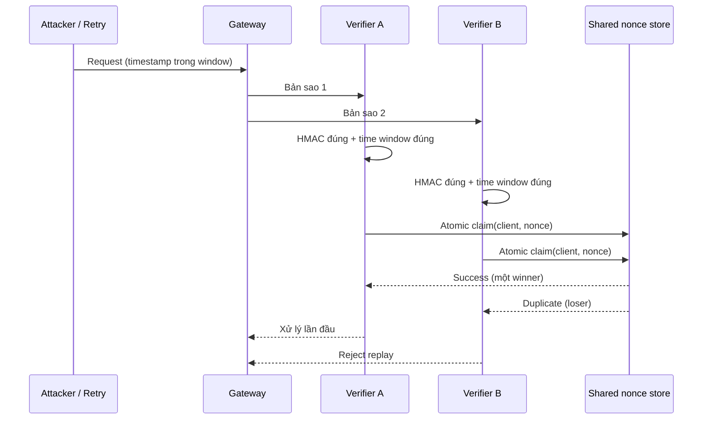
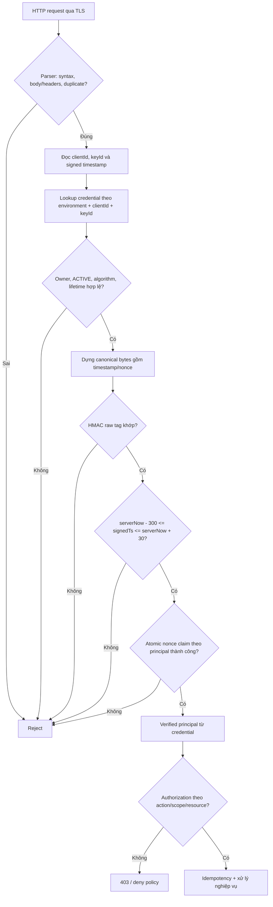

# Request tương lai

## 1. Request có timestamp trong tương lai là gì?

Trong cơ chế xác thực HTTP request bằng **HMAC với shared secret**, client thường gửi thêm thời điểm tạo request. Server không chỉ kiểm tra chữ ký HMAC hợp lệ mà còn phải quyết định **thời điểm được ký có nằm trong khoảng thời gian được chấp nhận hay không**. Nếu thời điểm trong request **lớn hơn thời gian hiện tại của server**, đó là một *future-dated request* — request được ghi thời gian ở tương lai theo góc nhìn server.

Ví dụ:

```http
POST /v1/transfers?currency=VND HTTP/1.1
Host: api.example.test
Content-Type: application/json
X-Client-Id: merchant-42
X-Key-Id: key-2026-b
X-Timestamp: 1790000015
X-Nonce: Ft9uRe4qA2sK7bL5
X-Signature: <base64url-hmac-sha256>

{"transferId":"t-204","amount":190000}
```

Giả sử thời điểm tin cậy của server là `1790000000` giây Unix epoch, thì header `X-Timestamp: 1790000015` **đi trước server 15 giây**. Request có thể hợp lệ nếu giao thức cho phép **độ lệch tương lai tối đa 30 giây**. Nếu timestamp là `1790000031`, nó đi trước 31 giây và **phải bị từ chối** theo cùng chính sách.

Bài **Request tương lai** thuộc chương **Timestamp**, trong module `SECURITY_AUTHENTICATION_HMAC_REQUEST_AUTHENTICATION`. Module thiết kế xác thực HTTP bằng HMAC trên canonical request có method, URI, header/body, có nonce chống replay, key rotation, kiểm thử proxy/gateway và tách authentication khỏi authorization. Chủ đề của bài là **xử lý timestamp đi trước đồng hồ server**, không chỉ xử lý request quá cũ.

Sau bài học, bạn sẽ:

- Phân biệt **future timestamp hợp lệ do clock skew**, **request quá xa tương lai**, **request quá cũ** và **replay request có HMAC đúng**.
- Thiết kế khoảng chấp nhận **bất đối xứng**: ví dụ lùi tối đa 300 giây nhưng tiến tối đa 30 giây.
- Quy định timestamp là **Unix epoch seconds dạng thập phân canonical**, không trộn milliseconds, timezone hoặc định dạng ngày tùy ý.
- Ràng buộc timestamp vào **canonical request/HMAC**, không tin header do client tự khai trước khi kiểm tra MAC.
- Tính **thời gian giữ nonce** đủ dài để ngăn request đã ký ở tương lai bị gửi lại trong toàn bộ cửa sổ hợp lệ.
- Cài đặt và kiểm thử Java 17 bằng `Clock` được inject, so sánh không overflow, HMAC raw tag, nonce claim nguyên tử và policy key.
- Xử lý clock drift, NTP, gateway/replica khác thời gian và lỗi đồng hồ một cách **fail-closed**.

**Thông điệp chính:** request có timestamp lớn hơn giờ server **không mặc nhiên là giả mạo**, nhưng **không thể chấp nhận vô hạn**. Hệ thống phải có *future skew tolerance* nhỏ, được ký vào hợp đồng giao thức dưới dạng chính sách server, và vẫn sử dụng **nonce/idempotency** để bảo vệ tính mới của request.

## 2. Timestamp được đo theo đồng hồ nào?

### 2.1. Unix epoch seconds và UTC

Một hợp đồng dễ liên thông là dùng số giây Unix epoch từ `1970-01-01T00:00:00Z`. Ví dụ:

```text
serverNow = 1790000000
signedTs  = 1790000015

difference = signedTs - serverNow = +15 seconds
```

Trong ví dụ trên, serverNow tương ứng **2026-09-21 14:13:20 UTC**, signedTs tương ứng **2026-09-21 14:13:35 UTC**. Các số này là **fixture kiểm thử cố định**, không phải giờ thực tế của máy ở thời điểm bạn đọc tài liệu.

Timestamp Unix epoch không phụ thuộc timezone của người dùng. Trong Java 17:

```java
import java.time.Clock;
import java.time.Instant;

Clock clock = Clock.systemUTC();
long nowEpochSeconds = clock.instant().getEpochSecond();
```

`Instant` đại diện cho thời điểm trên dòng thời gian, không phải ngày giờ hiển thị địa phương. Không dùng `LocalDateTime.now()` rồi tự cộng/trừ múi giờ, và không so các chuỗi như `"2026-09-21 21:13:35"` theo thứ tự từ điển.

### 2.2. Không trộn giây và milliseconds

Lỗi thường gặp khi client JavaScript lấy `Date.now()` (milliseconds) nhưng server dùng Unix **seconds**:

```text
seconds:      1790000015        (10 chữ số trong fixture)
milliseconds: 1790000015000     (13 chữ số)

Nếu server tưởng milliseconds là seconds:
  timestamp nhìn như rất xa tương lai.
```

Đừng âm thầm đoán đơn vị theo số chữ số, ví dụ “nếu dài 13 thì chia 1000”. Hợp đồng phải quy định **một đơn vị duy nhất**; input sai bị từ chối để client sửa SDK.

Trong JavaScript client, chuyển milliseconds sang seconds có chủ đích:

```javascript
const epochSeconds = Math.floor(Date.now() / 1000);
const timestamp = String(epochSeconds);
// Ký CHÍNH chuỗi timestamp này trong canonical request.
```

Trong Java:

```java
String timestamp = Long.toString(
    Clock.systemUTC().instant().getEpochSecond()
);
```

### 2.3. Timestamp là dữ liệu caller tự khai

`X-Timestamp` do client gửi không phải thời gian được server chứng thực. Caller có thể tự đặt nó trong tương lai, quá khứ hoặc bất kỳ giá trị nào. Chỉ khi HMAC **hợp lệ với secret đáng tin** thì server có bằng chứng timestamp là một phần của request đã được ký bằng secret đó.

HMAC xác thực **các byte đã ký**, không chứng minh rằng đồng hồ client chạy đúng. Vì vậy server vẫn cần kiểm tra cửa sổ thời gian **theo clock phía server**.

## 3. Cửa sổ thời gian bất đối xứng

### 3.1. Vì sao nên tách hai giới hạn?

Một số hệ thống dùng chính sách đơn giản:

```text
abs(serverNow - signedTs) <= 300 seconds
```

Chính sách này cho phép request đi trước **đến 300 giây**, cũng như chậm **đến 300 giây**. Mặc dù đơn giản, nó khiến một request ký ở tương lai có thể trở thành hợp lệ **trước thời gian ghi trong nó tới 5 phút**, kéo dài khoảng có thể thử phát lại.

Hợp đồng minh họa của bài sử dụng **cửa sổ bất đối xứng**:

```text
pastTolerance   = 300 seconds  (request tối đa 5 phút tuổi)
futureTolerance =  30 seconds  (đồng hồ client đi trước tối đa 30 giây)

Chấp nhận khi:
  serverNow - pastTolerance <= signedTs
  signedTs <= serverNow + futureTolerance
```

Tương đương với:

\[
\text{now}-300 \leq \text{signedTs} \leq \text{now}+30
\]

Đây là **chính sách ví dụ** nhằm dạy cách xử lý request tương lai. Cửa sổ production phải được chọn theo threat model, SLA, đồng bộ thời gian, mạng client và yêu cầu chống replay. Không có con số 30/300 giây bắt buộc cho mọi API.

### 3.2. Bảng ranh giới quan trọng

Cố định `serverNow = 1790000000`:

| Timestamp được ký | Chênh lệch so với server | Kết quả với (-300s, +30s) |
| --- | ---: | --- |
| `1789999699` | -301 giây | **Từ chối: quá cũ** |
| `1789999700` | -300 giây | **Chấp nhận về mặt thời gian**, đúng biên |
| `1789999999` | -1 giây | Chấp nhận về mặt thời gian |
| `1790000000` | 0 giây | Chấp nhận về mặt thời gian |
| `1790000001` | +1 giây | Chấp nhận nếu HMAC/nonce hợp lệ |
| `1790000015` | +15 giây | Chấp nhận nếu HMAC/nonce hợp lệ |
| `1790000030` | +30 giây | **Chấp nhận về mặt thời gian**, đúng biên |
| `1790000031` | +31 giây | **Từ chối: quá xa tương lai** |
| `1790000300` | +300 giây | **Từ chối: quá xa tương lai** |

“Chấp nhận về mặt thời gian” chỉ nghĩa **timestamp vượt qua phép kiểm tra window**, không phải request đã qua authentication. HMAC, key state, nonce, quyền truy cập và idempotency vẫn cần kiểm tra.

### 3.3. Một request tương lai có thể trở nên hợp lệ sau đó

Giả sử server nhận `signedTs = 1790000031` khi `now = 1790000000`. Request bị reject vì đi trước **31 giây**. Nếu attacker gửi lại **nguyên request đã được ký** vào giây tiếp theo khi `now = 1790000001`, chênh lệch còn **30 giây** và request có thể qua bước timestamp.

Đây không phải lỗi tính toán: cửa sổ hợp lệ **dịch chuyển theo thời gian**. Vì vậy:

- Request đi quá xa tương lai phải bị **reject tại thời điểm nhận**, không “sleep chờ đúng giờ” rồi tự xử lý.
- Khi request **lần đầu được chấp nhận**, nonce phải được claim nguyên tử để các lần gửi lại sau đó không được xử lý thêm.
- Nếu một request đã bị từ chối vì quá xa tương lai, nonce thường **chưa được claim** vì nó chưa vượt qua authentication/freshness policy. Một lần gửi lại sau khi đồng hồ bắt kịp vẫn có thể là lần chấp nhận đầu tiên nếu chữ ký hợp lệ.
- Client nên sửa clock drift và tạo request mới có timestamp/nonce mới, **không coi future rejection là lời mời để tự gửi lặp vô hạn**.

Nếu hệ thống muốn cấm hoàn toàn khả năng “request ký trước rồi chờ hợp lệ”, phải chọn **futureTolerance = 0** hoặc bổ sung cơ chế giao thức khác (challenge server, thời hạn/transaction token hoặc ràng buộc phiên). Không thể đồng thời cho phép skew dương và khẳng định request tương lai không bao giờ trở thành hợp lệ.

## 4. Những nguyên nhân hợp lệ của future timestamp

### 4.1. Đồng hồ client đi trước

Một máy client, thiết bị IoT hoặc container có thể có wall clock **nhanh hơn** server vài giây do:

- Chưa đồng bộ NTP hoặc NTP được cấu hình sai.
- Đồng hồ VM/container bị điều chỉnh sau suspend/resume hoặc migration.
- Thiết bị offline lâu, RTC không chính xác.
- App lấy thời gian từ nhiều nguồn khác nhau và trộn đơn vị/clock.
- Code dùng timezone/local time thay vì epoch seconds.

Client có đồng hồ đi trước 15 giây có thể vẫn được chấp nhận với future tolerance 30 giây. Client đi trước 90 giây sẽ bị reject; giải pháp là **sửa nguồn thời gian**, không mở rộng cửa sổ thành vài giờ để “chữa” một máy bị lệch.

### 4.2. Chính đồng hồ server bị chậm

Một client có giờ UTC đúng vẫn có thể bị xem là ở tương lai nếu server bị lệch lùi. Khi đó nhiều client cùng báo lỗi future-timestamp trên một vùng/replica. Cần theo dõi:

- Offset của các node với time source tin cậy.
- Sự khác biệt giữa gateway và backend khi mỗi tầng dùng clock riêng.
- Các đợt NTP correction, host pause/resume, live migration, deploy hoặc hạ tầng mất đồng bộ.
- Phân phối `signedTs - serverNow` của **request đã xác minh HMAC**, tránh tin thống kê từ caller chưa xác thực.

Không dùng timestamp do caller cung cấp làm mốc sửa giờ của server. Nếu clock server không còn đáng tin, endpoint yêu cầu freshness nghiêm ngặt nên **fail-closed** hoặc rút node ra khỏi đường nhận request cho tới khi clock được phục hồi.

### 4.3. Network và queueing có làm request thành tương lai?

Độ trễ mạng thông thường khiến một request được ký ở phía client **đến server muộn hơn**, tức timestamp có xu hướng nằm **trong quá khứ**, không phải tương lai. Future timestamp thường là dấu hiệu đồng hồ client đi trước, đồng hồ server đi sau hoặc caller cố ý đặt thời điểm.

Tuy vậy, nếu request đi qua gateway rồi hàng đợi dài, thời điểm được dùng để đánh giá có thể khác theo điểm kiểm tra. Hợp đồng phải định nghĩa **serverNow được chụp tại đâu**: khi request đến ingress, lúc verifier bắt đầu hay trước khi thực thi nghiệp vụ. Không tin header `X-Received-At` do caller tự gửi như một thời điểm server đáng tin.

### 4.4. NTP và đồng hồ đơn điệu

- **Wall clock UTC/epoch:** dùng để so timestamp mà client đã ký.
- **Monotonic clock:** thích hợp đo elapsed time/timeout; không phải thời gian Unix epoch có thể trao đổi giữa máy.
- **Server clock synchronization:** NTP/time service và health checks giúp tránh những quyết định sai về freshness.

Đừng thay thế timestamp epoch bằng `System.nanoTime()`. Giá trị này không có cùng mốc chung giữa máy client và server.

## 5. Future timestamp tạo ra rủi ro gì?

### 5.1. Tăng cửa sổ tái sử dụng request

Với chính sách chấp nhận:

```text
now - pastTolerance <= ts <= now + futureTolerance
```

một request ký tại `ts` có thể hợp lệ trong khoảng server-time:

```text
ts - futureTolerance <= now <= ts + pastTolerance
```

Nếu past=300 và future=30, **toàn bộ khoảng có thể chấp nhận dài 330 giây** (giữa hai mốc; tùy đếm giây nguyên có 331 điểm thời gian gồm hai đầu). Không nên nhầm rằng timestamp “chỉ có cửa sổ 300 giây” khi còn cho phép skew tương lai.

Ví dụ:

```text
Signed timestamp:     1790000015
Earliest accepted now:1790000015 - 30  = 1789999985
Latest accepted now:  1790000015 + 300 = 1790000315

Total span: 330 seconds
```

Nếu không có nonce, ai lấy được **request đã ký nguyên vẹn** có thể gửi lại nhiều lần trong khoảng này. HMAC sẽ tiếp tục khớp vì bytes không đổi. Do đó, chọn tolerance nhỏ hơn chỉ giảm rủi ro; **nonce replay protection vẫn cần thiết**.

### 5.2. Pre-signing và scheduled abuse

Bên sở hữu shared secret có thể tạo request mới với timestamp ở tương lai, kể cả chuẩn bị sẵn rất nhiều request trong cửa sổ. Nếu secret bị lộ, attacker có thể tự tạo chữ ký hợp lệ cho timestamp/nonce mới và chờ đến thời điểm phù hợp.

Không có quy tắc timestamp nào thay thế **key revocation** khi secret compromise. Cần phát hiện bất thường, thu hồi key, cấp secret mới, giảm quyền credential và rà soát giao dịch.

### 5.3. Replay qua nhiều replica

Một request có cùng tag, nonce và timestamp có thể được gửi đồng thời đến hai node:



Nếu chỉ dùng local `ConcurrentHashMap` riêng cho mỗi node hoặc thao tác `GET` rồi `SET` không nguyên tử, hai bản sao có thể cùng được xử lý. Hệ thống cần shared store với **atomic insert-if-absent**, hoặc một cơ chế đồng bộ tương đương theo chính sách.

### 5.4. Nonce TTL phải bao phủ cả tương lai cho phép

Trong cửa sổ bất đối xứng, một nonce được claim tại thời gian sớm nhất `ts - futureTolerance` có thể phải được nhớ đến **sau** `ts + pastTolerance`.

Với timestamp cố định, thời điểm cuối mà request có thể còn hợp lệ là:

\[
\text{lastAcceptableServerTime} = \text{signedTs}+\text{pastTolerance}
\]

Nonce store cần giữ nonce **ít nhất tới sau thời điểm ấy**, cộng biên an toàn cho độ lệch đồng hồ giữa verifier/store và độ trễ xử lý.

Ví dụ:

```text
signedTs = 1790000015
pastTolerance = 300 s
futureTolerance = 30 s
retentionMargin = 60 s

latestAcceptableNow = 1790000315
nonceExpireAt       = 1790000375

Nếu claim ở now=1789999985:
  minimum retention ≈ 390 seconds

Nếu claim ở now=1790000000:
  minimum retention ≈ 375 seconds
```

Công thức TTL từ thời điểm claim:

```text
expiresAt = signedTs + pastTolerance + safetyMargin
ttlAtClaim = max(1, expiresAt - trustedNow)
```

**Không dùng cố định TTL 300 giây kể từ lần claim** khi có future skew 30 giây: nếu request được chấp nhận ngay tại rìa sớm, nonce có thể bị quên **trước khi timestamp hết hợp lệ**.

Phạm vi khóa nonce nên ít nhất ràng buộc với **environment và verified client/principal**. Nếu chỉ scope theo `(clientId, keyId, nonce)`, một client có thể dùng lại cùng nonce qua key rotation. Chính sách v1 dùng `(environment, clientId, nonce)` để nonce không bị reset khi đổi key ID.

## 6. Hợp đồng HTTP-HMAC-FUTURE-TIME-V1

Đây là một **hợp đồng ví dụ riêng** để minh họa rõ timestamp tương lai. Không mặc định mọi API HMAC hoặc mọi protocol tuân theo cùng format.

### 6.1. Các quy tắc bắt buộc

1. Header `X-Timestamp` mang **Unix epoch seconds dạng thập phân ASCII** (không có dấu, leading zeros, decimal point, exponent, SP/HTAB còn sót lại hay ký tự Unicode).
2. Cú pháp `[1-9][0-9]{0,18}`, parse bằng `Long.parseLong` và reject overflow. Với hệ thống chỉ xử lý epoch dương; nếu cần epoch trước 1970 phải có hợp đồng khác.
3. Method, raw path/query, trusted authority, selected headers và exact body digest đều thuộc canonical request; **timestamp và nonce phải nằm trong MAC input**.
4. Tập signed headers bắt buộc: `content-type`, `x-client-id`, `x-key-id`, `x-timestamp` và `x-nonce`. Tên header chuyển ASCII lowercase, mỗi field có đúng một occurrence; reject duplicate, CR/LF và schema không hợp lệ.
5. Dạng signature là Base64url no-padding của **full HMAC-SHA256 32-byte tag** (43 ký tự). `X-Signature` không được đưa vào chính MAC input nhưng phải được kiểm tra duplicate và encoding.
6. Server có `pastTolerance=300s` và `futureTolerance=30s`; **bao gồm hai biên**, đánh giá với server clock tin cậy tại authentication boundary.
7. Validation dùng **so sánh giới hạn với phép cộng/trừ có kiểm tra overflow**, không chuyển `long` về `int` hay lấy trị tuyệt đối của phép trừ có thể overflow.
8. HMAC phải hợp lệ, key owner/algorithm/state phải đúng, timestamp mới được coi là authenticated metadata. Chỉ claim nonce **sau khi MAC và window đều đúng**.
9. Nonce phải được claim nguyên tử theo `(environment, verifiedClientId, nonce)`; expiry = `signedTs + 300 + safetyMargin` trong shared store.
10. Sau xác thực, principal được tạo từ trusted credential, rồi authorization kiểm tra scope/resource/action. Không dùng timestamp tương lai để bỏ qua hạn mức hoặc hẹn giờ thực thi nghiệp vụ.

### 6.2. Golden canonical request 11 dòng

Fixture:

```http
POST /v1/transfers?currency=VND HTTP/1.1
Host: api.example.test
Content-Type: application/json
X-Client-Id: merchant-42
X-Key-Id: key-2026-b
X-Timestamp: 1790000015
X-Nonce: Ft9uRe4qA2sK7bL5
X-Signature: <base64url-tag>

{"transferId":"t-204","amount":190000}
```

Canonical text chính xác: **11 dòng**, nối bằng LF (`0x0A`), **không có LF ở cuối**, mã hóa UTF-8.

```text
HTTP-HMAC-FUTURE-TIME-V1
POST
/v1/transfers
currency=VND
authority:api.example.test
content-type:application/json
x-client-id:merchant-42
x-key-id:key-2026-b
x-timestamp:1790000015
x-nonce:Ft9uRe4qA2sK7bL5
083da4a45ea1b02f7817ef2722403bb6a6f06de8d53f905da1485e5670caaa9f
```

Dòng cuối là SHA-256 **hex lowercase của exact body bytes**. Có một chữ số `1` ở giây thứ 15 trong `1790000015`, và giá trị này **không bị thay đổi** khi dựng canonical input. Server có thể parse thành số để kiểm tra cửa sổ thời gian, nhưng MAC phải bảo vệ **đúng chuỗi được chuẩn hóa theo hợp đồng**.

### 6.3. Golden vector HMAC độc lập

Các giá trị sau được tính từ primitive SHA-256/HMAC-SHA256 độc lập với ví dụ Java phía dưới:

```text
Server now fixture (epoch seconds): 1790000000
Signed timestamp (epoch seconds):   1790000015
Future offset:                      +15 seconds
Future tolerance:                   +30 seconds
Past tolerance:                     -300 seconds
Expected timestamp decision:        ACCEPTABLE

Test key (32 bytes, hex, CHỈ DÙNG TRONG TEST):
000102030405060708090a0b0c0d0e0f101112131415161718191a1b1c1d1e1f

Exact body bytes (UTF-8, no final LF):
{"transferId":"t-204","amount":190000}

SHA-256(body) hex:
083da4a45ea1b02f7817ef2722403bb6a6f06de8d53f905da1485e5670caaa9f

Canonical request: 11 lines, 270 UTF-8 bytes, LF, no trailing LF

HMAC-SHA256 full 32-byte tag, lowercase hex:
6a6716912e4d2dde6d28739dc527f8270e89fd833f1c654773782a7aedfa539e

Base64url no-padding (43 chars):
amcWkS5NLd5tKHOdxSf4Jw6J_YM_HGVHc3gqeu36U54
```

**Phân biệt hai loại kiểm thử:** golden HMAC test chứng minh canonical bytes và primitive đúng; kiểm thử timestamp với **injected clock** chứng minh chính sách future/past window đúng. Dù HMAC golden hợp lệ, một request có timestamp fixture này ở thời điểm hiện tại thật có thể **quá cũ** và bị reject.

## 7. Java 17: kiểm tra timestamp tương lai an toàn

### 7.1. Dùng `Clock` và phép toán chống overflow

Hàm dưới đây chỉ xử lý **timestamp policy**, không tự xác thực HMAC. Gọi sau khi request đã có schema hợp lệ; đối với pipeline hoàn chỉnh, xem mục 8.

```java
public final class FutureTimestampPolicyV1 {
    public static final long PAST_SECONDS = 300;
    public static final long FUTURE_SECONDS = 30;
    public static final long NONCE_SAFETY_MARGIN_SECONDS = 60;

    public enum Decision {
        ACCEPTABLE,
        TOO_OLD,
        TOO_FAR_FUTURE
    }

    private FutureTimestampPolicyV1() {}

    public static long parseCanonicalSeconds(String value) {
        if (value == null
                || !value.matches("[1-9][0-9]{0,18}")) {
            throw new IllegalArgumentException(
                "Timestamp must be canonical Unix seconds");
        }
        try {
            return Long.parseLong(value);
        } catch (NumberFormatException invalid) {
            throw new IllegalArgumentException(
                "Timestamp does not fit signed 64-bit integer", invalid);
        }
    }

    public static Decision decide(long signedTs, long serverNow) {
        final long lowerBound;
        final long upperBound;
        try {
            lowerBound = Math.subtractExact(serverNow, PAST_SECONDS);
            upperBound = Math.addExact(serverNow, FUTURE_SECONDS);
        } catch (ArithmeticException invalidClock) {
            // Clock/policy nằm ngoài miền tính toán đáng tin.
            throw new IllegalStateException(
                "Cannot compute trusted freshness window", invalidClock);
        }

        if (signedTs < lowerBound) return Decision.TOO_OLD;
        if (signedTs > upperBound) return Decision.TOO_FAR_FUTURE;
        return Decision.ACCEPTABLE;
    }

    public static long nonceExpirationEpoch(long signedTs) {
        try {
            return Math.addExact(
                Math.addExact(signedTs, PAST_SECONDS),
                NONCE_SAFETY_MARGIN_SECONDS);
        } catch (ArithmeticException invalid) {
            throw new IllegalArgumentException(
                "Timestamp exceeds supported nonce expiry", invalid);
        }
    }
}
```

**Vì sao không dùng `Math.abs(now - ts)`?**

- Phép trừ hai giá trị `long` có thể overflow nếu input cố ý cực lớn.
- `Math.abs(Long.MIN_VALUE)` vẫn âm vì không có giá trị dương tương ứng trong `long`.
- Cửa sổ bài này **bất đối xứng**, nên dùng `abs` sẽ làm mất logic “chậm 300 giây, nhanh 30 giây”.

**Vì sao không tự đổi đơn vị?** `parseCanonicalSeconds` từ chối định dạng khác hợp đồng. Giá trị milliseconds nhìn như quá xa tương lai sẽ bị reject theo time window, không bị tự động chia 1000 để “cứu” client sai.

### 7.2. Thử ranh giới với clock cố định

```java
import java.time.Clock;
import java.time.Instant;
import java.time.ZoneOffset;

Clock fixed = Clock.fixed(
    Instant.ofEpochSecond(1790000000L),
    ZoneOffset.UTC
);
long now = fixed.instant().getEpochSecond();

assert FutureTimestampPolicyV1.decide(
    1790000015L, now)
    == FutureTimestampPolicyV1.Decision.ACCEPTABLE;

assert FutureTimestampPolicyV1.decide(
    1790000030L, now)
    == FutureTimestampPolicyV1.Decision.ACCEPTABLE;

assert FutureTimestampPolicyV1.decide(
    1790000031L, now)
    == FutureTimestampPolicyV1.Decision.TOO_FAR_FUTURE;

assert FutureTimestampPolicyV1.decide(
    1789999700L, now)
    == FutureTimestampPolicyV1.Decision.ACCEPTABLE;

assert FutureTimestampPolicyV1.decide(
    1789999699L, now)
    == FutureTimestampPolicyV1.Decision.TOO_OLD;

assert FutureTimestampPolicyV1.nonceExpirationEpoch(
    1790000015L) == 1790000375L;
```

Trong bài lab có thể dùng Java `assert` khi chạy với cờ `-ea`; trong test framework chính thức nên dùng assertion JUnit để tránh việc JVM bỏ qua `assert` theo cấu hình mặc định.

### 7.3. Không parse rồi tự format lại khi tính HMAC

Ví dụ client ký chuỗi `1790000015`. Verifier nên:

- Validate schema và parse `long` để kiểm tra cửa sổ.
- Dùng **chính string canonical đã nhận** làm thành phần `x-timestamp:1790000015` của canonical request.
- Không tự thêm timezone, đổi timestamp thành ISO-8601, chia 1000 hoặc làm tròn.
- Không chấp nhận `01790000015` như alias của cùng con số trong hợp đồng V1.

Cách này giữ cùng signature input giữa Java/JavaScript/Go và tránh parser disagreement.

## 8. Java 17: xác minh HMAC, future skew và nonce trong cùng pipeline

Đây là một skeleton có tính thực hành để lắp temporal policy với việc xác minh mật mã. HTTP adapter phải cung cấp **đúng những thành phần request đã được parser và gateway kiểm soát**; không lấy trustedAuthority hoặc principal từ `X-Forwarded-*` chưa được tin cậy.

### 8.1. Hợp đồng với credential và nonce store

```java
import java.nio.charset.StandardCharsets;
import java.security.GeneralSecurityException;
import java.security.MessageDigest;
import java.time.Clock;
import java.util.Base64;
import java.util.HexFormat;
import java.util.Optional;
import javax.crypto.Mac;
import javax.crypto.spec.SecretKeySpec;

public final class HmacFutureRequestV1 {
    public record Request(
        String method,
        String rawPath,
        String rawQuery,
        String trustedAuthority,
        String contentType,
        String clientId,
        String keyId,
        String timestampText,
        String nonce,
        byte[] exactBodyBytes
    ) {}

    public record Credential(
        String ownerClientId,
        String keyId,
        String algorithm,
        boolean active,
        long notBeforeEpochSeconds,
        long expiresAtEpochSeconds,
        byte[] secret
    ) {}

    public record VerifiedPrincipal(String clientId) {}

    public interface CredentialStore {
        // Environment được cố định ở trusted server configuration.
        Optional<Credential> find(
            String environment, String clientId, String keyId);
    }

    public interface NonceStore {
        // Phải atomic, shared giữa nhiều verifier và có TTL/expiration.
        // False = đã có nonce, lỗi storage phải fail-closed.
        boolean claim(
            String environment,
            String verifiedClientId,
            String nonce,
            long expiresAtEpochSeconds);
    }

    private HmacFutureRequestV1() {}

    private static void validate(Request r) {
        if (r == null
                || r.exactBodyBytes() == null
                || r.exactBodyBytes().length > 1_048_576
                || !"POST".equals(r.method())
                || !"/v1/transfers".equals(r.rawPath())
                || !"currency=VND".equals(r.rawQuery())
                || !"api.example.test".equals(r.trustedAuthority())
                || !"application/json".equals(r.contentType())
                || r.clientId() == null
                || !r.clientId().matches("[A-Za-z0-9._-]{1,64}")
                || r.keyId() == null
                || !r.keyId().matches("[A-Za-z0-9._-]{1,64}")
                || r.nonce() == null
                || !r.nonce().matches("[A-Za-z0-9_-]{16,64}")) {
            throw new IllegalArgumentException(
                "Invalid request or signed component");
        }
        FutureTimestampPolicyV1.parseCanonicalSeconds(
            r.timestampText()
        );
    }

    public static byte[] canonicalBytes(Request r)
            throws GeneralSecurityException {
        validate(r);
        byte[] bodyDigest = MessageDigest.getInstance("SHA-256")
            .digest(r.exactBodyBytes());
        String bodySha = HexFormat.of().formatHex(bodyDigest);

        String canonical = String.join("\n",
            "HTTP-HMAC-FUTURE-TIME-V1",
            r.method(),
            r.rawPath(),
            r.rawQuery(),
            "authority:" + r.trustedAuthority(),
            "content-type:" + r.contentType(),
            "x-client-id:" + r.clientId(),
            "x-key-id:" + r.keyId(),
            "x-timestamp:" + r.timestampText(),
            "x-nonce:" + r.nonce(),
            bodySha
        );
        return canonical.getBytes(StandardCharsets.UTF_8);
    }

    private static byte[] decodeSignature(String text) {
        // Full HMAC-SHA256 32 bytes -> 43 Base64url chars, no padding.
        if (text == null || !text.matches("[A-Za-z0-9_-]{43}")) {
            throw new IllegalArgumentException("Invalid signature format");
        }
        final byte[] bytes;
        try {
            bytes = Base64.getUrlDecoder().decode(text);
        } catch (IllegalArgumentException invalid) {
            throw new IllegalArgumentException(
                "Malformed Base64url tag", invalid);
        }
        String reencoded = Base64.getUrlEncoder().withoutPadding()
            .encodeToString(bytes);
        if (bytes.length != 32 || !reencoded.equals(text)) {
            throw new IllegalArgumentException(
                "Noncanonical HMAC signature");
        }
        return bytes;
    }

    private static byte[] mac(byte[] secret, byte[] data)
            throws GeneralSecurityException {
        if (secret == null || secret.length < 32) {
            throw new IllegalStateException(
                "Configured HMAC secret missing/too short");
        }
        Mac hmac = Mac.getInstance("HmacSHA256");
        hmac.init(new SecretKeySpec(secret, "HmacSHA256"));
        return hmac.doFinal(data);
    }

    // Chỉ hàm này trả VerifiedPrincipal.
    public static Optional<VerifiedPrincipal> verify(
        Request request,
        String receivedSignature,
        String environment,
        CredentialStore credentials,
        NonceStore nonces,
        Clock trustedServerClock
    ) throws GeneralSecurityException {
        // Request được parser kiểm tra header occurrences/duplicates/CRLF
        // trước khi tạo record Request. Validate lại schema nội bộ.
        byte[] input = canonicalBytes(request);
        byte[] receivedTag = decodeSignature(receivedSignature);

        // clientId, keyId vẫn là selectors caller khai (chưa authn).
        Optional<Credential> found = credentials.find(
            environment, request.clientId(), request.keyId());
        if (found.isEmpty()) return Optional.empty();

        Credential c = found.get();
        long now = trustedServerClock.instant().getEpochSecond();
        if (!c.active()
                || !request.clientId().equals(c.ownerClientId())
                || !request.keyId().equals(c.keyId())
                || !"HmacSHA256".equals(c.algorithm())
                || now < c.notBeforeEpochSeconds()
                || now >= c.expiresAtEpochSeconds()) {
            return Optional.empty();
        }

        // Không được coi key ID/secret chỉ tìm thấy là authenticated.
        byte[] expectedTag = mac(c.secret(), input);
        if (!MessageDigest.isEqual(expectedTag, receivedTag)) {
            return Optional.empty();
        }

        long signedTs =
            FutureTimestampPolicyV1.parseCanonicalSeconds(
                request.timestampText());
        if (FutureTimestampPolicyV1.decide(signedTs, now)
                != FutureTimestampPolicyV1.Decision.ACCEPTABLE) {
            return Optional.empty();
        }

        // TTL đủ bao phủ cả khoảng có thể chấp nhận signed timestamp.
        long nonceExpiry =
            FutureTimestampPolicyV1.nonceExpirationEpoch(signedTs);

        // Sau HMAC + time window mới claim nonce nguyên tử.
        if (!nonces.claim(
                environment, c.ownerClientId(),
                request.nonce(), nonceExpiry)) {
            return Optional.empty();
        }

        // Authenticated identity từ trusted credential, không từ role header.
        return Optional.of(
            new VerifiedPrincipal(c.ownerClientId())
        );
    }

    // Chỉ dùng trong fixture lab; client thực cần khóa riêng của client.
    public static String signForTest(Request r, byte[] secret)
            throws GeneralSecurityException {
        return Base64.getUrlEncoder().withoutPadding()
            .encodeToString(mac(secret, canonicalBytes(r)));
    }
}
```

**Giới hạn quan trọng:** Ví dụ là skeleton cho **đúng một route** và không triển khai HTTP adapter, kho nonce, permission engine hay KMS. HTTP server phải từ chối duplicate signed headers, signature header trùng, malformed HTTP, body/content coding bất hợp lệ **trước khi** tạo `Request`. Nếu framework chỉ cung cấp một value đã gộp, verifier trong class này không thể biết wire request từng có nhiều occurrences.

Credential store thật phải xét cả owner, environment, algorithm, key rotation/revocation, cache consistency và quyền. Record `active` trong demo chỉ là mô hình đơn giản; việc thu hồi secret bị lộ cần trạng thái cập nhật mọi replica. Exception từ JCA/KMS/nonce store phải **fail-closed**, không catch rồi trả principal.

### 8.2. Test fixture với clock inject và nonce store mô phỏng

```java
import java.nio.charset.StandardCharsets;
import java.time.Clock;
import java.time.Instant;
import java.time.ZoneOffset;
import java.util.HexFormat;
import java.util.Optional;
import java.util.concurrent.atomic.AtomicBoolean;

byte[] testSecret = HexFormat.of().parseHex(
    "000102030405060708090a0b0c0d0e0f"
  + "101112131415161718191a1b1c1d1e1f"
);

var request = new HmacFutureRequestV1.Request(
    "POST", "/v1/transfers", "currency=VND",
    "api.example.test", "application/json",
    "merchant-42", "key-2026-b",
    "1790000015", "Ft9uRe4qA2sK7bL5",
    "{\"transferId\":\"t-204\",\"amount\":190000}"
        .getBytes(StandardCharsets.UTF_8)
);
String golden = "amcWkS5NLd5tKHOdxSf4Jw6J_YM_HGVHc3gqeu36U54";
byte[] canonical = HmacFutureRequestV1.canonicalBytes(request);

if (canonical.length != 270
        || !golden.equals(
            HmacFutureRequestV1.signForTest(request, testSecret))) {
    throw new AssertionError("Golden canonical/HMAC mismatch");
}

var credentialStore =
    (HmacFutureRequestV1.CredentialStore)
    (environment, clientId, keyId) ->
        "test".equals(environment)
        && "merchant-42".equals(clientId)
        && "key-2026-b".equals(keyId)
        ? Optional.of(new HmacFutureRequestV1.Credential(
            "merchant-42", "key-2026-b", "HmacSHA256", true,
            1789990000L, 1790100000L, testSecret))
        : Optional.empty();

// AtomicBoolean mô phỏng một instance TEST, KHÔNG thay shared nonce store.
AtomicBoolean claimed = new AtomicBoolean(false);
var nonceStore = (HmacFutureRequestV1.NonceStore)
    (environment, clientId, nonce, expiresAt) ->
        !claimed.getAndSet(true);

Clock onTime = Clock.fixed(
    Instant.ofEpochSecond(1790000000L),
    ZoneOffset.UTC
);

if (HmacFutureRequestV1.verify(
        request, golden, "test",
        credentialStore, nonceStore, onTime).isEmpty()) {
    throw new AssertionError("Valid +15-second request should pass");
}
if (HmacFutureRequestV1.verify(
        request, golden, "test",
        credentialStore, nonceStore, onTime).isPresent()) {
    throw new AssertionError("Same nonce must be rejected on replay");
}

// Test request TOO FAR FUTURE: cùng signedTs, serverNow lùi thêm 16 s.
Clock tooEarly = Clock.fixed(
    Instant.ofEpochSecond(1789999984L),
    ZoneOffset.UTC
);
AtomicBoolean otherClaimed = new AtomicBoolean(false);
var anotherNonceStore = (HmacFutureRequestV1.NonceStore)
    (environment, clientId, nonce, expiresAt) ->
        !otherClaimed.getAndSet(true);

if (HmacFutureRequestV1.verify(
        request, golden, "test",
        credentialStore, anotherNonceStore, tooEarly).isPresent()) {
    throw new AssertionError("Future +31 s must be rejected");
}
if (otherClaimed.get()) {
    throw new AssertionError("Too-future request must not claim nonce");
}
```

Ví dụ dùng `AtomicBoolean` chỉ để chứng minh **một lần claim** trong bài lab; nó không bảo vệ nhiều instance, không có TTL và không đủ cho production. Implementation thật phải dùng shared atomic storage với key `(environment,verifiedClientId,nonce)`, expiry hợp đồng và xử lý lỗi store.

**Đừng dùng timestamp fixture như giờ hiện tại thực.** Fixture cố định ngày 2026-09-21 UTC; kiểm thử sản xuất phải dùng clock đáng tin tại thời điểm chạy, nonce mới, secret thử nghiệm và ký lại request. Golden vector và temporal policy là **hai kiểm thử riêng**.

## 9. Pipeline đúng: từ HMAC đến freshness rồi authorization



Ba điểm về thứ tự:

**1. HMAC phải khớp trước khi tin timestamp do client gửi.** Có thể parse schema timestamp sớm để giới hạn input, nhưng không cho một timestamp chưa xác thực tác động đến shared nonce store hoặc quyết định nghiệp vụ.

**2. Kiểm tra time window trước khi claim nonce.** Nếu timestamp quá xa tương lai, không cần chiếm một nonce trong store. Khi thời gian đến gần, một request đã ký có thể được client gửi lại, nhưng lần đầu được chấp nhận sẽ claim nonce.

**3. Authorization luôn ở sau authentication.** Kể cả request có timestamp hợp lệ, HMAC đúng và nonce mới, một principal chỉ được thao tác tài nguyên trong phạm vi quyền đã cấp. Không dùng tham số `owner` do client tự ký để vượt quyền.

**Lưu ý về status:** Theo API contract, malformed timestamp có thể nhận `400`; credential/HMAC hoặc freshness không hợp lệ thường nhận `401`; principal đã xác thực nhưng không đủ quyền thường là `403`. Phản hồi công khai không nên tiết lộ chi tiết key ID hoặc trạng thái key; lỗi đồng hồ/nonce store của hạ tầng phải được phân loại và fail-closed, không tự động biến thành xác thực thành công.

## 10. Gateway, proxy và đồng hồ nhiều node

### 10.1. Client ký với clock A, gateway verify bằng clock B

Trong hệ thống phân tán, gateway và backend có thể có đồng hồ lệch nhau:

```text
client signedTs = 1790000015

Gateway A now  = 1790000000 => +15 s -> ACCEPTABLE
Gateway B now  = 1789999979 => +36 s -> TOO FAR FUTURE
Backend C now  = 1790000020 =>  -5 s -> ACCEPTABLE
```

Cùng một HMAC tag, request có thể bị xử lý khác nhau. Đây là **clock-policy drift**. Cần:

- Đồng bộ clock của tất cả verifier bằng nguồn tin cậy, giám sát offset và health.
- Cùng dùng một version chính sách past/future skew; tránh gateway +30s còn backend +5m.
- Chỉ định một tầng **sở hữu freshness/replay verification**. Nếu verify tại gateway, backend nhận verified principal qua kênh nội bộ xác thực nguồn; không để một tầng tự sửa timestamp rồi verify lại.
- Khi một node lệch giờ ngoài giới hạn vận hành, đưa node ra khỏi traffic hoặc fail-closed theo chính sách.

Không nên cho backend tin `X-Verified-At` hoặc `X-Original-Timestamp` do caller internet tự gửi. Nếu gateway cần chuyển thời điểm ingress đáng tin, phải **bảo vệ nguồn và tính toàn vẹn** của assertion nội bộ.

### 10.2. Nơi nào là “thời điểm nhận request”?

Lựa chọn phổ biến là `serverNow` tại **authentication boundary**, sau khi HTTP parser chấp nhận request và trước khi tạo verified principal. Nếu dùng thời điểm tại ingress để tránh queue skew, cần ghi nhận và truyền nó **trong security context đáng tin**, có giới hạn độ trễ xử lý.

Nếu gateway đã kiểm tra freshness lúc request vào, nhưng giữ request trong hàng đợi hàng giờ rồi mới thực thi thanh toán, cần cân nhắc thêm **maximum processing delay** hoặc reauthorization/revalidation phù hợp. Kiểm tra timestamp lúc ingress **không cho phép** giữ ý định giao dịch vô thời hạn.

### 10.3. Proxy rewrite và định dạng thời gian

| Biến đổi | Rủi ro | Điều cần kiểm thử |
| --- | --- | --- |
| Gateway đổi case tên `X-Timestamp` | HTTP header names case-insensitive | Vẫn lấy đúng field |
| Proxy trim OWS trong framing | Value sau parser có thể thay representation | Hợp đồng rõ, không tùy tiện làm sạch CR/LF |
| Proxy thêm/sửa giá trị timestamp | Chữ ký client mất hiệu lực | HMAC fail; không sửa header đã ký |
| Client gửi cả giây và milliseconds | Parser disagreement | Chỉ chấp nhận seconds canonical |
| Gateway đổi `Host`/path/query | Canonical input khác, có thể đổi route | Verify trước rewrite/trusted representation |
| Proxy reserialize JSON body | SHA-256 body digest khác | Hash exact bytes tại boundary đã định |
| HTTP/1.1 → HTTP/2/3 | Framing/tên header khác | Ký semantic components theo contract |
| Backend được gọi bỏ gateway | Có thể bypass authn/time checks | Chặn direct access hoặc verify tương đương |
| Two verifiers cùng claim nonce | Replay logic chặn sai request hợp lệ | Một replay owner hoặc orchestration rõ |
| Một node dùng clock quá chậm | Reject request thực sự hợp lệ | Clock-health check, fail-closed/drain node |

**TLS** giúp bảo vệ request trên đường truyền, nhưng không ngăn replay khi kẻ có thể sở hữu bản sao request hợp lệ. HMAC bảo vệ tính toàn vẹn của signed timestamp; **nonce** bảo vệ việc sử dụng lại cùng request trong thời gian chấp nhận.

## 11. Thiết kế test “Request tương lai”

Thử nghiệm cần phân biệt rõ **timestamp policy**, **HMAC signature**, **nonce replay** và **gateway integration**. Nếu dùng `Clock.systemUTC()` trực tiếp trong test, kết quả có thể flaky theo thời điểm chạy; hãy inject clock và dùng fixture cố định.

### 11.1. Bài kiểm tra ranh giới

| Test | signedTs với serverNow=1790000000 | Kết quả mong đợi |
| --- | --- | --- |
| T01 | `1789999699` (-301s) | TOO_OLD |
| T02 | `1789999700` (-300s) | ACCEPTABLE, đúng biên |
| T03 | `1789999701` (-299s) | ACCEPTABLE |
| T04 | `1789999999` (-1s) | ACCEPTABLE |
| T05 | `1790000000` (0s) | ACCEPTABLE |
| T06 | `1790000001` (+1s) | ACCEPTABLE |
| T07 | `1790000015` (+15s) | ACCEPTABLE |
| T08 | `1790000029` (+29s) | ACCEPTABLE |
| T09 | `1790000030` (+30s) | ACCEPTABLE, đúng biên |
| T10 | `1790000031` (+31s) | TOO_FAR_FUTURE |
| T11 | `1790000300` (+300s) | TOO_FAR_FUTURE |
| T12 | `Long.MAX_VALUE` | Từ chối time window, không overflow |
| T13 | Tính bound với clock ngoài miền `long` | Fail-closed khi `addExact/subtractExact` overflow |

### 11.2. Schema và dữ liệu đã ký

| Test | Timestamp/input | Kết quả mong đợi |
| --- | --- | --- |
| S01 | `1790000015` | Parse canonical thành `long` |
| S02 | `01790000015` | Reject leading zero |
| S03 | `+1790000015` hoặc `-1790000015` | Reject dấu |
| S04 | `1790000015.0` | Reject decimal |
| S05 | `1.790000015e9` | Reject exponent |
| S06 | `1790000015000` (milliseconds) | Không tự chia 1000; quá xa future |
| S07 | `" 1790000015 "` sau semantic parser | Reject SP, không tự trim ở app |
| S08 | Unicode digits hoặc NBSP | Reject non-ASCII |
| S09 | 20 chữ số vượt schema/`Long.parseLong` | Reject |
| S10 | 19 chữ số nhưng lớn hơn `Long.MAX_VALUE` | Reject parse overflow |
| S11 | Đổi `X-Timestamp` sau khi ký, giữ tag | HMAC mismatch |
| S12 | Hai `X-Timestamp` khác case hoặc giống nhau | Reject duplicate trước MAC |
| S13 | Timestamp có CR/LF/obs-fold | Reject tại HTTP parser |
| S14 | Golden body SHA-256 và canonical request | 11 dòng, 270 byte, digest đúng |
| S15 | Golden HMAC-SHA256 Base64url | `amcWkS5NLd5tKHOdxSf4Jw6J_YM_HGVHc3gqeu36U54` |
| S16 | Header signature padded/noncanonical hoặc sai độ dài | Reject encoding, không cấp principal |

### 11.3. Replay, key state và nghiệp vụ

| Test | Kịch bản | Kết quả mong đợi |
| --- | --- | --- |
| R01 | Future +15s, HMAC đúng, nonce mới | Authn có thể thành công |
| R02 | Future +31s, HMAC đúng | Từ chối; **không claim nonce** |
| R03 | Gửi lại R02 sau 1 giây, nay +30s | Có thể là lần accept đầu nếu nonce chưa claim |
| R04 | Gửi lại request đã accept, cùng nonce | Reject replay ngay cả khi timestamp vẫn trong window |
| R05 | Hai replica nhận cùng nonce đồng thời | Tối đa một atomic claim thành công |
| R06 | TTL nonce chỉ 300s kể từ accept ở rìa future | Test phát hiện TTL quá ngắn |
| R07 | TTL nonce tới `ts+300+margin` | Không quên nonce trước hạn hợp lệ |
| R08 | Same nonce qua key rotation của cùng client | Reject nếu đã claim theo client namespace |
| R09 | Key `REVOKED`, MAC toán học đúng | Reject credential |
| R10 | Secret bị lộ, attacker ký request mới | Revocation cần ngăn; nonce một mình không đủ |
| R11 | Nonce store unavailable | Fail-closed cho endpoint nhạy cảm |
| R12 | Client clock đi trước 90s | Reject thay vì tăng tolerance vô hạn |
| R13 | Credential active nhưng thiếu `transfers:create` | Authn pass, authz `403` |
| R14 | Owner trong body không thuộc verified principal | Authorization reject |
| R15 | Request retry với nonce mới nhưng cùng transfer ID | Kiểm tra idempotency để không tạo giao dịch trùng |
| R16 | Key rotation với key ID khác, cùng thuật toán | Timestamp/HMAC format không đổi, đúng secret mới |

### 11.4. Proxy/gateway và độ ổn định clock

| Test | Điều kiện | Kết quả mong đợi |
| --- | --- | --- |
| I01 | Gateway A now đúng, gateway B chậm 40s | Test phát hiện kết quả freshness không đồng nhất |
| I02 | NTP chỉnh đồng hồ node lùi 2 phút | Monitoring/health flag, không ngầm mở rộng future tolerance |
| I03 | NTP chỉnh đồng hồ node tiến đột ngột | Tránh false accept, fail-closed nếu clock không đáng tin |
| I04 | HTTP/1.1 → HTTP/2 names lowercase | Timestamp semantic không đổi |
| I05 | Proxy rewrite `X-Timestamp` | Signature fail hoặc reject |
| I06 | Gateway rewrite path/authority/body | HMAC mismatch hoặc verify trước rewrite |
| I07 | Caller tự khai `X-Received-At` | Không dùng làm trusted serverNow |
| I08 | Backend direct bypass gateway | Bị chặn hoặc có verifier tương đương |
| I09 | Queue giữ request 1 giờ sau ingress verify | Processing-time policy ngăn thao tác quá trễ |
| I10 | Client gửi lại quá nhiều future-rejected requests | Rate limit, telemetry nhưng không claim nonce sai |
| I11 | Server error trả chi tiết trạng thái key hoặc offset nội bộ | Kiểm tra giảm information disclosure |
| I12 | Nhiều replica/replay store chung | Revocation, window và nonce policy nhất quán |

### 11.5. Property-based tests có ích

- Với `now` cố định và window `[-300,+30]`, mọi timestamp trong miền này cho kết quả **ACCEPTABLE**; bên ngoài cho TOO_OLD hoặc TOO_FAR_FUTURE.
- Với `now` tăng từ từ, một timestamp cố định chuyển từ **TOO_FAR_FUTURE → ACCEPTABLE → TOO_OLD**; không chuyển ngược nếu clock đi tiến bình thường.
- Với mọi signed timestamp hợp lệ, `nonceExpirationEpoch(ts)` lớn hơn `ts + pastTolerance` khi safety margin dương.
- Với mọi phép sửa timestamp nhưng không ký lại, golden tag cũ không được chấp nhận (ngoại trừ xác suất collision MAC cực kỳ nhỏ).
- Với mọi request qua HMAC thành công và timestamp trong window, chỉ **một lần nonce claim nguyên tử** có thể thành công trên cùng client namespace.
- Với mọi input timestamp malformed/overflow, verifier không được cấp principal hoặc gọi business handler.

**Tránh test flaky:** không lấy giờ hệ thống thực rồi `sleep` chờ đúng một biên 30 giây. Dùng injected `Clock.fixed` và unit tests ranh giới. Chỉ các integration tests hạ tầng mới cần kiểm tra clock thực, và chúng phải có khoảng an toàn/điều kiện vận hành rõ.

## 12. Tình huống thực tế và phân tích

### A. Client nhanh hơn server 15 giây

Client có HMAC hợp lệ, `X-Timestamp` ở tương lai +15 giây. API được cấu hình future tolerance 30 giây, nonce mới.

**Phân tích:** Request **qua được time window**. Sau khi MAC, key state, nonce và quyền đều hợp lệ, nó có thể được xử lý. Không tự động loại bỏ mọi timestamp lớn hơn serverNow; điều đó dễ làm mất tương thích với thiết bị có clock skew nhỏ.

### B. Client nhanh hơn 2 phút

Cùng request nhưng đồng hồ client đi trước server 120 giây. Team đề nghị tăng future tolerance lên 5 phút vì một client quan trọng liên tục bị 401.

**Phân tích:** Đây là vấn đề vận hành time synchronization. Nới cửa sổ tăng **thời gian chấp nhận pre-signed/replayed request** trên toàn hệ thống. Ưu tiên sửa đồng hồ client, theo dõi drift và giới hạn ngoại lệ có kiểm soát (nếu policy cho phép), không nâng tolerance toàn cục chỉ để che lỗi.

### C. Request bị từ chối +31 giây, sau đó được nhận +30 giây

Một request có tag HMAC đúng bị reject khi timestamp cách server 31 giây. Một giây sau, chính request đó được gửi lại và qua time window.

**Phân tích:** Đây là hệ quả trực tiếp của interval cho phép. Nếu nonce chưa được claim ở lần reject đầu, lần sau có thể được accept như lần đầu. Khi đã accept, nonce phải được claim, và mọi replay sau đó bị từ chối. Nếu sản phẩm không chấp nhận hành vi này, cần thay policy/protocol chứ không sửa bằng sleep hoặc bypass nonce.

### D. Nonce TTL 300 giây nhưng future tolerance 30 giây

Một request được ký tương lai +30 giây, chấp nhận tại rìa sớm nhất. Server claim nonce và đặt TTL 300 giây. Hết TTL, timestamp của request **vẫn còn hợp lệ thêm 30 giây**.

**Phân tích:** Đây là **replay gap**. Nonce phải sống tới **`signedTs + pastTolerance + safetyMargin`**, không chỉ “300 giây tính từ lúc thấy nonce”. Cần test ranh giới expiration trên shared store.

### E. Hai gateway có thời gian khác nhau

Một gateway có giờ chuẩn, gateway khác chậm 40 giây, policy chỉ cho phép +30 giây. Client đúng giờ đi qua A thành công nhưng qua B bị reject future request.

**Phân tích:** Cần giám sát và đồng bộ clock, không “chữa” bằng cách giảm security check ở B. Tầng chịu trách nhiệm authn/freshness phải có clock đủ tin cậy và policy thống nhất. Khi node mất đồng bộ lớn, fail-closed hoặc drain traffic.

### F. HMAC đúng nhưng secret đã bị lộ

Attacker biết shared secret, tạo request cho timestamp +20 giây với nonce ngẫu nhiên mới rồi ký HMAC đúng.

**Phân tích:** HMAC và nonce có thể hoàn toàn hợp lệ; attacker đã sở hữu secret. Cần **thu hồi key**, cấp secret mới, giảm quyền và điều tra. Chặn future timestamp không đủ để xử lý key compromise.

### G. Tương lai hợp lệ nhưng tài khoản không thuộc quyền

`merchant-42` gửi request +10 giây, HMAC hợp lệ, nonce mới, nhưng body tạo transfer từ account của `merchant-73`.

**Phân tích:** Authentication có thể thành công, nhưng **authorization phải từ chối** nếu principal không có quyền đối với account. Timestamp, nonce và HMAC không thay thế permission checks hoặc idempotency.

## 13. Checklist triển khai Request tương lai

- [ ] Timestamp dùng **Unix epoch seconds UTC**, định dạng ASCII thập phân canonical, không tự suy đơn vị milliseconds hoặc timezone.
- [ ] `X-Timestamp` xuất hiện đúng một lần và **được đưa vào HMAC input**, không bị sửa sau khi ký.
- [ ] Có **pastTolerance** và **futureTolerance** riêng, viết rõ biên inclusive/exclusive và giá trị có thể chấp nhận.
- [ ] Chọn future tolerance nhỏ theo threat model/clock-health; không nới vô hạn để “chữa” clock drift.
- [ ] Dùng `Clock` inject được để test; wall clock UTC để so epoch, monotonic clock chỉ để đo elapsed time.
- [ ] Validate schema/overflow và so bounds bằng phép toán an toàn, không dùng `Math.abs(now - ts)` cho asymmetric window.
- [ ] HMAC raw tag được verify bằng shared secret đúng client/key ID, key state và algorithm; chưa tin timestamp trước MAC.
- [ ] Future timestamp quá giới hạn **phải bị reject tại thời điểm nhận**; không sleep chờ request “đủ giờ”.
- [ ] Nonce claim **sau HMAC và freshness hợp lệ**, dùng shared atomic store giữa các verifier.
- [ ] Nonce TTL phải tính tới **`signedTs + pastTolerance + safetyMargin`**, bao gồm thời gian future skew có thể làm kéo dài cửa sổ.
- [ ] Nonce scope theo environment + verified client, không vô tình reset chống replay khi key rotation.
- [ ] Giám sát client drift và NTP offset của gateway/replica; fail-closed khi server clock không đáng tin.
- [ ] Định nghĩa điểm lấy `serverNow` ở trust boundary; nếu queue lâu, có chính sách thời gian trước khi thực thi.
- [ ] Test gateway/proxy rewrite method/URI/headers/body, HTTP/1.1/2/3, signed timestamp và forwarded headers.
- [ ] Key rotation/revocation đồng nhất trên mọi replica; secret bị lộ thì thu hồi chứ không chỉ siết timestamp.
- [ ] Verified principal chỉ được tạo sau authentication, **authorization riêng theo principal/scope/action/resource**.
- [ ] Với giao dịch nhạy cảm, dùng idempotency và giới hạn retry để chống xử lý lặp ngay cả khi nonce khác.
- [ ] Dùng TLS, bảo vệ secret, không log tag/full request hoặc timestamp metadata nhạy cảm không cần thiết.
- [ ] Golden vector và boundary tests phải chạy độc lập; không xem `sign() == verify()` là bằng chứng hợp đồng đúng.

**Kết luận:** *Request tương lai* là một tình huống bình thường có thể phát sinh do **clock skew**, nhưng phải được kiểm soát bằng **future tolerance nhỏ, ranh giới rõ ràng và clock server đáng tin**. Một timestamp +15 giây có thể hợp lệ trong hợp đồng +30 giây; +31 giây phải bị reject. Quan trọng hơn, chấp nhận timestamp tương lai làm tăng toàn bộ khoảng request có thể còn hợp lệ, nên **nonce atomic claim và TTL đủ dài** là bắt buộc. HMAC, key state, chống replay, gateway integrity và **authorization** vẫn là các lớp kiểm soát độc lập phải hoạt động cùng nhau.

