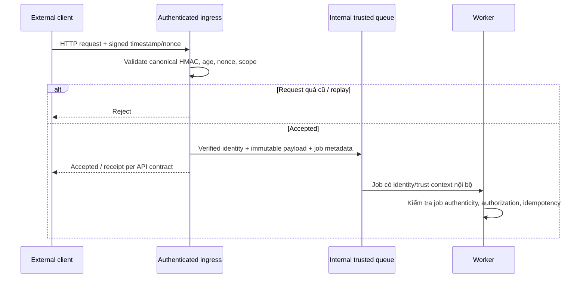

# Request quá cũ: kiểm tra timestamp khi xác thực HTTP request bằng HMAC

## 1. Request quá cũ là gì và tại sao phải từ chối?

Một HTTP request có chữ ký **HMAC hợp lệ** có thể bị lưu lại rồi gửi lại sau nhiều phút, nhiều giờ hoặc nhiều ngày. Nếu server chỉ đối chiếu HMAC trên method, URI, header và body, một request **không bị sửa byte nào** vẫn có thể tiếp tục vượt qua phép kiểm tra chữ ký. Đây là cơ sở của **replay attack**: phát lại một thông điệp trước đây từng hợp lệ.

**Request quá cũ (stale request)** là request có thời điểm ký hoặc phát hành do client khai báo nằm **trước giới hạn tuổi tối đa mà server cho phép**. Trong một hợp đồng ký HMAC, timestamp phải là **một thành phần của canonical request đã được ký**, và server cần kiểm tra nó theo **đồng hồ tin cậy ở phía server**. Nếu quá cũ, request bị từ chối **ngay cả khi HMAC đúng**.

Bài **Request quá cũ** thuộc chương **Timestamp** của module `SECURITY_AUTHENTICATION_HMAC_REQUEST_AUTHENTICATION`. Module hướng dẫn xác thực HTTP request bằng **shared secret** và **canonical request** ràng buộc method, URI, signed headers và/hoặc body; xác minh chữ ký, chống replay bằng timestamp/nonce, quản lý key rotation, kiểm thử proxy/gateway và phân biệt **authentication** với **authorization**.

Ví dụ, khách hàng đã ký lệnh chuyển tiền:

```http
POST /v1/transfers HTTP/1.1
Host: api.example.test
Content-Type: application/json
X-Key-Id: wallet-a-2026-11
X-Signature-Version: hmac-time-v1
X-Timestamp: 2026-11-28T09:40:00Z
X-Nonce: abcdefghijklmnopqrstuvwxABCDEFGH
X-Idempotency-Key: 550e8400-e29b-41d4-a716-446655440000
X-Signature: <64 lowercase hex characters>

{"from":"A123","to":"B456","amount":100000}
```

Giả sử **server đang ở `2026-11-28T10:00:00Z`**, và chính sách cho phép request tối đa **5 phút tuổi**. Timestamp trên đã cũ **20 phút**, nên phải bị từ chối. Dù client thực sự biết secret và có thể tạo chữ ký hợp lệ cho dữ liệu đó, **chữ ký không tự chứng minh request còn mới**.

Ba khái niệm cần phân biệt:

| Kiểm soát | Câu hỏi nó trả lời | Điều nó không tự chứng minh |
| --- | --- | --- |
| **HMAC** | Byte canonical này có MAC đúng với shared secret đã cấp không? | Request có còn mới, nonce đã dùng chưa, caller có quyền không? |
| **Timestamp freshness** | Thời điểm đã ký nằm trong cửa sổ thời gian cho phép không? | Request đó đã được gửi lần nào trong cửa sổ chưa? |
| **Nonce / replay store** | Cặp credential và nonce đã được chấp nhận trước đây chưa? | Caller có quyền thực hiện nghiệp vụ hay không? |
| **Authorization và idempotency** | Caller có quyền, và cùng lệnh nghiệp vụ có được xử lý lặp an toàn không? | Không thay thế xác minh HMAC, timestamp hoặc nonce. |

**Kết luận ban đầu:** một request vừa được ký HMAC hợp lệ, vừa nằm trong time window, vẫn có thể là **replay** nếu nonce đã được dùng; ngược lại, một request có nonce chưa từng thấy nhưng đã quá cũ vẫn phải bị từ chối.

## 2. Timestamp phải nằm trong phần được ký

Một cách thiết kế **không an toàn** là server nhận timestamp từ header nhưng **không ký** timestamp:

```text
Canonical cũ = METHOD + URI + BODY_DIGEST
Header ngoài MAC = X-Timestamp: ...
```

Khi đó một người có request và chữ ký cũ có thể thử **đổi riêng `X-Timestamp` thành thời gian hiện tại**, giữ nguyên HMAC của các phần còn lại. Nếu server tin timestamp mới, kiểm tra “quá cũ” bị vô hiệu hóa.

Hợp đồng đúng phải ràng buộc nó như sau:

```text
canonicalBytes = UTF8(
    VERSION + LF + METHOD + LF + TARGET + LF
    + SIGNED_HEADERS_INCLUDING_TIMESTAMP_AND_NONCE + LF
    + BODY_SHA256_HEX
)
signature = HMAC-SHA256(sharedSecret, canonicalBytes)
```

Thay đổi bất kỳ byte nào của `X-Timestamp` sẽ thay đổi canonical bytes và khiến HMAC cũ không còn khớp. **Nhưng** một request hợp lệ **nguyên vẹn** vẫn có MAC đúng khi bị replay; vì vậy server vẫn phải kiểm tra **tuổi request** và **nonce đã dùng**.

### Đừng nhầm timestamp ký với thời gian nhận request

- **Client timestamp:** thời điểm client tạo request hoặc bắt đầu ký, nằm trong signed header. Nó là **dữ liệu do client khai báo** nhưng được HMAC bảo vệ khỏi sửa đổi sau khi ký.
- **Server now:** thời gian đọc từ đồng hồ UTC tin cậy của server khi xác minh. Đây là **nguồn quyết định** request quá cũ hay không.
- **HTTP `Date` header:** có thể có ngữ nghĩa riêng ở HTTP; **không tự động là timestamp xác thực** nếu signature contract không chọn nó.
- **Thời gian log của proxy:** hữu ích cho chẩn đoán nhưng không được dùng thay đồng hồ xác minh nếu ranh giới và tính tin cậy chưa được quy định.

Một chữ ký hợp lệ chứng minh credential đã ký timestamp, **không chứng minh đồng hồ client đúng**. Client có thể vô tình đặt sai giờ hoặc cố ý dùng timestamp tương lai; server phải áp dụng chính sách kiểm tra.

## 3. Xác định “quá cũ” bằng một cửa sổ thời gian chính xác

Hợp đồng minh họa `hmac-time-v1` chọn:

- **MAX_AGE = 300 giây** (5 phút): request không được cũ hơn ngưỡng này.
- **MAX_FUTURE_SKEW = 30 giây**: chấp nhận sai lệch nhỏ khi đồng hồ client chạy **nhanh hơn** server; không nhận timestamp quá xa về tương lai.
- **Server dùng UTC `Instant`**, không dựa vào timezone hiển thị trên máy.

Gọi `issuedAt` là thời điểm client đã ký và `now` là thời điểm server xác minh. Request chỉ đạt kiểm tra thời gian khi:

```text
now - 300 seconds <= issuedAt <= now + 30 seconds
```

Hai đầu mút **được tính là hợp lệ** trong profile này. Tương đương:

```text
requestAge = now - issuedAt

if requestAge > 300 seconds   => TOO_OLD
if requestAge < -30 seconds   => TOO_FAR_IN_FUTURE
otherwise                    => WITHIN_TIME_WINDOW
```

Đây **không phải** quy tắc bắt buộc cho mọi API. Một số giao thức chọn cửa sổ đối xứng ±5 phút; hệ thống tài chính có thể đặt giới hạn ngắn hơn và dùng queue-specific trust boundary. Phải chọn chính sách có **version hoặc cấu hình server rõ ràng** và tính đến latency, clock drift cùng mức rủi ro nghiệp vụ.

### Ví dụ xác định biên với đồng hồ cố định

Cho:

```text
serverNow = 2026-11-28T10:00:00Z
MAX_AGE = 300s
MAX_FUTURE_SKEW = 30s
```

| `X-Timestamp` đã ký | Độ tuổi tại server | Kết quả |
| --- | --- | --- |
| `2026-11-28T09:40:00Z` | 20 phút | **TOO_OLD**, từ chối dù MAC đúng. |
| `2026-11-28T09:54:59Z` | 5 phút 1 giây | **TOO_OLD**, quá ngưỡng đúng 1 giây. |
| `2026-11-28T09:55:00Z` | 5 phút đúng | **Đạt**, vì ngưỡng dưới bao gồm biên. |
| `2026-11-28T09:56:00Z` | 4 phút | **Đạt**. |
| `2026-11-28T10:00:00Z` | 0 giây | **Đạt**. |
| `2026-11-28T10:00:30Z` | -30 giây | **Đạt**, ở biên phía tương lai. |
| `2026-11-28T10:00:31Z` | -31 giây | **TOO_FAR_IN_FUTURE**, từ chối. |
| `2026-11-29T10:00:00Z` | -24 giờ | **TOO_FAR_IN_FUTURE**, không “đợi” tới khi request hợp lệ. |

**Cẩn thận với dấu so sánh:** nếu chính sách nói *quá 300 giây mới bị từ chối*, test nên dùng `issuedAt.isBefore(now.minusSeconds(300))`, **không** dùng `!issuedAt.isAfter(...)`. Nhầm điều kiện `<`/`<=` có thể làm request đúng 5 phút tuổi bị từ chối, tạo bug ở ranh giới.

### Timestamp trong header chưa được tin trước HMAC

Phần kiểm tra `X-Timestamp` có thể được dùng để **lọc request quá cũ trước khi tính MAC** nhằm giảm CPU, vì thời gian client gửi là dữ liệu công khai và do caller kiểm soát. Nhưng khi đó log không được ghi “request đã ký xác thực nhưng quá cũ” trước khi kiểm tra HMAC; nó mới chỉ có **timestamp khai báo không đạt chính sách**.

Ví dụ Java sau đây chọn **kiểm tra MAC trước rồi kiểm tra freshness**, để diễn giải rõ trường hợp **HMAC hợp lệ nhưng quá cũ**. Production có thể sắp xếp kiểm tra sơ bộ sớm hơn, miễn là không bỏ qua MAC và không tin timestamp chưa được xác minh cho các quyết định quyền hoặc nghiệp vụ.

## 4. Định dạng timestamp: UTC, độ chính xác và canonicalization

Để tránh khác biệt giữa Java, JavaScript, gateway hoặc các nền tảng khác, hợp đồng ký phải chọn **một biểu diễn timestamp chính xác**. Profile của bài dùng **UTC ISO-8601 ở độ chính xác giây**, ví dụ:

```text
2026-11-28T09:56:00Z
```

Điều kiện cú pháp được công bố:

```text
YYYY-MM-DDTHH:mm:ssZ
```

- Có ký tự `T` hoa giữa ngày và giờ, hậu tố UTC `Z` hoa.
- **Không có milliseconds, microseconds hay nanoseconds**, không có phần fractional seconds.
- Không có dấu cách, timezone name, `+07:00`, `+00:00` hay `z` thường trong profile này; các dạng đó có thể biểu diễn thời điểm thật tương đương, nhưng **không phải canonical representation đã được ký**.
- Ngày/giờ phải tồn tại theo lịch thực; `2026-02-30T09:56:00Z` không được chấp nhận.
- Kiểm tra **cả cú pháp lẫn giá trị thời gian**, không chỉ dùng regex.

Trong Java 17:

```java
import java.time.Instant;
import java.time.format.DateTimeParseException;

static Instant parseTimestampStrict(String input) {
    if (input == null || !input.matches(
            "[0-9]{4}-[0-9]{2}-[0-9]{2}T"
            + "[0-9]{2}:[0-9]{2}:[0-9]{2}Z")) {
        throw new IllegalArgumentException("Bad timestamp format");
    }
    try {
        Instant result = Instant.parse(input);
        if (result.getNano() != 0
                || !result.toString().equals(input)) {
            throw new IllegalArgumentException("Not canonical UTC");
        }
        return result;
    } catch (DateTimeParseException invalid) {
        throw new IllegalArgumentException("Invalid instant", invalid);
    }
}
```

`Instant.parse` chuyển chuỗi thành **thời điểm tuyệt đối**, không dùng timezone mặc định của máy. So sánh bằng `Instant` và `Duration` giúp tránh phép trừ millisecond hoặc xử lý `LocalDateTime` không có timezone một cách mơ hồ.

### Những lỗi định dạng thường gặp

| Giá trị | Vấn đề | Chính sách của `hmac-time-v1` |
| --- | --- | --- |
| `2026-11-28T09:56:00Z` | Biểu diễn chuẩn tới giây. | Có thể chấp nhận nếu nằm trong cửa sổ. |
| `2026-11-28T09:56:00.000Z` | Có fractional seconds dù bằng đúng thời điểm. | Từ chối vì không đúng biểu diễn canonical. |
| `2026-11-28T16:56:00+07:00` | Tương ứng cùng instant với 09:56Z nhưng dùng offset. | Từ chối ở profile ví dụ; client phải tạo UTC `Z`. |
| `2026-11-28 09:56:00` | Thiếu `T` và timezone. | Từ chối. |
| `2026-11-28T09:56:60Z` | Giây nhuận hoặc cú pháp không theo canonical contract. | Không chấp nhận nếu parse/round-trip không đúng dạng quy định. |
| `1764323760` | Epoch seconds của một thời điểm khác, không cùng format. | Từ chối vì profile không dùng số epoch. |
| `1764323760000` | Trông giống epoch milliseconds; đơn vị mơ hồ nếu không ghi rõ. | Từ chối vì profile không dùng epoch millis. |
| `null` hoặc header thiếu | Không có timestamp thực. | Từ chối; không mặc định là `Instant.now()`. |

Nếu API khác chọn **epoch seconds** thay cho chuỗi UTC, cần quy định rõ đơn vị **giây hay millisecond**, integer 64-bit, canonical decimal format (không dấu `+`, zero padding, scientific notation), hành vi overflow và phiên bản hợp đồng ký. Nhầm **10 chữ số giây** với **13 chữ số milliseconds** sẽ làm request bị coi là quá cũ hoặc ở rất xa tương lai. Không tự “đoán đơn vị” từ độ dài đầu vào khi verify.

### Clock của Java: vì sao dùng `Clock`?

```java
Clock productionClock = Clock.systemUTC();
Instant now = productionClock.instant();
```

Thay vì gọi `Instant.now()` rải rác trong một lần xác minh, hãy **capture một giá trị `now`** để đánh giá cả giới hạn quá cũ và quá xa tương lai. Một request đến đúng biên không nên được so với hai thời điểm khác nhau trong cùng verification.

Để test chính xác:

```java
Clock fixed = Clock.fixed(
        Instant.parse("2026-11-28T10:00:00Z"),
        java.time.ZoneOffset.UTC);
```

`Clock.fixed` giúp kiểm tra boundary mà không cần `Thread.sleep`. Đồng hồ hệ thống ngoài production nên được giám sát đồng bộ thời gian (ví dụ NTP theo vận hành), cảnh báo drift, tránh chỉnh giờ thủ công. `System.nanoTime()` là clock đơn điệu phù hợp đo thời lượng nội bộ, **không đại diện UTC timestamp để gửi trong request**.

## 5. Hợp đồng HMAC-TIME-V1: timestamp là signed header bắt buộc

Để nối việc kiểm tra “quá cũ” vào xác thực HMAC HTTP thực tế, ta dùng **`hmac-time-v1`**, một signature profile **tự định nghĩa cho bài học**, không phải chuẩn sẵn có của HTTP.

Request mẫu:

```http
POST /v1/transfers HTTP/1.1
Host: api.example.test
Content-Type: application/json
X-Key-Id: wallet-a-2026-11
X-Signature-Version: hmac-time-v1
X-Timestamp: 2026-11-28T09:56:00Z
X-Nonce: abcdefghijklmnopqrstuvwxABCDEFGH
X-Idempotency-Key: 550e8400-e29b-41d4-a716-446655440000
X-Signature: <64 lowercase hex characters>

{"from":"A123","to":"B456","amount":100000}
```

**Quy tắc ký và xác minh**:

1. **Method/target:** `POST` và raw request target `/v1/transfers`. Không tự chuyển path/query trước hoặc sau verify.
2. **Audience:** `https://api.example.test`, lấy từ routing/ingress tin cậy, ràng buộc với credential và route; không chỉ tin vào `Host` hoặc `X-Forwarded-Host` do client khai báo.
3. **Content-Type:** đúng một header `application/json`, body UTF-8 JSON và profile không hỗ trợ `Content-Encoding`; server hash **body bytes sau gỡ HTTP transfer framing nhưng trước JSON parser**.
4. **Header đơn trị:** `Content-Type`, `X-Key-Id`, `X-Signature-Version`, `X-Timestamp`, `X-Nonce`, `X-Idempotency-Key` và `X-Signature` phải có đúng **một field line** theo tên case-insensitive. Thiếu, trùng hoặc giá trị sai grammar đều từ chối.
5. **Key ID/version:** `X-Key-Id` là định danh, server tra secret thực ở credential store; `hmac-time-v1` ánh xạ cố định sang `HmacSHA256` và canonical schema này.
6. **Timestamp:** UTC `YYYY-MM-DDTHH:mm:ssZ`, nằm trong `now - 300s` đến `now + 30s`, hai đầu mút bao gồm.
7. **Nonce:** Base64URL không padding của 24 bytes ngẫu nhiên (32 ký tự), được ký và được claim nguyên tử trên kho dùng chung **sau khi MAC đúng và time window đạt**.
8. **Idempotency key:** định danh thao tác nghiệp vụ (ví dụ UUID chữ thường); đưa vào canonical để chống sửa. Nó **không thay thế nonce**; idempotency store ở tầng nghiệp vụ phải kiểm tra cùng operation/payload và tránh thực hiện giao dịch hai lần.
9. **MAC:** `HmacSHA256` full **32 bytes**, thể hiện bằng **64 ký tự lowercase hex**. `X-Signature` là đầu ra nên không nằm trong canonical message.
10. **Byte representation:** từng dòng nối bằng LF (`0A`), encode toàn canonical message UTF-8, **không có LF cuối**. Header names được ghi chữ thường, values được validate theo schema.

Canonical message minh họa:

```text
HMAC-TIME-V1
POST
https://api.example.test
/v1/transfers
content-type:application/json
x-idempotency-key:550e8400-e29b-41d4-a716-446655440000
x-key-id:wallet-a-2026-11
x-signature-version:hmac-time-v1
x-timestamp:2026-11-28T09:56:00Z
x-nonce:abcdefghijklmnopqrstuvwxABCDEFGH
<64 lowercase hex characters of SHA-256(bodyBytes)>
```

**Dòng cuối là placeholder** cho `SHA-256(bodyBytes)` thực tế, không ký ký tự `<` hoặc `>`. Byte canonical được tạo ở hai phía theo đúng thứ tự dòng; phần `X-Signature` không đưa vào canonical để tránh vòng lặp tự tham chiếu.

```text
bodyDigestHex  = lowercaseHex(SHA-256(bodyBytes))
canonicalBytes = UTF8(canonicalMessage)
macBytes       = HMAC-SHA256(sharedSecretBytes, canonicalBytes)
signatureHex   = lowercaseHex(macBytes)
```

### Vì sao phải ký `X-Idempotency-Key` nếu đã ký nonce?

`X-Nonce` chống phát lại **cùng một signed request** trong time window: khi nonce đã claim, request thứ hai bị từ chối. Còn `X-Idempotency-Key` giúp tầng nghiệp vụ nhận ra **cùng một lệnh chuyển tiền** nếu client cần **retry với timestamp/nonce và MAC mới** sau timeout. Khi một retry được ký lại, nonce mới không thể cho biết đó là lệnh chuyển tiền cũ hay mới; idempotency key có thể giúp lưu và trả lại kết quả cũ thay vì chuyển tiền hai lần.

Idempotency cần một **store/transaction boundary** phù hợp, kiểm tra cùng key không được sử dụng với payload khác và lưu kết quả hoặc trạng thái xử lý. Chỉ đưa idempotency key vào HMAC **không tự thực hiện logic idempotency**.

## 6. Java 17+: xác minh HMAC trước khi phân loại request quá cũ

Ví dụ sau là một class **Java 17 độc lập** minh họa:

- Thu thập từng HTTP field line để từ chối **signed header thiếu, lặp tên hoặc malformed**.
- Định nghĩa `hmac-time-v1` và các signed fields theo **một contract cố định**.
- Tạo canonical UTF-8 bytes từ body và các field thực nhận; tính `HmacSHA256` bằng `Mac.init(SecretKeySpec)`.
- So sánh MAC đầy đủ bằng `MessageDigest.isEqual`, không so sánh chuỗi signature bằng `String.equals`.
- Parse UTC timestamp, kiểm tra **`issuedAt` trước `now-300s`** là stale, và **sau `now+30s`** là tương lai quá xa.
- Claim nonce sau khi **MAC đúng và thời gian hợp lệ**. Server vẫn phải kiểm tra quyền và business idempotency riêng.
- Dùng `Clock.fixed` để test các ngưỡng thời gian mà không phải ngủ hoặc phụ thuộc đồng hồ thực.

**Giả định quan trọng:** HTTP adapter phải giữ raw target, field lines trước khi gateway merge, body bytes sau gỡ HTTP transfer framing, không cho `Content-Encoding` và kiểm tra HTTP framing/authority trước khi gọi verifier. Sample chỉ dành cho một endpoint, không có HTTP server thực. `NonceStore` ở `main` dùng memory trong **một JVM và không có TTL**; chỉ là mock để quan sát replay, **không dùng trong production**.

```java
import java.nio.charset.StandardCharsets;
import java.security.GeneralSecurityException;
import java.security.MessageDigest;
import java.security.SecureRandom;
import java.time.Clock;
import java.time.Duration;
import java.time.Instant;
import java.time.ZoneOffset;
import java.time.format.DateTimeParseException;
import java.util.ArrayList;
import java.util.Base64;
import java.util.HashMap;
import java.util.HexFormat;
import java.util.List;
import java.util.Locale;
import java.util.Map;
import java.util.Set;
import java.util.concurrent.ConcurrentHashMap;
import javax.crypto.Mac;
import javax.crypto.spec.SecretKeySpec;

public final class StaleHmacRequestDemo {
    private static final String VERSION = "hmac-time-v1";
    private static final String ORIGIN = "https://api.example.test";
    private static final String TARGET = "/v1/transfers";
    private static final String IDEMPOTENCY_KEY =
            "550e8400-e29b-41d4-a716-446655440000";
    private static final Duration MAX_AGE = Duration.ofSeconds(300);
    private static final Duration FUTURE_SKEW = Duration.ofSeconds(30);
    private static final Duration NONCE_TTL = Duration.ofMinutes(6);
    private static final HexFormat HEX = HexFormat.of();
    private static final Set<String> SIGNED_FIELDS = Set.of(
            "content-type", "x-idempotency-key", "x-key-id",
            "x-signature-version", "x-timestamp", "x-nonce");
    private static final Set<String> ALL_FIELDS = Set.of(
            "content-type", "x-idempotency-key", "x-key-id",
            "x-signature-version", "x-timestamp", "x-nonce",
            "x-signature");

    public record FieldLine(String name, String value) {}

    public record Request(
            String method, String rawTarget, String trustedOrigin,
            List<FieldLine> headers, byte[] body) {
        public Request {
            headers = headers == null ? null : List.copyOf(headers);
            body = body == null ? null : body.clone();
        }
        @Override
        public byte[] body() {
            return body == null ? null : body.clone();
        }
    }

    public record Credential(
            String keyId, byte[] secret, boolean active,
            String audience, Set<String> allowedVersions,
            Set<String> allowedTargets) {
        public Credential {
            secret = secret == null ? null : secret.clone();
        }
        @Override
        public byte[] secret() {
            return secret == null ? null : secret.clone();
        }
    }

    public interface CredentialStore {
        Credential find(String keyId);
    }

    public interface NonceStore {
        // Production phải là atomic insert-if-absent với TTL trên kho chung.
        boolean claim(String keyId, String nonce, Duration ttl);
    }

    // Đo tuổi theo đồng hồ UTC server; bao gồm cả hai biên.
    public static boolean withinWindow(Instant issuedAt, Instant now) {
        return !issuedAt.isBefore(now.minus(MAX_AGE))
                && !issuedAt.isAfter(now.plus(FUTURE_SKEW));
    }

    // Không chỉ regex: phải parse ngày giờ thật và round-trip canonical.
    private static Instant parseTimestamp(String text) {
        if (text == null || !text.matches(
                "[0-9]{4}-[0-9]{2}-[0-9]{2}T"
                + "[0-9]{2}:[0-9]{2}:[0-9]{2}Z")) {
            throw new IllegalArgumentException("Bad timestamp syntax");
        }
        try {
            Instant value = Instant.parse(text);
            if (value.getNano() != 0
                    || !text.equals(value.toString())) {
                throw new IllegalArgumentException("Not canonical UTC");
            }
            return value;
        } catch (DateTimeParseException invalid) {
            throw new IllegalArgumentException("Invalid timestamp", invalid);
        }
    }

    private static String trimOws(String value) {
        int start = 0, end = value.length();
        while (start < end
                && (value.charAt(start) == ' '
                    || value.charAt(start) == '\t')) start++;
        while (end > start
                && (value.charAt(end - 1) == ' '
                    || value.charAt(end - 1) == '\t')) end--;
        return value.substring(start, end);
    }

    private static Map<String, String> readFields(
            List<FieldLine> lines, boolean requireSignature) {
        if (lines == null) {
            throw new IllegalArgumentException("Headers unavailable");
        }
        Set<String> required =
                requireSignature ? ALL_FIELDS : SIGNED_FIELDS;
        Map<String, String> found = new HashMap<>();
        for (FieldLine h : lines) {
            if (h == null || h.name() == null
                    || !h.name().matches("[A-Za-z0-9-]{1,128}")
                    || h.value() == null) {
                throw new IllegalArgumentException("Malformed field");
            }
            String name = h.name().toLowerCase(Locale.ROOT);
            if ("content-encoding".equals(name)) {
                throw new IllegalArgumentException("Unsupported encoding");
            }
            // Signed fields trong ví dụ chỉ chấp nhận ASCII an toàn;
            // HTAB ở rìa được trim nhưng HTAB nội bộ bị từ chối.
            String value = trimOws(h.value());
            for (int i = 0; i < value.length(); i++) {
                char c = value.charAt(i);
                if (c < 0x20 || c > 0x7E) {
                    throw new IllegalArgumentException("Unsafe field value");
                }
            }
            if (ALL_FIELDS.contains(name)) {
                if (found.putIfAbsent(name, value) != null) {
                    throw new IllegalArgumentException(
                            "Duplicate signed header: " + name);
                }
            }
        }
        if (!found.keySet().equals(required)) {
            throw new IllegalArgumentException(
                    "Required field missing or unexpected signature");
        }
        return Map.copyOf(found);
    }

    private static boolean nonceLooksCanonical(String nonce) {
        if (!nonce.matches("[A-Za-z0-9_-]{32}")) return false;
        try {
            byte[] bytes = Base64.getUrlDecoder().decode(nonce);
            return bytes.length == 24
                    && nonce.equals(Base64.getUrlEncoder()
                            .withoutPadding().encodeToString(bytes));
        } catch (IllegalArgumentException invalid) {
            return false;
        }
    }

    private static boolean validFields(Map<String, String> fields) {
        return "application/json".equals(fields.get("content-type"))
                && fields.get("x-idempotency-key").matches(
                    "[0-9a-f]{8}(-[0-9a-f]{4}){3}-[0-9a-f]{12}")
                && fields.get("x-key-id").matches(
                    "[A-Za-z0-9._-]{1,128}")
                && VERSION.equals(fields.get("x-signature-version"))
                && nonceLooksCanonical(fields.get("x-nonce"));
    }

    private static byte[] canonicalBytes(
            Request r, Map<String, String> fields)
            throws GeneralSecurityException {
        String digestHex = HEX.formatHex(
                MessageDigest.getInstance("SHA-256").digest(r.body()));
        String canonical = String.join("\n",
                "HMAC-TIME-V1",
                r.method(),
                ORIGIN,
                r.rawTarget(),
                "content-type:" + fields.get("content-type"),
                "x-idempotency-key:"
                        + fields.get("x-idempotency-key"),
                "x-key-id:" + fields.get("x-key-id"),
                "x-signature-version:"
                        + fields.get("x-signature-version"),
                "x-timestamp:" + fields.get("x-timestamp"),
                "x-nonce:" + fields.get("x-nonce"),
                digestHex);
        return canonical.getBytes(StandardCharsets.UTF_8);
    }

    private static byte[] hmac(
            byte[] secret, byte[] canonical)
            throws GeneralSecurityException {
        Mac mac = Mac.getInstance("HmacSHA256");
        mac.init(new SecretKeySpec(secret, "HmacSHA256"));
        return mac.doFinal(canonical);
    }

    // Chỉ được gọi khi HTTP adapter đã tạo snapshot request đúng contract.
    public static boolean verify(
            Request r, CredentialStore credentials,
            NonceStore nonceStore, Clock clock)
            throws GeneralSecurityException {
        if (r == null || credentials == null || nonceStore == null
                || clock == null || r.method() == null
                || r.rawTarget() == null || r.trustedOrigin() == null
                || r.headers() == null || r.body() == null) return false;

        if (!"POST".equals(r.method())
                || !TARGET.equals(r.rawTarget())
                || !ORIGIN.equals(r.trustedOrigin())
                || r.body().length == 0
                || r.body().length > 1_048_576) return false;

        Map<String, String> fields;
        Instant issuedAt;
        try {
            fields = readFields(r.headers(), true);
            if (!validFields(fields)
                    || !fields.get("x-signature")
                            .matches("[0-9a-f]{64}")) {
                return false;
            }
            issuedAt = parseTimestamp(fields.get("x-timestamp"));
        } catch (IllegalArgumentException invalid) {
            return false;
        }

        String keyId = fields.get("x-key-id");
        Credential key = credentials.find(keyId);
        if (key == null || !key.active()
                || !keyId.equals(key.keyId())
                || !ORIGIN.equals(key.audience())
                || key.allowedVersions() == null
                || !key.allowedVersions().contains(VERSION)
                || key.allowedTargets() == null
                || !key.allowedTargets().contains(TARGET)) {
            return false;
        }
        byte[] secret = key.secret();
        if (secret == null || secret.length < 32) return false;

        byte[] expected = hmac(secret, canonicalBytes(r, fields));
        byte[] received = HEX.parseHex(fields.get("x-signature"));
        if (expected.length != 32 || received.length != 32
                || !MessageDigest.isEqual(expected, received)) {
            return false;
        }

        // Timestamp đã được MAC xác thực; dùng một now UTC duy nhất.
        Instant now = clock.instant();
        if (!withinWindow(issuedAt, now)) {
            return false; // MAC có thể đúng nhưng request quá cũ.
        }

        // Không claim nonce cho request cũ hoặc MAC sai.
        return nonceStore.claim(
                keyId, fields.get("x-nonce"), NONCE_TTL);
        // Sau true: vẫn cần authorization + idempotency business store.
    }

    private static Request signAt(
            String timestamp, byte[] secret, SecureRandom random)
            throws GeneralSecurityException {
        byte[] nonceBytes = new byte[24];
        random.nextBytes(nonceBytes);
        String nonce = Base64.getUrlEncoder().withoutPadding()
                .encodeToString(nonceBytes);

        byte[] body = (
                "{\"from\":\"A123\",\"to\":\"B456\",\"amount\":100000}")
                .getBytes(StandardCharsets.UTF_8);
        List<FieldLine> lines = new ArrayList<>(List.of(
                new FieldLine("Content-Type", "application/json"),
                new FieldLine("X-Idempotency-Key", IDEMPOTENCY_KEY),
                new FieldLine("X-Key-Id", "wallet-a-2026-11"),
                new FieldLine("X-Signature-Version", VERSION),
                new FieldLine("X-Timestamp", timestamp),
                new FieldLine("X-Nonce", nonce)));
        Request draft = new Request("POST", TARGET, ORIGIN, lines, body);
        Map<String, String> fields = readFields(lines, false);
        if (!validFields(fields)) {
            throw new IllegalArgumentException("Invalid signer fields");
        }
        String signatureHex = HEX.formatHex(
                hmac(secret, canonicalBytes(draft, fields)));
        lines.add(new FieldLine("X-Signature", signatureHex));
        return new Request("POST", TARGET, ORIGIN, lines, body);
    }

    // Đổi timestamp nhưng giữ signature cũ để thử integrity.
    private static Request tamperTimestamp(
            Request r, String substitutedTime) {
        List<FieldLine> changed = new ArrayList<>();
        for (FieldLine line : r.headers()) {
            if ("x-timestamp".equalsIgnoreCase(line.name())) {
                changed.add(new FieldLine(line.name(), substitutedTime));
            } else {
                changed.add(line);
            }
        }
        return new Request(r.method(), r.rawTarget(),
                r.trustedOrigin(), changed, r.body());
    }

    private static void check(
            String caseName, boolean actual, boolean expected) {
        if (actual != expected) {
            throw new AssertionError(
                    caseName + " expected " + expected + " got " + actual);
        }
        System.out.println(caseName + ": " + actual);
    }

    public static void main(String[] args) throws Exception {
        // Secret thử nghiệm ngẫu nhiên, không xuất ra logs.
        SecureRandom random = new SecureRandom();
        byte[] secret = new byte[32];
        random.nextBytes(secret);
        Credential key = new Credential(
                "wallet-a-2026-11", secret, true, ORIGIN,
                Set.of(VERSION), Set.of(TARGET));
        CredentialStore credentials = id ->
                key.keyId().equals(id) ? key : null;

        // Mock in-memory chỉ chạy một JVM, không có TTL;
        // production bắt buộc dùng atomic store chia sẻ.
        Set<String> seen = ConcurrentHashMap.newKeySet();
        NonceStore nonces = (keyId, nonce, ttl) ->
                seen.add(keyId + ":" + nonce);

        Clock fixedClock = Clock.fixed(
                Instant.parse("2026-11-28T10:00:00Z"),
                ZoneOffset.UTC);

        Request tooOld = signAt(
                "2026-11-28T09:54:59Z", secret, random);
        Request oldBoundary = signAt(
                "2026-11-28T09:55:00Z", secret, random);
        Request fresh = signAt(
                "2026-11-28T09:56:00Z", secret, random);
        Request futureBoundary = signAt(
                "2026-11-28T10:00:30Z", secret, random);
        Request tooFarFuture = signAt(
                "2026-11-28T10:00:31Z", secret, random);

        check("301 seconds old",
                verify(tooOld, credentials, nonces, fixedClock),
                false);
        check("300 seconds old (inclusive)",
                verify(oldBoundary, credentials, nonces, fixedClock),
                true);
        check("240 seconds old",
                verify(fresh, credentials, nonces, fixedClock),
                true);
        check("30 seconds future (inclusive)",
                verify(futureBoundary, credentials, nonces, fixedClock),
                true);
        check("31 seconds future",
                verify(tooFarFuture, credentials, nonces, fixedClock),
                false);

        // Cùng request, cùng nonce: chữ ký vẫn đúng,
        // nhưng replay protection phải từ chối.
        check("replay signed request",
                verify(fresh, credentials, nonces, fixedClock),
                false);

        // Sửa timestamp của request quá cũ để làm nó có vẻ mới;
        // timestamp thuộc canonical nên HMAC cũ không khớp.
        Request forged = tamperTimestamp(
                tooOld, "2026-11-28T10:00:00Z");
        check("changed timestamp without resigning",
                verify(forged, credentials, nonces, fixedClock),
                false);
    }
}
```

### Tại sao code kiểm tra MAC trước khi kiểm tra tuổi?

Trong `verify`, timestamp được **parse cú pháp** trước để tránh dữ liệu malformed, nhưng việc xác nhận tính mới được thực hiện **sau `MessageDigest.isEqual`**. Do đó một request do client hợp lệ ký từ 301 giây trước có thể có **MAC hoàn toàn đúng** nhưng bị từ chối tại `withinWindow`. Đây chính là vấn đề **Request quá cũ** mà bài học cần phân biệt.

Trong production, server có thể dùng kiểm tra time-window sơ bộ sớm để chống DoS, nhưng không được công nhận identity hay ghi nhận “chữ ký đúng” trước khi tính MAC. Cũng không nên trả ra hai thông báo công khai có chi tiết khác biệt như “key ID hợp lệ nhưng chữ ký sai” và “chữ ký đúng nhưng timestamp quá cũ” nếu chúng gây rò rỉ thông tin về credential; phản hồi bên ngoài nên theo chính sách authentication thống nhất.

### Vì sao code dùng `Clock.fixed`?

Với đồng hồ thực, nếu request đang ở gần mốc 5 phút, kết quả có thể thay đổi ngay giữa hai dòng test. Một `Clock.fixed` cho phép kiểm tra **301 giây bị từ chối**, **300 giây được chấp nhận**, **30 giây tương lai được chấp nhận** và **31 giây tương lai bị từ chối** một cách tất định. Khi triển khai thực, inject `Clock.systemUTC()` thay vì fixed clock; **không bao giờ giữ fixed clock trong production**, bởi thời gian sẽ đứng yên và làm hỏng kiểm tra freshness.

### Những điều demo không thay thế được

- Credential store thật phải quản lý key ID, tenant, active/revoked state và rotation; không dùng secret test làm khóa phát hành.
- Nonce store thật phải hỗ trợ **atomic insert-if-absent**, TTL và chia sẻ giữa mọi instance/region theo thiết kế.
- HTTP ingress phải chặn duplicate fields, framing mơ hồ, HTTP/2 pseudo-header issues, path rewrite và content transform ngoài contract.
- Handler thực phải kiểm tra **authorization cho source/destination accounts**, hạn mức và **business idempotency** trước khi chuyển tiền.
- Trường hợp backend cần xử lý background queue không được coi mọi request HMAC “không còn fresh” trong queue là có thể tự động bỏ qua thời gian. Hãy xác minh request tại ingress, rồi đưa job **đã được xác thực qua kênh nội bộ tin cậy** vào queue với chính sách riêng.

## 7. Timestamp và nonce phải phối hợp ra sao?

Chỉ kiểm tra timestamp giới hạn **thời gian có thể replay**, nhưng **không ngăn replay trong cửa sổ được chấp nhận**. Giả sử server chấp nhận request tối đa 5 phút tuổi:

```text
09:59:00  Client ký POST transfer, timestamp=09:59:00, nonce=N1.
09:59:01  Server nhận lần 1: HMAC đúng, age=1 giây -> hợp lệ.
09:59:02  Attacker hoặc client gửi lại đúng request với nonce=N1.
09:59:02  HMAC vẫn đúng, age=2 giây -> timestamp vẫn hợp lệ.
09:59:02  Nonce store thấy N1 đã được sử dụng -> TỪ CHỐI.
```

Nếu không có nonce store, timestamp chỉ giới hạn khoảng thời gian mà attacker có thể phát lại cùng request. Đối với yêu cầu nhạy cảm như chuyển tiền, tạo đơn hoặc thay đổi cấu hình bảo mật, đây là lỗ hổng đáng kể.

### Claim nonce phải atomic và chỉ sau khi xác minh

Mẫu lưu nonce về nguyên tắc:

```text
key          = (credentialKeyId, nonce)
operation    = INSERT_IF_ABSENT(key, TTL)
result       = inserted ? ACCEPT_REPLAY_CHECK : REJECT_REPLAY
```

Hãy triển khai với một kho dùng chung hỗ trợ **thao tác nguyên tử**, ví dụ lệnh `SET key value NX EX ttl` trong một hệ thống key-value hỗ trợ tính năng tương đương. Không làm như sau:

```text
if !nonceStore.exists(key):
    nonceStore.put(key, 360s)
    accept()
```

Hai node xử lý song song có thể cùng thấy `exists=false`, rồi cùng chấp nhận request trước khi ghi key. Atomic insert-if-absent giải quyết race này khi mọi node dùng **cùng kho nhất quán**.

Nonce store không nên được ghi cho request có **MAC sai**, **timestamp quá cũ**, key bị revoke hoặc route sai. Nếu một kẻ tấn công không biết secret có thể claim nonce chỉ bằng cách gửi header chứa nonce, kẻ đó có thể gây **nonce poisoning/denial of service** cho request hợp lệ.

### TTL phải bao phủ toàn bộ thời gian replay còn có thể thành công

Với cửa sổ minh họa:

```text
MAX_AGE         = 300s
MAX_FUTURE_SKEW = 30s
```

Request có timestamp **đi trước server 30 giây** vẫn có thể được chấp nhận lần đầu tại `t0`. Nó chỉ bắt đầu được coi là quá cũ sau:

```text
lastPossibleValidServerTime = signedTimestamp + MAX_AGE
                           = t0 + 30s + 300s
                           = t0 + 330s
```

Vì vậy, nếu lưu nonce với TTL kể từ **lần chấp nhận đầu**, thời gian giữ phải **ít nhất 330 giây cộng biên an toàn**. Bài chọn **360 giây (6 phút)** cho minh họa, với điều kiện các node dùng chính sách clock skew nhất quán, TTL tính từ thời điểm claim và kho nonce không tự làm mất entry sớm.

**Không áp dụng máy móc công thức cho mọi hệ thống:** nếu cho phép timestamp ở tương lai ±5 phút, request có thể còn hợp lệ lâu hơn; nếu có nhiều region với drift lớn, time-window và retention phải được thiết kế tương ứng. Nonce store mất dữ liệu do failover hoặc eviction cũng có thể mở cửa replay trong time window. Với request nhạy cảm, nên **fail closed** khi replay store không thể bảo đảm tính nguyên tử/tồn tại của entry.

### Nonce không thay thế idempotency key

Một **retry hợp lệ** sau timeout thường cần timestamp và nonce **mới**, nên sẽ có **MAC mới**. Nếu đây vẫn là cùng lệnh chuyển tiền, tầng nghiệp vụ phải biết **không chuyển tiền hai lần**. Cách phổ biến là dùng một **idempotency key đã được ký** gắn với caller và nội dung thao tác, lưu trạng thái xử lý atomically và trả lại kết quả phù hợp khi retry.

| Tình huống | Nonce | Idempotency key | Hành vi mong đợi |
| --- | --- | --- | --- |
| Request đầu tiên | N1 | I1 | Xác minh, claim N1, xử lý lệnh I1 một lần. |
| Phát lại nguyên request | N1 | I1 | **Từ chối replay N1**, không xử lý lệnh. |
| Client retry an toàn sau timeout | N2 | I1 | MAC mới hợp lệ; business idempotency store nhận ra I1 và không thực thi lần hai. |
| Client gửi giao dịch mới | N3 | I2 | MAC mới và idempotency key mới; vẫn cần authorization, validation. |
| Client dùng lại I1 cho payload khác | N4 | I1 | Business layer từ chối/conflict theo chính sách, không âm thầm xử lý lệnh khác. |

## 8. Các nguyên nhân khiến request hợp lệ lại bị coi là quá cũ

Không phải lỗi “request quá cũ” nào cũng là tấn công. Các tình huống vận hành cần được phân biệt với replay:

| Nguyên nhân | Triệu chứng | Cách xử lý phù hợp |
| --- | --- | --- |
| **Đồng hồ client chạy chậm** | HMAC có thể đúng nhưng timestamp trước ngưỡng 300 giây. | Đồng bộ giờ của client, sử dụng UTC; không nới cửa sổ một cách tùy tiện. |
| **Đồng hồ server chạy nhanh** | Nhiều client cùng bị báo stale, các node không nhất quán. | Giám sát clock drift, NTP và alert theo từng node/region. |
| **Client tạo timestamp quá sớm** | Ký request, chờ trong queue hoặc batch quá lâu rồi gửi. | Tạo timestamp và ký **sát thời điểm thực gửi**, hoặc thiết kế một signed asynchronous envelope riêng. |
| **HTTP retries dùng lại signature** | Request đã được gửi hoặc bị giữ lâu; nonce có thể cũ. | Retry với nonce/timestamp mới và ký lại; giữ idempotency key. |
| **Network latency cao / proxy chờ lâu** | Request đến server khi age đã vượt 300 giây. | Đo latency từng hop, xử lý nghẽn, cân nhắc chính sách max age theo threat model. |
| **Nhầm đơn vị seconds/milliseconds** | Timestamp biến thành năm 1970 hoặc tương lai rất xa. | Một biểu diễn timestamp cố định, unit tests; không tự đoán đơn vị. |
| **Nhầm timezone địa phương** | Thời điểm lệch nhiều giờ. | Dùng `Instant` UTC và canonical `Z`; không ký `LocalDateTime` thiếu zone. |
| **Mất precision / fractional seconds** | MAC mismatch do chuỗi timestamp khác nhau hoặc parser từ chối. | Dùng exact `YYYY-MM-DDTHH:mm:ssZ`, canonical bytes nhất quán. |
| **Gateway rewrite timestamp** | Client ký giá trị A, backend thấy B. | Không biến đổi signed timestamp; xác minh tại ranh giới phù hợp. |
| **NTP step hoặc host clock jump** | Một số request đồng loạt bị stale/future. | Alert và bảo trì clock sync; fail closed theo policy, không bỏ kiểm tra freshness. |
| **Secret đã rotate/revoke** | Request cũ có thể sai key policy dù vẫn nằm trong window. | Phân biệt lỗi khóa với lỗi thời gian trong metrics nội bộ, không dùng key cũ trái policy. |

### Queue và tác vụ chạy bất đồng bộ

Một webhook có thể được client ký lúc 09:00, đi qua hàng đợi và chỉ được worker xử lý lúc 09:20. Nếu worker dùng trực tiếp timestamp của **HTTP request từ bên ngoài** làm freshness tại thời điểm xử lý job, nó sẽ coi request quá cũ. **Không khắc phục bằng cách vô hiệu hóa kiểm tra timestamp**.

Một kiến trúc rõ ràng hơn:



Ở đây **ingress** xác minh tính mới của HTTP request khi request vừa đến. Sau đó dữ liệu đã được xác thực được đưa vào hệ thống queue **có bảo vệ**, với cơ chế tin cậy và chống trùng lặp riêng cho job. Worker không được tin một `X-Verified-Client` tự do do client Internet tự gửi, cũng không được bỏ business authorization.

### Trả lỗi cho client mà không làm lộ thông tin

Trong triển khai thực, server có thể phân loại lỗi nội bộ:

```text
INVALID_TIMESTAMP_SYNTAX
INVALID_MAC
STALE_TIMESTAMP
TIMESTAMP_TOO_FAR_IN_FUTURE
REPLAY_NONCE
KEY_REVOKED
TARGET_OUT_OF_SCOPE
```

Nhưng phản hồi công khai nên theo chính sách authentication phù hợp, thường là `401 Unauthorized` cho chứng cứ xác thực thiếu/sai/hết hạn; request HTTP malformed có thể bị chặn ở `400 Bad Request` tại ingress; nếu xác thực đúng nhưng thiếu quyền thì thường là `403 Forbidden`. Không tiết lộ expected MAC, shared secret, số lượng key tồn tại hoặc chi tiết nội bộ giúp attacker enumerate credential. Nếu dùng `401`, cần chính sách `WWW-Authenticate` tương ứng scheme/challenge thật sự được triển khai, không bịa challenge không tương thích.

Một client **đã được phép ký request** có thể được SDK hướng dẫn đồng bộ UTC clock, tạo timestamp/nonce mới và ký lại; nhưng không gửi secret, canonical bytes nhạy cảm hoặc expected MAC ra log công khai để debug.

## 9. Gateway, key rotation và những thay đổi làm kiểm tra timestamp mất ý nghĩa

Một request thường đi qua CDN, load balancer, API gateway, service mesh rồi mới tới backend. Timestamp đã ký có thể bị làm sai hoặc bị bỏ qua nếu các thành phần này không đồng nhất hợp đồng:

```text
Client SDK                     API Gateway                 Backend
----------                     -----------                 -------
Serialize body bytes
Create timestamp UTC
Create random nonce
Build canonical request
Sign HMAC
    |                                |                         |
    +--- signed HTTP request ------->|                         |
                                     | validate/normalize?     |
                                     +--- forwarded HTTP ----->|
                                                               |
                                    verify same canonical bytes
                                    check MAC + timestamp age
                                    atomic nonce claim
                                    authorization
```

| Tình huống | Rủi ro | Chính sách phòng vệ |
| --- | --- | --- |
| Gateway tự viết lại `X-Timestamp` thành giờ ingress. | HMAC gốc không còn khớp hoặc server tin giờ được “làm mới” không ký. | Không sửa signed timestamp; nếu có chuyển đổi, xác minh ở đúng ranh giới và lập contract mới. |
| Gateway strip `X-Timestamp` hoặc `X-Nonce`. | Backend không còn dữ liệu để xác minh freshness/replay. | Forward theo contract hoặc gateway thực hiện verification, chuyển verified identity qua kênh tin cậy. |
| Gateway cộng thời gian nhận request vào age mà backend cũng cộng lần nữa. | Cùng request có thể bị từ chối không nhất quán. | Một thành phần sở hữu phép kiểm tra freshness và dùng thời điểm server tại ranh giới đó. |
| CDN/cache phục vụ response trước auth. | Request có thể vượt qua verifier hoặc cache không gắn với identity. | Với dữ liệu riêng tư, không cache chung trước enforcement; cân nhắc `Cache-Control: no-store`. |
| Proxy rewrite path/query hoặc signed headers. | Canonical ở client và backend khác, MAC sai. | Định nghĩa raw/logical target và verify trước rewrite hoặc dùng metadata tin cậy có version. |
| Gateway decompress hoặc serialize lại JSON. | Body digest thay đổi; signature mismatch. | Ký/verify cùng snapshot body; công bố Content-Encoding contract. |
| Header `X-Timestamp` lặp với hai giá trị. | Filter kiểm tra timestamp A, HMAC verifier ký timestamp B. | Từ chối duplicate **theo tên case-insensitive** ngay từ ingress. |
| HTTP/1.1 → HTTP/2 hoặc ngược lại. | HTTP target/authority khác biểu diễn; header normalization không đồng nhất. | Kiểm thử adapter `:path`, `:authority`, `Host` và route tin cậy; không phụ thuộc vào framing từng hop. |
| Region A và B có clock drift. | Node A chấp nhận, node B báo TOO_OLD hoặc FUTURE. | Đồng bộ UTC clock, cảnh báo drift, cấu hình window nhất quán. |
| Region A và B dùng nonce store độc lập không phối hợp. | Replay có thể được chấp nhận ở region còn lại. | Dùng replay store có phạm vi nhất quán với chính sách routing/credential hoặc ràng buộc traffic vào partition được thiết kế an toàn. |

### Xác minh ở gateway hay backend?

**Gateway verify trước khi rewrite:** gateway có raw request và có thể kiểm tra timestamp/nonce tại ingress. Sau thành công, gateway chuyển **verified identity, route, body snapshot** qua TLS/mTLS hoặc kênh tin cậy tương đương đến backend; backend chặn bypass trực tiếp và không tin các header identity do client tự khai. Cần bảo đảm business authorization vẫn ở nơi thích hợp.

**Backend verify sau gateway:** gateway phải bảo toàn các field đã ký và request target/body đúng hợp đồng. Nếu backend phải biết URI gốc, chỉ tin metadata được **gateway đã xác thực** tạo mới sau khi strip input giả mạo; không tin `X-Original-URI`, `X-Original-Timestamp` hay `X-Verified-Client` do client Internet tự gửi.

### Key rotation không phải cơ chế kéo dài thời gian sống request

Một request có HMAC tính đúng bằng secret cũ nhưng timestamp đã quá 5 phút vẫn phải bị từ chối nếu key đó còn active. Nếu key bị revoke, phải từ chối **ngay cả khi** request đang trong 5 phút và HMAC toán học vẫn đúng.

Trong thời gian rotation, server có thể cho phép **hai key ID khác nhau** cùng active với secret riêng, nhưng mỗi request chỉ mang **một key ID**. Không “thử mọi secret” hoặc fallback sang canonical/signature version cũ để cứu request quá hạn. Đổi key không tự làm timestamp cũ trở thành mới; client cần tạo request **mới đúng chính sách** và ký bằng credential còn hiệu lực.

## 10. Test matrix: request quá cũ, request tương lai và replay

Bộ **golden fixtures** nên lưu: method, raw URI, từng field line, body bytes, key ID và secret **chỉ dùng thử nghiệm**, timestamp ISO-8601, nonce, canonical UTF-8 bytes, MAC dự kiến, **clock server cố định**, nonce-store state và kết quả.

Đối với case hết hạn, **phải có chữ ký HMAC hợp lệ** của đúng canonical request rồi mới kiểm thử `MAX_AGE`. Nếu test chỉ gửi MAC sai, việc bị từ chối **không chứng minh** logic timestamp hoạt động.

| Ca kiểm thử | Kỳ vọng theo `hmac-time-v1` |
| --- | --- |
| Timestamp `09:54:59Z`, `now=10:00:00Z`, MAC đúng. | **TOO_OLD**, từ chối: cũ 301 giây. |
| Timestamp `09:55:00Z`, MAC đúng, nonce mới. | **Đạt giới hạn 300 giây**, tiếp tục replay check. |
| Timestamp `09:56:00Z`, MAC đúng, nonce mới. | **Đạt**: request 240 giây tuổi. |
| Timestamp `10:00:00Z`, MAC đúng. | **Đạt** ở tuổi 0 giây. |
| Timestamp `10:00:30Z`, MAC đúng. | **Đạt** ở biên future skew +30 giây. |
| Timestamp `10:00:31Z`, MAC đúng. | **TOO_FAR_IN_FUTURE**, từ chối. |
| Timestamp trước hiện tại 24 giờ nhưng MAC đúng. | Từ chối; HMAC không cấp quyền dùng request vô thời hạn. |
| Timestamp bị sửa từ `09:54:59Z` thành `10:00:00Z`, giữ MAC cũ. | **MAC FAIL**, không thể “làm mới” request đã ký. |
| Timestamp đúng nhưng `X-Timestamp` thiếu. | Từ chối do missing signed header. |
| Hai `X-Timestamp` cùng giá trị, khác case field name. | Từ chối duplicate ngay cả khi cùng value. |
| Timestamp `2026-11-28T09:56:00.000Z`. | Từ chối: khác canonical format dù tương đương instant. |
| Timestamp `2026-11-28T16:56:00+07:00`. | Từ chối: không dùng UTC `Z` theo profile. |
| Timestamp sai ngày `2026-02-30T09:56:00Z`. | Từ chối do parse/round-trip. |
| Timestamp nhầm epoch milliseconds. | Từ chối vì contract không dùng epoch numeric; không tự đoán đơn vị. |
| Timestamp trong cửa sổ, MAC sai. | Từ chối tại MAC verification, không claim nonce. |
| MAC đúng, timestamp hợp lệ, nonce đã được claim. | **REPLAY**, từ chối dù MAC và time window đạt. |
| Hai node đồng thời xử lý cùng `(keyId, nonce)`. | Chỉ **một** atomic claim thành công; node còn lại từ chối. |
| Nonce store mất kết nối hoặc key-value store bị lỗi. | Fail closed; không coi store lỗi là “nonce chưa dùng”. |
| Credential bị revoke ngay trước verification. | Từ chối theo key policy, bất kể timestamp và MAC. |
| Request ký cho route khác nhưng timestamp vẫn mới. | Từ chối do method/target/scope hoặc HMAC không khớp. |
| Request đi qua gateway 6 phút rồi tới backend. | Backend verify theo thời điểm đến sẽ từ chối; nếu cần queue, verify tại ingress và dùng trusted job contract. |
| Client retry ký lại với nonce mới, idempotency key cũ. | Authentication có thể đạt; **business idempotency** không được tạo transfer thứ hai. |
| Client ký một transfer mới có tiền lớn vượt hạn mức. | MAC có thể đạt; **authorization/business validation** vẫn từ chối. |

### Kiểm thử thuần `Clock` cho điều kiện biên

Nếu chỉ muốn kiểm tra logic phân loại thời gian độc lập với HTTP/JCA:

```java
import java.time.Instant;

Instant now = Instant.parse("2026-11-28T10:00:00Z");
assert !StaleHmacRequestDemo.withinWindow(
        Instant.parse("2026-11-28T09:54:59Z"), now);
assert StaleHmacRequestDemo.withinWindow(
        Instant.parse("2026-11-28T09:55:00Z"), now);
assert StaleHmacRequestDemo.withinWindow(
        Instant.parse("2026-11-28T10:00:30Z"), now);
assert !StaleHmacRequestDemo.withinWindow(
        Instant.parse("2026-11-28T10:00:31Z"), now);
```

Các assertion chỉ kiểm tra **time window logic**; để chứng minh hệ thống chống replay cần **thêm các fixture MAC đúng/sai, duplicate headers, nonce atomic và authorization**. Nếu chạy Java với `assert`, nhớ bật assertions bằng `-ea`; hoặc dùng framework kiểm thử và hàm assertion thực thi mặc định.

## 11. Bài tập thực hành

1. Với `now=2026-11-28T10:00:00Z`, tính bằng tay tuổi của bốn request có timestamp `09:54:59Z`, `09:55:00Z`, `10:00:30Z` và `10:00:31Z`. Nêu rõ dấu so sánh ở mỗi biên.
2. Chạy `StaleHmacRequestDemo` và giải thích vì sao test **301 giây tuổi** trả `false` dù chữ ký được tạo bằng shared secret đúng, trong khi test **300 giây tuổi** trả `true` nếu nonce chưa dùng.
3. Sửa timestamp của một request quá cũ để trông như request mới nhưng **giữ MAC cũ**. Chỉ ra trường hợp này thất bại tại **HMAC verification**, không phải freshness.
4. Đổi `X-Timestamp` sang `+07:00` hoặc thêm `.000`; dù cùng instant, giải thích vì sao hợp đồng canonical strict từ chối.
5. Viết test với `Clock.fixed` để chứng minh không cần `Thread.sleep`, và giải thích vì sao không nên dùng `Clock.fixed` trong production.
6. Cho nonce N1 đã claim ở node A, rồi gửi cùng request tới node B. Thiết kế một **atomic store chung** để chỉ một node chấp nhận N1.
7. Chứng minh cách tính TTL cho nonce được nhận lần đầu với timestamp **đi trước now 30 giây**. Nếu TTL chỉ 300 giây từ lúc claim, cửa sổ replay nào có thể mở lại?
8. Mô phỏng request bị giữ trong queue 20 phút. Đề xuất ranh giới **xác minh HMAC ở ingress** và một cơ chế chuyển verified job identity an toàn tới worker.
9. Client gửi lại cùng transfer sau timeout, dùng nonce và timestamp mới nhưng giữ idempotency key. Giải thích vì sao **HMAC, nonce và idempotency** giải quyết ba bài toán khác nhau.
10. Thử rotate key giữa khi client tạo request và khi server nhận; nêu ảnh hưởng của trạng thái active/revoked và cách xử lý không thử bí mật ngoài key ID.

## 12. Checklist triển khai request freshness

- [ ] Quy định rõ **signature version**, định dạng timestamp (UTC `YYYY-MM-DDTHH:mm:ssZ`), độ chính xác, giới hạn tuổi và future skew.
- [ ] Đưa timestamp, nonce, key ID và version **vào canonical request được HMAC ký** cùng method, URI/target, signed headers và body digest.
- [ ] Dùng đồng hồ UTC đáng tin cậy của server (`Clock.systemUTC()` hoặc clock được inject); không tin giờ client hay timestamp proxy như nguồn quyết định.
- [ ] Kiểm tra **cả hai phía**: quá `MAX_AGE` và quá `MAX_FUTURE_SKEW`; công bố inclusive/exclusive boundary.
- [ ] Parse timestamp nghiêm ngặt, từ chối null, thiếu, ký tự ngoài format, timezone không đúng, fractional seconds và sai lịch; không đoán epoch seconds/milliseconds.
- [ ] Chỉ dùng các header **đơn trị đã được kiểm tra**, chặn duplicate `X-Timestamp`, `X-Nonce`, `X-Key-Id` và `X-Signature` trước khi proxy/parser hợp nhất.
- [ ] Không xem timestamp trong cửa sổ là chống replay đủ: nonce phải được ký, cấp ngẫu nhiên và claim bằng **atomic insert-if-absent** trên shared store.
- [ ] Nonce TTL bao phủ **toàn bộ thời gian request có thể vẫn hợp lệ**, gồm future skew và biên an toàn; store lỗi phải fail closed.
- [ ] Không claim nonce cho request MAC sai, đã quá cũ hoặc key bị revoke; không thực hiện business side effects trước xác minh.
- [ ] Client tạo timestamp **sát thời điểm gửi** và retry với timestamp/nonce/MAC mới; business idempotency key phải được ký và kiểm tra riêng.
- [ ] Secret từ credential store server; key rotation/revocation, tenant, route/audience scope và allowed signature version được kiểm tra.
- [ ] Gateway/proxy không tự sửa signed timestamp, URI, signed headers hoặc body; nếu gateway verify, chỉ chuyển verified identity qua kênh tin cậy và chặn bypass.
- [ ] Giám sát drift của đồng hồ server, latency giữa các hop, lỗi freshness/replay và đặc điểm đa region; không log secret, full signature hay body nhạy cảm.
- [ ] Có golden fixtures với clock cố định, kiểm thử chính xác biên 300/301 giây, future 30/31 giây, malformed time, concurrency replay và queue delay.
- [ ] Xác thực HMAC **không thay thế authorization** theo tài nguyên, business validation, idempotency hoặc HTTPS/TLS xác minh server.

**Điểm cần nhớ:** Một **request quá cũ phải bị từ chối dù HMAC hoàn toàn hợp lệ**. Timestamp chỉ có ý nghĩa bảo mật khi **được đưa vào canonical bytes đã ký**, được kiểm tra với **UTC clock tin cậy của server** theo cửa sổ cụ thể và có chính sách rõ về biên thời gian. Timestamp làm ngắn thời gian replay; **nonce atomically claimed** mới chặn việc phát lại trong chính cửa sổ đó, còn **authorization và idempotency** quyết định giao dịch được thực hiện an toàn. Đồng bộ clock, kiểm thử gateway và tách biệt xác thực HTTP ở ingress với xử lý queue giúp hệ thống ổn định mà không làm suy yếu freshness policy.
