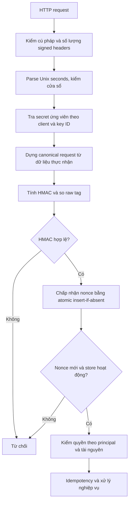
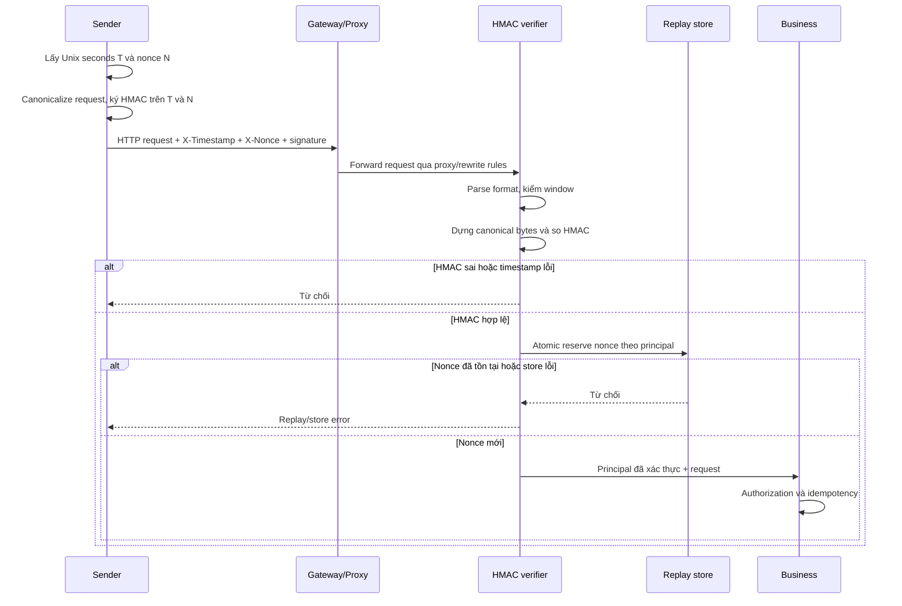

# Kiểm thử timestamp

## 1. Mục tiêu của kiểm thử timestamp trong HMAC request authentication

Trong hệ thống xác thực HTTP request bằng **HMAC với shared secret**, client dựng **canonical request** từ method, URI, các header đã chọn và/hoặc body. Client tính chữ ký HMAC trên chuỗi canonical đó; server tự dựng lại cùng dữ liệu và so chữ ký.

Nếu một request đã được ký được phát lại nguyên vẹn, chữ ký vẫn có thể hợp lệ. **Timestamp** giúp server chỉ chấp nhận một request trong **cửa sổ thời gian hữu hạn**. Tuy nhiên, timestamp **không tự ngăn phát lại bên trong cửa sổ**; cần thêm **nonce đã được ký** và replay store có thao tác ghi nhận nguyên tử.

Bài **“Kiểm thử timestamp”** thuộc chương **Timestamp** của mô-đun **`SECURITY_AUTHENTICATION_HMAC_REQUEST_AUTHENTICATION`**. Phạm vi mô-đun là xác thực HTTP request bằng HMAC trên canonical request gồm phương thức, URI, header hoặc body; thực hành xác minh chữ ký, chống replay bằng timestamp/nonce, quản lý key rotation, kiểm thử proxy/gateway và phân biệt xác thực với phân quyền.

**Khác với việc chỉ hướng dẫn thêm một header thời gian**, mục tiêu của bài này là chứng minh bằng kiểm thử rằng:

1. Client và server dùng **cùng đơn vị và định dạng** timestamp.
2. Timestamp **thực sự được ràng buộc với chữ ký HMAC**.
3. Server áp dụng đúng **cận quá khứ và tương lai**, bao gồm kiểm thử điểm biên.
4. Các trường hợp **clock skew, queue delay, retry, replay và nhiều server** không phá vỡ chính sách thời gian.
5. Nonce không bị xóa khỏi replay store trước khi timestamp tương ứng hết khả năng được chấp nhận.
6. Không có đường đi qua gateway, lỗi key rotation hay exception khiến verifier **bỏ qua** bước kiểm tra.
7. Việc HMAC/timestamp hợp lệ **không bị nhầm** với quyền truy cập tài nguyên.

Với mỗi phép thử, cần mô tả **đầu vào, thời gian server giả lập, quyết định kỳ vọng và lớp quyết định**. Chẳng hạn, một timestamp trong cửa sổ chỉ có nghĩa là qua kiểm tra **thời gian**; request còn phải qua HMAC, replay detection và authorization.

## 2. Bốn lớp kiểm thử không được đánh đồng

Một bộ test timestamp có chất lượng phải tách **parsing**, **window policy**, **signature binding** và **end-to-end security**.

| Lớp | Câu hỏi kiểm thử | Ví dụ |
| --- | --- | --- |
| **Cú pháp** | Timestamp có đúng decimal Unix seconds không? | Bác bỏ `+1795856400` và `1795856400000` |
| **Cửa sổ thời gian** | So với đồng hồ server, thời điểm được ký còn hợp lệ không? | Chấp nhận `now-300`, từ chối `now-301` |
| **Ràng buộc HMAC** | Có thể thay timestamp giữ nguyên signature không? | Sửa một chữ số trong `X-Timestamp` phải làm MAC sai |
| **Tích hợp bảo mật** | Một bản replay hoặc request dùng key thu hồi có thể qua các tầng không? | Timestamp đúng nhưng nonce đã dùng phải bị từ chối |

Sơ đồ luồng:



Một số hệ thống kiểm time window **trước HMAC** để giảm chi phí cho request quá hạn. Điều đó hợp lý nếu chỉ là **precheck trên dữ liệu chưa xác thực**, không thiết lập principal, không ghi nonce và không thực hiện nghiệp vụ trước khi HMAC được xác minh.

**Nguyên tắc kiểm thử:** đừng chỉ assert “HTTP 401” cho mọi trường hợp. Trong unit test, xác định **lớp nào từ chối**; trong integration test, có thể sử dụng mã lỗi HTTP theo hợp đồng sản phẩm và kiểm thêm **không có side effect**.

## 3. Khóa hợp đồng timestamp trước khi viết test

Các hệ thống có thể dùng nhiều định dạng thời gian khác nhau. Trong bài này chọn hợp đồng học tập **`HMAC-SHA256-V1`**, với các quy tắc cụ thể:

| Thuộc tính | Quy tắc V1 |
| --- | --- |
| Header | `X-Timestamp`, đúng **một** giá trị |
| Đơn vị | **Unix epoch seconds**, không phải milliseconds |
| Biểu diễn | Số nguyên thập phân ASCII, **không có dấu** |
| Số 0 đầu | Chỉ `0` được phép; `01` hoặc `01795856400` bị từ chối |
| Khoảng trắng | Không nhận space, tab, CR, LF trong giá trị canonical |
| Độ dài cú pháp | Tối đa **12 chữ số** trong bài minh họa |
| Thời gian quá khứ | Cho phép tối đa **300 giây** |
| Thời gian tương lai | Cho phép tối đa **60 giây** |
| So sánh biên | **Bao gồm hai cận** |
| Nguồn thời gian server | `java.time.Clock` được inject; production dùng clock hệ thống đã đồng bộ |
| Canonical line | `x-timestamp:<decimal-seconds>` trong chuỗi được HMAC ký |
| Nonce | Header `X-Nonce` được ký, lưu theo principal đã xác thực |
| Quy tắc lỗi | Format, window, HMAC, nonce store hoặc key policy lỗi đều **không được cho request đi tiếp** |

Định nghĩa chấp nhận theo thời gian:

\[
t_{\text{server}} - 300 \leq t_{\text{signed}} \leq t_{\text{server}} + 60
\]

Trong đó `t_server` là thời điểm hiện tại của **server tại điểm xác minh**, `t_signed` là Unix seconds đọc từ request. Hai giá trị phải dùng **cùng đơn vị giây**.

**Lưu ý:** các số 300, 60 và 12 chữ số là lựa chọn phục vụ ví dụ; chúng **không phải chuẩn bắt buộc** của mọi HMAC API. Khi sản phẩm thay window, format hoặc đơn vị, phải cập nhật hợp đồng và test theo phiên bản tương ứng.

### 3.1. Test liệu header timestamp có được ký hay không

Một timestamp chỉ có hiệu quả chống sửa đổi khi **tham gia canonical request**. Không đủ nếu:

```http
X-Timestamp: 1795856400
```

được gửi nhưng HMAC chỉ ký method, path và body hash. Nếu bỏ timestamp khỏi canonical bytes, attacker có thể sửa thời điểm sang một giá trị mới rồi dùng lại signature cũ.

Golden test bắt buộc: **cùng request + cùng secret + timestamp thay đúng một giây** phải tạo **hai HMAC khác nhau**. Phần test vector ở mục 9 minh họa điều này.

### 3.2. Timestamp không phải bằng chứng đồng hồ client đáng tin

Một sender có secret có thể ký timestamp tự chọn. Server phải **so với đồng hồ của chính mình**, không tin clock client. Timestamp được HMAC bảo vệ chỉ ngăn **bên không có secret** sửa giá trị mà vẫn giữ signature cũ.

## 4. Kiểm thử cú pháp timestamp: negative input rất quan trọng

Dù một chuỗi có thể được parse thành số, nó chưa chắc đúng **canonical representation** của hợp đồng.

| Chuỗi header | Test case | Kết quả V1 |
| --- | --- | --- |
| `1795856400` | Unix seconds chuẩn | Hợp lệ **về cú pháp** |
| `0` | Decimal số 0 | Hợp lệ về cú pháp, thường hết hạn khi kiểm window |
| `01795856400` | Leading zero | **Từ chối** |
| `+1795856400` | Dấu cộng | **Từ chối** |
| `-1795856400` | Dấu âm | **Từ chối** |
| `1795856400.0` | Số thập phân | **Từ chối** |
| `1795856400000` | Unix milliseconds | **Từ chối** |
| `1795856400000000000` | Giá trị nghi nanoseconds | **Từ chối** |
| `1795856400 ` | Khoảng trắng cuối | **Từ chối** theo giá trị canonical |
| ` 1795856400` | Khoảng trắng đầu | **Từ chối** theo giá trị canonical |
| `1795856400\n` | Newline literal | **Từ chối**; HTTP parser cũng phải cấm injection |
| `1_795_856_400` | Dấu phân cách số | **Từ chối** |
| `1.7958564E9` | Scientific notation | **Từ chối** |
| `2026-11-28T00:00:00Z` | ISO 8601 | **Từ chối** vì V1 dùng Unix seconds |
| `999999999999999999999999` | Tràn số/độ dài | **Từ chối trước parse** |
| `1795856400,1795856401` | Header bị gộp | **Từ chối** |
| Chuỗi rỗng hoặc header thiếu | Missing timestamp | **Từ chối** |

Một bug thường gặp:

```java
// KHÔNG NÊN: tùy tiện "sửa" dữ liệu nhận từ client.
String normalized = timestampHeader.trim();
long timestamp = Long.parseLong(normalized);

// Nếu input có leading zero, dấu '+' hoặc whitespace,
// code có thể chấp nhận biểu diễn trái hợp đồng.
```

Nếu hai phía ký **chuỗi gốc** nhưng một phía lại so window trên **chuỗi đã chuẩn hóa**, các biến thể có thể gây lỗi khó chẩn đoán. Với V1, hãy **từ chối input không canonical**, thay vì tự bỏ ký tự không mong muốn.

### 4.1. Lỗi milliseconds đặc biệt dễ bỏ sót

Trong Java:

```java
long seconds = java.time.Instant.now().getEpochSecond();
long millis = System.currentTimeMillis();
```

Cùng một thời điểm, `millis` lớn hơn xấp xỉ 1.000 lần. Không nên xử lý kiểu:

```java
if (timestamp.length() == 13) {
    timestamp = timestamp / 1000; // SAI: tự đoán đơn vị.
}
```

Một bộ test phải chứng minh server **không fallback** giữa milliseconds, seconds và ISO text. Đổi đơn vị là thay đổi giao thức, không phải một phép chữa lỗi an toàn.

## 5. Kiểm thử các cận past/future một cách chính xác

Chọn thời gian server cố định **`T = 1795856400`** (chỉ là timestamp test). Với past window **300 giây** và future skew **60 giây**:

```text
T = 1795856400

Lower bound: T - 300 = 1795856100
Upper bound: T +  60 = 1795856460

Dải hợp lệ theo thời gian:
[1795856100 ... 1795856460]
```

| Header `X-Timestamp` | So với T | Kỳ vọng time-window |
| --- | ---: | --- |
| `1795856098` | Cũ 302 giây | Từ chối |
| `1795856099` | Cũ 301 giây | Từ chối |
| `1795856100` | Cũ đúng 300 giây | **Chấp nhận** |
| `1795856101` | Cũ 299 giây | **Chấp nhận** |
| `1795856399` | Cũ 1 giây | **Chấp nhận** |
| `1795856400` | Bằng T | **Chấp nhận** |
| `1795856401` | Tương lai 1 giây | **Chấp nhận** |
| `1795856459` | Tương lai 59 giây | **Chấp nhận** |
| `1795856460` | Tương lai đúng 60 giây | **Chấp nhận** |
| `1795856461` | Tương lai 61 giây | Từ chối |
| `1795856462` | Tương lai 62 giây | Từ chối |

**Hai điểm biên được bao gồm**. Nếu nhóm sản phẩm muốn dùng toán tử so sánh `<` hoặc `>` (loại trừ điểm biên), phải nêu trong hợp đồng rồi viết test theo điều kiện ấy. Lỗi **off-by-one** thường xuất hiện khi một bên dùng `<` còn bên kia dùng `<=`.

### 5.1. Đảo chiều kiểm thử: giữ signed timestamp, di chuyển đồng hồ server

Với signed timestamp cố định `S = 1795856400`, nó chỉ hợp lệ khi:

\[
S - 60 \leq t_{\text{server}} \leq S + 300
\]

Nói cách khác:

```text
Server 1795856339 -> từ chối: request quá xa tương lai
Server 1795856340 -> chấp nhận: đúng future boundary
Server 1795856400 -> chấp nhận: trùng signed timestamp
Server 1795856700 -> chấp nhận: đúng past boundary
Server 1795856701 -> từ chối: đã cũ quá 300 giây
```

Cách kiểm thử đảo chiều này giúp tìm lỗi **đặt dấu sai** trong biểu thức kiểm tra thời gian; nếu chỉ test timestamp thay đổi trên một clock cố định, đôi khi reviewer bỏ sót loại lỗi đó.

## 6. Java 17: tạo một time policy dễ kiểm thử

**Inject `Clock`** thay vì gọi `Instant.now()` trực tiếp trong logic kiểm tra. Khi đó unit test có thể dựng bất kỳ thời điểm nào mà không phụ thuộc ngày chạy hoặc timezone máy CI.

```java
import java.time.Clock;
import java.time.Instant;
import java.util.Objects;
import java.util.regex.Pattern;

public final class TimestampPolicyV1 {
    public static final long MAX_PAST_SECONDS = 300L;
    public static final long MAX_FUTURE_SECONDS = 60L;

    // "0" hoặc tối đa 12 chữ số không có leading zero.
    private static final Pattern DECIMAL_SECONDS =
            Pattern.compile("0|[1-9][0-9]{0,11}");

    private TimestampPolicyV1() {}

    public static boolean isCanonicalDecimal(String headerValue) {
        return headerValue != null
                && DECIMAL_SECONDS.matcher(headerValue).matches();
    }

    public static boolean isWithinWindow(
            String signedTimestamp, Clock serverClock) {

        Objects.requireNonNull(serverClock, "serverClock");

        if (!isCanonicalDecimal(signedTimestamp)) {
            return false;
        }

        final long signedSeconds;
        try {
            signedSeconds = Long.parseLong(signedTimestamp);
        } catch (NumberFormatException overflow) {
            return false;
        }

        long now = Instant.now(serverClock).getEpochSecond();

        // Trong thực tế now của hệ thống nằm xa các cực trị long;
        // vẫn kiểm overflow để không chấp nhận nhầm khi test cực trị.
        final long minAccepted;
        final long maxAccepted;
        try {
            minAccepted = Math.subtractExact(
                    now, MAX_PAST_SECONDS);
            maxAccepted = Math.addExact(
                    now, MAX_FUTURE_SECONDS);
        } catch (ArithmeticException outOfRange) {
            return false;
        }

        return signedSeconds >= minAccepted
                && signedSeconds <= maxAccepted;
    }
}
```

**Vì sao cách này phù hợp với test?**

- `isCanonicalDecimal` chỉ kiểm **dạng text**, không đọc clock.
- `isWithinWindow` dùng **một thời điểm server** cho cả hai cận.
- `Clock.fixed(...)` cho phép kiểm **biên chính xác đến giây**.
- `Math.subtractExact` và `Math.addExact` tránh overflow im lặng khi kiểm tra clock cực trị trong test.
- `Long.parseLong` chỉ được gọi sau kiểm format, và mọi lỗi overflow bị từ chối.
- Kết quả `true` chỉ có nghĩa timestamp **hợp lệ về cú pháp và window**. HMAC, nonce và authorization vẫn chưa được xác minh.

**Giới hạn có chủ đích:** 12 chữ số đủ cho phạm vi thời gian vận hành trong bài; không phải ràng buộc bắt buộc của Unix time trên mọi hệ thống. Nếu sản phẩm hỗ trợ một dải năm khác hoặc định dạng khác, phải thay contract và tests.

### 6.1. Server dùng đồng hồ nào?

Production có thể khởi tạo:

```java
Clock clock = Clock.systemUTC();

boolean timeOk = TimestampPolicyV1.isWithinWindow(
        request.getHeader("X-Timestamp"), clock);
```

Ở đây `request.getHeader(...)` chỉ là ví dụ về API nhận header. HTTP adapter thật phải **từ chối duplicate `X-Timestamp`**, xử lý OWS theo hợp đồng và ngăn CR/LF injection **trước khi gọi** validator. Một lời gọi `getHeader` đơn lẻ không bảo đảm parser chưa ẩn đi các header trùng tên.

`Clock.systemUTC()` sử dụng wall clock của hệ điều hành. Việc thời gian có chính xác hay không vẫn phụ thuộc đồng bộ clock của máy chủ.

## 7. JUnit 5: test cú pháp và boundary một cách tất định

Dùng `Clock.fixed(...)` để loại bỏ sự phụ thuộc vào thời gian thực. Những đoạn sau là ví dụ **JUnit 5** cho Java 17; cần dependency JUnit khi tích hợp vào dự án.

```java
import static org.junit.jupiter.api.Assertions.*;
import java.time.Clock;
import java.time.Instant;
import java.time.ZoneOffset;
import org.junit.jupiter.api.Test;

class TimestampPolicyV1Test {
    private static final Clock FIXED = Clock.fixed(
            Instant.ofEpochSecond(1795856400L),
            ZoneOffset.UTC);

    @Test
    void acceptsInclusivePastAndFutureBounds() {
        String[] accepted = {
                "1795856100", // now - 300
                "1795856101",
                "1795856399",
                "1795856400", // now
                "1795856401",
                "1795856459",
                "1795856460"  // now + 60
        };

        for (String timestamp : accepted) {
            assertTrue(
                    TimestampPolicyV1.isWithinWindow(
                            timestamp, FIXED),
                    "Expected valid timestamp: " + timestamp);
        }
    }

    @Test
    void rejectsJustOutsideEitherBoundary() {
        String[] rejected = {
                "1795856098",
                "1795856099", // now - 301
                "1795856461", // now + 61
                "1795856462"
        };

        for (String timestamp : rejected) {
            assertFalse(
                    TimestampPolicyV1.isWithinWindow(
                            timestamp, FIXED),
                    "Expected expired/future timestamp: " + timestamp);
        }
    }

    @Test
    void rejectsNonCanonicalTimestampText() {
        String[] rejected = {
                null, "", " ", "01795856400",
                "+1795856400", "-1795856400",
                "1795856400.0", "1795856400000",
                "1795856400 ", " 1795856400",
                "1795856400\n", "2026-11-28T00:00:00Z",
                "999999999999999999999999"
        };

        for (String timestamp : rejected) {
            assertFalse(
                    TimestampPolicyV1.isWithinWindow(
                            timestamp, FIXED),
                    "Expected invalid: " + timestamp);
        }
    }

    @Test
    void syntaxAndTimeValidityAreDifferent() {
        assertTrue(TimestampPolicyV1.isCanonicalDecimal("0"));
        assertFalse(
                TimestampPolicyV1.isWithinWindow("0", FIXED));
    }
}
```

Những test này bảo đảm giá trị **đúng hai cận** được nhận, giá trị lệch thêm một giây bị loại và timestamp không canonical bị từ chối trước khi phụ thuộc vào thời gian.

### 7.1. Test đánh giá clock thay đổi chứ không chỉ input thay đổi

```java
import static org.junit.jupiter.api.Assertions.*;
import java.time.Clock;
import java.time.Duration;
import java.time.Instant;
import java.time.ZoneOffset;
import org.junit.jupiter.api.Test;

class TimestampMovingClockTest {
    private static final Clock SIGNING_INSTANT = Clock.fixed(
            Instant.ofEpochSecond(1795856400L),
            ZoneOffset.UTC);

    @Test
    void sameSignatureTimestampHasLimitedLifetime() {
        String signedTimestamp = "1795856400";

        Clock earliestAllowed = Clock.offset(
                SIGNING_INSTANT, Duration.ofSeconds(-60));
        Clock tooEarly = Clock.offset(
                SIGNING_INSTANT, Duration.ofSeconds(-61));
        Clock latestAllowed = Clock.offset(
                SIGNING_INSTANT, Duration.ofSeconds(300));
        Clock tooLate = Clock.offset(
                SIGNING_INSTANT, Duration.ofSeconds(301));

        assertTrue(TimestampPolicyV1.isWithinWindow(
                signedTimestamp, earliestAllowed));
        assertFalse(TimestampPolicyV1.isWithinWindow(
                signedTimestamp, tooEarly));
        assertTrue(TimestampPolicyV1.isWithinWindow(
                signedTimestamp, latestAllowed));
        assertFalse(TimestampPolicyV1.isWithinWindow(
                signedTimestamp, tooLate));
    }
}
```

**Test này không cần `Thread.sleep`.** Nó kiểm chính sách trên thời gian giả lập, tránh phải chờ 300 giây hoặc làm test flaky khi CI load cao.

## 8. Kiểm thử timestamp khi client và server lệch đồng hồ

Trong hệ thống phân tán, **clock skew** là nguồn lỗi phổ biến. Sender và verifier có thể có wall clock lệch nhau vì cấu hình, NTP, máy ảo hoặc container host.

Giả sử request được gửi ngay khi tạo chữ ký và không có network delay, server thấy thời điểm `T`:

| Clock client so với server | Timestamp gửi | Kỳ vọng với cửa sổ -300/+60 |
| --- | --- | --- |
| Chậm 301 giây | `T - 301` | Từ chối |
| Chậm 300 giây | `T - 300` | Chấp nhận về thời gian |
| Chậm 120 giây | `T - 120` | Chấp nhận về thời gian |
| Bằng server | `T` | Chấp nhận về thời gian |
| Nhanh 59 giây | `T + 59` | Chấp nhận về thời gian |
| Nhanh 60 giây | `T + 60` | Chấp nhận về thời gian |
| Nhanh 61 giây | `T + 61` | Từ chối |
| Nhanh 120 giây | `T + 120` | Từ chối |

Kết quả thực tế còn chịu ảnh hưởng của **network delay**. Ví dụ client nhanh 60 giây nhưng request mất 5 giây đến server: signed timestamp chỉ còn nhanh hơn server 55 giây, nên đi qua window. Ngược lại, client chậm 299 giây và request chậm thêm 5 giây có thể bị từ chối vì tổng độ tuổi đạt 304 giây.

**Không đánh đồng độ lệch đồng hồ với độ trễ truyền.** Khi điều tra, nên phân biệt:

```text
signedTimestamp
        |
        | network queue + proxy delay
        v
serverVerificationTime

apparentAge = serverVerificationTime - signedTimestamp
```

### 8.1. Test offset bằng Java

```java
Clock server = Clock.fixed(
        java.time.Instant.ofEpochSecond(1795856400L),
        java.time.ZoneOffset.UTC);

Clock clientAhead = Clock.offset(
        server, java.time.Duration.ofSeconds(61));
Clock clientBehind = Clock.offset(
        server, java.time.Duration.ofSeconds(-301));

String aheadStamp = Long.toString(
        java.time.Instant.now(clientAhead).getEpochSecond());
String behindStamp = Long.toString(
        java.time.Instant.now(clientBehind).getEpochSecond());

assert !TimestampPolicyV1.isWithinWindow(aheadStamp, server);
assert !TimestampPolicyV1.isWithinWindow(behindStamp, server);
```

Đoạn trên minh họa biến đổi clock; trong JUnit nên sử dụng `assertFalse` thay vì Java `assert` vì assertion của JVM có thể bị tắt khi không bật `-ea`.

### 8.2. Múi giờ và daylight saving time

Unix epoch seconds biểu diễn một thời điểm tuyệt đối; **không tự thay đổi khi đổi timezone hiển thị**. Test nên xác minh:

- Cùng một `Instant` được hiển thị ở `Asia/Ho_Chi_Minh` hay `UTC` vẫn có cùng epoch seconds.
- Không chuyển `LocalDateTime` chưa gắn zone trực tiếp thành timestamp mà không xác định timezone.
- Không parse chuỗi ngày theo locale hoặc quy tắc daylight saving time để suy signed timestamp.

Nếu client dùng số epoch seconds đúng, **DST và timezone không phải lý do** để ký sai. Nếu dùng ISO text có offset, đó phải là hợp đồng ký khác.

### 8.3. Leap seconds và thời gian hệ thống

Unix/POSIX time không biểu diễn leap second theo cách giống một timestamp text có giây `60`. Vì hợp đồng V1 dùng **số epoch seconds**, không nhận chuỗi `23:59:60` hoặc ISO text tùy ý. NTP leap smear hoặc điều chỉnh clock có thể tác động đến offset thực tế; hãy giám sát và kiểm thử hành vi của hệ thống vận hành thay vì tự sửa timestamp client đã ký.

## 9. Golden vector: chứng minh timestamp thật sự nằm trong HMAC

Unit test window chưa chứng minh hệ thống **đã ký timestamp**. Cần một **test vector mật mã độc lập**, trong đó chỉ thay timestamp và đối chiếu kết quả HMAC.

Request mẫu:

```http
POST /v1/payments?merchantId=m-42 HTTP/1.1
Host: api.example.test
Content-Type: application/json
X-Client-Id: client-42
X-Key-Id: key-demo-01
X-Timestamp: 1795856400
X-Nonce: AAAAAAAAAAAAAAAAAAAAAA
X-Signature: <base64-hmac-sha256>

{"orderId":"O-42","amount":250000,"currency":"VND"}
```

**Chỉ dùng cho test:** secret, timestamp và nonce đều cố định/công khai. Body chính xác **51 byte UTF-8** (không có LF cuối), với SHA-256 lowercase hex:

```text
ea646bb8b1903a83256034142a633e90ffad35b3a40bb4c5f0e8f1eb4f4f27f9
```

Hợp đồng canonical request `HMAC-SHA256-V1` chứa **10 dòng**, nối bằng LF, **không có LF cuối**:

```text
HMAC-SHA256-V1
POST
/v1/payments
merchantId=m-42
content-type:application/json
x-client-id:client-42
x-key-id:key-demo-01
x-timestamp:1795856400
x-nonce:AAAAAAAAAAAAAAAAAAAAAA
ea646bb8b1903a83256034142a633e90ffad35b3a40bb4c5f0e8f1eb4f4f27f9
```

Canonical string trên dài **240 byte UTF-8**. Với secret test ASCII:

```text
0123456789abcdef0123456789abcdef
```

HMAC-SHA-256 đầy đủ, Base64 Basic có padding:

```text
GMGNFyHLvQHRH53KE9+jTILR1qc0HauQJiX06bXm1n0=
```

Giữ **toàn bộ dữ liệu khác**, chỉ đổi timestamp từ `1795856400` sang `1795856401`:

```text
x-timestamp:1795856401
```

Canonical request vẫn dài **240 byte**, nhưng HMAC Base64 trở thành:

```text
yDUc2xZJMgJ2Gfa0IjTHiw1SFMmL5tMV8YNlPwj6gvk=
```

Hai vector được tính độc lập từ body/secret/canonical bytes. **Chữ ký phải khác nhau** dù chỉ đổi một giây. Nếu một triển khai tạo **cùng chữ ký** cho hai timestamp, có thể timestamp đã bị bỏ khỏi canonical request hoặc caller đang dùng một giá trị cũ khi ký.

### 9.1. Hai test riêng biệt từ cùng fixture

- **Test cryptographic binding:** với timestamp `T`, chữ ký V1 phải bằng expected Base64 thứ nhất; với `T+1` phải bằng expected Base64 thứ hai. Không cần đồng hồ thực.
- **Test freshness:** với clock cố định `T`, cả `T` và `T+1` đều **qua time window**. Điều đó không khiến một chữ ký của `T` xác minh được request có timestamp `T+1`.

**Không sử dụng golden vector cố định để kiểm độ “mới” theo thời gian thực.** Nếu test so timestamp này với `Instant.now()` của ngày chạy CI, test sẽ dần thất bại vì request hết hạn — đó không phải lỗi HMAC.

## 10. Java 17: fixture tạo chữ ký để unit test timestamp

Để thấy rõ timestamp được đưa vào MAC, ví dụ sau cung cấp một **test fixture hoàn chỉnh**, sử dụng secret và request cố định. Đây không phải signer production; utility chỉ dành cho test canonicalization/HMAC.

```java
import java.nio.charset.StandardCharsets;
import java.security.GeneralSecurityException;
import java.security.MessageDigest;
import java.util.Base64;
import java.util.HexFormat;
import javax.crypto.Mac;
import javax.crypto.spec.SecretKeySpec;

public final class TimestampHmacFixtureV1 {
    private static final byte[] TEST_KEY = (
            "0123456789abcdef0123456789abcdef"
    ).getBytes(StandardCharsets.US_ASCII);

    private static final byte[] TEST_BODY = (
            "{\"orderId\":\"O-42\",\"amount\":250000,"
          + "\"currency\":\"VND\"}"
    ).getBytes(StandardCharsets.UTF_8);

    private TimestampHmacFixtureV1() {}

    public static String canonical(String signedTimestamp)
            throws GeneralSecurityException {
        if (!TimestampPolicyV1.isCanonicalDecimal(signedTimestamp)) {
            throw new IllegalArgumentException("Bad timestamp format");
        }

        byte[] digest = MessageDigest.getInstance("SHA-256")
                .digest(TEST_BODY);
        String bodyHash = HexFormat.of().formatHex(digest);

        return String.join("\n",
                "HMAC-SHA256-V1",
                "POST",
                "/v1/payments",
                "merchantId=m-42",
                "content-type:application/json",
                "x-client-id:client-42",
                "x-key-id:key-demo-01",
                "x-timestamp:" + signedTimestamp,
                "x-nonce:AAAAAAAAAAAAAAAAAAAAAA",
                bodyHash);
    }

    public static byte[] rawTag(String signedTimestamp)
            throws GeneralSecurityException {
        Mac mac = Mac.getInstance("HmacSHA256");
        mac.init(new SecretKeySpec(TEST_KEY, "HmacSHA256"));

        byte[] canonicalBytes = canonical(signedTimestamp)
                .getBytes(StandardCharsets.UTF_8);

        return mac.doFinal(canonicalBytes);
    }

    public static String signature(String signedTimestamp)
            throws GeneralSecurityException {
        return Base64.getEncoder().encodeToString(
                rawTag(signedTimestamp));
    }

    public static boolean fixtureVerify(
            String signedTimestamp, String signatureBase64)
            throws GeneralSecurityException {

        if (signatureBase64 == null
                || signatureBase64.length() != 44) {
            return false;
        }

        final byte[] supplied;
        try {
            supplied = Base64.getDecoder().decode(signatureBase64);
        } catch (IllegalArgumentException badEncoding) {
            return false;
        }

        if (supplied.length != 32
                || !Base64.getEncoder()
                        .encodeToString(supplied)
                        .equals(signatureBase64)) {
            return false;
        }
        return MessageDigest.isEqual(
                rawTag(signedTimestamp), supplied);
    }
}
```

**Giới hạn quan trọng:** `fixtureVerify` không kiểm timestamp window, nonce store, key rotation, HTTP header duplicates hoặc authorization. Nó chỉ mô phỏng **ràng buộc timestamp vào HMAC trên request test cố định**. Secret công khai trong source này **chỉ được phép tồn tại trong test fixture**, không được sao chép làm key thực.

### 10.1. JUnit kiểm ký và chống thay timestamp

```java
import static org.junit.jupiter.api.Assertions.*;
import org.junit.jupiter.api.Test;

class TimestampHmacFixtureV1Test {

    @Test
    void signatureMatchesIndependentVectors() throws Exception {
        assertEquals(
                "GMGNFyHLvQHRH53KE9+jTILR1qc0HauQJiX06bXm1n0=",
                TimestampHmacFixtureV1.signature("1795856400"));

        assertEquals(
                "yDUc2xZJMgJ2Gfa0IjTHiw1SFMmL5tMV8YNlPwj6gvk=",
                TimestampHmacFixtureV1.signature("1795856401"));
    }

    @Test
    void tamperingTimestampBreaksExistingSignature()
            throws Exception {
        String oldTag =
                TimestampHmacFixtureV1.signature("1795856400");

        assertTrue(TimestampHmacFixtureV1.fixtureVerify(
                "1795856400", oldTag));

        assertFalse(TimestampHmacFixtureV1.fixtureVerify(
                "1795856401", oldTag));
    }

    @Test
    void canonicalRequestHasExactlyTenLines()
            throws Exception {
        String canonical =
                TimestampHmacFixtureV1.canonical("1795856400");

        assertEquals(10, canonical.split("\n", -1).length);
        assertFalse(canonical.endsWith("\n"));
        assertEquals(240, canonical.getBytes(
                java.nio.charset.StandardCharsets.UTF_8).length);
    }
}
```

Những test này **không chỉ gọi sign rồi verify cùng implementation**. Chúng so kết quả với **golden values độc lập**, giúp phát hiện hai phía cùng bỏ quên timestamp hoặc cùng nối newline sai. Để test hệ thống thực, còn cần fixture xây dựng từ **HTTP request thật** chứ không phải các string cố định trong utility.

## 11. Testing anti-replay: timestamp đúng không đồng nghĩa request mới

Giả sử server đã kiểm HMAC hợp lệ tại `T=1795856400` và dùng cửa sổ `300/60`. Attacker gửi lại request **đúng byte** ở `T+10`.

```text
Timestamp = T
HMAC      = hợp lệ
T+10      = vẫn trong cửa sổ
Nonce     = đã dùng ở request đầu tiên
Kết quả   = phải từ chối replay
```

Nếu chỉ kiểm timestamp và HMAC, bản sao này có thể được chấp nhận. Kiểm thử hoàn chỉnh cần một **replay store** với thao tác **atomic insert-if-absent**.

Trong ví dụ, nonce là **16 byte ngẫu nhiên mật mã** và được encode Base64URL không padding thành **22 ký tự**. Sender phải ký nonce bằng dòng `x-nonce:<nonce>` cùng timestamp; server phải:

1. Kiểm format của timestamp và nonce.
2. Kiểm timestamp window theo chính sách.
3. Tra secret ứng viên theo client/key ID.
4. Dựng canonical request **từ request thực nhận**, tính HMAC và so raw tag.
5. Chỉ **sau khi HMAC đúng**, ghi nonce bằng atomic insert-if-absent theo **authenticated principal**.
6. Từ chối nonce đã tồn tại.
7. Tiếp tục authorization và idempotency cho request có side effect.

### 11.1. Kiểm thử thứ tự xử lý

Hai negative tests nên có:

- **HMAC sai, nonce mới:** verifier phải từ chối và replay store **không được ghi nonce**. Nếu vẫn ghi, một request giả có thể chiếm nonce, gây từ chối dịch vụ.
- **HMAC đúng, nonce đã dùng:** verifier phải từ chối trước business side effect, dù timestamp còn trong window.

Một replay store đơn giản được mô phỏng bằng `ConcurrentHashMap.putIfAbsent` trong unit test có thể kiểm logic **một JVM**. Nhưng không nên nhầm fake store với bảo đảm multi-node thực; integration test phải dùng kho được triển khai thật (Redis hoặc hệ tương đương) và kiểm failover/consistency.

### 11.2. Không gắn replay scope chỉ với key ID

Nếu client xoay secret từ `key-A` sang `key-B`, chính sách nonce “dùng một lần trên mỗi client” thường chọn replay key dạng:

```text
hmac-replay:v1:<authenticatedPrincipalId>:<nonce>
```

Nếu dùng `(clientId,keyId,nonce)`, cùng một nonce có thể được nhận lại khi đổi key. Cần quyết định và kiểm thử scope theo contract. Với bài này, phạm vi được chọn là **principal đã xác thực**, không phải riêng từng key ID.

## 12. Kiểm thử TTL nonce tương ứng timestamp window

**TTL replay record** là một phần của an toàn thời gian. Nếu bản ghi nonce hết hạn trước khi timestamp hết hạn, một request đã ký có thể được chấp nhận lại.

Với chính sách:

\[
t_{\text{now}} - 300 \le t_{\text{signed}} \le t_{\text{now}} + 60
\]

Xét lần đầu tại server time `T=1000` và request có signed timestamp `1060`:

```text
server now lúc reserve = 1000
signed timestamp       = 1060
max future skew        = 60
max past age           = 300

Request còn được chấp nhận về thời gian cho tới:
    signedTimestamp + maxPastAge = 1360

Thời gian còn lại kể từ lúc reserve:
    1360 - 1000 = 360 giây
```

Nếu replay record hết hạn sau **300 giây**, đến `now=1301` nonce đã biến mất nhưng timestamp `1060` vẫn còn hợp lệ (vì `1301 - 1060 = 241`). Đây là **lỗi TTL tạo lại cửa sổ replay**.

### 12.1. Công thức TTL theo thời gian còn hiệu lực

Một chính sách có thể tính:

\[
\text{remaining} = (t_{\text{signed}}+300)-t_{\text{server}}
\]

\[
\text{TTL} = \max(1, \text{remaining}+\text{safetyMargin})
\]

Trong đó `safetyMargin` phải được xác định từ **clock skew tối đa giữa verifier nodes, độ trễ reserve và yêu cầu vận hành**. Một ví dụ đơn giản dùng **60 giây margin**, nên ở trường hợp biên tương lai trên, TTL là **420 giây**.

**Lưu ý:** 420 giây không tự bảo đảm an toàn cho mọi cluster. Nếu một node có clock chậm hơn chuẩn nhiều hơn giả định hoặc store bị mất record do failover, cần chính sách chặt hơn hoặc sửa hạ tầng; không thể chỉ tăng một con số rồi coi bài toán đã giải quyết.

### 12.2. Java 17: tính TTL testable bằng thời gian cố định

```java
public final class ReplayTtlPolicyV1 {
    private static final long SAFETY_MARGIN_SECONDS = 60L;

    private ReplayTtlPolicyV1() {}

    public static long ttlSeconds(
            long signedTimestamp, long nowSeconds) {
        long expiry = Math.addExact(
                signedTimestamp,
                TimestampPolicyV1.MAX_PAST_SECONDS);

        long remaining = Math.subtractExact(
                expiry, nowSeconds);

        long withMargin = Math.addExact(
                remaining, SAFETY_MARGIN_SECONDS);

        return Math.max(1L, withMargin);
    }
}
```

**Điều kiện sử dụng:** gọi hàm sau khi timestamp đã vượt kiểm tra window, để `remaining` nằm trong dải dự kiến; lỗi overflow phải dẫn đến fail closed. Trong production, TTL cũng phải phù hợp giữa **tất cả verifier nodes**, chính sách NTP/clock, expiry semantics của store và tính nhất quán khi failover.

JUnit:

```java
import static org.junit.jupiter.api.Assertions.*;
import org.junit.jupiter.api.Test;

class ReplayTtlPolicyV1Test {

    @Test
    void futureBoundaryNeedsMoreThanPastWindow() {
        // ts=now+60 -> 360s remaining + 60s margin
        assertEquals(420,
                ReplayTtlPolicyV1.ttlSeconds(1060, 1000));
    }

    @Test
    void nowTimestampAndOldBoundary() {
        assertEquals(360,
                ReplayTtlPolicyV1.ttlSeconds(1000, 1000));

        // ts=now-300 -> 0s remaining + 60s margin
        assertEquals(60,
                ReplayTtlPolicyV1.ttlSeconds(700, 1000));
    }

    @Test
    void expiredTimestampCannotBeMadeValidByTtl() {
        // Hàm TTL không quyết định timestamp validity.
        // Verifier phải từ chối theo TimestampPolicyV1
        // trước khi reserve nonce.
        assertFalse(TimestampPolicyV1.isWithinWindow(
                "699",
                java.time.Clock.fixed(
                    java.time.Instant.ofEpochSecond(1000L),
                    java.time.ZoneOffset.UTC)));
    }
}
```

### 12.3. Phải test “nonce đã hết hạn nhưng request vẫn còn valid”

Trong integration test có **fake clock hoặc store hỗ trợ thời gian ảo**:

1. Đặt `serverNow=1000`, signed timestamp `1060`.
2. Chấp nhận request lần đầu và reserve nonce.
3. Tiến thời gian tới `serverNow=1301`.
4. Xác minh timestamp **vẫn hợp lệ**.
5. Phát lại nguyên request: **nonce phải còn được lưu**, request bị từ chối.
6. Tiến vượt `1360`: timestamp đã hết hạn, request bị từ chối ngay cả nếu nonce record đã bị xóa.

Đừng dùng `Thread.sleep(420_000)` trong unit test để chờ TTL thật. Hãy cô lập logic thời gian bằng `Clock` hoặc test store với TTL ngắn và cơ chế thời gian điều khiển được, rồi giữ một số kiểm thử end-to-end theo cấu hình production.

## 13. Property-based và metamorphic tests cho timestamp

Kiểm thử bằng bảng 11 giá trị chưa bao phủ tất cả input. Với time policy, có những **bất biến toán học** rất hữu ích.

### 13.1. Tính tương đương giữa hai cách viết điều kiện

Với timestamp `s` và server time `n`:

\[
n-300 \le s \le n+60
\]

tương đương với:

\[
s-60 \le n \le s+300
\]

Test có thể sinh những giá trị `s, n` trong dải không overflow rồi so kết quả của hai biểu thức **độc lập**, để bắt lỗi đổi dấu hoặc tráo past/future.

### 13.2. Tính liên tục theo server clock

Với signed timestamp cố định `s`:

- Trước `n=s-60`: quá xa tương lai.
- Từ `n=s-60` đến `n=s+300`: hợp lệ về thời gian.
- Sau `n=s+300`: đã quá cũ.

Một request không nên **tự nhiên hợp lệ lại** khi server time tăng tiếp, nếu không có thao tác chỉnh clock lùi. Đây là cách phát hiện lỗi viết `Math.abs(now - signedTimestamp) < maxPast` khi chính sách cố ý có hai biên bất đối xứng.

### 13.3. Test ngẫu nhiên có seed cố định

```java
import static org.junit.jupiter.api.Assertions.*;
import java.time.Clock;
import java.time.Instant;
import java.time.ZoneOffset;
import java.util.Random;
import org.junit.jupiter.api.Test;

class TimestampPropertyTest {
    @Test
    void acceptanceMatchesWindowForRandomOffsets() {
        Random random = new Random(20261128L);

        long now = 1795856400L;
        Clock fixed = Clock.fixed(
                Instant.ofEpochSecond(now), ZoneOffset.UTC);

        for (int i = 0; i < 10_000; i++) {
            // Test giá trị nằm trong/vượt biên ±1000s.
            long offset = random.nextInt(2001) - 1000;
            long signed = now + offset;

            boolean expected =
                    offset >= -300 && offset <= 60;

            assertEquals(expected,
                    TimestampPolicyV1.isWithinWindow(
                            Long.toString(signed), fixed),
                    "Offset=" + offset);
        }
    }
}
```

Tính chất này không thay test biên chính xác. Nếu test ngẫu nhiên không trúng `-300` hoặc `+60`, một lỗi off-by-one vẫn có thể lọt qua.

### 13.4. Fuzz timestamp malformed có giới hạn

Có thể sinh đầu vào gồm:

- Chữ số ASCII trộn chữ cái, dấu `+`/`-`, tab, CR/LF, Unicode digits.
- Chuỗi dài hàng nghìn chữ số; empty/null.
- Leading zeros; ký tự nhìn giống số nhưng không thuộc `0-9`.
- Giá trị gần `Long.MAX_VALUE` hoặc quá dải số.
- Header bị gộp hoặc duplicate ở HTTP adapter.

Điều kiện nghiệm thu: input lỗi bị từ chối **nhanh, có giới hạn tài nguyên**, không ném exception làm sập handler hoặc đi vào nhánh **fail open**.

## 14. Integration test qua HTTP client, proxy và gateway

Với HMAC request authentication, timestamp là một **signed header**. Các tầng mạng có thể đổi giá trị header, chuẩn hóa method/path/query hoặc serialize body theo cách khác khiến HMAC sai, dù timestamp vẫn nằm trong window.



**Những trường hợp cần mô phỏng:**

| Thay đổi trong hạ tầng | Phải test điều gì? |
| --- | --- |
| Gateway **giữ** `X-Timestamp` nhưng đổi path | HMAC phải phát hiện khác canonical URI |
| Proxy thay timestamp bằng lúc nhận | Chữ ký cũ phải sai; không “refresh” timestamp |
| Header timestamp lặp với hai giá trị | Từ chối trước khi một parser chọn first/last |
| HTTP/2 sang HTTP/1.1 | Giữ đúng ngữ nghĩa method, public URI và signed metadata |
| Gateway/worker queue delay vượt 300s | Request hết hạn, không tự bỏ qua window |
| Gateway xác minh rồi backend cũng xác minh với cùng nonce store | Tránh coi bản forward nội bộ là replay của chính request |
| Hai node dùng đồng hồ lệch nhau | Cùng request có thể bị đánh giá khác; phải giám sát clock |
| Gateway đổi JSON body, encoding hoặc Content-Type đã ký | HMAC phải không khớp |
| Client tự gửi `X-Original-Timestamp` / `X-Original-URI` | Không coi metadata chưa tin cậy là bằng chứng dữ liệu gốc |
| Timestamp hợp lệ nhưng nonce store không hoạt động | Fail closed, không chạy nghiệp vụ |

### 14.1. Chọn nơi kiểm timestamp và nơi ghi nonce

**Phương án A — xác minh HMAC tại gateway** trước khi rewrite: gateway có thể kiểm timestamp và reserve nonce, sau đó chuyển authenticated principal qua **kênh nội bộ tin cậy**. Backend không tự nhận header principal do Internet khai báo.

**Phương án B — xác minh ở backend**: gateway phải bảo toàn public original request components hoặc cung cấp metadata bảo vệ khỏi client giả mạo. Backend cần tính HMAC trên **những giá trị client thực sự đã ký**, không sử dụng URI đã decode/rewrite một cách tùy ý.

Một hệ thống có **hai lần xác minh** cần hai replay scopes hoặc cơ chế chuyển quyết định xác thực được bảo vệ. Nếu gateway reserve nonce và backend dùng cùng replay key để reserve lần nữa, backend có thể từ chối **chính request hợp lệ**.

### 14.2. CORS preflight không phải request nghiệp vụ đã ký

Với một API trình duyệt, CORS preflight `OPTIONS` có thể được gửi **không có header chữ ký nghiệp vụ**. Không nên để middleware HMAC cố kiểm `X-Timestamp` trên mọi preflight trước khi áp dụng CORS policy, rồi kết luận client bị tấn công.

Test cần phân biệt **preflight** với **POST/GET nghiệp vụ thực sự có HMAC**. CORS là chính sách trình duyệt, **không thay thế HMAC authentication**.

## 15. Retry, queueing và timestamp sát thời điểm gửi

Timestamp nên được tạo **gần thời điểm ký và gửi request**, không phải khi tạo business intent hoặc khi job vào hàng đợi.

```text
10:00:00  Tạo lệnh thanh toán O-42
10:00:01  Ghi job vào queue
10:15:00  Worker lấy job
10:15:01  Tạo timestamp T, nonce N và signature S
10:15:02  Gửi HTTP request
```

Nếu timestamp được tạo lúc 10:00 nhưng request gửi lúc 10:15, cửa sổ 300 giây sẽ từ chối. Test tích hợp nên mô phỏng delay dài giữa **enqueue** và **send** mà không đợi thật 15 phút.

### 15.1. Khi timeout, nên retry thế nào?

Một request đã được verifier chấp nhận có thể thành công ở backend nhưng response bị mất. Nếu client gửi lại **nguyên signed request**, timestamp vẫn còn hợp lệ nhưng nonce đã được reserve, nên anti-replay sẽ từ chối.

Retry hợp lệ cần:

- **Timestamp mới** của lần gửi hiện tại.
- **Nonce mới**, được sinh bằng CSPRNG.
- **Signature mới**, vì timestamp/nonce đã ký thay đổi.
- **Cùng idempotency key** cho cùng ý định thanh toán.
- Body và các semantic fields phù hợp với idempotency contract.

Nếu `Idempotency-Key` ảnh hưởng đến kết quả nghiệp vụ, nó phải được **ràng buộc trong hợp đồng ký** hoặc theo một cơ chế tin cậy tương đương; không để attacker sửa key sau khi ký mà thay đổi mục đích request.

### 15.2. Một request được ký nhưng chờ network lâu sau khi ký

Nếu signer đã tính MAC rồi giữ request trong bộ nhớ nhiều phút trước khi socket thực sự gửi, timestamp cũng có thể hết hạn. Không “sửa” riêng `X-Timestamp` sau khi ký; phải **dựng canonical request và ký lại** với giá trị mới, giữ đúng body bytes mà sender sẽ phát.

## 16. Key rotation, signed headers và authorization trong test

Kiểm timestamp thành công không có nghĩa request được phép đi tiếp. Thử nghiệm tích hợp cần đánh giá **key lifecycle** và quyền truy cập.

### 16.1. Key rotation

Giả sử `client-42` chuyển từ `key-A` sang `key-B`:

- Request dùng timestamp mới nhưng **key đã thu hồi** phải bị từ chối.
- Request đổi `X-Key-Id` mà giữ HMAC cũ phải sai vì secret và signed metadata không còn khớp.
- Nếu hai key còn hiệu lực trong giai đoạn chuyển tiếp, resolver chọn đúng secret của **client/key ID**, không fallback sang secret đã thu hồi.
- Timestamp do client ký **không được dùng để khôi phục key cũ** nếu chính sách server đã thu hồi nó.
- Replay nonce theo **authenticated principal** có thể phải trải qua key rotation mà không cho dùng lại cùng nonce.

### 16.2. Authentication không phải authorization

Một client có thể ký request hợp lệ cho:

```http
POST /v1/payments?merchantId=m-99 HTTP/1.1
X-Timestamp: 1795856400
X-Nonce: <fresh-nonce>
X-Signature: <valid-signature>
```

Nếu principal chỉ có quyền với `merchantId=m-42`, server vẫn phải từ chối ở **authorization** dù timestamp, HMAC và nonce đều hợp lệ. Test nên kiểm cả **mã lỗi** và **không có tác dụng phụ nghiệp vụ**.

### 16.3. Header trùng và nội dung request thay đổi

Các signed headers như `X-Client-Id`, `X-Key-Id`, `X-Timestamp`, `X-Nonce` phải được kiểm tra **đúng một giá trị**. Không nên cho một tầng dùng timestamp đầu tiên và tầng khác dùng timestamp thứ hai. Tương tự, query duplicate hoặc path percent-encoding có thể làm verifier và router hiểu khác nhau; timestamp test **end-to-end** cần bảo đảm canonical request thực sự khớp request được xử lý.

## 17. Ma trận test tổng hợp cho CI

Bảng dưới là checklist có thể dùng để xây bộ kiểm thử theo rủi ro.

| ID | Input hoặc tình huống | Kỳ vọng |
| --- | --- | --- |
| T01 | Timestamp decimal chuẩn | Cú pháp hợp lệ |
| T02 | Leading zero | Từ chối |
| T03 | Dấu `+`, `-`, phần thập phân | Từ chối |
| T04 | Milliseconds thay seconds | Từ chối |
| T05 | Header thiếu/rỗng | Từ chối |
| T06 | Header duplicate (khác case) | Từ chối ở HTTP adapter |
| T07 | Chuỗi rất dài/overflow | Từ chối, không gây tải bất thường |
| T08 | `now-300` | Qua time window |
| T09 | `now-301` | Từ chối |
| T10 | `now+60` | Qua time window |
| T11 | `now+61` | Từ chối |
| T12 | Timestamp bằng now | Qua time window |
| T13 | Đổi timestamp giữ chữ ký cũ | HMAC không khớp |
| T14 | Hai golden HMAC vectors ở mục 9 | Khớp đúng chữ ký đã tính độc lập |
| T15 | Body thay nhưng timestamp giữ nguyên | HMAC phải không khớp nếu body hash được ký |
| T16 | Method/path/query/header đã ký bị đổi | HMAC không khớp |
| T17 | Signed timestamp đúng nhưng nonce đã dùng | Từ chối replay |
| T18 | Nonce bị sửa nhưng HMAC cũ | HMAC không khớp |
| T19 | HMAC sai và nonce mới | Không reserve nonce |
| T20 | Hai node nhận cùng nonce đồng thời | Nhiều nhất một lần reserve thành công |
| T21 | Nonce TTL 300s với timestamp ở future bound | Test phát hiện replay-gap và từ chối cấu hình sai |
| T22 | TTL đủ + clock offset giữa các nodes | Nonce tồn tại đến khi mọi node không còn nhận timestamp |
| T23 | Key bị thu hồi, timestamp vẫn mới | Từ chối |
| T24 | Secret đổi trong key rotation | HMAC khác, timestamp format không đổi |
| T25 | Retry với timestamp/nonce/signature mới | Qua anti-replay nếu hợp lệ; idempotency chặn nghiệp vụ trùng |
| T26 | Replay nguyên request từ bản ghi mạng | Timestamp có thể pass, nonce store phải reject |
| T27 | Proxy rewrite URI hoặc body sau ký | Không chấp nhận MAC sai |
| T28 | Gateway thay `X-Timestamp` | Không chấp nhận chữ ký cũ |
| T29 | Clock lệch ±120 giây | Kiểm đúng hướng past/future |
| T30 | Clock bị chỉnh lùi hoặc nhảy tới | Không âm thầm bỏ qua window/nonce |
| T31 | Replay store timeout, eviction hoặc failover | Fail closed theo policy, không cho request lặp |
| T32 | HMAC/time/nonce đúng nhưng merchant không thuộc quyền | Authorization từ chối |
| T33 | Timestamp static test chạy vào năm khác | Test vẫn ổn nhờ `Clock.fixed` |
| T34 | CORS preflight không có HMAC nghiệp vụ | Xử lý theo CORS policy, không coi là signed POST |
| T35 | Response lỗi không tiết lộ key/HMAC oracle | Giữ thông tin lỗi công khai ở mức cần thiết |

**Nhóm CI đề xuất:** chạy test cú pháp/window và golden vector trên mọi thay đổi; chạy tests xuyên proxy khi cập nhật HTTP client, Spring/Servlet, gateway hoặc route config; chạy replay concurrency, failover, key rotation và authorization regression khi thay đổi thành phần bảo mật hoặc hạ tầng lưu trạng thái.

## 18. Diagnosing test failures và các lỗi thiết kế phổ biến

Khi một request bị từ chối, đừng lập tức kết luận **timestamp không đúng**. HMAC có nhiều nguyên nhân thất bại khác nhau.

| Triệu chứng | Có thể do | Hướng kiểm tra |
| --- | --- | --- |
| Request vừa gửi đã hết hạn | Client dùng milliseconds, clock chậm, queue delay | Kiểm đơn vị, `Instant.getEpochSecond`, network latency |
| Chỉ thất bại ở một API node | Đồng hồ hoặc policy khác nhau | Giám sát offset và cấu hình cả cluster |
| Boundary test lúc pass lúc fail | Dùng `Instant.now()` thật trong unit test | Inject `Clock.fixed` |
| HMAC sai dù timestamp còn hạn | Timestamp chưa được ký, canonical khác, key sai | So canonical bytes và golden vector |
| Thay timestamp mà signature vẫn pass | Timestamp bị bỏ khỏi signed input | Yêu cầu test ràng buộc HMAC |
| Timestamp hợp lệ nhưng replay vẫn được thực thi | Nonce store thiếu/không nguyên tử | Atomic insert-if-absent, kiểm TTL và consistency |
| Nonce hết hạn trước window | TTL không tính future skew | Derive TTL từ expiry của signed timestamp |
| Timestamp khác giữa gateway/backend | Middleware ghi lại header, header duplicate | Chốt điểm xác minh, từ chối duplicate |
| Test phụ thuộc timezone | Dùng local time string thay Unix seconds | Dùng `Instant` và UTC |
| Request retry gây duplicate payment | Nonce mới nhưng không có idempotency | Duy trì idempotency key và DB constraints |
| Key cũ đã revoke vẫn pass | Resolver dựa sai vào signed timestamp | Áp dụng policy key tại thời điểm server xác minh |
| HMAC đúng nhưng nhận `403` | Client thiếu quyền trên merchant/tenant | Kiểm authorization sau xác thực |
| Replay store timeout được bỏ qua | Fail-open exception handling | Fail closed, đo availability |
| Timestamp bị parse bằng nhiều format | Fallback tự đoán unit | Cố định version contract |
| Request hợp lệ hết hạn vì proxy chậm | Timeout/queue vượt policy | Ký sát thời điểm gửi, giảm delay, không tự sửa signature |

### 18.1. Logging/observability không được tiết lộ thông tin nhạy cảm

Ở **môi trường thử nghiệm** có thể ghi hex dump canonical bytes với test data để so sánh sender/verifier. Nhưng ở **production**, không log shared secret, chữ ký đầy đủ, payload nhạy cảm hoặc toàn bộ HTTP request còn hiệu lực, vì chúng có thể bị dùng để replay trước khi hết hạn.

Có thể theo dõi các **metrics**:

- Số lượng request bị từ chối vì `timestamp_bad_format`, `timestamp_expired` hoặc `timestamp_too_far_future`.
- Histogram chênh lệch giữa server time và signed timestamp theo client/region, đã kiểm soát privacy.
- Clock offset giữa nodes và tình trạng đồng bộ NTP.
- Tỷ lệ `bad_mac`, `replay_rejected`, `nonce_store_error`, `key_revoked` và `authorization_denied`.
- Latency ở gateway, verifier và queue.

Phản hồi HTTP có thể dùng mã lỗi chung hơn so với metrics nội bộ để tránh tạo **oracle** tiết lộ trạng thái client/key/secret. Mã lỗi cụ thể phụ thuộc hợp đồng API; **không** mặc định mọi lỗi timestamp, HMAC và authorization là cùng một nguyên nhân.

## 19. Bài tập thực hành: viết bộ kiểm thử timestamp đầy đủ

Một API thanh toán `POST /v1/payments` dùng HMAC-SHA-256, `X-Timestamp` Unix seconds, `X-Nonce` Base64URL 128 bit, cửa sổ **300 giây quá khứ/60 giây tương lai** và replay store dùng chung.

**Nhiệm vụ:**

1. Viết 8 test parsing khác nhau cho header `X-Timestamp`. Vì sao `01795856400` phải bị từ chối dù có thể parse thành số?
2. Với server time `1795856400`, cho biết kết quả của `1795856099`, `1795856100`, `1795856460`, `1795856461`.
3. Giữ signed timestamp `1795856400` và thay clock server bằng `1795856339`, `1795856340`, `1795856700`, `1795856701`. Tìm lỗi dễ gặp nếu đảo cận past/future.
4. Tạo `Clock.fixed(...)` rồi kiểm positive/negative cases mà không chờ thời gian thật.
5. Kiểm test vector với timestamp `1795856400`. Khi chỉ tăng timestamp lên một giây, HMAC Base64 expected là gì?
6. Một request bị sửa `X-Timestamp` sau khi ký nhưng signature không đổi phải bị từ chối ở bước nào?
7. Một request có timestamp còn hạn và HMAC đúng được gửi lại lần thứ hai; lớp nào phải ngăn replay?
8. Nếu nonce store dùng TTL đúng 300 giây và timestamp lúc ký ở **tương lai 60 giây**, có khoảng trống replay không? Hãy tính.
9. Viết test tích hợp hai API nodes nhận cùng request đồng thời. Điều kiện cần kiểm là gì?
10. Làm thế nào để test phát hiện **header duplicate** khi framework chỉ cho lấy một giá trị?
11. Clock của một node đi nhanh 120 giây; vì sao cùng signed request có thể có kết quả khác giữa các node?
12. Client retry thanh toán sau timeout; các giá trị timestamp, nonce, signature và idempotency key nên thay đổi thế nào?
13. Client đổi key ID đã thu hồi nhưng timestamp mới; tại sao không được chấp nhận?
14. Một request vượt qua HMAC/timestamp/nonce nhưng client không sở hữu merchant được yêu cầu. Kết quả phải ra sao?
15. Nếu business chỉ cần URL/body chính xác, vì sao test timestamp vẫn phải chạy qua proxy/gateway?
16. Những khẳng định nào có thể chứng minh bằng unit test, và những khẳng định nào bắt buộc cần concurrency/integration tests với replay store thật?

### Gợi ý đáp án

1. Hợp đồng yêu cầu biểu diễn decimal canonical; leading zero có thể khiến các tầng ký/parse khác nhau.
2. `6099` từ chối, `6100` chấp nhận, `6460` chấp nhận, `6461` từ chối về time window.
3. `6339` từ chối quá xa tương lai; `6340` chấp nhận; `6700` chấp nhận; `6701` hết hạn.
4. Dùng JUnit và `Clock.fixed(Instant.ofEpochSecond(...), UTC)`.
5. `yDUc2xZJMgJ2Gfa0IjTHiw1SFMmL5tMV8YNlPwj6gvk=`; không được dùng lại signature cũ.
6. HMAC phải không khớp nếu timestamp được ký; nếu chỉ window test bắt lỗi, review xem timestamp có bị bỏ khỏi MAC không.
7. Atomic nonce replay store sau HMAC.
8. Có. `360s` còn hiệu lực ở future bound, cộng margin vận hành nếu cần; TTL `300s` không đủ.
9. Nhiều nhất một reservation được chấp nhận cho cùng principal/nonce.
10. Kiểm ở gateway/HTTP server khi còn thông tin raw header, từ chối mơ hồ.
11. Các node dùng `t_server` khác nhau, nên window assessment khác.
12. Timestamp/nonce/signature **mới**; idempotency key của cùng payment intent **giữ nguyên** và được bảo vệ.
13. Key resolver phải từ chối key thu hồi theo policy tại thời điểm verify.
14. Tầng authorization từ chối, không tạo side effect.
15. Proxy có thể sửa signed header hoặc các canonical request components.
16. Unit test được parsing/window/HMAC vectors; race, TTL thật, multi-node và failover cần integration/concurrency tests.

## 20. Tổng kết

**Kiểm thử timestamp là kiểm thử một chính sách an ninh xuyên tầng**, không chỉ kiểm `Instant.now()` hay tính hiệu số thời gian. Một bộ test đúng phải chốt **format Unix seconds**, kiểm **cận quá khứ/tương lai** cả hai phía, dùng **`Clock.fixed/offset`** để tái lập, và đối chiếu **golden HMAC vectors** chứng minh timestamp thực sự được ký.

Timestamp được ký giới hạn khả năng dùng lại request theo thời gian; nhưng **nonce store nguyên tử** mới chặn phát lại trong cửa sổ còn hiệu lực. TTL phải bao trùm **thời gian còn chấp nhận của signed timestamp**, kể cả future skew và độ lệch clock giữa các node. Khi retry phải ký mới, khi xoay khóa phải tuân policy key, và khi qua gateway phải giữ nguyên các thành phần canonical đã ký.

Cuối cùng, request có timestamp hợp lệ chưa chắc có **HMAC hợp lệ, nonce mới hay quyền truy cập tài nguyên**. Hệ thống chỉ đáng tin khi unit/golden tests được bổ sung bằng **proxy end-to-end, concurrency/replay, failover, key rotation, authorization và idempotency tests**, đồng thời lỗi được xử lý theo nguyên tắc **fail closed**.

