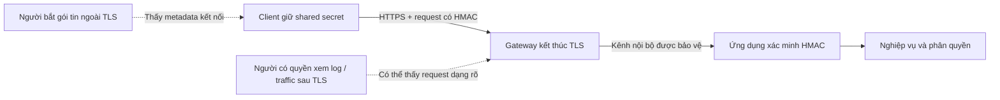
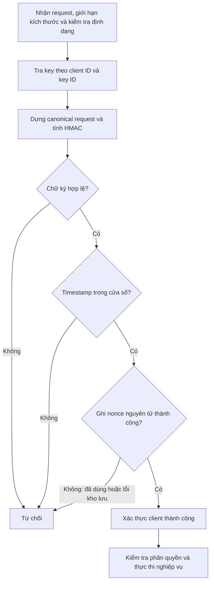

# Kẻ tấn công nghe lén

## 1. Bối cảnh và mục tiêu

Trong mô hình **xác thực HTTP request bằng HMAC với shared secret**, client và server cùng giữ một khóa bí mật. Client tính HMAC trên một **canonical request** được hai bên thống nhất; server dựng lại cùng chuỗi canonical và xác minh chữ ký trước khi xử lý nghiệp vụ.

Bài này tập trung vào **kẻ tấn công nghe lén (eavesdropper)**: đối tượng có khả năng quan sát lưu lượng mạng hoặc bản sao request, nhưng ban đầu không biết shared secret. Sau bài học, bạn cần giải thích được:

- Kẻ nghe lén có thể thu được gì trên HTTP, HTTPS và tại proxy/gateway kết thúc TLS.
- Vì sao HMAC chứng minh tính toàn vẹn và quyền sở hữu khóa, nhưng **không mã hóa** nội dung request.
- Vì sao request có chữ ký hợp lệ vẫn có thể bị **phát lại (replay)** nếu thiếu cơ chế kiểm soát thời gian và nonce.
- Cần ký những thành phần nào, kiểm tra ở đâu và kiểm thử gì khi hệ thống có proxy/gateway.
- Vì sao xác thực client bằng HMAC chưa đồng nghĩa với quyền thực hiện hành động nghiệp vụ.

Ví dụ xuyên suốt là client của đối tác gọi `POST /v1/transfers` đến API chuyển tiền. Mô hình tương tự áp dụng cho webhook, API server-to-server, đồng bộ dữ liệu và request đi qua gateway.

## 2. Năng lực của kẻ nghe lén và các ranh giới tin cậy

**Nghe lén thụ động** nghĩa là quan sát và lưu lại dữ liệu mà không sửa gói tin đang truyền. Khả năng quan sát phụ thuộc vào vị trí:

| Vị trí quan sát | Dữ liệu có thể thấy | Điều đáng lo |
| --- | --- | --- |
| Trên đường truyền **HTTP không TLS** (Wi-Fi công cộng, router trung gian, mạng nội bộ) | Phương thức, URI/query, header, body, timestamp, nonce, chữ ký HMAC nếu các trường này được gửi trong request | Lộ dữ liệu nghiệp vụ; có đủ nguyên liệu để gửi lại nguyên request |
| Trên đường truyền **HTTPS/TLS đúng cách** | Thường chỉ thấy metadata kết nối như IP, thời điểm, kích thước lưu lượng; một số metadata tên miền tùy cơ chế DNS/TLS | Không đọc được HTTP payload hoặc chữ ký chỉ bằng bắt gói tin; metadata vẫn có thể tiết lộ mẫu hoạt động |
| Tại **gateway/reverse proxy sau khi giải mã TLS** | HTTP request ở dạng rõ, tùy cấu hình middleware và quyền truy cập | Người có quyền xem trace, log hoặc bản sao traffic có thể lấy request đã ký |
| Trong **access log, APM, message queue hoặc bản sao dùng để debug** | Bất kỳ header/body nào hệ thống ghi lại | Nguy cơ lộ dữ liệu và tạo nguồn request hợp lệ để replay, ngay cả khi kết nối bên ngoài dùng HTTPS |

Giả định cơ sở của bài học: secret ngẫu nhiên đủ mạnh, được bảo vệ đúng cách; thuật toán là HMAC-SHA256; kẻ nghe lén **chưa đánh cắp secret** và không thể tính chữ ký mới tùy ý. Nếu secret bị lộ, đó là một tình huống nghiêm trọng hơn: kẻ tấn công có thể tự ký request giả và phải được xử lý bằng thu hồi/rotation khóa.



Sơ đồ minh họa **hai ranh giới khác nhau**: TLS bảo vệ dữ liệu trên đường truyền; HMAC giúp bên xác minh phát hiện nội dung được ký bị thay đổi và xác thực bên biết khóa. Kết nối từ gateway đến ứng dụng cũng phải được bảo vệ bằng TLS/mTLS hoặc một kênh nội bộ có kiểm soát tương đương.

### Nghe lén khác với giả mạo, sửa đổi và replay

Một đối tượng chỉ nghe lén chưa tự động sửa được request. Nhưng khi đã ghi lại request, họ có thể chuyển sang hành vi **chủ động gửi lại** một bản sao ở thời điểm khác, nếu có khả năng truy cập API. Phân biệt ba trường hợp:

1. **Đọc trộm nội dung:** HMAC không ngăn đọc body/header trên HTTP rõ; HTTPS bảo vệ tính bí mật trên đường truyền.
2. **Sửa nội dung đã ký:** Chẳng hạn đổi `"amount":250000` thành `"amount":900000`. Nếu body nằm trong hợp đồng ký, chữ ký cũ sẽ không khớp; kẻ tấn công không có secret nên không tạo được chữ ký hợp lệ mới.
3. **Gửi lại nguyên bản request:** Body, phương thức, URI, timestamp, nonce và chữ ký đều giữ nguyên; HMAC vẫn đúng về mặt toán học. Server phải có kiểm tra **freshness và replay** ngoài bước so sánh HMAC.

**Kết luận của mô hình đe dọa:** chữ ký hợp lệ chỉ chứng minh một thông điệp khớp với khóa và canonical request đã ký. Nó không tự chứng minh thông điệp đang được gửi **lần đầu**, và không bảo đảm nội dung **bí mật**.

## 3. Request bị thu thập: chữ ký bảo vệ những gì?

Giả sử ứng dụng nhận request sau (giá trị timestamp và signature chỉ để minh họa; không phải request còn hiệu lực tại thời điểm chạy):

```http
POST /v1/transfers?currency=VND HTTP/1.1
Host: api.example.test
Content-Type: application/json
X-Client-Id: merchant-42
X-Key-Id: key-2026-11
X-Timestamp: 1790000000
X-Nonce: q1V7rK4Z0pT8nC2y
X-Signature: <base64url-hmac-sha256>

{"transferId":"tr-19","amount":250000}
```

Client dùng secret tương ứng với cặp `(X-Client-Id, X-Key-Id)`, rồi tính:

```text
signature = BASE64URL_NO_PADDING(
    HMAC_SHA256(secret_bytes, UTF8(canonical_request))
)
```

Hợp đồng canonicalization **ví dụ của bài** quy định chính xác thứ tự và cách biểu diễn:

1. Phương thức HTTP dạng chữ in hoa, ví dụ `POST`.
2. Đường dẫn URI thô tại **ranh giới xác minh** (không có scheme/host), ví dụ `/v1/transfers`.
3. Chuỗi query thô tại cùng ranh giới, giữ nguyên thứ tự và percent-encoding, ví dụ `currency=VND`; nếu không có query thì dùng dòng rỗng.
4. Giá trị `Content-Type` dưới dạng `content-type:<value>`; tên header viết thường, giá trị chỉ bỏ khoảng trắng đầu/cuối theo hợp đồng.
5. Tương tự, lần lượt ký `x-client-id`, `x-key-id`, `x-timestamp` và `x-nonce`.
6. Dòng cuối là SHA-256 dạng hex chữ thường của **đúng các byte body nhận được** sau khi HTTP transfer decoding; không tự parse JSON rồi serialize lại.
7. Ghép các dòng bằng ký tự LF (`\n`), mã hóa toàn bộ chuỗi bằng UTF-8; **không thêm LF cuối**.

Canonical request tương ứng có dạng:

```text
POST
/v1/transfers
currency=VND
content-type:application/json
x-client-id:merchant-42
x-key-id:key-2026-11
x-timestamp:1790000000
x-nonce:q1V7rK4Z0pT8nC2y
<sha256-hex-cua-chinh-xac-body-bytes>
```

Dòng cuối phải được thay bằng giá trị hash thực tế; đây là ký hiệu mô tả, không phải giá trị hash. **SHA-256 của body không mã hóa body**: nếu bắt được HTTP rõ, kẻ tấn công vẫn đọc được JSON ban đầu.

Trong triển khai, phải định nghĩa rõ xử lý header lặp, header thiếu, ký tự điều khiển, whitespace, encoding, query parameter trùng tên, đường dẫn có `%2F` hoặc `..`, và thay đổi do proxy. Một cách an toàn là **từ chối** header ký bị lặp/không hợp lệ và làm canonicalization theo một hợp đồng duy nhất được kiểm thử giữa client, gateway và ứng dụng. Nếu tài nguyên hoặc phân quyền phụ thuộc `Host`/authority, hãy thêm authority chuẩn hóa vào hợp đồng ký.

### Dưới góc nhìn kẻ nghe lén

| Hành động sau khi bắt được request HTTP rõ | Kết quả mong đợi |
| --- | --- |
| Đọc `transferId` và `amount` | **Có thể**: HMAC không cung cấp confidentiality |
| Đổi `amount` nhưng giữ chữ ký | **Bị chặn** nếu body bytes được ký và server xác minh đúng |
| Đổi `currency=VND` thành `currency=USD` | **Bị chặn** nếu query được ký chính xác |
| Gửi lại toàn bộ request không thay đổi | **Có thể qua được riêng bước HMAC**; phải chặn bằng timestamp + nonce |
| Tạo request mới với amount khác và chữ ký đúng | **Không khả thi theo giả định** secret đủ mạnh, chưa bị lộ và HMAC-SHA256 được dùng đúng |
| Lấy `X-Key-Id` hoặc `X-Client-Id` từ request | Đây là định danh, **không phải secret**; không đủ để tự tạo chữ ký |

Lưu ý: nếu một trường ảnh hưởng đến hành vi nhưng không nằm trong canonical request, kẻ tấn công có thể sửa trường đó mà chữ ký vẫn đúng. Chẳng hạn ký body nhưng bỏ query trong khi server sử dụng query để chọn đơn vị tiền tệ là một lỗ hổng hợp đồng ký.

## 4. Replay: lỗ hổng quan trọng ngay cả khi HMAC đúng

Giả sử API chấp nhận request miễn HMAC khớp. Kẻ tấn công lấy một request chuyển tiền hợp lệ từ log nội bộ, chờ vài giây rồi gửi lại nguyên byte. Vì chữ ký được tính trên cùng canonical request, server sẽ xác minh thành công lần nữa. Nếu nghiệp vụ thực hiện chuyển tiền lại, chỉ HMAC **không đủ**.

Cần ghép hai biện pháp:

- **Timestamp đã ký:** `X-Timestamp` biểu diễn Unix epoch seconds; server kiểm tra trong khoảng thời gian cho phép, ví dụ `server_now - 300 <= timestamp <= server_now + 300`. Vì timestamp nằm trong chuỗi ký, attacker không thể sửa nó để kéo dài hiệu lực mà vẫn giữ chữ ký.
- **Nonce đã ký, dùng một lần:** `X-Nonce` đủ khó đoán và duy nhất cho client trong cửa sổ hiệu lực. **Sau khi chữ ký hợp lệ**, server thực hiện thao tác ghi nonce **nguyên tử, chỉ thành công nếu chưa tồn tại**, ví dụ lệnh `SET key value NX EX ttl` trong Redis. Lần sử dụng tiếp theo bị từ chối, kể cả hai request đến đồng thời ở hai instance.

Khoá lưu nonce nên phân vùng theo client, ví dụ `hmac-nonce:{clientId}:{nonce}`, để client khác không vô tình va chạm. Thời gian TTL cần bao phủ **toàn bộ khoảng thời gian request có thể còn được chấp nhận**, tính cả clock skew và độ trễ giữa các node. Với cửa sổ ±5 phút và khả năng nhận timestamp ở tương lai, TTL khoảng 11 phút kể từ lần nhận đầu là một giá trị minh họa; cần điều chỉnh theo đồng hồ và kiến trúc thực tế.

Thứ tự kiểm tra hợp lý:



**Không đánh dấu nonce là đã dùng trước khi kiểm tra HMAC**: người không có khóa có thể gửi request giả với nonce đoán được nhằm làm gián đoạn request hợp lệ. Nếu hệ thống lưu nonce phân tán gặp lỗi hoặc không bảo đảm tính nguyên tử, cần **từ chối request nhạy cảm** thay vì bỏ qua kiểm tra replay.

Nonce chặn việc dùng lại chữ ký tại tầng xác thực; nghiệp vụ vẫn nên dùng **idempotency key, định danh giao dịch duy nhất hoặc ràng buộc trạng thái**. Ví dụ, `transferId=tr-19` phải được xử lý đúng một lần ở tầng nghiệp vụ ngay cả khi request hợp lệ mới xuất hiện do retry, sự cố mạng hoặc race condition.

## 5. Ví dụ Java: xác minh request đã ký

Mẫu dưới đây dùng Java 17, thể hiện đường đi chính. Phần đọc HTTP request, chặn duplicate header và lưu nonce trong Redis/database do adapter ở tầng gateway/application triển khai. `Request` phải chứa **body bytes nguyên vẹn** đã đọc tại ranh giới xác minh. Hai phía phải dùng cùng hợp đồng canonical ở mục 3.

```java
import java.nio.charset.StandardCharsets;
import java.security.GeneralSecurityException;
import java.security.MessageDigest;
import java.time.Clock;
import java.time.Duration;
import java.util.Base64;
import java.util.HexFormat;
import javax.crypto.Mac;
import javax.crypto.spec.SecretKeySpec;

public final class HmacRequestVerifier {
    private static final long WINDOW_SECONDS = 300;

    public record Request(
        String method, String rawPath, String rawQuery, String contentType,
        String clientId, String keyId, String timestamp, String nonce,
        byte[] body, String signature
    ) {}

    public interface SecretStore {
        byte[] find(String clientId, String keyId);
    }

    public interface NonceStore {
        // Phải là thao tác "claim nếu chưa tồn tại" nguyên tử, có TTL.
        boolean claim(String clientId, String nonce, Duration ttl);
    }

    public static boolean verify(
        Request r, SecretStore secrets, NonceStore nonces, Clock clock
    ) throws GeneralSecurityException {
        if (r == null || r.body() == null || !"POST".equals(r.method())
                || !validId(r.clientId()) || !validId(r.keyId())
                || !validNonce(r.nonce())
                || !safe(r.rawPath()) || !r.rawPath().startsWith("/")
                || (r.rawQuery() != null && !safe(r.rawQuery()))
                || !safe(r.contentType())
                || !safe(r.timestamp()) || r.signature() == null) {
            return false;
        }

        byte[] secret = secrets.find(r.clientId(), r.keyId());
        if (secret == null || secret.length < 32) return false;

        long issuedAt;
        try {
            issuedAt = Long.parseLong(r.timestamp());
        } catch (NumberFormatException ex) {
            return false;
        }

        String bodyHash = HexFormat.of().formatHex(
            MessageDigest.getInstance("SHA-256").digest(r.body())
        );
        String canonical = String.join("\n",
            r.method(),
            r.rawPath(),
            r.rawQuery() == null ? "" : r.rawQuery(),
            "content-type:" + r.contentType().trim(),
            "x-client-id:" + r.clientId(),
            "x-key-id:" + r.keyId(),
            "x-timestamp:" + r.timestamp(),
            "x-nonce:" + r.nonce(),
            bodyHash
        );

        byte[] supplied;
        try {
            supplied = Base64.getUrlDecoder().decode(r.signature());
        } catch (IllegalArgumentException ex) {
            return false;
        }
        if (supplied.length != 32) return false;

        Mac mac = Mac.getInstance("HmacSHA256");
        mac.init(new SecretKeySpec(secret, "HmacSHA256"));
        byte[] expected = mac.doFinal(
            canonical.getBytes(StandardCharsets.UTF_8)
        );
        if (!MessageDigest.isEqual(expected, supplied)) return false;

        long now = clock.instant().getEpochSecond();
        if (issuedAt < now - WINDOW_SECONDS
                || issuedAt > now + WINDOW_SECONDS) {
            return false;
        }

        // TTL phải dài hơn khoảng replay còn khả dĩ, tính cả clock skew.
        return nonces.claim(r.clientId(), r.nonce(), Duration.ofMinutes(11));
    }

    private static boolean validId(String s) {
        return s != null && s.matches("[A-Za-z0-9._-]{1,64}");
    }

    private static boolean validNonce(String s) {
        return s != null && s.matches("[A-Za-z0-9_-]{16,128}");
    }

    private static boolean safe(String s) {
        return s != null && !s.contains("\r") && !s.contains("\n");
    }
}
```

Trong ví dụ, `safe` và các regex chỉ là **bước kiểm tra cơ bản**. Adapter HTTP thực tế phải từ chối header bị lặp/không hợp lệ, kiểm soát kích thước body, quy tắc canonicalization đầy đủ và tránh các cách giải mã URI khác nhau giữa gateway và backend. Bộ xác minh cũng cần chính sách lỗi rõ ràng; ví dụ lỗi Redis nonce store không được âm thầm biến thành “cho qua”. Không hardcode khóa trong mã nguồn; lấy secret từ secret manager, giới hạn quyền và không ghi ra log. So sánh chữ ký dùng `MessageDigest.isEqual` để tránh cách so sánh thông thường rò rỉ thời gian.

Thứ tự xác minh HMAC trước timestamp ở ví dụ giúp dễ thấy timestamp cũng nằm trong dữ liệu ký. Trong thực tế có thể từ chối sớm timestamp có định dạng sai hoặc quá hạn để tiết kiệm tài nguyên, miễn là **không claim nonce** khi chữ ký chưa được xác minh.

## 6. Proxy/gateway, TLS và chỗ dễ bỏ sót

Khi request đi qua gateway, câu hỏi cần trả lời là: **client ký request ở dạng nào, và component nào chịu trách nhiệm xác minh đúng dạng đó?**

- **TLS termination:** HTTPS từ client tới gateway không bảo vệ tự động đoạn gateway → service. Bảo vệ hop nội bộ, hạn chế truy cập bản rõ và quyền đọc log/trace.
- **Path/query rewrite:** Gateway có thể đổi `/external/v1/transfers` thành `/v1/transfers`, thay percent-encoding, sắp xếp query hoặc gộp giá trị. Nếu client ký một dạng còn service xác minh dạng khác, request hợp lệ bị từ chối; nếu mỗi tầng hiểu URI theo một cách khác, có thể tạo lỗ hổng. Nên xác minh tại ingress trước rewrite hoặc có hợp đồng canonical rõ ràng giữa các tầng.
- **Header normalization:** Proxy có thể thay `Host`, thêm `X-Forwarded-*`, chuẩn hóa `Content-Type`, gộp header trùng. Chỉ tin header do proxy tin cậy **ghi đè và quản lý**; không lấy giá trị `X-Forwarded-*` do client tự khai để làm định danh hay thành phần xác thực khi chưa kiểm soát nguồn.
- **Body transform:** Middleware nén/giải nén, parse rồi serialize JSON, sửa newline hoặc charset sẽ làm thay đổi body bytes. Hash phải dựa trên cùng dạng body ở hai phía; không tính hash trên đối tượng JSON đã parse nếu hợp đồng quy định ký byte.
- **Quan sát vận hành:** Tránh log toàn bộ `Authorization`/`X-Signature`, nonce và body nhạy cảm; dùng masking, quyền truy cập chặt chẽ, thời hạn lưu hợp lý. Chữ ký không phải secret, nhưng **chữ ký đi kèm nguyên request** là vật liệu phục vụ replay nếu các lớp bảo vệ khác yếu.
- **Key rotation:** Client gửi key ID công khai; server chọn secret tương ứng. Chỉ chấp nhận khóa hiện hành và khóa cũ trong thời gian chuyển tiếp có giới hạn. Nếu khóa bị lộ, phải thu hồi/đổi khóa ngay; HTTPS, nonce và timestamp không thể bù cho secret đã bị đánh cắp.

HMAC xác thực **client nào biết secret**; nó không tự trả lời client đó có được chuyển tiền cho tài khoản cụ thể hay không. Sau bước xác thực vẫn cần authorization theo principal, tài nguyên, hành động, scope và quy tắc nghiệp vụ.

## 7. Bài thực hành và ma trận kiểm thử

Thiết lập hai endpoint thử nghiệm chạy cùng logic HMAC: một endpoint truy cập qua HTTPS/gateway và một môi trường lab giả lập HTTP rõ (không sử dụng dữ liệu thật). Dùng tài khoản thử nghiệm và secret ngẫu nhiên, sau đó tạo request hợp lệ, ghi nhận kết quả và thử từng thay đổi riêng.

| Thử nghiệm | Thao tác | Kết quả cần kiểm chứng |
| --- | --- | --- |
| Quan sát mạng | Bắt gói tin của HTTP lab và HTTPS | HTTP lab bộc lộ payload; HTTPS không lộ header/body trong packet capture bên ngoài TLS |
| Toàn vẹn body | Đổi `amount`, giữ signature | Từ chối vì HMAC khác |
| Toàn vẹn URI | Đổi query hoặc path, giữ signature | Từ chối nếu các trường này nằm trong hợp đồng ký |
| Timestamp | Gửi timestamp ngoài cửa sổ, kể cả với HMAC được tính đúng trên timestamp đó | Từ chối vì hết hạn hoặc quá xa tương lai |
| Replay tuần tự | Gửi cùng request hợp lệ hai lần | Lần đầu được xác thực, lần sau bị từ chối vì nonce đã dùng |
| Replay đồng thời | Gửi cùng request tới hai instance song song | **Tối đa một** request claim nonce thành công; kiểm tra tính nguyên tử của kho chia sẻ |
| Proxy rewrite | Gửi đường dẫn chứa percent-encoding, query trùng tên hoặc header lặp | Kết quả nhất quán theo hợp đồng; input mơ hồ bị từ chối |
| Rotation | Thử request ký bằng key mới, key cũ trong grace period và key đã thu hồi | Chỉ những key được phép ở thời điểm xác minh mới thành công |
| Authorization | Client có HMAC hợp lệ gọi tài nguyên không được cấp quyền | Vẫn nhận `403 Forbidden` sau bước xác thực |

### Tình huống suy luận

**Tình huống A.** Hệ thống chỉ dùng HMAC-SHA256, không có TLS. Người trên cùng Wi-Fi bắt được một request có body chứa địa chỉ và số tiền. Người đó có đọc được thông tin không? Có tự đổi số tiền mà giữ chữ ký được không?

**Đáp án:** Có thể đọc body rõ, vì HMAC không mã hóa. Không thể sửa số tiền mà vẫn dùng chữ ký cũ nếu body được ký; tuy nhiên có thể thử replay nguyên request khi API truy cập được.

**Tình huống B.** Hệ thống ký method, URI, body và timestamp, dùng HTTPS, chấp nhận timestamp ±5 phút nhưng không lưu nonce. Một bản sao request bị lộ từ log sau TLS.

**Đáp án:** Kẻ có bản sao có thể gửi lại request trong cửa sổ thời gian còn hiệu lực. Timestamp giới hạn **thời lượng** replay nhưng không ngăn **lặp lại trong cửa sổ**. Cần nonce one-time và idempotency ở nghiệp vụ.

**Tình huống C.** Client ký `/api/v1/transfers?currency=VND`, gateway bỏ prefix `/api` trước khi chuyển service, service xác minh HMAC trên `/v1/transfers?currency=VND`.

**Đáp án:** Hai phía tạo canonical request khác nhau nên chữ ký thất bại dù client hợp lệ. Giải quyết bằng xác minh ở ingress trước rewrite hoặc thống nhất dạng URI đã ký và cách truyền dạng đó qua trust boundary một cách an toàn.

## 8. Checklist trước khi coi cơ chế chống nghe lén là đạt yêu cầu

- Dùng HTTPS/TLS cho mọi hop cần bảo vệ confidentiality, gồm cả đường nối gateway–service; quản trị dữ liệu bản rõ trong log/trace.
- HMAC-SHA256 sử dụng secret đủ ngẫu nhiên, cấp riêng theo client/môi trường, giữ trong secret manager; secret **không gửi kèm request**.
- Canonical request bao phủ mọi trường có ý nghĩa bảo mật/nghiệp vụ: method, URI/query, header ký và body; tài liệu hóa chính xác cách chuẩn hóa.
- Timestamp và nonce đều thuộc dữ liệu đã ký; timestamp có cửa sổ hữu hạn, nonce được claim **nguyên tử** với TTL phù hợp ở mọi instance.
- So sánh chữ ký theo cách an toàn, từ chối input mơ hồ, key không hợp lệ, replay và lỗi kho lưu nonce.
- Thực hiện authorization và idempotency nghiệp vụ sau xác thực; có quy trình key rotation/revocation và bộ test qua proxy/gateway.

**Điểm cốt lõi:** Với kẻ nghe lén, TLS bảo vệ **bí mật thông tin trên đường truyền**; HMAC bảo vệ **tính toàn vẹn và xác thực bên biết shared secret**; timestamp + nonce bảo vệ **tính mới và việc dùng một lần trong cửa sổ cho phép**. Ba lớp giải quyết ba câu hỏi khác nhau và phải được thiết kế cùng nhau.
