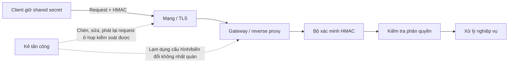

# Kẻ tấn công sửa request

> **Chương:** Mô hình đe dọa  
> **Phạm vi:** Xác thực HTTP request bằng HMAC với shared secret và một hợp đồng §canonical request§. Bài học tập trung vào trường hợp kẻ tấn công thay đổi phương thức, URI, header hoặc body trước khi request được xử lý.

## 1. Tình huống và mục tiêu bảo vệ

Giả sử dịch vụ §billing-worker§ gửi yêu cầu chuyển tiền đến §payments-api§:

```http
POST /v1/transfers?dryRun=false HTTP/1.1
Host: payments.example.vn
Content-Type: application/json
X-Client-Id: billing-worker
X-Key-Id: key-2026-11
X-Timestamp: 1795800000
X-Nonce: cNzDdJbKj6IVxaQKnwOcmg
X-Signature: <chu-ky-base64url>

{"toAccount":"A-200","amount":100000,"currency":"VND"}
```

Trong ví dụ này, các giá trị timestamp và chữ ký chỉ minh họa cấu trúc; chữ ký thực phải được tính từ shared secret và đúng bytes của request. Nếu kẻ tấn công đổi §"amount":100000§ thành §"amount":900000§, hoặc đổi §dryRun=false§, mục tiêu của hệ thống là **phát hiện request đã bị sửa trước khi thực hiện nghiệp vụ**.

HMAC (Hash-based Message Authentication Code) giúp bên nhận kiểm tra rằng dữ liệu được đưa vào hợp đồng ký vẫn nguyên vẹn và bên tạo MAC biết shared secret tương ứng. Kết quả xác thực **không tự động cấp quyền chuyển tiền**: sau khi xác thực, hệ thống vẫn phải kiểm tra danh tính client, quyền đối với tài khoản, hạn mức và quy tắc nghiệp vụ.

Để xác định một phương án HMAC có chống được sửa request hay không, cần trả lời bốn câu hỏi:

1. Kẻ tấn công có thể chạm vào những phần nào của HTTP request?
2. Phần nào thực sự đi vào §canonical request§ để tạo HMAC?
3. Bên ký và bên xác minh có nhìn thấy cùng một biểu diễn của request qua proxy/gateway không?
4. Request cũ có thể được phát lại với chữ ký hợp lệ trong thời hạn chấp nhận hay không?

## 2. Tài sản, ranh giới tin cậy và khả năng của kẻ tấn công

| Thành phần cần bảo vệ | Hậu quả nếu bị sửa mà không bị phát hiện |
| --- | --- |
| HTTP method và đường dẫn | Đổi thao tác hoặc tài nguyên đích, ví dụ từ kiểm tra sang thực thi |
| Query string | Đổi cờ §dryRun§, tham số phân trang, filter hoặc tham số ảnh hưởng xử lý |
| HTTP header có ý nghĩa nghiệp vụ | Đổi tenant, định dạng nội dung, định danh client hoặc bối cảnh định tuyến |
| Body | Đổi người nhận, số tiền, số lượng, tài khoản, trạng thái |
| Timestamp, nonce, key ID và thông tin định danh | Cố kéo dài thời gian sống của request, tái sử dụng request hoặc đánh tráo ngữ cảnh xác thực |
| Shared secret và bản đồ client–key | Giả mạo client nếu secret bị lộ hoặc gán nhầm key cho client |



**Giả định chính của tình huống sửa request:** kẻ tấn công kiểm soát được một phần đường truyền hoặc một hop trung gian, hoặc có thể gửi lại những request đã thu thập; **họ không biết shared secret của client hợp lệ**. Với TLS được xác minh đúng, kẻ ngoài mạng thường không thể sửa nội dung HTTPS trên đường truyền. Tuy nhiên, ở điểm chấm dứt TLS, gateway, mạng nội bộ hoặc hệ thống tích hợp cấu hình sai vẫn tồn tại các ranh giới cần đánh giá.

Kẻ tấn công có thể:

- Thay một số bytes trong body, sửa query, thay method, thêm/bớt header hoặc phát lại toàn bộ request đã ký.
- Gửi nhiều biến thể có giá trị trông giống nhau nhưng cách mã hóa khác nhau, thí dụ §%2F§ với §/§, khoảng trắng trong JSON, thứ tự query hoặc tên header khác chữ hoa/thường.
- Khai thác việc gateway, framework và service parse request theo những quy tắc khác nhau, chẳng hạn header trùng tên hoặc query parameter trùng khóa.
- Gửi request bất kỳ bằng key riêng của họ nếu họ là một client được đăng ký; do đó xác thực phải gắn đúng key với đúng client và phạm vi quyền.

Kẻ tấn công **không thể** tạo HMAC hợp lệ cho nội dung mới nếu không có secret phù hợp và hệ thống dùng HMAC-SHA256 đúng cách. Nếu shared secret bị lộ, giả định an toàn đó không còn: cần thu hồi/rotate key và điều tra phạm vi ảnh hưởng. HMAC cũng không bảo đảm bí mật nội dung request; vẫn cần HTTPS/TLS.

## 3. Những cách sửa request cần đưa vào threat model

| Cách tấn công | Ví dụ | Điều kiện để phát hiện đúng |
| --- | --- | --- |
| **Body tampering** | Đổi §amount§ hoặc §toAccount§ | HMAC bao phủ hash của **bytes body thực nhận** |
| **Method/path tampering** | Đổi §POST§ hoặc chuyển từ §/quote§ sang §/transfer§ | Method và đường dẫn đều được ký |
| **Query tampering** | Đổi §dryRun=false§ thành §true§; thêm §admin=true§ | Ký toàn bộ query có ý nghĩa, gồm tham số lặp theo hợp đồng rõ ràng |
| **Header tampering** | Đổi §X-Tenant-Id§, §Content-Type§, thông tin tác động đến nghiệp vụ | Ký mọi header mà server tin dùng để định tuyến, giải mã, nhận diện hoặc ra quyết định |
| **Identity/key confusion** | Đổi §X-Client-Id§ hoặc §X-Key-Id§ | Ràng buộc định danh và key ID trong canonical request; resolver chỉ trả key được phép của client |
| **Canonicalization mismatch** | Gateway giải mã §%2F§, sắp xếp query, chuẩn hóa path; service ký một phiên bản khác | Đặc tả nhất quán về biểu diễn được ký, vị trí xác minh và phép biến đổi được phép |
| **Replay** | Phát lại request cũ không cần sửa chữ ký | Timestamp đã ký, nonce dùng một lần với lưu trữ nguyên tử và cửa sổ hợp lý |
| **Cross-service replay** | Đem request ký ở môi trường A sang môi trường B dùng cùng key | Ký §audience§/service/environment cố định; phân tách key giữa các môi trường |
| **Parser differential** | Gửi hai header §X-Client-Id§ hoặc hai query §amount§ | Từ chối cấu trúc mơ hồ và xử lý thống nhất giữa gateway và ứng dụng |

Một lỗi cốt lõi là **ký ít trường hơn số trường có thể thay đổi kết quả xử lý**. Ví dụ, nếu chỉ ký body mà không ký query, người tấn công có thể đổi §?dryRun=true§ thành §?dryRun=false§ mà chữ ký body vẫn hợp lệ. Tương tự, ký body nhưng đọc §X-Tenant-Id§ ngoài phạm vi chữ ký tạo đường vòng để đánh tráo tenant.

## 4. Hợp đồng canonical request minh họa

Để có ví dụ kiểm chứng được, giả sử API chuyển tiền áp dụng hợp đồng **HMAC v1** như sau:

- Chỉ nhận §POST§, §Content-Type: application/json§ và body JSON gửi dưới dạng UTF-8; giới hạn kích thước body.
- §RAW_TARGET§ là path cộng query **đúng biểu diễn request-target mà bộ xác minh nhận ở trust boundary đã định**, bắt đầu bằng §/§; không chứa fragment (§#...§). Không tự động decode, gộp slash, sắp xếp query hay parse rồi dựng lại chuỗi để ký.
- §BODY_SHA256_HEX§ là SHA-256 viết hex chữ thường của **bytes nội dung thực nhận sau khi HTTP transfer framing đã được xử lý**; không parse rồi serialize JSON trước khi hash. Nếu dùng §Content-Encoding§ hoặc proxy giải nén, phải đưa encoding vào hợp đồng và kiểm soát phép biến đổi, hoặc từ chối encoding không được hỗ trợ.
- §CLIENT_ID§, §KEY_ID§, §TIMESTAMP§ và §NONCE§ đến từ đúng một giá trị header tương ứng, theo định dạng cố định. Bất kỳ header xác thực trùng hoặc sai định dạng đều bị từ chối.
- §AUDIENCE§ là hằng số §payments-api-prod§ do cả hai phía cấu hình; ngăn mang chữ ký sang dịch vụ/môi trường khác. Khi Host, tenant hoặc header định tuyến tác động đến đích xử lý, phải ràng buộc thêm ngữ cảnh đó trong hợp đồng hoặc bảo đảm gateway cố định nó.

Chuỗi canonical được ghép theo **đúng thứ tự**, mỗi trường cách nhau một ký tự LF (§\n§), không thêm LF cuối:

```text
hmac-v1
payments-api-prod
METHOD
RAW_TARGET
CONTENT_TYPE
CLIENT_ID
KEY_ID
TIMESTAMP
NONCE
BODY_SHA256_HEX
```

Với request ở đầu bài, chuỗi minh họa là:

```text
hmac-v1
payments-api-prod
POST
/v1/transfers?dryRun=false
application/json
billing-worker
key-2026-11
1795800000
cNzDdJbKj6IVxaQKnwOcmg
<sha256-hex-cua-bytes-body>
```

Cả client và server tính:

```text
signature = BASE64URL_NO_PADDING(
    HMAC_SHA256(shared_secret, UTF8(canonical_request))
)
```

Ký tự xuống dòng trong một trường sẽ làm mơ hồ cấu trúc ghép; do đó trường header/target phải được giới hạn ký tự hợp lệ và từ chối CR/LF. Mọi thay đổi dù chỉ một byte trong trường đã ký làm đổi dữ liệu đầu vào HMAC. Trong điều kiện secret còn an toàn, bên tấn công không thể tính lại chữ ký tương ứng.

**Lưu ý về gateway:** §RAW_TARGET§ ở đây là dữ liệu mà **điểm xác minh** quan sát, không mặc định là giá trị ban đầu tại client. Nếu proxy rewrite §/api/v1/transfers§ thành §/v1/transfers§, hai phía phải thống nhất chính xác ký trước hay sau rewrite, hoặc đặt bộ xác minh trước bước rewrite. Không lấy §X-Original-URI§/§X-Forwarded-*§ do client tự gửi làm nguồn tin nếu gateway không xóa và tái tạo chúng một cách đáng tin cậy.

### So sánh ba request

| Request đến server | Chữ ký ban đầu | Kết quả mong đợi |
| --- | --- | --- |
| Body và các trường đã ký giữ nguyên; nonce chưa sử dụng | Hợp lệ | Qua kiểm tra HMAC/anti-replay, tiếp tục **phân quyền** |
| Body đổi §amount§ từ §100000§ thành §900000§ | Không đổi | **Từ chối:** body hash khác, MAC khác |
| Query đổi §dryRun=false§ thành §dryRun=true§ | Không đổi | **Từ chối:** §RAW_TARGET§ khác, MAC khác |

Ngay cả khi request không bị sửa, kẻ tấn công vẫn có thể gửi lại toàn bộ body, header và chữ ký. Đó là bài toán **replay**, không được HMAC đơn thuần giải quyết.

## 5. Quy trình xác minh và ví dụ Java 17

Bên nhận cần xác minh trước khi gọi nghiệp vụ: kiểm tra cấu trúc, giới hạn dữ liệu, kiểm tra timestamp, chọn key theo client và key ID, tính canonical bytes, so sánh MAC theo thời gian gần như cố định, sau đó **giành quyền sử dụng nonce bằng thao tác nguyên tử**. Với nhiều instance, nonce store phải chia sẻ giữa các instance.

Đoạn mã dưới đây minh họa lõi xác minh cho **endpoint chuyển tiền POST dùng JSON**, không phải middleware HTTP hoàn chỉnh. Lớp HTTP/gateway phải từ chối header trùng hoặc nhập nhằng trước khi tạo §SignedRequest§; key store chỉ trả secret đang được phép sử dụng của client; nonce store thực thi thao tác atomically-if-absent và lưu TTL theo giây.

```java
import java.nio.charset.StandardCharsets;
import java.security.GeneralSecurityException;
import java.security.MessageDigest;
import java.time.Clock;
import java.util.Base64;
import java.util.HexFormat;
import javax.crypto.Mac;
import javax.crypto.spec.SecretKeySpec;

public final class HmacRequestVerifier {
    private HmacRequestVerifier() {}

    // Chỉ trả key đang hợp lệ và thuộc đúng clientId; null nếu không có.
    public interface KeyStore {
        byte[] secretFor(String clientId, String keyId);
    }

    // Phải nguyên tử và dùng kho chia sẻ giữa các instance.
    // Trả false nếu nonce đã tồn tại hoặc không thể ghi an toàn.
    public interface NonceStore {
        boolean claimOnce(String clientId, String keyId,
                          String nonce, long ttlSeconds);
    }

    public record SignedRequest(
            String method,
            String rawTarget,
            String contentType,
            String clientId,
            String keyId,
            String timestamp,
            String nonce,
            String signature,
            byte[] body) {

        // Giữ bản sao bytes đã nhận để tránh caller sửa trong lúc verify.
        public SignedRequest {
            body = body == null ? null : body.clone();
        }

        @Override
        public byte[] body() {
            return body == null ? null : body.clone();
        }
    }

    public static boolean verify(
            SignedRequest r, KeyStore keys, NonceStore nonces, Clock clock) {
        try {
            if (!valid(r)) return false;

            long sentAt = Long.parseLong(r.timestamp());
            long now = clock.instant().getEpochSecond();
            if (sentAt < now - 300 || sentAt > now + 300) return false;

            // Không thử hàng loạt key, không chấp nhận key đã bị thu hồi.
            byte[] secret = keys.secretFor(r.clientId(), r.keyId());
            if (secret == null || secret.length != 32) return false;

            byte[] received = Base64.getUrlDecoder().decode(r.signature());
            if (received.length != 32) return false;
            String normalizedSignature = Base64.getUrlEncoder()
                    .withoutPadding().encodeToString(received);
            if (!normalizedSignature.equals(r.signature())) return false;

            byte[] bodyBytes = r.body(); // bytes snapshot để hash
            byte[] bodyHash = MessageDigest.getInstance("SHA-256")
                    .digest(bodyBytes);
            String canonical = String.join("\n",
                    "hmac-v1",
                    "payments-api-prod",
                    r.method(),
                    r.rawTarget(),
                    r.contentType(),
                    r.clientId(),
                    r.keyId(),
                    r.timestamp(),
                    r.nonce(),
                    HexFormat.of().formatHex(bodyHash));

            Mac mac = Mac.getInstance("HmacSHA256");
            mac.init(new SecretKeySpec(secret, "HmacSHA256"));
            byte[] expected = mac.doFinal(
                    canonical.getBytes(StandardCharsets.UTF_8));

            if (!MessageDigest.isEqual(expected, received)) return false;

            // 660s > 2 * 300s; chống replay trong cả cửa sổ lệch đồng hồ.
            return nonces.claimOnce(
                    r.clientId(), r.keyId(), r.nonce(), 660);
        } catch (IllegalArgumentException | GeneralSecurityException ex) {
            return false;
        }
    }

    private static boolean valid(SignedRequest r) {
        if (r == null || r.body() == null || r.body().length > 1_048_576)
            return false;
        if (!"POST".equals(r.method())
                || !"application/json".equals(r.contentType()))
            return false;
        if (r.rawTarget() == null || r.rawTarget().length() > 2048
                || !r.rawTarget().startsWith("/")
                || r.rawTarget().contains("#")
                || !r.rawTarget().chars()
                    .allMatch(c -> c >= 0x21 && c <= 0x7e))
            return false;
        return r.clientId() != null
                && r.clientId().matches("[A-Za-z0-9._-]{1,64}")
                && r.keyId() != null
                && r.keyId().matches("[A-Za-z0-9._-]{1,64}")
                && r.timestamp() != null
                && r.timestamp().matches("[0-9]{10,12}")
                && r.nonce() != null
                && r.nonce().matches("[A-Za-z0-9_-]{16,128}")
                && r.signature() != null
                && r.signature().matches("[A-Za-z0-9_-]{43}");
    }
}
```

Trong môi trường thật, gateway cần lấy §rawTarget§ theo API bảo toàn đúng request-target đã thống nhất; không giả định §getRequestURI()§, route đã decode hay query được framework parse lại luôn phù hợp. Bản sao §bodyBytes§ đã xác minh cũng phải là nguồn dữ liệu cho bước parse/xử lý tiếp theo, tránh kiểm tra một bản rồi xử lý bản khác (TOCTOU). Ví dụ chỉ cho §POST§/JSON để làm rõ hợp đồng; khi hỗ trợ method, content type, encoding hoặc body rỗng khác, cần mở rộng đặc tả và test cả hai phía một cách có chủ đích.

**Điểm quan trọng về nonce:** §claimOnce§ phải tương đương thao tác “insert nếu chưa có” kèm TTL (ví dụ Redis §SET key value NX EX 660§). Hai request cùng nonce đến đồng thời phải chỉ có **một** request được chấp nhận. Không dùng kiểm tra §exists§ rồi mới §set§ riêng rẽ vì cả hai có thể vượt qua. Ghi nonce **sau khi** MAC hợp lệ để giảm khả năng request giả lấp đầy kho; nếu kho nonce lỗi, từ chối an toàn. TTL cần bao phủ cửa sổ timestamp đang chấp nhận, kể cả lệch đồng hồ giữa các nút và độ trễ thực tế.

## 6. Phân tích từng giới hạn bảo vệ

### 6.1 Ký body không đồng nghĩa với bảo vệ toàn bộ request

SHA-256 của body chỉ nhận diện thay đổi body; HMAC bao phủ hash đó và các trường được liệt kê trong canonical request. Nếu không ký method, path, query hoặc header ảnh hưởng logic, request vẫn có thể bị thay đổi ở những trường đó. Mỗi nhóm phát triển API cần rà soát tất cả input được đọc sau xác thực, kể cả header do gateway đưa vào.

Không ký §Content-Length§ thường vẫn hợp lý vì nó có thể thay đổi qua HTTP framing trong khi body bytes không đổi. Ngược lại, §Content-Type§ hoặc §Content-Encoding§ ảnh hưởng cách diễn giải body nên phải được bảo vệ hoặc bị khóa cố định. Với JSON, §{"a":1,"b":2}§ và §{ "b": 2, "a": 1 }§ có thể biểu đạt dữ liệu tương đương nhưng **khác bytes**, nên signature theo bytes phải khác; đừng ngầm chuẩn hóa JSON ở một phía.

### 6.2 Canonicalization là một phần của giao thức bảo mật

Một lỗi phổ biến là client ký path chưa encode, còn server ký path đã decode, hoặc proxy chuyển §%2F§ thành §/§. Với query §?role=user&role=admin§, các framework có thể chọn giá trị đầu hoặc cuối. Dù HMAC hợp lệ cho nguyên chuỗi query, nghiệp vụ vẫn nguy hiểm nếu gateway, WAF và service diễn giải khác nhau. Cần xác định quy tắc cho percent-encoding, khóa lặp, khoảng trắng, chữ hoa/thường, dấu slash cuối, header lặp và vị trí xác minh; từ chối các cách biểu diễn mơ hồ mà ứng dụng không chủ động hỗ trợ.

HTTP/1.1 và HTTP/2 có cách biểu diễn method/authority/path khác nhau; khi gateway đổi protocol, phải kiểm thử §:path§, authority, query và request-target ở đúng trust boundary. HMAC không sửa được lỗi parser không thống nhất hoặc request smuggling; cần cấu hình HTTP parser, gateway và service tương thích.

### 6.3 Chống replay khác với chống sửa nội dung

Một request bị sửa sẽ có MAC không khớp; nhưng **phát lại nguyên request** có thể giữ MAC đúng. Timestamp ký bằng HMAC giới hạn thời gian; nonce ngẫu nhiên dùng một lần (tạo bằng CSPRNG, đủ độ dài) ngăn nhiều lần dùng trong cửa sổ. Nên đồng bộ thời gian máy chủ và phân biệt mã lỗi nội bộ cho hết hạn, nonce trùng, MAC sai để quan sát vận hành.

Đối với giao dịch chuyển tiền, nonce không thay thế §Idempotency-Key§ và thiết kế idempotent: lỗi mạng có thể khiến client cần gửi lại yêu cầu hợp lệ với nonce/chữ ký mới, nhưng hệ thống vẫn phải tránh tạo giao dịch hai lần theo khóa nghiệp vụ.

### 6.4 Key rotation và phân quyền

Mỗi client có key ID và shared secret riêng, quản lý bằng secret manager/KMS phù hợp, không nhúng vào ứng dụng frontend công khai hoặc ghi vào log. Trong rotation, có thể tạm chấp nhận key hiện tại và key trước đó **theo thời gian hiệu lực và đúng client**, sau đó thu hồi key cũ. Bên nhận không nên thử mọi secret để tìm chữ ký khớp, cũng không để header do client chọn thuật toán yếu hơn. Giá trị §X-Key-Id§ đã được đưa vào canonical request nhằm ràng buộc danh tính key.

Một client sở hữu secret của chính nó vẫn có thể ký các request mà client muốn gửi. Vì vậy, “MAC hợp lệ” chỉ chứng minh request được ký bằng secret đã đăng ký; không chứng minh client được phép sửa tài nguyên của tenant khác, thực hiện endpoint quản trị hay vượt hạn mức. Quyết định ủy quyền thuộc lớp phía sau xác thực.

## 7. Kiểm thử tấn công, proxy và vận hành

Hãy dựng một request hợp lệ bằng cùng bộ dữ liệu đầu vào ở client và verifier, rồi chỉ thay **một** thành phần mỗi lần. Những ca sau cần có test tích hợp qua gateway thực tế, bên cạnh unit test hàm HMAC:

| Ca kiểm thử | Hành động | Kỳ vọng |
| --- | --- | --- |
| Baseline | Request mới, đúng key, đúng bytes, nonce mới | HMAC qua; phân quyền được kiểm tra tiếp |
| Sửa body | Đổi một chữ số của §amount§, giữ chữ ký | MAC sai, không chạy nghiệp vụ |
| Sửa method | §POST§ thành §GET§ | Bị từ chối |
| Sửa path/query | Thêm §?admin=true§ hoặc đổi §dryRun§ | MAC sai |
| Sửa header được ký | Đổi §Content-Type§ hoặc §X-Client-Id§ | Bị từ chối |
| Sửa timestamp | Tăng thời gian nhưng giữ chữ ký | MAC sai; timestamp ngoài cửa sổ cũng bị từ chối |
| Replay | Gửi lại y nguyên request đã chấp nhận | Nonce trùng, bị từ chối |
| Đồng thời | Hai instance nhận cùng nonce gần đồng thời | Chính xác một request giành được nonce |
| Key sai/thu hồi | Dùng key ID không thuộc client hoặc đã hết hiệu lực | Bị từ chối |
| Request mơ hồ | Header xác thực trùng, query lặp không được hỗ trợ | Từ chối trước nghiệp vụ |
| Proxy rewrite | Thay đổi path, query encoding, body nén, chuyển HTTP/2 → HTTP/1.1 | Hoặc ký/xác minh cùng bytes, hoặc từ chối theo hợp đồng |
| Unsigned business input | Thử sửa host/tenant/forwarded header mà nghiệp vụ sử dụng | Phải bị ràng buộc trong hợp đồng hoặc bị khóa bởi gateway |
| Sai quyền | Chữ ký hợp lệ nhưng client không có quyền chuyển tài khoản đích | Bị lớp phân quyền từ chối |

Các phép thử proxy nên chạy ở cả cấu hình direct-to-service và qua ingress/gateway; so sánh canonical bytes/digest đã **ẩn thông tin nhạy cảm** ở hai đầu để khoanh vùng chỗ rewrite. Không log raw shared secret, chữ ký, token hoặc body giao dịch. Có thể ghi client ID, key ID, thời gian, mã lỗi nội bộ đã chuẩn hóa, correlation ID và chỉ dấu request đã ký để quan sát; phản hồi ra ngoài nên tránh tiết lộ chi tiết giúp dò key hoặc cấu trúc xác minh.

Trước khi đưa vào vận hành, cần xác nhận:

- Bộ ký và bộ xác minh dùng cùng phiên bản hợp đồng; thay đổi canonical format phải có version mới và lộ trình chuyển đổi rõ.
- Key được phân quyền theo client và môi trường; secret có thể rotation/thu hồi; dùng HTTPS ngay cả khi có HMAC.
- Gateway xử lý thống nhất header lặp, path/query encoding, body encoding, giới hạn payload và authority; xác minh đặt đúng điểm trong chuỗi biến đổi.
- Nonce store có thao tác nguyên tử, chia sẻ giữa tất cả instance, TTL phù hợp, fail closed; đồng hồ được giám sát và đồng bộ.
- HMAC chạy **trước** nghiệp vụ; phân quyền và idempotency vẫn được kiểm tra độc lập.

## 8. Câu hỏi tự kiểm tra

1. Nếu backend chỉ ký JSON body, kẻ tấn công còn có thể thay đổi những trường nào để ảnh hưởng nghiệp vụ mà MAC vẫn đúng?
2. Vì sao hai request có nội dung JSON tương đương về mặt đối tượng nhưng khác khoảng trắng lại có chữ ký khác nếu hash raw body?
3. Việc ký timestamp có đủ chặn hai request giống hệt nhau gửi trong cùng 5 phút không? Cơ chế nào xử lý?
4. Khi proxy rewrite §/api/v1§ thành §/v1§, client và server cần thống nhất điều gì để không tạo sai lệch canonical request?
5. Vì sao client có chữ ký HMAC hợp lệ vẫn có thể bị từ chối chuyển tiền sang một tài khoản cụ thể?

**Kết luận kiến thức:** HMAC chỉ chống sửa đổi **những trường được bao phủ đúng và được cả hai phía diễn giải thống nhất**. Muốn chống “kẻ tấn công sửa request”, phải bắt đầu từ threat model, ký toàn bộ input có tác động đến quyết định xử lý, xử lý canonicalization qua proxy, chặn replay và tách bạch xác thực với phân quyền.
