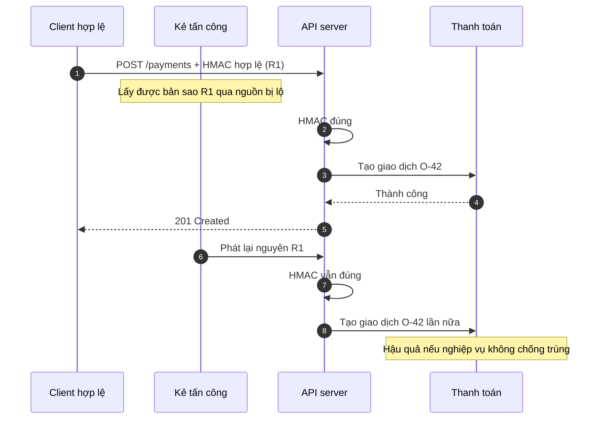
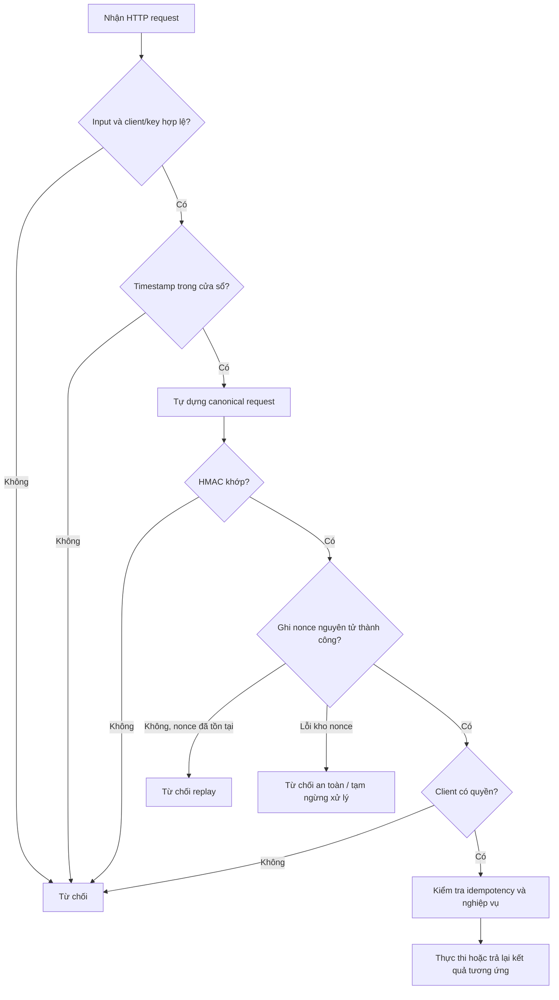

# Kẻ tấn công phát lại

## 1. Tình huống: chữ ký hợp lệ nhưng giao dịch vẫn bị lặp

Một dịch vụ thanh toán cho phép đối tác gọi API:

```http
POST /v1/payments?merchantId=m-42 HTTP/1.1
Content-Type: application/json
X-Client-Id: client-42
X-Key-Id: key-2026-11
X-Timestamp: <unix-seconds>
X-Nonce: <random-value>
X-Signature: <base64-hmac>

{"orderId":"O-42","amount":250000,"currency":"VND"}
```

Hệ thống sử dụng **HMAC với shared secret**: client ký một *canonical request* bao gồm HTTP method, URI, các header theo hợp đồng ký và hash của body. Server tái tạo canonical request, tìm secret tương ứng với client/key, tính lại HMAC và xác minh chữ ký.

Giả sử request đầu tiên đã được ký hợp lệ, server xử lý thành công và tạo một thanh toán. Nếu một bên khác lấy được **bản sao nguyên vẹn** của request rồi gửi lại, kết quả tính HMAC vẫn như cũ. Khi endpoint thực hiện một thao tác có tác dụng phụ, request lặp có thể tạo thêm giao dịch, gửi hai lần một lệnh chi tiền hoặc phát hành hai lần một quyền truy cập.

Đây là **replay attack** (*tấn công phát lại*): kẻ tấn công sử dụng lại một thông điệp xác thực đã hợp lệ trong quá khứ nhằm khiến hệ thống chấp nhận nó lần nữa. Kẻ tấn công **không cần biết shared secret** và cũng không cần phá thuật toán HMAC, miễn là máy chủ chỉ kiểm tra chữ ký mà không kiểm tra tính mới của request.

Trong mô-đun **`SECURITY_AUTHENTICATION_HMAC_REQUEST_AUTHENTICATION`**, bài này tập trung vào đối thủ thực hiện replay, các giả định của mô hình đe dọa, cơ chế chống replay bằng timestamp/nonce, tác động của key rotation và proxy/gateway, cùng ranh giới giữa xác thực, chống replay, idempotency và phân quyền.

## 2. Định nghĩa phạm vi và giả định đe dọa

### 2.1. Tài sản cần bảo vệ

| Tài sản / thuộc tính | Hậu quả nếu replay thành công |
| --- | --- |
| Số dư và giao dịch thanh toán | Tạo giao dịch trùng, chi tiền nhiều lần |
| Đơn hàng, webhook, hàng đợi sự kiện | Xử lý cùng nghiệp vụ nhiều lần |
| Trạng thái người dùng hoặc tài khoản | Lặp hành động đặt lệnh, đổi cấu hình, cấp quyền |
| Giới hạn sử dụng và quota | Ghi nhận sai, tiêu thụ tài nguyên quá mức |
| Nhật ký kiểm toán | Khó phân biệt request hợp lệ ban đầu với bản sao phát lại |
| Tính sẵn sàng của dịch vụ | Flood request hợp lệ đã thu thập được |

### 2.2. Kẻ tấn công có thể và không thể làm gì?

**Năng lực giả định:** kẻ tấn công có được một hoặc nhiều request đã ký hoàn chỉnh, gồm method, URI, các header đã ký, body và chữ ký; có thể gửi lại request đến endpoint qua mạng. Bản sao có thể bị lộ do log ghi quá nhiều dữ liệu, một máy client bị xâm nhập, hệ thống giám sát không được bảo vệ hoặc một thành phần trung gian có quyền xem nội dung. Với TLS hoạt động đúng, kẻ nghe lén mạng thụ động thông thường **không thể đọc nguyên vẹn** nội dung HTTPS chỉ bằng cách quan sát gói tin.

**Giới hạn giả định:** kẻ tấn công không biết shared secret, không tạo được chữ ký mới cho nội dung khác và không thể giả mạo thành công HMAC-SHA-256. Việc sửa các trường *đã được ký* sẽ làm chữ ký không hợp lệ. Tuy vậy, nếu hợp đồng ký bỏ sót một trường có tác động nghiệp vụ, kẻ tấn công có thể kết hợp replay với sửa đổi trường đó; khi ấy vấn đề bao gồm cả **thiếu ràng buộc toàn vẹn**.

**Mục tiêu của bên phòng thủ:** server chỉ chấp nhận các request được ký bởi client tin cậy, còn hiệu lực theo chính sách thời gian và chưa được dùng trước đó trong phạm vi cần bảo vệ. Dù request vượt qua các kiểm tra này, server vẫn phải kiểm tra client có **quyền thực hiện hành động** hay không.

### 2.3. Các ranh giới tin cậy

| Ranh giới | Điều server được phép tin | Điều server phải tự xác minh |
| --- | --- | --- |
| Internet → gateway | Không tin header danh tính do bên ngoài tự khai báo | Chữ ký, timestamp, nonce, giới hạn kích thước request |
| Gateway → backend | Chỉ tin thông tin đã qua bảo vệ và xác thực ở kênh nội bộ | Header xác thực do gateway thiết lập; request đã bị biến đổi hay chưa |
| API instance → kho nonce | Cần tính nhất quán cho mọi instance xử lý cùng principal | Thao tác thêm nonce phải nguyên tử, thời gian lưu đủ dài |
| API → hệ thống nghiệp vụ | Principal đã xác thực và request được chấp nhận | Quyền theo merchant/tài nguyên, idempotency, quy tắc nghiệp vụ |

## 3. Diễn tiến của một replay attack

Giả sử hệ thống chỉ kiểm tra HMAC. Một request hợp lệ có thể bị phát lại nhiều lần mà server không nhận ra.



**Điều quan trọng:** kết quả HMAC không thay đổi khi thông điệp và secret không đổi. HMAC chứng minh *thông điệp từng được bên giữ secret ký*; bản thân nó không chứng minh đây là lần đầu thông điệp đến server. Timestamp và nonce cũng chỉ có tác dụng khi **được ký cùng request và được máy chủ kiểm tra đúng cách**.

### 3.1. Bốn biến thể cần phân biệt

1. **Phát lại tuần tự:** gửi bản sao R1 sau khi R1 đã thành công. Nếu server không nhớ dấu vết, nó tiếp nhận cả hai.
2. **Phát lại đồng thời:** gửi R1 tới hai API instance cùng thời điểm. Nếu mỗi instance kiểm tra “nonce chưa có” rồi mới ghi, cả hai có thể cùng chấp nhận vì điều kiện chạy đua (*race condition*).
3. **Phát lại qua nhiều điểm vào:** chuyển bản sao qua gateway, region hoặc endpoint khác trong hệ thống dùng cùng miền khóa. Kho nonce cục bộ không đồng bộ có thể cho phép cùng request được xử lý ở nhiều nơi.
4. **Phát lại bằng bản sao được lưu lâu:** dùng request cũ sau một thời gian dài. Nếu server không kiểm tra timestamp, hoặc cho phép nonce hết TTL khi chữ ký vẫn còn được chấp nhận, request cũ có thể được dùng lại.

Trường hợp **client bị lộ shared secret** là một đe dọa nghiêm trọng khác: đối thủ có thể tự ký request *mới*, tạo timestamp và nonce mới. Chống replay không thể chặn đối thủ đã có secret; phải thu hồi và xoay khóa, điều tra lộ lọt và giới hạn quyền của client.

## 4. Timestamp chỉ giới hạn thời gian, chưa bảo đảm một lần duy nhất

Giả sử mỗi request mang `X-Timestamp` là Unix time tính bằng **giây** và trường này nằm trong dữ liệu được ký. Server cho phép sai lệch `W = 300` giây:

```text
acceptTimestamp =
    abs(serverTimeSeconds - signedRequestTimestampSeconds) <= 300
```

Khi client ký request tại 10:00:00 UTC, một máy chủ có đồng hồ chuẩn có thể chấp nhận timestamp đó từ **09:55:00 đến 10:05:00 UTC**. Bản sao request gửi lúc 10:02 vẫn nằm trong cửa sổ 5 phút, dù request gốc đã được xử lý lúc 10:00. Vì vậy:

- **Không có timestamp:** một request đã ký có thể còn phát lại sau thời gian dài miễn là key còn hiệu lực và hợp đồng không có ràng buộc khác.
- **Có timestamp được ký nhưng không có nonce:** đối thủ vẫn phát lại được nhiều lần **trong cửa sổ thời gian**.
- **Có timestamp nhưng không được đưa vào canonical request:** đối thủ có thể sửa timestamp trên đường đi và kéo dài hiệu lực của bản sao nếu server chỉ kiểm tra giá trị header mà không kiểm tra ràng buộc mật mã.
- **Có timestamp được ký và có nonce được ký:** hệ thống mới có đủ thông tin để phát hiện bản sao, nhưng cần thêm **bộ nhớ nonce dùng chung và thao tác nguyên tử**.

Server phải kiểm tra cả timestamp quá cũ **và quá xa tương lai**, dùng cùng đơn vị giây/millisecond đã quy định, đồng bộ đồng hồ bằng nguồn tin cậy, giới hạn độ dài/kiểu dữ liệu và không cho phép số nguyên tràn. Đồng hồ không ổn định tạo ra cả rủi ro chấp nhận request cũ và rủi ro từ chối client hợp lệ.

## 5. Nonce: nhận biết một request đã từng được dùng

**Nonce** là một giá trị được tạo mới cho mỗi lần ký request và không được tái sử dụng trong phạm vi client đã xác thực. Nên dùng bộ sinh số ngẫu nhiên bảo mật (*CSPRNG*) và đủ entropy, chẳng hạn 128 bit:

```java
import java.security.SecureRandom;
import java.util.Base64;

public class NonceFactory {
    private static final SecureRandom RNG = new SecureRandom();

    public static String newNonce() {
        byte[] random = new byte[16]; // 128 bit
        RNG.nextBytes(random);
        return Base64.getUrlEncoder().withoutPadding().encodeToString(random);
    }
}
```

Lệnh `newNonce()` được gọi khi **ký một request mới**. Không tái sử dụng nonce của request trước dù request đó gặp timeout. Với mục tiêu chống phát lại, nonce không cần mã hóa hay giấu khỏi đối phương; nó cần khó đoán, ít trùng và **được ràng buộc bằng HMAC** để không bị thay trên đường đi.

Máy chủ lưu dấu vết theo khóa, chẳng hạn:

```text
replayKey = "hmac:nonce:" + authenticatedClientId + ":" + signedNonce
```

`authenticatedClientId` phải là danh tính đã được xác thực bằng HMAC, không phải giá trị header chưa kiểm chứng. Thiết kế nên dùng miền nonce thống nhất cho một client ngay cả khi đang xoay key, trừ khi hợp đồng quy định chặt chẽ cơ chế khác. Có thể hash nonce trước khi lưu để giảm rò rỉ giá trị trong log/kho dữ liệu.

### 5.1. Vì sao “check rồi insert” là chưa đủ?

Cách sai khi hai API instance chạy đồng thời:

```text
Instance A: nonce có chưa? → chưa
Instance B: nonce có chưa? → chưa
Instance A: ghi nonce → thành công
Instance B: ghi nonce → thành công
=> Cả A và B đều xử lý request
```

Server cần một thao tác duy nhất có nghĩa **“chỉ thêm nonce nếu chưa tồn tại”** (*atomic insert-if-absent*), ví dụ lệnh Redis:

```redis
SET hmac:nonce:client-42:abc123 1 NX EX 600
```

Đây là câu lệnh minh họa: `NX` chỉ ghi khi khóa chưa tồn tại; `EX` đặt TTL tính bằng giây. Trong hệ thống thật, phải tính TTL theo cửa sổ chấp nhận của timestamp và đảm bảo tất cả node/region thực hiện việc ghi nonce trên một hệ thống có **đảm bảo nhất quán cần thiết**. Redis đặt ở các region với replication bất đồng bộ có thể chưa đủ để chống trường hợp hai request được gửi đồng thời tới các region khác nhau.

Nếu thao tác ghi nonce trả về “đã tồn tại”, hệ thống từ chối request dù chữ ký HMAC vẫn đúng.

### 5.2. Tính TTL từ thời điểm cuối còn được chấp nhận

Một sai lầm phổ biến là mặc định lưu nonce đúng 300 giây vì cửa sổ timestamp là ±300 giây. Giả sử request có timestamp **10:00**, được server có đồng hồ 09:55 chấp nhận sớm và nonce được lưu tới 10:00. Đến 10:02, timestamp vẫn hợp lệ nhưng nonce đã biến mất: bản sao có thể lọt qua.

Với quy tắc `abs(now - timestamp) <= W`, tại thời điểm chấp nhận `now`, thời điểm cuối timestamp có thể được chấp nhận là:

```text
expiresAt = signedTimestamp + W
requiredRetention = max(0, expiresAt - now) + safetyMargin
```

Ví dụ ở lần chấp nhận sớm nhất (`now = 09:55`, `timestamp = 10:00`, `W = 300 s`), nonce phải được giữ ít nhất đến khoảng **10:05**, tức gần **600 giây** tính từ thời điểm ghi, cộng biên độ an toàn cho sai lệch thời gian và cơ chế hết hạn. Có thể lựa chọn TTL bảo thủ phù hợp để giảm phức tạp, nhưng **không được hết hạn nonce khi timestamp vẫn còn được chấp nhận**.

Không nên dùng TTL vô hạn: kho nonce sẽ tăng theo lưu lượng. Việc chọn `W`, TTL, tỷ lệ request, độ lớn bản ghi và giới hạn quota là một phần của thiết kế vận hành. Nếu hệ thống dùng nhiều đồng hồ có thể lệch nhau, cần thêm biên độ bảo vệ và giám sát đồng bộ thời gian.

## 6. Ràng buộc timestamp và nonce vào đúng canonical request

Hai bên phải có **hợp đồng ký xác định chính xác byte** được đưa vào HMAC. Một ví dụ minh họa có các trường:

```text
HMAC-SHA256-V1
POST
/v1/payments
merchantId=m-42
client-42
key-2026-11
1795856400
K8nkZ3yHdRfANbgpAqv3AA
<sha256-hex-cua-body>
```

Hợp đồng ví dụ này gồm version, method, public path, query chuẩn hóa, client ID, key ID, Unix timestamp (giây), nonce và SHA-256 của **body bytes**. Các giá trị là dữ liệu minh họa; muốn triển khai thực tế phải đặc tả thuật toán canonicalization cho path/query, thứ tự và encoding, cùng cách xử lý body. Nếu `Content-Type` ảnh hưởng cách parse body hoặc xác định nghiệp vụ, cần được bảo vệ theo hợp đồng.

```text
signature = Base64(HMAC-SHA256(sharedSecret, UTF8(canonicalRequest)))
```

Giả sử kẻ tấn công thay nonce cũ bằng nonce mới hoặc thay timestamp quá hạn bằng timestamp hiện tại. Khi timestamp và nonce là **thành phần được ký**, server dựng canonical request khác, chữ ký cũ không còn khớp. Nếu method, endpoint, merchant ID hoặc body thay đổi và chúng được ràng buộc vào HMAC, chữ ký cũ cũng mất hiệu lực.

Điều này dẫn đến hai yêu cầu bổ sung:

- Không bỏ sót bất cứ trường nào có thể thay đổi **ý nghĩa hành động**; một query/header không được ký có thể bị sửa dù server kiểm tra replay đúng.
- Không xác minh chữ ký trên một biểu diễn mà xử lý nghiệp vụ trên một biểu diễn khác. Gateway rewrite path, normalize query, giải nén body hoặc parse rồi serialize lại JSON có thể tạo chênh lệch; phải ấn định ranh giới xác thực và cách lấy byte chuẩn ở client/server.

## 7. Luồng xác minh phía server để chống replay

Một quy trình an toàn cho request có tác dụng phụ:

1. **Kiểm tra cấu trúc và giới hạn đầu vào:** method/route hợp lệ, kích thước body và header trong mức cho phép, chữ ký đúng dạng Base64, timestamp có định dạng số, nonce đúng bộ ký tự và độ dài.
2. **Xác định client/key ứng viên:** dùng `clientId` và `keyId` để tra cấu hình. Chỉ dùng khóa thuộc client và đang còn hiệu lực; lúc này danh tính vẫn **chưa được xác thực**.
3. **Kiểm tra thời gian:** từ chối timestamp quá cũ hoặc xa tương lai; diễn giải cùng đơn vị, múi giờ và chính sách.
4. **Tự dựng canonical request:** lấy method, URI, header, body thực nhận theo đúng hợp đồng. Không tin một body hash chỉ vì client đã gửi nó.
5. **Xác minh chữ ký HMAC:** tính HMAC bằng secret ứng viên và so sánh giá trị byte theo cách giảm rò rỉ thời gian. Nếu sai, không ghi nonce.
6. **Đánh dấu nonce nguyên tử:** chỉ ghi nếu chưa có trong phạm vi client; TTL tồn tại ít nhất đến thời điểm timestamp không còn được chấp nhận.
7. **Phân quyền và xử lý nghiệp vụ:** xác minh client được phép thao tác trên merchant/tài nguyên; áp dụng idempotency và các kiểm tra nghiệp vụ riêng.



**Không ghi hoặc giữ chỗ nonce trước khi xác minh HMAC:** một kẻ không có secret có thể gửi request giả với nonce đoán được hoặc quan sát được, chiếm nonce của client thật (*nonce poisoning*). Nếu kho nonce ngừng hoạt động, không được tự động bỏ qua chống replay đối với giao dịch nhạy cảm. Hãy trả lỗi tạm thời, ghi nhận sự cố và khôi phục dịch vụ theo chính sách vận hành.

Về chi tiết mã, giao diện lưu nonce có thể biểu đạt rõ tính nguyên tử:

```java
interface ReplayStore {
    /**
     * Trả true khi nonce được ghi lần đầu; false khi đã tồn tại.
     * Ném lỗi khi kho nonce không bảo đảm thao tác.
     */
    boolean insertIfAbsent(String clientId, String nonce,
                           long retentionSeconds);
}
```

Phần triển khai của giao diện phải dùng thao tác nguyên tử thực sự và đảm bảo tính nhất quán giữa các node phục vụ cùng vùng bảo vệ. Đây là hợp đồng thiết kế, chưa phải một hệ thống anti-replay hoàn chỉnh.

## 8. Replay khác với retry và idempotency như thế nào?

Client hợp lệ có thể gặp timeout sau khi gửi lệnh thanh toán: nó không biết server đã tạo giao dịch hay chưa. Hệ thống cần cho phép client **thử lại một cách an toàn**, nhưng không được xem một request cũ bị sao chép là request mới.

| Cơ chế | Giải quyết câu hỏi | Khóa xác định thường dùng |
| --- | --- | --- |
| Xác thực HMAC | Ai biết secret và nội dung được ký có bị sửa? | Client/key + canonical request |
| Timestamp | Request có còn trong cửa sổ thời gian? | Thời điểm được ký |
| Nonce / anti-replay | Request đã ký này có từng được chấp nhận? | Client đã xác thực + nonce |
| Idempotency | Một ý định nghiệp vụ có tạo hiệu ứng lần thứ hai? | Client + idempotency key hoặc business ID |
| Phân quyền | Client có quyền thực hiện hành động này? | Principal + quyền + tài nguyên |

Ví dụ một thanh toán có `Idempotency-Key: payment-O-42` được bảo vệ bởi HMAC:

1. Client ký request đầu với `nonce=N1`, timestamp `T1` và idempotency key `payment-O-42`.
2. Server xác minh, ghi `N1`, thực thi giao dịch; response có thể bị thất lạc.
3. Client retry với timestamp mới `T2`, **nonce mới `N2`**, chữ ký HMAC mới nhưng **giữ nguyên idempotency key** và payload theo hợp đồng.
4. Hệ thống chống replay chấp nhận rằng `N2` chưa dùng; hệ thống idempotency trả về kết quả giao dịch ban đầu hoặc xử lý trạng thái đang thực thi, thay vì tạo giao dịch thứ hai.

Nếu retry dùng lại **nguyên request N1**, lớp anti-replay có lý do từ chối. Nếu retry ký mới với N2 nhưng hệ thống **không có idempotency**, thanh toán có thể bị tạo hai lần dù anti-replay hoàn toàn đúng. Với webhook, cần thêm khóa nhận diện sự kiện (như event ID đã được xác thực) để xử lý phát lại một sự kiện dưới nhiều lần gửi hợp lệ.

Thực thi idempotency cũng phải bảo đảm nguyên tử ở ranh giới nghiệp vụ; chỉ kiểm tra “ID đã có chưa?” rồi ghi sau có thể gặp race giống kho nonce. TTL của bản ghi idempotency dựa trên quy tắc nghiệp vụ, có thể dài hơn nhiều so với cửa sổ anti-replay.

## 9. Những rủi ro riêng khi có gateway, nhiều instance và key rotation

### 9.1. Nhiều API instance hoặc nhiều region

Một nonce store chỉ nằm trong RAM của từng instance không thể ngăn cùng request được gửi đồng thời tới hai instance khác nhau. Nếu hệ thống phục vụ nhiều region độc lập, phải xác định vùng dữ liệu nào cần chống replay toàn cục và chọn hệ thống lưu vết có đảm bảo cần thiết. Replication bất đồng bộ có thể khiến cả hai region cùng “thêm lần đầu” trong một khoảng ngắn.

Thiết kế cũng phải chịu được việc instance restart, autoscaling và failover. Nếu mất toàn bộ nonce đã chấp nhận trong khi timestamp vẫn còn hợp lệ, các request cũ có thể được phát lại.

### 9.2. Proxy và gateway thay đổi request

Nếu client ký `POST /api/payments` nhưng gateway chuyển thành `POST /internal/payments`, backend không thể tùy tiện tính HMAC trên đường dẫn đã rewrite. Hãy thống nhất **canonical URI gốc** hoặc xác minh HMAC tại gateway, sau đó truyền danh tính đã xác thực qua kênh nội bộ đáng tin cậy. Các header như `X-Authenticated-Client` do client Internet tự đặt phải bị loại bỏ/ghi đè ở biên tin cậy.

Cần kiểm thử dấu `/` cuối, percent-encoding, thứ tự và tham số query lặp, header lặp/khác chữ hoa thường, chuyển đổi transfer encoding, body được nén/giải nén và việc parse rồi serialize lại JSON. Nếu tuyến gateway quyết định vùng nonce khác nhau theo path, một request bị route lại có thể tránh kiểm tra chống replay; phạm vi chống trùng phải được định nghĩa rõ trong thiết kế.

### 9.3. Vòng đời shared secret

`keyId` cho phép server chọn phiên bản secret đang còn hiệu lực. Trong giai đoạn xoay key, có thể tạm chấp nhận cả khóa cũ và mới, nhưng mọi phiên bản khóa của **cùng một client** cần tuân thủ chính sách chống replay tương thích. Không mặc định xóa kho nonce khi xoay khóa; còn khóa được chấp nhận thì bản sao đã ký bằng khóa ấy vẫn có thể hợp lệ trong cửa sổ thời gian.

Khi secret đã bị lộ, kẻ tấn công có thể sinh request với nonce mới và timestamp mới: cần **thu hồi khóa ngay khi phù hợp với mức độ sự cố**, cấp khóa thay thế và rà soát phạm vi quyền. Anti-replay chỉ ngăn việc sử dụng lại request cũ, không ngăn người có quyền ký tạo request mới.

## 10. Đánh giá rủi ro bằng tình huống cụ thể

Khi phân tích một endpoint, đặt câu hỏi: *Đối thủ có thể lấy bản sao đã ký từ đâu? Cần giữ dữ liệu gì để phát lại? Cửa sổ thời gian còn lại bao lâu? Khi request lặp, nghiệp vụ sẽ thay đổi trạng thái ra sao? Hệ thống nào đang quyết định request có phải lần đầu?*

| Tình huống | Điểm yếu | Hậu quả | Hướng kiểm soát |
| --- | --- | --- | --- |
| POST thanh toán ký HMAC nhưng không có nonce | Chữ ký có thể dùng nhiều lần | Giao dịch lặp | Timestamp + nonce + kho dùng chung + idempotency |
| Có timestamp ±5 phút nhưng không lưu nonce | Nhiều bản sao được nhận trong 5 phút | Lặp thao tác nhanh | Ghi nhận nonce nguyên tử |
| Nonce lưu 5 phút trong khi request có thể hợp lệ tới 10 phút sau lần chấp nhận sớm | TTL quá ngắn | Replay sau khi khóa nonce hết hạn | Lưu tới hết vòng đời timestamp |
| Hai backend độc lập cùng đọc rồi ghi nonce | Race condition | Cả hai xử lý | Atomic insert-if-absent |
| Nonce lưu trong memory mỗi backend | Không có phạm vi dùng chung | Replay qua node khác | Shared store đủ nhất quán |
| Gateway xác thực rồi forward header danh tính không được bảo vệ | Trust boundary bị vượt qua | Giả mạo principal | Strip/overwrite header, bảo vệ kênh nội bộ |
| Retry thanh toán với nonce mới nhưng không có idempotency | Nhầm chống replay với chống trùng nghiệp vụ | Tạo hai thanh toán hợp lệ | Idempotency key nghiệp vụ |
| Shared secret bị lộ | Đối thủ có thể tự ký request mới | Giả mạo liên tục | Thu hồi và xoay key, giới hạn quyền |

Không có một con số đánh giá mức độ nghiêm trọng cho mọi API. Replay trên endpoint chỉ đọc thường có hậu quả khác với endpoint chuyển tiền, kích hoạt thiết bị hoặc cập nhật quyền. Ưu tiên kiểm soát dựa trên tác dụng phụ, khả năng đối thủ có bản sao, thời gian hiệu lực và mức độ phân tán của hạ tầng.

## 11. Bộ kiểm thử replay nên có

Hãy chuẩn bị một client thử nghiệm có secret riêng và một endpoint sandbox có thể ghi nhận số lần nghiệp vụ được thực thi. Trước khi kiểm thử, thống nhất hợp đồng ký gồm method, URI, header cần ký, body/hash, client ID, key ID, timestamp và nonce. Chỉ thực hiện kiểm thử trên môi trường được phép.

| Kịch bản | Cách thực hiện | Kết quả mong đợi |
| --- | --- | --- |
| Request hợp lệ lần đầu | Ký và gửi request với timestamp hiện tại, nonce mới | Qua xác thực và anti-replay, chuyển đến phân quyền |
| Phát lại tuần tự | Gửi lại nguyên method, URI, header, body, chữ ký sau thành công | Lần sau bị nhận diện là replay, không thực thi thêm |
| Phát lại đồng thời | Gửi cùng request tới hai instance cùng lúc | Tối đa một lần được nhận qua cơ chế nonce nguyên tử |
| Phát lại qua gateway/region | Gửi lại bản sao qua hai điểm vào cùng miền bảo vệ | Không có hai lần xử lý |
| Timestamp quá hạn | Ký request tại thời điểm cũ hơn cửa sổ cho phép | Từ chối dù HMAC đúng |
| Timestamp tương lai quá xa | Ký request nằm ngoài giới hạn tương lai | Từ chối |
| Nonce bị sửa trên đường đi | Giữ chữ ký nhưng đổi nonce | HMAC không khớp |
| Timestamp bị sửa trên đường đi | Giữ chữ ký nhưng đổi timestamp | HMAC không khớp |
| Sửa body, method, URI hoặc header đã ký | Giữ chữ ký cũ | HMAC không khớp |
| Request được ký bằng key đã bị thu hồi | Dùng lại request còn timestamp hợp lệ | Từ chối do key không còn hiệu lực |
| Kho nonce lỗi | Mô phỏng store timeout/disconnect | Không xử lý nghiệp vụ nhạy cảm khi anti-replay chưa được bảo đảm |
| Client retry hợp lệ | Ký request mới, nonce mới, idempotency key cũ | Không tạo tác dụng phụ lần thứ hai |
| Client thiếu quyền | HMAC và nonce hợp lệ nhưng truy cập merchant khác | Xác thực có thể qua, phân quyền từ chối |
| Cùng JSON nhưng bytes khác | Ký body A, thay bằng serialization B | Bị từ chối nếu hợp đồng ký raw body/hash của bytes |
| Nonce hết TTL quá sớm | Mô phỏng timestamp tương lai còn hợp lệ sau TTL mặc định | Phải phát hiện cấu hình sai và sửa thời hạn lưu |

Khi quan sát hệ thống, nên phân loại số liệu: `invalid_signature`, `stale_timestamp`, `future_timestamp`, `duplicate_nonce`, `key_revoked`, `replay_store_error`. Log nên chứa request ID, client ID đã xác thực và mã lỗi, đồng thời **không ghi secret, chữ ký nguyên văn hoặc body nhạy cảm**. Tăng đột biến `duplicate_nonce` có thể là tấn công, retry sai của SDK hoặc sự cố mạng; cần kết hợp ngữ cảnh trước khi kết luận.

## 12. Bài tập phân tích

Giả sử hệ thống chấp nhận timestamp lệch tối đa 5 phút và lưu nonce đúng 5 phút kể từ lần đầu chấp nhận. Client có timestamp `10:00:00`; server thứ nhất nhận request lúc `09:55:00` và server thứ hai nhận bản sao lúc `10:02:00`.

1. Timestamp có hợp lệ ở cả hai lần nhận không? Vì sao?
2. Nếu kho nonce xóa bản ghi đúng lúc `10:00:00`, bản sao lúc `10:02:00` có thể được chấp nhận không?
3. Muốn chặn bản sao trong toàn bộ khoảng timestamp còn hợp lệ, nonce phải tồn tại ít nhất tới thời điểm nào?
4. Nếu cả hai server cùng nhận bản sao lúc `09:55:00`, thao tác `check` rồi `insert` tách rời có đảm bảo chỉ một request được xử lý không?
5. Nếu client gửi một request hoàn toàn mới, nonce mới và HMAC đúng nhưng dùng lại `orderId`, tầng nào phải quyết định có tạo thêm giao dịch?

**Gợi ý đáp án:** (1) Có, cả hai đều nằm trong khoảng 09:55–10:05; (2) Có, nếu nonce đã mất và không còn ràng buộc nào khác; (3) Ít nhất tới sau 10:05 với biên độ an toàn phù hợp; (4) Không, cần ghi nguyên tử và kho chung; (5) Idempotency/quy tắc nghiệp vụ, sau xác thực và phân quyền.

## 13. Kết luận của mô hình đe dọa

Một **chữ ký HMAC hợp lệ không có nghĩa request là mới**. Khi bên tấn công sở hữu bản sao của một HTTP request đã ký, họ có thể phát lại mà không biết shared secret. Timestamp được ký làm ngắn thời gian phát lại; nonce được ký kết hợp **kho nonce nhất quán, ghi nguyên tử và TTL đủ dài** mới cho phép nhận biết bản sao trong cửa sổ đó. Bên cạnh đó, idempotency bảo vệ hiệu ứng nghiệp vụ khi client hợp lệ retry, key rotation giới hạn thiệt hại khi khóa lộ, proxy/gateway phải giữ hợp đồng canonical request nhất quán, và phân quyền vẫn được thực hiện sau khi xác thực.
