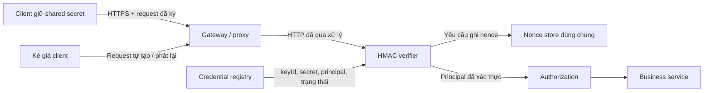
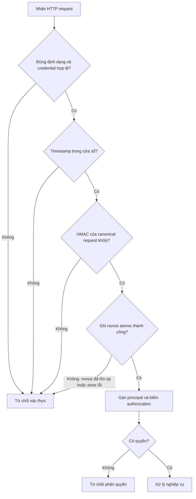

# Kẻ tấn công giả client trong xác thực HMAC request

> **Chương:** Mô hình đe dọa  
> **Chủ đề:** Kẻ tấn công giả client  
> **Phạm vi:** Hệ thống xác thực HTTP request bằng **HMAC + shared secret**, trong đó hai phía tạo cùng một **canonical request** từ method, URI, các header được ký và/hoặc body theo hợp đồng. Bài học phân tích khi nào một đối tượng có thể bị nhầm là client hợp lệ, hậu quả và cách kiểm tra các lớp bảo vệ.

## 1. Bài toán: hệ thống đang xác thực điều gì?

Giả sử đối tác `merchant-A` có quyền gọi API của nền tảng:

```http
POST /v1/refunds?orderId=42 HTTP/1.1
Host: api.example.test
Content-Type: application/json
X-Key-Id: merchant-A-key-2
X-Timestamp: 1795800000
X-Nonce: 8d73a1cd772af5308bfa2cdba94cb290
X-Signature: v1=<hmac-tag-base64url>

{"amount":150000}
```

Đây là **ví dụ giao thức tự định nghĩa**, không phải tiêu chuẩn chung cho mọi hệ thống HMAC. Bên gửi tạo tag bằng secret ứng với key ID; bên nhận tra secret, tái tạo canonical request và kiểm tra HMAC. Theo hợp đồng ký ví dụ, method, host/authority, path, canonical query, `content-type`, `x-key-id`, `x-timestamp`, `x-nonce` và SHA-256 của **raw body bytes** đều được ràng buộc vào dữ liệu ký; tag được gửi trong `X-Signature`.

Mục tiêu bảo vệ là: **chỉ request mang tag hợp lệ được tính bằng secret còn hiệu lực của đúng client, với dữ liệu đã ký nguyên vẹn và request còn mới, mới được đi tiếp đến bước phân quyền**.

Điểm quan trọng nhất của mô hình đe dọa:

- `X-Key-Id: merchant-A-key-2` là **lời khai không bí mật** về credential cần tra. Kẻ tấn công có thể chép hoặc tự đặt header này.
- HMAC chứng minh **bên tạo tag có khả năng sử dụng shared secret tương ứng**, với giả định secret không bị lộ và phép xác minh đúng. HMAC **không chứng minh** phần mềm, thiết bị hay con người gửi request là client nguyên bản.
- Một tag hợp lệ có thể đến từ **client thật**, **bên đã đánh cắp secret**, **dịch vụ nội bộ bị lợi dụng làm nơi ký**, hoặc **request cũ được phát lại** nếu không chống replay.
- Sau xác thực, `merchant-A` vẫn chỉ được thao tác trên tài nguyên mà **authorization** cho phép. Biết key ID hoặc có chữ ký đúng không tự cho phép sửa đơn hàng của `merchant-B`.

Trong bài này, **kẻ tấn công giả client (client impersonator)** là đối tượng cố khiến server coi request của mình là request đáng tin cậy từ một client hợp lệ, dù không được chủ thể đó ủy quyền.

## 2. Xác định tài sản, bên tham gia và ranh giới tin cậy

| Thành phần / tài sản | Điều phải bảo vệ | Nếu bị thao túng |
| --- | --- | --- |
| **Shared secret** | Bí mật, độ ngẫu nhiên và quyền sử dụng khóa; khóa gắn đúng client. | Có thể tạo tag mới hợp lệ và giả client cho đến khi khóa bị thu hồi. |
| **Credential registry** | Quan hệ `keyId → secret → client/principal → trạng thái/phạm vi`. | Có thể gán nhầm danh tính hoặc cho phép dùng khóa của môi trường/client khác. |
| **Signing contract** | Định nghĩa chính xác các byte được ký, phiên bản, thuật toán và chuẩn hóa. | Client và server kiểm tra khác thứ mình sẽ thực thi. |
| **Request HTTP** | Method, authority, URI, query, headers và body có ý nghĩa với nghiệp vụ. | Trường không được ký có thể bị thay đổi mà tag vẫn đúng. |
| **Timestamp và nonce** | Tính mới và tính một lần của request đã xác minh. | Request cũ có thể được chạy lại. |
| **Proxy / API gateway** | Đường truyền dữ liệu gốc đáng tin cậy; nơi xác minh HMAC và truyền danh tính. | Header danh tính bị giả mạo hoặc URI/body bị rewrite sau điểm ký. |
| **Authorization rules** | Ánh xạ principal sang tenant, endpoint, tài nguyên và thao tác được phép. | Một client xác thực đúng có thể vượt quyền sang client khác. |
| **Audit, logs, metrics** | Phát hiện lạm dụng mà không làm lộ credential. | Secret hoặc request nhạy cảm xuất hiện trong log; điều tra sự cố thiếu dấu vết. |

**Các đối tượng trong mô hình:**

1. **Client hợp lệ**: được cấp một hoặc vài credential HMAC, có thể chủ động tạo request mới.
2. **Kẻ tấn công bên ngoài**: gửi HTTP request và tự chọn các header/URI/body; có thể biết key ID nhưng **không biết secret**.
3. **Kẻ tấn công có bản sao request**: lấy được một request đã ký từ log, điểm trung gian hoặc hệ thống bị xâm nhập; có thể phát lại chính xác request đó.
4. **Kẻ tấn công đã lộ secret**: có thể tạo HMAC hợp lệ cho request mới trong phạm vi secret bị lộ.
5. **Thành phần trung gian lỗi hoặc bị chiếm quyền**: gateway, reverse proxy hay service signer có thể sửa request hoặc cung cấp danh tính không đáng tin.

Không mặc định attacker có quyền đọc bộ nhớ server hoặc phá vỡ thuật toán HMAC-SHA256. Nếu giả định thay đổi, ví dụ secret đã bị đánh cắp, **khả năng phòng thủ và phản ứng cũng phải đổi**.

### Ranh giới tin cậy trong luồng request



Trong sơ đồ, đường đi **không tự đảm bảo an toàn**. Phải quyết định gateway có phải là nơi xác minh hay không, dữ liệu đã ký có còn nguyên khi đến verifier hay không, service downstream tin principal bằng cơ chế nào và nonce store có dùng chung cho mọi instance hay không.

## 3. Phân biệt những kiểu “giả client”

| Kiểu hành vi | Attacker có secret? | Khả năng tạo request mới có HMAC hợp lệ? | Lớp kiểm soát chính |
| --- | --- | --- | --- |
| **Giả key ID**: tự gửi `X-Key-Id` của client thật | Không | **Không**, nếu verifier tra đúng secret và kiểm tag. | Tra credential đáng tin cậy; chỉ suy principal từ credential đã xác minh. |
| **Đoán tag HMAC** | Không | Không khả thi về thực tế nếu khóa ngẫu nhiên đủ mạnh và HMAC triển khai đúng. | Khóa mạnh; thuật toán cố định; so sánh tag an toàn; rate limit. |
| **Phát lại request đã ký** | Không | Không tạo được tag cho nội dung mới, nhưng có thể gửi lại **nguyên request**. | Timestamp đã ký, nonce đã ký, nonce store atomic. |
| **Sửa trường không ký** | Không | Có thể giữ nguyên tag mà đổi **trường ngoài hợp đồng ký**. | Ký mọi trường ảnh hưởng đến xử lý và định danh/routing. |
| **Lợi dụng khác biệt canonicalization** | Có thể không | Có thể khiến verifier chấp nhận biểu diễn mà tầng nghiệp vụ hiểu theo nghĩa khác. | Canonicalization nhất quán, từ chối request mơ hồ. |
| **Đánh cắp shared secret** | Có | **Có**, attacker tự tạo request hợp lệ cho đến khi khóa bị vô hiệu. | Bảo vệ secret, giới hạn phạm vi, phát hiện và thu hồi/rotation. |
| **Mượn signing oracle**: lợi dụng dịch vụ có quyền ký | Có khả năng dùng khóa gián tiếp | Có thể ký request mà attacker chọn nếu signer không kiểm chính sách. | Khống chế API ký, phạm vi dữ liệu được ký và quyền gọi signer. |
| **Giả header danh tính sau gateway** | Không cần nếu bypass lớp xác minh | Có thể được downstream tin nhầm nếu mạng nội bộ/headers thiếu bảo vệ. | Xóa header do client khai báo, xác minh tin cậy gateway–backend. |

**Cần nói rõ trong threat model:** “Không có shared secret” chỉ chặn **tạo mới một tag HMAC hợp lệ cho dữ liệu đã ký**. Nó không tự chặn replay, nhầm lẫn cách parse, lạm dụng trường không ký hoặc bypass ở gateway.

## 4. Kịch bản A — Chỉ giả key ID và chữ ký

**Tiền điều kiện:** attacker biết `merchant-A-key-2`, gửi request tùy ý tới API, nhưng không biết shared secret của credential đó.

**Đường tấn công:** attacker thay header `X-Key-Id` thành ID của merchant A, tự đặt chuỗi `X-Signature` hoặc dùng tag tính bằng secret của mình. Nếu server xác thực theo kiểu “có key ID tồn tại là đủ”, hoặc tra credential sai, attacker sẽ bị nhận nhầm là merchant A.

**Bảo vệ đúng:** key ID chỉ chọn **bản ghi credential**; server tính HMAC bằng secret của bản ghi đó, so sánh tag và kiểm trạng thái credential. Chỉ sau khi các điều kiện xác thực khác đạt, server mới lấy principal từ registry. Không lấy tenant/role đã xác thực trực tiếp từ `X-Key-Id`, `X-Client-Id` hoặc giá trị body do client tự khai.

| Dữ liệu attacker kiểm soát | Được dùng làm gì? | Không được dùng làm gì? |
| --- | --- | --- |
| `X-Key-Id` | Tìm **ứng viên** credential trong registry. | Bằng chứng duy nhất rằng người gửi là client hợp lệ. |
| `X-Signature` | Đầu vào để so sánh với HMAC server tính. | Khẳng định hợp lệ chỉ vì có đúng số ký tự hoặc decode được Base64URL. |
| `X-Timestamp` và `X-Nonce` | Đầu vào được ký để kiểm thời gian và chống replay. | Tin như sự thật nếu không được ràng buộc bằng chữ ký. |
| `merchantId` / `tenantId` trong path hoặc body | Tham số yêu cầu đã hoặc chưa được ký theo hợp đồng. | Principal đã xác thực hoặc quyền truy cập mặc định. |

**Kết quả mong muốn:** request có key ID hợp lệ nhưng signature sai bị từ chối xác thực, ví dụ HTTP 401. Không làm lộ trong thông báo bên ngoài rằng key ID tồn tại hay sai ở bước nào.

## 5. Kịch bản B — Đánh cắp shared secret hoặc lợi dụng nơi ký

Đây là kịch bản nghiêm trọng hơn vì HMAC **không phân biệt được** request do client thật tạo với request do attacker tạo khi **cả hai đều có thể sử dụng cùng secret**.

### Nguồn lộ khóa thường gặp

- Secret được commit vào mã nguồn, ảnh chụp màn hình, ticket, tài liệu, biến cấu hình chia sẻ hoặc log ứng dụng.
- CI/CD in secret ra console, truyền secret qua một công cụ không được kiểm soát hoặc dùng chung cho quá nhiều service.
- Secret được nhúng vào ứng dụng di động, JavaScript chạy trên trình duyệt hoặc chương trình phân phối cho người dùng cuối; không thể giả định secret tồn tại an toàn trong môi trường do người dùng kiểm soát.
- Máy client hoặc server xác minh bị xâm nhập, dẫn đến đọc secret từ file, biến môi trường hay bộ nhớ.
- Tài khoản truy cập vault/KMS có quyền quá rộng; một credential được dùng lại cho nhiều tenant hoặc cả môi trường test và production.
- “Signing service” có khóa trong máy chủ nhưng cho caller tùy ý chọn canonical request để ký; attacker không cần xem secret vẫn có thể thu được tag cho yêu cầu không được phép.

**Giới hạn cơ bản:** timestamp và nonce không ngăn attacker **đã có secret** tạo request mới với timestamp hiện tại và nonce mới. Rate limiting chỉ giảm tốc độ lạm dụng; không biến khóa bị lộ thành khóa an toàn.

### Cách giảm thiểu và ứng phó

1. **Cấp khóa có entropy cao**, ví dụ 32 byte ngẫu nhiên sinh bằng CSPRNG cho mỗi credential HMAC-SHA256; không dùng mật khẩu dễ đoán.
2. **Phân tách khóa theo client, ứng dụng và môi trường**, gắn key ID với principal, trạng thái, quyền và thời hạn. Không chia secret cho nhiều tenant.
3. **Giữ secret trong kho bảo mật**, kiểm soát quyền đọc/sử dụng, giảm số dịch vụ có quyền xem secret; không log secret hoặc raw header Authorization chứa secret.
4. **Giới hạn signer**: service ký phải xác thực bên gọi và kiểm quyền, endpoint, tenant, method và payload được phép ký. Tránh API “ký mọi byte tùy ý” cho client không đáng tin.
5. **Luân chuyển/thu hồi khóa**: phát hành key ID mới, chuyển client sang khóa mới, kết thúc thời gian song song; khi nghi bị lộ thì **revoke khóa cũ ngay** tùy khả năng vận hành.
6. **Khoanh vùng sự cố**: xác định request theo key ID, thời điểm, tenant, nguồn và hành động; xem xét rollback hoặc phục hồi giao dịch theo cơ chế nghiệp vụ nếu đã có lạm dụng.

Một hệ thống HMAC tốt phải có quy trình **phản ứng khi khóa bị lộ**, vì không có thuật toán so sánh signature nào sửa được việc attacker biết secret.

## 6. Kịch bản C — Giả client bằng cách phát lại request thật

Attacker có bản sao request `POST /v1/refunds` **đã được ký hợp lệ**, nhưng không biết secret. Nếu server chỉ xác minh signature, attacker gửi lại chính request đó và HMAC vẫn khớp. Tình huống này là **replay attack**, không phải phá được HMAC.

### Lớp kiểm soát tính mới

**Timestamp** là thời điểm tạo request, được ghi theo đơn vị quy định (ví dụ Unix seconds) và **nằm trong phần đã ký**. Server có thể chấp nhận sai lệch đồng hồ trong cửa sổ hữu hạn, ví dụ:

```text
abs(serverNowSeconds - signedTimestampSeconds) <= 300
```

**Nonce** là giá trị ngẫu nhiên dùng một lần, ví dụ 128 bit từ CSPRNG, **cũng nằm trong phần được ký**. Sau khi HMAC và timestamp hợp lệ, server phải ghi nonce vào một kho dùng chung bằng thao tác nguyên tử kiểu **insert-if-absent**; nếu nonce đã có thì từ chối request.



Một số ranh giới dễ bỏ qua:

- **Không chiếm nonce trước khi xác minh HMAC**: kẻ không biết secret có thể cố “đặt chỗ” nonce của client để chặn request thật.
- **Kiểm tra và ghi nonce phải atomic**: hai instance đồng thời cùng nhận một request không được cùng vượt qua bước “chưa thấy nonce”.
- **TTL phải bao phủ toàn bộ khoảng request có thể còn hợp lệ**. Với cửa sổ `±300` giây, một timestamp tương lai có thể hợp lệ từ `T-300` đến `T+300`; nếu cache giữ nonce chỉ 300 giây tính từ lần nhận sớm nhất thì request có thể bị phát lại khi cache hết hạn mà vẫn nằm trong cửa sổ. Chọn TTL đủ bao phủ trường hợp biên và độ trễ.
- **Fail closed khi kho nonce lỗi** đối với thao tác nhạy cảm; chính sách fallback phải được quyết định rõ thay vì tự bỏ qua chống replay.
- **Retry và idempotency** là bài toán riêng: gửi lại cùng request có nonce cũ phải bị từ chối; một retry hợp lệ có thể dùng nonce mới cùng `Idempotency-Key` đã ký để nghiệp vụ trả kết quả cũ thay vì thực thi hai lần.

## 7. Kịch bản D — Giữ nguyên HMAC nhưng sửa trường ngoài hợp đồng ký

HMAC chỉ bảo vệ **những byte có mặt trong signing input**. Kẻ tấn công có thể thử đổi trường khác mà không làm thay đổi tag.

Ví dụ, nếu hợp đồng chỉ ký method, path và body, nhưng bỏ qua **query `merchantId`** mà backend dùng để xác định tenant, cùng một signature có thể đi với hai query khác nhau. Nếu body không được ký, attacker có thể thay `amount` mà không ảnh hưởng đến HMAC. Nếu host/authority quyết định service hay tenant nhưng không được ký, request có thể bị chuyển hướng xử lý theo host khác trong một thiết kế routing yếu.

Bởi vậy, khi xây signing contract phải hỏi:

1. **Method** nào được gọi? Đổi `GET` thành `POST` có đổi tác động không?
2. **Host/authority, path và query** nào quyết định route, tenant, đối tượng và thao tác?
3. **Headers** nào ảnh hưởng đến phân tích payload, phiên bản API, idempotency hoặc quyền?
4. **Body bytes** nào sẽ được xử lý? Server ký digest của raw body trước khi parse chứ?
5. **Key ID, timestamp, nonce, version** có được ràng buộc chống thay thế và downgrade không?

### Ví dụ hai cách sửa cùng một request

| Thay đổi attacker thử | Nếu trường được ký đúng | Nếu không ký hoặc verifier hiểu khác backend |
| --- | --- | --- |
| Sửa `?orderId=42` thành `?orderId=99` | HMAC không khớp. | Có thể đổi đối tượng nghiệp vụ mà tag vẫn hợp lệ. |
| Sửa `{"amount":150000}` | Body hash đổi, HMAC sai. | Có thể sửa số tiền nếu body nằm ngoài hợp đồng ký. |
| Đổi `Content-Type` | HMAC sai nếu header nằm trong signed headers. | Có thể kích hoạt một parser khác hoặc xử lý dữ liệu khác. |
| Đổi `X-Key-Id` | HMAC sai khi key ID được ký; server vẫn tra đúng khóa từ registry. | Có thể gây nhầm credential nếu bí mật bị dùng chung hoặc lookup không nhất quán. |
| Đổi `X-Nonce` hay `X-Timestamp` | HMAC sai. | Attacker có thể thay metadata để né kiểm soát replay/freshness. |
| Đổi `Host` / `:authority` | HMAC sai khi hợp đồng ký authority. | Có thể đổi routing nếu authority là dữ liệu tin cậy mà chưa được ràng buộc. |

**Không có danh sách “header nên ký” chung cho mọi API**: ký đúng những dữ liệu ảnh hưởng đến tác động bảo mật và nghiệp vụ, đồng thời thống nhất cách chúng đi qua gateway. Không thể đảm bảo an toàn bằng cách ký “một vài header thường gặp” mà không mô tả cách ứng dụng sử dụng toàn bộ request.

## 8. Kịch bản E — Sai khác canonicalization và HTTP parsing

Hai phía có thể tạo hoặc hiểu một request theo các quy tắc khác nhau. Lỗi này đặc biệt nguy hiểm nếu verifier chấp nhận chữ ký trên biểu diễn A, nhưng framework backend **thực thi nội dung B**.

### Các dạng mơ hồ cần đưa vào threat model

| Vùng dữ liệu | Biểu diễn dễ gây nhầm | Kỳ vọng |
| --- | --- | --- |
| **URI encoding** | `/a%2Fb` với `/a/b`; dấu `+` và `%20`; đường dẫn `/a/../b`. | Quy định rõ encoding/normalization; reject dạng mơ hồ nếu không xử lý đồng nhất. |
| **Query parameters** | `role=user&role=admin`; đổi thứ tự hoặc có key rỗng. | Quy định xử lý duplicate key, sắp xếp và giá trị rỗng; verifier/backend đồng nhất. |
| **Header names/values** | `X-Mode` và `x-mode`; khoảng trắng thừa; header trùng tên. | Chuẩn hóa tên, xử lý OWS nhất quán, từ chối bản sao mơ hồ. |
| **Body JSON** | `{"a":1,"b":2}` khác byte với `{"b":2,"a":1}`. | Hash trên **raw body bytes** hoặc có canonical JSON được định nghĩa đầy đủ; không parse/serialize lại tùy tiện. |
| **Content length/encoding** | Chuyển HTTP/1.1 sang HTTP/2, chunked, nén/giải nén. | Thống nhất vị trí xác minh và tập byte được xem là payload cần bảo vệ. |
| **Version/algorithm** | `v1` với `v2`, dùng header cho thuật toán client tự khai. | Verifier chỉ nhận version/algorithm được cấu hình cho credential; từ chối downgrade không được phép. |

**Ví dụ:** verifier chỉ lấy giá trị đầu của `?role=user&role=admin` để canonicalize, nhưng backend lấy giá trị cuối. Chữ ký có thể hợp lệ cho `role=user` trong khi ứng dụng xử lý `role=admin`. Cần bảo đảm verifier và business layer dùng **cùng cách phân tích** hoặc chủ động từ chối parameter trùng.

Trong HTTP, còn có các khác biệt do reverse proxy rewrite path, chuyển đổi `Host` thành `:authority`, xóa header, thêm prefix hoặc thay đổi dấu cách. Hợp đồng ký phải gắn với **vị trí xác minh cụ thể** và định nghĩa dữ liệu nào đã được ký, thay vì dựa vào suy đoán “cả hai đều nhìn thấy cùng URL”.

## 9. Kịch bản F — Giả mạo danh tính qua proxy/gateway

Một kiến trúc phổ biến để gateway xác minh HMAC, sau đó chuyển thông tin xác thực cho backend qua header nội bộ, ví dụ `X-Authenticated-Client: merchant-A`. Khi đó, **ranh giới tin cậy** đã chuyển từ “client ↔ verifier” sang “gateway ↔ backend”.

Attacker có thể gửi header `X-Authenticated-Client` tự khai cùng request chưa được ký. Nếu gateway **không xóa header này và thay bằng giá trị đã xác minh**, hoặc backend có cổng truy cập trực tiếp bỏ qua gateway, backend có thể tin nhầm attacker là merchant A.

### Quy tắc triển khai

- Chọn rõ **ai** là HMAC verifier: gateway hay service đích. Không được để cả hai lớp suy danh tính theo hai nguồn mâu thuẫn.
- Nếu gateway xác minh, **strip các header danh tính do client gửi**, thiết lập lại principal từ credential đã xác minh và bảo vệ kênh đến backend bằng kiểm soát mạng và xác thực service-to-service phù hợp (ví dụ mTLS).
- Backend **chỉ tin thông tin principal** từ đường nội bộ đã được xác thực; không chấp nhận header tương tự khi client truy cập trực tiếp.
- Nếu service đích xác minh, gateway phải chuyển tiếp **dữ liệu canonicalizable** đúng theo hợp đồng, hoặc cung cấp giá trị gốc qua một kênh đáng tin được quy định rõ.
- Các header `X-Forwarded-*` là đầu vào đáng tin **chỉ khi** proxy đã xóa giá trị client khai và tự thiết lập trong mô hình trust đã cấu hình.

**Bài học:** HMAC trên một request không tự động bảo vệ mọi header bổ sung và mọi thành phần nội bộ trong hệ thống phân tán. Ranh giới nơi danh tính chuyển từ “chưa kiểm chứng” thành “đã xác thực” phải được bảo vệ tới cuối luồng.

## 10. Kịch bản G — Lẫn credential giữa client, môi trường và kỳ luân chuyển khóa

Kẻ tấn công có thể khai thác lỗi trong **credential lookup**, không cần phá HMAC.

- **Key ID không duy nhất** hoặc server chọn sai record theo tenant do client tự khai. Nếu hai khách hàng dùng chung secret, việc phân biệt principal có thể bị phá vỡ.
- **Khóa test được chấp nhận trên production**, hoặc một key được phép dùng cho nhiều hệ thống mà không có ràng buộc môi trường/cổng.
- **Rotation thiếu trạng thái**: server chấp nhận lại khóa đã thu hồi, hoặc không chặn key ID cũ sau grace period.
- **Thuật toán/phiên bản do request tự chọn**: server có thể vô tình xác minh theo chế độ yếu hoặc không nhất quán với credential.
- **Bị lộ secret cũ** nhưng API vẫn giữ key đó hoạt động quá thời gian cần thiết.

Nên duy trì credential registry với ít nhất `keyId`, `client/principal`, `secret reference`, `algorithm/version`, `status`, `notBefore/notAfter` và `scope/environment` (theo nhu cầu hệ thống). Tra cứu bắt buộc chính sách phía server; request không có quyền tự quyết định áp dụng credential vào tenant nào.

**Rotation có kiểm soát:** tạo khóa `k2`; cho phép xác minh `k1` và `k2` trong giai đoạn chuyển; client chủ động ký bằng `k2`; kết thúc cửa sổ thì khóa `k1` bị từ chối. Khi nghi compromise, thu hồi ngay theo quy trình sự cố, không mặc định cho tiếp tục grace period.

## 11. Gắn threat model vào quy trình xác minh

Quy trình mẫu sau dùng để **thiết kế kiểm soát**. Cách tổ chức code và thứ tự các bước kiểm tra có thể thay đổi, nhưng các điều kiện an toàn cần được giữ.

```text
HTTP request ở điểm xác minh đã định nghĩa
  -> Giới hạn kích thước / validate định dạng / từ chối header mơ hồ
  -> Đọc keyId chỉ như khóa tra cứu credential
  -> Tra registry: key thuộc principal nào, còn hiệu lực, ở môi trường nào?
  -> Kiểm timestamp trong cửa sổ cho phép
  -> Dựng canonical request bằng quy tắc duy nhất của hợp đồng
  -> Tính HMAC với secret đúng, so sánh tag bằng constant-time comparison
  -> Atomic claim (keyId, nonce) với TTL đủ bao phủ freshness window
  -> Gán authenticated principal từ registry
  -> Authorization trên endpoint, tenant, tài nguyên và hành động
  -> Thực thi nghiệp vụ có idempotency khi phù hợp
```

Khi thiết kế bước kiểm HMAC, cần bảo đảm:

- Server **không tự chấp nhận thuật toán tùy ý** từ client; version/algorithm được kiểm qua chính sách credential.
- Dữ liệu ký dùng chính xác **byte đã quy định**, nhất là body. Header signature được parse và decode theo encoding đã thỏa thuận; so sánh tag dạng byte bằng phép so sánh hạn chế rò rỉ timing.
- Trường thiếu, sai định dạng, timestamp ngoài cửa sổ hoặc tag không hợp lệ đều bị từ chối mà **không thay đổi trạng thái nonce**.
- Nonce chỉ được ghi nhận khi HMAC hợp lệ, và thao tác atomic xảy ra **trước hiệu ứng nghiệp vụ**. Mọi instance cùng dùng một replay store hoặc cơ chế tương đương.
- Dù request vượt qua xác thực và replay control, vẫn phải có **authorization**; không lấy tenant mục tiêu từ request làm principal.

### Checklist để thiết kế hợp đồng ký an toàn

| Câu hỏi thiết kế | Nếu câu trả lời là “không” hoặc “chưa biết” |
| --- | --- |
| Key ID có ánh xạ duy nhất sang đúng client, khóa, môi trường, phiên bản và trạng thái? | Có nguy cơ credential confusion. |
| Những trường định tuyến và ảnh hưởng đến nghiệp vụ có nằm trong signing input? | Attacker có thể sửa trường ngoài phần ký. |
| Verifier và downstream có cách hiểu URI, query, headers, body giống nhau? | Có nguy cơ canonicalization/parsing mismatch. |
| Timestamp và nonce có được ký, kiểm và lưu dùng chung qua atomic claim? | Có nguy cơ replay. |
| Secret có entropy đủ mạnh và quy trình cấp, lưu, thu hồi, rotation? | Có nguy cơ tạo chữ ký giả khi secret lộ hoặc quản lý sai. |
| Khi gateway xác minh, downstream có xác minh nguồn principal và bị chặn bypass? | Có nguy cơ giả header danh tính. |
| Có phân quyền dựa trên principal đã xác thực và đối tượng nghiệp vụ thực tế? | Có nguy cơ cross-tenant/cross-resource access. |

## 12. Bộ kiểm thử tập trung vào “giả client”

Chuẩn bị một **client A** và **client B**, mỗi client có shared secret riêng; một môi trường test có gateway/proxy như production; một nonce store dùng chung cho các instance. Gửi các request thử nghiệm vào môi trường kiểm thử được phép.

| # | Test case | Kết quả mong muốn |
| --- | --- | --- |
| 1 | Client A ký đúng request bằng key A, timestamp hợp lệ, nonce mới. | **Xác thực thành công**, sau đó còn kiểm quyền. |
| 2 | Dùng key ID của A nhưng tính tag bằng secret B. | **401 / từ chối xác thực**. |
| 3 | Thay một byte của body đã ký, giữ signature cũ. | **Từ chối HMAC**. |
| 4 | Đổi method, path, canonical query hoặc signed header, giữ signature cũ. | **Từ chối HMAC**. |
| 5 | Thay timestamp hoặc nonce đã ký, giữ signature cũ. | **Từ chối HMAC**. |
| 6 | Gửi lại nguyên request đã xử lý thành công trong freshness window. | **Từ chối replay** nhờ nonce trùng. |
| 7 | Gửi một request cũ quá cửa sổ thời gian nhưng HMAC vẫn đúng. | **Từ chối vì timestamp**. |
| 8 | Cùng request/nonce gửi đồng thời đến hai instance. | **Chỉ một** request được claim nonce và đi tiếp. |
| 9 | Client A có tag đúng nhưng cố thao tác tài nguyên của B. | **Từ chối phân quyền**, thường HTTP 403. |
| 10 | Client giả header principal nội bộ khi gọi từ Internet. | Gateway phải xóa header; backend không tin principal giả. |
| 11 | Bypass gateway, gọi thẳng backend với header `X-Authenticated-Client`. | Bị chặn ở mạng/xác thực nội bộ; không đi vào nghiệp vụ. |
| 12 | Dùng khóa đã revoke/hết hạn hoặc khóa môi trường test trên production. | **Từ chối xác thực** dù tag có thể đúng theo khóa cũ. |
| 13 | Query có key lặp, path percent-encoding mơ hồ hoặc header trùng tên. | Từ chối hoặc xử lý nhất quán theo hợp đồng, không có parser mismatch. |
| 14 | Proxy đổi host/path prefix, transfer encoding hoặc body representation. | Xác minh nhất quán theo điểm ký; fail an toàn nếu dữ liệu đã ký thay đổi. |
| 15 | Nonce store không khả dụng khi xử lý thao tác nhạy cảm. | Không bỏ qua replay control; xử lý theo chính sách fail closed. |
| 16 | Một request có signature hợp lệ nhưng header body format/encoding không đúng hợp đồng. | Từ chối định dạng, không tự đoán cách parse để “cứu” signature. |

Trong kiểm thử, nên thu thập **mã lỗi và lý do nội bộ ở mức phân loại** (`invalid_signature`, `stale_timestamp`, `replayed_nonce`, `credential_revoked`, `authorization_denied`), đồng thời **không trả thông tin quá chi tiết cho phía gọi** và **không ghi secret hoặc signature đầy đủ** vào log. Ghi lại correlation ID, key ID hoặc định danh đã được giảm nhạy cảm, timestamp, endpoint và kết quả bảo mật phục vụ audit.

## 13. Đọc kết quả và chọn biện pháp ưu tiên

Hãy phân tách thất bại theo **năng lực mà attacker thật sự có**:

| Quan sát | Ý nghĩa có thể có | Kiểm soát cần xem xét trước |
| --- | --- | --- |
| Request giả key ID nhưng thiếu secret vẫn được xử lý. | Kiểm HMAC bị bỏ qua, tra khóa sai hoặc tin header danh tính. | Sửa luồng authentication và trust boundary. |
| Request cũ được chấp nhận lần thứ hai. | Thiếu/không đúng replay protection. | Nonce atomic, TTL, clock skew, cụm nhiều instance. |
| Request sửa query/body vẫn hợp lệ. | Signing contract bỏ sót trường hoặc canonicalization lệch. | Bao phủ trường có tác động; đồng nhất parser. |
| Chữ ký đúng nhưng truy cập tài nguyên client khác thành công. | Phân quyền không ràng buộc principal với resource. | Authorization phía server và tenant isolation. |
| Request có chữ ký mới hợp lệ xuất hiện sau khi client báo lộ khóa. | Secret bị compromise hoặc signer bị lợi dụng. | Revoke/rotate, điều tra đường lộ và thu hẹp scope. |
| Chỉ xảy ra lỗi ở đường qua gateway hoặc HTTP/2. | Khác biệt dữ liệu trên các hop. | Thống nhất ký/kiểm tại một điểm rõ ràng và kiểm thử end-to-end. |

Không nên kết luận “HMAC không an toàn” chỉ vì thấy một request giả client thành công. Cần xác định chính xác request thành công do **secret bị lộ**, **replay**, **field ngoài hợp đồng ký**, **nhầm danh tính**, **bypass gateway** hay **lỗi phân quyền**; mỗi nguyên nhân cần biện pháp khác nhau.

## 14. Câu hỏi tự kiểm tra

**Câu 1.** Attacker biết `X-Key-Id` của merchant A. Điều này có đủ để tự tạo request hợp lệ không?

**Trả lời:** Không. Với verifier đúng và secret không lộ, biết key ID chỉ giúp chọn credential, không cho khả năng tính HMAC hợp lệ.

**Câu 2.** Một request HMAC đúng nhưng đã gửi thành công trước đó, có nên tiếp tục được thực thi?

**Trả lời:** Không, nếu hợp đồng yêu cầu nonce dùng một lần. Cần replay store atomic và TTL đủ dài, ngoài timestamp.

**Câu 3.** Khi secret của A bị lộ, thêm nonce và cửa sổ timestamp có ngăn attacker tạo request mới không?

**Trả lời:** Không. Attacker tự ký request với timestamp và nonce mới. Cần thu hồi/rotation credential, điều tra nguồn lộ và giới hạn quyền tác động.

**Câu 4.** Gateway đã xác minh HMAC. Backend có thể tin `X-Authenticated-Client` từ mọi request đi vào backend không?

**Trả lời:** Không. Phải bảo vệ kênh giao tiếp, ngăn bypass và chỉ chấp nhận danh tính từ gateway đã xác thực sau khi gateway đã loại bỏ header do client tự khai.

**Câu 5.** Signature của client A đúng, nhưng request truy cập đơn hàng của B. Đây là lỗi xác thực hay phân quyền?

**Trả lời:** Nếu chữ ký đúng cho A, **authentication có thể thành công**; việc từ chối thao tác trên tài nguyên của B là trách nhiệm của **authorization**.

**Câu 6.** Nếu server chỉ ký body và method, liệu sửa query có làm signature sai?

**Trả lời:** Không, nếu query không nằm trong dữ liệu ký. Đây là lý do phải lập signing contract dựa trên các trường thực sự ảnh hưởng đến định tuyến và nghiệp vụ.

---

**Kết luận học tập:** Trong mô hình đe dọa *kẻ tấn công giả client*, hãy bắt đầu bằng câu hỏi **attacker có thể biết hoặc sử dụng shared secret hay chỉ kiểm soát request?** Tiếp đó kiểm tra **hợp đồng ký có bảo vệ dữ liệu nghiệp vụ**, **request có thể bị phát lại**, **credential có bị gán nhầm**, **gateway có thể bị bypass**, và **principal có bị cấp quyền quá rộng** hay không. HMAC là một lớp chứng minh quyền sử dụng secret đối với dữ liệu đã ký; an toàn của toàn hệ thống phụ thuộc cả việc bảo vệ khóa, canonicalization, replay prevention, key rotation, trust boundary và authorization.
