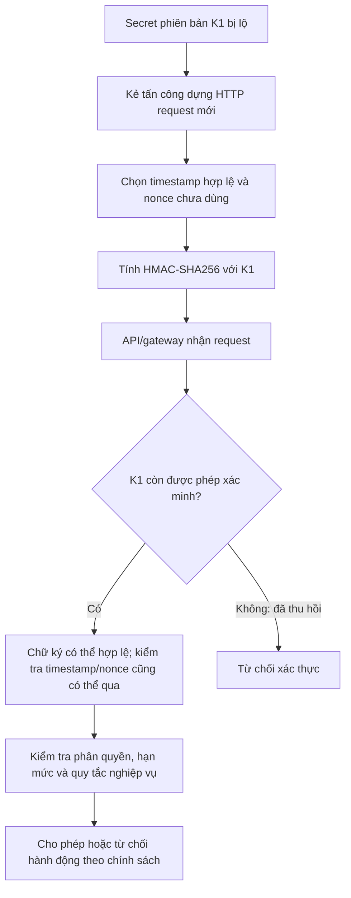
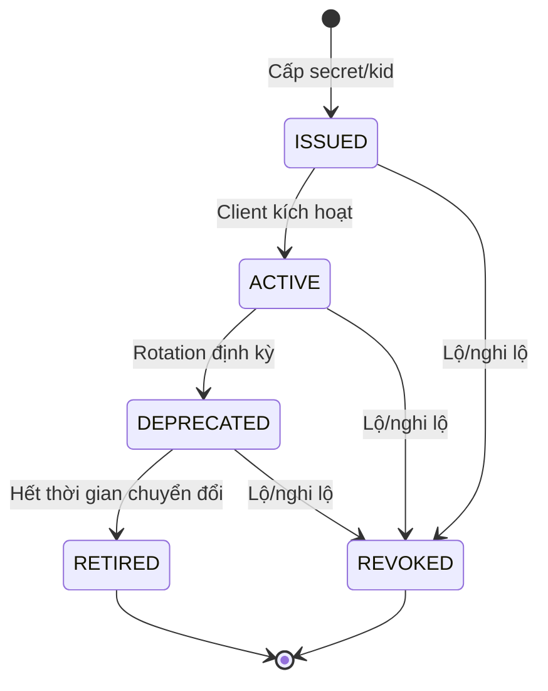
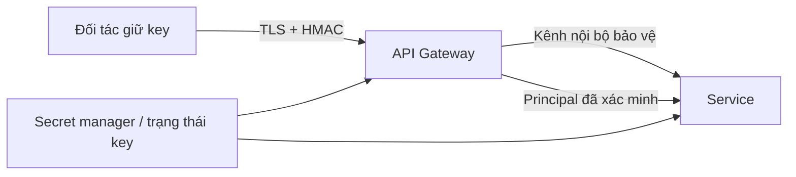

# Secret bị lộ

## 1. Bối cảnh: shared secret là gốc tin cậy của HMAC

Trong cơ chế **xác thực HTTP request bằng HMAC**, client và server cùng biết một **shared secret**. Client tạo chữ ký bằng cách áp dụng HMAC (ví dụ HMAC-SHA256) lên **canonical request**; server lấy secret tương ứng với client/key ID, dựng lại cùng canonical request rồi kiểm tra chữ ký. Hợp đồng ký thường bao gồm HTTP method, URI/query, một số header và body hoặc hash body.

Trong chương **Mô hình đe dọa**, bài này khảo sát trường hợp **secret bị lộ** cho bên không được phép. Đây là tình huống nghiêm trọng hơn việc kẻ tấn công chỉ nghe lén một request đã ký: kẻ có secret có thể **tạo chữ ký hợp lệ cho request mới**, với timestamp và nonce mới do chính họ chọn.

Sau bài học, bạn cần:

- Mô tả điều kiện dẫn tới lộ secret, ranh giới tin cậy và phạm vi thiệt hại (*blast radius*).
- Phân biệt **secret**, **key ID**, **client ID**, **signature** và nội dung canonical request.
- Giải thích chính xác tác dụng và giới hạn của TLS, HMAC, timestamp, nonce và idempotency khi secret đã bị lộ.
- Thiết kế **thu hồi khẩn cấp** khác với **key rotation định kỳ**.
- Xác minh việc từ chối khóa đã thu hồi qua proxy/gateway và trên nhiều instance; tách **xác thực** khỏi **phân quyền**.
- Lập kế hoạch phát hiện, ứng phó, kiểm thử và khôi phục sau sự cố.

Ví dụ xuyên suốt: đối tác `merchant-42` được cấp secret để gọi `POST /v1/transfers`. Server xác thực bằng các header `X-Client-Id`, `X-Key-Id`, `X-Timestamp`, `X-Nonce` và `X-Signature`. Các giá trị chỉ dùng để minh họa, không phải thông tin xác thực thực.

## 2. Tài sản cần bảo vệ và năng lực của kẻ tấn công

### Secret là gì, không phải là gì?

| Thành phần | Ý nghĩa | Có thể công khai? |
| --- | --- | --- |
| **Shared secret** | Byte key dùng làm đầu vào HMAC; ai sở hữu key có thể tạo chữ ký tương ứng | **Không**. Chỉ client và các thành phần server được cấp quyền xác minh |
| **Client ID** | Định danh client/đối tác trong hệ thống | Thường có thể lộ; không chứng minh danh tính |
| **Key ID / `kid`** | Định danh một phiên bản khóa để server tra cứu | Thường có thể lộ; không chứa bản thân secret |
| **HMAC signature** | Kết quả ký một canonical request cụ thể | Không phải secret; nhưng bản sao request + signature có thể dùng để replay nếu các biện pháp khác yếu |
| **Timestamp / nonce** | Thông tin chống sử dụng lại request cũ, cần nằm trong dữ liệu được ký | Không phải secret; server phải kiểm tra tính mới và việc sử dụng một lần |
| **Canonical request** | Biểu diễn thống nhất của method, URI, header, body theo hợp đồng ký | Không thay thế việc bảo vệ nội dung HTTP bằng TLS |

Ví dụ quy tắc tính chữ ký:

```text
canonical =
    METHOD + "\n"
  + RAW_PATH + "\n"
  + CANONICAL_QUERY + "\n"
  + SELECTED_SIGNED_HEADERS + "\n"
  + SHA256_HEX(BODY_BYTES)

signature = BASE64URL(HMAC_SHA256(shared_secret, UTF8(canonical)))
```

Đây là **sơ đồ hợp đồng ký**, không phải tiêu chuẩn duy nhất cho mọi API. Hai bên phải thống nhất chính xác cách chuẩn hóa URI/query/header, hash body, encoding và dấu xuống dòng. Các trường `X-Client-Id`, `X-Key-Id`, `X-Timestamp`, `X-Nonce` cũng cần nằm trong `SELECTED_SIGNED_HEADERS` của hợp đồng ví dụ này.

**Giả định đe dọa:** kẻ tấn công đã lấy được **đúng secret đang được server chấp nhận**, biết hoặc suy ra hợp đồng canonicalization và có khả năng gửi HTTP request tới API. Họ không nhất thiết chiếm quyền máy chủ, phá thuật toán HMAC hay có quyền truy cập cơ sở dữ liệu.

### Điểm xảy ra lộ lọt

Secret có thể rò rỉ ở cả **bên client** lẫn **bên server**:

- Commit secret vào Git, file cấu hình, `.env`, mobile app, container image hoặc artefact build; sao chép vào kho lưu trữ công khai hay nội bộ quá rộng quyền.
- In secret vào log, trace, thông báo lỗi, lệnh CI/CD, lịch sử shell, màn hình debug hoặc công cụ hỗ trợ khách hàng.
- Truy cập trái phép secret manager, KMS/HSM policy, backup, máy CI runner, tài khoản service hoặc biến môi trường của workload.
- Máy client/đối tác bị xâm nhập, process memory dump, crash dump hoặc quyền truy cập vận hành quá rộng.
- Chia sẻ **một secret** cho nhiều đối tác, tenant, môi trường production/staging hoặc nhiều mục đích; một điểm lộ làm phạm vi ảnh hưởng lan rộng.

**Phát hiện một chuỗi trông giống secret trong log chưa tự chứng minh khóa đã bị khai thác.** Nhưng nếu có căn cứ secret thật đã ra khỏi vùng tin cậy, phải đánh giá nó là **có khả năng bị sử dụng**; không nên chờ request giả mạo được phát hiện bằng chữ ký vì chữ ký sẽ hợp lệ.

## 3. Chuỗi tấn công khi secret đã bị lộ



Giả sử client hợp lệ gửi:

```http
POST /v1/transfers HTTP/1.1
Host: api.example.test
Content-Type: application/json
X-Client-Id: merchant-42
X-Key-Id: k-2026-11
X-Timestamp: <unix-epoch-seconds>
X-Nonce: <unique-random-value>
X-Signature: <base64url-hmac>

{"transferId":"tr-100","amount":250000,"currency":"VND"}
```

Nếu kẻ tấn công có secret ứng với `merchant-42/k-2026-11`, họ có thể tạo **request khác** (ví dụ đổi người nhận hoặc số tiền trong giới hạn API cho phép), chọn timestamp trong cửa sổ hợp lệ, tạo nonce mới và **ký lại toàn bộ** method, URI, các header được chọn và body. Trên server chưa thu hồi khóa, bước kiểm tra HMAC có thể thành công.

Đây là khác biệt mấu chốt với **replay attack**:

- **Replay thông thường:** kẻ tấn công giữ nguyên một request/chữ ký có sẵn. Timestamp giới hạn khoảng thời gian sử dụng; nonce one-time chặn gửi lại.
- **Secret bị lộ:** kẻ tấn công sinh request/chữ ký **mới**; mỗi lần có timestamp và nonce mới. Kiểm tra freshness, nonce và HMAC đều có thể hợp lệ.
- **Phạm vi hành động:** sau xác thực, server vẫn phải xác định principal thực sự và kiểm tra quyền đối với tài nguyên/hành động. Nếu principal có quyền rất rộng, thiệt hại vẫn có thể lớn.

**HMAC là cơ chế khóa đối xứng:** cả người ký hợp pháp và phía xác minh có secret đều có khả năng tạo HMAC. Khi một bản ghi HMAC hợp lệ xuất hiện, riêng chữ ký **không thể chứng minh ai trong số các bên giữ khóa đã tạo nó**. Vì vậy không được xem HMAC là bằng chứng chống chối bỏ (*non-repudiation*).

## 4. Những lớp bảo vệ còn hiệu quả và không còn đủ

| Cơ chế | Khi secret chưa bị lộ | Khi secret đã bị lộ |
| --- | --- | --- |
| **HMAC-SHA256** | Phát hiện thay đổi trong các trường đã ký; chứng minh bên gửi biết secret | Kẻ tấn công cũng biết secret, nên có thể tạo chữ ký hợp lệ. Đổi thuật toán HMAC mà vẫn dùng secret lộ **không khắc phục được** |
| **HTTPS/TLS** | Bảo vệ bí mật và toàn vẹn dữ liệu trên đường truyền giữa hai đầu TLS | Tiếp tục bảo vệ đường truyền, nhưng không lấy lại secret đã lộ từ Git/log/máy bị chiếm hoặc tại điểm kết thúc TLS |
| **Timestamp đã ký** | Giới hạn cửa sổ sử dụng chữ ký cũ | Kẻ giữ secret tự ký timestamp mới, nên không bị chặn chỉ bởi cửa sổ thời gian |
| **Nonce một lần** | Chặn dùng lại đúng request đã ký, nếu ghi nonce nguyên tử | Kẻ giữ secret tạo nonce mới. Nonce vẫn cần cho replay của request thông thường nhưng **không ngăn giả mạo bằng secret đã lộ** |
| **Key ID** | Chọn đúng phiên bản khóa, hỗ trợ rotation | Key ID không có tính bí mật; kẻ có secret và key ID vẫn có thể ký |
| **Key revocation** | Vô hiệu hóa credential đã cấp | **Biện pháp trực tiếp để cắt khả năng ký hợp lệ** bằng secret bị lộ, nếu mọi verifier đều thực thi ngay |
| **Authorization, hạn mức, phê duyệt, antifraud** | Giới hạn hành động sau khi xác thực | Vẫn có thể giới hạn mức độ thiệt hại của credential bị chiếm, nếu chính sách không trao quyền quá rộng |
| **Idempotency / unique transaction ID** | Ngăn xử lý một thao tác trùng nhiều lần | Giảm lỗi hoặc giao dịch trùng; **không chặn** kẻ dùng secret tạo các giao dịch mới với ID khác |

Một sai lầm phổ biến là chỉ giảm cửa sổ timestamp từ 5 phút xuống 30 giây, hoặc mở rộng Redis nonce store, rồi coi sự cố đã được xử lý. Các biện pháp đó **không triệt tiêu quyền tạo chữ ký mới** khi secret vẫn còn được chấp nhận. Cần thu hồi key bị lộ và kiểm soát các quyền nghiệp vụ bị ảnh hưởng.

## 5. Đánh giá phạm vi ảnh hưởng (*blast radius*)

Khi biết một secret đã lộ, trước tiên xác định **secret đó mở khóa được những gì**.

| Câu hỏi cần xác minh | Vì sao quan trọng |
| --- | --- |
| Secret có **riêng cho từng client/tenant** không? | Nếu dùng chung, có thể phải thu hồi credential của nhiều đối tác; việc phân biệt thủ phạm từ HMAC trở nên khó |
| Secret có được **tách theo môi trường** không? | Một khóa staging dùng lại cho production khiến sự cố môi trường thấp ảnh hưởng môi trường cao |
| Secret có được **tách theo API/purpose/quyền** không? | Khóa dùng cho đọc trạng thái và chuyển tiền có blast radius lớn hơn khóa chỉ đọc |
| Key ID nào, phiên bản nào, thời điểm kích hoạt/hết hạn? | Xác định chính xác credential cần khóa, các bản sao, thời gian có thể bị lạm dụng |
| Verifier nằm ở gateway, service hay cả hai? Có **cache key** không? | Thu hồi trên secret manager chưa đủ nếu instance vẫn giữ cache cho phép key cũ |
| Có webhook, retry queue, job dài hạn hay client offline không? | Chúng có thể tiếp tục gửi request với credential cũ sau khi thu hồi; cần kế hoạch chuyển đổi |
| Những principal, scope và nghiệp vụ nhạy cảm nào được gắn với key? | Xác định tài nguyên/giao dịch cần kiểm tra, tạm dừng hoặc phê duyệt lại |

Thiết kế tốt sử dụng **secret khác nhau theo client, môi trường và mục đích có rủi ro khác nhau**, giới hạn quyền của principal gắn với key và đảm bảo key có thể bị vô hiệu hóa độc lập. Nếu không rõ bản sao nào bị lộ, cần mở rộng phạm vi điều tra/rotation phù hợp với bằng chứng; không giả định một key ID bị nêu tên là toàn bộ vấn đề.

### Ranh giới tin cậy giữa key và principal

Server **không được** tin `X-Client-Id` chỉ vì request mang header đó. Kẻ tấn công có thể tự điền client ID bất kỳ. Phía xác minh phải:

1. Tra credential bằng cặp `(clientId, keyId)` trong kho được tin cậy; **không** tìm secret theo key ID chung rồi cho phép khai bất kỳ client nào.
2. Kiểm tra credential thực sự được cấp cho principal/client này, môi trường này, mục đích này, còn hiệu lực và chưa bị thu hồi.
3. Xác minh HMAC trên canonical request có chứa `X-Client-Id` và `X-Key-Id`, cùng các trường có ý nghĩa bảo mật.
4. Gán principal **từ bản ghi credential đã xác minh**, không từ header tùy ý.
5. Chạy authorization dựa trên principal, scope, hành động, tài nguyên và quy tắc nghiệp vụ.

Ngay cả khi secret đã lộ, các bước 4–5 giúp ngăn việc một credential bị lợi dụng để **tự nhận là client khác** hoặc thực hiện hành động ngoài quyền đã cấp, miễn chính sách và các ràng buộc thực thi đúng.

## 6. Thu hồi khóa khẩn cấp và rotation định kỳ

### Phân biệt hai quy trình

**Rotation định kỳ**: Không có dấu hiệu key bị lộ; có thể cần một khoảng chuyển đổi ngắn để các client nhận và bắt đầu ký với khóa mới. Trong khoảng này, server chấp nhận **hai key ID riêng biệt** với chính sách thời gian rõ ràng. Đến hạn, khóa cũ được hủy hiệu lực.

**Thu hồi khẩn cấp vì nghi lộ secret**: Khóa cũ **không còn đáng tin**. Không tiếp tục cho qua bằng cơ chế dual-key grace period; khóa cũ phải bị đánh dấu `REVOKED` hoặc `DISABLED` và bị từ chối ở **mọi nơi xác minh**. Nếu cần thời gian cấp khóa mới, có thể tạm ngưng các thao tác nhạy cảm của client bị ảnh hưởng để giữ an toàn.

Ví dụ vòng đời credential:



| Trạng thái | Có được dùng để xác minh request mới? | Ghi chú |
| --- | --- | --- |
| `ISSUED` | Theo chính sách, thường **chưa** | Đã cấp nhưng chưa kích hoạt |
| `ACTIVE` | **Có**, nếu trong thời hạn và đúng client/scope | Trạng thái bình thường |
| `DEPRECATED` | **Có điều kiện**, chỉ cho rotation lành mạnh | Phải có ngày kết thúc cụ thể; không sử dụng cho key nghi lộ |
| `REVOKED` | **Không** | Phải từ chối ngay cả khi chữ ký và timestamp hợp lệ |
| `RETIRED` | **Không** | Đã kết thúc sử dụng; có thể xóa vật liệu khóa theo chính sách lưu giữ |

Khi nhận request, client gửi `X-Key-Id` công khai. Server tra **đúng** bản ghi được chỉ định; không thử tất cả secret cũ đến khi có chữ ký khớp và không âm thầm fallback sang key khác. Key ID và client ID phải nằm trong hợp đồng ký; key ID không được tự quyết định quyền hoặc mức tin cậy.

### Thứ tự khôi phục sau khi phát hiện lộ key

1. **Kích hoạt ứng phó và khoanh vùng.** Ghi nhận nguồn phát hiện, client/key ID, môi trường, thời điểm và những thành phần có thể giữ secret. Giới hạn quyền truy cập vào bằng chứng; không sao chép secret vào ticket, chat hoặc báo cáo.
2. **Ngăn sử dụng credential nghi lộ.** Đánh dấu key `REVOKED` tại nguồn chính; tạm dừng client/endpoint nhạy cảm nếu hệ thống chưa bảo đảm thu hồi nhanh. Đảm bảo mọi gateway, replica và cache áp dụng trạng thái mới, kể cả khi thành phần cô lập hoặc mất kết nối.
3. **Phát hành secret mới qua kênh an toàn.** Tạo key bằng bộ sinh số ngẫu nhiên an toàn; cấp `kid` mới, giới hạn theo principal/scope và môi trường. Chuyển secret qua secret manager hoặc kênh được xác thực và mã hóa, giới hạn người có quyền nhận.
4. **Khôi phục có kiểm soát.** Client chuyển sang key mới; thử một request hợp lệ, một request với key cũ, một request giả mạo client ID và một request replay. Chỉ mở lại thao tác nhạy cảm khi cơ chế xác thực và authorization đạt yêu cầu.
5. **Điều tra và khắc phục nguyên nhân.** Xác định secret xuất hiện ở đâu (repo, log, máy, CI/CD, backup), xóa bản sao khỏi luồng truy cập đang hoạt động, sửa quyền và cấu hình, quét các bản sao tương tự. Chỉ xóa khỏi Git HEAD chưa đủ nếu secret còn trong lịch sử, clone, cache hoặc artefact; việc thu hồi key mới là bước chặn sử dụng.
6. **Rà soát tác động.** Truy xuất các request/giao dịch có key liên quan trong giai đoạn có thể bị lộ, đối chiếu thời gian, IP/thiết bị, hành vi, idempotency ID, quyền và thay đổi bất thường. Chữ ký HMAC hợp lệ **không chứng minh** request do đối tác hợp pháp phát ra.
7. **Theo dõi sau khôi phục.** Đặt cảnh báo request dùng key đã thu hồi, xác minh cache đã đồng bộ, xem lại quyền dài hạn và quy trình rotation. Với giao dịch tiền/tài sản nhạy cảm, cần quy trình đối soát và phê duyệt nghiệp vụ phù hợp.

**Điểm triển khai dễ sai:** đổi giá trị secret trong secret manager nhưng verifier giữ secret cũ trong bộ nhớ/cache hàng giờ. Hệ thống sẽ vẫn chấp nhận chữ ký của attacker đến khi cache hết hạn. Thiết kế cần **revocation status** được tra cứu hoặc phân phối tin cậy, cơ chế invalidation tức thời và thời gian hội tụ được kiểm chứng. Với endpoint nhạy cảm, nếu không thể xác minh trạng thái thu hồi, nên từ chối thay vì sử dụng dữ liệu cho phép đã lỗi thời.

## 7. Mẫu thiết kế bộ xác minh an toàn với key rotation

Pseudocode sau tập trung vào **kiểm tra trạng thái key**. Hàm canonicalization, HMAC và nonce store phải được cài đặt theo hợp đồng riêng, đủ chặt chẽ trước khi vận hành.

```text
verify(request):
    parse request; reject malformed or duplicate signed headers
    enforce request size and canonicalization limits

    clientId = request.signedHeader("X-Client-Id")
    keyId    = request.signedHeader("X-Key-Id")
    record   = credentialStore.lookup(clientId, keyId)

    if record is missing or record.ownerClientId != clientId:
        reject authentication
    if record.state not in {ACTIVE, DEPRECATED_ALLOWED}:
        reject authentication
    if record.environment != currentEnvironment:
        reject authentication
    if now outside record.validityInterval:
        reject authentication

    canonical = canonicalizeExactlyAsContract(request)
    expected = HMAC_SHA256(record.secretBytes, canonical)
    if !constantTimeEqual(expected, decodeSignature(request)):
        reject authentication
    if !timestampInAllowedWindow(request.signedTimestamp):
        reject authentication
    if !atomicClaimNonce(clientId, request.signedNonce, suitableTtl):
        reject authentication

    principal = record.ownerClientId
    authorize(principal, request.action, request.resource, record.scopes)
    executeBusinessActionWithIdempotencyProtection()
```

Trong ứng dụng thật, trạng thái `DEPRECATED_ALLOWED` phải bị tắt khi phát hiện nghi lộ; `validityInterval` bao gồm cả thời điểm bắt đầu/kết thúc theo đồng hồ tin cậy phía server. `atomicClaimNonce` phải dùng kho chia sẻ có thao tác nguyên tử trên nhiều instance. Nếu kho trạng thái revocation hoặc nonce gặp sự cố, xử lý **fail-closed** với nghiệp vụ nhạy cảm.

### Sinh secret bằng Java

Ví dụ sau tạo **32 byte ngẫu nhiên (256 bit)** bằng `SecureRandom` và bàn giao cho một giao diện secret manager giả định. Đây là minh họa cách sinh và cấp key, không phải triển khai đầy đủ secret manager:

```java
import java.security.SecureRandom;
import java.util.Arrays;

public final class SecretProvisioning {
    public interface SecretManager {
        // Cần bảo vệ kết nối, phân quyền, audit và mã hóa at rest.
        void storeNewVersion(String clientId, String keyId, byte[] secret);
    }

    public static void issueNewKey(
            SecretManager manager, String clientId, String newKeyId) {
        byte[] secret = new byte[32];
        new SecureRandom().nextBytes(secret);
        try {
            manager.storeNewVersion(clientId, newKeyId, secret);
        } finally {
            // Giảm thời gian bản sao key ở mảng local;
            // không bảo đảm xóa hết mọi bản sao trong JVM/OS.
            Arrays.fill(secret, (byte) 0);
        }
    }
}
```

Không in secret ra `stdout`, log hoặc HTTP response tùy tiện. Client phải nhận khóa bằng quy trình cấp phát riêng, được xác thực, mã hóa và có audit. Có thể dùng secret manager/KMS/HSM với API quản lý khóa phù hợp; với HMAC, mọi thành phần thực sự cầm secret cần được xem là một phần của ranh giới tin cậy. Không dùng UUID, timestamp hoặc chuỗi dễ đoán để làm secret; `X-Key-Id` chỉ là nhãn nhận diện, không phải nguồn entropy.

**Chi tiết vận hành:** phân biệt key rotation *trước sự cố* với *sau sự cố*. Nếu đã nghi lộ, khóa cũ phải bị vô hiệu hóa; việc chỉ thêm key mới và để key cũ hoạt động thêm vài ngày vẫn cho phép attacker ký request.

## 8. Proxy/gateway và nhiều tầng xác thực

Một hệ thống thường có chuỗi:



Cần thiết kế nhất quán giữa các tầng:

- **Vị trí xác minh:** xác định gateway hay service là nơi xác minh HMAC trên **dạng request nào**. Gateway có thể rewrite path, normalize query, đổi header hoặc transform body. Nếu hai phía dựng canonical khác nhau, request hợp lệ có thể thất bại; trường không được ký có thể bị lợi dụng nếu ảnh hưởng đến định danh/quyền.
- **Tin cậy principal nội bộ:** nếu gateway gắn header như `X-Verified-Client` cho service, gateway phải **xóa header cùng tên do client bên ngoài gửi** trước khi gắn giá trị đã xác minh. Service chỉ tin header qua kênh nội bộ có xác thực nguồn; không được bỏ qua bảo vệ chỉ vì header xuất hiện.
- **Thu hồi đồng bộ:** mọi verifier phải từ chối `kid` đã thu hồi; kiểm tra cả service đọc cache, autoscaling instance, proxy failover và vùng triển khai khác. Lỗi cập nhật cache có thể giữ cửa cho attacker.
- **Bảo vệ secret ở từng hop:** HTTPS chỉ bảo vệ lưu lượng trên đoạn được mã hóa; secret không nên đi trong request bình thường. Giới hạn quyền đọc secret ở gateway/service và quyền xem log sau khi TLS được giải mã.
- **Key ID và canonical request:** key ID, client ID và các trường quyết định routing/authorization phải được ràng buộc vào thông điệp đã ký. Không lấy `X-Forwarded-*` do client tự khai làm nguồn xác thực nếu proxy chưa chuẩn hóa và kiểm soát.

Khi key bị lộ, một bản ký hợp lệ có thể đi qua gateway dù không bị sửa byte nào. Vì thế các kiểm soát sau xác thực tại service (quyền, rate limit, hạn mức, phê duyệt) vẫn đặc biệt quan trọng.

## 9. Phát hiện và quan sát an toàn

### Dấu hiệu cảnh báo

- Công cụ quét secret phát hiện key trong commit, image, artifact, log hoặc kho cấu hình.
- Audit của secret manager ghi nhận truy cập/đọc key trái vai trò, thời điểm hoặc workload dự kiến.
- Request hợp lệ bằng HMAC nhưng xuất hiện từ nguồn mạng, khu vực, nhịp gọi, API hoặc tập tài nguyên bất thường so với đối tác.
- Lượng giao dịch tăng vọt, ID giao dịch mới bất thường, thay đổi người nhận hoặc nhiều lỗi authorization/hạn mức.
- Request sử dụng **key ID đã REVOKED** sau thời điểm thu hồi, cho thấy có client chưa chuyển đổi hoặc nỗ lực sử dụng khóa cũ.

**Không thể phân biệt chắc chắn request thật và request do attacker ký chỉ bằng HMAC** khi cả hai cùng sở hữu secret. IP, User-Agent, vị trí mạng và bất thường hành vi là dấu hiệu hỗ trợ điều tra, không phải chứng cứ độc lập xác nhận danh tính.

### Log nên và không nên ghi gì?

Có thể ghi: request ID, client ID, key ID, trạng thái credential, quyết định authn/authz, HTTP status, timestamp server, endpoint đã chuẩn hóa, mã lỗi nội bộ và dấu hiệu rate limit. Cần kiểm soát quyền xem, thời hạn lưu và dữ liệu cá nhân.

Không ghi: shared secret, biến môi trường chứa key, bản dump bộ nhớ, toàn bộ body nhạy cảm hay các header xác thực không cần thiết. Nếu bắt buộc trace chữ ký cho mục đích kỹ thuật, nên hạn chế/masking theo chính sách và tránh giữ bản sao đầy đủ request + signature có thể phục vụ replay. Phản hồi công khai nên dùng lỗi chung cho xác thực thất bại, không tiết lộ secret hay chi tiết tra cứu key.

## 10. Bài thực hành mô phỏng sự cố

### Thiết lập

Trong môi trường test không có dữ liệu thật, cấp hai client `merchant-42` và `merchant-73`, mỗi client một `kid` và secret độc lập. Dùng endpoint `POST /v1/transfers` có kiểm tra HMAC-SHA256, timestamp ±5 phút, nonce one-time, authorization và key state store. Khóa ở trạng thái `ACTIVE`, có một gateway và ít nhất hai service instance dùng chung cơ chế revocation.

Dùng **secret test** của `merchant-42` để mô phỏng attacker. Không dùng khóa production hoặc công bố key thật.

| Ca thử | Thao tác | Kết quả kỳ vọng |
| --- | --- | --- |
| T1: Baseline | Client `merchant-42` gửi request hợp lệ, trong scope | Xác thực thành công, nghiệp vụ xử lý đúng một lần |
| T2: HMAC sai | Đổi body nhưng giữ signature cũ | Từ chối xác thực |
| T3: Replay | Gửi lại nguyên request hợp lệ sau lần đầu | Từ chối do nonce đã dùng |
| T4: Lộ secret | Dùng chính secret test đã giả định lộ để ký **request mới**, timestamp và nonce mới | **Có thể qua HMAC/freshness/nonce** nếu key còn `ACTIVE`; thể hiện mối nguy |
| T5: Thu hồi | Đánh dấu key test bị lộ là `REVOKED` rồi ký request mới bằng key đó | Từ chối ngay cả khi chữ ký toán học đúng |
| T6: Rotation khẩn cấp | Phát hành `kid` mới, chuyển client sang key mới | Key mới được chấp nhận theo quyền; key đã thu hồi luôn thất bại |
| T7: Nhiều instance | Lần lượt gửi request key cũ tới gateway/service instance khác nhau | Mọi instance từ chối; phát hiện cache còn key cũ |
| T8: Nhận sai principal | Ký bằng secret của `merchant-42` nhưng khai `X-Client-Id: merchant-73` | Từ chối; không được nhận quyền client khác |
| T9: Scope tối thiểu | Dùng key hợp lệ chỉ có quyền đọc để gọi endpoint chuyển tiền | Có thể xác thực nhưng **bị từ chối phân quyền** |
| T10: Hết thời hạn rotation | Gửi request bằng `DEPRECATED` key đã quá hạn | Từ chối; không fallback sang key khác |
| T11: Replay đa instance | Hai request cùng nonce tới hai instance đồng thời | Tối đa một lần claim nonce thành công |
| T12: Gateway rewrite | Test path/query/header encoding qua gateway trước và sau rewrite | Canonicalization đúng hợp đồng; input mơ hồ bị từ chối |
| T13: Log và lưu trữ | Kiểm tra log, APM, CI output và quyền secret manager | Không xuất hiện secret/raw body nhạy cảm; audit đọc secret hoạt động |

### Tình huống A — Đã có timestamp + nonce, còn cần thu hồi?

Secret của một đối tác bị lộ trong CI log. API dùng HTTPS, ký method, URI, body, timestamp, nonce. Timestamp cho phép ±5 phút và nonce lưu Redis, ghi nguyên tử.

**Phân tích:** kẻ có secret có thể ký request mới, chọn timestamp hiện tại và nonce chưa dùng. HTTPS, timestamp và nonce vẫn cần thiết nhưng không ngăn request giả mạo với key bị lộ. **Phải thu hồi key**, phát hành key khác, kiểm tra phân quyền/nghiệp vụ và điều tra các request có khả năng bị lạm dụng.

### Tình huống B — Thêm key mới, để key cũ thêm 48 giờ

Đội vận hành nghi secret cũ đã được đăng công khai. Để không gián đoạn đối tác, họ kích hoạt key mới nhưng giữ key cũ `ACTIVE` thêm hai ngày.

**Phân tích:** đây là mô hình phù hợp hơn với **rotation định kỳ không có dấu hiệu lộ**. Trong sự cố, mỗi phút key cũ còn được chấp nhận là một phút attacker có thể ký request mới. Giải pháp là thu hồi khẩn cấp key cũ, phối hợp bàn giao an toàn và tạm dừng chức năng nhạy cảm khi cần.

### Tình huống C — Gateway đã thu hồi, instance backend vẫn chấp nhận

Gateway vừa cập nhật trạng thái `REVOKED` nhưng service có cache key 30 phút. Một đường đi nội bộ khác có thể gọi thẳng service, bỏ qua gateway.

**Phân tích:** thu hồi chưa hoàn tất vì hệ thống vẫn còn đường xác minh sử dụng bản ghi cũ. Cần buộc mọi entrypoint qua kiểm tra tin cậy, chặn gọi trực tiếp trái phép, phân phối invalidation và thử request key cũ trên từng đường đi. Không được tin header báo xác thực do client bên ngoài tự cung cấp.

## 11. Checklist thiết kế và ứng phó

- **Giảm xác suất lộ:** secret ngẫu nhiên đủ mạnh (ví dụ 256 bit), không hardcode, không tái sử dụng cross-client/cross-environment, quản lý bằng secret manager và least privilege; secret scan trong pipeline.
- **Giảm phạm vi thiệt hại:** ràng buộc key với đúng client, scope, môi trường và purpose; authorization riêng ở tầng nghiệp vụ; hạn mức, phê duyệt và idempotency cho thao tác nhạy cảm.
- **Xác minh đúng:** HMAC trên canonical request có hợp đồng rõ ràng, header/key ID/client ID được ký, so sánh chữ ký an toàn, timestamp và nonce được kiểm tra sau khi key hợp lệ.
- **Thu hồi thực sự:** `REVOKED` được từ chối tại mọi verifier, không fallback, không grace period cho key nghi lộ; giám sát hiệu lực cache/propagation và fail-closed khi không xác định được trạng thái.
- **Khôi phục an toàn:** key ID mới, secret mới cấp qua kênh bảo mật, kiểm tra key cũ bị chặn, điều tra log/backup/repo, đối soát hành vi/giao dịch và xác minh nguyên nhân lộ đã được chặn.
- **Kiểm thử thực tế:** lỗi cache và multi-instance, gateway rewrite, chuyển key, key hết hạn, nhầm principal, quyền không đủ, nonce đồng thời và các tình huống key bị lộ giả lập.

**Kết luận:** khi shared secret của HMAC bị lộ, chữ ký hợp lệ không còn phân biệt được client thật với bên giữ khóa trái phép. TLS, timestamp và nonce vẫn hữu ích cho các đe dọa khác nhưng **không khôi phục sự tin cậy của secret đã lộ**. Cần thu hồi credential, phát hành khóa mới, đồng bộ trạng thái trên toàn hệ thống và dùng phân quyền cùng kiểm soát nghiệp vụ để hạn chế hậu quả.
