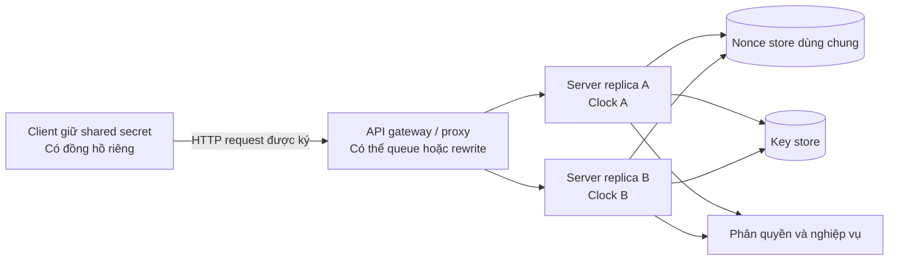
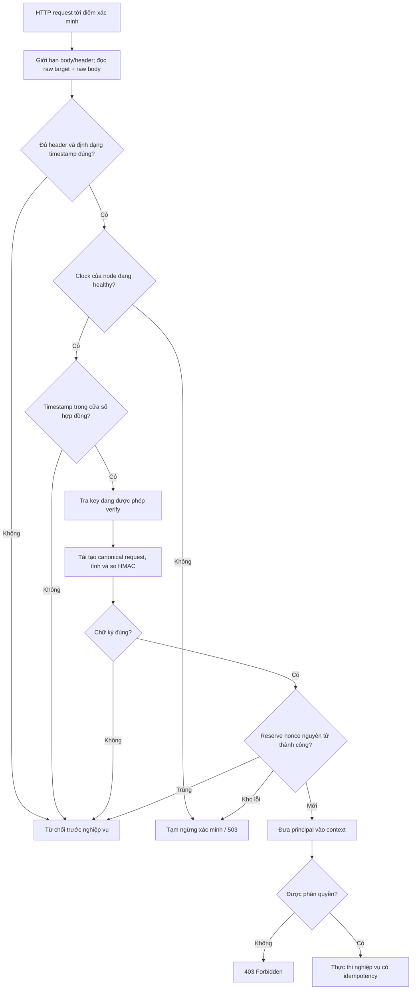

# Clock bị sai: mô hình đe dọa đối với HMAC request authentication

## 1. Vì sao đồng hồ là một phần của an ninh?

Trong mô hình **xác thực HTTP request bằng HMAC với shared secret**, client ký một **canonical request** đã thỏa thuận, thường gồm method, URI, các header được chọn và/hoặc hash của raw body. Server tìm secret theo `keyId`, tái tạo chính xác dữ liệu đã ký và kiểm tra HMAC. Để chống **replay** (gửi lại request hợp lệ), hợp đồng thường yêu cầu hai trường:

- **Timestamp**: thời điểm client tạo chữ ký, giúp giới hạn khoảng thời gian server chấp nhận request.
- **Nonce**: giá trị ngẫu nhiên, duy nhất cho mỗi request; server ghi nhận nonce đã dùng và không chấp nhận lần thứ hai.

Đồng hồ của client, API gateway và các replica server có thể **chạy nhanh, chạy chậm, sai đơn vị hoặc đột ngột nhảy giờ**. Nếu tin rằng đồng hồ luôn đúng, hệ thống có thể từ chối hàng loạt request hợp lệ, chấp nhận request quá hạn, tạo lỗ hổng replay khi cache nonce hết hạn sớm hoặc làm sai thời điểm kích hoạt/thu hồi khóa.

> **Luận điểm trung tâm:** Timestamp là một điều kiện của xác thực HMAC, nhưng bản thân timestamp không chứng minh request là mới. Chỉ khi kết hợp **chữ ký đúng + cửa sổ thời gian hợp lý + nonce được giữ nguyên tử đủ lâu + đồng hồ server đáng tin cậy**, request mới đạt mức bảo vệ replay đã thiết kế.

### Ranh giới của bài học

Bài này phân tích cụ thể mối đe dọa **“Clock bị sai”** trong chương **Mô hình đe dọa** của HMAC request authentication. Các thiết kế canonical request, quản lý shared secret, key rotation, kiểm thử gateway/proxy và phân biệt xác thực với phân quyền đều được xét theo tác động của thời gian. Bài dùng hợp đồng ký minh họa, không mặc định đó là một tiêu chuẩn HMAC áp dụng cho mọi hệ thống.

## 2. Giả định hệ thống và tài sản cần bảo vệ

Giả sử một nền tảng có API `POST /v1/transfers` nhận request từ đối tác qua API gateway rồi chuyển tới nhiều replica. Đối tác có `keyId` và một secret bí mật. Hợp đồng ký yêu cầu:

```http
POST /v1/transfers HTTP/1.1
Content-Type: application/json
X-HMAC-Key-Id: partner-17:v2
X-HMAC-Timestamp: 1795838400
X-HMAC-Nonce: 2cbe36cfeb154e97b838d5b2462d96d1
X-HMAC-Signature: <base64-cua-hmac>

{"to":"account-B","amount":250000}
```

Với ví dụ này, chuỗi ký được xây dựng theo một hợp đồng cố định: **phiên bản thuật toán, method, raw request target, các header bắt buộc (trong đó có timestamp/nonce/key ID), rồi SHA-256 của raw body bytes**. Client và server phải dùng cùng quy tắc UTF-8, ký tự phân tách dòng, chuẩn hóa header và cách biểu diễn URI. Chữ ký HMAC-SHA256 được tính từ secret và chuỗi canonical đó. Timestamp được truyền dưới dạng **Unix epoch seconds**, không phải milliseconds, chuỗi giờ theo múi giờ hay thời điểm gateway nhận request.

Các tài sản và giả định bảo mật:

| Thành phần | Điều cần bảo vệ / giả định |
| --- | --- |
| Shared secret | Chỉ client được cấp phép và server giữ được; không xuất hiện trong request hoặc log. |
| Chữ ký + canonical request | Bảo vệ tính toàn vẹn của đúng những trường trong hợp đồng; `X-HMAC-Timestamp` và `X-HMAC-Nonce` **phải nằm trong chữ ký**. |
| Đồng hồ của server | Phản ánh thời gian thực trong sai số có giám sát; dùng thời gian hệ thống tin cậy để đánh giá timestamp và trạng thái key. |
| Nonce store | Dùng chung giữa replica và region cần chia sẻ trạng thái replay; hỗ trợ ghi nguyên tử, TTL đủ dài, chính sách thất bại rõ ràng. |
| Kho khóa và cấu hình key | Xác định key nào đang được phép **verify** tại thời điểm hiện tại; chỉ key đã xác minh HMAC mới ánh xạ sang principal. |
| Quyền truy cập nghiệp vụ | Tách riêng khỏi xác thực HMAC; một principal đúng chữ ký vẫn có thể bị cấm truy cập transfer/tenant khác. |

### Ranh giới tin cậy



Không coi timestamp, `Date`, `X-Forwarded-*` hoặc `X-Original-*` do Internet gửi đến là thời gian đáng tin cậy. Timestamp trong request là **dữ liệu do client khai báo và đã ký**, chỉ có ý nghĩa khi server đối chiếu với đồng hồ của chính server. Việc một request đi qua TLS giúp bảo vệ đường truyền nhưng không làm cho đồng hồ client chính xác và không thay thế kiểm tra replay.

## 3. Ai có thể gây ra clock sai, và hậu quả gì?

Sai đồng hồ không nhất thiết là một cuộc tấn công chủ động. Nhiều lỗi là sự cố cấu hình, vận hành hoặc sự không nhất quán giữa các máy. Tuy nhiên, kẻ tấn công có thể **khai thác** các sai lệch này bằng cách phát lại request đã quan sát được hoặc cố tác động lên dịch vụ đồng bộ thời gian nếu có khả năng truy cập mạng/hạ tầng phù hợp.

| Mã | Nguồn đe dọa hoặc tình huống | Tác động lên xác thực HMAC | Kiểm soát chính |
| --- | --- | --- | --- |
| T1 | Clock client chậm 7 phút, server đúng | Request được ký hợp lệ nhưng bị từ chối vì timestamp quá cũ; có thể gián đoạn tích hợp hàng loạt. | Đồng bộ giờ client, báo sai lệch có kiểm soát, không tự động mở rộng cửa sổ. |
| T2 | Clock một replica server nhanh/chậm 6 phút so với cụm | Cùng request có thể thành công ở node này, thất bại ở node khác; node chậm có thể nhận timestamp mà node đúng đã xem là cũ. | Giám sát offset từng node, đưa node không đạt ngưỡng khỏi luồng verify, đồng bộ NTP/chrony hoặc tương đương. |
| T3 | Kẻ tấn công thu được request có chữ ký hợp lệ rồi gửi lại | Nếu server chỉ kiểm tra timestamp, request vẫn có thể được xử lý nhiều lần trong cửa sổ cho phép. | Nonce duy nhất, lưu bằng thao tác nguyên tử ở kho dùng chung; bổ sung idempotency nghiệp vụ. |
| T4 | Đặt TTL nonce bằng một nửa độ dài cửa sổ chấp nhận | Nonce hết hạn trong lúc timestamp vẫn hợp lệ, tạo khả năng replay sau khi cache mất dấu. | Tính TTL theo **toàn bộ thời gian timestamp còn có thể hợp lệ**, có dự phòng cho sai số giữa các node. |
| T5 | NTP mất đồng bộ, clock nhảy lùi sau khi nonce hết hạn | Timestamp cũ có thể được chấp nhận trở lại; sự bảo đảm về TTL dựa trên thời gian đơn điệu bị phá vỡ. | Cảnh báo clock step/offset, fail-closed khi clock không tin cậy, đồng hồ tham chiếu ổn định. |
| T6 | Client ghi epoch **milliseconds** nhưng server đọc **seconds**, hoặc parse timestamp không chặt | Chữ ký có thể đúng nhưng kiểm tra thời gian sai, lỗi tương thích hoặc tràn số nếu xử lý bất cẩn. | Quy định một đơn vị duy nhất, validate cú pháp/range, dùng kiểu số 64 bit. |
| T7 | Proxy giữ request trong hàng đợi lâu; gateway và backend kiểm tra ở hai thời điểm khác nhau | Request đã ký đi qua cửa sổ giữa đường; kết quả phụ thuộc vị trí và lúc xác minh. | Đặt điểm xác minh rõ ràng, giới hạn queue/độ trễ, đo latency, không chuyển timestamp bằng cách sửa header. |
| T8 | Đồng hồ bị sai khi key đang rotation hoặc hết hạn | Key đã phải thu hồi có thể bị chấp nhận ở node chậm; client mới có thể bị từ chối ở node nhanh. | Quản lý key theo trạng thái và mốc thời gian đáng tin cậy, giám sát tất cả replica, thu hồi có hiệu lực trên mọi node. |

**Năng lực kẻ tấn công cần phân biệt:** Bên chỉ nghe lén/chiếm được **một request đã ký** không thể thay `X-HMAC-Timestamp` hay nonce nếu chúng được đưa vào canonical request, trừ khi biết secret. Nhưng họ vẫn có thể phát lại **toàn bộ request y nguyên**. Bên đã lấy được secret có thể tự ký timestamp và nonce mới; lúc này HMAC không còn chứng minh đối tác hợp lệ, cần thu hồi và xoay secret, không thể chỉ trông cậy vào kiểm tra giờ.

## 4. Phân tích cửa sổ thời gian và replay

### 4.1 Điều kiện chấp nhận timestamp

Gọi `t_req` là Unix epoch seconds trong header đã ký, `t_srv` là Unix epoch seconds tại nơi xác minh, và `W` là mức sai lệch cho phép, tính bằng giây. Quy tắc đối xứng thông dụng:

\[
|t_{srv}-t_{req}| \le W
\]

Ví dụ với `W = 300` giây (5 phút), tại thời điểm đồng hồ server là `12:00:00`:

| Timestamp request | Chênh lệch so với server | Kết quả kiểm tra thời gian |
| --- | ---: | --- |
| `11:54:59` | -301 giây | Từ chối: quá cũ. |
| `11:55:00` | -300 giây | Chấp nhận tại đúng biên cũ. |
| `12:00:00` | 0 giây | Chấp nhận. |
| `12:05:00` | +300 giây | Chấp nhận tại đúng biên tương lai. |
| `12:05:01` | +301 giây | Từ chối: quá xa tương lai. |

Đây chỉ là **điều kiện thời gian**, chưa khẳng định request được xử lý: còn phải kiểm tra secret, chữ ký, nonce, key status và quyền truy cập. Nếu muốn giảm nguy cơ timestamp nằm ở tương lai, hợp đồng có thể chọn **hai biên không đối xứng** (ví dụ cho phép cũ 300 giây, tương lai 30 giây); cả client và server phải biết rõ quy tắc này.

### 4.2 Vì sao cửa sổ ±5 phút có thể kéo dài đến 10 phút?

Giả sử tại `12:00:00`, server nhận một request có timestamp `12:05:00` với HMAC đúng. Timestamp này đúng **biên tương lai** nên có thể được chấp nhận. Nếu không có nonce store, cùng request vẫn qua được điều kiện thời gian cho đến khi đồng hồ server đạt `12:10:00` — khoảng **10 phút** kể từ lần đầu chấp nhận.

```text
Clock server: 12:00          12:05                    12:10
                |-------------|-------------------------|
Timestamp:     [request ghi 12:05]
                ^                                      ^
      lần đầu hợp lệ (sớm nhất)               lần cuối hợp lệ

Với W = 300 s:
earliest_accepted_server_time = t_req - 300 s
latest_accepted_server_time   = t_req + 300 s
maximum_lifetime              = 600 s
```

Từ đó, **TTL nonce chỉ 300 giây không đủ** trong trường hợp chấp nhận timestamp tương lai. Nếu nonce bị xóa lúc `12:05:00`, trong khi timestamp vẫn hợp lệ tới `12:10:00`, request cũ có thể vượt qua kho nonce một lần nữa. Ngay cả nếu client bình thường luôn ký sát giờ hiện tại, server vẫn phải thiết kế chống replay theo **trường hợp xấu nhất mà chính hợp đồng đang cho phép**.

### 4.3 TTL nonce khi nhiều replica có sai lệch nhỏ

Giả sử mọi server verify được giám sát để có sai lệch đồng hồ thực tế không vượt `E` giây, và `D` giây dự phòng cho thời gian giữa lúc kiểm tra và lúc trạng thái nonce có hiệu lực hoặc chậm xử lý. Một cận bảo thủ dễ vận hành cho cửa sổ đối xứng là:

\[
TTL_{nonce} \ge 2W + 2E + D
\]

Tại sao có `2E`? Replica nhanh `+E` có thể chấp nhận timestamp tương lai `+W` trước; về sau một replica chậm `-E` vẫn có thể coi timestamp đó hợp lệ thêm tối đa `2E` giây theo thời gian thực. Ví dụ `W = 300 s`, `E = 2 s`, `D = 10 s`: cần ít nhất `614 s`; có thể cấu hình **`630 s`** để có dự phòng. Đây là cận theo **các giả định đã kiểm soát**; nếu clock tự ý nhảy lùi lớn hoặc TTL store không đáng tin cậy, công thức không còn bảo đảm. Hệ thống phải dừng chấp nhận request khi trạng thái thời gian không còn được xác nhận.

Nonce store phải có thao tác ghi nguyên tử kiểu:

```redis
SET hmac:nonce:partner-17:v2:2cbe36cfeb154e97b838d5b2462d96d1 1 NX EX 630
```

`NX` chỉ chấp nhận lần đầu; `EX` gắn thời gian sống cùng thao tác. Namespace nonce nên ràng buộc với **key ID hoặc principal đã được xác minh**, đồng thời được dùng chung trên các server chịu cùng phạm vi replay. Tránh kiểu `GET` rồi `SET` vì hai request đồng thời có thể đều vượt qua. Khi kho nonce không hoạt động, áp dụng **fail-closed**: không thực hiện nghiệp vụ chỉ vì chữ ký và timestamp hợp lệ.

> **Chống replay không đồng nghĩa idempotency:** hai request khác nonce nhưng cùng thao tác chuyển tiền đều có thể hợp lệ. Nghiệp vụ cần idempotency key được ràng buộc với principal và nội dung request, cùng giao dịch ghi nhận kết quả phù hợp để tránh xử lý trùng.

## 5. Thời gian phải được kiểm tra như thế nào trong luồng HMAC?



1. **Đọc request đúng lớp HTTP:** lấy raw method/URI/header/body theo hợp đồng ký. Proxy có thể đổi URI, header hoặc body; xác minh ở gateway trước rewrite hoặc đảm bảo backend dùng dữ liệu nguyên bản qua kênh đáng tin cậy. Đừng lấy query từ map đã parse rồi ghép lại.
2. **Kiểm tra cú pháp timestamp:** yêu cầu đúng một header, số nguyên thập phân không âm biểu diễn epoch seconds, giới hạn độ dài và tránh tràn số. Ví dụ không chấp nhận dạng ISO-8601 hay mili giây nếu hợp đồng quy định giây. Tránh dùng múi giờ cục bộ để diễn giải epoch seconds.
3. **Đánh giá sức khỏe clock:** chỉ dùng giờ hệ thống được đồng bộ và theo dõi offset. Lấy **một snapshot của thời gian** để đánh giá request, tránh nhiều lần gọi clock trong cùng quyết định khi đồng hồ vừa bị điều chỉnh.
4. **Kiểm tra cửa sổ:** từ chối timestamp cũ/quá xa tương lai. Không tự sửa header timestamp bằng `now` để “cứu” request, vì thay nó sẽ làm thay đổi nội dung đã ký.
5. **Tính và so HMAC:** timestamp, nonce, `keyId` và mọi trường đã thỏa thuận phải được đưa vào canonical request. Decode chữ ký chặt chẽ và so byte bằng phép so sánh hạn chế rò rỉ thời gian. Secret và byte body không được ghi log tùy tiện.
6. **Reserve nonce trước nghiệp vụ:** chỉ sau khi chữ ký hợp lệ; thao tác phải nguyên tử và dùng chung cho mọi replica liên quan. Xử lý mất kết nối bằng fail-closed.
7. **Phân quyền riêng:** HMAC xác thực bên giữ shared secret; quyền đối với endpoint, tenant, tài khoản hoặc số tiền phải kiểm tra ở lớp authorization/ứng dụng.

### Ví dụ Java: tách kiểm tra đồng hồ để có thể kiểm thử

Sử dụng `java.time.Clock` giúp thay đồng hồ trong unit test mà không sửa giờ máy thật. Đoạn dưới chỉ kiểm tra timestamp; **chưa phải bộ xác minh HMAC đầy đủ**. Các giới hạn độ dài và format là lựa chọn minh họa cho hệ thống dùng epoch seconds; cần thống nhất với client trước khi triển khai.

```java
import java.time.Clock;
import java.time.Instant;

enum TimeVerdict {
    OK, BAD_FORMAT, TOO_OLD, TOO_FAR_IN_FUTURE, CLOCK_UNHEALTHY
}

interface ClockHealth {
    // Theo dõi đồng bộ giờ/offset; false khi node không còn đáng tin cậy.
    boolean isHealthy();
}

final class HmacTimestampPolicy {
    private static final long MAX_PAST_SECONDS = 300;
    private static final long MAX_FUTURE_SECONDS = 300;

    private final Clock clock;
    private final ClockHealth clockHealth;

    HmacTimestampPolicy(Clock clock, ClockHealth clockHealth) {
        this.clock = clock;
        this.clockHealth = clockHealth;
    }

    TimeVerdict evaluate(String signedTimestamp) {
        if (!clockHealth.isHealthy()) return TimeVerdict.CLOCK_UNHEALTHY;

        // Canonical decimal epoch seconds, không dấu, không leading zero.
        if (signedTimestamp == null
                || !signedTimestamp.matches("(0|[1-9][0-9]{0,11})")) {
            return TimeVerdict.BAD_FORMAT;
        }

        final long requestSeconds;
        try {
            requestSeconds = Long.parseLong(signedTimestamp);
        } catch (NumberFormatException ex) {
            return TimeVerdict.BAD_FORMAT;
        }

        long serverSeconds = Instant.now(clock).getEpochSecond();

        if (requestSeconds < serverSeconds - MAX_PAST_SECONDS) {
            return TimeVerdict.TOO_OLD;
        }
        if (requestSeconds > serverSeconds + MAX_FUTURE_SECONDS) {
            return TimeVerdict.TOO_FAR_IN_FUTURE;
        }
        return TimeVerdict.OK;
    }
}
```

`ClockHealth` phải được nối với tình trạng đồng bộ thời gian thực tế của host/VM và có ngưỡng offset rõ ràng, không trả `true` cố định. `Clock.systemUTC()` giúp tránh diễn giải múi giờ khi tạo timestamp nhưng **không chứng minh đồng hồ host đang chính xác**. Dùng nguồn **wall-clock** để so timestamp; dùng nguồn **monotonic** cho thời lượng timeout, retry delay hoặc phép đo latency trong cùng tiến trình. Không dùng `System.nanoTime()` làm epoch seconds.

Ví dụ kiểm thử với clock cố định:

```java
import java.time.Clock;
import java.time.Instant;
import java.time.ZoneOffset;

Clock serverClock = Clock.fixed(
        Instant.parse("2026-11-28T12:00:00Z"), ZoneOffset.UTC);
HmacTimestampPolicy policy = new HmacTimestampPolicy(serverClock, () -> true);

long now = serverClock.instant().getEpochSecond();
assert policy.evaluate(Long.toString(now - 300)) == TimeVerdict.OK;
assert policy.evaluate(Long.toString(now + 300)) == TimeVerdict.OK;
assert policy.evaluate(Long.toString(now - 301)) == TimeVerdict.TOO_OLD;
assert policy.evaluate(Long.toString(now + 301)) == TimeVerdict.TOO_FAR_IN_FUTURE;
```

Phần HTTP adapter cần kiểm tra trường timestamp có xuất hiện **chính xác một lần** và nội dung được ký giữ nguyên giá trị chuỗi gửi đến. `assert` trong ví dụ chỉ diễn tả kỳ vọng; trong test framework nên dùng assertion luôn được thực thi. Bộ xác minh HMAC thực tế vẫn phải quản lý secret, canonical request, chữ ký và nonce như quy trình bên trên.

## 6. Clock bị sai sẽ ảnh hưởng thế nào đến key rotation và gateway?

### 6.1 Key rotation và thu hồi khóa

Khi rotate từ `partner-17:v2` sang `partner-17:v3`, server có thể cho phép hai khóa cùng **verify** trong một khoảng chuyển tiếp có kiểm soát. Nếu node A chạy nhanh và node B chạy chậm, thời điểm ngừng chấp nhận `v2` có thể khác nhau: client nhìn thấy kết quả thất thường hoặc kẻ có secret cũ tiếp tục ký request được B chấp nhận sau thời gian thu hồi dự kiến.

Hướng xử lý: ánh xạ `keyId` vào trạng thái khóa và mốc `notBefore`/`notAfter` từ nguồn quản lý khóa tập trung; mọi node phải áp dụng cùng chính sách và có đồng hồ đạt chuẩn. **Không dùng timestamp do client tự khai báo để quyết định một khóa đã hết hạn còn được dùng không**: một request mới mang timestamp quá khứ nhưng ký bởi secret bị thu hồi vẫn phải bị từ chối theo trạng thái hiện tại của key. Khi secret lộ, thu hồi bất kể còn nằm trong cửa sổ chuyển đổi. Các thay đổi quyền truy cập đối tác cũng phải cập nhật độc lập với chữ ký.

### 6.2 Proxy/gateway có queue và biến đổi request

Thời điểm ký, thời điểm gateway nhận và thời điểm backend xác minh có thể cách xa nhau. Ví dụ client ký lúc `12:00`, gateway giữ request 4 phút rồi backend mất thêm 2 phút: backend lúc `12:06` sẽ từ chối với cửa sổ quá khứ 5 phút, dù request và secret đều hợp lệ. Giải pháp là giới hạn queue, đo độ trễ thực, thiết kế retry **ký lại request với timestamp và nonce mới** ở phía client; không âm thầm tăng cửa sổ lên vô hạn.

Nếu gateway là nơi xác minh HMAC, backend chỉ được tin principal nội bộ mà gateway tạo qua kênh xác thực, sau khi đã loại bỏ header giả mạo từ client. Nếu backend xác minh HMAC, gateway phải bảo toàn raw request target/body hoặc truyền metadata nguyên bản đã được bảo vệ; rewrite path, đổi `Content-Encoding` và parse/serialize body có thể khiến canonical request khác client ký. Thêm header `X-Forwarded-Date` không giải quyết được clock sai vì client có thể giả mạo giá trị này nếu gateway không có cơ chế tin cậy riêng.

Trong cả hai cách, các instance thực hiện **quyết định thời gian và xác minh chữ ký** phải nhất quán về múi giờ chuẩn, đơn vị epoch, cửa sổ chấp nhận và cấu hình key. Unix epoch seconds độc lập với timezone hiển thị; lỗi thường đến từ chuyển đổi sai dữ liệu hoặc nguồn clock mất đồng bộ, không phải thay đổi múi giờ của người dùng.

## 7. Phát hiện và phản ứng vận hành khi đồng hồ không đáng tin cậy

### Giám sát phòng ngừa

- **Theo node/region:** độ lệch so với nguồn giờ tham chiếu, trạng thái NTP/chrony hoặc dịch vụ đồng bộ tương đương, lần đồng bộ thành công gần nhất, các sự kiện clock step, máy mới boot hoặc snapshot restore.
- **Theo xác thực:** số/tỷ lệ `timestamp_too_old`, `timestamp_future`, `bad_timestamp_format`, `invalid_hmac`, `nonce_replay`, `nonce_store_error`; quan sát theo key/tenant với nhãn đã kiểm soát để tránh bùng nổ cardinality.
- **Theo đường đi:** chênh lệch thời điểm nhận gateway và bắt đầu verify, queue latency, region/replica có tỷ lệ lỗi lệch hẳn cụm, thời điểm thay đổi key rotation.

Chỉ ghi timestamp do request khai báo, thời gian server nhận, delta đã tính, request/correlation ID và key ID ở mức phù hợp cho chẩn đoán. Không ghi secret, chữ ký đầy đủ, nonce nguyên văn nếu không cần, hoặc body nhạy cảm. Tránh gửi thông báo lỗi tiết lộ trạng thái key hay cấu hình secret ra cho client; có thể dùng `401` với thông điệp chung khi không xác thực được.

### Quy trình phản ứng tham khảo

1. **Xác định phạm vi:** lỗi xuất hiện ở một client, một replica hay toàn cụm; kiểm tra đơn vị timestamp, offset của host và độ trễ proxy. Không kết luận “client sai giờ” nếu chỉ một node bị lỗi.
2. **Cô lập node clock lỗi:** đưa node ra khỏi phục vụ xác thực hoặc chuyển hệ thống sang chế độ **fail-closed** khi không biết giờ đáng tin cậy. Với lỗi hạ tầng thời gian, có thể trả `503 Service Unavailable` để client retry theo chính sách, thay vì chấp nhận request thiếu kiểm soát.
3. **Khôi phục và kiểm chứng:** đồng bộ clock, xác minh trạng thái nonce store, trạng thái key rotation, so sánh test vector/đồng hồ giữa các replica; chỉ cho node nhận lưu lượng sau khi offset ổn định dưới ngưỡng.
4. **Rà soát tác động:** kiểm tra giao dịch trùng, request bị từ chối, key cũ có thể đã được chấp nhận ngoài kỳ vọng; áp dụng idempotency và đối soát nghiệp vụ nếu cần.

Không có một mức `W` phù hợp mọi API. W lớn làm giảm lỗi do độ trễ/sai giờ nhưng tăng khoảng thời gian chữ ký có thể được phát lại nếu nonce bị mất hoặc vô hiệu; W nhỏ tăng an toàn thời gian nhưng làm các request chậm dễ bị từ chối. Chọn W từ độ lệch đồng hồ cho phép, latency thực tế, mức nhạy cảm nghiệp vụ và khả năng vận hành nonce store; đo trước và theo dõi sau khi triển khai.

## 8. Kiểm thử mô hình đe dọa theo tình huống

| Case | Cách tạo điều kiện kiểm thử | Kỳ vọng bảo mật |
| --- | --- | --- |
| C01 — Biên cửa sổ | Dùng `Clock.fixed` và request timestamp ở `now-300`, `now+300`, `now-301`, `now+301`. | Hai biên đầu hợp lệ về thời gian; hai giá trị ngoài biên bị từ chối. |
| C02 — Client clock chậm | Client giả lập clock lùi 7 phút, vẫn ký HMAC đúng. | Từ chối theo timestamp; không tạo principal, không reserve nonce và không chạy nghiệp vụ. |
| C03 — Replica lệch nhau | Node A dùng clock chuẩn, B chậm 6 phút; gửi cùng request trong cùng khoảng thời gian. | Phát hiện sự không nhất quán; node B không được tiếp tục xác minh nếu vượt ngưỡng health. |
| C04 — Nonce TTL ngắn | Cho phép `±300 s`, giả lập nonce hết hạn sau 300 s, phát lại trước `t_req+300`. | Test phải phát hiện lỗ hổng; cấu hình cuối phải giữ nonce qua toàn bộ cửa sổ. |
| C05 — Replay đồng thời | Gửi cùng signed request đến hai replica trong cùng mili giây. | Tối đa một thao tác atomic reserve thành công; không thực hiện nghiệp vụ hai lần. |
| C06 — Clock nhảy lùi | Cho clock của node lùi sau khi vừa xác minh, hoặc đánh dấu clock health không đạt. | Node ngừng accept; không tiếp tục dựa vào TTL đã giả định cho clock ổn định. |
| C07 — Sai đơn vị timestamp | Gửi epoch milliseconds, số âm, chuỗi không số, nhiều header trùng. | Bị từ chối vì sai format/range hoặc ngoài cửa sổ; không xảy ra tràn số. |
| C08 — Biến đổi trường đã ký | Sửa timestamp hoặc nonce mà không ký lại; thay đổi path/body qua proxy. | HMAC không khớp; server không tự dùng metadata chưa được tin cậy để “sửa” chữ ký. |
| C09 — Gateway chậm | Đưa request hợp lệ qua queue vượt cửa sổ thời gian. | Request bị từ chối theo hợp đồng; hệ thống quan sát được queue latency, client retry với timestamp/nonce mới. |
| C10 — Key cũ và clock chậm | Thu hồi key `v2`, gửi request ký bằng `v2` vào replica đang chậm giờ. | Key đã thu hồi bị từ chối theo trạng thái hiện tại, kể cả timestamp còn nằm trong cửa sổ. |
| C11 — Nonce store gián đoạn | Làm mất kết nối tới kho nonce sau khi HMAC đúng. | Fail-closed, không thực hiện thao tác nghiệp vụ; có metric/cảnh báo. |
| C12 — HMAC đúng, thiếu quyền | Đối tác ký request hợp lệ vào tài khoản của tenant khác. | HMAC được xác minh nhưng authorization trả `403` theo chính sách. |

Đối với integration test, nên chạy ít nhất một luồng **client → gateway → nhiều replica → nonce store dùng chung** và chủ động thay đổi độ trễ/offset trong môi trường thử nghiệm. Không thay đổi clock của máy production để thử case; sử dụng clock injection, môi trường cô lập hoặc cơ chế fault injection được kiểm soát. Test vector phải khóa rõ method, raw URI, header, raw body bytes, canonical string và HMAC mong đợi để phân biệt lỗi thời gian với lỗi canonicalization.

## 9. Bài tập tình huống

**Đề bài:** API đối tác áp dụng cửa sổ timestamp `±5 phút` và TTL nonce `5 phút`. Client ký lúc `14:05:00` và server lần đầu nhận lúc `14:00:00`. Chữ ký, key và nonce đều hợp lệ. Đến `14:06:00`, kẻ tấn công phát lại chính request đã ký này; kho nonce đã xóa bản ghi lúc `14:05:00`.

**Phân tích:** Request ban đầu vượt qua điều kiện thời gian do timestamp **ở biên tương lai**. Lúc `14:06:00`, timestamp chỉ chậm 1 phút so với clock server, vẫn nằm trong cửa sổ ±5 phút. Vì nonce đã hết hạn, hệ thống thiếu khả năng nhận biết request trùng. Nếu không có idempotency, nghiệp vụ có thể thực hiện lần thứ hai. Cách sửa là **tăng TTL nonce theo toàn bộ cửa sổ và sai số giữa các node**, giữ thao tác reserve nguyên tử, đồng thời giám sát clock health; với nghiệp vụ có tác dụng phụ cần thêm idempotency.

### Câu hỏi tự kiểm tra

1. Vì sao `clock chạy chậm` thường nguy hiểm hơn cho khả năng chấp nhận request cũ, trong khi `clock chạy nhanh` dễ làm client hợp lệ bị từ chối?
2. Timestamp được ký có ngăn được replay nguyên vẹn không? Điều gì ngăn kẻ tấn công sửa timestamp?
3. Với `W=300 s`, `E=3 s`, `D=15 s`, TTL nonce tối thiểu theo cận ở bài là bao nhiêu giây?
4. Vì sao lấy `X-Forwarded-Date` từ request công khai làm “thời gian chuẩn” có thể tạo lỗ hổng?
5. Nếu clock node đang sai nhưng HMAC đúng, tại sao chọn fail-closed hợp lý hơn tự mở rộng cửa sổ?
6. Nếu đã verify chữ ký thành công, vì sao server vẫn cần kiểm tra `tenantId` và quyền chuyển tiền của principal?

**Ghi nhớ:** Đồng hồ ảnh hưởng trực tiếp đến tính mới của chữ ký HMAC, tuổi thọ nonce và hiệu lực key rotation. Phải xem độ lệch thời gian là một **rủi ro có giới hạn và có giám sát**: quy định chính xác epoch seconds/cửa sổ chấp nhận, đồng bộ clock mọi điểm verify, tính đủ TTL nonce theo trường hợp xấu nhất, fail-closed khi mất bảo đảm thời gian và luôn phân quyền độc lập sau xác thực.
