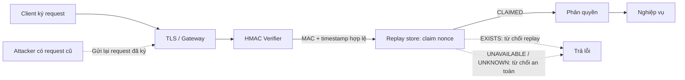
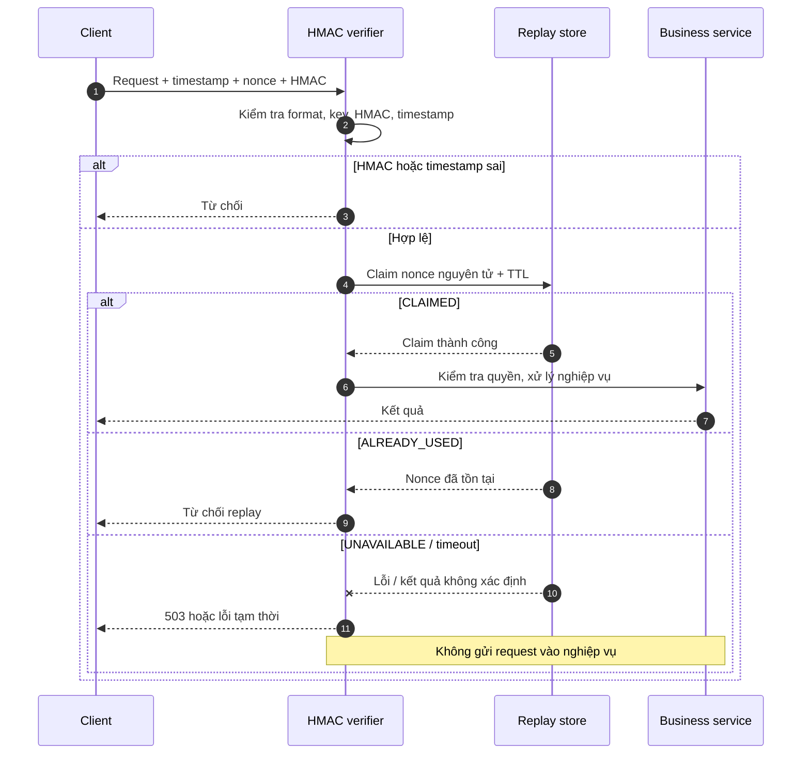

# Replay store bị lỗi

> **Chương:** Mô hình đe dọa  
> **Phạm vi:** Xác thực HTTP request bằng HMAC với shared secret và canonical request bao phủ các thành phần theo hợp đồng ký: method, URI, header và/hoặc body. Bài này tập trung vào rủi ro **kho lưu nonce chống replay (replay store) bị lỗi**, từ đó thiết kế cách từ chối an toàn, kiểm thử vận hành và xử lý retry.

## 1. Vì sao replay store là một thành phần bảo mật?

Giả sử client gửi lệnh tạo chuyển khoản đến API:

```http
POST /v1/transfers HTTP/1.1
Host: payments.example.vn
Content-Type: application/json
X-Client-Id: billing-service
X-Key-Id: key-2026-11
X-Timestamp: 1795800000
X-Nonce: az9Ty3KZn6_m5GbW7RLGnQ
X-Signature: <hmac-sha256-base64url>

{"transactionId":"tx-5271","toAccount":"A-900","amount":1000000}
```

Chữ ký HMAC có thể đúng vì client đã ký canonical request bằng shared secret hợp lệ. Tuy nhiên, nếu ai đó gửi lại **nguyên vẹn** request này, HMAC vẫn có thể xác minh thành công: dữ liệu và chữ ký đều không thay đổi. Chỉ kiểm tra chữ ký sẽ không đủ để biết request đã được sử dụng trước đó hay chưa.

Một thiết kế thường dùng ba lớp:

1. **HMAC:** kiểm tra tính toàn vẹn của method, URI, các header có ý nghĩa và hash body theo hợp đồng ký; ràng buộc chữ ký với client, key ID và đích dịch vụ.
2. **Timestamp:** chỉ nhận request nằm trong cửa sổ thời gian cho phép, ví dụ lệch tối đa 5 phút. Timestamp cũng phải nằm trong dữ liệu đã ký.
3. **Nonce dùng một lần:** kiểm tra và ghi một định danh ngẫu nhiên chưa từng dùng, trong một replay store chia sẻ giữa tất cả instance. Nonce cũng phải nằm trong dữ liệu đã ký.

Nếu replay store không hoạt động, hệ thống **mất khả năng khẳng định một nonce là mới**. Đó là tình huống *không xác định*, không phải bằng chứng nonce chưa xuất hiện. HMAC còn đúng không đồng nghĩa request an toàn để chạy nghiệp vụ.

**Mục tiêu an toàn:** Khi không thể xác nhận và lưu nonce nguyên tử, API phải từ chối request trước khi tạo tác dụng nghiệp vụ. Hệ thống có thể mất khả dụng tạm thời (*availability*) nhưng không được âm thầm giảm mức chống replay (*integrity*).

## 2. Threat model: tài sản, kẻ tấn công và điểm hỏng

### 2.1 Tài sản cần bảo vệ

| Tài sản | Điều kiện an toàn |
| --- | --- |
| Thao tác nghiệp vụ nhạy cảm | Một request bị phát lại không được thực hiện lại do lỗi lớp chống replay |
| Quyền dùng nonce | Chỉ một request có thể giành được nonce trong thời hạn nó có thể được chấp nhận |
| Kho lưu dấu nonce | Ghi có tính nguyên tử, trạng thái dùng chung và tồn tại đủ lâu; không mất dấu sau failover |
| Shared secret và định danh key | Không bị lộ, được phân tách theo client/môi trường, hỗ trợ rotation và thu hồi |
| Dữ liệu ký | Timestamp, nonce, client, audience, method, URI và các header/body cần thiết được ràng buộc vào cùng hợp đồng canonical request |
| Khả năng quan sát lỗi | Phân biệt nội bộ duplicate, store lỗi, MAC sai, timestamp sai mà không lộ bí mật ra log |

### 2.2 Kẻ tấn công làm được gì?

Xét trường hợp kẻ tấn công đã thu được một request hợp lệ còn trong cửa sổ timestamp, ví dụ thông qua một thành phần trung gian bị kiểm soát, log bị lộ hoặc ứng dụng client bị xâm nhập. Họ có thể:

- Phát lại request đã ký **không cần biết shared secret**.
- Gửi nhiều bản sao đồng thời đến các instance khác nhau để thử điều kiện chạy đua.
- Canh lúc cache restart, failover, mất mạng hoặc quá tải để khai thác lỗi chống replay.
- Gửi lưu lượng gây áp lực lên replay store, cố khiến hệ thống rơi vào đường xử lý dự phòng thiếu an toàn.
- Thử vượt ranh giới giữa các vùng triển khai nếu mỗi vùng dùng kho nonce riêng hoặc đồng bộ bất nhất.

Với TLS được cấu hình và xác minh đúng, kẻ ngoài mạng thường không đọc/sửa được HTTPS. Mô hình vẫn phải xét request bị lộ tại client, hệ thống log, gateway, điểm chấm dứt TLS, hoặc một bên tích hợp được cấp quyền. Nếu attacker biết cả shared secret, họ còn có thể tạo request mới với nonce mới: replay store **không giải quyết** việc key bị lộ; cần thu hồi key và điều tra sự cố.

### 2.3 Sơ đồ ranh giới tin cậy



Replay store nằm **trên đường quyết định bảo mật** (*security-critical dependency*). Một lỗi thiết kế nghiêm trọng là cho phép luồng đi tiếp chỉ vì kho này không trả lời.

## 3. Các kiểu lỗi replay store và hậu quả

Cần phân biệt lỗi truy cập, lỗi mất dữ liệu và lỗi nhất quán. Không phải mọi lỗi đều gây replay ngay lập tức, nhưng chúng có thể phá vỡ bằng chứng “nonce chưa từng được sử dụng”.

| Tình huống | Nguy cơ cụ thể | Cách xử lý |
| --- | --- | --- |
| Timeout kết nối / store không phản hồi | Không biết nonce chưa dùng, đã dùng hay thao tác ghi đã thành công | **Từ chối**, không thực hiện nghiệp vụ; ghi nhận lỗi nội bộ |
| Store trả lỗi xác thực, cấu hình hoặc thiếu quyền | Không thể ghi nonce | **Từ chối**, báo vận hành; không tự đổi sang bypass |
| Store trả lời duplicate | Nonce đã được lưu hoặc bị chiếm trước đó | **Từ chối replay**, không chạy nghiệp vụ |
| Race giữa hai request | Hai request đều đọc thấy “chưa có” nếu dùng đọc rồi ghi tách rời | Dùng một lệnh claim **nguyên tử** |
| Store restart và mất bộ nhớ | Các nonce đã được ghi bị mất; request cũ có thể được xem là mới | Cấu hình độ bền phù hợp; xem đây là sự cố an toàn cần đánh giá |
| Redis primary failover sang replica chưa nhận bản ghi | Một claim đã được xác nhận có thể biến mất | Đánh giá tính bền và nhất quán của kiến trúc; yêu cầu mạnh hơn cho nghiệp vụ giá trị cao |
| Nhiều vùng địa lý dùng kho riêng | Cùng nonce có thể được chấp nhận một lần ở **mỗi** vùng | Dùng nguồn quyết định chung có bảo đảm phù hợp hoặc định tuyến nhất quán và ràng buộc vùng vào chữ ký |
| TTL quá ngắn, eviction hoặc xóa nhầm key | Nonce mất trước khi hết thời hạn timestamp; request cũ trở lại hợp lệ | Tính TTL theo cửa sổ; cô lập store, theo dõi eviction; kiểm soát xóa dữ liệu |
| Store quá tải | Timeout tăng, request hợp lệ bị từ chối | Giới hạn tải, capacity planning, circuit breaker fail-closed |
| Fallback sang bộ nhớ local | Hai instance không chia sẻ trạng thái; restart làm mất nonce | **Không dùng** làm đường dự phòng cho một audience triển khai nhiều instance |
| Đồng hồ giữa node lệch nhiều | Request có thể được chấp nhận muộn hơn TTL dự kiến | Đồng bộ thời gian và thêm margin; từ chối khi độ lệch vượt ngưỡng |

**Phân biệt:** một request đã được claim và bị từ chối ở bước phân quyền vẫn có thể tiêu tốn nonce. Đây là hy sinh tính tiện dụng được chấp nhận vì nonce dùng một lần là cơ chế chống replay. Hệ thống không nên hoàn trả nonce sau lỗi nghiệp vụ bằng thao tác xóa đơn giản, bởi request cũ có thể được sử dụng lại.

## 4. Quy tắc quyết định: fail closed khi không chắc chắn

Đề xuất mô hình kết quả tường minh:

- **`CLAIMED`**: ghi nonce thành công bằng một thao tác nguyên tử; chỉ khi đó mới được tiếp tục phân quyền và nghiệp vụ.
- **`ALREADY_USED`**: store xác nhận nonce đã tồn tại; chặn như request replay.
- **`UNAVAILABLE`**: store không thể khẳng định kết quả do timeout, kết nối đứt, failover hoặc lỗi nội bộ; chặn trước nghiệp vụ.

Không được dùng kiểu boolean mà §false§/§null§ mơ hồ giữa duplicate và lỗi store, hoặc §catch (Exception) { return true; }§. Một timeout **sau khi server đã ghi nonce nhưng trước khi client nhận ACK** vẫn phải thuộc trạng thái không xác định. Đừng đoán là claim thành công chỉ vì xác suất thành công cao.

| HMAC | Timestamp | Claim nonce | Quyết định |
| --- | --- | --- | --- |
| Sai | Bất kỳ | Không cần gọi | Từ chối xác thực |
| Đúng | Hết hạn / quá tương lai | Không cần gọi | Từ chối |
| Đúng | Hợp lệ | `CLAIMED` | Tiếp tục **phân quyền**, sau đó xử lý nghiệp vụ |
| Đúng | Hợp lệ | `ALREADY_USED` | Từ chối replay |
| Đúng | Hợp lệ | `UNAVAILABLE` / timeout / không rõ | Từ chối tạm thời, không chạy nghiệp vụ |

Mô hình trình tự:



Có thể dùng HTTP `503 Service Unavailable` và `Retry-After` cho lỗi store tạm thời; phản hồi public không nên chứa chi tiết Redis topology, trạng thái key hoặc secret. Lỗi nonce trùng có thể ánh xạ thành lỗi xác thực/replay theo hợp đồng API; nội bộ cần mã nguyên nhân riêng để quan sát.

**Đánh đổi:** Fail closed có thể khiến API tạm thời không phục vụ request hợp lệ. Đó là quyết định đúng nếu hợp đồng bảo mật yêu cầu chống replay. Với endpoint ít nhạy cảm, đội sản phẩm chỉ nên cân nhắc chế độ suy giảm sau một đánh giá rủi ro **tường minh**, được thiết kế trước theo endpoint và kiểm soát thay đổi; không tạo nhánh “tạm bỏ kiểm tra nonce” trong lúc sự cố.

## 5. Thiết kế nonce claim nguyên tử và TTL

### 5.1 Hợp đồng lưu trữ

Replay key phải có namespace rõ ràng và nhất quán với hợp đồng ký, ví dụ:

```text
hmac-replay:v1:{audience}:{clientId}:{nonceDigest}
```

Trong đó:

- `audience` là API/môi trường đích đã ràng buộc vào canonical request, ví dụ `payments-api-prod`; không chấp nhận chữ ký của môi trường khác.
- `clientId` được gắn với shared secret đang xác minh, **không lấy tùy tiện** từ header chưa được xác thực.
- `nonceDigest` có thể là SHA-256 của nonce theo encoding thống nhất, giúp không để raw nonce trong tên key.
- Không đưa `keyId` vào namespace nonce nếu muốn cùng một client **không thể tái sử dụng nonce** chỉ bằng cách chuyển sang key khác khi rotation. Key ID vẫn phải được xác thực và nằm trong canonical request theo hợp đồng ký.

Phải quy định đầy đủ tính hợp lệ của `X-Nonce`: giá trị đủ ngẫu nhiên từ CSPRNG (ví dụ ít nhất 128 bit), dạng encode cố định, giới hạn độ dài, từ chối header trùng/CRLF và không chuẩn hóa ngầm khác nhau giữa client và gateway. Một bộ xác minh chỉ được tin những trường mà HMAC đã ràng buộc và key resolver đã xác thực.

### 5.2 Ví dụ Redis (một primary quyết định)

```redis
SET hmac-replay:v1:<audience>:<clientId>:<nonceDigest> "1" NX EX 660
```

Ý nghĩa với một Redis instance xử lý lệnh: ghi **chỉ khi key chưa tồn tại**, đồng thời đặt TTL. Kết quả `OK` là đã claim; kết quả nil khi dùng `NX` là đã tồn tại; lỗi/timeout phải ánh xạ thành `UNAVAILABLE`. Tránh `GET` rồi `SET` vì hai request đồng thời có thể cùng thấy key trống.

Không nhầm **atomic trong một primary** với bảo đảm không mất dữ liệu qua failover: Redis có thể nhân bản bất đồng bộ, nên claim vừa ACK có thể biến mất nếu primary hỏng trước khi replica nhận được. Ngay cả cơ chế đồng bộ nhiều replica hoặc cấu hình persistence cũng cần đánh giá ranh giới bảo đảm thực tế. Với nghiệp vụ tài chính hoặc thao tác không thể đảo ngược, cân nhắc một nguồn lưu trữ có **unique constraint và transaction bền vững** (hoặc thiết kế tương đương được chứng minh phù hợp), kết hợp idempotency nghiệp vụ.

### 5.3 Chọn TTL đủ phủ toàn bộ cửa sổ chấp nhận

Giả sử verifier chấp nhận:

```text
abs(now_epoch_seconds - signed_timestamp) <= 300
```

Tức cửa sổ lệch tối đa ±300 giây. Một request có timestamp ở **tương lai 300 giây** có thể được chấp nhận ngay bây giờ, rồi vẫn được chấp nhận đến **600 giây sau** theo timestamp của nó. Nếu TTL chỉ là 300 giây kể từ claim đầu tiên, nonce có thể hết hạn trong khi chữ ký vẫn còn trong cửa sổ chấp nhận.

Vì vậy, với mô hình trên, TTL cố định phải tối thiểu bao phủ `2 × 300 = 600` giây và cộng thêm margin cho sai lệch đồng hồ giữa các node, độ trễ và vận hành, ví dụ chọn **660 giây** khi mức margin đã được xác minh phù hợp. Có thể tính TTL động dựa trên hạn cuối mà timestamp còn hợp lệ, nhưng phải bảo đảm tất cả node sử dụng cùng quy tắc, có margin và không đặt TTL bằng 0 hay giá trị âm.

Cửa sổ 5 phút chỉ là ví dụ, không phải giá trị bắt buộc. Trong hệ thống nhiều cụm hoặc nhiều region, đồng hồ và việc mất dấu sau failover có thể quan trọng hơn vài chục giây TTL.

### 5.4 Độ bền, tính nhất quán và khả năng chịu tải

- **Mọi instance cùng nguồn quyết định:** nếu A và B sử dụng hai cache độc lập, mỗi instance có thể claim cùng nonce. Routing sticky có thể giảm va chạm nhưng không tự tạo bảo đảm khi route thay đổi hoặc instance restart.
- **Thứ tự ghi:** xác minh MAC và cú pháp trước khi ghi nonce. Nếu ghi trước, attacker có thể chiếm nonce hoặc gây tiêu tốn bộ nhớ bằng request có chữ ký không hợp lệ.
- **Không eviction khi chưa hết hạn bảo mật:** cache dùng cho replay không nên bị chính sách eviction xóa key chưa hết TTL. Theo dõi dung lượng, key count, rejected writes và pressure.
- **Giới hạn tải:** áp dụng request size limit, validation, rate limit và timeout có giới hạn để attacker không gây khuếch đại tài nguyên.
- **Failover:** diễn tập trường hợp claim đã được ACK rồi failover; hệ thống phải nhận diện và xử lý rủi ro mất dấu, thay vì mặc định bản ghi còn tồn tại.
- **Multi-region:** nếu có active-active, phải đảm bảo kiểm tra uniqueness trên mọi vùng đối với cùng namespace hoặc ràng buộc audience/vùng rõ ràng với chữ ký và route; eventual replication riêng lẻ không cung cấp bảo đảm toàn cục.

## 6. Ví dụ Java 17: biểu diễn lỗi store tường minh

Ví dụ sau mô tả **bước chống replay sau khi HMAC đã được kiểm tra thành công**, không phải toàn bộ HTTP filter. Đầu vào `VerifiedRequest` phải chỉ được tạo từ luồng xác minh đã kiểm tra key, HMAC trên canonical request, timestamp/nonce được ký và các field đúng định dạng. Lớp phân quyền chạy sau kết quả `CONTINUE`.

```java
import java.time.Clock;
import java.time.Duration;

public final class ReplayGate {
    private ReplayGate() {}

    private static final long WINDOW_SECONDS = 300L;
    private static final Duration NONCE_TTL = Duration.ofSeconds(660L);

    public record VerifiedRequest(
            String audience,
            String clientId,
            String nonce,
            long signedAtEpochSeconds) {
    }

    public record ReplayKey(
            String audience,
            String clientId,
            String nonce) {
    }

    public enum ClaimResult {
        CLAIMED,
        ALREADY_USED
    }

    public enum Decision {
        CONTINUE,
        REJECT_TIMESTAMP,
        REJECT_REPLAY,
        REJECT_STORE_UNAVAILABLE
    }

    // Mọi thao tác claim phải nguyên tử, dùng chung và có TTL.
    // Không được "âm thầm" trả CLAIMED khi store mất kết nối.
    public interface ReplayStore {
        ClaimResult claimOnce(
                ReplayKey key, Duration ttl)
                throws ReplayStoreUnavailableException;
    }

    public static final class ReplayStoreUnavailableException
            extends Exception {
        public ReplayStoreUnavailableException(String message) {
            super(message);
        }
    }

    public static Decision checkAndReserve(
            VerifiedRequest request,
            ReplayStore store,
            Clock clock) {

        // Trong hệ thống thật, request phải là kết quả nội bộ
        // của bộ xác minh HMAC và quá trình validate dữ liệu.
        if (request == null || request.audience() == null
                || request.clientId() == null
                || request.nonce() == null
                || request.nonce().isBlank()) {
            return Decision.REJECT_TIMESTAMP;
        }

        long now = clock.instant().getEpochSecond();
        long signedAt = request.signedAtEpochSeconds();

        // Timestamp đã được MAC bảo vệ; chỉ dùng khi khớp chữ ký.
        if (signedAt < now - WINDOW_SECONDS
                || signedAt > now + WINDOW_SECONDS) {
            return Decision.REJECT_TIMESTAMP;
        }

        ReplayKey key = new ReplayKey(
                request.audience(), request.clientId(), request.nonce());

        try {
            ClaimResult result = store.claimOnce(key, NONCE_TTL);
            if (result == ClaimResult.CLAIMED) {
                return Decision.CONTINUE;
            }
            if (result == ClaimResult.ALREADY_USED) {
                return Decision.REJECT_REPLAY;
            }
            // Null hoặc kết quả không biết cũng phải fail closed.
            return Decision.REJECT_STORE_UNAVAILABLE;
        } catch (ReplayStoreUnavailableException ex) {
            return Decision.REJECT_STORE_UNAVAILABLE;
        }
    }
}
```

Adapter Redis có thể ánh xạ lệnh `SET key "1" NX EX 660` sang các kết quả kể trên. Phải đặt timeout hợp lý, kiểm soát connection pool, và đảm bảo lỗi không bị đổi thành `CLAIMED` trong lớp adapter. Một exception không dự kiến cần được global exception handler **từ chối request**, không được bỏ qua filter rồi gọi handler nghiệp vụ.

**Ranh giới của ví dụ:** code chưa triển khai xác minh HMAC-SHA256, ràng buộc audience/key ID, canonicalization của path/query/header/body hoặc thao tác Redis thật. Những phần này phải được kiểm tra thống nhất từ client qua proxy/gateway đến verifier. Với endpoint đòi hỏi atomicity giữa replay claim và side effect nghiệp vụ, cần thiết kế transaction/idempotency riêng; việc claim nonce ở một store độc lập **không tạo giao dịch phân tán exactly-once**.

## 7. Khi store lỗi, client retry thế nào?

Một hiểu lầm nguy hiểm là “store timeout thì cho request đi tiếp vì chữ ký HMAC đã đúng”. Vấn đề nằm ở khả năng không thể biết đã từng nhận request đó. Một lỗi khác là server tự hủy dấu nonce sau khi nghiệp vụ thất bại, khiến bản sao request cũ có cơ hội vượt qua kiểm tra.

Các tình huống cần xử lý khác nhau:

| Trạng thái phía server | Client nhìn thấy | Cách phục hồi phù hợp |
| --- | --- | --- |
| Store không nhận được request claim | `503` hoặc timeout | Retry sau khi phục hồi; có thể tạo timestamp/nonce/chữ ký mới nếu request cũ hết hạn |
| Store đã ghi nonce nhưng ACK bị mất | `503` hoặc timeout | Retry cùng nonce có thể bị từ chối replay dù nghiệp vụ **chưa chạy**; dùng thông tin trạng thái/idempotency để quyết định |
| Store claim thành công, nghiệp vụ chưa bắt đầu rồi server crash | Timeout | Nonce đã dùng, thao tác có thể chưa thực hiện; client cần quy trình retry có khóa nghiệp vụ |
| Store claim thành công, nghiệp vụ hoàn tất nhưng response thất lạc | Timeout | Không được tạo giao dịch thứ hai; đọc trạng thái theo operation ID/idempotency key |
| Store đã mất dấu nonce khi failover | Có thể không có lỗi rõ ràng | Nguy cơ chạy lại request; cần bảo đảm dữ liệu bền và idempotency nghiệp vụ |

Với lệnh tạo chuyển khoản, nên ký thêm **`Idempotency-Key`** hoặc transaction ID trong hợp đồng canonical request và lưu trạng thái nghiệp vụ theo khóa đó trong nguồn dữ liệu bền phù hợp. Một client khi retry có thể tạo nonce/timestamp/HMAC mới nhưng giữ nguyên idempotency key cho **cùng một giao dịch**, để phía nghiệp vụ trả lại kết quả đã có hoặc chặn thực hiện lặp. Không sử dụng một idempotency key cho hai payload khác nhau; server cần kiểm tra binding của key với client và digest payload.

**Nonce và idempotency giải quyết hai bài toán khác nhau:**

- Nonce bảo vệ cửa sổ xác thực trước việc **phát lại cùng một thông điệp đã ký**.
- Idempotency bảo vệ **hiệu ứng nghiệp vụ** trước nhiều yêu cầu thực hiện cùng một thao tác, kể cả khi được ký lại hợp lệ với nonce mới.

Không nên coi `503` là bằng chứng nghiệp vụ chắc chắn chưa chạy nếu hệ thống không có một hợp đồng end-to-end được chứng minh; cần endpoint truy vấn trạng thái hoặc quy trình hòa giải giao dịch. Với một request dừng trước bước phân quyền/nghiệp vụ do lỗi store, server biết luồng đó chưa chạy nghiệp vụ, nhưng client có thể đã có **request trước đó** chạy thành công rồi bị mất phản hồi.

## 8. Key rotation, gateway và nhiều instance

### Key rotation

Key resolver phải kiểm tra `X-Key-Id` thuộc đúng `X-Client-Id`, key còn hiệu lực, và HMAC ràng buộc cả hai trường theo hợp đồng ký. Trong thời gian rotation có thể chấp nhận song song key cũ và mới trong khoảng chuyển tiếp có kiểm soát. Việc đổi key **không được xóa replay store** hoặc tạo một cửa sổ replay mới cho cùng client. Nếu nonce namespace là `audience + clientId + nonce`, nonce đã sử dụng vẫn bị chặn khi client ký lại với key ID khác. Chặn replay không thay thế việc thu hồi secret bị lộ.

### Reverse proxy / gateway

Cần thống nhất bước canonicalization trước khi gửi request đến replay gate:

- Xác minh đúng dữ liệu đã được ký: method, URI/query, header ảnh hưởng nghiệp vụ, hash body, timestamp, nonce, client, key ID và audience.
- Gateway có thể đổi path, query encoding, authority, header hoặc nén/giải nén body; vị trí xác minh phải nhất quán với hợp đồng ký. Không nhận `X-Original-URI` hoặc `X-Forwarded-*` do client tự khai nếu gateway chưa làm sạch và tái tạo từ nguồn tin cậy.
- Gateway không được bỏ qua HMAC/replay gate bằng đường route khác, health-check path không được trá hình thành business endpoint.
- Khi xác minh ở gateway nhưng xử lý ở backend, identity đã xác thực phải đi qua kênh nội bộ đáng tin cậy; backend không tin header `X-Authenticated-Client` do bên ngoài tự gửi.
- Nếu nonce được claim tại gateway, mọi gateway instance phải dùng cùng nguồn trạng thái với bảo đảm thích hợp; cache local riêng ở từng gateway sẽ gây lỗ hổng.

### Phân quyền vẫn bắt buộc

Request có HMAC hợp lệ, timestamp hợp lệ và nonce mới **chưa đủ để truy cập một tài nguyên**. Sau xác thực phải kiểm tra client có quyền truy cập tenant, tài khoản và hành động cụ thể hay không. Hệ thống không được đồng nhất “bên ký có shared secret” với “bên ký được phép thực hiện mọi lệnh”.

## 9. Giám sát và xử lý sự cố

Vì fail closed làm giảm khả dụng khi store lỗi, cần cơ chế phát hiện và khôi phục đủ nhanh mà không phải bỏ chống replay.

**Những tín hiệu nên giám sát:**

| Tín hiệu | Câu hỏi vận hành cần trả lời |
| --- | --- |
| Tỷ lệ `CLAIMED` / `ALREADY_USED` / `UNAVAILABLE` | Có đột biến replay hay store đang lỗi? |
| P95/P99 latency và timeout của claim | Store sắp quá tải hoặc đứt kết nối? |
| Eviction, memory usage, TTL và số key | Nonce có bị xóa trước khi hết cửa sổ chấp nhận? |
| Redis failover / replication lag / restart | Có nguy cơ mất các claim đã ACK? |
| Lệch đồng hồ các node | TTL và timestamp window còn nhất quán? |
| Tỷ lệ request bị chặn trước nghiệp vụ | Lỗi ảnh hưởng khách hàng đến mức nào? |
| Số tác vụ nghiệp vụ trùng idempotency key | Có xử lý lặp dù HMAC/replay kiểm tra đã qua? |

Log mã nguyên nhân nội bộ, client ID, key ID, audience, correlation ID, region/node và độ trễ kiểm tra; cân nhắc hash nonce nếu cần đối chiếu. Không log raw shared secret, full Authorization, toàn bộ request có dữ liệu nhạy cảm hoặc chữ ký có thể tái sử dụng. Các metric nhiều cardinality cần giới hạn nhãn; client ID thường nên dùng cho log/tracing có kiểm soát thay vì nhãn metric đại trà.

**Runbook khi replay store lỗi:**

1. Kích hoạt cảnh báo `UNAVAILABLE`; xác minh mọi luồng đều fail closed và không có đường bypass qua gateway/backend.
2. Kiểm tra mạng, quyền truy cập, pool connection, capacity, timeout, cấu hình TTL/eviction và trạng thái replication/failover.
3. Khôi phục store hoặc chuyển sang hệ thống dự phòng **đã được thiết kế có bảo đảm phù hợp**. Không bật local-cache fallback hay bỏ nonce check khi chưa có thiết kế được phê duyệt.
4. Nếu nghi có mất nonce đã claim, xác định thời gian/vùng bị ảnh hưởng và đối chiếu audit nghiệp vụ, idempotency records; thu hồi các key bị nghi lộ nếu cần.
5. Xác nhận thử nghiệm replay trên nhiều instance/region trước khi đóng sự cố; ghi lại nguyên nhân gốc và biện pháp ngăn tái diễn.

Việc bật circuit breaker trong lỗi store chỉ nên làm request thất bại nhanh và rõ, giúp giảm tải; **không** được chuyển circuit breaker sang chế độ “bỏ qua xác thực”.

## 10. Bộ kiểm thử dành cho tình huống replay store lỗi

Cần chạy test giả lập ở cả cấp service và qua gateway thực tế. Một số phép thử có thể dùng fake store cho unit test; lỗi failover, persistence và routing đòi hỏi môi trường tích hợp phù hợp.

| Kiểm thử | Tác động | Kết quả bắt buộc |
| --- | --- | --- |
| Request lần đầu | HMAC hợp lệ, timestamp trong cửa sổ, nonce mới | Một claim thành công; kiểm tra quyền rồi thực hiện |
| Gửi lại nguyên request | Cùng nonce và chữ ký | Bị từ chối, không thực hiện nghiệp vụ lần hai |
| Hai request đồng thời | Đến hai instance cùng nonce | Chính xác một claim thành công |
| Store mất kết nối | Tắt kết nối trước claim | Không có nghiệp vụ nào chạy, trả lỗi tạm thời |
| Timeout sau khi ghi | Gây mất ACK từ store | Xử lý như `UNAVAILABLE`, không giả định claim thành công |
| Store trả null / exception | Adapter gặp trạng thái không xác định | Fail closed |
| Redis restart / failover | Sau khi đã claim nonce | Request cũ không được vượt qua nếu vẫn trong cửa sổ; nếu không bảo đảm, phải ghi nhận lỗ hổng kiến trúc |
| Eviction / TTL sai | Xóa replay key sớm rồi gửi lại | Test phát hiện nguy cơ; khắc phục cấu hình để không thể chấp nhận replay |
| Node lệch thời gian | Hai node lệch nhiều giây | Timestamp/TTL được kiểm soát; lệch quá ngưỡng phải bị phát hiện |
| Multi-region | Phát cùng nonce đến hai region | Chỉ một request được chấp nhận trong phạm vi audience chung |
| Key rotation | Ký lại cùng nonce bằng key mới còn hiệu lực | Nonce vẫn bị coi là đã dùng |
| MAC sai | Nonce mới nhưng chữ ký không hợp lệ | Chặn trước claim; không tiêu tốn replay key |
| Idempotent retry | Chữ ký/nonce mới, cùng transaction ID | Không tạo hai hiệu ứng nghiệp vụ |
| Store khôi phục | Replay lại request đã ghi trước outage | Vẫn từ chối nếu còn trong cửa sổ |
| Sai quyền | HMAC đúng và nonce mới nhưng client thiếu quyền | Phân quyền từ chối; không chạy nghiệp vụ |

### Bài thực hành nhỏ

**Thiết lập:** Có hai instance API `api-a` và `api-b` dùng chung Redis. Clock lệch tối đa 2 giây, cửa sổ timestamp cho phép ±300 giây, TTL nonce là 660 giây. Client gửi một request tạo giao dịch hợp lệ, sau đó gửi lại request đó vào instance còn lại.

1. Chạy baseline, xác nhận một trong hai instance trả thành công và request lặp bị từ chối.
2. Thay cách claim nguyên tử bằng `GET` rồi `SET` trong môi trường test; phát hai request đồng thời và quan sát khả năng cả hai vượt qua.
3. Khôi phục cách claim nguyên tử, giả lập Redis timeout; xác nhận **không có** tác dụng nghiệp vụ.
4. Giả lập mất ACK sau khi Redis đã ghi, sau đó retry cùng nonce; thảo luận vì sao client có thể nhận lỗi dù nghiệp vụ chưa chạy.
5. Gửi lại với nonce/timestamp mới nhưng cùng idempotency key, xác nhận giao dịch không bị tạo hai lần.
6. Thử failover sang replica thiếu claim đã ghi; đánh giá xem thiết kế storage hiện tại có đạt mức an toàn kỳ vọng hay cần thay bằng storage bền hơn.

**Tiêu chí đạt:** mọi tình huống store không thể xác nhận uniqueness đều chặn luồng nghiệp vụ; concurrency không chấp nhận hai lần cùng nonce; retry an toàn về hiệu ứng nghiệp vụ nhờ idempotency; giám sát phân biệt được replay thật, store unavailable và lỗi cấu hình.

## 11. Câu hỏi tự kiểm tra

1. Vì sao chữ ký HMAC hợp lệ không đủ ngăn người khác phát lại một lệnh thanh toán?
2. Trong trường hợp Redis timeout ngay sau lệnh `SET NX EX`, vì sao không được coi nonce là “mới” hoặc “đã claim thành công”?
3. Hai instance API dùng local in-memory set riêng có rủi ro gì, dù cả hai đều xác minh HMAC chính xác?
4. Vì sao TTL nonce bằng đúng 300 giây là thiếu khi timestamp được chấp nhận trong khoảng ±300 giây?
5. Tại sao `SET NX EX` atomic trên một primary không tự đảm bảo an toàn nếu failover có thể làm mất claim đã ACK?
6. HMAC, nonce và idempotency key bảo vệ những thuộc tính khác nhau ra sao?
7. Key rotation nên thay đổi trạng thái nonce đã dùng như thế nào? Sau khi HMAC và nonce hợp lệ, còn phải kiểm tra gì trước nghiệp vụ?

**Điểm cần ghi nhớ:** replay store là một phần của ranh giới xác thực HMAC. Khi trạng thái nonce không chắc chắn, lựa chọn an toàn là **từ chối trước khi xử lý nghiệp vụ**. Để hệ thống thực sự chống replay, thao tác claim phải nguyên tử, chia sẻ giữa các instance, tồn tại đủ lâu và có độ bền/nhất quán phù hợp; đồng thời phải có idempotency cho hiệu ứng nghiệp vụ, giám sát lỗi và kiểm thử toàn đường đi qua gateway.
