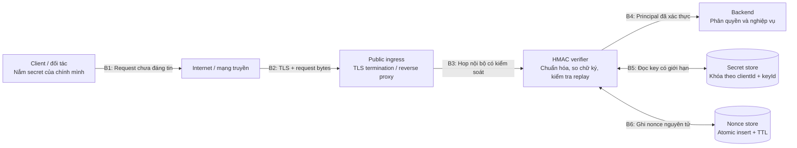
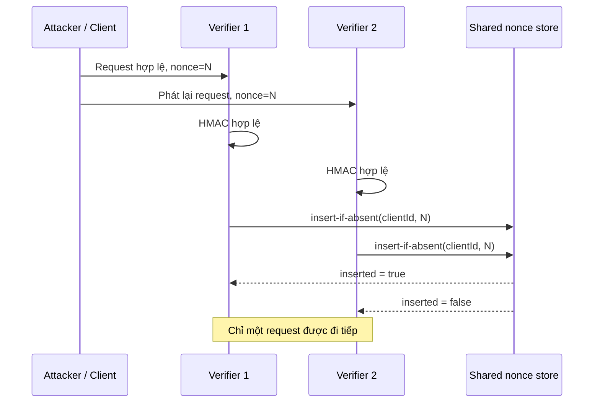

# Giả định trust boundary trong mô hình đe dọa HMAC Request Authentication

## Mục tiêu học tập

Sau bài học này, bạn có thể:

- Xác định **trust boundary** (ranh giới tin cậy) trong đường đi của HTTP request từ client, qua reverse proxy/API gateway, tới verifier và ứng dụng.
- Phân biệt **giả định an ninh**, **thuộc tính thực sự được HMAC bảo đảm** và **điều phải kiểm chứng bằng cấu hình hoặc kiểm thử**.
- Nhận ra khi nào dữ liệu không đáng tin (header, URI, body, `clientId`, `keyId`) được chuyển thành một **danh tính đã xác thực**.
- Phân tích nguy cơ của một secret bị lộ, canonical request không nhất quán, gateway sửa request, nonce store thiếu tính nguyên tử và backend tin header giả mạo.
- Thiết kế các biện pháp bảo vệ tại từng ranh giới, bao gồm TLS, quản lý khóa, replay protection, key rotation và phân quyền độc lập.

> **Phạm vi:** Đây là bài thuộc chương **Mô hình đe dọa** của module `SECURITY_AUTHENTICATION_HMAC_REQUEST_AUTHENTICATION`. Ví dụ sử dụng HMAC-SHA256 với shared secret và một canonical request có phương thức, URI, header/body theo hợp đồng ký. Hợp đồng cụ thể trong ví dụ chỉ mang tính minh họa; mỗi hệ thống phải định nghĩa chính xác phiên bản hợp đồng của mình.

## 1. Trust boundary là gì trong một hệ thống HMAC?

**Trust boundary** là điểm mà dữ liệu hoặc thao tác đi từ một miền có mức bảo đảm an ninh này sang miền khác. Đi qua một mạng nội bộ, một process, một API gateway, một secret store hay một tenant đều có thể là vượt ranh giới tin cậy. Một lời gọi nằm “trong VPC” hoặc chạy “sau gateway” không tự nhiên trở thành đáng tin.

Trong xác thực HTTP bằng HMAC, có ba thời điểm cần tách rõ:

1. **Trước xác minh:** mọi byte do client hoặc mạng chuyển đến, kể cả `X-Client-Id`, `X-Key-Id`, `X-Timestamp`, `X-Nonce` và `X-Signature`, đều là **đầu vào không đáng tin**.
2. **Sau xác minh HMAC và điều kiện đi kèm:** verifier có thể xác nhận rằng request được tạo bởi **một bên có khả năng sử dụng khóa phù hợp**, rằng các trường được ký khớp hợp đồng và request đáp ứng chính sách thời gian/nonce. Kết quả này chỉ là một khẳng định có giới hạn.
3. **Sau phân quyền:** ứng dụng mới xác định danh tính đã xác thực có quyền thực hiện hành động đó trên **tài nguyên/tenant cụ thể** hay không.

Đường ranh giữa (1) và (2) là điểm phát sinh **authentication context** (ví dụ `principal = partner-17`). Đường ranh giữa (2) và (3) là điểm ứng dụng thực hiện **authorization**. Gộp hai bước sẽ gây lỗi kiểu “ký hợp lệ nên được thao tác trên tài khoản của người khác”.

### Một sơ đồ ranh giới điển hình



Các nhãn B1–B6 đặt tên **những ranh giới cần xem xét**, không có nghĩa mạng nào ở một phía luôn an toàn. Nếu verifier nằm ngay trong gateway, B3 là ranh giới logic bên trong gateway. Nếu gateway chỉ chuyển request và verifier chạy ở backend, B3 là một kết nối dịch vụ thật phải được bảo vệ.

## 2. Tài sản, đối tượng tấn công và năng lực của attacker

Muốn đặt giả định tin cậy chính xác, cần xác định **điều đang bảo vệ** trước khi bàn đến công nghệ.

| Tài sản / thuộc tính | Điều cần giữ | Hậu quả nếu mất |
|---|---|---|
| Shared secret `K` | Bí mật, cô lập theo client/tenant/môi trường; có thể thu hồi | Bất cứ ai lấy được `K` có thể tạo chữ ký mới hợp lệ |
| Hợp đồng canonical request | Cùng một cách diễn giải method, URI, header, body trước/sau proxy | Ký một ý nghĩa, thực thi một ý nghĩa khác; lỗi xác thực hoặc bypass |
| Danh tính `principal` đã xác thực | Không bị gán từ header không tin cậy; đúng chủ sở hữu key | Giả mạo client hoặc tenant |
| Replay state `(clientId, nonce)` | Tính nhất quán, thao tác nguyên tử, thời hạn lưu phù hợp | Phát lại request chuyển tiền/tạo đơn |
| Quyền nghiệp vụ | Chỉ principal phù hợp được tác động tài nguyên tương ứng | Truy cập hoặc sửa dữ liệu tenant khác |
| Audit, clock, key status | Truy vết, đồng bộ thời gian, chặn khóa đã thu hồi | Khó phát hiện tấn công; chấp nhận request hết hạn/khóa bị thu hồi |

Đối tượng tấn công có thể là người ngoài Internet, một client tích hợp không đáng tin, kẻ đã chiếm quyền một client, nhân sự có quyền xem log/secret, hoặc thành phần proxy/backend bị cấu hình sai. Không nên giả định attacker chỉ gửi những request có hình thức đẹp.

Một **mô hình attacker thực tế** cho API công khai nên cho phép attacker:

- Tự tạo method, path, query, header, body, timestamp, nonce, key ID và signature bất kỳ; gửi header trùng lặp hoặc URL encoding khác thường.
- Gửi lại toàn bộ request đã quan sát được khi có cơ hội; thử gửi đồng thời tới nhiều replica.
- Điều khiển **một** tài khoản client hợp lệ và biết khóa **của chính client đó**; cố truy cập dữ liệu tenant khác.
- Khai thác khác biệt xử lý request giữa CDN, reverse proxy, thư viện HTTP, verifier và backend.
- Gây tải lớn, thử key ID không tồn tại hoặc làm đầy nonce store.

Tùy phạm vi hệ thống, attacker cũng có thể đã chiếm được một secret. Khi đó mục tiêu hợp lý là **giới hạn vùng ảnh hưởng và thu hồi khóa**, chứ không tuyên bố HMAC vẫn ngăn giả mạo.

## 3. Những điều HMAC thực sự bảo đảm — và không bảo đảm

Với `K` đủ mạnh, thuật toán đúng và canonical request nhất quán:

- Chữ ký đúng chứng tỏ bên tạo HMAC **có khả năng sử dụng khóa** được verifier chấp nhận.
- Các **byte/thông tin nằm trong chuỗi được ký** được ràng buộc với chữ ký; thay một phần đã ký thường khiến xác minh thất bại.
- Chữ ký tự nó **không mã hóa** body, không bảo vệ bí mật trên đường truyền, không chứng minh request là “mới” nếu thiếu timestamp/nonce, và không cấp quyền thực hiện thao tác.
- Do cả client và verifier đều có cùng `K`, chữ ký HMAC **không chứng minh duy nhất ai đã ký** (không có tính chống chối bỏ như chữ ký bất đối xứng).
- HMAC không chứng minh request đã được xử lý đúng sau khi vượt qua verifier. Hop từ verifier tới backend là một ranh giới khác.

Một giả định cần kiểm chứng là: **các trường ảnh hưởng đến quyết định bảo mật/nghiệp vụ đều nằm trong phạm vi ký**. Nếu API phân quyền dựa trên `X-Tenant-Id` nhưng verifier không ký hoặc không đối chiếu trường này với principal đã xác thực, attacker có thể điều chỉnh `X-Tenant-Id` sau khi ký.

## 4. Bản đồ giả định theo từng trust boundary

Bảng sau diễn đạt mỗi ranh giới như một **giả định cụ thể có thể bị phá vỡ**, đồng thời chỉ ra bằng chứng cần có thay vì ghi chung chung “mạng nội bộ đáng tin”.

| Ranh giới | Giả định được chấp nhận có điều kiện | Cách chứng minh / kiểm soát | Nếu giả định sai |
|---|---|---|---|
| **B1 — Client / runtime** | Secret không bị lộ, đúng key được sử dụng cho đúng client và môi trường | Secret manager, quyền tối thiểu, audit, không ghi log/commit, quy trình thu hồi | Kẻ lấy key ký được request tùy ý trong scope đó |
| **B2 — Mạng công khai → ingress** | TLS tới đúng endpoint được bảo vệ; ingress giới hạn malformed request và size | HTTPS, cấu hình TLS, kiểm tra chứng chỉ, body/header size limit, rate limit | Nghe lén dữ liệu, can thiệp request, lạm dụng tài nguyên |
| **B3 — Ingress → verifier** | Những byte được verifier xác minh có ý nghĩa tương ứng với request mà backend sẽ xử lý; hop không bị giả mạo | Hợp đồng canonical rõ ràng, kiểm thử rewrite, mTLS/ACL cho hop, danh sách proxy tin cậy | Ký đường dẫn A nhưng chạy đường dẫn B; header identity bị chèn |
| **B4 — Verifier → backend** | Principal và thông tin được ký không bị client tự chèn hoặc sửa trên đường đi; backend xác minh nguồn của context | Xóa/ghi đè header nhận dạng tại ingress, kết nối tin cậy, không cho gọi trực tiếp backend, authz riêng | Backend tin danh tính giả hoặc bỏ qua quyền tenant |
| **B5 — Verifier → kho khóa** | Key lookup chọn đúng secret theo client, key ID và môi trường; trạng thái rotation/thu hồi kịp thời | ACL, mã hóa, định danh phiên bản, không thử chéo key, cache có invalidation | Khóa tenant A dùng cho tenant B; khóa thu hồi vẫn được chấp nhận |
| **B6 — Verifier → nonce store** | Mọi verifier nhìn thấy cùng trạng thái replay; thao tác “ghi nếu chưa tồn tại” là nguyên tử | Kho dùng chung, `SET NX`/conditional insert, TTL đủ dài, chính sách khi store lỗi | Hai replica cùng nhận một nonce; replay vẫn được thực thi |

**Quy tắc đọc bảng:** cột “Giả định” là điều kiện của mô hình, **không phải bằng chứng** điều kiện đó đã đúng trong hệ thống. Chỉ khi có cơ chế và kết quả kiểm thử tương ứng mới được dựa vào giả định khi quyết định kiến trúc.

## 5. Trust boundary của danh tính và khóa dùng chung

### 5.1. `clientId` và `keyId` ban đầu chỉ là dữ liệu tra cứu

Ví dụ request:

```http
POST /v1/payments HTTP/1.1
Host: api.example.test
Content-Type: application/json
X-Client-Id: merchant-A
X-Key-Id: key-2026-11
X-Timestamp: 1795830000
X-Nonce: cba48d23b1954fd3b07c4e089bb54ee5
X-Signature: <base64url-hmac>

{"merchantId":"merchant-A","amount":100000}
```

Bất cứ client nào cũng có thể tự gửi các header trên. Verifier **không được tin** rằng `X-Client-Id: merchant-A` chứng minh người gọi chính là merchant A. Dữ liệu này chỉ giúp tìm khóa ứng viên sau khi kiểm tra format và giới hạn đầu vào.

Một bản ghi khóa có thể có dạng logic:

```text
(clientId=merchant-A, keyId=key-2026-11, env=production)
    -> secretRef, state=ACTIVE, permissionsRef, notAfter
```

Verifier dùng chính khóa thuộc bộ ba đó để kiểm tra HMAC của **canonical request đã bao gồm cả client ID và key ID**. Thành công mới cho phép tạo principal `merchant-A`. Không có đường rẽ “không tìm thấy key thì thử key mặc định” hay “thử hết mọi key đến khi một chữ ký khớp”.

**Giả định cốt lõi:** mỗi client/tenant dùng khóa được cô lập. Nếu mọi tenant dùng một global secret, ai nắm global secret có thể giả làm bất kỳ tenant nào khi chỉnh `clientId`; lựa chọn này mở rộng đáng kể vùng ảnh hưởng của sự cố.

### 5.2. Ranh giới quản lý và phân phối secret

Khi cấp hoặc xoay vòng khóa, một ranh giới khác xuất hiện: **control plane** (nơi tạo/quản lý/thu hồi khóa) → **data plane** (tiến trình đang ký hoặc xác minh request).

Những câu hỏi threat model phải trả lời:

- Ai có quyền tạo hoặc xem secret; có cần con người thấy secret thô hay không?
- Khóa được cấp qua kênh nào và gắn với client, môi trường, quyền sử dụng nào?
- Ai có thể đổi trạng thái `ACTIVE`, `VERIFY_ONLY`, `DISABLED`? Thay đổi này truyền tới cache verifier trong bao lâu?
- Mỗi client có thể tự đổi `keyId` để yêu cầu verifier sử dụng khóa của tenant khác không? Nếu có, đó là lỗi ánh xạ quyền.
- Backup, crash dump, log và môi trường kiểm thử có làm lộ khóa production không?

**Key rotation không có nghĩa an toàn nếu verifier tiếp tục chấp nhận khóa bị thu hồi vô thời hạn** vì cache không có cơ chế invalidation hoặc expiry.

## 6. Trust boundary giữa canonical request và request thực thi

Đây là ranh giới đặc biệt quan trọng trong hệ thống có proxy/gateway. Giả sử client ký:

```text
POST
/v1/orders?tenant=A
host:api.example.test
x-client-id:merchant-A
x-timestamp:1795830000
x-nonce:cba48d23b1954fd3b07c4e089bb54ee5
body-sha256:<digest-of-original-body>
```

Đây chỉ là ví dụ định dạng (không phải chuẩn chung). Verifier và client phải cùng thỏa thuận byte encoding, thứ tự dòng, LF, cách chuẩn hóa URI/header, hash body và phiên bản hợp đồng ký.

Rủi ro phát sinh nếu:

- Proxy bỏ `/api` prefix, gộp hai dấu `//`, decode `%2F`, thay đổi thứ tự query hoặc thêm header mà backend dùng để phân quyền.
- Verifier ký/băm một body, nhưng backend nhận body đã được parse rồi serialize lại, giải nén hoặc biến đổi.
- Verifier đọc giá trị header đầu tiên trong khi backend đọc giá trị cuối cùng khi có hai header `X-Tenant-Id`.
- Gateway tin `X-Forwarded-Host` do client cung cấp, khiến host ký và host được route khác nhau.
- Verifier ký `GET /resources?id=1` nhưng backend thực thi resource được chọn từ một trường không ký, như `X-Resource-Id`.

**Bất biến cần giữ:** backend chỉ được thực thi thao tác dựa trên đúng những thông tin mà verifier đã xác nhận và kiểm tra chính sách phù hợp. Nếu có biến đổi có chủ đích, nó phải diễn ra theo quy tắc xác định, thuộc miền tin cậy, và không làm thay đổi ý nghĩa bảo mật của các trường đã ký.

### Hai phương án thiết kế thường gặp

**Phương án A — Xác minh tại ingress trước khi rewrite.** Gateway xác minh trên request-target và body nhận từ client theo hợp đồng ký; sau đó gắn context danh tính được tin cậy, chuyển request qua kênh nội bộ được bảo vệ. Phương án này cần ngăn thay đổi trái phép **sau** xác minh và bảo đảm backend không thể bị gọi trực tiếp để bỏ qua gateway.

**Phương án B — Xác minh ở backend sau gateway.** Gateway phải truyền nguyên vẹn các thành phần đã ký hoặc gửi một biểu diễn canonical được bảo vệ và đáng tin cậy. Các header như `Forwarded`/`X-Original-URI` chỉ được tin nếu do proxy được ủy quyền tạo và ghi đè; backend phải ngăn client tự chèn những giá trị có cùng tên.

Không có phương án nào mặc nhiên an toàn. Threat model phải ghi rõ **điểm xác minh, điểm rewrite và cách bảo vệ đoạn giữa chúng**.

## 7. Replay vượt qua ranh giới thời gian và giữa các replica

HMAC xác minh một nội dung, nhưng chữ ký của request hợp lệ có thể tiếp tục hợp lệ nếu attacker gửi lại request y hệt. Chống replay dựa vào các giả định bổ sung:

1. `timestamp` và `nonce` **được ký**, format cố định và gắn đúng với client/key scope theo hợp đồng.
2. Đồng hồ của client và server đủ đồng bộ cho cửa sổ chấp nhận, ví dụ `±300s` (giá trị tùy chính sách).
3. Nonce đủ khó đoán và được kiểm tra trong một **kho chia sẻ** cho mọi replica cùng nhận request của principal.
4. Sau khi HMAC hợp lệ, hệ thống ghi nonce bằng thao tác **atomic insert-if-absent**; request lặp lại phải bị chặn.
5. TTL của nonce đủ bao phủ *toàn bộ khoảng request cùng timestamp còn hợp lệ*, tính cả lệch đồng hồ và thời điểm nhận sớm nhất; TTL quá ngắn cho phép replay xuất hiện lại trong cửa sổ hợp lệ.
6. Khi nonce store không khả dụng, endpoint nhạy cảm phải có chính sách lỗi rõ ràng; **fail closed** (từ chối thay vì bỏ qua kiểm tra replay) là lựa chọn an toàn mặc định.

### Race giữa hai verifier



Nếu mỗi verifier chỉ ghi vào bộ nhớ riêng, hoặc ứng dụng làm “`GET` rồi `SET`” thành hai thao tác không nguyên tử, **cả hai request có thể được chấp nhận**.

Replay protection cũng không thay thế **idempotency**. Client hợp lệ gửi request mới với nonce mới sau một lần timeout vẫn có thể tạo hai giao dịch. Vì vậy API tạo đơn hoặc thanh toán cần cơ chế idempotency riêng; nếu có `Idempotency-Key` thì trường này phải được ràng buộc bởi chữ ký hoặc context đáng tin cậy.

## 8. Trust boundary giữa authentication và authorization

Từ góc nhìn ứng dụng:

```text
Untrusted request headers
   |
   v
[HMAC verifier + replay policy]
   |
   | Principal=merchant-A (đã xác thực)
   v
[Authorization: method, path, tenant, object, scope]
   |
   | Được phép trên tài nguyên cụ thể
   v
[Business handler]
```

**Ví dụ giả định:** `merchant-A` có key hợp lệ và gửi yêu cầu `POST /v1/merchants/merchant-B/refunds`, ký đầy đủ URI và body bằng key của A. Chữ ký có thể hợp lệ vì người gửi thực sự nắm key A. Nhưng thao tác đụng tới merchant B, nên **backend phải từ chối** theo quan hệ principal–tenant–resource. Đổi toàn bộ logic thành “chữ ký đúng ⇒ cho phép refund” là lỗi phân quyền, không phải lỗi HMAC.

Tương tự, những header như `X-Authenticated-User` hoặc `X-Tenant-Id` do client đưa vào không tự đáng tin sau khi chữ ký được xác minh: một header có thể không nằm trong phạm vi ký; hoặc dù được ký, client vẫn có quyền tự đặt một giá trị bất kỳ. Backend phải lấy principal từ **kết quả verifier được bảo vệ** và tự đối chiếu mọi đối tượng nghiệp vụ.

Đối với gateway đẩy identity vào header nội bộ, cần:

- Xóa hoặc ghi đè header nội bộ cùng tên từ request ở biên công khai.
- Chỉ cho backend nhận các kết nối từ proxy/verifier được ủy quyền (ACL, mTLS, token dịch vụ, hoặc cơ chế tương ứng).
- Ngăn client gọi thẳng endpoint nội bộ hoặc tự tạo authentication context.
- Làm rõ backend kiểm tra quyền ở đâu, kể cả các luồng async/event được phát sinh sau request.

## 9. Hai chuỗi tấn công minh họa

### Tình huống 1 — Chữ ký hợp lệ nhưng vượt quyền tenant

**Thiết lập:** API nhận `X-Client-Id`, HMAC của request và `X-Tenant-Id`. Backend lấy tenant cần thao tác từ `X-Tenant-Id`, còn verifier chỉ kiểm tra `clientId` với secret.

1. Attacker là chủ hợp pháp của client `merchant-A`, biết secret của A.
2. Attacker ký request có `clientId=merchant-A` nhưng đặt `X-Tenant-Id: merchant-B`.
3. Verifier kiểm tra chữ ký và trả về thành công cho `merchant-A`.
4. Backend tin trực tiếp `X-Tenant-Id` để chọn tài nguyên tenant B, không đối chiếu principal với tenant.

**Ranh giới bị phá:** danh tính đã xác thực bị nhầm thành quyền tác động tài nguyên; backend tin dữ liệu nghiệp vụ do client tự chọn.

**Cách sửa:** backend bắt buộc so principal đã xác thực với owner/tenant của tài nguyên, kiểm tra scope theo thao tác; mọi header điều khiển routing/phân quyền cần xử lý theo hợp đồng ký và chính sách tin cậy, không chỉ có chữ ký hợp lệ.

### Tình huống 2 — Replay đi qua hai replica

**Thiết lập:** mỗi verifier chạy ở một pod riêng và giữ danh sách nonce đã thấy trong RAM.

1. Một request thanh toán đã được ký hợp lệ và gửi qua load balancer tới pod 1.
2. Attacker gửi lại nguyên request trong cửa sổ timestamp; load balancer chuyển tới pod 2.
3. Pod 2 chưa từng thấy nonce đó, nên chấp nhận request dù chữ ký và nonce trùng nguyên bản.

**Ranh giới bị phá:** hệ thống giả định mỗi replica quan sát được cùng trạng thái đã sử dụng nonce, trong khi thực tế cache chỉ nằm trong process.

**Cách sửa:** dùng kho nonce chung với insert-if-absent nguyên tử, thời gian lưu phù hợp; thêm idempotency cho thao tác nghiệp vụ để xử lý retry và tránh thanh toán/tạo đơn trùng.

## 10. Chuyển các giả định thành điều kiện thiết kế có thể kiểm thử

Một sơ đồ trust boundary chỉ hữu ích khi mỗi giả định có thể chuyển thành bài kiểm tra với **kết quả quan sát được**.

| Giả định / bất biến | Kiểm thử hoặc bằng chứng | Kỳ vọng |
|---|---|---|
| Không thể giả danh client khác chỉ bằng header | Ký bằng key của A rồi thay `clientId` hoặc `keyId` sang B | Verifier từ chối; không thử khóa chéo tenant |
| Hợp đồng ký bao phủ hành động | Sửa method, path, query có ý nghĩa, host đã ký, body hoặc header đã ký | Từ chối chữ ký; hành động đã ký trùng hành động thực thi |
| Không có mơ hồ parser qua proxy | Gửi header trùng, URI có `%2F`, `+`, query parameter lặp, JSON bytes khác | Reject hoặc canonicalize nhất quán theo hợp đồng |
| Danh tính nội bộ không bị giả mạo | Client tự gửi `X-Authenticated-Principal`; thử gọi thẳng backend | Header bị xóa/ghi đè; backend không nhận context giả |
| TLS/hop nội bộ được bảo vệ | Kiểm tra ingress TLS, định tuyến, kết nối verifier–backend, ACL/mTLS | Không có đường truy cập backend bỏ qua verifier |
| Nonce có tính toàn cục và nguyên tử | Gửi song song cùng nonce tới hai replica; thử khi nonce store lỗi | Tối đa một request qua; lỗi theo chính sách fail closed |
| Đồng hồ và giới hạn thời gian đúng | Timestamp quá cũ/quá xa tương lai, timestamp định dạng sai | Bị từ chối trước khi xử lý nghiệp vụ |
| Key rotation không làm mất cô lập | Ký bằng key cũ khi còn chấp nhận; sau khi `DISABLED`; thử key khác client | Chỉ các key hợp lệ đúng owner được xác minh |
| Backend phân quyền độc lập | Ký hợp lệ cho principal A nhưng yêu cầu resource của B | HMAC pass, authorization deny |
| Audit không làm lộ dữ liệu | Kiểm tra log, trace, error response, crash dumps và metric | Không xuất hiện secret hoặc dữ liệu nhạy cảm ngoài chính sách |

Bên cạnh bài test tích hợp, cần quan sát **runtime thực tế**: metric mismatch chữ ký theo proxy route, clock skew, nonce conflict, tỉ lệ sử dụng key ID cũ và lỗi tra secret. Các metric này giúp phát hiện giả định bị phá trong production. Không log raw secret, không log body nhạy cảm để phục vụ debug HMAC.

### Mẫu ghi chép một giả định trong threat model

```yaml
id: TB-03
boundary: "Ingress -> HMAC verifier"
assumption: "Verifier và backend dùng cùng ý nghĩa method, URI, header, body"
threat: "Proxy rewrite path hoặc header làm lệch canonical request"
control:
  - "Canonical request contract phiên bản hóa"
  - "Giữ nguyên signed fields hoặc chuyển đổi theo hợp đồng đáng tin cậy"
  - "Chặn header trùng/giá trị nhập nhằng"
evidence:
  - "Integration test chạy qua production-like gateway"
  - "Cấu hình ingress và route đã được review"
owner: "API platform + service team"
failure_policy: "Reject request khi không dựng được canonical form hợp lệ"
```

Mẫu này là **biểu mẫu tài liệu**, không phải cấu hình có thể chạy ngay. Mỗi giả định nên có owner, test, nơi lưu bằng chứng và chính sách khi không thể bảo đảm.

## 11. Những giả định thường sai khi triển khai

**“Đã dùng HTTPS thì mọi header ở backend đều đáng tin.”** HTTPS bảo vệ một hop giữa các endpoint TLS. Khi TLS chấm dứt tại gateway, một hop mới xuất hiện; header do client cung cấp vẫn không mặc nhiên trở thành header do gateway xác thực.

**“Nằm trong mạng nội bộ nên có thể bỏ xác thực giữa gateway và backend.”** Nếu backend bị gọi trực tiếp hoặc bị spoof header nội bộ, có thể vượt qua hoàn toàn HMAC verifier. Cần kiểm soát đường truy cập và xác thực danh tính dịch vụ phù hợp.

**“Chữ ký đúng chứng minh user muốn làm hành động đó.”** HMAC chứng minh quyền sử dụng shared secret đối với thông điệp đã ký, không chứng minh ý định của một cá nhân, không chống chối bỏ và không cấp quyền thao tác.

**“Có timestamp là đã chống replay.”** Trong cửa sổ thời gian, cùng một request có thể được gửi lại nhiều lần. Cần nonce state dùng chung hoặc cơ chế chống phát lại tương đương.

**“Đổi key ID là xoay vòng khóa xong.”** Rotation còn phải giải quyết cấp phát secret mới, trạng thái key cũ, khoảng chấp nhận chuyển tiếp, cache invalidation, thu hồi khẩn cấp và audit.

**“Verifier ký body thì backend chắc chắn xử lý chính body đó.”** Điều này chỉ đúng khi có hợp đồng rõ về byte được hash và các biến đổi trên mọi hop, đồng thời backend không sử dụng thêm dữ liệu không được kiểm soát.

## 12. Bài tập: vẽ trust boundary cho hệ thống nhiều tenant

Một nền tảng thương mại điện tử có API `POST /v1/orders`. Ba đối tác `partner-A`, `partner-B` và `partner-C` gửi request qua CDN, reverse proxy và gateway; gateway chuyển tiếp tới hai replica của `order-service`. Mỗi đối tác có `clientId`, một hoặc hai phiên bản HMAC key. `order-service` dùng Redis kiểm tra nonce và kiểm tra quyền tạo đơn theo tenant.

Hãy lập **mô hình đe dọa tối thiểu** bằng cách:

1. Vẽ các miền tin cậy: client, Internet, CDN, reverse proxy, gateway/verifier, Redis nonce, kho secret và backend.
2. Chỉ rõ nơi nào TLS chấm dứt, request-target có thể thay đổi, HMAC được xác minh, principal được thiết lập và quyền tenant được kiểm tra.
3. Nêu ít nhất **sáu giả định cần kiểm chứng** kèm tình huống có thể phá vỡ mỗi giả định.
4. Thiết kế thử nghiệm khi đối tác A ký yêu cầu tới tenant B; hai request cùng nonce đến đồng thời; proxy đổi `Host` hoặc path; key cũ bị disable giữa thời gian rotation.
5. Quyết định chính sách khi Redis không khả dụng và khi secret của một đối tác bị lộ; mô tả tác động đến các đối tác khác.

**Tiêu chí tự đánh giá:** Câu trả lời đạt yêu cầu phải chỉ ra được **dữ liệu nào còn không đáng tin tại mỗi điểm**, điều kiện cần để chuyển trạng thái từ “request chưa xác thực” sang “principal đã xác thực”, ranh giới giữa xác thực và phân quyền, và một bằng chứng kiểm thử thực tế cho từng giả định quan trọng.

---

## Kết luận

Trong `SECURITY_AUTHENTICATION_HMAC_REQUEST_AUTHENTICATION`, **giả định trust boundary** quyết định giá trị thực của cơ chế HMAC. HMAC-SHA256 chỉ là một phép tính mật mã; thiết kế xác thực HTTP request an toàn còn đòi hỏi phân phối shared secret đúng ranh giới, canonical request nhất quán qua proxy/gateway, chống replay với timestamp/nonce, key rotation/thu hồi có hiệu lực, và kiểm tra phân quyền của backend. Mỗi giả định phải gắn với **điểm chuyển giao tin cậy, kiểm soát cụ thể và phương thức kiểm chứng**.
