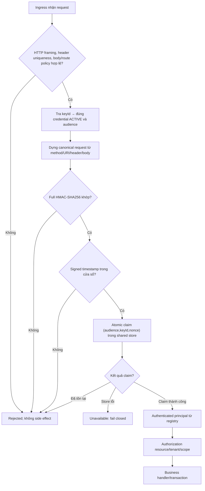

# Nonce là gì? Chống replay HTTP request đã ký bằng HMAC

Một HTTP request có **HMAC-SHA256 hợp lệ** không có nghĩa nó chỉ được gửi **một lần**. Nếu ai đó ghi lại nguyên request, gồm method, URL, header, body và signature, rồi gửi lại trước khi chữ ký hết thời hạn, phép tính HMAC trên server vẫn có thể cho kết quả đúng. Để giới hạn nguy cơ ấy, giao thức xác thực thường sử dụng **timestamp** kết hợp **nonce**.

**Nonce** viết tắt từ *number used once*: một giá trị được thiết kế để **không dùng lại trong phạm vi đã định**. Trong HMAC request authentication, client gửi nonce mới cùng mỗi request, **đưa nonce vào canonical request để ký**, còn server nhớ nonce đã chấp nhận bằng thao tác **nguyên tử**. Khi thấy lại cùng nonce trong phạm vi chống replay, server từ chối dù MAC vẫn đúng.

Bài **Nonce là gì** thuộc chương **Nonce** trong module `SECURITY_AUTHENTICATION_HMAC_REQUEST_AUTHENTICATION`. Module này hướng dẫn thiết kế xác thực HTTP bằng **HMAC với shared secret** và **canonical request** ràng buộc method, URI, signed headers hoặc body; xác minh chữ ký, chống replay bằng timestamp/nonce, quản lý key rotation, kiểm thử proxy/gateway và **phân biệt authentication với authorization**. Trọng tâm bài này là hiểu nonce đúng về mặt giao thức, sinh và lưu nonce an toàn, rồi tích hợp nó vào verifier HTTP thực tế.

## 1. Mục tiêu học tập

Sau bài học, bạn có thể:

1. Giải thích **nonce là gì**, vì sao HMAC đúng và timestamp còn mới vẫn chưa ngăn replay trong cửa sổ.
2. Phân biệt **nonce**, timestamp, idempotency key, session identifier, CSRF token, salt và IV/nonce trong mã hóa AEAD.
3. Sinh nonce client bằng **CSPRNG**, chọn phạm vi duy nhất và dạng mã hóa không nhập nhằng; hiểu xác suất trùng khi dùng nonce ngẫu nhiên 128 bit.
4. Đưa `X-Nonce` vào **canonical request đã ký** cùng method, raw URI, body digest, key ID, timestamp và audience.
5. Thiết kế **atomic claim-if-absent**, key namespace, thời hạn lưu nonce và chính sách **fail closed** khi store lỗi.
6. Viết demo Java 17 tạo nonce, ký HMAC-SHA256, xác minh, phát hiện replay, kiểm thử MAC sai, timestamp hết hạn và nonce store unavailable.
7. Xác định ranh giới với retry, key rotation, proxy/gateway, phân quyền và idempotency nghiệp vụ.

## 2. Nonce là gì và nó giải quyết vấn đề nào?

Trong ngữ cảnh request authentication, nonce là một **giá trị phân biệt request attempt**. Nó không phải là secret và cũng không phải chữ ký. API có thể yêu cầu client gửi:

```http
POST /v1/orders?channel=partner HTTP/1.1
Host: api.example.test
Content-Type: application/json
X-Key-Id: partner-a-202611
X-Timestamp: 2026-11-28T02:00:00Z
X-Nonce: Zq8DxKtUokcwPGNj3d_yvQ
X-Signature: v1=<BASE64_HMAC_SHA256>

{"sku":"BK-42","quantity":2}
```

Trong ví dụ, `Zq8DxKtUokcwPGNj3d_yvQ` là một **chuỗi Base64URL không padding biểu diễn 16 byte**. Nó chỉ là ví dụ định dạng, không phải giá trị nên hardcode hay tái sử dụng trong hệ thống thật.

Một nonce có ba yêu cầu cốt lõi:

- **Duy nhất trong phạm vi chống replay:** cùng credential/audience không được dùng lại nonce đã chấp nhận khi request cũ vẫn còn hợp lệ về thời gian.
- **Không thể bị sửa mà giữ chữ ký:** giá trị nonce phải nằm trong **canonical bytes có HMAC bảo vệ**; server tự dựng chuỗi ký từ header đã nhận.
- **Có trạng thái kiểm soát việc dùng lại:** server phải ghi nhận lần chấp nhận đầu trong **kho dùng chung có thao tác nguyên tử**. Việc client tuyên bố nonce là “mới” chưa đủ.

Ở nhiều giao thức, nonce có thể là bộ đếm đơn điệu hoặc challenge từ server. **Hợp đồng ví dụ trong bài chọn nonce ngẫu nhiên 128 bit** do client sinh bằng CSPRNG; đây là một thiết kế cụ thể, không phải định nghĩa duy nhất của nonce.

### Replay attack dù HMAC không bị phá

```mermaid
sequenceDiagram
    participant C as Client hợp lệ
    participant A as Bên phát lại request
    participant V as HMAC Verifier
    participant N as Shared nonce store
    participant B as Backend
    C->>V: POST + timestamp T + nonce N + signature S
    V->>V: Kiểm tra HMAC và timestamp
    V->>N: Atomic claim (keyId, N)
    N-->>V: Claimed
    V->>B: Chỉ tiếp tục sau authentication
    A->>V: Replay nguyên POST + T + N + S
    V->>V: MAC vẫn đúng, T vẫn trong cửa sổ
    V->>N: Atomic claim cùng (keyId, N)
    N-->>V: Already exists
    V-->>A: Từ chối replay; không thực hiện lại
```

Attacker ở đây **không cần biết shared secret** để sao chép nguyên request đã ký. Nonce không chứng minh secret; **HMAC chứng minh possession của secret và tính toàn vẹn những trường đã ký**, còn nonce store bảo đảm **tối đa một lần được chấp nhận trong phạm vi chống replay**.

**Giới hạn rất quan trọng:** nếu attacker lấy được request trước khi server nhìn thấy nó và gửi trước, attacker có thể làm lần gửi đầu được xử lý hoặc khiến request thật của client bị từ chối. Nonce không tự bảo đảm ai đến trước, không bảo đảm exactly-once delivery và không thay TLS, bảo vệ kênh hay idempotency.

## 3. So sánh nonce với các khái niệm dễ nhầm

| Khái niệm | Đặc điểm | Giải quyết gì? | Có thay nonce trong HMAC request auth không? |
| --- | --- | --- | --- |
| **Nonce request** | Giá trị mới theo từng attempt, được ký và claim một lần. | Chặn phát lại **cùng nonce** trong phạm vi policy. | Đây là cơ chế chính của bài. |
| **Timestamp request** | Thời gian client khai, được ký và kiểm tra với clock server. | Giới hạn **tuổi** request. | **Không**: replay trong cửa sổ vẫn có MAC đúng. |
| **Idempotency key** | Cùng giá trị cho **cùng ý định nghiệp vụ** qua nhiều lần retry. | Không thực thi lặp side effect như tạo hai đơn hàng. | **Không**: thường phải giữ nguyên qua retry, ngược với nonce. |
| **Session ID** | Tham chiếu phiên làm việc/danh tính. | Quản lý trạng thái phiên. | Không mang tính dùng một lần cho mỗi request. |
| **CSRF token** | Token bảo vệ hành động trên ngữ cảnh browser/cookie. | Giảm nguy cơ cross-site request forgery. | Không mặc nhiên chống replay của HMAC machine-to-machine. |
| **Salt** | Dữ liệu làm khác đầu vào cho một primitive như password hashing. | Ngăn nhiều giá trị trùng nhau dùng cùng biểu diễn/hash. | Không phải kho đánh dấu request đã dùng. |
| **IV/nonce của AEAD** | Giá trị đầu vào cho mã hóa có xác thực (AES-GCM, ChaCha20-Poly1305). | Đảm bảo tính an toàn của **phép mã hóa** theo yêu cầu thuật toán. | Khác ngữ cảnh; **reuse IV/nonce của AEAD có thể phá an toàn mã hóa**, không nhầm với nonce request. |
| **Server challenge** | Giá trị server cấp, client dùng khi ký đáp ứng. | Chứng minh freshness theo giao thức challenge-response. | Là phương án khác, nhưng đòi hỏi round-trip và quản lý challenge. |

**Quy tắc dễ nhớ:** nonce thay đổi theo **lần gửi**, idempotency key giữ nguyên theo **ý định nghiệp vụ**, timestamp gắn với **thời điểm tạo request**. Ba trường có thể cùng xuất hiện trên một request và cần hợp đồng ký rõ ràng.

### Nonce có cần giữ bí mật không?

**Không.** Nonce nằm trong HTTP header và có thể được client/server/log nhìn thấy. Nó không phải shared secret, không dùng để tra quyền. Thuộc tính quan trọng là **khó đoán trước khi được tạo, rất ít khả năng trùng và không được chấp nhận lặp** theo thiết kế V1. Giữ nonce không bí mật **không** đồng nghĩa có thể cho phép client tự khai một giá trị cũ: server vẫn phải kiểm tra store.

## 4. Sinh nonce an toàn: độ dài, entropy và biểu diễn

Với client có quyền tạo nhiều request, một phương án đơn giản là tạo **16 byte ngẫu nhiên bằng CSPRNG** (`SecureRandom` trong Java), rồi encode bằng **Base64URL không padding**:

```text
16 random bytes = 128 bit
Base64URL unpadded length = 22 ASCII characters
Ví dụ: Zq8DxKtUokcwPGNj3d_yvQ
```

Đây là độ dài và encoding **theo hợp đồng V1 minh họa**. Một hệ thống khác có thể dùng 96 bit, 192 bit hoặc counter với cơ chế đồng bộ nghiêm ngặt. Không chọn độ dài bằng cảm giác; xem số request, số credential, tỷ lệ rủi ro và policy vận hành.

### Xác suất trùng khi dùng random nonce 128 bit

Giả sử nonce thật sự đều và độc lập trong không gian `2^128` giá trị. Nếu tạo `n` nonce trong **cùng phạm vi**, xác suất xuất hiện ít nhất một cặp trùng với `n` nhỏ so với `2^64` xấp xỉ theo bài toán birthday:

\[
P(\text{collision}) \approx \frac{n(n-1)}{2^{129}}.
\]

Ví dụ với **một tỷ** nonce ngẫu nhiên độc lập (`n=10^9`), xác suất trùng xấp xỉ **1,5 × 10⁻²¹**. Đây là xác suất rất nhỏ khi generator đúng; nhưng **không được dùng xác suất ấy để bỏ nonce store**. Nonce store chặn **replay có chủ đích**, không chỉ chặn trùng do ngẫu nhiên.

Nếu client tạo nonce từ `System.currentTimeMillis()`, một bộ đếm cục bộ bị reset hoặc `new Random()` không bảo đảm tính không đoán được và tính độc lập giữa các instance. Đặc biệt, nhiều tiến trình cùng khởi động có thể dùng cùng seed/time, tạo nonce lặp. Dùng CSPRNG hoặc cơ chế counter được phân phối và đồng bộ theo thiết kế rõ ràng.

### Java 17: sinh và kiểm tra đúng format

```java
import java.security.SecureRandom;
import java.util.Base64;

public final class NonceGenerator {
    private static final SecureRandom RANDOM = new SecureRandom();

    public static String nextNonce() {
        byte[] nonce = new byte[16];
        RANDOM.nextBytes(nonce);
        return Base64.getUrlEncoder().withoutPadding()
                .encodeToString(nonce);
    }

    public static boolean validNonce(String text) {
        if (text == null || text.length() != 22) {
            return false;
        }
        try {
            byte[] decoded = Base64.getUrlDecoder().decode(text);
            return decoded.length == 16
                    && Base64.getUrlEncoder().withoutPadding()
                            .encodeToString(decoded).equals(text);
        } catch (IllegalArgumentException malformed) {
            return false;
        }
    }
}
```

Hàm `validNonce` kiểm tra **định dạng Base64URL canonical của 16 byte**, **không** kiểm tra xem chuỗi có thật sự được tạo từ nguồn ngẫu nhiên an toàn hay đã dùng chưa. Đối với bên nhận, không thể biết entropy của một nonce chỉ bằng nhìn chuỗi; server cần **claim uniqueness** và chính sách cấp credential/giám sát chất lượng client.

**Đừng trộn Base64URL của nonce với Base64 của chữ ký.** Trong V1, nonce dùng Base64URL không padding (22 ký tự), còn full HMAC-SHA256 32 byte được gửi bằng **Base64 chuẩn có padding** (44 ký tự). Hai field có hợp đồng encoding riêng.

## 5. Vì sao nonce phải được đưa vào canonical request?

Giả sử client ký:

```text
HMAC(method, URI, bodyDigest)
```

nhưng server đọc `X-Nonce` và cập nhật nonce store **ngoài dữ liệu ký**. Một bên trung gian có thể đổi nonce `N1` thành `N2` mà giữ nguyên signature. Khi đó request cũ với signature đúng có thể được phát lại bằng nonce mới cho tới khi timestamp hết hạn, làm mất ý nghĩa của nonce.

**Cách đúng:** ký chính xác **giá trị nonce đã gửi** cùng timestamp và các phần request khác.

Hợp đồng minh họa `HMAC-SHA256-V1` cho endpoint `POST /v1/orders?channel=partner`:

| Thành phần | Quy tắc V1 |
| --- | --- |
| Algorithm | HMAC-SHA256 full tag 32 byte (`HmacSHA256`). |
| Audience | Dòng cố định `orders-api-prod`; kiểm tra đúng service/môi trường. |
| Method | Chính xác `POST`, không đổi case. |
| Raw request target | `/v1/orders?channel=partner`, giữ nguyên query theo contract. |
| Content-Type | Chính xác `application/json`, chỉ một occurrence, tên được canonical lowercase. |
| Content-Encoding | **Không xuất hiện** trong V1 (không gzip/body transform). |
| Key ID | `x-key-id:partner-a-202611` dùng tra đúng credential ACTIVE. |
| Timestamp | `x-timestamp:2026-11-28T02:00:00Z`, UTC có giây, được ký. |
| **Nonce** | `x-nonce:Zq8DxKtUokcwPGNj3d_yvQ`, Base64URL 128-bit, được ký. |
| Body | `sha256:...`, hex thường của SHA-256 trên raw content bytes. |
| Canonical encoding | UTF-8, mỗi dòng ngăn bằng LF (`\n`), không có LF cuối. |
| Signature header | `X-Signature: v1=<Base64 chuẩn có padding của 32 byte HMAC>`. |

Canonical string:

```text
HMAC-SHA256-V1
orders-api-prod
POST
/v1/orders?channel=partner
content-type:application/json
x-key-id:partner-a-202611
x-timestamp:2026-11-28T02:00:00Z
x-nonce:Zq8DxKtUokcwPGNj3d_yvQ
sha256:<LOWERCASE_HEX_SHA256_RAW_BODY>
```

`<...>` là **placeholder**, không phải digest hoặc signature thật. Định nghĩa phép ký:

\[
\begin{aligned}
d &= \operatorname{SHA256}(\mathrm{rawBodyBytes}),\\
C &= \operatorname{UTF8}(\mathrm{canonicalRequest\ chứa\ hex}(d)),\\
t &= \operatorname{HMAC}_{\mathrm{SHA256}}(K,C),\\
S &= \texttt{v1=} \parallel \operatorname{Base64}_{\mathrm{standard,padded}}(t).
\end{aligned}
\]

Bên nhận phải **tự dựng** `C` từ HTTP request thực nhận. Không lấy `X-Canonical-Request` hoặc `X-Original-URI` do client tự khai rồi tin là dữ liệu canonical đáng tin. Việc đổi **nonce**, timestamp, method, target, signed header value hay body bytes mà vẫn giữ signature cũ phải bị từ chối vì MAC không còn khớp.

### Chữ ký MAC đúng chưa đủ để claim nonce?

Đúng: **phải kiểm tra policy quanh MAC**. Request có chữ ký đúng nhưng timestamp đã hết hạn phải bị từ chối. Request có chữ ký đúng và timestamp fresh nhưng nonce đã dùng cũng bị từ chối. Request có chữ ký đúng, fresh, nonce mới nhưng key đã bị revoke hoặc sai audience không được authenticated.

## 6. Luồng xác minh nonce an toàn và thứ tự các bước



Giải thích quyết định ở từng bước:

1. **HTTP ingress** giới hạn kích thước, chặn header security trùng (kể cả khác case), request smuggling và path ambiguity; lấy đúng body bytes và target tin cậy.
2. **Credential lookup** chọn **một** shared secret theo key ID được client khai. Key ID chưa là principal trước khi MAC khớp.
3. **Canonicalization** ràng buộc nonce với timestamp và toàn request; verify full HMAC tag sau khi decode Base64 strict.
4. **Freshness check** so timestamp đã ký với `now` của server, ví dụ cửa sổ ±300 giây.
5. **Nonce claim nguyên tử** đánh dấu `(audience,keyId,nonce)` chưa từng dùng trong phạm vi hợp đồng. Bước này phải nằm **sau MAC đúng** để người ngoài không thể chiếm nonce bằng request không biết secret.
6. **Result** chỉ được trở thành `Authenticated` nếu nonce mới và được claim thành công. **Replay** là rejected; **store outage** là unavailable và phải fail closed.
7. **Authorization** tiếp tục kiểm tra principal có quyền trên method, tenant/resource và field hay không. Nonce không cấp quyền.

**Không thực hiện thao tác nghiệp vụ trước nonce claim.** Nếu backend đã ghi DB hoặc phát event rồi verifier mới phát hiện replay, kiểm soát chống replay đến quá muộn.

### Thời điểm một nonce được xem là “đã dùng”

Trong mô hình này, nonce được coi là dùng **khi verification vượt MAC/freshness và claim store thành công**, không phải khi request trả HTTP 2xx. Nếu authorization sau đó trả `403` hoặc business validation trả `422`, nonce **vẫn đã được dùng**. Không “trả lại nonce” để gửi lại nguyên signature vì điều này có thể mở ra replay và race. Muốn sửa request, client tạo timestamp/nonce mới rồi ký lại.

## 7. Chọn phạm vi nonce key và chống trùng giữa credential

Kho nonce phải biết **một giá trị nonce thuộc phạm vi nào**. Một thiết kế phổ biến khi key ID không bao giờ tái sử dụng:

```text
replay:v1:<audience>:<keyId>:<nonce>
```

Ví dụ:

```text
replay:v1:orders-api-prod:partner-a-202611:Zq8DxKtUokcwPGNj3d_yvQ
```

| Thành phần | Vai trò |
| --- | --- |
| `replay:v1` | Namespace cho cơ chế chống replay và phiên bản lưu trữ. |
| `audience` | Phân tách dịch vụ/môi trường, tránh dùng nhầm nonce ở nhiều ứng dụng. |
| `keyId` | Phân tách từng credential; cần gắn với registry và không tái sử dụng ID sai chính sách. |
| `nonce` | Giá trị dùng một lần do client sinh, đã được ký. |

**Không đưa timestamp vào replay key trong V1**. Nếu key là `(keyId,timestamp,nonce)`, client có thể ký một request **mới với timestamp khác nhưng cùng nonce**; store sẽ coi hai key khác nhau và bỏ qua chính sách “nonce không tái sử dụng trong một credential”. Việc timestamp khác tạo signature khác là bình thường, nhưng **nonce vẫn phải mới cho mỗi attempt**.

Có trường hợp ứng dụng muốn scope nonce theo **client principal** thay vì key ID để chặn dùng lại khi rotation. Điều đó phải được đặc tả, vì hai credential ACTIVE của cùng client có thể cùng tồn tại; lưu theo client ID giảm khả năng trùng giữa key A/B nhưng tăng yêu cầu đồng bộ giữa các credential. Quan trọng là **client và server hiểu giống nhau**, registry định danh đúng principal và kho nonce áp dụng một key namespace bền vững.

### Credential rotation ảnh hưởng replay key ra sao?

Trong thời gian rotation, `partner-a-202611` và `partner-a-202702` có thể cùng ACTIVE. Cùng raw nonce được gửi dưới hai key ID khác nhau có thể tạo hai replay key theo chính sách per-key. HMAC vẫn phải đúng dưới **secret tương ứng từng key**. Nếu threat model yêu cầu chống trùng xuyên các key của cùng client, dùng scope theo authenticated `clientId`/audience thay vì `keyId` hoặc bổ sung ràng buộc nghiệp vụ. Không mặc nhiên giả định per-key nonce store ngăn mọi lặp nghiệp vụ xuyên rotation.

## 8. Nonce store: claim-if-absent phải nguyên tử

Một thiết kế sai phổ biến:

```java
// KHÔNG an toàn khi nhiều thread/node cùng xử lý:
if (!store.contains(nonceKey)) {
    store.put(nonceKey, expiresAt);
    processBusinessRequest(); // Hai node có thể cùng chạy.
}
```

Hai verifier có thể **đồng thời** thấy key chưa tồn tại rồi đều xử lý nghiệp vụ. Đây là lỗi *check-then-act race*, không phải lỗi của HMAC.

### Phương án production bằng Redis (mang tính kiến trúc)

Khi request đã qua MAC và freshness, ứng dụng có thể dùng một thao tác Redis **`SET key value NX PX ttlMillis`** để chỉ một bên thắng:

```text
SET replay:v1:orders-api-prod:partner-a-202611:<nonce>
    used NX PX <milliseconds-until-safe-expiry>
```

Cú pháp trên được xuống dòng để dễ đọc, không phải một câu lệnh Redis CLI có thể paste nguyên văn. Ý nghĩa:

- **`NX`**: chỉ ghi nếu key chưa tồn tại.
- **`PX`**: đặt thời gian hết hạn theo mili-giây.
- Trả thành công: nonce được claim, request có thể đi tiếp tới authorization.
- Key đã tồn tại: replay, từ chối.
- Network/Redis lỗi hoặc kết quả không xác định: **fail closed**, không suy luận nonce chắc chắn mới.

Cần cẩn trọng với eviction, failover, consistency và persistence: một key được báo đã lưu nhưng bị mất trước khi request hết hiệu lực có thể mở lại cửa sổ replay. Tùy yêu cầu bảo mật, có thể dùng **database unique constraint**, Redis có cấu hình persistence/replication phù hợp hoặc kho trạng thái mạnh hơn. Không chọn cơ chế có thể silently evict nonce vì memory pressure rồi vẫn khẳng định bảo đảm at-most-once.

### SQL unique constraint là phương án khác

Ví dụ bảng có unique key trên `(audience, key_id, nonce)` và expiry:

```sql
CREATE TABLE accepted_request_nonces (
    audience       VARCHAR(100) NOT NULL,
    key_id         VARCHAR(100) NOT NULL,
    nonce          VARCHAR(128) NOT NULL,
    expires_at     TIMESTAMP NOT NULL,
    PRIMARY KEY (audience, key_id, nonce)
);
```

Chỉ **một INSERT** theo key được thành công; insert trùng bị unique constraint từ chối. Cleanup expired entries cần được thiết kế an toàn: không xóa trước khi timestamp còn có thể nằm trong cửa sổ. Nếu throughput lớn, cần đánh giá chi phí storage, partition và batch cleanup. Đây là mô hình, không phải schema production hoàn chỉnh cho mọi DB.

## 9. Nonce TTL phải dài hơn thời gian còn replay được

Một câu hỏi quan trọng: **kho nonce cần nhớ một giá trị trong bao lâu?** Không phải cứ chọn TTL 5 phút vì cửa sổ timestamp “±5 phút”.

Giả sử verifier cho phép:

\[
\mathrm{now}-P \leq \mathrm{signedTimestamp}
\leq \mathrm{now}+F
\]

Với `P` = allowedPast = 300 giây, `F` = allowedFuture = 300 giây. Một request có timestamp `T` có thể được chấp nhận từ `T-F` đến `T+P` (nếu bỏ qua các điều kiện khác). Do đó **sau khi claim nonce**, cần giữ nó ít nhất đến:

\[
\mathrm{expiresAt}=T+P+\mathrm{safetyMargin}.
\]

### Ví dụ có số giờ cụ thể

```text
Timestamp T được ký:         2026-11-28T02:05:30Z
Server nhận sớm nhất:        2026-11-28T02:00:30Z  (T - 300s)
Server còn chấp nhận cuối:   2026-11-28T02:10:30Z  (T + 300s)
Nonce phải tồn tại ít nhất:  đến sau 02:10:30Z (+ margin)
```

Khoảng từ lần nhận sớm nhất đến lúc hết hiệu lực là **600 giây**, chưa kể biên an toàn. Nếu nonce store đặt TTL **300 giây kể từ lần nhận đầu** thì key có thể bị xóa lúc `02:05:30Z`, trong khi request còn fresh thêm 300 giây — attacker có cơ hội phát lại.

**Cách tính tại điểm claim:**

```text
expiry = signedTimestamp + allowedPast + safetyMargin
ttl    = expiry - serverNow
```

Đối với Redis `PX`, đổi khoảng thời gian này sang mili-giây với xử lý overflow/làm tròn phù hợp. TTL phải **dương** tại lúc claim; nếu timestamp ngoài freshness window thì đã bị từ chối trước đó. Nếu yêu cầu security level cao hoặc hạ tầng có clock skew/replication delay, cộng margin đủ bảo thủ và giám sát TTL thực tế.

### Vì sao TTL không lấy từ nonce?

Nonce là chuỗi ngẫu nhiên, không mang thời gian theo định nghĩa V1. Không parse nonce ra timestamp, không coi nonce tăng dần hoặc có prefix ngày giờ. **Timestamp và nonce là hai field riêng**, cùng được HMAC ký, nhưng có nhiệm vụ khác nhau.

## 10. Java 17: demo tự chứa từ sinh nonce tới từ chối replay

Ví dụ sau dùng **Java 17** thuần JDK, không yêu cầu framework. Nó minh họa một hợp đồng `HMAC-SHA256-V1` cụ thể:

- Endpoint `POST /v1/orders?channel=partner`, raw body UTF-8 JSON; Content-Type chính xác `application/json`.
- Nonce **16 byte** ngẫu nhiên từ `SecureRandom`, Base64URL **22 ký tự không padding**.
- Timestamp UTC chuẩn có giây, được ký và kiểm tra **±300 giây** bằng `Clock`.
- MAC HMAC-SHA256 **32 byte** và signature `v1=` + Base64 chuẩn có padding (47 ký tự cả prefix).
- `NonceStore.claimIfAbsent` dùng `synchronized` ở **một JVM demo**; production cần shared store với atomic insert.
- Một kết quả `AUTHENTICATED` chỉ có sau khi MAC, freshness và nonce claim cùng thành công.

**Lưu ý:** Class này học về nonce/replay, không phải HTTP security filter production. Những điều kiện như duplicate HTTP headers, parse framing, request-target ở gateway, registry/secret manager phân tán và phân quyền vẫn cần tích hợp ở các lớp tương ứng.

```java
import java.nio.charset.StandardCharsets;
import java.security.GeneralSecurityException;
import java.security.MessageDigest;
import java.security.SecureRandom;
import java.time.Clock;
import java.time.Instant;
import java.time.ZoneOffset;
import java.time.temporal.ChronoUnit;
import java.time.format.DateTimeParseException;
import java.util.Arrays;
import java.util.Base64;
import java.util.HashMap;
import java.util.HexFormat;
import java.util.Map;
import java.util.Set;
import javax.crypto.Mac;
import javax.crypto.spec.SecretKeySpec;

public final class NonceHmacV1Demo {
    private static final String VERSION = "HMAC-SHA256-V1";
    private static final String AUDIENCE = "orders-api-prod";
    private static final String TARGET = "/v1/orders?channel=partner";
    private static final String TYPE = "application/json";
    private static final String PREFIX = "v1=";
    private static final long PAST_WINDOW_SECONDS = 300;
    private static final long FUTURE_WINDOW_SECONDS = 300;
    private static final long SAFETY_MARGIN_SECONDS = 30;

    private NonceHmacV1Demo() {}

    public enum Decision {
        AUTHENTICATED, BAD_REQUEST, INVALID_CREDENTIAL,
        INVALID_SIGNATURE, EXPIRED, TOO_EARLY,
        NONCE_REPLAY, UNAVAILABLE
    }

    public record AuthResult(Decision decision, String clientId) {
        public static AuthResult reject(Decision code) {
            return new AuthResult(code, null);
        }
        public static AuthResult accept(String clientId) {
            return new AuthResult(Decision.AUTHENTICATED, clientId);
        }
    }

    public record Credential(
            String keyId, String clientId, String audience,
            boolean active, byte[] secret, Set<String> scopes) {
        public Credential {
            secret = secret.clone();
            scopes = Set.copyOf(scopes);
        }
        @Override
        public byte[] secret() {
            return secret.clone();
        }
    }

    public record SignedRequest(
            String method, String rawTarget, String contentType,
            boolean contentEncodingPresent, String keyId,
            String timestamp, String nonce, byte[] body,
            String signature) {
        public SignedRequest {
            if (body != null) {
                body = body.clone();
            }
        }
        @Override
        public byte[] body() {
            return body == null ? null : body.clone();
        }
    }

    public static final class StoreUnavailableException extends Exception {
        public StoreUnavailableException(String message) {
            super(message);
        }
    }

    public interface NonceStore {
        boolean claimIfAbsent(
                String key, Instant expiresAt, Instant now)
                throws StoreUnavailableException;
    }

    /** Kho demo: atomic trong một JVM, không chia sẻ giữa các node. */
    public static final class LocalNonceStore implements NonceStore {
        private final Map<String, Instant> accepted = new HashMap<>();

        @Override
        public synchronized boolean claimIfAbsent(
                String key, Instant expiresAt, Instant now) {
            if (!expiresAt.isAfter(now)) {
                return false;
            }
            accepted.entrySet().removeIf(
                    e -> !e.getValue().isAfter(now));
            if (accepted.containsKey(key)) {
                return false;
            }
            accepted.put(key, expiresAt);
            return true;
        }

        public synchronized int size() {
            return accepted.size();
        }
    }

    public static String newNonce(SecureRandom random) {
        byte[] nonceBytes = new byte[16];
        random.nextBytes(nonceBytes);
        return Base64.getUrlEncoder().withoutPadding()
                .encodeToString(nonceBytes);
    }

    public static boolean validNonce(String text) {
        if (text == null || text.length() != 22) {
            return false;
        }
        try {
            byte[] decoded = Base64.getUrlDecoder().decode(text);
            return decoded.length == 16
                    && Base64.getUrlEncoder().withoutPadding()
                            .encodeToString(decoded).equals(text);
        } catch (IllegalArgumentException malformed) {
            return false;
        }
    }

    private static Instant strictTimestamp(String text) {
        if (text == null || !text.matches(
                "[0-9]{4}-[0-9]{2}-[0-9]{2}T"
                + "[0-9]{2}:[0-9]{2}:[0-9]{2}Z")) {
            throw new IllegalArgumentException("Bad timestamp format");
        }
        try {
            Instant parsed = Instant.parse(text);
            if (!parsed.truncatedTo(ChronoUnit.SECONDS)
                    .toString().equals(text)) {
                throw new IllegalArgumentException("Noncanonical timestamp");
            }
            return parsed;
        } catch (DateTimeParseException invalid) {
            throw new IllegalArgumentException("Bad timestamp value", invalid);
        }
    }

    private static boolean validShape(SignedRequest req) {
        if (req == null
                || !"POST".equals(req.method())
                || !TARGET.equals(req.rawTarget())
                || !TYPE.equals(req.contentType())
                || req.contentEncodingPresent()
                || req.keyId() == null
                || !req.keyId().matches("[A-Za-z0-9_-]{1,80}")
                || !validNonce(req.nonce())
                || req.body() == null || req.body().length > 8192) {
            return false;
        }
        try {
            strictTimestamp(req.timestamp());
            return true;
        } catch (IllegalArgumentException badTimestamp) {
            return false;
        }
    }

    private static byte[] canonicalBytes(SignedRequest req)
            throws GeneralSecurityException {
        String bodyHash = HexFormat.of().formatHex(
                MessageDigest.getInstance("SHA-256").digest(req.body()));
        String canonical = String.join("\n",
                VERSION, AUDIENCE, req.method(), req.rawTarget(),
                "content-type:" + req.contentType(),
                "x-key-id:" + req.keyId(),
                "x-timestamp:" + req.timestamp(),
                "x-nonce:" + req.nonce(),
                "sha256:" + bodyHash);
        return canonical.getBytes(StandardCharsets.UTF_8);
    }

    private static byte[] hmac(byte[] key, byte[] message)
            throws GeneralSecurityException {
        // Policy provisioning của demo: >=32 byte secret ngẫu nhiên.
        if (key == null || key.length < 32) {
            throw new GeneralSecurityException("Invalid key policy");
        }
        Mac mac = Mac.getInstance("HmacSHA256");
        mac.init(new SecretKeySpec(key, "HmacSHA256"));
        return mac.doFinal(message);
    }

    private static byte[] decodeSignature(String text) {
        if (text == null || text.length() != 47
                || !text.startsWith(PREFIX)) {
            return null;
        }
        String b64 = text.substring(PREFIX.length());
        if (!b64.matches("[A-Za-z0-9+/]{43}=")) {
            return null;
        }
        try {
            byte[] bytes = Base64.getDecoder().decode(b64);
            return bytes.length == 32
                    && Base64.getEncoder().encodeToString(bytes).equals(b64)
                    ? bytes : null;
        } catch (IllegalArgumentException malformed) {
            return null;
        }
    }

    public static AuthResult authenticate(
            SignedRequest req, Map<String, Credential> registry,
            NonceStore store, Clock clock) {
        if (!validShape(req)) {
            return AuthResult.reject(Decision.BAD_REQUEST);
        }
        Credential credential = registry.get(req.keyId());
        if (credential == null || !credential.active()
                || !AUDIENCE.equals(credential.audience())
                || !req.keyId().equals(credential.keyId())) {
            return AuthResult.reject(Decision.INVALID_CREDENTIAL);
        }

        byte[] supplied = decodeSignature(req.signature());
        if (supplied == null) {
            return AuthResult.reject(Decision.INVALID_SIGNATURE);
        }
        try {
            byte[] expected = hmac(
                    credential.secret(), canonicalBytes(req));
            if (!MessageDigest.isEqual(expected, supplied)) {
                // Không chạm vào nonce store nếu MAC không hợp lệ.
                return AuthResult.reject(Decision.INVALID_SIGNATURE);
            }
        } catch (GeneralSecurityException providerFailure) {
            return AuthResult.reject(Decision.UNAVAILABLE);
        }

        Instant now = clock.instant();
        Instant signedTime = strictTimestamp(req.timestamp());
        if (signedTime.isBefore(now.minusSeconds(PAST_WINDOW_SECONDS))) {
            return AuthResult.reject(Decision.EXPIRED);
        }
        if (signedTime.isAfter(now.plusSeconds(FUTURE_WINDOW_SECONDS))) {
            return AuthResult.reject(Decision.TOO_EARLY);
        }

        // Không đưa timestamp vào key: cùng nonce dưới credential
        // đã dùng thì vẫn bị từ chối kể cả client ký timestamp mới.
        String nonceKey = "replay:v1:" + AUDIENCE + ":"
                + req.keyId() + ":" + req.nonce();
        Instant expiresAt = signedTime.plusSeconds(
                PAST_WINDOW_SECONDS + SAFETY_MARGIN_SECONDS);

        try {
            if (!store.claimIfAbsent(nonceKey, expiresAt, now)) {
                return AuthResult.reject(Decision.NONCE_REPLAY);
            }
        } catch (StoreUnavailableException unavailable) {
            return AuthResult.reject(Decision.UNAVAILABLE);
        }
        // Chỉ đến đây mới publish principal từ registry đáng tin.
        return AuthResult.accept(credential.clientId());
    }

    public static SignedRequest signForTest(
            Credential credential, String timestamp,
            String nonce, byte[] body) throws GeneralSecurityException {
        SignedRequest unsigned = new SignedRequest(
                "POST", TARGET, TYPE, false,
                credential.keyId(), timestamp, nonce, body, null);
        if (!validShape(unsigned)) {
            throw new IllegalArgumentException("Invalid outgoing request");
        }
        byte[] tag = hmac(credential.secret(), canonicalBytes(unsigned));
        String signature = PREFIX
                + Base64.getEncoder().encodeToString(tag);
        return new SignedRequest(
                unsigned.method(), unsigned.rawTarget(),
                unsigned.contentType(), false,
                unsigned.keyId(), timestamp, nonce, body, signature);
    }

    private static void check(
            Decision expected, AuthResult actual) {
        if (actual.decision() != expected) {
            throw new AssertionError("Expected " + expected
                    + " but got " + actual.decision());
        }
        if (expected != Decision.AUTHENTICATED
                && actual.clientId() != null) {
            throw new AssertionError("Principal leaked on rejection");
        }
    }

    public static void main(String[] args) throws Exception {
        byte[] secret = new byte[32]; // Chỉ dùng làm secret giả trong test.
        Arrays.fill(secret, (byte) 0x58);
        Credential credential = new Credential(
                "partner-a-202611", "partner-a", AUDIENCE,
                true, secret, Set.of("orders:read"));
        Map<String, Credential> registry =
                Map.of(credential.keyId(), credential);
        Clock fixed = Clock.fixed(
                Instant.parse("2026-11-28T02:00:30Z"), ZoneOffset.UTC);
        SecureRandom random = new SecureRandom();
        byte[] body = "{\"sku\":\"BK-42\",\"quantity\":2}"
                .getBytes(StandardCharsets.UTF_8);

        String nonce = newNonce(random);
        if (!validNonce(nonce)) {
            throw new AssertionError("CSPRNG nonce has wrong encoding");
        }
        SignedRequest firstRequest = signForTest(
                credential, "2026-11-28T02:00:00Z", nonce, body);
        LocalNonceStore store = new LocalNonceStore();

        AuthResult first = authenticate(
                firstRequest, registry, store, fixed);
        check(Decision.AUTHENTICATED, first);
        if (!"partner-a".equals(first.clientId())) {
            throw new AssertionError("Wrong principal");
        }

        // Replay nguyên request: HMAC đúng nhưng nonce đã được claim.
        check(Decision.NONCE_REPLAY, authenticate(
                firstRequest, registry, store, fixed));

        // Ký lại với timestamp mới mà tái dùng nonce: vẫn replay.
        SignedRequest reusedNonce = signForTest(
                credential, "2026-11-28T02:00:10Z", nonce, body);
        check(Decision.NONCE_REPLAY, authenticate(
                reusedNonce, registry, store, fixed));

        // Giữ chữ ký cũ, chỉ sửa nonce: MAC phải sai.
        SignedRequest forgedNonce = new SignedRequest(
                firstRequest.method(), firstRequest.rawTarget(),
                firstRequest.contentType(), false, firstRequest.keyId(),
                firstRequest.timestamp(), newNonce(random),
                firstRequest.body(), firstRequest.signature());
        int usedBefore = store.size();
        check(Decision.INVALID_SIGNATURE, authenticate(
                forgedNonce, registry, store, fixed));
        if (usedBefore != store.size()) {
            throw new AssertionError("Bad MAC consumed a nonce");
        }

        // Nonce mới, chữ ký mới: request mới xác thực độc lập.
        SignedRequest secondRequest = signForTest(
                credential, "2026-11-28T02:00:20Z",
                newNonce(random), body);
        check(Decision.AUTHENTICATED, authenticate(
                secondRequest, registry, store, fixed));

        // Timestamp cũ quá 300 giây, dù MAC hợp lệ.
        SignedRequest expired = signForTest(
                credential, "2026-11-28T01:55:29Z",
                newNonce(random), body);
        check(Decision.EXPIRED, authenticate(
                expired, registry, store, fixed));

        // Store lỗi: fail closed, không publish principal.
        NonceStore unavailable = (key, expiry, now) -> {
            throw new StoreUnavailableException("test outage");
        };
        SignedRequest fresh = signForTest(
                credential, "2026-11-28T02:00:00Z",
                newNonce(random), body);
        check(Decision.UNAVAILABLE, authenticate(
                fresh, registry, unavailable, fixed));

        // Authentication thành công không tự cấp quyền orders:create.
        if (credential.scopes().contains("orders:create")) {
            throw new AssertionError("Unexpected create permission");
        }
        System.out.println(
                "Nonce signing, replay and store-failure tests passed.");
    }
}
```

### Giải thích những điểm dễ sai

- **`newNonce`** dùng `SecureRandom.nextBytes` tạo 16 byte mới rồi encode Base64URL; không dựa vào timestamp hoặc `Math.random()`.
- **`validNonce`** buộc chuỗi có đúng dạng 22 ký tự canonical. Nó không kiểm tra freshness hoặc lịch sử dùng nonce.
- **`canonicalBytes`** đưa nonce và timestamp vào MAC, cùng method, raw target, content type và body digest. Server dựng lại dữ liệu ký từ request đã nhận.
- **`authenticate`** so raw MAC 32 byte bằng `MessageDigest.isEqual` rồi mới kiểm tra timestamp và gọi nonce store. Request có MAC sai không tiêu hao nonce.
- **`LocalNonceStore`** dùng `synchronized` để ngăn race giữa thread **trong cùng JVM demo**; đó **không phải** giải pháp production nhiều gateway.
- **`expiresAt`** dựa vào signed timestamp + allowed past window + margin. Với request timestamp ở tương lai sát biên, entry phải sống lâu hơn 5 phút từ lúc claim.
- **`AuthResult`** không có principal trong các nhánh `BAD_REQUEST`, `INVALID_SIGNATURE`, `NONCE_REPLAY` và `UNAVAILABLE`.
- Demo chứng minh **nonce cũ vẫn bị từ chối ngay cả khi timestamp được cập nhật và signature được ký lại**. Điều này phụ thuộc vào việc replay key không bao gồm timestamp.
- Scope `orders:read` cho thấy **HMAC + nonce thành công chưa phải quyền tạo đơn**; authorization cần kiểm tra riêng.

**Giới hạn:** Mẫu chưa kết nối Servlet/Spring/Gateway thực, chưa bắt duplicate header, chưa triển khai secret manager, TLS, credential expiry, rate limiting, distributed nonce store, idempotency hoặc DB transaction. Mã Java có thể được biên dịch để học với JDK 17, nhưng không nên gắn trực tiếp vào endpoint Internet mà không có các lớp bảo vệ đó.

## 11. Client gửi nonce qua Java HttpClient

Một client thật cần tạo **một context bất biến cho mỗi HTTP attempt**: method/URI, raw body bytes, key ID/secret, timestamp, nonce và signed headers. Chữ ký và request được gửi phải sử dụng **cùng những giá trị ấy**.

Ví dụ tích hợp Java 17:

```java
// Đây là mảnh tích hợp, không phải class độc lập.
// uri, secret, keyId, orderData, jsonSerializer đã được chuẩn bị
// đúng policy, và signer tạo signature từ chính bytes này.
byte[] body = jsonSerializer.writeValueAsBytes(orderData);
String timestamp = java.time.Instant.now(java.time.Clock.systemUTC())
        .truncatedTo(java.time.temporal.ChronoUnit.SECONDS)
        .toString();
byte[] nonceBytes = new byte[16];
new java.security.SecureRandom().nextBytes(nonceBytes);
String nonce = java.util.Base64.getUrlEncoder().withoutPadding()
        .encodeToString(nonceBytes);

String signature = signer.sign(
        "POST", uri, "application/json",
        keyId, timestamp, nonce, body, secret);

java.net.http.HttpRequest request =
        java.net.http.HttpRequest.newBuilder(uri)
        .header("Content-Type", "application/json")
        .header("X-Key-Id", keyId)
        .header("X-Timestamp", timestamp)
        .header("X-Nonce", nonce)
        .header("X-Signature", signature)
        .POST(java.net.http.HttpRequest.BodyPublishers.ofByteArray(body))
        .build();
```

`signer` trong mảnh tích hợp là một thành phần giả định triển khai **đúng hợp đồng V1**; không có hàm `signer.sign` chuẩn của JDK. Điều quan trọng là việc sinh nonce và tính chữ ký xảy ra **trước gửi**, body được serialize **một lần**, URI không bị đổi sau ký và client dùng HTTPS ở production.

### Vì sao không nên phát lại cùng một `HttpRequest`?

Nếu lần gửi đầu bị timeout, một số ứng dụng gọi lại `client.send(request, ...)` với **cùng đối tượng**. Điều này có thể gửi lại **cùng timestamp, nonce và signature**, khiến server từ chối replay — hoặc tệ hơn, nếu server chưa từng claim, request có thể được xử lý trong khi client vẫn không biết outcome cũ. Retry có kiểm soát cần **tạo attempt mới**, nonce/timestamp/signature mới, đồng thời có **idempotency** hoặc status lookup để tránh side effect lặp.

## 12. Nonce, retry và idempotency: ba nhiệm vụ khác nhau

| Câu hỏi | Nonce | Timestamp | Idempotency key |
| --- | --- | --- | --- |
| Request có còn mới về thời gian không? | Không tự trả lời. | **Có**. | Không. |
| Request đã dùng nonce này trong window chưa? | **Có**, khi server claim nguyên tử. | Không. | Không mặc nhiên. |
| Retry một POST có tạo hai đơn không? | **Không bảo đảm**; nonce mới làm request mới hợp lệ. | Không bảo đảm. | **Có thể ngăn lặp** nếu backend thực thi đúng cơ chế dedupe. |
| Giá trị khi client retry cùng nghiệp vụ? | **Phải mới**. | **Mới**, gần thời điểm gửi. | **Giữ nguyên** cho cùng ý định nghiệp vụ. |
| Có cần được HMAC ký? | **Có**. | **Có**. | **Có, nếu ảnh hưởng xử lý**. |

Giả sử client gửi `POST /orders` tạo đơn, server đã commit DB nhưng response thất lạc. Client gửi một request mới với nonce mới và HMAC mới. Server sẽ xem đây là một attempt xác thực **mới**, có thể tạo thêm đơn nếu không có idempotency key. Đây không phải lỗi của nonce; nonce đang làm đúng nhiệm vụ **chặn phát lại cùng một request đã ký**.

Một protocol hỗ trợ `Idempotency-Key` cần ký header này và ràng buộc với **authenticated principal + method + target + fingerprint body**. Server xử lý đồng thời các retry cùng key bằng transaction hoặc cơ chế deduplication phù hợp. Nonce và idempotency key **không thể dùng thay nhau**.

### Nếu nonce bị trùng ngẫu nhiên?

Nếu client tạo một nonce mới nhưng tình cờ trùng với nonce đã được chấp nhận trong cùng phạm vi, server từ chối như replay vì không thể phân biệt trùng ngẫu nhiên với replay thật. Với CSPRNG 128 bit, xác suất trùng cực thấp. Client cần tạo request mới (timestamp/nonce/signature mới) theo policy và chú ý idempotency nếu thao tác có side effect.

## 13. Nonce và key rotation

Một client có thể có hai credential ACTIVE trong giai đoạn rotation:

| Key ID | Principal | Secret | Trạng thái |
| --- | --- | --- | --- |
| `partner-a-202611` | `partner-a` | Secret A | ACTIVE trong overlap. |
| `partner-a-202702` | `partner-a` | Secret B độc lập | ACTIVE mới. |
| `partner-a-202608` | `partner-a` | Secret đã thu hồi | REVOKED. |

Khi request khai `X-Key-Id: partner-a-202702`, verifier chỉ lấy **secret B** của key đó; không thử A rồi B để tìm khóa khớp. Key ID nằm trong canonical request được ký, nên attacker không thể chỉ thay ID để dùng lại MAC cũ.

Với thiết kế replay key theo `(audience,keyId,nonce)`, cùng nonce dưới hai key khác nhau có thể không bị xem là replay theo **per-key scope**. Đây là quyết định protocol, không phải bảo đảm ngăn mọi nghiệp vụ lặp. Nếu application muốn uniqueness trên cùng `clientId` xuyên key rotation, nên scope replay key ở principal đã xác thực hoặc kết hợp idempotency và business rules. Tuyệt đối không tạo principal từ `X-Key-Id` **trước khi HMAC đúng**.

**Khi credential bị thu hồi:** request với key REVOKED phải bị từ chối dù nonce mới và timestamp fresh. Ngược lại, một nonce chưa từng dùng **không** làm credential cũ hợp lệ trở lại. Key rotation, freshness và replay là ba lớp kiểm soát độc lập.

## 14. Gateway/proxy: ranh giới tin cậy và các lỗi nonce

| Tình huống | Hệ quả | Cách xử lý |
| --- | --- | --- |
| Gateway và backend có **hai nonce store riêng**. | Cùng request có thể được chấp nhận ở hai nơi. | Quy định **một điểm sở hữu claim** hoặc shared store và hợp đồng phối hợp rõ. |
| Hai gateway cùng nhận request có chung nonce. | Race nếu kiểm tra `contains` rồi `put`. | Atomic `SET NX`/unique constraint trong kho dùng chung. |
| Gateway claim nonce trước khi verify MAC. | Attacker không biết secret có thể chiếm nonce hoặc gây áp lực store. | Verify full MAC và freshness trước claim; rate limit ingress. |
| Proxy sửa `X-Nonce` hoặc `X-Timestamp`. | MAC mismatch vì đều được ký. | Không rewrite signed values; kiểm thử trên deployment thật. |
| Proxy gộp hai `X-Nonce` khác case. | Verifier/backend có thể chọn first/last. | Từ chối duplicate security headers ở ingress. |
| HTTP/1.1 → HTTP/2 đổi **tên** `X-Nonce` thành `x-nonce`. | Tên field cùng nghĩa; không nên đổi MAC. | Canonical lowercase header **name**, giữ nguyên **value**. |
| Middleware giải nén hoặc reserialize body. | Body digest khác; MAC mismatch. | Hash đúng raw content bytes và content coding policy. |
| Gateway rewrite raw URI/route. | HMAC ký một target, backend xử lý target khác. | Verify ở edge trước rewrite hoặc truyền metadata đã xác thực qua kênh bảo vệ. |
| Client tự gửi `X-Authenticated-Client`. | Backend có thể nhầm header giả thành principal. | Gateway xóa spoofed headers và truyền trusted context qua mTLS/assertion. |
| Nonce store failover làm mất key chưa hết TTL. | Request cũ có thể được claim lại. | Chọn consistency/persistence phù hợp threat model; giám sát failover. |

**Không dùng `X-Original-URI`/`X-Forwarded-*` do client tự khai làm canonical source** để “chữa” signature mismatch. Nếu có rewrite nội bộ, gateway phải xác thực ở điểm tin cậy rồi bảo đảm resource và principal được backend sử dụng tương ứng với request đã ký.

## 15. Kết quả xác thực, HTTP status và logging

Khi nonce không hợp lệ hoặc replay, hệ thống cần phân biệt **kết quả nội bộ** với **phản hồi bên ngoài**.

| Điều kiện | Kết quả nội bộ gợi ý | HTTP response thường phù hợp |
| --- | --- | --- |
| Nonce thiếu, sai Base64URL, sai độ dài | `BAD_REQUEST` / `NONCE_FORMAT_INVALID` | `400` hoặc `401` theo API contract. |
| HMAC sai do attacker sửa nonce | `INVALID_SIGNATURE` | `401 Unauthorized`; không claim nonce. |
| Timestamp đã hết hạn | `EXPIRED_REQUEST` | Thường lỗi authentication; không claim nonce. |
| HMAC đúng, timestamp fresh, nonce đã claim | `NONCE_REPLAY` | Từ chối; thường `401` hoặc mã riêng của API. |
| Nonce store lỗi, không xác định claim thành công | `UNAVAILABLE` | **5xx**, fail closed và cảnh báo vận hành. |
| Credential revoked hoặc key ID không hợp lệ | `INVALID_CREDENTIAL` | Từ chối authentication. |
| Authentication đúng nhưng client thiếu quyền resource | **Authorization failure** | Thường **403 Forbidden**, không phải replay. |
| Authenticated/authorized nhưng JSON nghiệp vụ sai | Business validation failure | `400`/`409`/`422` theo contract. |

Nếu dùng `401`, cần công bố scheme/challenge HTTP (ví dụ `WWW-Authenticate`) phù hợp hợp đồng API; không cho rằng mọi ứng dụng tự định nghĩa HMAC qua `X-Signature` đều có cùng quy tắc status.

**Không ghi** secret, raw body nhạy cảm, full signature production hoặc canonical request chứa PII ra log. Nonce **không phải secret**, nhưng có thể là dữ liệu giúp liên kết request và bộc lộ hoạt động của client; nên hạn chế log đầy đủ nonce production nếu không cần thiết. Có thể ghi request ID, lỗi `NONCE_REPLAY`, credential ID đã lọc, audience và thời gian kiểm tra/expiry trong hệ thống audit được bảo vệ.

## 16. Ma trận kiểm thử nonce HMAC request authentication

| Test case | Kết quả mong đợi |
| --- | --- |
| Client dùng `SecureRandom` tạo nonce 16 byte, Base64URL không padding. | Đúng 22 ký tự và roundtrip ra 16 byte. |
| Nonce có padding `=` hoặc ký tự ngoài Base64URL. | Từ chối theo policy V1. |
| Nonce sai độ dài, hoặc Base64URL noncanonical pad bits. | Từ chối format qua decode–reencode. |
| Request hợp lệ, key ACTIVE, signature đúng, timestamp fresh, nonce mới. | Authenticated; nonce được claim một lần. |
| Phát lại **nguyên request** trong cửa sổ timestamp. | MAC có thể đúng, **NONCE_REPLAY**, không chạy nghiệp vụ hai lần. |
| Cùng nonce nhưng ký lại **timestamp mới** dưới cùng key ID. | **NONCE_REPLAY** nếu replay key không chứa timestamp. |
| Chỉ đổi nonce nhưng giữ signature cũ. | **INVALID_SIGNATURE**; MAC bảo vệ nonce. |
| MAC sai, nonce chưa dùng. | Không claim nonce, dù attacker gửi nonce hợp lệ về format. |
| Timestamp quá cũ/quá xa tương lai với MAC đúng. | Từ chối freshness, không claim nonce. |
| Hai gateway cùng claim nonce trong cùng mili-giây. | Tối đa một claim thành công trong distributed store. |
| Hai instance có set nonce local riêng. | Test âm: có thể chấp nhận hai request; thiết kế phải sửa. |
| Nonce store bị mất kết nối. | **UNAVAILABLE**, fail closed, không publish principal. |
| Nonce store silently evict key trước expiry. | Test âm: replay có thể được chấp nhận; cần retention an toàn. |
| Timestamp ở tương lai 300 giây khi nhận sớm. | Nonce còn lưu tới `T + allowedPast + margin`, gần 600 giây từ thời điểm nhận sớm. |
| Key mới/khóa cũ ACTIVE khi rotation. | Dùng đúng secret theo key ID; xử lý nonce theo scope đã công bố. |
| Credential bị REVOKED nhưng nonce hoàn toàn mới. | Từ chối credential, không chấp nhận vì nonce mới. |
| Proxy đổi giá trị `X-Nonce` hoặc raw target sau ký. | MAC mismatch; không tự normalize signature cho khớp. |
| Header `X-Nonce` xuất hiện hai lần khác case. | Ingress từ chối duplicate, không chọn first/last. |
| Retry POST với **nonce mới** nhưng không có idempotency key. | Có nguy cơ side effect lặp; phải kiểm tra business dedupe. |
| Authenticated nhưng scope không cho phép tạo đơn. | **403 authorization**, không phải lỗi nonce. |

Test vector liên ngôn ngữ nên gồm secret **thử nghiệm**, method, raw target, signed headers, raw body bytes, timestamp, nonce raw hex và Base64URL, body digest, canonical UTF-8 bytes, HMAC raw hex/Base64, policy clock window và **nonce claim outcome**. Chỉ kiểm thử HMAC trên một chuỗi có sẵn chưa kiểm chứng khả năng chống replay tại hạ tầng thật.

## 17. Bài tập thực hành

### Bài 1 — Nonce ngẫu nhiên có đủ chống replay không?

Client sinh nonce 128 bit CSPRNG và ký request, nhưng server không lưu lịch sử nonce. Attacker phát lại nguyên request sau 15 giây. Request có được bảo vệ hoàn toàn không?

**Gợi ý:** Không. Nonce chỉ giúp server phân biệt request nếu server **ghi nhận và kiểm tra đã dùng**; cần claim nguyên tử trong store dùng chung. Nếu chỉ có timestamp, replay trong window vẫn có thể qua.

### Bài 2 — Tại sao không đưa timestamp vào replay key?

Server lưu `replay:keyId:timestamp:nonce`. Client tạo request thứ hai với cùng nonce nhưng timestamp mới, rồi ký lại HMAC. Server có phát hiện nonce bị tái sử dụng không?

**Gợi ý:** Có thể không, vì timestamp đổi làm key khác. Nếu contract nonce là **duy nhất theo credential**, key phải scope theo audience/keyId/nonce, không bao gồm timestamp.

### Bài 3 — Phân biệt nonce với idempotency key

Client gửi POST tạo đơn, timeout và cần retry. Có nên dùng lại nonce cũ và tạo idempotency key mới?

**Gợi ý:** Ngược lại. **Nonce/timestamp/signature phải mới cho HTTP attempt mới**; idempotency key **giữ nguyên** cho cùng ý định tạo đơn, theo hợp đồng ký và deduplication của server.

### Bài 4 — Nonce TTL tại biên tương lai

Timestamp `T=02:05:30Z` được nhận lần đầu lúc `02:00:30Z` với cửa sổ ±300 giây. Nonce store xóa entry sau 300 giây. Rủi ro gì?

**Gợi ý:** Request còn fresh đến `02:10:30Z`, trong khi key hết hạn khoảng `02:05:30Z`. Attacker có thể replay trong khoảng còn lại. Cần giữ đến `T + 300s + margin`.

### Bài 5 — Hai gateway và check-then-put

Gateway A và B cùng thấy nonce chưa có trong Redis vì cùng gọi `GET`, sau đó cùng gọi `SET` rồi cùng chạy nghiệp vụ. Vì sao sai, sửa như thế nào?

**Gợi ý:** Check-then-put không nguyên tử; cả hai có thể qua. Dùng **atomic SET NX với TTL** hoặc unique constraint/cơ chế compare-and-insert tương đương; chỉ một bên được tiếp tục.

### Bài 6 — Gateway claim trước MAC

Gateway lưu nonce vào store ngay khi đọc `X-Nonce`, rồi mới kiểm tra HMAC. Attacker không biết secret nhưng có thể đoán/lấy nonce của client khác. Rủi ro?

**Gợi ý:** Attacker có thể chiếm nonce hợp lệ hoặc gây cạn store bằng request giả. Kiểm tra chữ ký và freshness trước claim, kèm giới hạn rate/body/key lookup.

### Bài 7 — Chữ ký đúng, tenant sai

Client có key hợp lệ, MAC đúng, timestamp fresh, nonce mới, nhưng muốn sửa resource của tenant khác. Server có được chấp nhận không?

**Gợi ý:** Không. Nonce là replay prevention; HMAC là authentication; **authorization theo tenant, resource và scope** phải từ chối thao tác không được phép.

## 18. Checklist triển khai và kết luận

Trước khi đưa nonce protection vào production:

- [ ] Giao thức nêu rõ **nonce scope** (theo key ID, principal hay audience), encoding, độ dài và cách xử lý khi rotation.
- [ ] Client sinh nonce mới bằng **CSPRNG** cho mỗi HTTP attempt, không dùng timestamp/bộ đếm dễ trùng làm nonce ngẫu nhiên.
- [ ] Nonce được HMAC ký **cùng timestamp, method, raw URI, signed headers và body digest**, có version và audience.
- [ ] Ingress từ chối duplicate `X-Nonce`/`X-Signature`/`X-Key-Id`, path ambiguity, framing sai và body quá giới hạn.
- [ ] Verifier chọn **đúng secret ACTIVE** theo key ID và audience; kiểm tra full HMAC bytes an toàn trước nonce claim.
- [ ] Timestamp được parse theo định dạng canonical, so với clock server theo window rõ ràng; không tự sửa timestamp đã ký.
- [ ] Nonce store **dùng chung giữa node**, claim **nguyên tử** bằng insert-if-absent; không dùng check-then-put.
- [ ] Nonce expiry tính từ **signed timestamp + allowedPast + safety margin**, không ngắn hơn lifetime request.
- [ ] Store có consistency/persistence/eviction policy phù hợp threat model; mất kết nối hoặc trạng thái không xác định phải **fail closed**.
- [ ] Không thực thi mutation hoặc publish authenticated principal trước MAC, freshness và nonce claim thành công.
- [ ] Retry mutation có nonce/timestamp/signature **mới**; idempotency key hoặc status lookup xử lý trùng nghiệp vụ.
- [ ] Key rotation/revoke theo đúng một credential; scoped nonce logic nhất quán giữa các phiên bản khóa.
- [ ] Proxy/gateway không sửa signed nonce value hoặc nội dung request; principal được truyền qua kênh nội bộ tin cậy.
- [ ] Authorization theo **principal, method, resource, tenant, scope/field** được kiểm tra **sau** authentication.
- [ ] Test đồng thời hai gateway, replay, TTL ở biên timestamp, store unavailable, client nonce sai format, MAC tamper và failover.
- [ ] Log/telemetry phân loại replay và store outage nhưng không lộ secret, full MAC/body nhạy cảm.

**Kết luận:** **Nonce là một giá trị được thiết kế để dùng một lần trong phạm vi giao thức đã định**, không phải secret, không phải timestamp và cũng không phải idempotency key. Với HTTP HMAC request authentication, nonce chỉ có tác dụng chống replay khi **được đưa vào canonical request đã ký**, **được sinh đủ tốt**, và **được claim nguyên tử trong kho trạng thái đủ tin cậy, giữ đến sau khi request hết hạn**. Timestamp giới hạn thời gian, nonce chặn dùng lại trong cửa sổ, HMAC bảo vệ các trường đã ký; còn **authorization và idempotency nghiệp vụ** vẫn phải được xử lý riêng.
