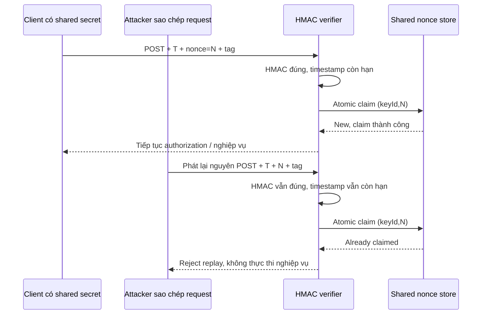
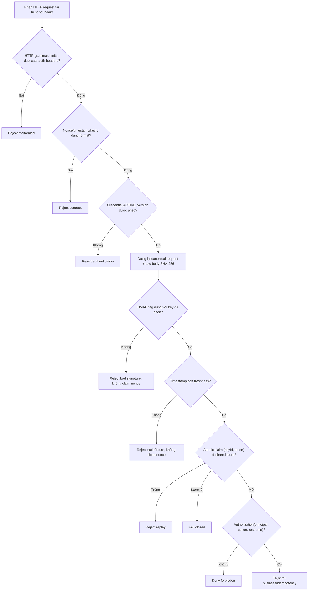
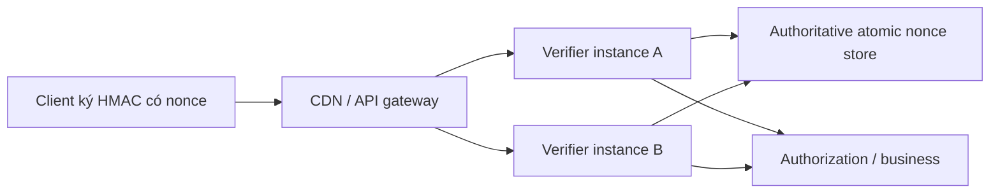

# Nonce uniqueness: bảo đảm mỗi HTTP request HMAC chỉ được chấp nhận một lần

> **Chương:** Nonce  
> **Bài học:** Nonce uniqueness  
> **Phạm vi module:** `SECURITY_AUTHENTICATION_HMAC_REQUEST_AUTHENTICATION` — thiết kế xác thực HTTP request bằng HMAC với shared secret và canonical request bao gồm method, URI, signed headers hoặc body theo hợp đồng ký. Bài học tập trung vào **tính duy nhất của nonce**, từ cách client tạo đến cách verifier ghi nhận nguyên tử, chống replay qua nhiều instance, vận hành key rotation, kiểm thử proxy/gateway và phân biệt xác thực với phân quyền.

## 1. Nonce uniqueness là gì?

**Nonce** là viết tắt thường dùng của *number used once*: giá trị được thiết kế để dùng **một lần** trong một phạm vi xác định. Trong HMAC request authentication, nonce thường là một chuỗi ngẫu nhiên được client tạo riêng cho mỗi lần ký một request, ví dụ:

```http
POST /v1/payments?orderId=42 HTTP/1.1
Host: api.example.test
Content-Type: application/json
X-Key-Id: merchant-a-k2
X-Timestamp: 1767225600
X-Nonce: 2a91e03f87b640dcb6f1a20e9d5734ab
X-Signature: v1=<HMAC_TAG_BASE64URL>

{"amount":100000}
```

Giá trị nonce mẫu chỉ là **fixture**. Client thật cần tạo nonce mới bằng nguồn ngẫu nhiên phù hợp; không copy nonce trong tài liệu để gửi request production.

Trong thiết kế thực tế, có **hai nghĩa khác nhau** của “unique”:

1. **Unique khi client tạo:** xác suất hai lần sinh ra cùng nonce phải cực thấp trong phạm vi sử dụng. `SecureRandom` với 16 byte ngẫu nhiên giúp đạt mục tiêu này, nhưng xác suất trùng **không bằng 0**.
2. **Unique khi server chấp nhận:** server phải có chính sách đảm bảo **một nonce trong một phạm vi credential chỉ có tối đa một lần claim thành công** trong khoảng timestamp có thể hợp lệ. Điều này cần một kho trạng thái và thao tác nguyên tử, không thể suy ra chỉ từ việc nonce trông ngẫu nhiên.

**Kết luận đầu tiên:** “Tạo nonce khó trùng” ở client và “không chấp nhận nonce trùng” ở server là **hai lớp bảo vệ bổ sung**. Không được thay việc lưu nonce đã dùng bằng niềm tin rằng xác suất ngẫu nhiên trùng rất nhỏ.

### Ví dụ trực quan

```text
Request 1: keyId=A, nonce=N, HMAC hợp lệ → server claim N → chấp nhận
Request 2: keyId=A, nonce=N, HMAC hợp lệ → N đã claim → từ chối replay
Request 3: keyId=A, nonce=M, HMAC hợp lệ → M mới → có thể chấp nhận
Request 4: keyId=B, nonce=N, HMAC hợp lệ bằng key B
           → chính sách namespace (keyId,nonce) coi là nonce khác
```

Request 4 **không tự động được phép**: nó vẫn phải qua credential, timestamp, HMAC, authorization và idempotency. Nó chỉ minh họa phạm vi uniqueness có thể là `(keyId, nonce)` thay vì một tập nonce toàn cầu.

## 2. Vì sao HMAC và timestamp vẫn chưa đủ chống replay?

HMAC-SHA256 chứng minh rằng người gửi biết secret đã ký **đúng dữ liệu thuộc signing input**. Nhưng HMAC là phép tính xác định:

\[
\operatorname{HMAC}(K,M)=T
\]

Với cùng khóa `K` và cùng thông điệp `M`, tag `T` không đổi. Nếu attacker quan sát được toàn bộ request hợp lệ rồi gửi lại **nguyên vẹn**, server vẫn có thể tính được tag trùng.

Timestamp được ký giới hạn khoảng chấp nhận:

```text
signed timestamp T = 1767225600
server now N       = 1767225610
freshness window   = ±300 seconds
```

Request còn **tươi** ở lần gửi thứ hai. Chỉ kiểm timestamp và HMAC không giúp nhận biết nó đã được xử lý trước đó.



**Nonce không phải secret.** Người quan sát request có thể đọc nonce và timestamp; an toàn không đến từ việc che giấu chúng mà đến từ **việc nonce và timestamp được ký, có entropy thích hợp và đã được server ghi nhận một lần**.

Khi secret bị lộ, attacker có thể ký request mới với nonce mới. Nonce **không giải quyết credential compromise**; phải thu hồi/rotation key, giới hạn quyền và giám sát.

## 3. Ba thuộc tính thường bị nhầm lẫn

| Thuộc tính | Nghĩa | Ai chịu trách nhiệm? |
| --- | --- | --- |
| **Tính khó đoán (unpredictability)** | Người không nắm state nguồn sinh khó đoán nonce tiếp theo. | Nguồn `CSPRNG` của client; không thay cho HMAC. |
| **Xác suất không trùng (collision resistance khi sinh)** | Hai lần tạo nonce độc lập rất ít khi cho cùng giá trị. | Không gian nonce đủ lớn, random generator tốt, tránh seed lỗi. |
| **Tính dùng một lần khi được chấp nhận (enforced uniqueness)** | Hai request trong cùng namespace không thể cùng claim nonce còn hiệu lực. | **Shared atomic nonce store** tại verifier/gateway. |

Một nonce tăng dần có thể **unique theo bộ đếm** nhưng **dễ đoán**. Điều này không nhất thiết làm mất tính bảo mật nếu contract được thiết kế đúng và luôn yêu cầu HMAC, nhưng nó cần state client tin cậy, chống reset khi restart và quản lý concurrency. Với client phân tán, nonce ngẫu nhiên đủ lớn thường dễ triển khai hơn.

Một nonce ngẫu nhiên có entropy cao **không tự loại replay** nếu server không lưu việc đã sử dụng: attacker chỉ cần copy đúng giá trị hiện có, không cần đoán ra giá trị mới.

### Dữ liệu cố định không phải nonce an toàn

Các lựa chọn dễ gây trùng:

```java
String nonce = "1"; // Hằng số: sai
String nonce2 = Long.toString(System.currentTimeMillis()); // Dễ trùng
String nonce3 = Long.toString(System.nanoTime()); // Không là global ID
String nonce4 = Thread.currentThread().getName(); // Trùng khi restart
```

`System.nanoTime()` dành cho đo khoảng thời gian trong JVM, **không** có epoch hoặc bảo đảm duy nhất trên máy khác. Thời gian Unix milliseconds cũng không đủ để chống trùng khi nhiều request cùng millisecond, nhiều instance hoặc đồng hồ bị chỉnh.

## 4. Thiết kế nonce ngẫu nhiên đủ lớn

### 4.1. 128 bit ngẫu nhiên từ `SecureRandom`

Một lựa chọn phổ biến cho HTTP HMAC API là:

```text
nonceRaw = 16 random bytes = 128 bits
nonceText = lowercaseHex(nonceRaw) = 32 ASCII hex characters
```

Java 17+:

```java
import java.security.SecureRandom;
import java.util.HexFormat;

public final class NonceFactory {
    private static final SecureRandom RANDOM = new SecureRandom();

    private NonceFactory() {}

    public static String nextNonce() {
        byte[] bytes = new byte[16];
        RANDOM.nextBytes(bytes);
        return HexFormat.of().formatHex(bytes);
    }
}
```

Với hợp đồng trên, text nonce có thể là:

```text
5e93cb8409ba4f4c88b17a9f23d61640
```

Mỗi lần ký request mới gọi `nextNonce()`. Test có thể dùng nonce cố định để tái lập HMAC, nhưng production không được lấy một constant từ cấu hình cho mọi request.

**Lưu ý:** `SecureRandom` được thiết kế cho tạo số ngẫu nhiên phục vụ bảo mật. Không dùng `java.util.Random`, bộ đếm dựa vào `Math.random()` hoặc UUID có nguồn/tính chất không được xác nhận để thay thế một yêu cầu entropy rõ ràng. `UUID.randomUUID()` trong Java là UUID version 4 dựa trên bộ tạo ngẫu nhiên mạnh, nhưng UUIDv4 chỉ có khoảng **122 bit ngẫu nhiên** do version/variant bits cố định; format UUID với dấu gạch nối cũng **khác** grammar nonce 32 hex của ví dụ. Không tự trộn hai giao thức.

### 4.2. Xác suất collision có nhỏ đến mức nào?

Với nonce được chọn **độc lập và phân bố đều** trong không gian `2^128` giá trị, xác suất ít nhất một lần trùng sau `n` lượt sinh có xấp xỉ birthday bound:

\[
p \approx \frac{n(n-1)}{2^{129}}
\]

Ví dụ, với `n = 10^9` request trong **cùng một không gian nonce 128 bit**, xác suất collision khoảng `1,5 × 10^-21` nếu các giả thiết ngẫu nhiên đúng.

Đây là xác suất cực nhỏ, **không phải bằng 0**. Những rủi ro thực tế khác có thể lớn hơn nhiều: client lặp nonce sau retry, dùng random generator bị lỗi, tạo nonce bằng timestamp, store không atomic hoặc TTL quá ngắn.

**Server không “tha” nonce lặp vì nghĩ đó chỉ là collision đáng tiếc.** Nếu nonce trùng trong cửa sổ hiệu lực, từ chối. Client cần xử lý retry bằng request mới và chính sách idempotency thích hợp; đừng cho phép một ngoại lệ dễ bị lợi dụng để qua replay check.

### 4.3. Có thể dùng Base64URL thay hex không?

Có. Với 16 byte nonce:

- Hex chữ thường: **32 ký tự**.
- Base64URL không padding: **22 ký tự**.

Nhưng server phải quy định **một grammar** cho version hiện tại. Bài này dùng hex chữ thường để dễ kiểm tra. Không tự cho phép cả hex, UUID có gạch nối và Base64URL trong cùng trường `X-Nonce` nếu chưa có chính sách encode/decode/version rõ.

**Khi decode nonce**, không được âm thầm thay chữ hoa thành chữ thường, bỏ dấu phân tách hoặc chấp nhận whitespace nếu contract chỉ nhận `[0-9a-f]{32}`.

## 5. Phạm vi uniqueness: nonce duy nhất cho ai, trong bao lâu?

“Nonce phải unique” là yêu cầu **thiếu thông tin** nếu không xác định:

1. **Namespace:** uniqueness trên toàn hệ thống, theo client, theo principal, theo API key hay theo key version?
2. **Thời gian lưu:** có phải nhớ nonce vô hạn hay chỉ đủ lâu cho timestamp đã ký hết hiệu lực?
3. **Điểm xác minh:** gateway, service hay cả hai; kho nonce có dùng chung trên các instance?
4. **Độ tin cậy:** khi request đi qua nhiều region, có một decision point có tính nhất quán đủ mạnh không?

Trong custom HMAC protocol sử dụng `X-Key-Id` được ký và key ID xác định duy nhất một credential, một lựa chọn thực dụng là:

```text
replayKey = (keyId, nonce)
```

Ví dụ:

```text
("client-a-k1", "5e93cb8409ba4f4c88b17a9f23d61640")
("client-b-k9", "5e93cb8409ba4f4c88b17a9f23d61640")
```

Đây là **hai replay keys khác nhau**. Tuy nhiên cả hai phải có signature hợp lệ **với secret tương ứng**. Không được lấy key ID caller tự khai làm bằng chứng danh tính trước HMAC.

### 5.1. Theo key ID hay theo principal?

| Namespace | Lợi ích | Lưu ý |
| --- | --- | --- |
| `(keyId, nonce)` | Tự nhiên nếu mỗi key ID ánh xạ một credential/secret và key ID được ký. | Khi rotation từ k1 sang k2, cùng nonce được tính là khác namespace; điều này đúng **chỉ nếu** mỗi request được ký lại đúng key/version. |
| `(principalId, nonce)` | Giảm nguy cơ hai credential cùng principal dùng cùng nonce. | Cần principal được xác thực đáng tin trước khi claim; có thể gây false collision khi nhiều client/device cùng principal. |
| `(tenantId, keyId, nonce)` | Tách namespace theo tenant, có ích cho môi trường đa tenant. | Tenant/key ID phải có ngữ nghĩa và nguồn tin cậy, không lấy tenant ngoài chữ ký để tạo đường bypass. |
| Nonce global | Đơn giản về mặt khái niệm “không ai dùng lại”. | Tăng va chạm và áp lực store giữa các khách hàng; thường không cần cho request ký bằng key riêng. |

Trong bài này chọn **`(keyId, nonce)`**, vì HMAC và canonical request đều ràng buộc key ID. Nếu một hệ thống cho phép **cùng secret dưới nhiều key ID** hoặc chuyển credential alias mà vẫn nhận cùng request, cần phân tích lại namespace: replay store có thể phải scope theo identity của **credential thực** hoặc principal để không tạo cửa sổ phát lại xuyên alias.

### 5.2. Nonce không cần được lưu mãi

Nếu protocol chỉ nhận request có timestamp trong cửa sổ hữu hạn, thì nonce chỉ cần giữ đến **khi timestamp không còn có thể được chấp nhận** theo chính sách. Nhưng mọi verifier instance phải áp dụng cùng policy, và dữ liệu claim không được hết hạn quá sớm.

Không nên lưu nonce toàn thời gian nếu không có yêu cầu nghiệp vụ: sẽ làm dữ liệu tăng vô hạn và khó vận hành. Ngược lại, đặt TTL vài giây vì “request đến nhanh” là sai khi timestamp vẫn còn được chấp nhận.

## 6. Nonce phải được ràng buộc vào canonical request và HMAC

**Nonce trong header nhưng không được ký** tạo khả năng attacker sửa nonce trên một request cũ để vượt qua replay store.

Sai về thiết kế:

```text
signature = HMAC(secret, method + path + bodyDigest)
X-Nonce: any-string-not-covered-by-signature
```

Nếu server kiểm uniqueness nhưng để `X-Nonce` ngoài HMAC, attacker có thể sao chép request và thay nonce thành một giá trị chưa dùng mà **tag vẫn khớp**.

Đúng theo hợp đồng minh họa:

```http
POST /v1/payments?orderId=42 HTTP/1.1
Host: api.example.test
Content-Type: application/json
X-Key-Id: client-a-k1
X-Timestamp: 1767225600
X-Nonce: 5e93cb8409ba4f4c88b17a9f23d61640
X-Signature: v1=<BASE64URL_NO_PADDING_FULL_HMAC_TAG>

{"amount":100000}
```

**Tất cả** các trường tác động đến bảo mật và hành vi nghiệp vụ cần được ràng buộc theo hợp đồng:

```text
canonicalRequest =
    "POST" + "\n"
    + "api.example.test" + "\n"
    + "/v1/payments" + "\n"
    + "orderId=42" + "\n"
    + "content-type:application/json" + "\n"
    + "x-key-id:client-a-k1" + "\n"
    + "x-nonce:5e93cb8409ba4f4c88b17a9f23d61640" + "\n"
    + "x-timestamp:1767225600" + "\n"
    + "content-type;x-key-id;x-nonce;x-timestamp" + "\n"
    + lowercaseHex(SHA256(rawBodyBytes))

bytesToSign = UTF8("HMAC-SHA256/NONCE-UNIQUE-V1\n" + canonicalRequest)
tagBytes    = HMAC-SHA256(secretBytes, bytesToSign)
signature   = "v1=" + Base64URLNoPadding(tagBytes)
```

Đây là một **custom signing contract để học**, không phải RFC chung. Nó cố định endpoint và `Content-Type` chỉ để tập trung vào nonce; hệ thống thật phải có canonicalizer method, authority, path, query, headers và body đúng ở điểm xác minh.

Các bất biến:

- Đổi nonce, timestamp, key ID, method, path, query, `Content-Type` hoặc raw body bytes **mà không ký lại** → HMAC mismatch / reject.
- Không dùng `X-Signature` làm thành phần được ký trong custom scheme này vì nó là đầu ra.
- Ký chính xác chữ ký UTF-8 của canonical request; dùng LF, không tự chuyển thành CRLF.
- Server chọn shared secret qua **credential registry đáng tin** theo key ID và kiểm trạng thái credential trước khi xác minh.
- Nonce và timestamp được bảo vệ dù bản thân chúng **không bí mật**.

## 7. Chọn chính sách timestamp và TTL của nonce

Nonce uniqueness chỉ có ý nghĩa trong khoảng request **có thể được chấp nhận**.

Đặt:

- `T` = signed timestamp theo UTC Unix epoch seconds.
- `N` = server now theo epoch seconds.
- `P` = past window: server cho phép request **cũ nhất** `P` giây.
- `F` = future window: server cho phép request **sớm nhất** `F` giây trong tương lai.

Freshness hợp lệ khi:

\[
N - P \le T \le N + F
\]

Đổi vế để thấy khoảng server có thể chấp nhận **cùng timestamp `T`**:

\[
T - F \le N \le T + P
\]

Do đó, nonce đã claim phải tồn tại **ít nhất đến `T + P`** (thêm margin cho sai lệch và lịch xử lý theo policy).

### Ví dụ: cửa sổ ±300 giây

```text
T = 1767225600
P = 300 s
F = 300 s

Thời điểm nhận sớm nhất:  T - 300
Thời điểm nhận muộn nhất: T + 300
Khoảng timestamp hợp lệ:  600 giây
```

Nếu claim nonce ở `T-300` và đặt TTL cố định **300 giây từ lúc claim**, nonce sẽ hết hạn lúc `T` trong khi request còn hợp lệ tới `T+300`. Lúc đó có thể **phát lại sau khi nonce hết hạn** nếu không có lớp nào khác.

Cách tính tốt hơn:

```text
nonceExpiry = signedTimestamp + pastWindowSeconds + safetyMargin

ttlSeconds  = nonceExpiry - serverNow
```

Ví dụ code Java:

```java
long nowSeconds = clock.instant().getEpochSecond();
long signedAt = Long.parseLong(signedTimestamp);
long expiry = signedAt + PAST_WINDOW_SECONDS + SAFETY_MARGIN_SECONDS;
long ttl = expiry - nowSeconds;
if (ttl <= 0) {
    throw new IllegalStateException("Nonce expiry already passed");
}
```

**Điểm dễ nhầm:** `P` là cửa sổ trong **quá khứ**, nhưng nó quyết định thời điểm server **muộn nhất** còn chấp nhận `T`. `F` quyết định thời điểm server **sớm nhất** có thể chấp nhận `T`.

### 7.1. Vì sao cần safety margin?

Đồng hồ các verifier có thể lệch trong giới hạn cho phép; timeout/queue và sự khác biệt thời điểm kiểm/claim cũng có thể ảnh hưởng. Margin không thay việc đồng bộ clock và không nên quá lớn không kiểm soát.

Nếu các instance có clock skew lớn hoặc thậm chí nhảy lùi, một TTL tính bằng một đồng hồ đơn lẻ không bảo đảm replay safety. Cần giám sát/synchronize các node và điều chỉnh thiết kế expiry theo **mức skew tối đa tin cậy**, đồng thời fail closed khi không đáp ứng điều kiện đồng bộ.

### 7.2. Dung lượng store cần được tính toán

Giả sử hệ thống nhận **10.000 request/giây** và phải giữ nonce khoảng **660 giây**, thì trong trạng thái ổn định có thể cần lưu khoảng **6,6 triệu replay keys** (trước overhead, replica, index và phân mảnh). Đây là ước lượng quy mô, không phải giới hạn cố định.

Yêu cầu vận hành:

- Bound số request được phép và kích thước metadata trước khi ghi nonce.
- Claim **sau khi HMAC thành công**, tránh client giả mạo đổ đầy store chỉ bằng signature sai.
- Giới hạn quota hợp lý theo credential/principal, theo tenant và toàn cục.
- Theo dõi dung lượng, lỗi atomic claim, TTL, duplicate rate và clock skew.
- Không xóa sớm nonce đang hoạt động để “cứu” bộ nhớ: nếu store không đáp ứng được tính duy nhất, **không được fail open**.

## 8. Atomic claim: tại sao `GET rồi SET` không an toàn?

Trong một hệ thống có nhiều thread, nhiều JVM hoặc nhiều region:

```text
Thread A: GET nonce N -> not found
Thread B: GET nonce N -> not found
Thread A: SET nonce N
Thread B: SET nonce N
Thread A: ACCEPT
Thread B: ACCEPT
```

Cả hai request cùng HMAC hợp lệ và cùng nonce được **chấp nhận** vì kiểm tra và ghi là hai thao tác rời nhau.

Đây là **race condition** làm hỏng yêu cầu uniqueness.

### 8.1. Redis: atomic `SET NX` cùng expiry

Ví dụ một triển khai có thể sử dụng atomic command:

```text
SET replay:<credential-namespace>:<nonce> 1 NX EX <ttl-seconds>
```

Đây là cú pháp minh họa; `<...>` là placeholder của namespace/TTL đã tính ở application. Kết quả:

- Thành công: nonce chưa tồn tại → **claim** thành công.
- Không đặt được vì key đã tồn tại → **reject replay**.
- Lỗi kết nối/timeout/không chắc có ghi thành công → **fail closed**, không suy đoán là “nonce mới”.
- TTL cần đủ dài theo `T+P+margin`, không chỉ bằng kích thước freshness window từ lúc nhận.

**Hạn chế vận hành:** Lệnh atomic trên một Redis primary không tự chứng minh tính duy nhất toàn hệ thống nếu nhiều vùng dùng các kho độc lập, failover có thể mất bản ghi chưa durable hoặc replica có độ trễ. Cần lựa chọn consistency/durability phù hợp với mức bảo mật của API, quy định rõ hành vi khi partition và test failover thực.

### 8.2. Database unique constraint

Một lựa chọn khác là bảng:

```sql
CREATE TABLE used_nonce (
    credential_id VARCHAR(128) NOT NULL,
    nonce_hex CHAR(32) NOT NULL,
    expires_at_epoch BIGINT NOT NULL,
    PRIMARY KEY (credential_id, nonce_hex)
);
```

Request hợp lệ thực hiện **conditional insert** trong transaction; unique constraint đảm bảo chỉ một insert thành công. Dọn các hàng hết hạn sau khi chắc chắn chúng **không còn có thể được chấp nhận**.

SQL ở đây chỉ minh họa schema; cơ chế TTL/cleanup/transaction phụ thuộc database. Cần cân nhắc hiệu năng, lock, phân vùng, replica và các bảo đảm sau failover.

### 8.3. Bảng chọn giải pháp replay store

| Giải pháp | Atomic giữa các instance? | Giới hạn cần lưu ý |
| --- | --- | --- |
| `HashSet` cục bộ | **Không** | Hai JVM đều có thể claim cùng nonce. |
| `ConcurrentHashMap.putIfAbsent/compute` | Có trong **một JVM** | Không shared across nodes, cần cleanup TTL. |
| Redis `SET NX EX` trên cùng authoritative store | Có theo thao tác tại store đó | Cần xét HA/failover/replication, TTL và consistency. |
| DB unique constraint + transaction | Có theo cơ chế commit/unique của DB | Cần cấu hình durability, hiệu năng, cleanup và failover. |
| Eventual-consistent cache theo region | **Không mặc nhiên** | Có thể chấp nhận hai replay trước khi replicate. |

## 9. Thứ tự verifier an toàn để bảo vệ nonce uniqueness

Một pipeline được đề xuất:



### Những nguyên tắc bắt buộc

1. **HMAC trước khi claim nonce.** Nếu tag sai vẫn được ghi nonce, attacker có thể dùng chữ ký giả để “chiếm” nonce của client thật và tạo DoS logic.
2. **Freshness trước khi claim nonce** trong pipeline này. Request hết hạn không được tiêu thụ dung lượng store; thứ tự khác chỉ khi đã phân tích đầy đủ.
3. **Claim phải atomic.** `contains` rồi `put` hoặc `SELECT` rồi `INSERT` không có transaction/constraint là không đủ.
4. **Store lỗi → fail closed.** Không fallback vào cache cục bộ từng node hay bỏ qua replay chỉ vì “HMAC đã đúng”.
5. **Authorization vẫn độc lập.** Một client có secret đúng và nonce chưa từng dùng vẫn có thể không có quyền tới tenant/resource.
6. **Chưa có side effect nghiệp vụ** trước khi kết thúc authentication và authorization; claim nonce là state kỹ thuật duy nhất có thể thay đổi trong pipeline xác minh.

**Chi tiết thứ tự authorization:** Ví dụ claim nonce **trước** authorization, vì vậy request authenticated nhưng forbidden vẫn tiêu thụ nonce. Đây có thể là chính sách phù hợp để tránh lặp lại cùng request trái quyền. Nếu tổ chức chọn kiểm authorization trước claim, phải phân tích race, thời điểm xác định principal và side-effect, và giữ nguyên nguyên tắc **không thực thi nghiệp vụ trước khi claim thành công**.

## 10. Java 17+: client nonce factory và server verifier có anti-replay

Đoạn mã này là một **bài tập runnable offline** dùng JDK 17. Nó cố tình không dựng HTTP server thật. Thay vào đó:

- Mô phỏng một request đã được HTTP adapter parse/validate tại ranh giới tin cậy.
- Ký nonce, timestamp, key ID, method, authority, path, query, Content-Type và body hash.
- Sinh nonce production-style bằng `SecureRandom` 16 byte.
- Xác minh HMAC-SHA256 và tag Base64URL không padding 32 byte.
- Kiểm freshness `±300 giây` bằng `Clock.fixed`.
- Claim uniqueness theo `(keyId, nonce)` với `ConcurrentHashMap.compute` **atomic trong một JVM**.
- Kiểm request hợp lệ, replay, đổi body, đổi nonce mà giữ tag, nonce cùng credential nhưng khác timestamp, key ID khác, revoked key, stale/future, authorization và lỗi store.
- Kiểm hai thread cùng claim nonce: chính xác **một accept, một replay**.

**Lưu ý:** `ConcurrentHashMap` trong demo không thay được shared store/DB production. HTTP adapter thật phải kiểm duplicate headers, percent-encoding, routing và body limits trước khi tạo `SignedRequest`.

```java
import java.nio.charset.StandardCharsets;
import java.security.GeneralSecurityException;
import java.security.MessageDigest;
import java.security.SecureRandom;
import java.time.Clock;
import java.time.Instant;
import java.time.ZoneOffset;
import java.util.Base64;
import java.util.HexFormat;
import java.util.Map;
import java.util.Objects;
import java.util.concurrent.Callable;
import java.util.concurrent.ConcurrentHashMap;
import java.util.concurrent.CountDownLatch;
import java.util.concurrent.ExecutorService;
import java.util.concurrent.Executors;
import java.util.concurrent.Future;
import java.util.concurrent.TimeUnit;
import java.util.concurrent.atomic.AtomicBoolean;
import java.util.function.Predicate;
import javax.crypto.Mac;
import javax.crypto.spec.SecretKeySpec;

public final class NonceUniquenessDemo {
    private static final HexFormat HEX = HexFormat.of();
    private static final SecureRandom RANDOM = new SecureRandom();
    private static final long PAST_SECONDS = 300;
    private static final long FUTURE_SECONDS = 300;
    private static final long MARGIN_SECONDS = 60;
    private static final String PREFIX =
            "HMAC-SHA256/NONCE-UNIQUE-V1\n";
    private static final String SIGNED_NAMES =
            "content-type;x-key-id;x-nonce;x-timestamp";

    private NonceUniquenessDemo() {}

    record SignedRequest(
            String method, String authority, String rawPath,
            String rawQuery, String contentType, String keyId,
            String timestamp, String nonce, byte[] rawBody,
            String signature) {
        SignedRequest {
            Objects.requireNonNull(method);
            Objects.requireNonNull(authority);
            Objects.requireNonNull(rawPath);
            Objects.requireNonNull(rawQuery);
            Objects.requireNonNull(contentType);
            Objects.requireNonNull(keyId);
            Objects.requireNonNull(timestamp);
            Objects.requireNonNull(nonce);
            Objects.requireNonNull(rawBody);
            Objects.requireNonNull(signature);
            rawBody = rawBody.clone();
        }

        @Override public byte[] rawBody() {
            return rawBody.clone();
        }
    }

    record Credential(String principal, byte[] secret, boolean active) {
        Credential {
            Objects.requireNonNull(principal);
            Objects.requireNonNull(secret);
            secret = secret.clone();
        }

        @Override public byte[] secret() {
            return secret.clone();
        }
    }

    enum Decision {
        ACCEPT, MALFORMED, UNAUTHENTICATED,
        STALE, REPLAY, FORBIDDEN, UNAVAILABLE
    }

    interface NonceStore {
        boolean claim(String scopedKey, long expiresAt, long now);
    }

    // Chỉ là store demo trong MỘT JVM, không cleanup/durable/shared.
    static final class LocalNonceStore implements NonceStore {
        private final ConcurrentHashMap<String, Long> seen =
                new ConcurrentHashMap<>();

        @Override public boolean claim(
                String scopedKey, long expiresAt, long now) {
            if (expiresAt <= now) return false;
            AtomicBoolean acquired = new AtomicBoolean(false);
            seen.compute(scopedKey, (ignored, previousExpiry) -> {
                if (previousExpiry == null || previousExpiry <= now) {
                    acquired.set(true);
                    return expiresAt;
                }
                return previousExpiry;
            });
            return acquired.get();
        }
    }

    static String newNonce() {
        byte[] bytes = new byte[16];
        RANDOM.nextBytes(bytes);
        return HEX.formatHex(bytes);
    }

    private static long parseTimestamp(String value) {
        if (!value.matches("[1-9][0-9]{9,10}")) {
            throw new IllegalArgumentException(
                    "Expected canonical epoch seconds");
        }
        return Long.parseLong(value);
    }

    // Contract demo cố định endpoint, authority, query và media type.
    // Production cần HTTP adapter kiểm đúng những giá trị từ wire.
    private static void validate(SignedRequest r) {
        if (!"POST".equals(r.method())
                || !"api.example.test".equals(r.authority())
                || !"/v1/payments".equals(r.rawPath())
                || !"orderId=42".equals(r.rawQuery())
                || !"application/json".equals(r.contentType())
                || !r.keyId().matches("[A-Za-z0-9._-]{1,64}")
                || !r.nonce().matches("[0-9a-f]{32}")
                || r.rawBody().length > 64 * 1024) {
            throw new IllegalArgumentException("Invalid request contract");
        }
        parseTimestamp(r.timestamp());
    }

    private static String canonical(SignedRequest r)
            throws GeneralSecurityException {
        validate(r);
        String bodyHash = HEX.formatHex(MessageDigest
                .getInstance("SHA-256").digest(r.rawBody()));
        return String.join("\n",
                "POST",
                "api.example.test",
                r.rawPath(),
                r.rawQuery(),
                "content-type:" + r.contentType(),
                "x-key-id:" + r.keyId(),
                "x-nonce:" + r.nonce(),
                "x-timestamp:" + r.timestamp(),
                SIGNED_NAMES,
                bodyHash);
    }

    private static byte[] calculateHmac(
            byte[] secret, SignedRequest r)
            throws GeneralSecurityException {
        Mac mac = Mac.getInstance("HmacSHA256");
        mac.init(new SecretKeySpec(secret, "HmacSHA256"));
        String toSign = PREFIX + canonical(r);
        return mac.doFinal(toSign.getBytes(StandardCharsets.UTF_8));
    }

    private static String encodeTag(byte[] tag) {
        if (tag.length != 32) {
            throw new IllegalArgumentException("Expected full tag");
        }
        return "v1=" + Base64.getUrlEncoder()
                .withoutPadding().encodeToString(tag);
    }

    private static byte[] decodeTag(String header) {
        if (!header.matches("v1=[A-Za-z0-9_-]{43}")) {
            throw new IllegalArgumentException("Bad signature grammar");
        }
        String encoded = header.substring(3);
        byte[] decoded = Base64.getUrlDecoder().decode(encoded);
        if (decoded.length != 32
                || !encoded.equals(Base64.getUrlEncoder()
                        .withoutPadding().encodeToString(decoded))) {
            throw new IllegalArgumentException("Noncanonical signature");
        }
        return decoded;
    }

    static SignedRequest sign(SignedRequest r, byte[] secret)
            throws GeneralSecurityException {
        String signature = encodeTag(calculateHmac(secret, r));
        return new SignedRequest(
                r.method(), r.authority(), r.rawPath(), r.rawQuery(),
                r.contentType(), r.keyId(), r.timestamp(), r.nonce(),
                r.rawBody(), signature);
    }

    static Decision verify(
            SignedRequest r, Map<String, Credential> registry,
            Clock clock, NonceStore store,
            Predicate<String> authorizedPrincipal) {
        try {
            validate(r);
            byte[] supplied = decodeTag(r.signature());
            Credential credential = registry.get(r.keyId());
            if (credential == null || !credential.active()) {
                return Decision.UNAUTHENTICATED;
            }
            byte[] expected = calculateHmac(credential.secret(), r);
            if (!MessageDigest.isEqual(expected, supplied)) {
                return Decision.UNAUTHENTICATED;
            }

            long signedAt = parseTimestamp(r.timestamp());
            long now = clock.instant().getEpochSecond();
            if (signedAt < now - PAST_SECONDS
                    || signedAt > now + FUTURE_SECONDS) {
                return Decision.STALE;
            }

            // Valid latest arrival for T is T + PAST_SECONDS.
            long expiresAt = signedAt + PAST_SECONDS + MARGIN_SECONDS;
            String replayKey = r.keyId() + ":" + r.nonce();

            // Claim CHỈ sau HMAC và freshness pass.
            if (!store.claim(replayKey, expiresAt, now)) {
                return Decision.REPLAY;
            }
            if (!authorizedPrincipal.test(credential.principal())) {
                return Decision.FORBIDDEN;
            }
            return Decision.ACCEPT;
        } catch (IllegalArgumentException badInput) {
            return Decision.MALFORMED;
        } catch (GeneralSecurityException cryptoUnavailable) {
            return Decision.UNAVAILABLE;
        } catch (RuntimeException storeOrInfrastructureFailure) {
            return Decision.UNAVAILABLE; // Fail closed.
        }
    }

    static SignedRequest unsigned(
            String keyId, String timestamp,
            String nonce, String body) {
        return new SignedRequest(
                "POST", "api.example.test",
                "/v1/payments", "orderId=42",
                "application/json", keyId, timestamp, nonce,
                body.getBytes(StandardCharsets.UTF_8), "");
    }

    static SignedRequest withBody(
            SignedRequest r, String bodyText) {
        return new SignedRequest(
                r.method(), r.authority(), r.rawPath(), r.rawQuery(),
                r.contentType(), r.keyId(), r.timestamp(), r.nonce(),
                bodyText.getBytes(StandardCharsets.UTF_8),
                r.signature());
    }

    static SignedRequest withNonce(
            SignedRequest r, String nonce) {
        return new SignedRequest(
                r.method(), r.authority(), r.rawPath(), r.rawQuery(),
                r.contentType(), r.keyId(), r.timestamp(), nonce,
                r.rawBody(), r.signature());
    }

    private static void expect(Decision actual, Decision expected) {
        if (actual != expected) {
            throw new AssertionError(
                    "Expected " + expected + " but got " + actual);
        }
    }

    public static void main(String[] args) throws Exception {
        // Public fixture keys; tuyệt đối không sử dụng trong production.
        byte[] secretA = HEX.parseHex(
                "000102030405060708090a0b0c0d0e0f"
              + "101112131415161718191a1b1c1d1e1f");
        byte[] secretB = HEX.parseHex(
                "f0e0d0c0b0a090807060504030201000"
              + "ffeeddccbbaa99887766554433221100");
        Map<String, Credential> registry = Map.of(
                "client-a-k1", new Credential("client-A", secretA, true),
                "client-b-k2", new Credential("client-B", secretB, true));

        long nowSeconds = 1767225600L;
        Clock fixed = Clock.fixed(
                Instant.ofEpochSecond(nowSeconds), ZoneOffset.UTC);

        // Fixture cố định CHỈ dành cho test.
        String n1 = "aaaaaaaaaaaaaaaaaaaaaaaaaaaaaaaa";
        String n2 = "bbbbbbbbbbbbbbbbbbbbbbbbbbbbbbbb";
        SignedRequest first = sign(
                unsigned("client-a-k1", "1767225600", n1,
                        "{\"amount\":100000}"), secretA);

        LocalNonceStore shared = new LocalNonceStore();
        expect(verify(first, registry, fixed, shared, p -> true),
                Decision.ACCEPT);
        expect(verify(first, registry, fixed, shared, p -> true),
                Decision.REPLAY);

        // Cùng credential + nonce nhưng body/timestamp khác:
        // ngay cả khi có signature MỚI hợp lệ vẫn là reused nonce.
        SignedRequest differentBody = sign(
                unsigned("client-a-k1", "1767225601", n1,
                        "{\"amount\":900000}"), secretA);
        expect(verify(differentBody, registry, fixed, shared, p -> true),
                Decision.REPLAY);

        // Nonce mới với cùng credential có thể được chấp nhận.
        SignedRequest freshNonce = sign(
                unsigned("client-a-k1", "1767225600", n2,
                        "{\"amount\":100000}"), secretA);
        expect(verify(freshNonce, registry, fixed, shared, p -> true),
                Decision.ACCEPT);

        // Tag sai không được claim nonce (ngăn nonce poisoning).
        LocalNonceStore untouched = new LocalNonceStore();
        SignedRequest tamperedBody = withBody(first,
                "{\"amount\":900000}");
        expect(verify(tamperedBody, registry, fixed,
                untouched, p -> true), Decision.UNAUTHENTICATED);
        expect(verify(first, registry, fixed, untouched, p -> true),
                Decision.ACCEPT);

        // Nonce bị sửa nhưng giữ signature cũ: HMAC mismatch.
        expect(verify(withNonce(first, n2), registry, fixed,
                new LocalNonceStore(), p -> true),
                Decision.UNAUTHENTICATED);

        // Timestamp được ký đúng, nhưng freshness không đạt.
        SignedRequest old = sign(
                unsigned("client-a-k1", "1767225299", n1, "{}"), secretA);
        SignedRequest future = sign(
                unsigned("client-a-k1", "1767225901", n1, "{}"), secretA);
        LocalNonceStore notClaimed = new LocalNonceStore();
        expect(verify(old, registry, fixed, notClaimed, p -> true),
                Decision.STALE);
        expect(verify(future, registry, fixed, notClaimed, p -> true),
                Decision.STALE);
        expect(verify(first, registry, fixed, notClaimed, p -> true),
                Decision.ACCEPT);

        // Phạm vi (keyId,nonce): credential B có thể dùng cùng nonce
        // với chữ ký bằng secret B, độc lập với nonce đã claim ở A.
        SignedRequest otherCredential = sign(
                unsigned("client-b-k2", "1767225600", n1, "{}"),
                secretB);
        expect(verify(otherCredential, registry, fixed,
                shared, p -> true), Decision.ACCEPT);

        // Key bị revoke: HMAC toán học vẫn đúng nhưng không chấp nhận.
        Map<String, Credential> revoked = Map.of(
                "client-a-k1",
                new Credential("client-A", secretA, false));
        expect(verify(first, revoked, fixed,
                new LocalNonceStore(), p -> true),
                Decision.UNAUTHENTICATED);

        // Authn pass nhưng principal không có quyền.
        expect(verify(first, registry, fixed,
                new LocalNonceStore(), p -> false),
                Decision.FORBIDDEN);

        // Store bị lỗi: fail closed, không bypass.
        NonceStore unavailable = (key, expiry, now) -> {
            throw new IllegalStateException("Test replay store failure");
        };
        expect(verify(first, registry, fixed,
                unavailable, p -> true), Decision.UNAVAILABLE);

        // Hai thread cùng claim một nonce: 1 ACCEPT + 1 REPLAY.
        LocalNonceStore racingStore = new LocalNonceStore();
        ExecutorService pool = Executors.newFixedThreadPool(2);
        CountDownLatch ready = new CountDownLatch(2);
        CountDownLatch go = new CountDownLatch(1);
        Callable<Decision> task = () -> {
            ready.countDown();
            go.await();
            return verify(first, registry, fixed,
                    racingStore, p -> true);
        };
        try {
            Future<Decision> f1 = pool.submit(task);
            Future<Decision> f2 = pool.submit(task);
            if (!ready.await(5, TimeUnit.SECONDS)) {
                throw new AssertionError("Threads did not start");
            }
            go.countDown();
            Decision d1 = f1.get(5, TimeUnit.SECONDS);
            Decision d2 = f2.get(5, TimeUnit.SECONDS);
            if (!((d1 == Decision.ACCEPT && d2 == Decision.REPLAY)
                    || (d2 == Decision.ACCEPT
                        && d1 == Decision.REPLAY))) {
                throw new AssertionError("Atomic claim race failed");
            }
        } finally {
            go.countDown();
            pool.shutdownNow();
        }

        // Client production tạo nonce mới bằng CSPRNG.
        String generated = newNonce();
        if (!generated.matches("[0-9a-f]{32}")) {
            throw new AssertionError("Nonce factory grammar failed");
        }
        System.out.println("PASS: nonce uniqueness / HMAC / replay tests");
    }
}
```

Chạy khi đã lưu file đúng tên `NonceUniquenessDemo.java` và có JDK 17+:

```bash
javac NonceUniquenessDemo.java
java NonceUniquenessDemo
```

**Lưu ý kiểm chứng:** Mã là ví dụ để học và tự chạy; việc code xuất hiện trong tài liệu **không chứng minh đã được build/test trên môi trường của người học**. Trong production phải bổ sung HTTP adapter thực, shared durable store và integration tests.

### 10.1. Vì sao code có thể minh họa atomic nhưng chưa đủ cho production?

`ConcurrentHashMap.compute` bảo đảm atomic đối với key trong **một JVM**. Nếu có 10 instance, mỗi instance có map riêng thì **cả 10** đều có thể claim cùng một `(keyId, nonce)`.

Bản demo cũng không có background cleanup của nonce hết hạn; production phải có expiry/retention, giám sát dung lượng, consistency khi failover và quarantine/fail closed khi kho không khả dụng.

### 10.2. Vì sao test gửi cùng nonce nhưng khác body?

Một lỗi triển khai là dùng:

```text
replayKey = (keyId, nonce, bodyHash)
```

Khi đó một client có credential có thể ký request **khác body nhưng cùng nonce** và hệ thống coi đó là nonce mới. Nếu hợp đồng đã quy định nonce **dùng một lần cho mỗi credential trong cửa sổ**, key phải là `(keyId, nonce)`, **không chứa body hash hoặc timestamp** để tránh thay dữ liệu khác nhằm vượt uniqueness.

Body hash và timestamp vẫn cần có trong **HMAC signing input**, nhưng không phải là thành phần làm mất tính “used once” của một nonce.

### 10.3. Mã này chưa kiểm gì?

- Không đọc raw HTTP headers; duplicate `X-Nonce` / `X-Signature` phải bị reject ở ingress.
- Không triển khai canonicalizer URI/query/Content-Type tổng quát; contract demo cố định endpoint.
- Không hỗ trợ Content-Encoding, multipart hay streaming body lớn; raw body và limits phải được bảo toàn.
- Không có credential registry/secret manager production hoặc tính năng key rotation thực.
- Không có distributed nonce store; local test chỉ kiểm concurrency trong JVM.
- Không triển khai idempotency key/transaction policy và **authorization** chỉ là predicate minh họa.
- Không đảm bảo tuyệt đối uniqueness ngẫu nhiên: `SecureRandom` làm trùng cực hiếm; **store mới cưỡng chế chỉ một lần**.

## 11. Retry, timeout và idempotency: nonce mới không có nghĩa giao dịch mới

Một trường hợp thực tế của API thanh toán:

1. Client gửi POST với nonce `N1`, signature hợp lệ.
2. Server claim `N1` và tạo thanh toán thành công.
3. Phản hồi HTTP bị timeout trên đường về; client **không biết** thanh toán đã xảy ra.
4. Client muốn retry.

Nếu gửi lại **nguyên request**, server sẽ từ chối `N1` đã dùng. Đây là hành vi đúng của replay protection.

Muốn retry có kiểm soát:

- Tạo **timestamp mới, nonce `N2` mới và signature mới**.
- Giữ **cùng `Idempotency-Key`** đã được ký, cùng dữ liệu nghiệp vụ.
- Business service lưu kết quả/transaction theo idempotency key với scope phù hợp và fingerprint nội dung, tránh tạo thanh toán lần thứ hai.
- Nếu cùng idempotency key nhưng body/recipient/amount khác, **trả conflict** theo chính sách.
- Khi client không chắc request trước đã được xử lý, có thể truy vấn trạng thái nếu API cung cấp cơ chế an toàn.

```text
Attempt 1:
  idempotencyKey = pay-order-42
  nonce = N1
  signature = HMAC(K, request with N1)
  business effect = create payment

Attempt 2:
  idempotencyKey = pay-order-42
  nonce = N2
  signature = HMAC(K, request with N2)
  business effect = return previous result, not create payment again
```

**Nonce uniqueness bảo đảm tối đa một lần claim cho một nonce**, không bảo đảm **chính xác một lần thực thi nghiệp vụ**. Sau khi nonce claim thành công, server vẫn có thể crash trước transaction; client cần retry hợp lệ với nonce mới và idempotency.

### Nonce có dùng lại nếu client chưa chắc request đã được gửi?

Để tránh mơ hồ, với retry có thể đã tới server, **tạo nonce mới và ký lại** theo hợp đồng. Nếu chưa hề phát đi một byte nào và request chưa được tiếp nhận, triển khai có thể giữ snapshot/signature cho cùng một lần gửi theo policy, nhưng đừng xây logic dựa trên giả định khó xác minh rằng “request trước chắc chắn không đến server”. Idempotency giải quyết trạng thái bất định của thao tác nghiệp vụ.

## 12. Key rotation và nonce uniqueness

Giả sử client A có hai credential trong giai đoạn rotation:

```text
client-a-k1  → secret K1 (sắp hết hạn)
client-a-k2  → secret K2 (ACTIVE)
```

Nếu replay namespace là `(keyId, nonce)`:

- `(client-a-k1, N)` và `(client-a-k2, N)` là hai replay keys khác nhau.
- Nhưng request dùng k2 phải **được ký bằng K2** và chứa **keyId k2 trong canonical signing input**.
- Request dùng k1 bị revoke phải bị reject trước khi vào nonce store, dù HMAC theo K1 đúng.
- Không được chuyển key ID từ k1 sang k2 mà giữ signature cũ: ký lại vì key ID và secret thay đổi.
- Một phiên bản signing contract có thể tiếp tục dùng cùng grammar nonce qua rotation; **key version không phải nonce version**.

### Vùng nguy hiểm: alias/cùng secret giữa nhiều key IDs

Nếu hệ thống vô tình cho hai key ID là alias của **cùng một credential** và nhận HMAC bằng cùng secret trên cùng logical request, hai namespace tách biệt có thể không còn phù hợp. Cần quyết định uniqueness theo **credential identity đã xác minh**, không theo một chuỗi caller có thể đổi vô hạn.

**Không thử mọi secret** để tìm tag hợp lệ. Key lookup phải ràng buộc key ID, principal, status, environment và signing version theo registry đáng tin.

Java `Mac.reset()` **không đổi key**. Khi rotation, gọi `Mac.init(newKey)` hoặc tạo `Mac` mới; không dùng lại instance chưa init bằng credential mới.

## 13. Proxy/gateway, multi-region và nonce store consistency

Một request có thể đi qua:



Các tình huống nguy hiểm:

| Tình huống | Ảnh hưởng tới nonce uniqueness | Cách kiểm soát |
| --- | --- | --- |
| Gateway loại `X-Nonce` | Không thể xác minh đúng signing input. | Reject; không tự sinh nonce **ở verifier** cho request cũ. |
| Gateway tự đổi nonce | Tag client ký không còn khớp. | Không sửa signed metadata sau khi ký. |
| Duplicate `X-Nonce` với tên khác case | Các tầng có thể chọn first/last khác nhau. | Reject duplicate tại ingress trước khi mất thông tin. |
| Proxy thay URI/body nhưng giữ nonce | HMAC mismatch nếu canonical request bảo vệ đúng fields. | Verify ở đúng điểm hoặc bảo toàn request gốc đáng tin. |
| Gateway đã verify rồi backend verify lần nữa với cùng store | Nonce đã claim ở lần kiểm đầu, lần kiểm sau thành replay. | Chốt **một authoritative claim point**, hoặc dùng mô hình delegation tin cậy thay vì double-claim cùng nonce. |
| Hai node có replay cache riêng | Cùng nonce được chấp nhận ở hai node. | Shared atomic store hoặc routing/partition có chứng minh uniqueness. |
| Multi-region active-active với replication eventual | Hai region có thể claim cùng nonce trước khi đồng bộ. | Dùng authoritative decision nhất quán hoặc thiết kế policy/consistency cụ thể. |
| Redis failover mất dữ liệu claim vừa ghi | Replay có thể được chấp nhận sau failover. | Kiểm durability/consistency và fail closed khi không bảo đảm uniqueness. |
| Store TTL quá ngắn | Nonce hết hạn khi timestamp còn tươi. | Expiry theo `T+P+margin`. |
| Gateway/backend tin `X-Authenticated-Client` do caller gửi | Caller có thể giả principal, vượt kiểm HMAC. | Strip/overwrite metadata chưa tin, chặn backend bypass. |

### “Client signed nonce” phải được kiểm ở đâu?

- **Gateway verify:** gateway dùng secret registry và shared nonce store, xác thực trước khi rewrite, sau đó chuyển principal qua kênh nội bộ tin cậy. Backend không được bị gọi trực tiếp mà bỏ qua gateway.
- **Service verify:** gateway bảo toàn signed nonce/timestamp, method, URI, headers và body theo hợp đồng; service là điểm claim nonce. Không tin header “original nonce/URI” do client tự khai.

**Không được vừa gửi request nguyên đã ký qua nhiều nơi vừa bắt mỗi nơi claim nonce độc lập rồi mong tất cả thành công.** Một nonce dùng một lần ở một ranh giới xác minh đã được định nghĩa.

## 14. Fail closed, quan sát hệ thống và tránh DoS logic

### 14.1. Khi nonce store không sẵn sàng

Một request có:

```text
HMAC:     đúng
Timestamp: còn hạn
Nonce:    không thể kiểm vì replay store lỗi
```

Không nên coi đó là hợp lệ. Hệ thống cần **fail closed**, trả lỗi dịch vụ phù hợp (ví dụ 503 theo policy) và **không thực thi nghiệp vụ**.

Một timeout sau lệnh claim có thể gây trạng thái mơ hồ: có thể store **đã ghi nonce** nhưng client/ứng dụng không nhận được kết quả. Không được suy “chắc chưa ghi” rồi accept; retry hợp lệ phải dùng nonce mới và idempotency như đã nói.

### 14.2. Khi nonce collision xảy ra thật

Nếu một client hợp lệ vô tình sinh nonce trùng trong phạm vi hiệu lực:

- Verifier **reject** theo replay policy, không biết đó là collision hay cố ý phát lại.
- Client không xin “bỏ qua nonce store” để giao dịch vẫn chạy.
- Client có thể tạo **request signing attempt mới** với nonce mới, ký lại theo hợp đồng, giữ idempotency key nếu là cùng thao tác POST.
- Nếu tỷ lệ trùng cao bất thường, cần kiểm entropy generator, code retry, state reset, nhiều process dùng seed sai hoặc duplicate delivery ở transport.

### 14.3. Metrics và logging

Những chỉ số nên có:

- `replay_rejected_total` theo service/credential class (tránh lộ key ID công khai).
- `nonce_claim_success_total` và `nonce_claim_failure_total`.
- `nonce_store_unavailable_total`, latency p95/p99, failover events.
- Số lượng entries đang giữ, expiration lag, TTL distribution.
- Tỷ lệ timestamp stale/future và độ lệch giờ các nodes.
- Phân bố request/credential để phát hiện client lạm dụng hoặc signer lỗi.
- Side-effect count của nghiệp vụ và idempotency conflict/retry.

**Không log shared secret**; hạn chế log full signature, raw body, key ID, nonce và timestamp cùng nhau ở môi trường production vì chúng có thể tạo bản sao request dễ phát lại trong window nếu lộ dữ liệu kèm request. Dùng correlation ID, redaction và retention/access controls.

### 14.4. Giới hạn tài nguyên

Một attacker không có secret gửi hàng triệu nonce ngẫu nhiên nhưng tag sai **không được ghi các nonce đó vào store**. Hãy từ chối trước ở grammar/rate/body size và chỉ claim khi HMAC đúng. Client sở hữu credential thật vẫn có thể gây tải lớn bằng request hợp lệ; vì vậy cần rate limit/quota sau khi xác thực và giới hạn store phù hợp.

Một replay store là **thành phần trong trust boundary**, không phải cache tùy tiện bị eviction khi đầy. Nếu eviction có thể xóa nonce còn hiệu lực, hệ thống phải coi khả năng anti-replay đã suy giảm và áp chính sách an toàn.

## 15. Ma trận kiểm thử nonce uniqueness cho HMAC request

Tạo test fixture có cùng secret, canonical request, timestamp, nonce và tag đã xác minh. Đổi **một yếu tố tại một thời điểm**, đồng thời kiểm **không có side effect nghiệp vụ** khi request bị từ chối.

| # | Tình huống | Kết quả mong đợi |
| --- | --- | --- |
| 1 | Nonce hex 16 random bytes sinh bằng `SecureRandom`. | Đúng 32 ký tự `[0-9a-f]`. |
| 2 | Hai lần gọi nonce factory. | Với fixture cụ thể phải khác; không dùng xác suất thành assertion không thể sai tuyệt đối ở production. |
| 3 | Một request HMAC đúng, nonce mới, timestamp tươi. | Atomic claim thành công, tiếp tục authorization. |
| 4 | Gửi lại **nguyên request** cùng nonce trong window. | Reject replay dù HMAC đúng. |
| 5 | Cùng key ID và nonce nhưng body mới, HMAC mới đúng. | Reject replay; body hash không thuộc replay key. |
| 6 | Cùng key ID và nonce nhưng timestamp mới, HMAC mới đúng. | Reject replay; timestamp không thuộc replay key. |
| 7 | Cùng key ID, **nonce mới**, signature mới đúng. | Không bị reject bởi replay store nếu các điều kiện khác đạt. |
| 8 | Cùng nonce text, hai key ID khác nhau, đúng secret mỗi key. | Với namespace `(keyId,nonce)`, mỗi credential có thể claim một lần. |
| 9 | Thay nonce trên request cũ nhưng giữ HMAC tag. | HMAC mismatch. |
| 10 | Nonce được gửi nhưng không nằm trong signed headers. | Test phải phát hiện contract lỗ hổng; không đưa vào production. |
| 11 | Không có `X-Nonce`. | Reject request malformed/authentication. |
| 12 | Hai `X-Nonce` cùng giá trị. | Reject duplicate, không lấy first/last. |
| 13 | Hai `X-Nonce` khác case tên header. | Reject duplicate vì HTTP field name case-insensitive. |
| 14 | Nonce chữ hoa, UUID có dấu `-` hoặc Base64URL ngoài grammar hex. | Reject nếu `NONCE-UNIQUE-V1` chỉ chấp nhận hex lowercase 32 ký tự. |
| 15 | Nonce 31 hoặc 33 ký tự hex. | Reject grammar. |
| 16 | Nonce có space, control, dấu phẩy hoặc ký tự Unicode. | Reject input ngoài grammar. |
| 17 | Nonce toàn `a` trong fixture với tag đúng. | Hợp đồng demo chấp nhận grammar; production client phải dùng CSPRNG (verifier không đo được entropy của một request đơn lẻ). |
| 18 | Client dùng timestamp hoặc `System.nanoTime()` làm nonce. | Test quality/policy phát hiện thiết kế generator không đủ unique. |
| 19 | Client restart và dùng lại một nonce trong window. | Shared store vẫn reject, không phụ thuộc process client. |
| 20 | Hai threads cùng ký một nonce với một key. | Chỉ một claim thành công. |
| 21 | Hai verifier JVM dùng `ConcurrentHashMap` riêng. | Integration test phát hiện replay có thể được accept hai lần. |
| 22 | Hai verifier dùng shared atomic nonce store. | Một ACCEPT, một REPLAY. |
| 23 | Redis `GET` rồi `SET` không atomic. | Test concurrency cho thấy race; triển khai cần `SET NX`/transaction. |
| 24 | DB insert trùng `(credential_id,nonce)`. | Unique constraint từ chối insert thứ hai. |
| 25 | Nonce store lỗi/timeout. | Fail closed, không bypass. |
| 26 | Nonce claim thất bại mơ hồ do network timeout. | Không tự chấp nhận request; xử lý retry mới + idempotency. |
| 27 | Tag sai nhưng nonce chưa từng dùng. | Reject HMAC, **không claim nonce**. |
| 28 | Sau tag sai, gửi request hợp lệ cùng nonce. | Có thể claim nonce thành công nếu chưa có claim khác. |
| 29 | Timestamp quá cũ, tag đúng. | Reject freshness, không claim. |
| 30 | Timestamp quá xa tương lai, tag đúng. | Reject freshness, không claim. |
| 31 | Timestamp đúng biên `N-P`/`N+F`. | Qua freshness nếu policy inclusive; tiếp tục replay check. |
| 32 | Nonce claim lúc `T-F`, replay gần `T+P`. | Vẫn bị reject replay; TTL chưa hết. |
| 33 | TTL chỉ bằng `P` trong window đối xứng ±`P`. | Test phát hiện khả năng expiry sớm. |
| 34 | Store eviction xóa nonce trước `T+P`. | Không được cho replay pass; xử lý degradation fail closed. |
| 35 | Credential bị revoke sau khi nonce đã claim. | Reject credential, không thử HMAC bằng key cũ như fallback. |
| 36 | Key rotation sang k2, request ký bằng key mới và key ID mới. | Uniqueness theo namespace và credential policy đã công bố. |
| 37 | Thay key ID từ k1 sang k2 nhưng giữ signature cũ. | Reject HMAC/key mismatch. |
| 38 | Hai key ID alias cùng secret nhưng namespace không tương thích. | Test phát hiện lỗ hổng replay xuyên alias; chọn credential identity scope đáng tin. |
| 39 | Gateway xóa hoặc rewrite `X-Nonce`. | Reject HMAC/contract, không tự phát nonce thay. |
| 40 | Gateway verify và backend verify lại cùng nonce như hai claim độc lập. | Kiến trúc phải quy định một authoritative claim point; không yêu cầu double-claim. |
| 41 | Gateway và backend dùng nonce store khác nhau theo region. | Test chứng minh cần consistency/routing được bảo đảm. |
| 42 | Multi-region nhận cùng nonce đồng thời trước replication. | Không accept hai request; test consistency/failover theo thiết kế. |
| 43 | HTTP/1.1 ↔ HTTP/2 đổi case header name. | Canonical name giữ nghĩa, giá trị nonce không bị biến đổi. |
| 44 | Body/URI/query bị sửa nhưng timestamp và nonce giữ nguyên. | HMAC mismatch nếu các trường đó được ký. |
| 45 | Client dùng correct HMAC/nonce tới tenant không có quyền. | Authn có thể qua, authorization deny; không tác động nghiệp vụ. |
| 46 | Retry POST nonce mới và cùng idempotency key/body. | Không tạo giao dịch lần hai. |
| 47 | Retry POST cùng idempotency key nhưng payload khác. | Idempotency conflict. |
| 48 | Business crash sau khi nonce claim nhưng trước transaction. | Retry bằng nonce mới và idempotency; không giả định exactly once. |
| 49 | Hàng loạt request tag sai với nonce khác nhau. | Không gây phình nonce store; rate/size limits vẫn áp dụng. |
| 50 | Không đồng bộ clock giữa verifier nodes. | Monitoring/fail-closed và expiry policy bảo đảm nonce không được xóa sớm. |

### 15.1. Các assertion tối thiểu của một test replay tốt

Một test end-to-end không nên chỉ assert HTTP status 401:

- Request hợp lệ đầu tiên có tag đúng, nonce mới được **claim đúng một lần**.
- Replay bị từ chối và **không tạo thêm side effects**: DB không ghi thêm payment, event không phát thêm.
- Tag sai không chiếm nonce.
- Hai instance cạnh tranh phải chỉ có **một kết quả claim thành công** trên shared store.
- TTL còn đủ dài ở ranh giới cuối của freshness window.
- Credential revoked hoặc principal thiếu quyền không thể tạo nghiệp vụ dù nonce hợp lệ.
- Store lỗi/partition phải làm verification **fail closed**, không fallback accept.

## 16. Những anti-pattern cần tránh

| Anti-pattern | Vì sao nguy hiểm | Hướng đúng |
| --- | --- | --- |
| Nonce = timestamp hiện tại. | Nhiều request trong cùng thời điểm có thể trùng; dễ đoán, clock drift. | `SecureRandom` 128 bit hoặc scheme counter được thiết kế có state tin cậy. |
| Nonce = `System.nanoTime()`. | Không có uniqueness giữa JVMs/restarts. | Dùng CSPRNG hoặc bộ định danh phân tán được thiết kế rõ. |
| Nonce cố định cho mọi POST. | Tất cả request sau sẽ replay hoặc nếu store tắt thì không chống replay. | Tạo nonce mới cho mỗi signing attempt. |
| Gửi nonce nhưng **không ký**. | Attacker có thể thay nonce mà giữ tag. | Bao nonce trong canonical signed headers. |
| Không giới hạn nonce length. | Có thể tạo payload rất dài và store pressure. | Grammar ASCII, cố định 32 hex chars, limits ở ingress. |
| Dùng `Set<String>` local cho toàn cluster. | Mỗi node chỉ nhớ nonce riêng. | Shared atomic store có semantics rõ. |
| `GET` rồi `SET` để claim. | Race ở hai thread/nodes. | One atomic insert-if-absent. |
| Replay key có `bodyHash`/timestamp. | Attacker có credential có thể dùng lại nonce với body/time khác. | Namespace `(credential, nonce)`. |
| Claim nonce trước HMAC. | Attacker không có secret vẫn có thể poison nonce store. | HMAC/freshness pass rồi mới claim. |
| TTL bằng một nửa thời gian timestamp còn hợp lệ. | Replay được chấp nhận sau expiry sớm. | Expiry ≥ `T+P+margin`. |
| Evict nonce còn active khi cache đầy. | Mất khả năng chống replay trong window. | Capacity planning, quota và fail closed. |
| Mỗi region claim trên eventual-consistent cache. | Hai region có thể chấp nhận cùng nonce. | Authoritative consistency/routing. |
| Replay store lỗi thì cho qua vì tag đúng. | Mất lớp chống phát lại. | Fail closed, retry/idempotency có kiểm soát. |
| Ký lại POST bằng nonce mới và xem là tự idempotent. | Có thể tạo giao dịch trùng dù không replay. | Idempotency store/transaction policy riêng. |
| Key ID do client gửi quyết định principal trước HMAC. | Có thể giả danh hoặc chọn sai namespace. | Tra credential và xác minh trước khi gán principal. |
| Coi nonce mới là đủ cấp quyền. | Nonce chỉ kiểm uniqueness, không authorization. | Kiểm principal/action/resource độc lập. |

## 17. Bài tập thực hành

### Bài tập A — Thiết kế nonce factory cho SDK Java

Yêu cầu:

1. Viết lớp tạo 16 byte từ `SecureRandom`, encode thành 32 hex lowercase.
2. Thêm một test kiểm grammar và roundtrip hex→byte length.
3. Dùng một test `Clock.fixed` để tạo timestamp nhưng **không dùng clock làm nonce**.
4. Cố tình thay nonce thành một constant và chứng minh verifier từ chối lần thứ hai.
5. Tạo request thứ hai với nonce mới, ký lại toàn bộ canonical request.

**Tiêu chí đạt:** input của HMAC chứa nonce và timestamp; nonce mới do CSPRNG tạo; test không dựa vào random collision là bất khả về toán học.

### Bài tập B — Kiểm race với hai service instances

Mô phỏng hai verifier nhận **cùng request đã ký**:

```text
Instance A → Redis: claim(keyId:N) with NX and TTL
Instance B → Redis: claim(keyId:N) with NX and TTL
```

Thêm kiểm thử load/concurrency:

- Một claim thành công, một claim không thành công.
- Mọi request bị reject không được ghi payment/event.
- Restart một verifier không cho nonce được dùng lại.
- Tắt Redis hoặc giả lập timeout phải trả fail closed.
- Khi có failover, kiểm kết quả đã claim không bị mất theo durability policy.

**Tiêu chí đạt:** không tồn tại lịch thực thi cho phép cùng `(keyId,nonce)` được chấp nhận hai lần trong freshness window.

### Bài tập C — Tính TTL cho freshness bất đối xứng

Cho:

```text
T = 1767225600
past window P = 180 seconds
future window F = 30 seconds
nonce claim sớm nhất lúc N = T - F
```

Tính thời điểm cuối server còn chấp nhận request và TTL tối thiểu từ claim sớm nhất.

**Đáp án hướng dẫn:**

```text
N hợp lệ từ T - F đến T + P
Thời điểm muộn nhất = T + 180
TTL từ claim sớm nhất = (T + 180) - (T - 30) = 210 giây
```

Thêm safety margin khi triển khai theo mô hình clock skew của tổ chức.

### Bài tập D — Retry một thanh toán sau timeout

Client gửi POST có `Idempotency-Key: pay-42`, nonce `N1`; server claim `N1` và ghi giao dịch, nhưng response thất lạc.

Thiết kế retry với:

- Nonce `N2` và timestamp mới, **signature mới**.
- Cùng idempotency key và business fingerprint.
- Shared replay store từ chối N1 đã dùng.
- Business trả lại kết quả cũ cho N2, không tạo payment thứ hai.
- Merchant A không thể dùng signature hợp lệ để thao tác resource của B.

**Tiêu chí đạt:** có assertions riêng cho authentication, replay, idempotency và authorization.

## 18. Câu hỏi tự kiểm tra

**Câu 1.** Vì sao nonce ngẫu nhiên 128 bit vẫn cần replay store?

*Đáp án:* Nonce ngẫu nhiên giảm khả năng **hai lần sinh mới trùng nhau**, nhưng attacker phát lại **chính nonce đã quan sát**. Store mới bảo đảm chỉ một lần claim trong phạm vi hiệu lực.

**Câu 2.** Nonce có cần giữ bí mật như shared secret không?

*Đáp án:* Không. Nó thường được gửi trong header. Điều quan trọng là nonce **được HMAC ký**, có đủ entropy khi sinh và được verifier kiểm không dùng lại.

**Câu 3.** Có thể dùng `System.currentTimeMillis()` làm nonce duy nhất không?

*Đáp án:* Không bảo đảm. Hai request cùng millisecond, nhiều process, restart hoặc clock jump có thể trùng; dùng CSPRNG đủ lớn hoặc protocol counter được thiết kế rõ.

**Câu 4.** Nếu `X-Nonce` không nằm trong signing input, nguy cơ gì xảy ra?

*Đáp án:* Attacker có thể thay nonce trên request cũ mà giữ chữ ký hợp lệ, vượt qua replay store.

**Câu 5.** Nếu request có cùng key ID và nonce nhưng body mới đã ký lại hợp lệ thì có được claim lần nữa không?

*Đáp án:* Không theo contract dùng một lần trên `(keyId,nonce)`. Body và timestamp không nên là thành phần của replay key.

**Câu 6.** Hai key IDs khác nhau dùng cùng nonce có bị coi replay không?

*Đáp án:* Với namespace `(keyId,nonce)` thì không, **nếu** hai key ID thật sự là credential khác nhau và mỗi request ký bằng secret phù hợp. Nếu có credential alias/cùng secret, phải xem xét scope khác.

**Câu 7.** Vì sao không dùng `cache.contains(nonce)` rồi `cache.put(nonce)`?

*Đáp án:* Hai request concurrent có thể cùng thấy “chưa tồn tại”, rồi cùng ghi và cùng được chấp nhận. Cần **atomic insert-if-absent**.

**Câu 8.** Nếu cửa sổ timestamp ±300 giây, TTL nonce 300 giây kể từ lần claim có luôn đủ không?

*Đáp án:* Không. Timestamp có thể hợp lệ tổng cộng 600 giây từ lần nhận sớm nhất. Giữ nonce tới tối thiểu `T+P`, có margin phù hợp.

**Câu 9.** Vì sao chỉ claim nonce **sau** khi tag HMAC đúng?

*Đáp án:* Nếu tag sai cũng claim được, attacker không có secret vẫn có thể “chiếm” nonce của client hợp lệ, gây từ chối dịch vụ.

**Câu 10.** Khi nonce store không khả dụng, có nên bỏ check replay nếu HMAC đúng không?

*Đáp án:* Không. Đó là **fail open**, có thể cho replay lọt qua. Endpoint nhạy cảm cần fail closed và xử lý retry qua idempotency.

**Câu 11.** Khi key rotation từ k1 sang k2, có bắt buộc đổi grammar nonce không?

*Đáp án:* Không nếu signing contract giữ nguyên. Phải dùng secret mới, key ID mới và trạng thái credential hợp lệ; xét lại namespace nếu hai key IDs là alias cùng credential.

**Câu 12.** Nonce mới và HMAC đúng có bảo đảm không tạo hai thanh toán không?

*Đáp án:* Không. Hai request hợp lệ với nonce khác nhau vẫn có thể mô tả cùng giao dịch. Cần idempotency key, transaction policy và kiểm authorization.

---

## Tài liệu tham khảo

- [RFC 2104 — HMAC: Keyed-Hashing for Message Authentication](https://www.rfc-editor.org/rfc/rfc2104): HMAC với shared secret, khác nonce uniqueness.
- [RFC 4231 — HMAC-SHA-224/256/384/512 Test Vectors](https://www.rfc-editor.org/rfc/rfc4231): test vector HMAC độc lập.
- [RFC 9110 — HTTP Semantics](https://www.rfc-editor.org/rfc/rfc9110): method, HTTP fields và semantics của request.
- [RFC 3986 — URI Generic Syntax](https://www.rfc-editor.org/rfc/rfc3986): URI, path/query và percent-encoding trong canonical request.
- [RFC 4648 — The Base16, Base32, and Base64 Data Encodings](https://www.rfc-editor.org/rfc/rfc4648): hex và Base64URL representations cho nonce/tag.
- [RFC 9421 — HTTP Message Signatures](https://www.rfc-editor.org/rfc/rfc9421): chuẩn ký HTTP, khác custom `NONCE-UNIQUE-V1`.
- [NIST SP 800-90A Rev. 1 — Recommendation for Random Number Generation Using Deterministic Random Bit Generators](https://csrc.nist.gov/pubs/sp/800/90/a/r1/final): nguyên tắc nguồn sinh ngẫu nhiên mật mã.
- [Oracle Java SE 17 — `SecureRandom`](https://docs.oracle.com/en/java/javase/17/docs/api/java.base/java/security/SecureRandom.html): sinh nonce đủ entropy.
- [Oracle Java SE 17 — `Clock`](https://docs.oracle.com/en/java/javase/17/docs/api/java.base/java/time/Clock.html): freshness window, test bằng đồng hồ cố định.
- [Oracle Java SE 17 — `javax.crypto.Mac`](https://docs.oracle.com/en/java/javase/17/docs/api/java.base/javax/crypto/Mac.html): HMAC-SHA256 trên canonical request.
- [Oracle Java SE 17 — `ConcurrentHashMap`](https://docs.oracle.com/en/java/javase/17/docs/api/java.base/java/util/concurrent/ConcurrentHashMap.html): atomic update **trong một JVM**, không thay shared distributed store.

**Ghi nhớ:** **Nonce uniqueness không phải chỉ là tạo một chuỗi ngẫu nhiên dài**. Client nên dùng CSPRNG tạo nonce đủ lớn cho từng signing attempt; nonce cùng timestamp và key ID phải **được HMAC bảo vệ**; server kiểm freshness rồi **claim nguyên tử theo credential namespace** trong kho dùng chung mọi verifier, giữ nonce ít nhất tới khi timestamp hết hiệu lực. Nonce store lỗi phải **fail closed**. Việc ký request đúng, chống replay, key rotation, retry/idempotency và **authorization** là những lớp khác nhau, tất cả đều cần kiểm thử end-to-end qua proxy/gateway.
